# The Complete LangGraph Blueprint

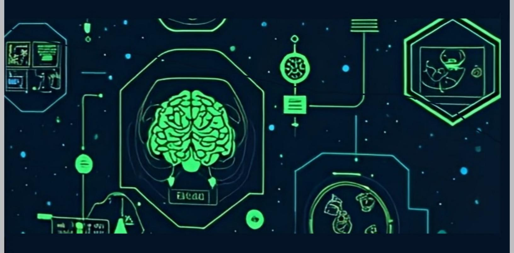

Build 50+ Al Agents for Business Success

James Karanja Maina

# The Complete LangGraph Blueprint

Build 50+ AI Agents for Business Success

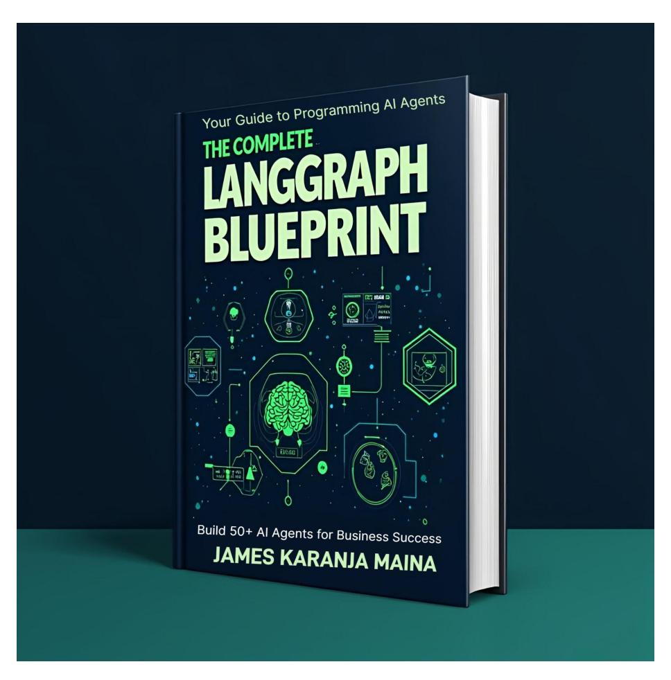

By James Karanja Maina

# **Copyright © 2025 All rights reserved.**

No part of this book may be reproduced, distributed, or transmitted in any form or by any means, including photocopying, recording, or other electronic or mechanical methods, without the prior written permission of the publisher, except in the case of brief quotations embodied in critical reviews and certain other noncommercial uses permitted by copyright law.

For permission requests, please contact the publisher at the address below.

Publisher Information:

Publisher Name: Zavora Technologies Ltd

Author: James Karanja Maina

Publisher address: P.O. Box 60058, 00100, Nairobi, Kenya

Publisher City: Nairobi

Publisher Country: Kenya

Publisher Email: info@zavora.ai

Author Email: james.karanja@zavora.ai

Website: www.zavora.ai

# **Disclaimer**

The information provided in this book is intended for educational purposes only and should not be taken as business, legal, or professional advice. The author and publisher disclaim any liability arising from the use or application of the information contained in this book.

# **Trademarks**

All brand names, product names, and company names mentioned in this book are trademarks or registered trademarks of their respective owners. Use of these names does not imply any affiliation with or endorsement by them.

# **First Edition: January 2025**

Thank you for reading and supporting this work. For more information and updates, visit: https://www.zavora.ai

# Table of Contents

| Preface                                                 |
|---------------------------------------------------------|
| Source Code                                             |
| Mailing List                                            |
| Chapter 1                                               |
| Introduction to LangGraph and  AI Agents                |
| 1.1 Welcome to the World of LangGraph and AI Agents     |
| 1.2 Programming Large Language Models                   |
| 1.3 What is LangGraph?                                  |
| 1.4 Core Principles of LangGraph                        |
| 1.5 Why Use LangGraph for AI Agents?                    |
| 1.6 How AI Agents Benefit from LangGraph's Structure    |
| 1.7 Real-World Applications of AI Agents with LangGraph |
| Chapter 2:                                              |
| Setting Up Your Development Environment                 |
| Why a Virtual Environment?                              |
| 2.1: Installing Python                                  |
| 2.2: Setting Up a Virtual Environment                   |
| 2.3: Installing LangGraph and Required Libraries        |
| 2.4: Setting Up Visual Studio Code (VS Code)            |
| Lesson 1: Building Your First Agent: "Hello World"      |
| 2.5 Visualize your Graph                                |
| 2.6 Try Adding Another Node to the Graph Workflow       |
| 2.7 Complete Code for the "Hello World" Agent           |
| Final Wrap-Up: What We Built and Learned                |
| How It All Works Together:                              |
| Chapter 3                                               |
| Understanding Key Programming Concepts                  |
| What is a Programming Language?                         |

| 3.5. Classes in Python: The Foundation of Object-Oriented Programming               |
|-------------------------------------------------------------------------------------|
| 3.5.7 Class and Static Methods                                                      |
| 3.5.8 Magic Methods                                                                 |
| 3.5.9 Properties:                                                                   |
| 3.5.10 Best Practices with Classes                                                  |
| 3.5.11. Common External Modules Used in LangGraph                                   |
| 3.5.12 Map, Filter, and Reduce                                                      |
| 3.6 Advanced Exception Handling                                                     |
| Chapter 4                                                                           |
| Core Elements of LangGraph                                                          |
| Key Concepts: Nodes, Edges, States, and Graphs                                      |
| 4.1. State - Keeping track of Data                                                  |
| 4.2. Nodes - The Business Logic                                                     |
| 4.3. Edges - connecting the nodes                                                   |
| 4.4. Graph                                                                          |
| 4.5. Input and Output Schemas of a graph: Flexible State Management in<br>LangGraph |
| 4.6. How LangGraph Brings it All Together                                           |
| 4.7. Decision-Making with Conditional Edges                                         |
| Chapter 5                                                                           |
| Building Your First AI Agent                                                        |
| 5.1 Introduction: The Power of AI Agents                                            |
| 5.2 Setting Up Your OpenAI API Key and Environment                                  |
| 5.3 The Basics of LangGraph Messaging                                               |
| 5.4 Continuous User Input Processing                                                |
| 5.5 Introduction to Tools in AI Agents                                              |
| Chapter 6                                                                           |
| Introducing Memory in AI Agents                                                     |
| 6.1 The Problem: An Agent Without Memory                                            |
| 6.2 Enhancing the Agent with Short-Term Memory                                      |
| 6.3 How Short-Term Memory Works                                                     |
|                                                                                     |

| 6.5 Full Code Example: An AI Agent with Short-Term Memory                          |
|------------------------------------------------------------------------------------|
| 6.6 Memory Across Multiple Sessions                                                |
| 6.7<br>Explainer<br>Section:<br>Technical<br>Details<br>on<br>Checkpointers<br>and |
| InMemoryStore                                                                      |
| 6.7.2. InMemoryStore                                                               |
| Chapter 6: Quiz                                                                    |
| Chapter 7                                                                          |
| Advanced Routing and Customization of AI Agents                                    |
| 7.1 Introduction to Routing in AI Agents                                           |
| 7.2 Inbuilt<br>tools_condition for Conditional Routing                             |
| 7.3 Custom Conditional Routing Example: Weather and Calculator Nodes               |
| 7.4 Streaming in LangGraph                                                         |
| 7.5 External API Integrations: Overview                                            |
| 7.6 Weather API Integration: A Step-by-Step Example                                |
| 7.7 Dynamic API Integration with User Input                                        |
| 7.8 Calculator API Integration                                                     |
| 7.9 Combining Multiple API Integrations                                            |
| Chapter 7 Quiz: API Integrations, Routing, and Streaming                           |
| Chapter 8                                                                          |
| Foundational AI Agent Architectures - ReAct                                        |
| ReAct (Reason + Act) Pattern                                                       |
| ReAct Agents in LangGraph                                                          |
| LangGraph Internal and Custom ReAct Agent Implementation Options                   |
| Best Practices for Building ReAct Agents                                           |
| 10 Examples of ReAct Agents in LangGraph                                           |
| Chapter 9                                                                          |
| Human-in-the-Loop Agents: Incorporating Human Feedback for Smarter                 |
| Decision-Making                                                                    |
| 9.1 What is Human-in-the-Loop?                                                     |
| 9.2 Core Concepts: Breakpoints, Checkpoints, and State Editing                     |
| 9.3 Example 1: Implementing Simple Breakpoints                                     |
|                                                                                    |

| 9.4 ReAct Agent Example with Financial Stock Purchase Use Case                |
|-------------------------------------------------------------------------------|
| 9.5 Understanding and Using "Interrupt After" in LangGraph                    |
| 9.6 Editing Graph State During Execution                                      |
| 9.7 Five Simple Breakpoint Examples                                           |
| 9.8 Dynamic Breakpoints: Concepts and Usage                                   |
| 9.9 Waiting for User Input: Concepts and Implementation                       |
| Practical Example: ReAct Agent with Human Input                               |
| Explainer:<br>Technical<br>Aspects<br>of<br>Human-in-the-Loop<br>(HITL)<br>in |
| LangGraph                                                                     |
| Chapter 9 Quiz: Human-in-the-Loop Agents                                      |
| Chapter 10                                                                    |
| Plan-and-Execute Agents                                                       |
| 10.1 Introduction                                                             |
| 10.2 Why Use Plan-and-Execute?                                                |
| 10.3 Plan-and-Execute Concepts                                                |
| 10.4 LangGraph Implementation of a Plan and Execute AI Agent                  |
| Practical Example 1.                                                          |
| IT Troubleshooting and Diagnostics Agent                                      |
| Practical Example 2. Business Workflow Automation Agent                       |
| Practical Example 3: Customer Support Chatbot                                 |
| Explainer: The Plan-and-Execute Architecture                                  |
| Chapter 10 Quiz: Plan-and-Execute Agents                                      |
| Chapter 11                                                                    |
| Agentic Retrieval-Augmented Generation (RAG) in LangGraph                     |
| What is RAG and Basic Concepts                                                |
| Embeddings in Research: Key Papers and Concepts                               |
| Embedding Models from Large Language Models (LLMs)                            |
| Vector Stores in RAG Systems                                                  |
| Popular Vector Stores                                                         |
| Generating Answers to Questions using RAG using an LLM                        |
| Practical RAG - Questioning a long PDF Document                               |
|                                                                               |

[Understanding the RAG Workflow in LangGraph: Retrieval AI Agent](#page-353-0) [Chapter Review: RAG Workflow in LangGraph](#page-359-0) [Introduction to Advanced RAG Architectures](#page-360-0) [Quiz on RAG Workflow in LangGraph](#page-361-0) [Chapter 12](#page-365-0) Advanced RAG [Architectures \(Self-RAG, Corrective RAG and Adaptive](#page-365-1) RAG) [12.1 Introduction to Self-Reflective RAG](#page-365-2) [12.2 Corrective Retrieval-Augmented Generation \(CRAG\)](#page-372-0) [12.3 Adaptive RAG](#page-379-0) [Explainer Section: Concepts in Chapter 12 - Advanced RAG](#page-389-0) Architectures [Chapter 12 Quiz: Advanced RAG Architectures \(Self-RAG, Corrective](#page-394-0) RAG, Adaptive RAG) [Chapter 13](#page-396-0) [Multiagent Architectures](#page-396-1) [13.1 Agent Supervisor](#page-396-2) [Practical Example 1: A Research Assistant Network](#page-397-0) [Practical Example 2: Customer Service Automation](#page-401-0) [Practical Example 3: Stock Analysis](#page-404-0) [Practical Example 4: Portfolio Management](#page-408-0) [Chapter 14](#page-414-0) [Hierarchical Agent Teams](#page-414-1) [Section 14.1: Building Hierarchical Agent Teams](#page-415-0) [Example Hierarchical Agent Team Architecture](#page-416-0) [Step 1: Building the Research Team](#page-417-0) [Step 2: Building the Document Authoring Team](#page-418-0) [Step 3: Integrating the Teams with an Overall Supervisor](#page-421-0) [Chapter 15](#page-423-0) [Specialized Agent Architectures](#page-423-1) [15.1 Event-Driven Agents](#page-423-2)

| 18.2 Inference Using Direct API Calls                                          |
|--------------------------------------------------------------------------------|
| 18.3: Inference Using LangChain                                                |
| 18.4 Self-Hosting NIMs                                                         |
| 18.4 Building an AI-Powered Campaign Generator with LangGraph                  |
| 18. 5 Explainer Section: Key Programming Concepts in the Campaign<br>Generator |
| Chapter 18 Quiz: Building Agents with NVIDIA NeMo Inference Models<br>(NIMs)   |
| Chapter 19                                                                     |
| Testing AI Agents with Test-Driven Development (TDD)                           |
| 19.1 Understanding Test-Driven Development (TDD)                               |
| 19.2 Project Setup                                                             |
| 19.3 Understanding the TDD Cycle                                               |
| Test-Driven Development follows a simple but powerful cycle:                   |
| 1.<br>Write a failing test                                                     |
| 2.<br>Write minimal code to pass the test                                      |
| 3.<br>Refactor while keeping tests green                                       |
| Let's start with a simple example to illustrate this cycle.                    |
| Example 1: Basic Message Processing Node                                       |
| 19.4 Understanding State Management                                            |
| 19.5 Testing LLM Interactions                                                  |
| Building a Customer Support AI Agent with Test-Driven Development              |
| Chapter 20                                                                     |
| Deploying AI Agents into Production                                            |
| 20.1 Deployment Strategies                                                     |
| 20.2 Continuous Integration and Continuous Deployment (CI/CD)                  |
| 20.3 Scaling AI Agents                                                         |
| 20.4 Security Considerations                                                   |
| Chapter 21                                                                     |
| Performance Monitoring and Maintenance                                         |
| 21.1 Monitoring Tools and Techniques                                           |

# [21.2 Performance Metrics for AI Agents](#page-542-0)

[21.3 Troubleshooting and Debugging](#page-543-0)

# [Chapter 22](#page-549-0)

# [Case Studies and Applications](#page-549-1)

- [22.1 Customer Support Automation: The AI Help Desk](#page-550-0)
- [22.3 Operational Efficiency: Automating Internal Workflows](#page-552-0)
- [22.4 Real World Lessons Learned](#page-554-0)

# [Chapter 23](#page-558-0)

# [Final Thoughts and Next Steps](#page-558-1)

- [23.1 The Future of AI Agents](#page-558-2)
- [1. Trend 1: Multi-Modal AI Agents](#page-558-3)
- [2. Trend 2: Federated Learning for Privacy-Enhanced AI](#page-559-0)
- [3. Trend 3: Explainable AI \(XAI\)](#page-560-0)
- [4. Trend 4: Edge AI](#page-560-1)
- [5. Trend 5: AI Agents in the Metaverse](#page-561-0)
- [23.2 Continuing Your Journey](#page-561-1)
- [23.3 Conclusion & Final Words](#page-563-0)

# [Thank You for Your Support!](#page-565-0)

[We'd Love Your Feedback!](#page-565-1)

# **Preface**

<span id="page-11-0"></span>We stand at the dawn of the AI agent era. By 2025, autonomous AI systems will fundamentally transform how businesses operate and how we solve complex problems. Yet for many, building practical AI solutions remains a challenging leap from theory to implementation.

The Complete LangGraph Blueprint bridges this gap. Using LangChain and LangGraph's open-source frameworks, this book provides a hands-on guide to building 50+ production-ready AI agents. Each chapter moves from concept to code, focusing on real-world applications that create immediate value.

This isn't just another book about AI's potential—it's your practical framework for building the future.

Welcome to The Complete LangGraph Blueprint.

James Karanja Maina [www.zavora.ai](http://www.zavora.ai/)

# **Source Code**

<span id="page-12-0"></span>The complete source code for this book can be obtained from GitHub at the address below:<https://github.com/jkmaina/LangGraphProjects>

# **Mailing List**

<span id="page-13-0"></span>To get the most recent version of the book, join the mailing list by emailing [james.karanja@zavora.ai](mailto:james.karanja@zavora.ai) This will entitle you to exclusive PDF editions (where available) of the books in the series "The Complete AI Blueprint" that will incorporate future updates on AI Agents, LangGraph and LangChain, with the relevant code updates and content. Subscribe to ensure you are always updated.

To deploy your AI Agents on the cloud, register for the upcoming AI Agent platform at [www.zavora.ai](http://www.zavora.ai/)

# Part 1: Foundations of LangGraph and AI Agent Building (Chapters 1-3)

# **Chapter 1**

# <span id="page-15-1"></span><span id="page-15-0"></span>**Introduction to LangGraph and AI Agents**

# <span id="page-15-2"></span>**1.1 Welcome to the World of LangGraph and AI Agents**

Welcome to your journey into the fascinating world of AI agents with LangGraph! This book will guide you through the process of building 50 AI agents of increasing complexity, using a structured approach that starts with the fundamentals. Whether you're an absolute beginner or a coder looking to level up your skills, this book is designed to make the complex simple and the challenging achievable.

In this first chapter, we'll introduce you to the core concepts of LangGraph and AI agents. You'll learn what LangGraph is, how it enables the creation of dynamic workflows, and why it's particularly suited to developing AI agents. By the end of this chapter, you'll have a high-level understanding of LangGraph's architecture, the types of problems it can solve, and the industries where AI agents are making a significant impact. You'll also set

up your development environment and build a simple "Hello World" agent to get hands-on experience from the start.

# <span id="page-16-0"></span>**1.2 Programming Large Language Models**

Large Language Models (LLMs) like GPT-4, Gemini and Claude are incredibly powerful. They can understand and generate human-like text, making them suitable for a wide range of applications, from chatbots to content generation. However, for businesses to harness their full potential, it's essential to structure how these models interact with other systems, such as databases, APIs, or retrieval systems.

#### **Traditional Approach: Chains**

Traditionally, workflows using LLMs, like ChatGPT, have followed a "chain" paradigm. This approach has been widely successful, especially with ChatGPT, which gained popularity for its ability to perform complex tasks through a simple, linear sequence of steps. Here's how it typically works:

- 1. **Input:** The system receives a user's question.
- 2. **Retrieve:** Relevant documents or data related to the question are found.
- 3. **Generate:** The retrieved data is then passed to the LLM (such as ChatGPT) to generate a well-informed response.

#### **Introducing LangChain**

LangChain is a popular framework that facilitates the creation and management of such chains. It provides tools to define sequences of LLM calls and integrate them with external systems like APIs and databases. LangChain's chain-based approach offers reliability, as the same set of steps runs with each invocation, ensuring consistent results.

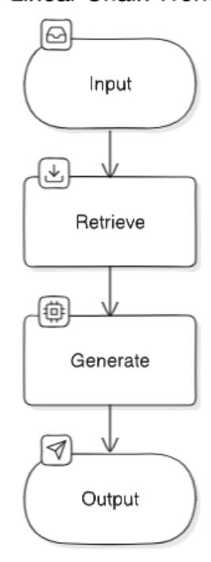

*Figure 1: A linear chain workflow with nodes representing each step (Input → Retrieve → Generate) connected by edges.*

#### **However, Chains Have Limitations**

While chains are reliable, they lack flexibility. They can't adapt their flow based on the content they're processing or make autonomous decisions about which steps to execute next. This rigidity can be a significant limitation in complex or dynamic applications where adaptability is crucial.

#### **Introducing AI Agents: Dynamic Control Flow**

Agents take things a step further. Instead of following a fixed chain, agents can decide their own sequence of steps based on the input they receive. This means:

- **Dynamic Routing:** An agent can choose between multiple paths depending on the situation.
- **Tool Selection:** It can decide which tools or APIs to call based on the task at hand.
- **Adaptive Responses:** It can determine if the generated answer is sufficient or if further processing is needed.

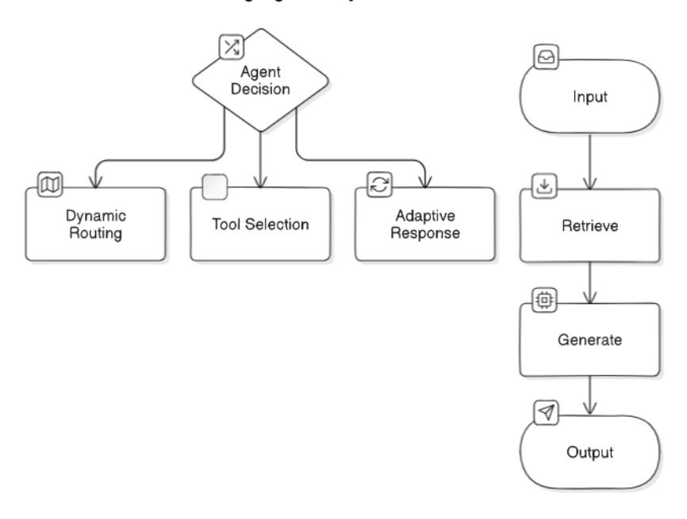

*Figure 2: Introducing Agents*

#### **Why AI Agents?**

Agents offer a higher degree of flexibility and intelligence. They can handle more complex and varied interactions, making them suitable for applications that require adaptability and nuanced decision-making.

# <span id="page-19-0"></span>**1.3 What is LangGraph?**

LangGraph is an open-source framework designed to simplify the development of AI agents. Unlike traditional programming frameworks, where control flows linearly from one task to the next, LangGraph structures workflows as graphs. In a LangGraph workflow, tasks are represented as **nodes** and the connections between them as **edges**. This graph-based approach makes LangGraph particularly well-suited for AI agents that need to manage complex, dynamic decision-making and data processing tasks.

#### **Why a Graph-Based Approach?**

LangGraph is inspired by *Pregel* (a large-scale graph processing framework developed by Google) and *Apache Beam* (open source batch and realtime processing framework). The public interface draws inspiration from NetworkX. LangGraph is built by LangChain Inc, the creators of LangChain, but can be used without LangChain or in combination for best results.

To understand why LangGraph uses a graph-based approach, let's take a quick look at what graphs are and how they work. In computer science, a **graph** is a collection of **nodes** (or vertices) and **edges** (or links) that connect these nodes.

Graphs allow for multiple paths and connections, making them ideal for workflows that involve branching, looping, or concurrent tasks.

# In LangGraph:

- **Nodes** represent individual tasks or actions. Each node can perform a specific function, like processing data or making a decision.
- **Edges** define the relationships between nodes and control the flow of data. They can be configured with conditions, allowing the workflow to follow different paths based on specific criteria.

This flexibility enables you to create workflows that are not strictly linear, but instead can branch out and adapt to different scenarios.

#### **Illustration: Example of a Graph-Based Workflow with Nodes and Edges**

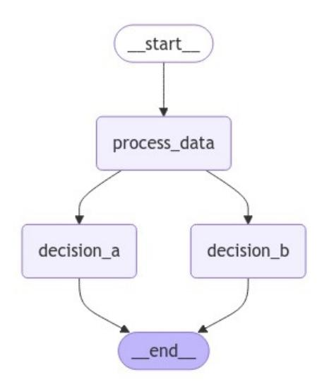

*Figure 3:* A simple diagram with three nodes connected by arrows. The first node is labeled "START," which connects via an edge to "Process Data." This node then splits into two paths (edges), one leading to "Decision A" node and the other to "Decision B. Both nodes then connect to the END note which concludes the execution of the graph.

The diagram shows a basic flow in LangGraph with five main steps. It starts with the **START** node, representing the beginning of the process. From there, it moves to **Process Data**, where initial data handling occurs. The process then branches into two decisions: **Decision A** and **Decision B**, which represent different choices or paths based on the data. Both decisions ultimately lead to the **END** node, which signals the process completion. This flow demonstrates how LangGraph can handle data processing and decision-making in a simple, structured way.

# <span id="page-20-0"></span>**1.4 Core Principles of LangGraph**

LangGraph is built on several core principles that make it ideal for developing reliable and dynamic agents:

1. **Controllability:** Define the flow of your application precisely using nodes (tasks) and edges (connections). This allows for both deterministic and conditional workflows.

- 2. **Persistence:** Maintain the state of your application across different sessions or interactions using various storage options like databases.
- 3. **Human-in-the-Loop:** Incorporate human oversight or intervention within the workflow, enhancing reliability and decision-making.
- 4. **Streaming:** Provide real-time updates and allow for continuous interaction between the agent and users or other systems.

# <span id="page-21-0"></span>**1.5 Why Use LangGraph for AI Agents?**

AI agents are programs that can autonomously or semi-autonomously perform tasks, often using artificial intelligence techniques like machine learning and natural language processing (NLP) to make decisions and interact with users. LangGraph is particularly well-suited for building AI agents because it enables you to construct workflows that are flexible, modular, and scalable.

Building agents that have a high degree of control can sometimes lead to challenges like:

- **Reliability Issues:** More control can introduce unpredictability, especially if the agent makes erroneous decisions.
- **Non-Determinism:** LLMs can produce different outputs for the same input, leading to inconsistent workflows.
- **Tool Selection Errors:** Incorrectly choosing tools or steps can disrupt the workflow.

# <span id="page-21-1"></span>**1.6 How AI Agents Benefit from LangGraph's Structure**

AI agents often need to handle tasks like:

- 1. **Decision-Making**: Evaluating conditions and choosing between multiple actions.
- 2. **Data Processing**: Analyzing input data and transforming it into useful information.

3. **Interaction with External Systems**: Fetching data from APIs, logging information, or performing other I/O operations.

In LangGraph, each of these tasks can be broken down into individual nodes, connected by edges that dictate the flow of information. For example, imagine building a chatbot for customer service. This bot might need to:

- **Understand User Queries**: Identify the type of question or request a user has submitted.
- **Route the Query**: Determine whether the query can be handled automatically or if it needs escalation to a human agent.
- **Log the Interaction**: Record the conversation for future reference or analysis.

Each of these tasks can be represented by a separate node in LangGraph, which can be easily updated or modified without affecting other parts of the workflow. This modularity makes it simple to expand the bot's capabilities over time. Need to add a feature that recommends products to customers based on their questions? Just add a new node, connect it to the existing workflow, and you're good to go!

# <span id="page-22-0"></span>**1.7 Real-World Applications of AI Agents with LangGraph**

AI agents built with LangGraph can be applied across various industries, including:

- **Customer Service**: Chatbots that handle customer inquiries, provide instant responses, and escalate issues when necessary.
- **Healthcare**: Agents that analyze patient data, provide health monitoring, or assist with preliminary diagnostics.
- **Finance**: Agents that monitor market trends, detect fraudulent transactions, or manage portfolios.
- **Retail**: Intelligent recommendation systems that suggest products based on customer behavior, manage inventory, or optimize pricing.

Each of these applications relies on an AI agent's ability to process information, make decisions, and take appropriate actions. LangGraph's framework supports this by allowing you to build complex workflows that

can handle multiple decision points and data flows, making it ideal for developing sophisticated AI agents.

# **Quick Recap**

At this point, you should have a basic understanding of:

- What LangGraph is and why it uses a graph-based approach.
- How nodes and edges form the foundation of LangGraph's architecture.
- Why LangGraph is well-suited for building AI agents, especially for tasks that involve decision-making, data processing, and interactions with external systems.

# **Chapter 2:**

# <span id="page-24-1"></span><span id="page-24-0"></span>**Setting Up Your Development Environment**

In the next section, we'll guide you through setting up your development environment so you can start building with LangGraph. By the end of this chapter, you'll create a simple "Hello World" agent that introduces you to the LangGraph syntax and workflow.

To start building with LangGraph, it's essential to set up a development environment that will make your coding experience smoother and more organized. In this section, we'll go through the steps to install Python, create a virtual environment for managing dependencies, and set up Visual Studio Code (VS Code) as your Integrated Development Environment (IDE).

# <span id="page-24-2"></span>**Why a Virtual Environment?**

A **virtual environment** is a self-contained directory that allows you to manage project-specific dependencies separately from the global Python environment on your computer. This isolation ensures that changes in one project's dependencies won't affect others. For LangGraph projects, a virtual environment will help you easily manage and install the libraries you need.

# <span id="page-25-0"></span>**2.1: Installing Python**

LangGraph requires **Python 3.10 or higher**. If you haven't installed Python yet, follow these steps:

# 1. **Download Python**:

Visit python.org [\(https://www.python.org/downloads/\)](https://www.python.org/downloads/) and download the latest version for your operating system. Instructions are provided for most operating systems you might be using.

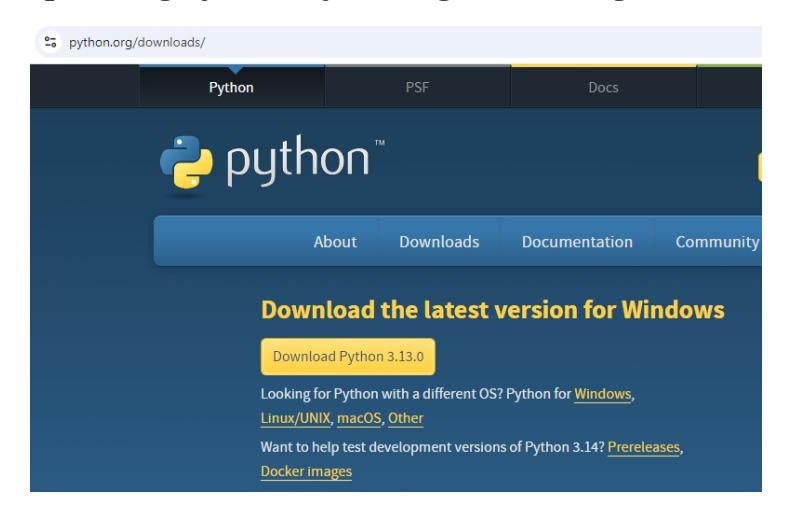

*Figure 4: Installing python from the python website.*

- 2. **Install Python**: Run the installer and follow the on-screen instructions. Be sure to check the box or agree to the question that says **"Add Python to PATH"** during installation. This will make it easier to run Python from the command line.
- 3. **Verify the install**: To verify the installation, open your terminal (or Command Prompt on Windows) and type:

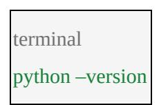

You should see a version number starting with "3.10" or higher. If you encounter issues, check Python's installation guide (https://docs.python.org/3/using/index.html) for troubleshooting tips.

# <span id="page-25-1"></span>**2.2: Setting Up a Virtual Environment**

Once Python is installed, it's time to create a virtual environment specifically for your LangGraph projects. This will keep all necessary libraries isolated and organized within the project folder.

# **Create a Project Folder**:

Start by creating a folder for your LangGraph projects. You can name it something like *LangGraphProjects.*

```
terminal
mkdir LangGraphProjects
cd LangGraphProjects
```

# **Create a Virtual Environment**:

With your project folder created, you can set up a virtual environment by running the following command:

```
terminal
python -m venv langgraph_env
```

This command creates a new directory called langgraph\_env within your project folder, which will contain a separate Python installation and any libraries you install.

# **Activate the Virtual Environment**:

On **Windows**, use the following command:

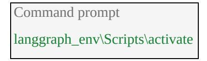

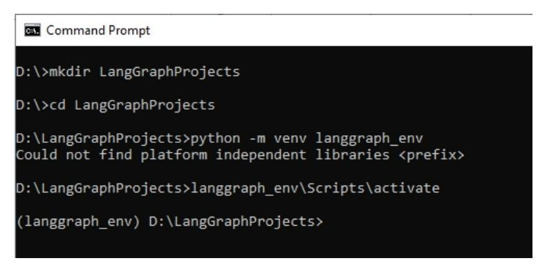

# On **macOS/Linux**, use this command:

```
Terminal
source langgraph_env/bin/activate
```

*Figure 5: How to activate the project's python environment for learning langgraph in this course. All the examples should be done in this folder and within the activated environment. This ensures you don't affect other python projects.*

Once activated, your terminal prompt should show (langgraph\_env) at the beginning, indicating that you are now working within the virtual environment. Any Python packages you install will be specific to this environment, keeping your global Python setup untouched.

*Troubleshooting Tip*: If you encounter an error, double-check the commands and make sure you are in the correct project directory. On Windows, you can manually create the folder using file explorer as an alternative to the command prompt.

# <span id="page-27-0"></span>**2.3: Installing LangGraph and Required Libraries**

With the virtual environment activated, you're ready to install LangGraph. This can be done using Python's package manager, **pip**, which comes preinstalled with Python.

# **Install LangGraph**:

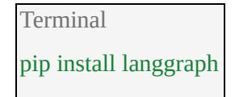

This command will download and install LangGraph, along with any dependencies it requires.

# **Install Additional Libraries (Optional)**:

Depending on your project needs, you may also want to install libraries for working with external APIs or data processing. For now, let's install requests , a popular library for making HTTP requests, which will be useful in later exercises.

> Terminal pip install requests

# <span id="page-29-0"></span>**2.4: Setting Up Visual Studio Code (VS Code)**

VS Code is a lightweight and powerful IDE that provides essential features like syntax highlighting, debugging, and version control. It's free, opensource, and well-suited for Python development.

# 1. **Download VS Code**:

Go to Visual Studio Code's website [\(https://code.visualstudio.com\)](https://code.visualstudio.com/) and download the installer for your operating system. Run the installer and follow the on-screen instructions to complete the setup.

2. **Open the folder** where we created the project "LangGraphProjects". Your vscode should look like below

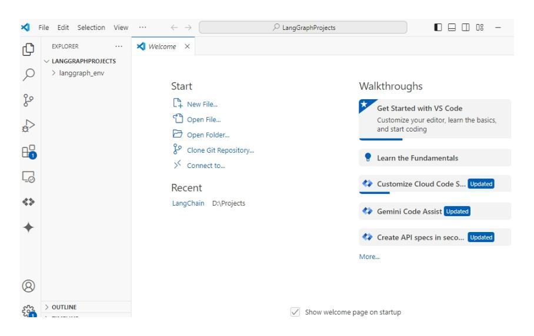

*Figure 6: Visual Studio Code with the LangGraphProjects folder opened using a light theme. Your VS Code might show a light theme or a dark mode theme, but it's the same content: Themes are just a matter of personal preference on how it looks.*

# 3. **Install the Python Extension**:

Open VS Code, and go to the Extensions view by clicking on the Extensions icon in the sidebar or pressing Ctrl+Shift+X . Search for "Python" by Microsoft and click **Install**. This extension provides

Python-specific features, such as IntelliSense (code completion), linting, and debugging.

*Figure 7: How to open the extensions icon in the sidebar, search for "Python" by Microsoft, and click Install. This is a recommended step for python programming in vscode.*

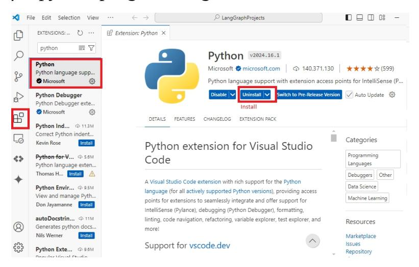

# 4. **Configure VS Code to Use the Virtual Environment**:

With the Python extension installed, you can set VS Code to use your virtual environment. Open the Command Palette by pressing Ctrl+Shift+P , then type and select "Python: Select Interpreter." Choose the Python interpreter located in the langgraph\_env folder. This ensures that VS Code runs Python commands within your virtual environment.

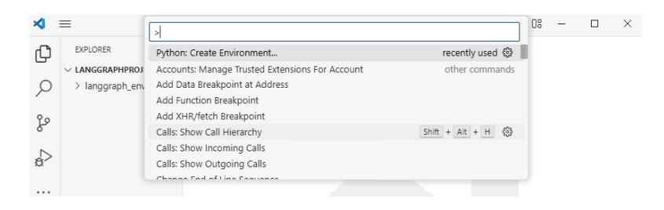

*Figure 8: Creating a python environment in VS Code for the* LangGraphProjects folder.

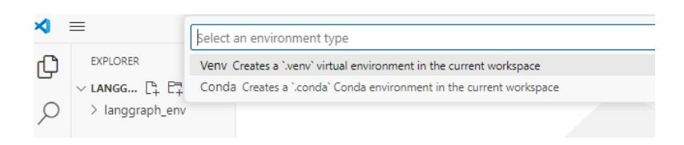

*Figure 9: Selecting the environment. Choose between:*

- *Venv : A virtual environment using Python's venv module. This is useful for creating isolated environments for project-specific dependencies.*
- *Conda : A Conda environment, ideal for users who prefer managing packages and environments with AnaConda, particularly for data science and machine learning workflows.*

In our project, we recommend using *Venv* for the sake of making things simple. You may use Conda if you prefer it.

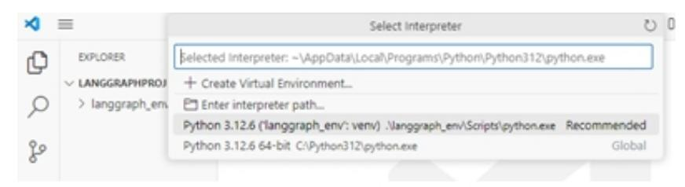

*Figure 10: Choose the Python interpreter located in the langgraph\_env folder. This ensures that VS Code runs Python commands within your virtual environment.*

# **Quick Recap**

By now, you should have:

- Installed Python and created a virtual environment to isolate your LangGraph project.
- Installed LangGraph and additional libraries needed for making API requests.
- Set up VS Code with the Python extension and configured it to use your virtual environment.

With everything ready, you're now equipped to start building LangGraph agents! In the next section, we'll dive into creating your first agent—a

simple "Hello World" program that will introduce you to LangGraph's syntax and workflow.

# <span id="page-33-0"></span>**Lesson 1: Building Your First Agent: "Hello World"**

With your development environment ready, it's time to start building your first LangGraph agent—a simple "Hello World" program. This exercise will introduce you to LangGraph's core components: nodes, edges, and states. You'll learn how these elements work together to control the flow of data through your agent.

#### **Step 1: Understanding LangGraph Core Components**

LangGraph agents are built using three primary components:

- **Nodes**: Represent tasks or actions, like processing input or making decisions.
- **Edges**: Define the connections between nodes, controlling the sequence of actions.
- **States**: Store and pass data between nodes, allowing the agent to maintain context throughout the workflow.

In this example, you'll create a node that modifies a greeting message in the state and connects it to form a simple workflow.

#### **Step 2: Defining the State**

First, let's define a **state** to hold your greeting message. We'll use Python's TypedDict to structure it as a dictionary with a specific key. In LangGraph, a state represents the application's current data and is often defined with TypedDict or Pydantic's BaseModel for ensuring data consistency and validation.

```
lesson1.py
from typing_extensions import TypedDict
# Define the state structure
class HelloWorldState(TypedDict):
  greeting: str  # This key will store the greeting message
```

The HelloWorldState state is now defined as a dictionary-like object where the field greeting will hold a string. You will initialize this message and modify it in the workflow.

*Figure 1.1: In your VSCode folder, create a file called lesson1.py and then add the code above as instructed above. You can copy or paste to speed up*

*typing time, though I personally recommend typing out the code as it reinforces learning and you get to understand it more.*

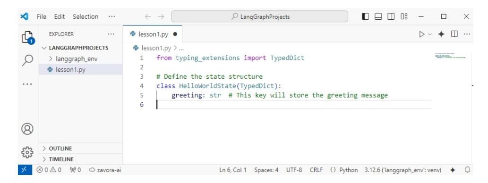

**Step 3: Creating the "Hello World" Node Function**

Next, we'll define a function to act as a **node** in LangGraph. This node will update the greeting key in the state by adding "Hello World" to the beginning of the existing message.

```
lesson1.py continued..
# Define the node function
def hello_world_node(state: HelloWorldState):
    state["greeting"] = "Hello World, " + state["greeting"]
    return state
```

This function accepts the state, prepends "Hello World" to the greeting , and then returns the updated state. Each node in LangGraph has access to the state, which allows it to read and modify data as needed.

*Figure 1.2: In your lesson1.py, we will continue adding code as instructed. It is recommended that you follow along and practically do this as we go along.*

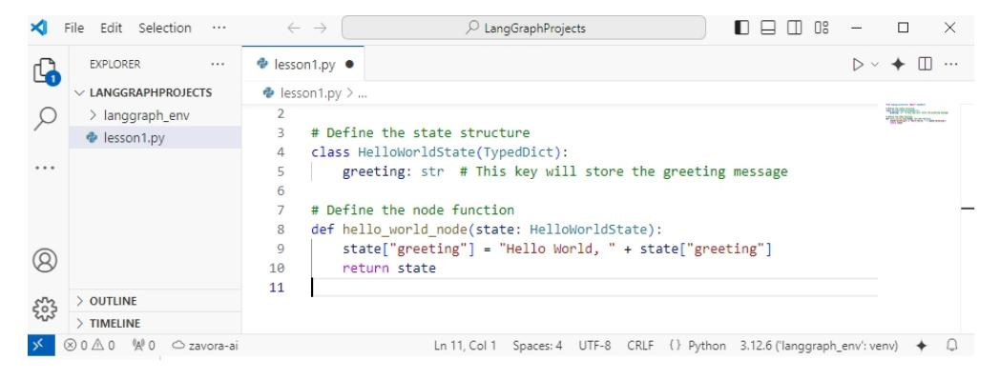

#### **Step 4: Setting Up the Graph Structure**

With the state and node defined, it's time to build the LangGraph workflow. You'll create a **graph** that connects the nodes with edges, establishing a path from start to finish.

```
lesson1.py continued..
#Add import at beginning of lesson1.py file
from langgraph.graph import StateGraph, START, END
# Initialize the graph and add the node
builder = StateGraph(HelloWorldState)
builder.add_node("greet", hello_world_node)
# Define the flow of execution using edges
builder.add_edge(START, "greet")  # Connect START to the "greet" node
builder.add_edge("greet", END)    # Connect the "greet" node to END
```

#### Here's what each part does:

- StateGraph(HelloWorldState) : Initializes the graph with the HelloWorldState schema, meaning it will expect data structured according to this state.
- add\_node("greet", hello\_world\_node) : Adds the hello\_world\_node function as a node in the graph, labeling it "greet."
- add\_edge(...) : Sets the flow of execution from START to "greet" and then to END , creating a straightforward path.

*Figure 1.3: Here is how your code should look like in VS Code so far*

**Step 5: Compiling and Running the Graph**

With the graph configured, you can now **compile** it and run the workflow by invoking the graph with an initial state. This will trigger the node to process the data and output

the result.

```
lesson1.py continued..
# Compile and run the graph
graph = builder.compile()
result = graph.invoke({"greeting": "from LangGraph!"})
print(result)
```

The expected output should look like this:

```
{'greeting': 'Hello World, from LangGraph!'}
```

This shows how the state was passed through the "greet" node and modified to include "Hello World."

*Figure 1.4: Press the "Run Python File" button to run the program and see the results on the terminal windows, as highlighted below.* 

# <span id="page-36-0"></span>**2.5 Visualize your Graph**

We use the MermaidDrawMethod to create a PNG visualization of the graph. This provides a graphical representation of the workflow, helping you to see the node connections visually. We will re-use this method to visualize the graphs in this book.

```
lesson1.py continued..
#Code to visualize the graph, we will re-use this in all future lessons
from langchain_core.runnables.graph import MermaidDrawMethod
import random
import os
mermaid_png=graph.get_graph(xray=1).draw_mermaid_png(draw_method=MermaidDrawMethod.API)
# Create an output folder if it doesn't exist, for now we can save in the current folder represented by .
output_folder = "."
os.makedirs(output_folder, exist_ok=True)
filename = os.path.join(output_folder, f"graph_{random.randint(1, 100000)}.png")
with open(filename, 'wb') as f:
    f.write(mermaid_png)
if sys.platform.startswith('darwin'):
    subprocess.call(('open', filename))
elif sys.platform.startswith('linux'):
    subprocess.call(('xdg-open', filename))
elif sys.platform.startswith('win'):
    os.startfile(filename)
```

The complete file is as shown below and it can also be obtained from GitHub: <https://github.com/jkmaina/LangGraphProjects/blob/main/chapter2/lesson1.py>

```
lesson1.py: complete example.
import random
from typing_extensions import TypedDict
from langgraph.graph import StateGraph, START, END
from langchain_core.runnables.graph import MermaidDrawMethod
import os
import subprocess
import sys
# Define the state structure
class HelloWorldState(TypedDict):
   greeting: str  # This key will store the greeting message
# Define the node function
def hello_world_node(state: HelloWorldState):
    state["greeting"] = "Hello World, " + state["greeting"]
    return state
# Initialize the graph and add the node
builder = StateGraph(HelloWorldState)
builder.add_node("greet", hello_world_node)
# Define the flow of execution using edges
builder.add_edge(START, "greet")  # Connect START to the "greet" node
builder.add_edge("greet", END)    # Connect the "greet" node to END
# Compile and run the graph
graph = builder.compile()
result = graph.invoke({"greeting": "from LangGraph!"})
print(result)
#Code to visualize the graph, we will re-use this in all future lessons
mermaid_png=graph.get_graph(xray=1).draw_mermaid_png(draw_method=MermaidDrawMethod.A
PI)
# Create an output folder if it doesn't exist, for now we can save in the current folder represented by .
output_folder = "."
os.makedirs(output_folder, exist_ok=True)
filename = os.path.join(output_folder, f"graph_{random.randint(1, 100000)}.png")
with open(filename, 'wb') as f:
    f.write(mermaid_png)
if sys.platform.startswith('darwin'):
    subprocess.call(('open', filename))
elif sys.platform.startswith('linux'):
    subprocess.call(('xdg-open', filename))
```

```
elif sys.platform.startswith('win'):
     os.startfile(filename)
```

Run the project. You should get the following graph file created automatically on your project folder and displayed automatically on your screen.

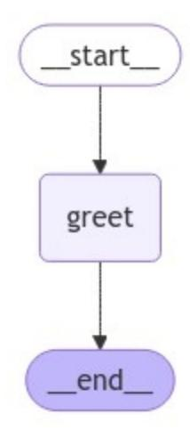

#### **What You See in the Visualization:**

- **START** node connected to the **greet** node, which then leads to the **END** node.
- This flow reflects the sequence you defined, showing how data moves from the start to the greeting modification and then to the end.

# <span id="page-38-0"></span>**2.6 Try Adding Another Node to the Graph Workflow**

To see how easy it is to extend a workflow, let's add a new node that adds an exclamation mark to the greeting. This will show how you can expand your LangGraph projects by chaining nodes together.

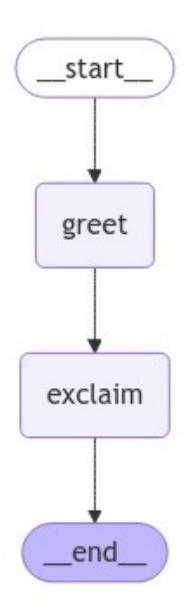

#### **Define the New Node**:

Just below the hello\_world\_node node in your lesson1.py code, add the below new node. This new function appends an exclamation mark to the greeting.

```
lesson1.py continued..
# Define an additional node function
def exclamation_node(state: HelloWorldState):
    state["greeting"] += "!"
    return state
```

**Add the Node to the Graph and Define New Edges**: Now, add the new node to the graph and connect it to the flow. Modify the greet node to connect to the exclaim node.

```
lesson1.py continued..
# Define the flow of execution using edges
builder.add_edge(START, "greet")  # Connect START to the "greet" node
builder.add_node("exclaim", exclamation_node) # Add a new node
# Update the edges
builder.add_edge("greet", "exclaim")  # Connect "greet" to "exclaim"
builder.add_edge("exclaim", END)      # Update the flow to end after "exclaim"
```

# **Compile and Run the Updated Graph**:

```
lesson1.py continued..
# Compile and run the graph
graph = builder.compile()
result = graph.invoke({"greeting": "from LangGraph!"})
# Output the result
```

```
print(result)
# Output: {'greeting': 'Hello World, from LangGraph!!'}
```

This setup illustrates how easily you can extend LangGraph workflows by chaining nodes together to perform multiple tasks.

# <span id="page-40-0"></span>**2.7 Complete Code for the "Hello World" Agent**

Here's the entire code, bringing together each of the steps above, including the optional experiment with the exclamation node:

```
lesson1b.py full example
#lesson1b.py
from typing_extensions import TypedDict
from langgraph.graph import StateGraph, START, END
from langchain_core.runnables.graph import MermaidDrawMethod
from  display_graph import display_graph
# Define the state structure
class HelloWorldState(TypedDict):
    greeting: str  # This key will store the greeting message
# Define an additional node function
def exclamation_node(state: HelloWorldState):
    state["greeting"] += "!"
    return state
# Define the node function
def hello_world_node(state: HelloWorldState):
    state["greeting"] = "Hello World, " + state["greeting"]
    return state
# Initialize the graph and add the node
builder = StateGraph(HelloWorldState)
builder.add_node("greet", hello_world_node)
# Define the flow of execution using edges
builder.add_edge(START, "greet")  # Connect START to the "greet" node
builder.add_node("exclaim", exclamation_node) # Add a new node
# Update the edges
builder.add_edge("greet", "exclaim")  # Connect "greet" to "exclaim"
builder.add_edge("exclaim", END)      # Update the flow to end after "exclaim"
# Compile and run the graph
graph = builder.compile()
result = graph.invoke({"greeting": "from LangGraph!"})
# Output the result
print(result)
# Output: {'greeting': 'Hello World, from LangGraph!!'}
```

#Visualize the graph display\_graph(graph)

# <span id="page-41-0"></span>**Final Wrap-Up: What We Built and Learned**

- **Nodes, Edges, and States**: These are the building blocks of LangGraph. Think of nodes as tasks, edges as the paths that connect tasks, and states as containers for data that moves through the workflow.
- **Creating a Simple Node**: You made a function that added "Hello World" to a message. This function was our node, and it showed how nodes process and update data.
- **Building the Flow with a Graph**: By connecting nodes with edges, you defined how data moves from start to finish in your workflow.

# <span id="page-41-1"></span>**How It All Works Together:**

- You saw how LangGraph uses a **state** (data) that gets updated as it moves through **nodes** (tasks), all linked by **edges** (paths). This lets you build agents that can handle tasks step-by-step.
- The final output, {'greeting': 'Hello World, from LangGraph!'} , shows how the data was modified as it passed through your simple workflow.

# **Recap**

You've now built your first LangGraph agent and added complexity with multiple nodes:

- Defined a state for holding and updating data.
- Created and connected nodes to manipulate the state.
- Ran the workflow to see how LangGraph processes and modifies data through nodes and edges.

# **Chapter 3**

# <span id="page-42-1"></span><span id="page-42-0"></span>**Understanding Key Programming Concepts**

Before we dive deeper into building LangGraph agents, let's pause and explore some fundamental programming concepts. This explainer will cover the basics of Python programming, data structures, and the core elements of LangGraph. Whether you're new to coding or need a quick refresher, this page will help you feel more confident as we progress through the book.

# <span id="page-42-2"></span>**What is a Programming Language?**

A **programming language** is a set of instructions that we use to communicate with computers. **Python**, the language we're using in this book, is known for being readable and beginner-friendly. It allows you to write code that's easy to understand, which makes it a popular choice for building AI agents.

#### **Key Concepts in Python**

Here are some of the basic concepts in Python that you'll encounter frequently as you work with LangGraph:

#### **3.1. Variables**

A **variable** is a name that holds a value. Think of it as a container that stores information. You can create a variable by simply assigning a value to it, like so:

```
greeting = "Hello World"
```

In this example:

- greeting is the variable name.
- "Hello World" is the value.
- The = operator assigns the value to the variable.

Once a variable is assigned a value, you can reference or manipulate that value later in the program:

```
Lesson2.py
print(greeting)  # Output: Hello World
```

print is a special function in python that shows the value of a variable in the output.

Python supports various data types including:

- **Integers**( int ): Whole numbers (e.g., 5 , -3 ).
- **Floating-point numbers**( float ): Numbers with decimals (e.g., 3.14 , -0.5 ).
- **Strings**( str ): Text enclosed in quotes (e.g., "Hello, World!" ).
- **Booleans**( bool ): True or False
- **NoneType** ( None ): Represents the absence of a value
- **Tuple**: ordered, immutable collection of elements enclosed in () e.g. (1, "hello", 3.14)
- **List**: list is a collection of variables, enclosed in [ ] and separated by commas e.g. colors = ['red', 'blue', 'green']
- **Set**:Unordered collections e.g. items = {"start", "end"}

One of Python's defining features is its **dynamic typing** system. This means that you don't have to declare the type of a variable when you create it. Python automatically determines the type based on the value assigned:

```
Lesson2.py continued
```

```
age = 25          # Integer
price = 19.99     # Float
name = "Alice"    # String
is_active = True  # Boolean
unknown = None    # NoneType
my_tuple = (1, "hello", 3.14) #Tuple
print(age) #output is 25
print(price) #output is 19.99
print (name) # output is "Alice"
print(is_active) #output is True
print(my_tuple[0]) #output is 1
print(my_tuple[1]) #output is Hello
```

This flexibility makes Python easy to use, but it also requires careful management to avoid type-related errors. You can change the type of a variable by assigning it a value of a different type:

```
Lesson2.py continued
data = "Hello"
print(type(data))  # Output: <class 'str'>
data = 100
print(type(data))  # Output: <class 'int'>
data = "Hello Again"
print(type(data))  # Output: <class 'str'>
```

# **3.1.1 Naming Variables - Best Practices:**

Here are the main rules and best practices for naming variables in Python:

● **Allowed Characters**: Variable names can include letters, numbers, and underscores ( \_ ). However, they cannot start with a number.

```
Lesson2.py continued
user_name = "Alice" # Valid
user2 = "Bob"        # Valid
2user = "Charlie" # Invalid
```

● **Case Sensitivity**: Python is case-sensitive, meaning UserName and username would be considered two different variables.

```
Lesson2.py continued
UserName = "Alice"
username = "Bob"
print(UserName)  # Output: Alice
print(username)  # Output: Bob
```

● **Snake Case**: By convention, variable names in Python are typically written in snake\_case (lowercase letters with underscores between words).

```
Lesson2.py continued
first_name = "Alice"
account_balance = 1000.00
```

- **Meaningful Names**: Use descriptive variable names that reflect the value they hold or the purpose they serve. This makes your code easier to understand.
- **Avoid Using Python Keywords**: Keywords are reserved words in Python that have special meanings, such as if , else , for , etc. Avoid using these as variable names to prevent syntax errors.

```
Lesson2.py continued
#Invalid variable names
if = 5     # SyntaxError
class = 10 # SyntaxError
```

# **3.1.2 Variable Scope: Global and Local Variables**

The **scope** of a variable determines where it can be accessed within a program. Python has two primary scopes for variables: **global** and **local.** A **global** variable is defined outside of any function and can be accessed from any part of the code. Global variables are available throughout the program.

```
Lesson2.py continued
greeting = "Hello, World!" #This variable can be accessed by many functions
def say_hello():
```

```
print(greeting)
say_hello()  # Output: Hello, World!
```

A **local variable** is defined within a function and can only be accessed within that function. Once the function finishes executing, the local variable is discarded.

```
Lesson2.py continued
def greet():
    message = "Hi there!"
    print(message)
```

In the example above, message is a local variable and only exists within the greet() function.

- **3.1.3 Memory management:** Python automatically handles memory allocation and deallocation for variables through **garbage collection**. This process removes unused objects from memory, freeing up resources.
- **3.1.4 Constants:** By convention, constants are written in all uppercase letters with underscores between words, signaling to other programmers that these values should not be altered.

```
Lesson2.py continued
PI = 3.14159  #ALL CAPS indicates its value should not be changed
MAX_USERS = 100
```

# **3.1.5 Variable Unpacking:**

Python supports unpacking multiple values into multiple variables, which can simplify assignments and make your code cleaner.

```
Lesson2.py continued
#9. Unpacking a tuple
coordinates = (10, 20)
x, y = coordinates
print(x)  # Output: 10
print(y)  # Output: 20
#10. Unpacking a list
names = ["Alice", "Bob", "Charlie"]
first, second, third = names
```

```
print(first)  # Output: Alice
You can also use the * operator to capture excess items during unpacking:
numbers = [1, 2, 3, 4, 5]
first, *middle, last = numbers
print(middle)  # Output: [2, 3, 4]
```

#### **3.2. Functions**

A **function** is a block of code that performs a specific task. Functions allow you to reuse code, making it easier to manage and organize your programs. In Python, you define a function using the def keyword, followed by the function name and parentheses () :

```
Lesson2.py continued
def say_hello():
   print("Hello World!")
```

This function, say\_hello , prints the text "Hello World!" when called. The function body is indented below the definition, and the function ends when the indentation stops.

To execute the code within a function, you **call** the function by using its name followed by parentheses:

```
Lesson2.py continued
say_hello()
```

**3.2.1 Parameters** allow you to pass data into functions, making them more flexible. When defining a function, you specify **parameters** as placeholders within the parentheses.

```
Lesson2.py continued
def greet(name):
    print(f"Hello, {name}!")
```

When calling the function, you provide **arguments**, which are the actual values assigned to those parameters.

```
Lesson2.py continued
greet("Alice")  # Output: Hello, Alice!
```

**3.2.2 Positional arguments** are the most common way to pass data into functions. The order of the arguments in the function call must match the order of parameters in the function definition.

The order of the arguments in the function call must match the order of parameters in the function definition.

```
Lesson2.py continued
def add(a, b):
    return a + b
print(add(5, 3))  # Output: 8
```

#### **3.2.3 Keyword Arguments**

You can also specify arguments by name, regardless of their order, by using **keyword arguments**. This makes function calls clearer and allows you to specify only some parameters if they have **default values**.

```
Lesson2.py continued
def create_user(name, age=18):
    print(f"User: {name}, Age: {age}")
create_user(name="Bob", age=25)  # Output: User: Bob, Age: 25
create_user(name="Alice")        # Output: User: Alice, Age: 18
```

#### **3.2.4 Default Parameter Values**

Default parameter values allow you to define optional parameters that do not need to be specified in every function call.

```
Lesson2.py continued
def greet(name="World"):
    print(f"Hello, {name}!")
greet()         # Output: Hello, World!
greet("Alice")  # Output: Hello, Alice!
```

#### **3.2.5 Variable-Length Arguments**

Sometimes, you may not know in advance how many arguments will be passed to a function. Python provides special syntax for handling variablelength arguments, using \*args for positional arguments and \*\*kwargs for keyword arguments.

# **Using \*args for Variable-Length Positional Arguments**

The \*args syntax allows a function to accept an arbitrary number of positional arguments, which are accessible as a tuple within the function.

```
Lesson2.py continued
def sum_all(*args):
   total = sum(args)
   print(f"Total: {total}")
sum_all(1, 2, 3, 4)  # Output: Total: 10
```

# **Using \*\*kwargs for Variable-Length Keyword Arguments**

The \*\*kwargs syntax allows a function to accept an arbitrary number of keyword arguments, which are accessible as a dictionary within the function.

```
Lesson2.py continued
def print_info(**kwargs):
    for key, value in kwargs.items():
         print(f"{key}: {value}")
print_info(name="Alice", age=30, country="Wonderland")
# Output:
# name: Alice
# age: 30
# country: Wonderland
```

#### **3.2.4 Return Statements**

A function can return a value using the return statement. If no return statement is specified, the function returns None by default.

```
Lesson2.py continued
def add(a, b):
    return a + b
result = add(5, 3)
print(result)  # Output: 8
```

Multiple values can be returned from a function as a tuple:

```
Lesson2.py continued
```

```
def get_user():
    return "Alice", 30
name, age = get_user()
print(name, age)  # Output: Alice 30
```

#### **3.2.5 Anonymous Functions with Lambda Expressions**

**Lambda** functions are concise, anonymous functions defined with the lambda keyword. They are ideal for short, one-off functions passed as arguments.

```
Lesson2.py continued
add = lambda x, y: x + y   #Take two numbers, add them together and return the value
print(add(3, 5))  # Output: 8
# Using lambda in a higher-order function
numbers = [1, 2, 3, 4]
squared = list(map(lambda x: x ** 2, numbers))
print(squared)  # Output: [1, 4, 9, 16]
```

#### **3.2.6 Decorators:**

A decorator is a higher-order function that modifies the behavior of another function. Decorators are useful for extending functionality, such as logging, caching, or access control, without modifying the original function's code.

```
Lesson2.py continued
def log_decorator(func):
    def wrapper(*args, **kwargs):
         print(f"Executing {func.__name__}")
         return func(*args, **kwargs)
    return wrapper
@log_decorator
def greet(name):
    print(f"Hello, {name}!")
greet("Alice") # Output: Executing greet
# Hello, Alice!
```

**In LangGraph, decorators can be used to wrap node functions, adding logging or error-handling behaviors.**

**3.2.7 Recursive Functions:** A recursive function is a function that calls itself. Recursive functions are useful for solving problems that can be broken down into smaller, similar subproblems, such as calculating factorials or traversing trees.

```
Lesson2.py continued
def factorial(n):
    if n == 1:
         return 1
    else:
         return n * factorial(n - 1)
print(factorial(5))  # Output: 120
```

When using recursion, ensure there's a base case to prevent infinite recursion.

#### **3.2.8 Docstrings and Documentation**

A **docstring** is a string that describes a function's purpose and behavior. Including docstrings helps make your code self-documenting, and it can be accessed via Python's built-in help() function.

```
Lesson2.py continued
def greet(name):
    """Greets a person by name."""
    print(f"Hello, {name}!")
help(greet) # Output:
# Help on function greet in module __main__:
# greet(name)
#    Greets a person by name.
```

By including docstrings, you make it easier for others (and yourself) to understand your functions and their expected behavior.

# **3.3. Dictionaries**

A **dictionary** is a data structure in Python that stores data as key-value pairs. Each **key** is associated with a **value**, making it easy to look up information based on a specific key. Here's an example:

```
Lesson2.py continued
```

```
person = {"name": "Alice", "age": 30, "is_active": True }
```

In this dictionary, "name" , "age" , and "is\_active" are keys. "Alice" , 30 , and True are values associated with these keys.

person["name"] would return "Alice" , and person["age"] would return 30 .

Dictionaries are very useful for storing and accessing related pieces of information. Therefore, a dictionary in Python is an **unordered collection** of items, where each item is stored as a key-value pair. Keys must be unique and immutable (e.g., strings, numbers, or tuples), while values can be of any data type, including lists, other dictionaries, or even functions.

Several ways to create dictionaries:

```
Lesson2.py continued
#Using curly braces
user_info = { "name": "Alice", "age": 30 }
#Using the dict() constructor
user_info = dict([("name", "Alice"), ("age", 30)])
user_info = dict(name="Alice", age=30)
```

You can access values in a dictionary by referring to their keys inside square brackets [] .

```
Lesson2.py continued
user_info = {"name": "Alice", "age": 30}
print(user_info["name"])  # Output: Alice
```

To avoid errors, you can use the get() method, which returns None (or a specified default) if the key does not exist:

```
Lesson2.py continued
print(user_info.get("location", "Unknown"))  # Output: Unknown
```

You can add, update, and delete items in a dictionary easily:

**3.3.1 Adding items:** Simply assign a value to a key. If the key exists, the value is updated; if the key doesn't exist, a new key-value pair is added.

```
Lesson2.py continued
```

```
user_info["location"] = "Wonderland"  # Adds a new key-value pair
user_info["age"] = 31 # Updates the value for the existing key
print(user_info)
```

**3.3.2 Removing items** from a dictionary: Python provides several methods to remove items from a dictionary:

**pop(key)** : Removes the item with the specified key and returns its value.

```
Lesson2.py continued
age = user_info.pop("age")
print(age)  # Output: 31
print(user_info)
# Output: {'name': 'Alice', 'location': 'Wonderland'}
del: Deletes an item or the entire dictionary.
del user_info["location"]
del user_info  # Deletes the entire dictionary
popitem(): Removes and returns the last inserted key-value pair.
last_item = user_info.popitem()
```

# **clear()** : Empties the dictionary.

```
Lesson2.py continued
user_info.clear()
```

**3.3.3 Dictionary methods:** Python dictionaries come with many built-in methods that facilitate working with them efficiently.

```
keys() , values() , and items()
```

These methods are used to retrieve the keys, values, and key-value pairs, respectively, from a dictionary:

```
Lesson2.py continued
user_info = {"name": "James", "age": 45}
keys = user_info.keys()      # Returns a view of the keys
print(keys)
values = user_info.values()  # Returns a view of the values
print(values)
items = user_info.items()    # Returns a view of the key-value pairs
```

```
print(items)
```

You can iterate over dictionaries using a for loop. You can choose to iterate over keys, values, or both.

```
Lesson2.py continued
for key in user_info:
    print(key)
for value in user_info.values():
    print(value)
for key, value in user_info.items():
    print(key, value)
```

# **update()**

The update() method allows you to add key-value pairs from another dictionary or an iterable of key-value pairs. If keys overlap, their values are updated.

```
Lesson2.py continued
user_info.update({"location": "Nairobi", "age": 32})
```

# **setdefault()**

The setdefault() method returns the value of a specified key. If the key does not exist, it inserts the key with a specified value.

```
Lesson2.py continued
user_info.setdefault("is_active", True)
```

#### **3.3.4 Nested Dictionaries**

A dictionary can contain other dictionaries, forming a nested structure. Nested dictionaries are useful for storing complex data and are commonly used in LangGraph for managing states with multiple layers of information.

```
Lesson2.py continued
user_info = {
    "name": "Alice",
    "contact": {
```

```
"email": "alice@example.com",
        "phone": "123-456-7890"
    }
}
print(user_info["contact"]["email"])  # Output: alice@example.com
```

#### **3.3.5 Accessing Nested Dictionary Values**

You can access nested dictionary values by chaining [] or get() calls.

```
Lesson2.py continued
email = user_info["contact"]["email"]
phone = user_info.get("contact", {}).get("phone", "Not available")
print(email, phone)
```

#### **3.3.6 Modifying Nested Dictionary Values**

You can update nested values by accessing them with their respective keys.

```
Lesson2.py continued
user_info["contact"]["email"] = "new_email@example.com"
```

#### **3.3.7 Dictionary Comprehension**

Python supports dictionary comprehensions, allowing you to create dictionaries in a concise and readable way. This is particularly useful for data transformations in LangGraph. Dictionary comprehension is a technique for creating Python dictionaries in one line. The method creates dictionaries from iterable objects, such as a list, tuple, or another dictionary.

```
Lesson2.py continued
# Creating a dictionary with squares of numbers
squares = {x: x ** 2 for x in range(5)}
print(squares)
# Output: {0: 0, 1: 1, 2: 4, 3: 9, 4: 16}
```

#### **3.3.8 Copying Dictionaries**

When you assign a dictionary to a new variable, you're actually creating a reference to the original dictionary. Therefore, modifications to the new

variable will also affect the original dictionary. To create a separate copy, use the copy() method.

```
Lesson2.py continued
user_info_copy = user_info.copy()
user_info_copy["name"] = "Bob"
print(user_info["name"])  # Output: Alice
print(user_info_copy["name"])  # Output: Bob
```

For deep copying (nested dictionaries), use the copy module.

```
Lesson2.py continued
import copy
deep_copy = copy.deepcopy(user_info)
print(deep_copy)
```

**3.3.9 Merging Dictionaries:** Python 3.9 introduced the | operator to merge two dictionaries. The |= operator updates a dictionary in place.

```
Lesson2.py continued
dict1 = {"a": 1, "b": 2}
dict2 = {"b": 3, "c": 4}
# Merging
merged = dict1 | dict2
# Output: {'a': 1, 'b': 3, 'c': 4}
# In-place merge
dict1 |= dict2
# Output: {'a': 1, 'b': 3, 'c': 4}
```

#### **3.4. What are TypedDicts?**

TypedDict is a feature introduced in Python's typing module (and later, typing\_extensions for backward compatibility) that allows you to define dictionaries with a specified structure.

In Python, a **TypedDict** is a special type of dictionary where you define the specific keys and the types of values each key can hold. It helps ensure that your data structure is used consistently, which can prevent errors. Here's how you define a TypedDict:

```
Lesson2.py continued
from typing_extensions import TypedDict
class Person(TypedDict):
    name: str
    age: int
```

In this example, the Person TypedDict specifies that the dictionary should have a name key (holding a **string**) and an age key (holding an **integer**). If you try to store other types of data, Python will raise an error, helping you keep your code clean and error-free.

```
Lesson2.py continued
person : Person = {"name": "Alice", "age": 30}
print(person["name"])  # Output: Alice
```

Alternatively, you can use the TypedDict factory function, which is useful when dynamically creating types or when the type name cannot be a valid class name.

```
Lesson2.py continued
Person = TypedDict('Person', {'id': int, 'name': str, 'age': int})
```

#### **3.4.1 TypedDict with Nested Dictionaries**

TypedDict is especially useful when you need to define complex nested structures, which are common in LangGraph for representing states with multiple layers of information.

With nested TypedDicts , you can ensure that both the outer and inner dictionary structures adhere to their specified types.

```
Lesson2.py continued
class Address(TypedDict):
    street: str
    city: str
    zip_code: int
class UserProfile(TypedDict):
    username: str
    email: str
    address: Address
```

```
profile: UserProfile = {
    "username": "johndoe",
    "email": "johndoe@example.com",
    "address": {
         "street": "123 Elm St",
         "city": "Metropolis",
         "zip_code": 12345
    }
}
```

#### **3.4.2 Using TypedDict in Functions**

TypedDict is particularly valuable in function parameters and return types. Specifying TypedDict as a type hint allows you to ensure that any dictionaries passed to or returned by the function follow the expected structure.

#### **4.3 TypedDict As Function Parameters**

```
Lesson2.py continued
class User(TypedDict):
    name: str
    age: int
    is_active: bool
def display_user_info(user: User) -> None:
    print(f"Name: {user['name']}, Age: {user['age']}, Active: {user['is_active']}")
user_data = {"name": "Alice", "age": 30, "is_active": True}
display_user_info(user_data)
3.4.3 TypedDict As Return Types
def create_user(name: str, age: int) -> User:
    return {"name": name, "age": age, "is_active": True}
new_user = create_user("Bob", 25)
print(new_user)
#Output {'name': 'Bob', 'age': 25, 'is_active': True}
```

By specifying User as the return type, you enforce that the dictionary returned by create\_user must match the structure defined by User .

#### **3.4.4 Using TypedDict with Default Values**

Unlike normal dictionaries, TypedDict does not support directly assigning default values for keys. You can, however, use setdefault() or initialize the dictionary with a helper function to ensure default values.

By using a helper function, you can initialize TypedDict with default values as needed.

```
Lesson2.py continued
class ServerConfig(TypedDict):
    host: str
    port: int
    use_ssl: bool
def create_default_server_config() -> ServerConfig:
    return {
         "host": "localhost",
         "port": 8080,
         "use_ssl": False
    }
config = create_default_server_config()
```

#### **3.4.5 Inheritance with TypedDict**

TypedDict inheritance allows you to extend an existing TypedDict with additional keys. This is useful for creating specialized dictionaries based on a base dictionary type.

```
Lesson2.py continued
class BaseUser(TypedDict):
    username: str
    email: str
class AdminUser(BaseUser):
    access_level: int
admin: AdminUser = {
    "username": "admin",
    "email": "admin@example.com",
    "access_level": 5
}
```

Here, AdminUser inherits the structure from BaseUser and adds an additional access\_level key.

# <span id="page-60-0"></span>**3.5. Classes in Python: The Foundation of Object-Oriented Programming**

Classes are the backbone of Object-Oriented Programming (OOP) in Python. They allow you to create custom data structures that represent real-world entities, with both data (attributes) and functionality (methods) encapsulated within them. This makes classes incredibly powerful for managing complex behaviors and maintaining organized code. In LangGraph, classes are often used to represent various entities, such as **nodes**, **states**, and **agents**. This section will guide you through the essentials of Python classes, including attributes, methods, inheritance, encapsulation, and advanced concepts like class and static methods.

#### **3.5.1 What is a Class?**

A **class** is a blueprint for creating objects, which are instances of that class. It defines a set of attributes and methods that the created objects will have. Using classes allows you to group related data and functionality together, providing a structured way to model real-world concepts.

```
Lesson2.py continued
class Dog:
    def __init__(self, name, age):
         self.name = name
         self.age = age
# Creating an object of the Dog class
my_dog = Dog("Buddy", 3)
print(my_dog.name)  # Output: Buddy
print(my_dog.age)   # Output: 3
```

# In this example:

- Dog is the class.
- \_\_init\_\_() is a special method (**initializer**) that runs when you create an instance of the class. It initializes the object's attributes.
- my\_dog is an instance (or object) of the Dog class.

#### **3.5.2 Attributes and Methods:**

Attributes are variables that belong to a class. There are two types of attributes:

- **Instance Attributes**: Defined within methods and are specific to each instance of the class.
- **Class Attributes**: Defined directly within the class and are shared among all instances.

```
Lesson2.py continued
class Dog:
    species = "Canis lupus"  # Class attribute
    def __init__(self, name, age):
         self.name = name # Instance attribute
         self.age = age      # Instance attribute
# Accessing attributes
dog1 = Dog("Buddy", 3)
dog2 = Dog("Lucy", 5)
print(dog1.species)  # Output: Canis lupus
print(dog1.name)     # Output: Buddy
```

#### **3.5.2.1 Methods**

Methods are functions defined within a class that describe the behaviors of the objects created from the class.

```
Lesson2.py continued
class Dog:
    def __init__(self, name, age):
         self.name = name
         self.age = age
    def bark(self):
         return f"{self.name} says woof!"
dog = Dog("Buddy", 3)
print(dog.bark())  # Output: Buddy says woof!
```

#### **3.5.3 The \_\_init\_\_() Method**

The \_\_init\_\_() method is a special method in Python classes known as the **initializer** or **constructor**. It is automatically called when a new instance of the class is created, and it allows you to initialize the instance attributes.

```
Lesson2.py continued
class Car:
    def __init__(self, make, model, year):
         self.make = make
         self.model = model
         self.year = year
my_car = Car("Toyota", "Corolla", 2021)
print(my_car.make)  # Output: Toyota
```

#### **3.5.4 The self Keyword**

In Python, self refers to the instance of the class and is used to access instance attributes and methods from within the class. When you define methods in a class, self is the first parameter, representing the instance calling the method.

#### **3.5.5 Inheritance**

Inheritance allows you to create a new class based on an existing class, inheriting its attributes and methods. This promotes code reuse and establishes a relationship between classes.

```
Lesson2.py continued
class Animal:
    def __init__(self, name):
         self.name = name
    def speak(self):
         return "Some generic sound"
class Dog(Animal):  # Dog inherits from Animal
    def speak(self):
         return f"{self.name} says woof!"
dog = Dog("Buddy")
print(dog.speak())  # Output: Buddy says woof!
```

# In this example:

- Animal is the **base class** or **parent class**.
- Dog is the **derived class** or **child class**, which inherits the properties of Animal and overrides the speak method.

#### **3.5.5.1 Multiple Inheritance**

Python supports multiple inheritance, where a class can inherit from more than one base class. This is useful in complex systems, though it can introduce ambiguity if not managed carefully.

```
Lesson2.py continued
class Walker:
    def walk(self):
         return "Walking..."
class Swimmer:
    def swim(self):
         return "Swimming..."
class Amphibian(Walker, Swimmer):
    pass
frog = Amphibian()
print(frog.walk())  # Output: Walking...
print(frog.swim())  # Output: Swimming...
```

#### **3.5.6 Encapsulation and Access Modifiers**

Encapsulation is the practice of restricting access to certain attributes or methods to protect the integrity of the data. Python uses underscores to denote different access levels:

- **Public Attributes**: Accessible from anywhere (default in Python).
- **Protected Attributes**: Prefixed with a single underscore ( \_ ). This is a convention to indicate that these should not be accessed directly.
- **Private Attributes**: Prefixed with a double underscore ( \_\_ ). These are name-mangled and cannot be accessed directly outside the class.

```
Lesson2.py continued
class BankAccount:
    def __init__(self, owner, balance):
         self.owner = owner
         self._balance = balance  # Protected
    def __withdraw(self, amount):  # Private method
         if amount <= self._balance:
           self._balance -= amount
           return self._balance
         return "Insufficient funds"
```

```
account = BankAccount("Alice", 1000)
print(account._balance)  # Accessing a protected attribute (not recommended)
```

# <span id="page-64-0"></span>**3.5.7 Class and Static Methods**

#### **3.5.7.1 Class Methods**

Class methods are methods that are bound to the class rather than the instance. They have access to the class itself via the cls parameter and are defined with the @classmethod decorator.

```
Lesson2.py continued
class Person:
   species = "Homo sapiens"
   @classmethod
   def set_species(cls, new_species):
      cls.species = new_species
Person.set_species("Homo sapiens sapiens")
print(Person.species)  # Output: Homo sapiens sapiens
```

#### **3.5.7.2 Static Methods**

Static methods are utility functions that do not require access to the class or instance attributes. They are defined with the @staticmethod decorator.

```
Lesson2.py continued
class Math:
    @staticmethod
    def add(a, b):
         return a + b
print(Math.add(3, 5))  # Output: 8
```

# <span id="page-64-1"></span>**3.5.8 Magic Methods**

Magic methods (also known as dunder methods) are special methods in Python that begin and end with double underscores ( \_\_ ). They allow you to

define the behavior of your class in various built-in operations, like + , - , or print() .

# **3.5.8.1 \_\_str\_\_ :**

Defines the behavior for str() and print() to return a user-friendly string representation. \_\_repr\_\_ : Returns an unambiguous string representation that can be used to recreate the object.

```
Lesson2.py continued
class Car:
    def __init__(self, make, model):
         self.make = make
         self.model = model
    def __str__(self):
         return f"{self.make} {self.model}"
    def __repr__(self):
         return f"Car('{self.make}', '{self.model}')"
car = Car("Toyota", "Corolla")
print(car)  # Output: Toyota Corolla
print(repr(car))  # Output: Car('Toyota', 'Corolla')
```

#### **3.5.8.2 Operator Overloading:**

**Magic methods also allow you to define behavior for built-in operators.**

```
Lesson2.py continued
class Vector:
    def __init__(self, x, y):
         self.x = x
         self.y = y
    def __add__(self, other):
         return Vector(self.x + other.x, self.y + other.y)
v1 = Vector(1, 2)
v2 = Vector(3, 4)
result = v1 + v2
print(result.x, result.y)  # Output: 4 6
```

# <span id="page-66-0"></span>**3.5.9 Properties:**

Properties in Python allow you to control attribute access. The @property decorator lets you define methods that are accessed like attributes, making your code cleaner and safer.

```
Lesson2.py continued
class Rectangle:
    def __init__(self, width, height):
         self.width = width
         self.height = height
    @property
    def area(self):
         return self.width * self.height
rect = Rectangle(5, 10)
print(rect.area)  # Output: 50
```

You can also define **setters** for properties to control how attributes are set.

```
Lesson2.py continued
class Rectangle:
    def __init__(self, width, height):
         self._width = width
         self._height = height
    @property
    def width(self):
         return self._width
    @width.setter
    def width(self, value):
         if value > 0:
      self._width = value
         else:
```

```
raise ValueError("Width must be
positive")
```

# <span id="page-67-0"></span>**3.5.10 Best Practices with Classes**

- **Use Descriptive Class Names**: Choose names that clearly describe the purpose of the class.
- **Encapsulate Data**: Use private attributes and public methods to protect data and control access.
- **Prefer Composition over Inheritance**: Use inheritance sparingly and favor composition to reduce complexity and improve flexibility.
- **Use Properties for Controlled Access**: Use properties to manage access to instance attributes safely.
- **Document Your Classes**: Include docstrings to explain the purpose and usage of your classes and methods.

# <span id="page-67-1"></span>**3.5.11. Common External Modules Used in LangGraph**

LangGraph leverages several external Python modules to enhance its functionality, streamline processes, and manage complex tasks. These modules support various functionalities, including data typing, asynchronous programming, API interactions, and data visualization. Understanding these modules will provide you with the tools needed to build powerful LangGraph applications. Below, we explore some of the most commonly used external modules in LangGraph development.

#### **a) typing and typing\_extensions**

LangGraph often requires type hints to ensure data consistency and maintain code readability. The typing and typing\_extensions modules are invaluable for specifying and enforcing types, particularly with complex data structures like dictionaries and functions.

- **TypedDict** : Allows for dictionaries with specific key-value pairs and type hints.
- **List , Dict , Tuple** : Type hints for basic data structures.
- **Union** : Allows a variable to be one of multiple specified types.
- **Optional** : Used when a variable may be None .

```
Lesson2.py continued
from typing import List, Dict, Optional
def process_data(data: Dict[str, Optional[List[int]]]) -> None:
    print(data)
```

#### **Where to Use in LangGraph:**

These modules are essential when defining complex data structures for node states or parameters, allowing for robust type-checking and code clarity.

#### **b) asyncio**

LangGraph applications often involve tasks that can benefit from asynchronous execution, such as network requests or concurrent data processing. The asyncio module is Python's built-in library for asynchronous programming, enabling non-blocking operations and efficient handling of I/O-bound tasks.

#### **Key Components:**

- **async and await** : For defining asynchronous functions.
- **asyncio.run()** : Runs the main asynchronous event loop.
- **gather()** : Runs multiple asynchronous tasks concurrently.

```
Lesson2.py continued
import asyncio
async def fetch_data():
    await asyncio.sleep(1)
    return "Data fetched!"
async def main():
    results = await asyncio.gather(fetch_data(), fetch_data())
    print(results)
asyncio.run(main())
```

#### **Where to Use in LangGraph:**

Use asyncio when you need to perform multiple tasks simultaneously, such as processing data in parallel or waiting for multiple API responses.

#### **c) requests**

While LangGraph itself may not always need direct API calls, it's common to interact with external APIs for data retrieval, model serving, or integration with other services. The requests module is the go-to library for handling HTTP requests in Python.

#### **Key Components:**

- **get() , post() , put() , delete()** : Methods for making HTTP requests.
- **json()** : Parse JSON responses directly into Python dictionaries.
- **headers , params , data** : For customizing requests.

```
Lesson2.py continued
import requests
try:
   response = requests.get("https://api.example.com/data")
   if response.status_code == 200:
       data = response.json()
       print(data)
except requests.exceptions.RequestException as e:
   print(f"Error: {e}")
```

#### **Where to Use in LangGraph:**

Use requests for any HTTP interactions required by your LangGraph nodes, such as fetching data from an external API or posting results to a web service.

#### **d) pydantic**

Pydantic is a data validation library based on Python type hints. It is especially useful in LangGraph when you need to ensure that data entering or leaving a node meets certain criteria. Pydantic's models can enforce strict typing, provide default values, and validate data against schemas.

- BaseModel : This is the foundational class from which all Pydantic models inherit. When you define a class that inherits from BaseModel, you can specify the expected data types for each attribute. Pydantic will then enforce these types when you create instances of the class.
- Field : This function allows you to add metadata to model fields, such as constraints (e.g., setting a minimum value) and default values. In the example below, Field(..., gt=0) specifies that the age field must be greater than zero.
- ValidationError : If data passed to a Pydantic model does not match the required schema, a ValidationError is raised. This exception provides detailed information about which fields failed validation and why.

```
Lesson2.py continued
from pydantic import BaseModel, Field, ValidationError
class User(BaseModel):
    name: str
    age: int = Field(..., gt=0)
try:
    user = User(name="Alice", age=-1)
except ValidationError as e:
    print(e)
```

#### **Where to Use in LangGraph:**

Pydantic is ideal for validating node inputs, ensuring that state data conforms to expected types, and serializing complex data structures.

#### **e) logging**

Logging is essential in LangGraph applications, especially when deploying in production environments, as it provides insights into the application's operation, helps diagnose issues, and aids in maintaining a stable system. Python's logging module is a built-in tool that allows for comprehensive and customizable logging, making it easy to track and manage logs for different levels of severity.

#### **Key Components Explained:**

- 1. **basicConfig()** : This function sets up the basic configuration for logging, such as the log level, format, and output destination. By setting the level , you control which messages are recorded, filtering out messages below the specified level.
- 2. **Logging Levels**: These predefined levels determine the severity of messages to log:
  - **DEBUG**: Detailed information for diagnosing problems.
  - **INFO**: General information about program execution.
  - **WARNING**: Indicates a potential problem or something unexpected.
  - **ERROR**: A significant issue that has prevented some part of the program from functioning.
  - **CRITICAL**: A serious error, likely leading to program termination.
- 3. **getLogger()** : This function returns a logger instance associated with a particular module or component. Using loggers allows you to create different log streams for different parts of your application, giving you fine-grained control over your logging.

Here's an example that shows how to configure and use logging:

```
Lesson2.py continued
import logging
# Configure basic logging settings
logging.basicConfig(level=logging.INFO)  # Sets logging to capture INFO and above
messages
# Create a logger instance
logger = logging.getLogger(__name__)
# Log an informational message
logger.info("This is an informational message.")
```

# In this example:

● basicConfig(level=logging.INFO) configures the logging system to capture INFO , WARNING , ERROR , and CRITICAL messages, while DEBUG messages are ignored.

- getLogger(\_\_name\_\_) creates a logger instance specific to the current module, allowing you to organize logs by module if needed.
- logger.info("This is an informational message.") outputs an informational message, which would be displayed on the console due to the configuration.

# Logging is particularly useful for:

- **Tracking Execution Flow**: You can add log statements at critical points within LangGraph nodes to follow how data flows through the graph and verify that processes are functioning as expected.
- **Recording Errors**: Log error messages within error handling sections of nodes to capture details about any issues that occur, enabling easier debugging.
- **Capturing System Events**: Log key events, such as node initialization, completion of significant tasks, or interactions with external services, to monitor the application's behavior over time.

For example, in LangGraph nodes, you could use logging to:

- Record when a node starts and finishes processing.
- Log inputs and outputs of nodes to facilitate debugging and understanding the data transformations taking place.
- Track errors and exceptions raised in nodes, providing stack traces or additional context to simplify issue resolution.

By strategically placing log statements, you can gain valuable insights into the operation of your LangGraph application, making it easier to monitor, debug, and maintain.

#### **f) subprocess**

The subprocess module allows you to spawn new processes, connect to their input/output/error pipes, and obtain their return codes. This is useful in LangGraph when nodes need to execute shell commands or run external scripts.

- **subprocess.run()** : Runs a command and waits for it to finish.
- **subprocess.Popen()** : More advanced control over processes, allowing for asynchronous execution.

● **check\_output()** : Runs a command and returns its output.

```
Lesson2.py continued
import sys
import subprocess
result = subprocess.run(["echo", "Hello, LangGraph!"], capture_output=True, text=True,
executable=sys.executable)
print(result.stdout)
```

#### **Where to Use in LangGraph:**

Use subprocess for tasks like executing shell commands, running auxiliary scripts, or integrating with command-line tools directly from LangGraph nodes.

#### **g) json Module**

The json module is Python's built-in library for working with JSON (JavaScript Object Notation) data. JSON is a lightweight data format that is easy to read and write, making it ideal for data interchange between applications. In LangGraph, json is frequently used for serializing and deserializing data, particularly when interacting with APIs or saving structured data to disk.

- **json.load()** : Reads JSON data from a file and deserializes it into a Python dictionary.
- **json.dump()** : Serializes Python objects to JSON format and writes them to a file.
- **json.loads()** : Deserializes a JSON-encoded string into a Python dictionary.
- **json.dumps()** : Serializes a Python object to a JSON-formatted string.

```
Lesson2.py continued
# Reading from a JSON file
with open("data.json", "r") as f:
    loaded_data = json.load(f)
print(loaded_data)  # Output: {'name': 'Alice', 'age': 30}
```

#### **Where to Use json in LangGraph:**

Use the json module for tasks that involve reading and writing structured data. Common use cases include:

- **Storing and retrieving node state data i.e. persistence**: JSON files can persist the state of nodes in LangGraph applications.
- **Interacting with APIs**: JSON is often the standard data format for API communication, so you'll frequently serialize and deserialize data when sending or receiving API requests.
- **Configuration Management**: JSON files are used for managing configurations in LangGraph projects due to their simplicity and wide support across platforms.

#### **h) yaml Module**

The yaml module, available via the PyYAML library, is another tool for serializing and deserializing data. YAML (YAML Ain't Markup Language) is similar to JSON but is more human-readable due to its syntax and support for comments. In LangGraph, yaml is commonly used for configuration files, as its readability makes it ideal for settings that might need manual adjustment. To use yaml , you need to install the PyYAML library:

Terminal pip install PyYAML

#### **Key Components:**

- **yaml.safe\_load()** : Reads YAML data from a file and deserializes it into a Python dictionary. The safe\_load method is recommended because it avoids potential security risks associated with the load method.
- **yaml.dump()** : Serializes Python objects to YAML format and writes them to a file.
- **yaml.safe\_load\_all()** : Reads and deserializes multiple documents from a YAML stream.

Lesson2.py continued import yaml # Writing to a YAML file

```
config = {"name": "Alice", "roles": ["admin", "user"]}
try:
    with open("config.yaml", "w") as f:
         yaml.dump(config, f)
    # Reading from a YAML file
    with open("config.yaml", "r") as f:
         loaded_config = yaml.safe_load(f)
    print(loaded_config)  # Output: {'name': 'Alice', 'roles': ['admin', 'user']}
except Exception as e:
    print(f"Error: {e}")
```

#### **Where to Use yaml in LangGraph:**

The yaml module is particularly suited for configuration management due to its readability and support for complex data structures. Common use cases include:

- **Configuration Files**: YAML files are often used to store configurations in LangGraph projects because they are more readable than JSON and support features like comments, which are useful for documentation.
- **Settings for Complex Nodes or Pipelines**: For LangGraph workflows that require intricate settings, YAML can provide a clean and readable way to manage and understand configurations.
- **Nested Structures**: YAML handles nested structures and complex data types more elegantly than JSON, making it preferable when configurations are hierarchical.

#### **i) pandas**

For data manipulation and analysis tasks within LangGraph, pandas is an invaluable tool. It provides powerful data structures like DataFrames and a wide array of functions for data processing.

- **DataFrame** : The primary data structure for tabular data.
- **read\_csv() / to\_csv()** : Reads from and writes to CSV files.

● **groupby() , merge() , pivot()** : Methods for transforming and aggregating data.

```
Lesson2.py continued
import pandas as pd
df = pd.read_csv("data.csv")
print(df.head())
```

#### **Where to Use in LangGraph:**

Use pandas for processing and transforming large datasets, such as aggregating data from multiple sources or preparing data for model inputs in LangGraph nodes.

#### **j) matplotlib and seaborn**

LangGraph often involves visualizing data, either for debugging, analysis, or presenting results. matplotlib and seaborn are popular libraries for creating static, animated, and interactive visualizations.

- **matplotlib.pyplot** : Module for creating basic plots like line, scatter, and bar charts.
- **seaborn** : Builds on matplotlib with advanced statistical plotting.

```
Lesson2.py continued
import matplotlib.pyplot as plt
plt.plot([1, 2, 3, 4], [10, 20, 25, 30])
plt.xlabel("X-axis")
plt.ylabel("Y-axis")
plt.show()
#Output
```

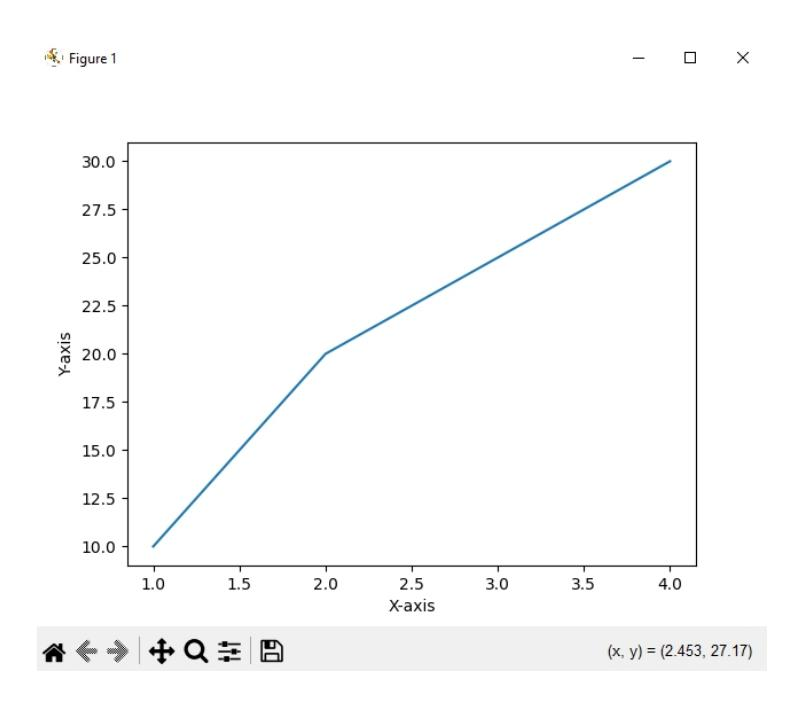

Use matplotlib and seaborn for creating visualizations that can aid in interpreting data processed within LangGraph, such as plotting results from a node or visualizing state changes over time.

#### **k) sqlalchemy and sqlite3**

For applications requiring persistent data storage, such as logging states or saving results, LangGraph can interact with databases. sqlalchemy provides an Object-Relational Mapping (ORM) layer for working with SQL databases, while sqlite3 is a lightweight database included in Python's standard library.

- **sqlalchemy.create\_engine()** : Connects to a database.
- **sessionmaker()** : Manages database sessions.
- **sqlite3.connect()** : Connects to an SQLite database directly.

```
Lesson2.py continued
from sqlalchemy import create_engine
from sqlalchemy.orm import sessionmaker
try:
    engine = create_engine("sqlite:///data.db")
    Session = sessionmaker(bind=engine)
```

```
session = Session()
except Exception as e:
    print(f"Error: {e}")
```

Use these libraries for storing and retrieving data in databases, managing application state persistence, or tracking long-term metrics across LangGraph sessions.

#### **l) os Module: File System Operations**

The os module provides a way to interact with the operating system. It allows for file and directory manipulation, environment variable access, and system-level operations. This module is frequently used in LangGraph projects for tasks like managing files and directories, creating output folders, and handling paths.

#### **Key Functions:**

- **os.path.join()** : Joins multiple path components into a single path.
- **os.makedirs()** : Creates a directory (and any necessary parent directories) if it does not exist.
- **os.environ** : Accesses environment variables.
- **os.remove()** : Deletes a file.
- **os.rename()** : Renames a file or directory.

```
Lesson2.py continued
import os
try:
    #Create a folder
    output_dir = "output"
    os.makedirs(output_dir, exist_ok=True)
    # Get an environment variable
    api_key = os.environ.get("API_KEY", "default_value")
except Exception as e:
    print(f"Error: {e}")
```

#### **Common Uses in LangGraph:**

- **Managing output files**: Create and organize output directories for logs, graphs, or data exports.
- **Setting environment variables**: Configure API keys or environmentspecific settings for LangGraph nodes.
- **File manipulation**: Delete or rename files as part of data processing workflows.

#### **m) sys Module: System-Specific Parameters and Functions**

The sys module provides access to system-specific parameters and functions that interact with the Python runtime environment. It's often used for handling command-line arguments, controlling the interpreter, and managing input/output streams.

#### **Key Functions:**

- **sys.argv** : Retrieves a list of command-line arguments passed to the script.
- **sys.exit()** : Exits the program, optionally with a specified exit status.
- **sys.path** : Accesses the list of directories Python searches for modules, useful for dynamically adding paths.
- **sys.platform** : Returns a string identifying the platform on which the script is running.

```
Lesson2.py continued
import sys
# Check if enough arguments were passed
if len(sys.argv) < 2:
    print("Usage: python script.py <filename>")
    sys.exit("Please provide a file path as an argument.")
# Accessing command-line arguments
filename = sys.argv[1]
print(f"Processing file: {filename}")
#Exit management
def process_data(data):
    if not data:
         print("Error: No data provided.")
         sys.exit(1)  # Exit with an error status
    print("Data processed successfully.")
    sys.exit(0)  # Exit with a success status
```

```
# Simulating a scenario with empty data
data = None
process_data(data)
```

- **Command-line argument handling**: Allow LangGraph scripts to accept user inputs directly from the command line, which is useful for customization.
- **Exit management**: Control script termination, particularly when encountering errors or invalid conditions.
- **Platform-specific behavior**: Adapt code behavior based on the operating system (e.g., handling file paths differently on Windows vs. Linux).

#### **n) random Module: Random Number Generation**

The random module provides functions for generating random numbers and selecting random items. This can be useful in LangGraph for creating randomized test cases, sampling data, or implementing stochastic processes within a graph.

#### **Key Functions:**

- **random.randint()** : Generates a random integer within a specified range.
- **random.choice()** : Selects a random element from a non-empty sequence.
- **random.shuffle()** : Randomly shuffles a list in place.
- **random.uniform()** : Generates a random floating-point number within a specified range.

```
Lesson2.py continued
import random
# Generate a random integer between 1 and 100
random_number = random.randint(1, 100)
print(random_number)
# Choose a random item from a list
options = ["apple", "banana", "cherry"]
```

```
fruit = random.choice(options)
print(fruit)
# Shuffle a list
numbers = [1, 2, 3, 4, 5]
shuffle = random.shuffle(numbers)
print(shuffle)
#Uniform float numbers
random_float = random.uniform(0, 1)
print(random_float)
```

- **Data sampling**: Randomly select subsets of data for processing or testing purposes.
- **Shuffling sequences**: Randomize the order of items within a list, such as randomizing test cases or creating varied output.
- **Stochastic processes**: Introduce randomness into decision-making or simulate random events within nodes.

#### **o) datetime Module: Working with Dates and Times**

The datetime module provides classes for manipulating dates and times. It is essential for tasks that involve timestamping, scheduling, or measuring time intervals. In LangGraph, datetime is useful for logging, managing time-based events, or processing time-series data.

- **datetime.datetime.now()** : Retrieves the current date and time.
- **datetime.timedelta** : Represents a duration, which can be used for date arithmetic.
- **datetime.datetime.strptime()** : Converts a string into a datetime object based on a specified format.
- **datetime.datetime.strftime()** : Formats a datetime object as a string.

```
Lesson2.py continued
from datetime import datetime, timedelta
# Get the current date and time
```

```
now = datetime.now()
# Calculate a future date by adding a timedelta
future_date = now + timedelta(days=5)
print(future_date.strftime("%Y-%m-%d"))
```

- **Timestamping events**: Log the time at which specific nodes are executed or when particular events occur.
- **Time-based scheduling**: Trigger or delay nodes based on time intervals, such as running a task every 15 minutes.
- **Parsing and formatting dates**: Process date strings into datetime objects for calculations, or convert datetime objects back into strings for reporting.

#### **p) collections Module: Specialized Data Structures**

The collections module provides specialized data structures that extend Python's built-in types, such as deque , Counter , defaultdict , and namedtuple . These structures are optimized for specific tasks and can make code more efficient and readable.

- **Counter** : A dictionary subclass for counting hashable objects.
- **defaultdict** : A dictionary subclass that provides default values for non-existent keys.
- **deque** : A double-ended queue optimized for fast appends and pops.
- **namedtuple** : Factory function for creating tuple subclasses with named fields.

```
Lesson2.py continued
from collections import Counter, defaultdict
# Counting occurrences of items in a list
words = ["apple", "banana", "apple", "cherry"]
word_count = Counter(words)
# Using defaultdict to handle missing keys
fruits = defaultdict(int)
fruits["apple"] += 1
```

```
print(fruits)  # Output: defaultdict(<class 'int'>, {'apple': 1})
```

- **Counting and tallying items**: Use Counter to quickly tally items, such as counting types of data passing through nodes.
- **Handling default values**: Use defaultdict in scenarios where missing keys are common, such as when accumulating results.
- **Managing ordered data**: Use deque for queue-based data processing within a graph workflow.

#### **q) itertools Module: Iterator Functions**

The itertools module provides a suite of fast, memory-efficient tools for creating and working with iterators. These functions can help manage looping and iteration in complex LangGraph workflows.

#### **Key Components:**

- **itertools.chain()** : Combines multiple iterators into a single sequence.
- **itertools.cycle()** : Repeats an iterable indefinitely.
- **itertools.groupby()** : Groups items in an iterable based on a specified key function.
- **itertools.permutations()** : Generates permutations of a sequence.

```
Lesson2.py continued
from itertools import cycle
# Cycling through a list indefinitely
colors = cycle(["red", "green", "blue"])
for _ in range(6):
    print(next(colors))
```

#### **Common Uses in LangGraph:**

- **Generating infinite sequences**: Use cycle for repeating sequences, which is useful for round-robin scheduling.
- **Efficient looping**: Use chain to iterate over multiple lists without creating additional data structures.

● **Creating permutations and combinations**: Use permutations for testing different configurations or solving combinatorial problems within LangGraph nodes.

# <span id="page-84-0"></span>**3.5.12 Map, Filter, and Reduce**

These functional programming tools are ideal for processing lists and other iterables in LangGraph.

- **map()**: Applies a function to all items in an iterable.
- **filter()**: Filters items based on a function.
- **reduce()**: Accumulates items into a single result.

The map() function applies a given function to each item of an iterable (like a list) and returns a map object (which can be converted to a list, tuple, etc.). It is useful for transforming data, such as squaring numbers or converting strings to uppercase.

```
Lesson2.py continued
# List of numbers to square
numbers = [1, 2, 3, 4]
# Using map to square each number
squares = list(map(lambda x: x**2, numbers))
print(squares)  # Output: [1, 4, 9, 16]
# List of strings
words = ["hello", "world", "langgraph"]
# Using map to convert each string to uppercase
uppercase_words = list(map(lambda word: word.upper(), words))
print(uppercase_words)  # Output: ['HELLO', 'WORLD', 'LANGGRAPH']
# List of dictionaries with user data
users = [
    {"name": "Alice", "age": 25},
    {"name": "Bob", "age": 30},
    {"name": "Charlie", "age": 35}
]
# Using map to extract only the 'name' field from each dictionary
names = list(map(lambda user: user["name"], users))
print(names)  # Output: ['Alice', 'Bob', 'Charlie']
```

The filter() function creates a new iterable with elements from the original iterable that return True when passed to the specified function. It's commonly used to filter items based on conditions.

```
Lesson2.py continued
# List of numbers to filter
numbers = [1, 2, 3, 4, 5, 6]
# Using filter to keep only even numbers
evens = list(filter(lambda x: x % 2 == 0, numbers))
print(evens)  # Output: [2, 4, 6]
# List of names
names = ["Alice", "Bob", "Charlie", "Dave"]
# Using filter to keep names with more than 3 characters
long_names = list(filter(lambda name: len(name) > 3, names))
print(long_names)  # Output: ['Alice', 'Charlie', 'Dave']
# List of dictionaries with user data
users = [
    {"name": "Alice", "age": 25},
    {"name": "Bob", "age": 20},
    {"name": "Charlie", "age": 35}
]
# Using filter to keep only users who are 30 years or older
adult_users = list(filter(lambda user: user["age"] >= 30, users))
print(adult_users)  # Output: [{'name': 'Charlie', 'age': 35}]
```

In more complex LangGraph workflows, you might find it useful to combine map() , filter() , and reduce() to perform multiple operations in sequence. Here's an example that demonstrates using all three functions together.

```
Lesson2.py continued
from functools import reduce
# List of numbers
numbers = [1, 2, 3, 4, 5, 6]
# Filtering even numbers, mapping to squares, and reducing to sum
sum_of_squares_of_evens = reduce(
    lambda x, y: x + y,
    map(lambda x: x**2, filter(lambda x: x % 2 == 0, numbers))
)
print(sum_of_squares_of_evens)  # Output: 56 (2^2 + 4^2 + 6^2)
```

# In this example:

- 1. filter() selects the even numbers: [2, 4, 6] .
- 2. map() squares each even number: [4, 16, 36] .
- 3. reduce() sums the squares: 4 + 16 + 36 = 56 .

# **3.5.13 Asynchronous Programming Basics for LangGraph**

Asynchronous programming is a key concept for optimizing tasks that involve waiting, such as network requests, file I/O, or data processing. In LangGraph, asynchronous programming allows for efficient parallel execution of tasks, improving performance by avoiding blocking operations. Python provides async and await keywords to enable asynchronous programming, allowing code to execute without waiting for long-running tasks to finish.

#### **3.5.13.1 Async/Await Basics**

The async and await keywords are used to define asynchronous functions and manage asynchronous operations, respectively. An asynchronous function defined with async def can be paused and resumed, enabling other code to run during the wait.

#### **Example 1: Basic Asynchronous Function**

In this example, we create an asynchronous function that simulates fetching data by waiting for one second before returning a message.

```
Lesson2.py continued
import asyncio
async def fetch_data():
    await asyncio.sleep(1)  # Simulates a non-blocking wait
    return "Data fetched!"
# Run the asynchronous function
result = asyncio.run(fetch_data())
print(result)  # Output: Data fetched!
```

Here:

- async def fetch\_data() defines an asynchronous function.
- await asyncio.sleep(1) pauses execution for one second without blocking other code.
- asyncio.run() runs the asynchronous function.

#### **Example 2: Performing Multiple Sequential Asynchronous Tasks:**

You can chain asynchronous functions to execute one after another.

```
Lesson2.py continued
async def task1():
    await asyncio.sleep(1)
    print("Task 1 completed")
async def task2():
    await asyncio.sleep(2)
    print("Task 2 completed")
async def main():
    await task1()
    await task2()
asyncio.run(main())
```

In this example, task1 and task2 are run sequentially, so the total runtime is 3 seconds. Using await ensures that each function finishes before the next one begins.

#### **3.5.14 Concurrent Programming with asyncio**

Concurrency allows you to run multiple tasks at the same time. In asyncio , the gather() function lets you run multiple asynchronous functions concurrently. This is useful in LangGraph for performing parallel processing, such as fetching data from multiple sources simultaneously.

```
Lesson2.py continued
async def task(name):
    await asyncio.sleep(1)
    print(f"Task {name} completed")
async def main():
    await asyncio.gather(task("A"), task("B"), task("C"))
```

```
asyncio.run(main())
#Output:
# Task A completed
# Task B completed
# Task C completed
```

All tasks start at the same time, so they complete together after one second. This is more efficient than running them sequentially, which would take 3 seconds.

#### **Example 3: Performing Asynchronous I/O Operations**

Imagine you want to simulate fetching data from three different sources in parallel:

```
Lesson2.py continued
async def fetch_source(source):
    print(f"Fetching from {source}...")
    await asyncio.sleep(2)
    print(f"Completed fetching from {source}")
async def main():
    sources = ["Source 1", "Source 2", "Source 3"]
    await asyncio.gather(*(fetch_source(source) for source in sources))
asyncio.run(main())
#Output
# Fetching from Source 1...
# Completed fetching from Source 1
# Fetching from Source 2...
# Completed fetching from Source 2
# Fetching from Source 3...
# Completed fetching from Source 3
```

Here, all three fetch\_source tasks run in parallel, completing in 2 seconds, compared to 6 seconds if done sequentially.

#### **3.5.15 Error Handling in Asynchronous Code**

Error handling in asynchronous functions is managed with try / except blocks, just like in synchronous functions. However, it's essential to place these within the async function itself for non-blocking error handling.

#### **Example 4: Handling Errors in Asynchronous Tasks**

```
Lesson2.py continued
async def faulty_task():
    try:
         raise ValueError("An error occurred")
    except ValueError as e:
         print(f"Error: {e}")
asyncio.run(faulty_task())
```

In this example, any errors raised inside faulty\_task are caught by the except block, preventing the program from crashing.

#### **Example 5: Error Handling in Concurrent Tasks with gather()**

When using gather() , you can choose to handle errors individually or let the function propagate them. By default, if any task raises an error, gather() stops and raises the first encountered error. To handle errors individually, use return\_exceptions=True .

```
Lesson2.py continued
async def task1():
    raise ValueError("Error in Task 1")
async def task2():
    await asyncio.sleep(1)
    return "Task 2 completed successfully"
async def main():
    results = await asyncio.gather(task1(), task2(), return_exceptions=True)
    for result in results:
         if isinstance(result, Exception):
           print(f"Handled exception: {result}")
         else:
           print(result)
asyncio.run(main())
#Output
# Error: ValueError("Error in Task 1")
# Task 2 completed successfully
```

Asynchronous programming in LangGraph enables efficient, non-blocking operations that make workflows faster and more responsive, especially in tasks that involve I/O operations, network calls, or any operations where latency can be high. By using asyncio , you can handle multiple tasks concurrently, improving the scalability and performance of your LangGraph projects.

#### **3.5.15 Asynchronous Example Relevant to LangGraph**

In LangGraph, asynchronous operations are particularly useful when dealing with nodes that require data from external APIs. By running multiple datafetching tasks concurrently, you can reduce overall execution time and improve efficiency.

#### **Example 6: Fetching Data for Multiple Nodes Concurrently in LangGraph**

Assume you have a LangGraph workflow where three different nodes fetch data from three different APIs. By fetching them asynchronously, you avoid waiting for each one to complete before moving to the next.

```
Lesson2.py continued
import asyncio
async def fetch_data_for_node(node_id, api_url):
    print(f"Node {node_id}: Fetching data from {api_url}...")
    await asyncio.sleep(2)  # Simulates a network delay
    print(f"Node {node_id}: Completed data fetch from {api_url}")
    return f"Data from {api_url}"
async def main():
    # URLs for data fetching in different nodes
    nodes = {
         "Node 1": "https://api.example.com/data1",
         "Node 2": "https://api.example.com/data2",
         "Node 3": "https://api.example.com/data3"
   }
    # Concurrently fetch data for all nodes
    results = await asyncio.gather(
         *(fetch_data_for_node(node_id, url) for node_id, url in nodes.items())
   )
    print("All data fetched:", results)
asyncio.run(main())
#Node Node 1: Fetching data from https://api.example.com/data1...
```

```
#Node Node 2: Fetching data from https://api.example.com/data2...
#Node Node 3: Fetching data from https://api.example.com/data3...
#Node Node 1: Completed data fetch from https://api.example.com/data1
#Node Node 2: Completed data fetch from https://api.example.com/data2
#Node Node 3: Completed data fetch from https://api.example.com/data3
#All data fetched: ['Data from https://api.example.com/data1', 'Data from
https://api.example.com/data2', 'Data from https://api.example.com/data3']
```

# In this example:

- fetch\_data\_for\_node simulates fetching data from an API for a specific node.
- asyncio.gather runs all fetch\_data\_for\_node tasks concurrently, fetching data for all nodes in parallel.
- This setup is ideal for LangGraph workflows where nodes rely on external data and parallel data fetching is required to minimize waiting times.

#### **3.5.16 String Manipulation**

Strings are a fundamental data type in Python and are used extensively in almost every program. Understanding how to manipulate strings is crucial when building agents that interact with user inputs, generate text, or process data from APIs.

#### **3.5.16.1 Basic String Operations**

Let's start with some common string operations like concatenation, slicing, and basic formatting.

#### **Example 1: Concatenation and Repetition**

Concatenation and repetition are fundamental string operations used to join or repeat strings.

```
Lesson2.py continued
# Concatenation
greeting = "Hello" + " " + "World"
print(greeting)  # Outputs: Hello World
# Repetition
echo = "Echo " * 3
print(echo)  # Outputs: Echo Echo Echo
```

#### **Example 2: String Slicing**

You can extract parts of a string using slicing.

```
Lesson2.py continued
text = "LangGraph"
# Extracting a substring
print(text[0:4])  # Outputs: Lang
print(text[-5:])  # Outputs: Graph
```

#### **Example 3: String Formatting**

String formatting is essential for creating dynamic strings. In modern Python, the f-string syntax is highly recommended.

```
Lesson2.py continued
name = "Alice"
age = 30
# Using f-strings for formatting
print(f"My name is {name}, and I am {age} years old.")  # Outputs: My name is Alice,
and I am 30 years old.
```

# Use Case in LangGraph:

String concatenation, slicing, and formatting are useful for dynamically generating prompts or text outputs in LangGraph agents. For instance, when a chatbot responds to a user query, it might need to format and concatenate various strings based on input.

#### **3.5.16.2 Advanced String Operations**

Let's move into more advanced string operations like searching, splitting, joining, and manipulating cases.

#### **Example 4: Searching in Strings**

You can search for substrings within a string using methods like find() and in .

```
Lesson2.py continued
text = "LangGraph is a powerful framework."
# Searching for a substring
print(text.find("powerful"))  # Outputs: 13
```

```
print("Graph" in text)        # Outputs: True
```

#### **Example 5: Splitting and Joining Strings**

Splitting breaks a string into a list of substrings, while joining concatenates elements of a list into a single string.

```
Lesson2.py continued
# Splitting a string into a list
words = text.split(" ")
print(words)  # Outputs: ['LangGraph', 'is', 'a', 'powerful', 'framework.']
# Joining a list into a string
sentence = " ".join(words)
print(sentence)  # Outputs: LangGraph is a powerful framework.
```

#### **Example 6: Changing String Case**

Python provides methods to manipulate the case of strings.

```
Lesson2.py continued
text = "LangGraph"
print(text.upper())   # Outputs: LANGGRAPH
print(text.lower())   # Outputs: langgraph
print(text.title())   # Outputs: Langgraph
```

#### **Use Case in LangGraph:**

These string operations are particularly useful for text processing tasks in LangGraph. For instance, when parsing user queries, splitting the text into words, normalizing the case, and joining tokens are common steps.

# <span id="page-93-0"></span>**3.6 Advanced Exception Handling**

In complex systems, error handling is essential for robustness. Python's exception handling mechanism allows you to catch and handle errors gracefully.

#### **3.6.1 Raising Custom Exceptions**

You can raise your own exceptions using the raise keyword. This is useful when you want to enforce specific rules in your program.

#### **Example 7: Raising Custom Exceptions**

```
Lesson2.py continued
def check_age(age):
    if age < 0:
         raise ValueError("Age cannot be negative")
    elif age < 18:
         print("Not eligible to vote")
    else:
         print("Eligible to vote")
try:
    check_age(-5)
except ValueError as e:
    print(e)  # Outputs: Age cannot be negative
```

Custom exceptions are helpful in LangGraph when you need to handle specific cases such as invalid input or failed API calls.

#### **3.6.2 try-except-else-finally**

The full try-except structure can include else and finally blocks to add more control.

- **else** : Executes if no exception occurs.
- **finally** : Executes no matter what, often used for cleanup.

#### **Example 8: Full Exception Handling**

```
Lesson2.py continued
try:
    number = int(input("Enter a number: "))
    result = 10 / number
except ValueError:
    print("You must enter a valid integer.")
except ZeroDivisionError:
    print("You can't divide by zero.")
else:
    print(f"Result: {result}")
finally:
    print("Execution completed.")
```

This structure ensures that any error is handled, and the finally block ensures that important cleanup tasks (like closing files or connections) are performed.

#### **3.6.3 Chained Exceptions**

Python allows you to raise a new exception while preserving the original exception. This is useful for debugging.

#### **Example 9: Chained Exceptions**

```
Lesson2.py continued
try:
    number = int(input("Enter a number: "))
    result = 10 / number
except ZeroDivisionError as e:
    raise RuntimeError("Failed to divide") from e
```

In LangGraph, chaining exceptions helps when one node fails due to an error in a previous node, preserving the error context for debugging.

#### **3.6.4 Exception Handling in LangGraph Workflows**

In a LangGraph agent, you may need to handle exceptions raised during the workflow. This could include catching network issues, invalid inputs, or errors in external APIs.

**Example 10: Exception Handling in LangGraph**

```
Lesson2.py continued
from langgraph import Graph, Node
class APIRequestNode(Node):
    def run(self):
        try:
      data = self.make_request()
      self.send_output(data)
        except TimeoutError:
      self.send_output("The request
timed out.")
        except ValueError as e:
      self.send_output(f"Invalid data:
{e}")
```

```
finally:
      self.log("Request completed.")
graph = Graph()
node = APIRequestNode()
graph.add_node(node)
```

In this example, a LangGraph node makes an API request and handles potential timeouts or invalid data gracefully, logging the outcome in the finally block.

Part 2: LangGraph Intermediate Concepts and Agent Design

(Chapters 4-7)

# **Chapter 4**

# <span id="page-97-1"></span><span id="page-97-0"></span>**Core Elements of LangGraph**

In this chapter, we will dive into the fundamental building blocks of LangGraph. Understanding these core elements is essential as they form the foundation of any AI agent or workflow you create. Don't worry if you're new to these concepts – we'll break everything down step by step and provide practical coding examples to guide you through.

# <span id="page-97-2"></span>**Key Concepts: Nodes, Edges, States, and Graphs**

LangGraph, as the name suggests, revolves around graphs, which are networks of connected tasks that can be used to build workflows for AI agents. These workflows rely on four primary components:

- 1. **State**
- 2. **Nodes**
- 3. **Edges**
- 4. **Graphs**

Let's explore these components in detail.

# <span id="page-97-3"></span>**4.1. State - Keeping track of Data**

The **state** is a shared data structure that stores information as it flows through the nodes of a graph. It allows different parts of the workflow to

"remember" and share information across multiple nodes. Think of it as the memory of your workflow. In LangGraph, states are typically Python dictionaries, TypedDict objects, or Pydantic models. These structures hold data that can be updated or modified by different nodes in your workflow.

# Here's a simple example of a state:

```
Lesson3a.py
from typing_extensions import TypedDict
# Define a simple state structure
class HelloWorldState(TypedDict):
    message: str  # This will store a message
```

In this example, HelloWorldState defines a state that can store a string message. As your workflow progresses, different nodes can read, update, or manipulate this message.

**Practical Example**: Imagine a workflow where one node starts by greeting the user, and another node adds more information to that greeting. The state allows this data to persist and be passed from one step to the next.

```
Lesson3a.py continued
# Initializing the state
state = {"message": "Hi! "}
```

# <span id="page-98-0"></span>**4.2. Nodes - The Business Logic**

A **node** in LangGraph is responsible for executing a specific task. Nodes are the building blocks that represent each action or decision point in a workflow. For example, one node might retrieve user input, while another node processes the input.

Nodes in LangGraph are typically implemented as functions that accept a state and return a modified version of that state. Here's an example of a node that appends text to the message stored in the state:

```
Lesson3a.py continued
def hello_world_node(state: HelloWorldState):
```

```
state["message"] = "Hello World"
return state
```

Here, hello\_world\_node is a node that takes in a state (a dictionary), adds a text string to the message in the state, and returns the updated state. By breaking workflows into smaller steps, like this, you can build more complex functionality over time.

The returned output looks like this

```
{"message": "Hello World"}
```

This means you can re-write the node above as below:

```
Lesson3a.py continued
def hello_world_node(state: HelloWorldState):
   return {"message": "Hello World"}
```

Nodes are added to a graph using the add\_node function

```
Lesson3a.py continued
graph_builder.add_node("greet_user", greet_user)
```

# <span id="page-99-0"></span>**4.3. Edges - connecting the nodes**

**Edges** define the connections between nodes. They control how data flows from one node to the next and determine the order in which tasks are executed. In simple terms, edges are the arrows that show the path from one node to another in a workflow.

For instance, if you want your workflow to start with a greeting node and then move to another node that processes user input, edges would define this transition.

An example of an edge connecting two nodes, connecting the raise\_invoice node to the receive\_payment .

```
Lesson3a.py continued
graph_builder = StateGraph(UserState)
graph_builder.add_edge("raise_invoice", "raise_invoice")
```

```
graph_builder.add_edge("receive_payment", END)
```

Let's focus on three important types of nodes and edges in LangGraph:

- 1. **Start Node**
- 2. **End Node**
- 3. **Conditional Edge**
- **4. Conditional Entry point**

# **4.3.1 Start Node: The Beginning of the Workflow**

The **Start Node** marks the entry point of the graph. It is the first node that activates the execution of the workflow. Think of it as a trigger that sets the process in motion, connecting the initial node where the workflow begins.

In LangGraph, the start of a workflow is often denoted by the constant START . The Start Node defines the connection from this starting point to the first node in your workflow. Here's an example:

```
Lesson3a.py continued
# Connect the start point to the first node
graph_builder.add_edge(START, "greet_user")  # Start edge
```

In this example, the edge connects the starting point ( START ) to the "greet\_user" node. When the graph is invoked, this edge triggers the greeting process, moving from START to the first task.

Alternatively, and entry point can be defined using the set\_entry\_poin t function

```
Lesson3a.py continued
graph_builder.set_entry_point("greet_user")
```

# **4.3.2 End Node: Completing the Workflow**

The **End Node** represents the conclusion of the workflow. It indicates that the workflow has reached its final task and no further actions are to be taken. Like the start edge, the **End Node** is represented by a constant END in LangGraph.

You can define an end node by connecting the final node of your workflow to the END marker. For example:

```
Lesson3a.py continued
# Connect the last node to the end point
graph_builder.add_edge("say_goodbye", END)
```

In this case, after the "say\_goodbye" node finishes its task, the workflow reaches the END , signaling the completion of the process.

Alternatively the finish point of a graph can be expressed using the set\_finish\_point

```
Lesson3a.py continued
graph_builder.set_finish_point("say_goodbye")
```

# **4.3.3 Conditional Edges: Adding Decision Points**

Conditional edges are one of the most powerful features in LangGraph. They allow the workflow to branch out based on certain conditions, enabling more dynamic behavior. With **Conditional Edges**, you can define different paths that the workflow might take depending on the state of the data or the outcome of a node.

For example, suppose you have a node that checks whether a user is a premium subscriber. Depending on whether the user is premium or not, you want the workflow to take different paths. Here's how you can implement conditional edges:

```
Lesson3a.py continued
# Define two nodes that handle different cases
def check_subscription(state: UserState):
    if state["is_premium"]:
         return "premium_greeting"
    else:
         return "regular_greeting"
…
graph_builder.add_conditional_edges("greet_user", check_subscription)
```

…

In this case, the graph will decide which path to follow based on the condition defined in the edge. The check\_subscription node will evaluate the user's subscription status, and the graph will follow the appropriate edge.

# **4.3.4 Principles of Edges in LangGraph**

Edges are more than just connections between tasks – they define the logic and flow of your workflow. Here are the core principles to understand when working with edges in LangGraph:

- **Sequential Flow**: Edges ensure that tasks are executed in the correct order. Without edges, there would be no control over how tasks are triggered and executed.
- **Conditional Flow**: Conditional edges enable branching logic, where the workflow can follow different paths based on the evaluation of certain conditions or data. This makes workflows adaptable and intelligent.
- **Completion Control**: The **End Edge** defines when the workflow terminates. Without an end edge, the graph would continue indefinitely or fail to properly signal its conclusion.
- **Error Handling**: Edges can be designed to handle errors or exceptions, guiding the workflow to recovery or alternative paths when unexpected outcomes occur.

# **4.3.5 Practical Example: Using Start, End, and Conditional Edges**

Here's a simple workflow that uses start, end, and conditional edges to greet users differently based on whether they are premium subscribers:

```
Lesson3a.py complete code example
from typing_extensions import TypedDict
from langgraph.graph import StateGraph, START, END
# Define the state for user data
class UserState(TypedDict):
    is_premium: bool
```

```
message: str
# Define nodes
def greet_user(state: UserState):
    state["message"] = "Welcome!"
    return state
def premium_greeting(state: UserState):
    state["message"] += " Thank you for being a premium user!"
    return state
def regular_greeting(state: UserState):
    state["message"] += " Enjoy your time here!"
    return state
# Define a decision node to choose the path based on user type
def check_subscription(state: UserState):
    if state["is_premium"]:
         return "premium_greeting"
    else:
         return "regular_greeting"
# Build the graph
graph_builder = StateGraph(UserState)
graph_builder.add_node("greet_user", greet_user)
graph_builder.add_node("check_subscription", check_subscription)
graph_builder.add_node("premium_greeting", premium_greeting)
graph_builder.add_node("regular_greeting", regular_greeting)
# Add edges to control the flow
graph_builder.add_edge(START, "greet_user")  # Start edge
graph_builder.add_conditional_edges("greet_user", check_subscription)
graph_builder.add_edge("premium_greeting", END)  # End edge for premium users
graph_builder.add_edge("regular_greeting", END)  # End edge for regular users
# Compile and run the graph for a premium user
graph = graph_builder.compile()
result = graph.invoke({"is_premium": True, "message": ""})
print(result)  # Output: {'message': 'Welcome! Thank you for being a premium user!'}
# Compile and run the graph for a regular user
result = graph.invoke({"is_premium": False, "message": ""})
print(result)  # Output: {'message': 'Welcome! Enjoy your time here!'}
```

In this example, we use a **Start Edge** to begin the workflow, a **Conditional Edge** to choose between two paths, and an **End Edge** to conclude the workflow. The result changes based on the user's subscription status, showcasing how dynamic workflows can be created with edges.

# <span id="page-104-0"></span>**4.4. Graph**

A **Graph** in LangGraph is the overarching structure that brings nodes, edges, and states together into a coherent workflow. It serves as the blueprint for the agent's activities, defining how tasks are ordered, which paths the agent can take, and how information flows through the entire process.

Graphs can be simple or complex, depending on the desired workflow. They might consist of just a few nodes connected linearly, or they might include multiple branches, conditional paths, and loops that allow for more sophisticated behaviors. A graph provides the framework within which nodes operate, with edges guiding the flow of the state through the connected tasks.

#### **4.4.1 Common Types of Graphs in LangGraph:**

# a. StateGraph

You start building a graph with a graph builder that specifies the graph type. The StateGraph class is the main graph class to use. This is parameterized by a user defined State object.

```
Lesson3b.py
graph_builder = StateGraph(HelloWorldState)
```

# b. MessageGraph

The MessageGraph class is a special type of graph specially made for handling a list of messages, specifically suited for a chat use case. The State of a MessageGraph is ONLY a list of messages. This class is rarely used except for chatbots, as most applications require the State to be more complex than a list of messages.

Lesson3b.py continued

```
graph_builder = StateGraph(MessageGraph)
```

#### **4.4.2 Compiling the Graph**

Once you have defined the graph builder nodes and edges, you compile it into a graph.

```
Lesson3b.py continued
graph = graph_builder.compile()
```

Compiling a graph does the following:

- Checks and validates the structure of the graph to make sure all nodes are completely utilized within the edges and all edges are correctly defining a complete workflow.
- Specify memory arguments like checkpointers
- Define breakpoints for human in the loop intervention actions.

In LangGraph, a complete simple graph might look something like this:

```
Lesson3b.py continued
from typing_extensions import TypedDict
from langgraph.graph import StateGraph, START, END
class HelloWorldState(TypedDict):
    """The state"""
    message: str  # This state key will store the message
def hello_world_node(state: HelloWorldState):
    """The node function"""
    state["message"] += "Hello World" #This node does this simple task.
    return state
#Define the graph
graph_builder = StateGraph(HelloWorldState)
graph_builder.add_node("hello_world", hello_world_node)
graph_builder.add_edge(START, "hello_world")
graph_builder.add_edge("hello_world", END)
# Compile and run the graph
```

```
graph = graph_builder.compile()
result = graph.invoke({"message": "Hi! "})
# Output the result
print(result)
# Output: {'greeting': 'Hi! Hello World'}
```

#### **4.4.3 State Channels**

Nodes usually communicate with a single schema. For example, you might have below nodes both of which share the same HelloWorldState . The state["message"] becomes a state channel which activates either node once data is received from the edge.

```
Lesson3b.py continued
def hello_world_node(state: HelloWorldState):
          state["message"] += "Hello World"
def welcome_user_node(state: HelloWorldState):
          state["message"] += "Welcome to this app"
```

When you have private variables inside a node that are not required in a graph's output, these become private channels that can reference a private schema.

#### **4.4.4 Debug Symbols of a LangGraph**

When you debug a LangGraph workflow, you can see the actual values of the variables in your workflow, including the start and end nodes, the nodes, the edges, the channels used in the graph, the state schemas and much more.

# <span id="page-108-0"></span>**4.5. Input and Output Schemas of a graph: Flexible State Management in LangGraph**

In LangGraph, states play a crucial role in how nodes communicate and share data throughout the workflow. LangGraph offers flexibility in how states are managed, allowing for different input and output schemas. This flexibility enables developers to use different subsets of data for different parts of the graph, enhancing both **modularity** and **data flow control**.

In this section, we'll explore how you can design workflows that use different schemas for input, output, and internal communication by introducing **internal state channels** and **multiple state schemas**. This allows for more complex behavior where nodes communicate using both **private** (internal) and **external** (output) states.

# **4.5.1 The Role of Input and Output Schemas**

In a LangGraph workflow, input and output schemas define the structure of data entering and exiting nodes. By specifying different input and output schemas, you can control which data gets passed between nodes and how the final results are returned.

- **Input Schema**: Specifies what data a node or graph accepts as input.
- **Output Schema**: Defines the structure of the data returned by the node or graph.

This separation is useful when you need to:

- 1. **Hide Internal Details**: For example, if a node needs to process intermediate data that shouldn't be exposed to the rest of the graph.
- 2. **Define Flexible Workflows**: Different parts of the graph can work with different types of data without interfering with each other.

# **4.5.2 Defining Multiple State Schemas**

Let's look at an example where we define an **OverallState** schema, which contains all the fields relevant to the graph's operations. From this overall

state, we can extract subsets to form the input and output schemas for nodes.

```
Lesson3b.py continued
from typing_extensions import TypedDict
# Define the input and output types for the overall state state
class OverallState(TypedDict):
    partial_message: str
    user_input: str
    message_output: str
```

# In this case:

- OverallState contains all the data relevant to the graph.
- InputState is a simplified version of OverallState that only includes the user input.
- OutputState is another subset that only contains the final message output.
- PrivateState is an internal state that is used for communication between nodes without exposing this information in the input or output.

```
Lesson3b.py continued
class InputState(TypedDict):
    user_input: str
class OutputState(TypedDict):
    message_output: str
class PrivateState(TypedDict):
    private_message: str
```

# **4.5.3 Example: Building a Graph with Multiple State Schemas**

To understand how input, output, and private states interact, let's build a workflow that processes a user input by adding words to it, using internal transformations, and returning a final message.

# *Define the Nodes*

We start by defining the nodes, each operating on different parts of the state.

- 1. **add\_world**: This node takes the InputState , adds the word "World" to the user input, and returns the modified OverallState .
- 2. **add\_exclamation**: This node works on the OverallState , adds an exclamation mark ( ! ), and stores the result in the internal PrivateState .
- 3. **finalize\_message**: This node retrieves the message from the private state and prepares it for output, returning an OutputState .

```
Lesson3b.py continued
# Define nodes (functions) that operate on the states
def add_world(state: InputState) -> OverallState:
    partial_message = state["user_input"] + " World"
    print(f"Node 1 - add_world: Transformed '{state['user_input']}' to
'{partial_message}'")
    return {"partial_message": partial_message, "user_input": state["user_input"],
"message_output": ""}
def add_exclamation(state: OverallState) -> PrivateState:
    private_message = state["partial_message"] + "!"
    print(f"Node 2 - add_exclamation: Transformed '{state['partial_message']}' to
'{private_message}'")
    return {"private_message": private_message}
def finalize_message(state: PrivateState) -> OutputState:
    message_output = state["private_message"]
    print(f"Node 3 - finalize_message: Finalized message to '{message_output}'")
    return {"message_output": message_output}
```

# **Building the Graph**

Next, we use **StateGraph** to define the entire workflow, specifying the input, output, and overall states.

```
Lesson3b.py continued
# Create the graph builder with nodes and edges
```

```
builder = StateGraph(OverallState, input=InputState, output=OutputState)
builder.add_node("add_world", add_world)
builder.add_node("add_exclamation", add_exclamation)
builder.add_node("finalize_message", finalize_message)
# Define the edges between nodes
builder.add_edge(START, "add_world")
builder.add_edge("add_world", "add_exclamation")
builder.add_edge("add_exclamation", "finalize_message")
builder.add_edge("finalize_message", END)
# Compile and run the graph
graph = builder.compile()
result = graph.invoke({"user_input": "Hello"})
print(result)  # Output: {'message_output': 'Hello World!'}
```

In this example, we demonstrated how nodes can work with different subsets of data:

- **InputState** is passed to the first node ( add\_world ) to process user input.
- **OverallState** is used internally by add\_world and add\_exclamation to manage and manipulate intermediate data.
- **PrivateState** is used as an internal communication channel between add\_exclamation and finalize\_message , allowing the final node to access transformed data without exposing it to the rest of the graph.
- **OutputState** is returned by the finalize\_message node, containing the result of the workflow.

# **Important Points:**

- 1. **State Flexibility**: *A node can write to any state channel in the graph*, even if that channel wasn't included in its input schema. For example, add\_world writes to partial\_message in the OverallState , even though it only received the InputState .
- 2. **Internal Communication**: The use of **PrivateState** allows nodes to communicate internally without exposing this information outside the graph. This is useful for separating private transformations from the public-facing output.

3. **State Union**: The *graph's state is the union of all state channels defined at initialization*. Even though we define different input and output schemas, the nodes can still access the overall state and manipulate different parts of it.

# **Key Takeaways**

- **Input and Output Schemas** allow you to control the data that enters and exits each node, providing flexibility in how nodes interact with the state.
- **Internal State Channels** enable nodes to perform intermediate processing that doesn't affect the overall input or output. This makes workflows cleaner and more modular.
- LangGraph's state management system allows nodes to share data while keeping certain details hidden when necessary, facilitating complex workflows with ease.

By mastering input and output schemas in LangGraph, you can build flexible, scalable, and powerful AI agents that manage complex data flows with precision.

# <span id="page-112-0"></span>**4.6. How LangGraph Brings it All Together**

LangGraph is designed to build workflows using these components. When you define a LangGraph agent, you create nodes (functions) that perform tasks, edges that determine the flow, and a state that holds the data. LangGraph combines these elements into a **graph** structure, allowing the agent to handle complex workflows that can branch, loop, or adapt based on the data.

Here's a visual representation of how these elements work together in a simple LangGraph workflow:

1. **Start** → 2. **Node 1** (modifies the state) → 3. **Node 2** (uses the modified state) → 4. **End**

Each node has access to the state, and the edges define the path through which the state flows. By structuring workflows this way, LangGraph

makes it easier to create AI agents that can handle complex tasks and make decisions based on changing data.

# **4.6.1 Activating a node**

When the graph starts, all nodes are *inactive*. They only start working (become *active*) when they receive new information or a message from another node. Think of it like a signal to start working.

# **4.6.2 Super Steps - multiple nodes running at the same time**

One or more nodes can become active at the same time. A super-step is like a round or phase where certain nodes (tasks) in the graph execute together. If nodes can run simultaneously, they belong to the same super-step. If they need to wait for each other, they are in separate super-steps.

During a super-step, all nodes that have received messages work at the same time. Each of them runs its function and sends out updates or results. For example, one node might do a calculation, and another might process a piece of text.

At the end of a super-step, the graph checks if there are any nodes that didn't receive new messages. These nodes then "vote to halt," which means they go back to being inactive.

# **4.6.3 When Does the Graph Stop?**

The whole process stops when there are no active nodes left, and no messages are in transit. This means that all tasks are done, and no new information is flowing through the graph.

# <span id="page-113-0"></span>**4.7. Decision-Making with Conditional Edges**

In LangGraph, **conditional edges** allow your agent to choose between multiple paths based on specific conditions. This makes workflows more dynamic, enabling the agent to adapt to different scenarios and handle various inputs intelligently. In this section, you'll extend the "Hello World" agent to include conditional logic, which will determine the path the workflow takes based on the state's content.

# **4.7.1 Understanding Conditional Edges**

A **conditional edge** is like a branching point in your workflow. Instead of always moving in a single direction, a conditional edge evaluates a condition and decides which path to follow based on the result. This flexibility is essential for building AI agents that need to handle different types of data or respond to various user inputs.

For example, a customer service chatbot might follow one path if a user's question is related to billing and another path if it's about technical support. In LangGraph, conditional edges let you set up these types of decision points, making it possible to create workflows that *respond dynamically* to the data in the state.

#### **Setting Up a Conditional Greeting Agent**

In this example, we'll set up a graph that:

- Normalizes the greeting to ensure that it's lowercase, making it easier to process.
- Evaluates whether the normalized greeting contains the word "hi."
- Branches to different greeting nodes based on this evaluation.

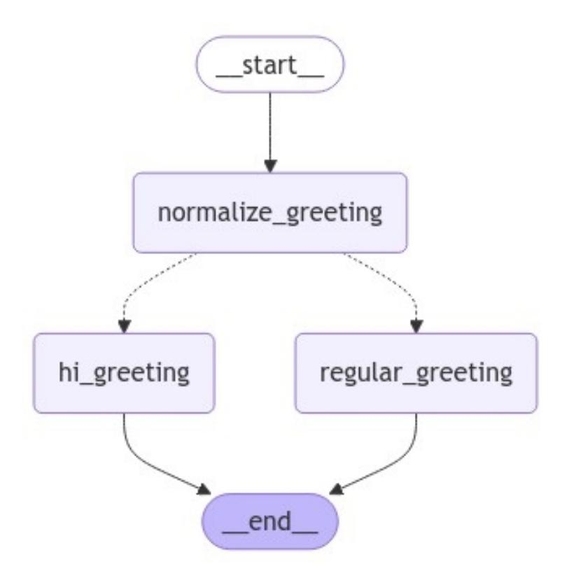

#### **1. Define the State Structure**

First, we need to define the structure of the state that the agent will use to keep track of the greeting message. In this example, our state will simply hold a greeting string.

```
Lesson3b.py continued
from typing_extensions import TypedDict
# Define the state structure
class GreetingState(TypedDict):
   greeting: str
```

#### **2. Create Node Functions for Each Greeting Type**

Next, we'll define three separate node functions:

- normalize\_greeting\_node : This node transforms the greeting text to lowercase to ensure consistency.
- hi\_greeting\_node : This node appends a special message if the greeting contains "hi."
- regular\_greeting\_node : This node appends a standard message for greetings without "hi."

```
Lesson3b.py continued
# Define a preprocessing node to normalize the greeting
def normalize_greeting_node(state):
   # Transform the greeting to lowercase
   state["greeting"] = state["greeting"].lower()
   return state  # Return the updated state dictionary
# Define a node for the "Hi" greeting
def hi_greeting_node(state):
   state["greeting"] = "Hi there, " + state["greeting"]
   return state  # Return the updated state dictionary
# Define a node for a standard greeting
def regular_greeting_node(state):
   state["greeting"] = "Hello, " + state["greeting"]
   return state  # Return the updated state dictionary
```

#### **3. Set Up the Conditional Logic Function**

The conditional function, choose\_greeting\_node , will examine the normalized greeting and decide whether to branch to the hi\_greeting\_node or the regular\_greeting\_node .

```
Lesson3b.py continued
# Define the conditional function to choose the appropriate greeting
def choose_greeting_node(state):
   # Choose the node based on whether "hi" is in the normalized greeting
   return "hi_greeting" if "hi" in state["greeting"] else "regular_greeting"
```

#### **4. Construct the Graph with Conditional Branching**

Now we'll set up the LangGraph, starting from a preprocessing step ( normalize\_greeting\_node ), and then use add\_conditional\_edges to evaluate which path to follow.

```
Lesson3b.py continued
from langgraph.graph import StateGraph, START, END
# Initialize the StateGraph
builder = StateGraph(GreetingState)
builder.add_node("normalize_greeting", normalize_greeting_node)
builder.add_node("hi_greeting", hi_greeting_node)
builder.add_node("regular_greeting", regular_greeting_node)
# Add the START to normalization node, then conditionally branch based on the
transformed greeting
builder.add_edge(START, "normalize_greeting")
builder.add_conditional_edges(
    "normalize_greeting", choose_greeting_node, ["hi_greeting", "regular_greeting"]
)
builder.add_edge("hi_greeting", END)
builder.add_edge("regular_greeting", END)
```

# In this setup:

- The workflow starts with normalize\_greeting\_node , which ensures the greeting is in lowercase.
- After normalization, choose\_greeting\_node determines the next step based on the presence of "hi" in the greeting.

● The agent then proceeds to either hi\_greeting\_node or regular\_greeting\_node , depending on the evaluation.

#### **5. Compile and Test the Agent**

Finally, we compile and test the graph with different greetings to see how it behaves based on the input.

```
Lesson3b.py continued
# Compile and run the graph
graph = builder.compile()
# Test with a greeting containing "Hi" in various forms (e.g., uppercase, mixed case)
result = graph.invoke({"greeting": "HI THERe!"})
print(result)  # Expected Output: {'greeting': 'Hi there, hi there!'}
# Test with a greeting not containing "Hi"
result = graph.invoke({"greeting": "Good morning!"})
print(result)  # Expected Output: {'greeting': 'Hello, good morning!'}
```

#### **Summary of Key Concepts**

- Conditional Edges: We used add\_conditional\_edges to add branching logic after the greeting normalization step.
- State Transformation: The normalize\_greeting\_node ensures consistency by converting the greeting to lowercase before any conditional checks.
- Dynamic Path Selection: The choose\_greeting\_node function allows the workflow to adapt based on the content of the greeting, directing it to the appropriate node.

By using conditional edges and a preprocessing step, this AI agent can now handle varied greeting inputs in a more robust way. This approach ensures that even if a user inputs "Hi" in uppercase or mixed case, the agent will recognize it and respond accordingly.

# **Complete Code for the Extended Conditional Logic Example**

Here's the full code, ready for you to test and experiment with additional conditions as you see fit:

```
from langgraph.graph import StateGraph, START, END
from typing_extensions import TypedDict
# Define the state structure
class GreetingState(TypedDict):
    greeting: str
# Define a preprocessing node to normalize the greeting
def normalize_greeting_node(state):
    # Transform the greeting to lowercase
    state["greeting"] = state["greeting"].lower()
    return state  # Return the updated state dictionary
# Define a node for the "Hi" greeting
def hi_greeting_node(state):
    state["greeting"] = "Hi there, " + state["greeting"]
    return state  # Return the updated state dictionary
# Define a node for a standard greeting
def regular_greeting_node(state):
    state["greeting"] = "Hello, " + state["greeting"]
    return state  # Return the updated state dictionary
# Define the conditional function to choose the appropriate greeting
def choose_greeting_node(state):
    # Choose the node based on whether "hi" is in the normalized greeting
    return "hi_greeting" if "hi" in state["greeting"] else "regular_greeting"
# Initialize the StateGraph
builder = StateGraph(GreetingState)
builder.add_node("normalize_greeting", normalize_greeting_node)
builder.add_node("hi_greeting", hi_greeting_node)
builder.add_node("regular_greeting", regular_greeting_node)
# Add the START to normalization node, then conditionally branch based on the
transformed greeting
builder.add_edge(START, "normalize_greeting")
builder.add_conditional_edges(
    "normalize_greeting", choose_greeting_node, ["hi_greeting", "regular_greeting"]
)
builder.add_edge("hi_greeting", END)
builder.add_edge("regular_greeting", END)
# Compile and run the graph
graph = builder.compile()
```

```
# Test with a greeting containing "Hi" in various forms (e.g., uppercase, mixed case)
result = graph.invoke({"greeting": "HI THERe!"})
print(result)  # Expected Output: {'greeting': 'Hi there, hi there!'}
# Test with a greeting not containing "Hi"
result = graph.invoke({"greeting": "Good morning!"})
print(result)  # Expected Output: {'greeting': 'Hello, good morning!'}
```

# Output:

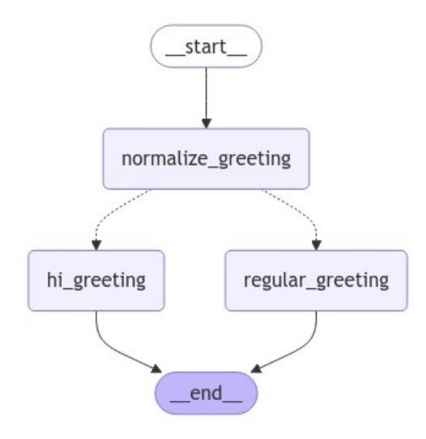

#### **Summary and Next Steps**

In this expanded example, you've learned how to:

- Create multiple branching paths based on different conditions.
- Use conditional edges to map specific conditions to corresponding nodes.
- Test and verify the flow of your LangGraph agent with different inputs.

Next, we'll explore how to introduce **state modifications** and **error handling** into workflows, which will allow your agent to manage data and respond gracefully to unexpected situations. This will help make your LangGraph agents more robust and versatile.

# **Quiz: Core LangGraph Concepts**

**Section 1: Core LangGraph Concepts and Structure**

# 1. **Which of the following statements about nodes in LangGraph is FALSE?**

- A) Nodes can modify the state data.
- B) Nodes define decision points that determine the path of the workflow.
- C) Nodes can connect directly to the END node.
- D) Nodes can be conditional or unconditional.

# 2. **In LangGraph, which element would most likely cause an infinite loop if improperly configured?**

- A) START node
- B) Conditional Edge
- C) State Dictionary
- D) Visualization
- 3. **True or False**: In a LangGraph workflow, all nodes must be directly connected to either the START node or the END node.

#### **Section 2: Conditional Logic and Branching**

4. If the following conditional function is used in a LangGraph workflow, which greeting will be used if state["greeting"] contains both "hi" and "hello"?

```
Lesson3b.py continued
def choose_greeting(state):
   if "hi" in state["greeting"]:
       return "hi_greeting"
   elif "hello" in state["greeting"]:
       return "hello_greeting"
   else:
       return "generic_greeting"
```

- A) hi\_greeting
- B) hello\_greeting
- C) generic\_greeting
- D) It will result in an error due to ambiguity.

# 4. **Which of the following best describes the behavior of the conditional edge in LangGraph?**

- A) It only allows the workflow to proceed if a specific condition is true.
- B) It enables branching by evaluating the state and determining the next node based on predefined conditions.
- C) It defines the start and end points of a workflow.
- D) It modifies the state based on conditional logic.
- 5. Given the code below, what would happen if "personalized\_hi\_greeting" is selected as the next node, but there is no direct edge from this node to END ?

```
Quiz
builder.add_conditional_edges(
          "normalize_greeting_node", choose_greeting,
          ["personalized_hi_greeting",
"personalized_hello_greeting", END]
```

- A) The workflow will skip to the next available node automatically.
- B) The workflow will attempt to execute, but a GraphRecursionError will likely occur.
- C) The workflow will end immediately.
- D) The workflow will loop back to the START node.

#### **Section 3: State Management and Workflow Execution**

# 7. **Which of these is NOT a best practice when defining state in LangGraph workflows?**

- A) Keeping state variables as specific as possible to ensure clarity.
- B) Storing all potential data in the state dictionary at the start, even if it's not used immediately.
- C) Updating the state within each node that processes it.
- D) Using type definitions like TypedDict to structure the state.

# 8. **If an AI agent needs to remember user preferences across multiple interactions, where should this information be stored?**

- A) In a local variable inside each node
- B) Within the state dictionary, passed along through the workflow
- C) In a separate file that each node can access
- D) Within the visualization settings
- 9. **True or False**: If a node modifies the state in a way that is unexpected by the subsequent nodes, it can lead to an InvalidUpdateError .

#### **Section 4: Visualization and Understanding Workflow Flow**

# 10. **Why might you use a tool like Graphviz to visualize your LangGraph workflow?**

- A) To automatically debug errors in the code
- B) To ensure the workflow logic is visually correct and flows as expected
- C) To speed up the execution time of the workflow

- D) To make the workflow more accessible to users without technical knowledge
  - **11. In the visualization below, if the arrow from Personalized Hi Greeting to Personalized Hello Greeting is missing, which of the following is most likely true?**

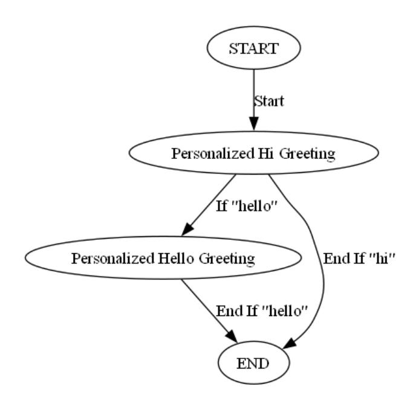

- A) The workflow has no path to execute Personalized Hello Greeting .
- B) Personalized Hello Greeting will be executed as the next node regardless.
- C) The workflow will automatically connect Personalized Hi Greeting to END .
- D) The visualization will still work but produce inaccurate output.
- 12. **True or False**: In LangGraph, visualization directly affects how the workflow executes.

**Section 5: Advanced Application and Scenario Questions**

13. **Consider a scenario where you have the following conditional function:**

```
Quiz
def choose_path(state):
   if state["greeting"].startswith("hello"):
       return "hello_path"
   if "goodbye" in state["greeting"]:
       return "goodbye_path"
   return END
```

If the input greeting is "hello and goodbye," which path will be selected?

- A) hello\_path
- B) goodbye\_path
- C) END
- D) Both hello\_path and goodbye\_path
- **14. What would happen if you accidentally removed the edge between Personalized Greeting and END ?**
- A) The workflow would still reach END through conditional paths.
- B) The workflow would terminate prematurely.
- C) A GraphRecursionError could occur if Normalize Greeting is revisited.
- D) The workflow would follow a default path to the END .
- 15. **Which of the following actions would likely improve performance if the workflow involves multiple branching conditions and paths?**
- A) Reducing the number of nodes by merging tasks into fewer nodes
- B) Storing state data as global variables
- C) Using more complex conditions within each node

D) Increasing the number of conditional edges for more precise routing

#### **Answer Key**

- 1. B) Nodes define decision points that determine the path of the workflow.
- 2. B) Conditional Edge
- 3. False
- 4. A) hi\_greeting
- 5. B) It enables branching by evaluating the state and determining the next node based on predefined conditions.
- 6. B) The workflow will attempt to execute, but a GraphRecursionError will likely occur.
- 7. B) Storing all potential data in the state dictionary at the start, even if it's not used immediately.
- 8. B) Within the state dictionary, passed along through the workflow
- 9. True
- 10. B) To ensure the workflow logic is visually correct and flows as expected
- 11. A) The workflow has no path to execute Personalized Hello Greeting .
- 12. False
- 13. A) hello\_path
- 14. C) A GraphRecursionError could occur if Personalized HI Greeting is revisited.
- 15. A) Reducing the number of nodes by merging tasks into fewer nodes

# **Chapter 5**

# <span id="page-126-1"></span><span id="page-126-0"></span>**Building Your First AI Agent**

# **Objective:**

In this chapter, you will create your first fully functional AI agent using LangGraph. The agent will be powered by a **Large Language Model (LLM)**, which will provide the intelligence to interpret user input and generate responses. The LLM will also be able to use tools, such as external APIs, to perform specific tasks.

By the end of this chapter, you will:

- Integrate an LLM into LangGraph.
- Manage messaging flows (human messages, system prompts, and AI responses).
- Set up continuous user input processing.
- Securely manage API keys and environment configurations.

# <span id="page-126-2"></span>**5.1 Introduction: The Power of AI Agents**

In today's world, AI agents are becoming an integral part of our lives, from customer service to interacting with users and automating tasks in business operations. These agents are built to perform tasks autonomously, interact with humans, and sometimes even make decisions based on the input they receive. What makes them intelligent is the combination of natural language

processing, decision-making logic, and the ability to take action by interfacing with external tools and systems.

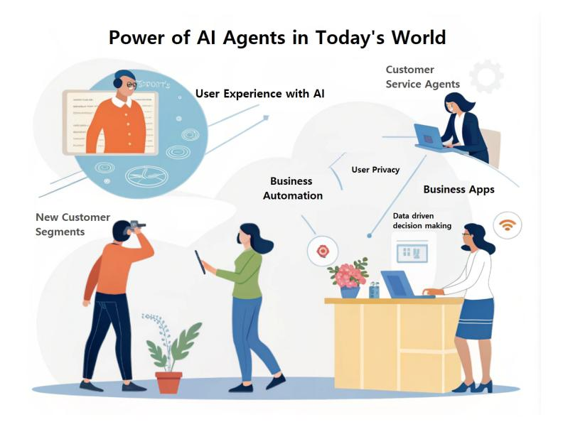

In this chapter, you will take your first step into building such an AI agent by using **LangGraph** as the framework and an **LLM** as the core intelligence engine. Your agent will:

- 1. Interact with users by understanding their queries.
- 2. Use the LLM to process natural language, turning human-like text into actionable data.
- 3. Trigger tool nodes to perform specific tasks, such as retrieving information from external APIs, scheduling events, or performing computations.

This AI agent will be simple in concept but powerful in its execution. By combining the capabilities of the LLM and tool nodes in LangGraph, you'll unlock the full potential of autonomous AI agents.

# <span id="page-127-0"></span>**5.2 Setting Up Your OpenAI API Key and Environment**

Before we begin coding, you'll need an OpenAI API key to call the LLM. Here's how you can set it up securely.

# 1. **Obtain an OpenAI API Key**:

○ Sign up or log in to [OpenAI Platform](https://platform.openai.com/) and navigate to the API keys section to generate your API key.

# 2. **Store the API Key Securely**:

- API Keys should never be stored as part of your main code. They are best stored as secrets in your environment as environment variables, or secrets with your cloud provider, like AWS or Google secrets.
- In this case, we store the API key in an .env file to keep it secure. This will prevent hard coding and leaking of sensitive information in your code.

Create a .env file in your project directory:

```
terminal
touch .env
```

Add your API key to the .env file:

```
terminal
OPENAI_API_KEY="your-api-key-here"
```

Then, load the API key from the .env file in your code:

```
#lesson4a.py
from dotenv import load_dotenv
import os
# Load environment variables from .env file
load_dotenv()
# Get the API key from environment variables
api_key = os.getenv("OPENAI_API_KEY")
# Check if API key exists
if api_key is None:
    print("Error: OPENAI_API_KEY not found in environment variables")
else:
    print("API key loaded successfully")
```

With this setup, you can securely load your OpenAI API key when the script runs.

# <span id="page-129-0"></span>**5.3 The Basics of LangGraph Messaging**

In LangGraph, the interaction between a user and an AI agent is managed through a sequence of messages. These include:

- **Human Messages**: Input from the user, such as questions or commands.
- **AI Messages**: Responses generated by the LLM.
- **System Messages**: Messages sent by the agent to provide context or additional instructions to the LLM (e.g., setting behavior or personality).
- **Prompt Templates**: Used to format and structure the inputs to the LLM, helping it generate more accurate responses.

For now, let's focus on the Human Message and AI Message to establish a simple back-and-forth interaction.

# **5.3.1 The Simplicity of using LangGraph for Creating AI Agents**

LangGraph is a robust framework for building AI agents that leverage **graph-based workflows**. The framework is centered around the concept of **nodes** and **edges**, which represent actions and the flow of data, respectively. In this chapter, you'll focus on using three key types of nodes:

- 1. **LLM Node**: This node uses an LLM (e.g., GPT-4o) to process text inputs and generate responses.
- 2. **Tool Node**: This node is responsible for triggering external actions, such as calling an API or executing a function.
- 3. **Decision Node**: This node helps the agent decide the next step based on the output from the LLM or tool node.

These components will work together to create a dynamic and intelligent system that can understand user input and take meaningful action.

# **5.3.2 AI Agent Use Case: Question & Answer AI Agent**

To make this example concrete, we will build a practical **Q&A agent** that can:

- 1. Accept a user's question.
- 2. Use an LLM to process the question and formulate a response.
- 3. Trigger tool nodes when needed (e.g., fetching weather information or news articles).
- 4. Respond back to the user with a detailed answer.

# *Define the Problem for the Question and Answer (Q&A) AI Agent*

This use case is highly practical and lays the groundwork for more complex agents in future chapters. It also demonstrates how powerful an AI agent can be when it combines natural language understanding with actionable tasks.

Before diving into building the agent, let's define what it will do. Our goal is to create a **Q&A agent** that can:

- 1. **Understand questions** from a user, such as "What's the weather today?" or "Tell me a joke."
- 2. **Generate intelligent responses** using an LLM as the intelligence provider.
- 3. **Trigger tool nodes** when necessary to fetch real-time information (e.g., calling an external weather API or stock prices).

In this example, the LLM will be responsible for understanding the user's intent, and the tool nodes will be used to carry out specific tasks.

# *Set Up the Graph*

Now that we have a clear goal, we can start setting up our LangGraph. A graph in LangGraph consists of nodes and edges that define how data moves through the system. For this agent, you'll create a graph that consists of the following nodes:

- 1. **Input Node**: This node will accept user input (the question). It will pass this input to the LLM for processing.
- 2. **LLM Node**: The LLM will take the user input, process it, and generate a response. The LLM node can either generate a direct

- response or trigger tool nodes depending on the question.
- 3. **Tool Nodes**: These nodes will be triggered based on the LLM's output. For example, if the LLM detects that the user is asking for the weather, it will trigger a tool node that fetches the weather data.
- 4. **Output Node**: Once the response has been generated, it will be returned to the user.

# *Create the Basic AI Agent*

We'll begin by setting up the LangGraph workflow to interact with an LLM. In this case, we are focusing only on calling the LLM to respond to user queries.

```
#lesson5a.py
from langchain_openai import ChatOpenAI
from langgraph.graph import StateGraph, MessagesState, START, END
# Initialize the LLM model (using OpenAI in this example)
model = ChatOpenAI(model="gpt-4o-mini", api_key="YOUR_API_KEY")
# Node function to handle the user query and call the LLM
def call_llm(state: MessagesState):
    messages = state["messages"]
    response = model.invoke(messages[-1].content)
    return {"messages": [response]}
# Define the graph
workflow = StateGraph(MessagesState)
# Add the node to call the LLM
workflow.add_node("call_llm", call_llm)
# Define the edges (start -> LLM -> end)
workflow.add_edge(START, "call_llm")
workflow.add_edge("call_llm", END)
# Compile the workflow
app = workflow.compile()
# Example input message from the user
input_message = {    
    "messages": [("human", "What is the capital of Kenya?")]
}
# Run the workflow
for chunk in app.stream(input_message, stream_mode="values"):
```

Here's a breakdown of what's happening:

- We use ChatOpenAI , an LLM, to handle language-based interactions.
- The call\_llm function sends the user's input to the model and returns the generated response.
- We define a simple graph with one node ( call\_llm ) and connect it to the start and end points.
- We ask the LLM a question as an input\_message and capture the response as a stream of results.

The expected output of running this code is as below:

| ==================================                                     |
|------------------------------------------------------------------------|
| Human Message                                                          |
| ==================================<br>What is the capital of Kenya?    |
| ==================================<br>AI Message                       |
| ==================================<br>The capital of Kenya is Nairobi. |

# <span id="page-132-0"></span>**5.4 Continuous User Input Processing**

One essential feature of a robust AI agent is its ability to handle continuous user input, where the user can ask multiple questions in a single session. We will extend our agent to support this interaction loop, processing user inputs until the conversation is terminated.

```
#lesson5b.py
from langchain_openai import ChatOpenAI
from langgraph.graph import StateGraph, MessagesState, START, END
from dotenv import load_dotenv
import os
# Load API key from .env file
load_dotenv()
api_key = os.getenv("OPENAI_API_KEY")
```

```
# Initialize the LLM (using OpenAI's GPT-4o)
model = ChatOpenAI(model="gpt-4o-mini", api_key=api_key)
# Node function to handle the user query and call the LLM
def call_llm(state: MessagesState):
    messages = state["messages"]
    response = model.invoke(messages[-1].content)
    return {"messages": [response]}
# Define the graph
workflow = StateGraph(MessagesState)
# Add the node to call the LLM
workflow.add_node("call_llm", call_llm)
# Define the edges (start -> LLM -> end)
workflow.add_edge(START, "call_llm")
workflow.add_edge("call_llm", END)
# Compile the workflow
app = workflow.compile()
# Function to continuously take user input
def interact_with_agent():
    while True:
         user_input = input("You: ")
         if user_input.lower() in ["exit", "quit"]:
          print("Ending the conversation.")
          break
         input_message = {
          "messages": [("human", user_input)]
         }
         for chunk in app.stream(input_message, stream_mode="values"):
          chunk["messages"][-1].pretty_print()
# Start interacting with the agent
interact_with_agent()
```

- **Step 1: Secure Setup**: We load the OpenAI API key from the .env file to keep it secure.
- **Step 2: LLM Node**: The call\_llm function processes the user input through the LLM and returns the AI's response.

- **Step 3: Graph Setup**: We create a StateGraph and add a node for calling the LLM. The graph is connected from start to end, processing the user input and returning the response.
- **Step 4: Continuous Input**: The interact\_with\_agent function takes continuous user input, allowing the user to ask multiple questions in a single session. The conversation ends when the user types "exit" or "quit."

# **5.4.1 Running the Agent**

Now that the AI agent is set up, you can run the script and start interacting with the agent. For example:

| You: What is the capital of Kenya?                                                                                    |
|-----------------------------------------------------------------------------------------------------------------------|
| ==================================<br>AI Message                                                                      |
| ==================================<br>The capital of Kenya is Nairobi.                                                |
| ================================<br>Human Message                                                                     |
| =================================<br>Tell me a Joke                                                                   |
| ==================================<br>Ai Message                                                                      |
| ==================================<br>Why did the scarecrow win an award?<br>Because he was outstanding in his field! |

You can continue asking questions, and the agent will keep responding until you type "exit" or "quit."

# **Section Summary**

In this first section, we've successfully built a basic AI agent that:

- Takes continuous user input.
- Calls the LLM to generate intelligent responses.
- Handles secure API key management via .env .

# <span id="page-134-0"></span>**5.5 Introduction to Tools in AI Agents**

While an LLM (Large Language Model) is great at generating responses based on language understanding, it has limitations. For example, it doesn't have real-time information, and it cannot perform specific tasks like calling an API or running calculations. This is where **tools** come in.

**Tools** allow an AI agent to:

- Fetch real-time data (e.g., weather information, stock prices).
- Perform specific tasks (e.g., sending emails, scheduling events).
- Retrieve information from databases or external APIs.

In this part, we will introduce **ToolNode**, a LangGraph node designed specifically for calling external tools, and integrate it into our existing agent.

# **5.5.1 Defining the Tool**

To demonstrate tool integration, let's define a simple tool that fetches weather information for a given city. This tool will simulate a weather service by returning a pre-defined response for certain cities.

# **Define the Tool Using @tool Decorator**

LangGraph provides a convenient way to define tools using the @tool decorator, which makes it easy to turn Python functions into callable tools.

```
#lesson5c.py
from langchain_core.tools import tool
# Define a tool to get the weather for a city
@tool
def get_weather(location: str):
    """Fetch the current weather for a specific location."""
    weather_data = {
         "San Francisco": "It's 60 degrees and foggy.",
         "New York": "It's 90 degrees and sunny.",
         "London": "It's 70 degrees and cloudy."
    }
    return weather_data.get(location, "Weather information is unavailable for this
location.")
```

- **@tool Decorator**: This decorator marks the function as a tool that can be used within LangGraph. You can think of it like tagging the function so that LangGraph knows it can call it later.
- **Function Logic**: The get\_weather function takes a location as input and returns the weather for that location. If the location isn't found in the dictionary, it returns a default message.

# **5.5.2 Integrating Tools with ToolNode**

Now that we have a tool to fetch the weather, we need to integrate it into our agent. LangGraph provides a node type called **ToolNode** , which is responsible for calling external tools like the one we just defined.

# **Step 2: Set Up the ToolNode**

```
#lesson5d.py
from langgraph.prebuilt import ToolNode
# Create a ToolNode with the weather tool
tool_node = ToolNode([get_weather])
```

# **Explanation:**

● **ToolNode** : This node is specifically designed to call external tools. It takes a list of tools as input. In this case, we pass the get\_weather tool to the ToolNode .

Now that we have the ToolNode set up, we can integrate it into our LangGraph workflow.

# **5.5.3 Updating the LLM to Use Tools**

In the first section, our agent used only the LLM to respond to user queries. Now, we'll update the graph so that the agent can also call the weather tool if the user asks for weather information.

```
#lesson5d.py continued
model=ChatOpenAI(model="gpt-4o-mini",api_key=api_key).bind_tools([get_weather])
# Step 4: Function to handle user queries and process LLM + tool results
def call_llm(state: MessagesState):
    messages = state["messages"]
```

```
# The LLM will decide if it should invoke a tool based on the user input
    response = model.invoke(messages[-1].content)
    # If the LLM generates a tool call, handle it
    if response.tool_calls:
         tool_result = tool_node.invoke({"messages": [response]})
         # Append the tool's output to the response message
         tool_message = tool_result["messages"][-1].content
         response.content += f"\nTool Result: {tool_message}"
    return {"messages": [response]}
# Step 5: Create the LangGraph workflow
workflow = StateGraph(MessagesState)
# Step 6: Add the LLM node to the workflow
workflow.add_node("call_llm", call_llm)
# Step 7: Define edges to control the flow (LLM -> End)
workflow.add_edge(START, "call_llm")
workflow.add_edge("call_llm", END)
# Step 8: Compile the workflow
app = workflow.compile()
```

- **Bind\_tools method:** The bind\_tools method to bind the get\_weather tool to the LLM. By doing this, the LLM becomes aware of the tool and can choose when to invoke it based on the user's input. If the user's query is about the weather, the LLM will automatically call the get\_weather tool and include the result in its response.
- **Graph Update**: We add a new node to the graph, call\_llm , which is responsible for interacting with the tool. This means that after the LLM processes the user input, it will decide whether to invoke the tool.
- **Flow Control**: If the LLM detects that the user is asking about the weather, it will call the weather tool. Once the tool finishes executing, the conversation will end.

# **5.5.4 Handling Continuous Input with Tools**

Let's extend our continuous input function to handle both general queries (processed by the LLM) and specific queries (processed by the tool).

```
#lesson5d.py continued
# Function to continuously take user input and decide between LLM and tool calls
def interact_with_agent():
    while True:
         user_input = input("You: ")
         if user_input.lower() in ["exit", "quit"]:
            print("Ending the conversation.")
            break
         input_message = {
            "messages": [("human", user_input)]
         }
         for chunk in app.stream(input_message, stream_mode="values"):
            chunk["messages"][-1].pretty_print()
# Start interacting with the agent
interact_with_agent()
```

● **Continuous Input Loop**: The agent listens for user input continuously, processing it through the graph and determining whether to call the LLM or the tool based on the user's request.

# **5.5.5 Running the Agent with Tools**

Now that everything is set up, let's run the agent and ask it a weatherrelated question.

# The complete code:

```
#lesson5d.py complete code example
# Import necessary libraries
from langchain_openai import ChatOpenAI
from langgraph.graph import StateGraph, MessagesState, START, END
from langchain_core.tools import tool
from langgraph.prebuilt import ToolNode
from dotenv import load_dotenv
import os
# Step 1: Load the API key from .env
load_dotenv()
```

```
api_key = os.getenv("OPENAI_API_KEY")
# Step 2: Define the tool to get weather information
@tool
def get_weather(location: str):
    """Fetch the current weather for a specific location."""
    weather_data = {
         "San Francisco": "It's 60 degrees and foggy.",
         "New York": "It's 90 degrees and sunny.",
         "London": "It's 70 degrees and cloudy."
    }
    return weather_data.get(location, "Weather information is unavailable for this
location.")
# Step 3: Initialize the LLM (OpenAI's GPT-4o-mini model) and bind the tool
tool_node = ToolNode([get_weather], handle_tool_errors=False)
model = ChatOpenAI(model="gpt-4o-mini",
api_key=api_key).bind_tools([get_weather])
# Step 4: Function to handle user queries and process LLM + tool results
def call_llm(state: MessagesState):
    messages = state["messages"]
    # The LLM will decide if it should invoke a tool based on the user input
    response = model.invoke(messages[-1].content)
    # If the LLM generates a tool call, handle it
    if response.tool_calls:
         tool_result = tool_node.invoke({"messages": [response]})
         # Append the tool's output to the response message
         tool_message = tool_result["messages"][-1].content
         response.content += f"\nTool Result: {tool_message}"
    return {"messages": [response]}
# Step 5: Create the LangGraph workflow
workflow = StateGraph(MessagesState)
# Step 6: Add the LLM node to the workflow
workflow.add_node("call_llm", call_llm)
# Step 7: Define edges to control the flow (LLM -> End)
workflow.add_edge(START, "call_llm")
workflow.add_edge("call_llm", END)
# Step 8: Compile the workflow
app = workflow.compile()
```

```
# Step 9: Function to interact with the agent continuously
def interact_with_agent():
    while True:
         user_input = input("You: ")
         if user_input.lower() in ["exit", "quit"]:
             print("Ending the conversation.")
             break
         # Prepare the user input for processing
         input_message = {
             "messages": [("human", user_input)]
         }
         # Process the input through the workflow and return the response
         for chunk in app.stream(input_message, stream_mode="values"):
             chunk["messages"][-1].pretty_print()
# Step 10: Start interacting with the AI agent
interact_with_agent()
```

# **Expected Output:**

| ================================== |
|------------------------------------|
| Human Message                      |
| ================================== |
| What's the weather in Nairobi?     |
| ================================== |
| AI Message                         |
| ================================== |

The weather in San Francisco is: It's 27 degrees and sunny.

# **5.5.6 How the System Decides to Use a Tool**

You might wonder, "How does the system know when to call a tool and when to just generate a response?" This decision-making process is based on the LLM's output. Here's how it works:

- 1. The user asks a question, and the **LLM node** processes the input.
- 2. The LLM generates a response. If the response contains a **tool call** (e.g., "Check the weather for San Francisco"), the graph triggers the **ToolNode**.

3. The **ToolNode** calls the specified tool (in this case, get\_weather ) and returns the result.

This interaction between the LLM and tools is what gives your agent the ability to understand user input and take real action based on that understanding.

# **5.5.7 Handling Errors in Tools**

LangGraph provides built-in error handling for tools. If something goes wrong during tool execution (e.g., the API is unreachable), LangGraph will handle the error and return a meaningful message to the user. You can customize the error handling by configuring the ToolNode to handle or propagate errors.

```
#lesson5d.py continued
# ToolNode with error handling disabled (propagating errors to the user)
tool_node = ToolNode([get_weather], handle_tool_errors=False)
```

In this case, if the weather tool encounters an error, the agent will let the user know that something went wrong rather than silently handling the error.

# **5.5.9 Explainer: Basics of Tool Calling in LangGraph: A Simple Overview**

In **LangGraph**, tools are helper functions that an AI agent can call to perform specific tasks, such as fetching data or processing user input. Here's a simplified guide to understanding how tool calling works, step-bystep.

# **What is Tool Calling in LangGraph?**

In LangGraph, **tools** are helper functions that an AI agent can call to perform specific tasks. These tools allow the agent to access external data, perform specific computations, or take actions that the agent alone cannot manage. For instance, you could create a tool that looks up an entry in a database, checks for available dates in a calendar, or retrieves financial data.

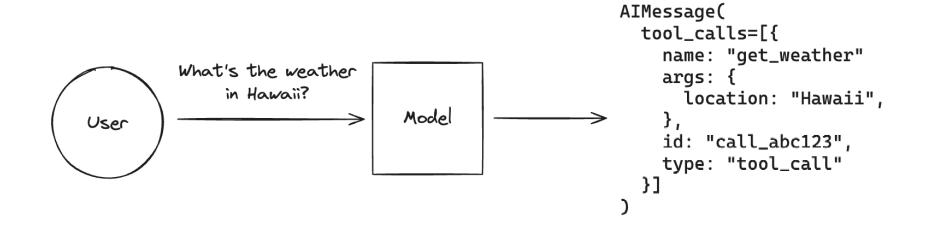

# **Key Requirements**

Before jumping into the process, it's important to understand that for the **ToolNode** to work, the **graph state** must contain a messages key. This key holds a list of interactions, which includes tool calls, user input, and results.

- **Tool**: A function that performs a task, such as retrieving database entries or computing a calculation.
- **ToolNode**: A node responsible for executing the tools when the AI agent requests them.
- **StateGraph**: The state of the AI workflow, which includes a messages key for storing tool calls and responses.

# **Example: Retrieving a User's Profile from a Database**

Let's use a more practical example: retrieving a user's profile from a database. In this example, the AI agent will call a tool that looks up user information based on a user ID.

# *Define Your Tool*

We define a tool using the @tool decorator, which marks it as callable by the **ToolNode**. In this case, the tool will search for a user profile in a predefined database (simulated here with a dictionary).

```
#lesson5e.py
from langchain_core.tools import tool
# Define a tool to get user profile by user ID
@tool
def get_user_profile(user_id: str):
    user_data = {
         "101": {"name": "Alice", "age": 30, "location": "New York"},
         "102": {"name": "Bob", "age": 25, "location": "San Francisco"}
```

```
}
return user_data.get(user_id, "User profile not found.")
```

Here, the get\_user\_profile tool takes a **user ID** as input and returns the user's profile information. If the user ID isn't found, it returns a "User profile not found" message.

# *Set Up the ToolNode*

Now that we've defined our tool, the next step is to set up the **ToolNode**. The **ToolNode** is responsible for calling the get\_user\_profile tool when the AI agent requests it.

```
#lesson5e.py continued
from langgraph.prebuilt import ToolNode
# Set up the ToolNode with the get_user_profile tool
tools = [get_user_profile]
tool_node = ToolNode(tools)
```

Here, we pass our get\_user\_profile tool to the **ToolNode**. This node will process the tool call and return the result.

# *Create an AIMessage for Tool Calling*

Next, we need to create an **AIMessage** that tells the AI agent which tool to call and provides the necessary input (in this case, the user ID). This **AIMessage** will be part of the **graph state** under the messages key.

```
#lesson5e.py continued
from langchain_core.messages import AIMessage
# Create a message with a tool call for retrieving user profile
message_with_tool_call = AIMessage(
    content="",
    tool_calls=[{
         "name": "get_user_profile",
         "args": {"user_id": "101"},
         "id": "tool_call_id",
         "type": "tool_call"
    }]
```

```
)
```

This **AIMessage** is asking the AI agent to call the get\_user\_profile tool with the user ID **101**.

# *Set Up the StateGraph*

Before we can invoke the tool, we need to set up the **StateGraph**. This graph holds the state of the AI workflow, including the list of messages (which includes the tool call).

```
#lesson5e.py continued
# Initialize the state with a messages key
state = {
    "messages": [message_with_tool_call]
}
```

The **StateGraph** must have a messages key, which contains the list of interactions (like the tool call we just created).

# *Invoke the Tool Using ToolNode*

Now, we can use the **ToolNode** to process the state and invoke the tool. The **ToolNode** will look at the last message in the state, find the tool call, and execute the corresponding tool ( get\_user\_profile ).

```
#lesson5e.py continued
# Use ToolNode to invoke the tool and update the state
result = tool_node.invoke(state)
print(result)
```

This will call the get\_user\_profile tool with the user ID **101** and return the user profile for Alice.

# **Example Output**

The complete code:

```
#lesson5e.py complete code example
from langchain_core.tools import tool
from langgraph.prebuilt import ToolNode
from langchain_core.messages import AIMessage
```

```
# Step 1: Define the tool
@tool
def get_user_profile(user_id: str):
    """Fetch the profile of a user by user ID."""
    user_data = {
         "101": {"name": "Alice", "age": 30, "location": "New York"},
         "102": {"name": "Bob", "age": 25, "location": "San Francisco"}
    }
    return user_data.get(user_id, "User profile not found.")
# Step 2: Set up the ToolNode with the get_user_profile tool
tools = [get_user_profile]
tool_node = ToolNode(tools)
# Step 3: Create an AIMessage for the tool call
message_with_tool_call = AIMessage(
    content="",
    tool_calls=[{
         "name": "get_user_profile",
         "args": {"user_id": "101"},
         "id": "tool_call_id",
         "type": "tool_call"
    }]
)
# Step 4: Set up the state with the messages key
state = {
    "messages": [message_with_tool_call]
}
# Step 5: Invoke the ToolNode with the state and get the result
result = tool_node.invoke(state)
# Output the result
print(result)
{'messages': [ToolMessage(content="{'name': 'Alice', 'age': 30, 'location': 'New York'}",
    name='get_user_profile', tool_call_id='tool_call_id')]}
```

# After running the code, the output would look like this:

```
#lesson5e.py output
```

```
{'messages': [ToolMessage(content="{'name': 'Alice', 'age': 30, 'location': 'New
York'}",name='get_user_profile', tool_call_id='tool_call_id')]}
```

This shows that the **ToolNode** successfully called the get\_user\_profile tool and returned Alice's profile.

# **Summary of Tool Calling**

- 1. **Tools** in LangGraph are functions that can be called by the AI agent to perform specific tasks.
- 2. The **ToolNode** is responsible for invoking the tools when requested.
- 3. **StateGraph** must have a messages key, where tool calls and results are stored.
- 4. The **AIMessage** tells the AI agent which tool to call and what input to pass.
- 5. The **ToolNode** updates the state with the result of the tool call.

By ensuring your **StateGraph** has the necessary messages key, you can easily use tools like get\_user\_profile or any other custom functionality in your LangGraph workflow. This revised guide provides a clear understanding of how the **ToolNode** interacts with the state to process and return tool call results.

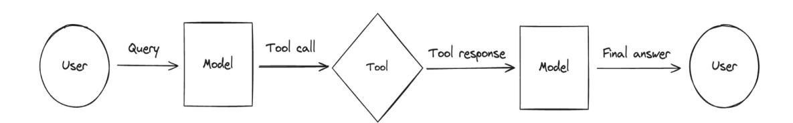

# **Summary of Chapter 5**

In this second part, we extended our AI agent's capabilities by:

- Defining a tool to fetch real-time weather information.
- Integrating the tool into our LangGraph workflow using ToolNode .

● Updating the agent to decide when to call the LLM and when to use the tool.

By adding tools to your AI agent, you enable it to perform more complex and useful tasks, such as retrieving real-time data, making calculations, or interacting with external systems. This lays the foundation for building even more sophisticated agents in future chapters.

# **What's Next?**

Now that you have a solid understanding of how to integrate LLMs and tools into your LangGraph workflows, we'll explore **state management and persistence** in the next chapter. This will allow your agents to remember information between interactions and sessions, further enhancing their functionality and user experience.

# **Chapter 6**

# <span id="page-148-1"></span><span id="page-148-0"></span>**Introducing Memory in AI Agents**

In this chapter, we will focus on **short-term memory** in AI agents, a key feature that allows an agent to remember interactions within a session but not across multiple sessions. Short-term memory helps an agent maintain context during a conversation, making it more coherent and responsive to user inputs.

We'll start by demonstrating an AI agent without any memory and show how adding short-term memory improves the interaction. We'll use LangGraph's built-in memory tools to achieve this.

# <span id="page-148-2"></span>**6.1 The Problem: An Agent Without Memory**

Let's first create a basic AI agent that lacks memory. This agent processes each user query individually, with no knowledge of prior interactions.

# **Example: A Basic AI Agent Without Memory**

#lesson6a.py from langchain\_openai import ChatOpenAI from langgraph.graph import StateGraph, MessagesState, START, END from dotenv import load\_dotenv import os

```
# Load API key from .env file
load_dotenv()
api_key = os.getenv("OPENAI_API_KEY")
# Initialize the LLM (using OpenAI's GPT-4o-mini)
model = ChatOpenAI(model="gpt-4o-mini", api_key=api_key)
# Node function to handle the user query and call the LLM
def call_llm(state: MessagesState):
    messages = state["messages"]
    response = model.invoke(messages[-1].content)
    return {"messages": [response]}
# Define the graph
workflow = StateGraph(MessagesState)
# Add the node to call the LLM
workflow.add_node("call_llm", call_llm)
# Define the edges (start -> LLM -> end)
workflow.add_edge(START, "call_llm")
workflow.add_edge("call_llm", END)
# Compile the workflow
app = workflow.compile()
# Function to continuously take user input
def interact_with_agent():
    while True:
         user_input = input("You: ")
         if user_input.lower() in ["exit", "quit"]:
          print("Ending the conversation.")
          break
         input_message = {
          "messages": [("human", user_input)]
         }
         for chunk in app.stream(input_message, stream_mode="values"):
          chunk["messages"][-1].pretty_print()
# Start interacting with the agent
interact_with_agent()
```

# In this case:

● The agent takes user input, sends it to the language model, and responds.

● **No memory:** The agent forgets everything after each interaction, treating every input as a new, isolated query.

# **Sample Interaction Without Memory:**

```
You: What's my name?
Agent: I'm sorry, I don't know your name.
You: My name is John.
Agent: Nice to meet you, John.
You: What's my name?
Agent: I'm sorry, I don't know your name.
```

Notice that the agent cannot remember that the user just mentioned their name a few moments ago.

# <span id="page-150-0"></span>**6.2 Enhancing the Agent with Short-Term Memory**

Now, let's add **short-term memory** using LangGraph's MemorySaver . With short-term memory, the agent can remember the conversation during the session but will forget everything once the session ends.

# **Example: Adding Short-Term Memory with MemorySaver**

```
#lesson6b.py
from langgraph.checkpoint.memory import MemorySaver
# Update node function to invoke all messages to give the LLM context
def call_llm(state: MessagesState):
    messages = state["messages"]
    response = model.invoke(messages)
    return {"messages": [response]}
# Initialize the checkpointer for short-term memory
checkpointer = MemorySaver()
# Compile the workflow with short-term memory
app_with_memory = workflow.compile(checkpointer=checkpointer)
def interact_with_agent_with_memory():
    # Use a thread ID to simulate a continuous session
    thread_id = "session_1"
    while True:
         user_input = input("You: ")
         if user_input.lower() in ["exit", "quit"]:
            print("Ending the conversation.")
```

```
break
        input_message = {
            "messages": [("human", user_input)]
        }
        # Invoke the graph with short-term memory enabled
        config = {"configurable": {"thread_id": thread_id}}
        for chunk in app_with_memory.stream(input_message, config=config,
stream_mode="values"):
            chunk["messages"][-1].pretty_print()
# Start interacting with the memory-enabled agent
interact_with_agent_with_memory()
```

# **Sample Interaction with Short-Term Memory:**

You: What's my name?

Agent: I'm sorry, I don't know your name.

You: My name is John.

Agent: Nice to meet you, John.

You: What's my name? Agent: Your name is John.

Here, the agent now **remembers** that your name is "John" during the session, demonstrating the benefit of short-term memory. The session context persists as long as the session is active.

# <span id="page-151-0"></span>**6.3 How Short-Term Memory Works**

By adding MemorySaver , we can store the state of the conversation within the session. In the background, LangGraph saves **checkpoints**—snapshots of the conversation state—at every step. These checkpoints are linked to a **thread ID**, which simulates a session. As long as the thread ID remains the same, the agent will remember past interactions.

- **Checkpointers:** Store the conversation state.
- **Thread ID:** Simulates a session, allowing the agent to maintain context.
- **Short-Term Memory:** Once the session ends, memory is discarded.

# **6.4 Demonstrating Short-Term Memory Through Multiple Questions**

Let's see how the agent behaves when answering multiple questions.

# **Sample Interaction:**

You: What is the capital of France? Agent: The capital of France is Paris.

You: And what's my name?

Agent: I'm sorry, I don't know your name.

You: My name is Sarah James. Agent: Nice to meet you, Sarah.

You: What's my first name? Agent: Your first name is Sarah.

You: What's my second name? Agent: Your second name is James.

# In this session:

- The agent correctly remembers the user's name ("Sarah") after it's provided.
- The agent also handles other queries (e.g., capitals of countries) without losing the memory of the user's name during the session.

# <span id="page-152-0"></span>**6.5 Full Code Example: An AI Agent with Short-Term Memory**

Here's the full code to create an AI agent with short-term memory using LangGraph's MemorySaver :

```
#lesson6c.py
from langchain_openai import ChatOpenAI
from langgraph.graph import StateGraph, MessagesState, START, END
from langgraph.checkpoint.memory import MemorySaver
from dotenv import load_dotenv
import os
# Load API key from .env file
load_dotenv()
api_key = os.getenv("OPENAI_API_KEY")
# Initialize the LLM (using OpenAI's GPT-4o-mini)
```

```
model = ChatOpenAI(model="gpt-4o-mini", api_key=api_key)
# Node function to handle the user query and call the LLM
def call_llm(state: MessagesState):
    messages = state["messages"]
    response = model.invoke(messages)
    return {"messages": [response]}
# Define the graph
workflow = StateGraph(MessagesState)
# Add the node to call the LLM
workflow.add_node("call_llm", call_llm)
# Define the edges (start -> LLM -> end)
workflow.add_edge(START, "call_llm")
workflow.add_edge("call_llm", END)
# Initialize the checkpointer for short-term memory
checkpointer = MemorySaver()
# Compile the workflow with short-term memory
app_with_memory = workflow.compile(checkpointer=checkpointer)
# Function to interact with the agent using short-term memory
def interact_with_agent_with_memory():
    # Use a thread ID to simulate a continuous session
    thread_id = "session_2"
    while True:
        user_input = input("You: ")
        if user_input.lower() in ["exit", "quit"]:
            print("Ending the conversation.")
            break
        input_message = {
            "messages": [("human", user_input)]
        }
        # Invoke the graph with short-term memory enabled
        config = {"configurable": {"thread_id": thread_id}}
        for chunk in app_with_memory.stream(input_message, config=config,
stream_mode="values"):
            chunk["messages"][-1].pretty_print()
# Start interacting with the memory-enabled agent
interact_with_agent_with_memory()
```

# <span id="page-154-0"></span>**6.6 Memory Across Multiple Sessions**

In the previous section, we explored short-term memory, where the agent remembers interactions within a single session. However, in many cases, it is useful for an agent to persist memory across multiple sessions. This allows the agent to remember user details or conversation history even if the user reconnects or starts a new session. In this section, we'll explore how LangGraph enables memory persistence across sessions using its memory store.

# **6.6.1 Memory and Checkpoints Across Sessions**

LangGraph uses **checkpointers** and **thread IDs** to store the state of the conversation at every interaction (called a **super-step**). Each interaction or session can be linked to a specific thread, allowing the agent to recall the exact state of the conversation when the thread ID is reused. This is useful when you need memory to persist across different sessions, which is often the case in customer service applications or personal assistants.

# **How It Works:**

- 1. **Checkpointers** store the state of the conversation (e.g., user inputs, agent responses) at each interaction.
- 2. **Thread IDs** uniquely identify a session or conversation, allowing the agent to restore the conversation from a previous checkpoint when the same thread ID is provided.

Let's demonstrate how the agent saves and restores memory across different sessions using the thread ID.

# **6.6.2 Example: In-Memory Persistence Across Sessions**

We will modify our existing agent to persist memory between different sessions by using thread IDs to link conversations. Remember that when the program ends the data will be lost from memory, since all the session are inmemory i.e located in RAM and not saved to disk.

# **Code Example: Using Checkpointers for Cross Session Memory**

#lesson6d.py

from langchain\_openai import ChatOpenAI

```
from langgraph.graph import StateGraph, MessagesState, START, END
from langgraph.checkpoint.memory import MemorySaver
from dotenv import load_dotenv
import os
# Load API key from .env file
load_dotenv()
api_key = os.getenv("OPENAI_API_KEY")
# Initialize the LLM (using OpenAI's GPT-4o-mini)
model = ChatOpenAI(model="gpt-4o-mini", api_key=api_key)
# Node function to handle the user query and call the LLM
def call_llm(state: MessagesState):
    messages = state["messages"]
    response = model.invoke(messages)
    return {"messages": [response]}
# Define the graph
workflow = StateGraph(MessagesState)
# Add the node to call the LLM
workflow.add_node("call_llm", call_llm)
# Define the edges (start -> LLM -> end)
workflow.add_edge(START, "call_llm")
workflow.add_edge("call_llm", END)
# Initialize the MemorySaver checkpointer
checkpointer = MemorySaver()
# Compile the workflow with short-term memory
app_with_memory = workflow.compile(checkpointer=checkpointer)
# Function to simulate interacting with the agent across sessions
def interact_with_agent_across_sessions():
    while True:
        # Simulate a new session by allowing the user to input a thread ID
        thread_id = input("Enter thread ID (or 'new' for a new session): ")
        if thread_id.lower() in ["exit", "quit"]:
            print("Ending the conversation.")
            break
        if thread_id.lower() == "new":
            thread_id = f"session_{os.urandom(4).hex()}"  # Generate a unique session
ID
        while True:
```

```
user_input = input("You: ")
             if user_input.lower() in ["exit", "quit", "end session"]:
                 print(f"Ending session {thread_id}.")
                 break
             input_message = {
                 "messages": [("human", user_input)]
             }
             # Invoke the graph with the correct thread ID to maintain memory across
sessions
             config = {"configurable": {"thread_id": thread_id}}
             for chunk in app_with_memory.stream(input_message, config=config,
stream_mode="values"):
                 chunk["messages"][-1].pretty_print()
# Start interacting with the memory-persistent agent
interact_with_agent_across_sessions()
```

# **Key Features:**

- 1. **Session-based Memory:** Users can reconnect to the agent using a thread ID (e.g., session\_1 ), and the agent will recall the conversation context from the last interaction associated with that ID.
- 2. **New Sessions:** Users can create a new session by generating a new thread ID, allowing the agent to start fresh without any prior memory.

# **Sample Interaction With In-Memory Persistence:**

```
You: My name is Sarah.
Agent: Nice to meet you, Sarah! How can I assist you today?
You: End session.
Ending session session_1.
Enter thread ID (or 'new' for a new session): session_1
You: What's my name?
Agent: Your name is Sarah.
Enter thread ID (or 'new' for a new session): session_2
You: What's my name?
```

Agent: I'm sorry, but I don't have access to personal information...

In this example, even though the session ended and resumed later, the agent remembered the user's name, thanks to the memory associated with the thread\_id . Each sessions memory is independent and memory stored in session\_1 is not available in session\_2.

# **6.6.3 How In-Memory Persistence Works in LangGraph**

# **Checkpoints and Threads**

- **Checkpoints:** LangGraph saves the state of the conversation at every interaction as a checkpoint. Each checkpoint contains the conversation context, including user inputs and agent responses.
- **Thread IDs:** Every session is associated with a thread ID. When the same thread ID is reused, LangGraph restores the conversation context from the last checkpoint associated with that thread.

# For example:

- If you start a session with thread\_id = "session\_1" , LangGraph will store all the interactions within this session.
- If you come back later and start a new session using the same thread\_id , the agent will restore the memory from the last interaction in session\_1 .

# **Resolving Memory Across Sessions**

Memory can be saved across different sessions, making it possible to resume conversations after a session ends. This is particularly useful for long-running workflows, customer service applications, or scenarios where users interact with the agent over time.

# **6.6.4 In-Memory Store for Persistent Information**

Sometimes, it's necessary for the agent to remember certain user information (e.g., preferences, personal data) **across all sessions**, even when a new thread is started. To accomplish this, LangGraph provides the **Memory Store**.

The Memory Store allows the agent to store information that can be shared across different sessions (threads) for the same user. For example, the agent

could store a user's food preferences or favorite activities, which would persist across all future conversations, regardless of the session ID.

# **Example: Storing Information Across Sessions Using Memory Store**

```
#lesson6e.py
from langgraph.store.memory import InMemoryStore
import uuid
# Initialize an in-memory store to store user information across sessions
in_memory_store = InMemoryStore()
# Function to store user information across sessions
def store_user_info(state: MessagesState, config, *, store=in_memory_store):
    user_id = config["configurable"]["user_id"]
    namespace = (user_id, "memories")
    # Create a memory based on the conversation
    memory_id = str(uuid.uuid4())
    memory = {"user_name": state["user_name"]}
    # Save the memory to the in-memory store
    store.put(namespace, memory_id, memory)
    return {"messages": ["User information saved."]}
# Function to retrieve stored user information
def retrieve_user_info(state: MessagesState, config, *, store=in_memory_store):
    user_id = config["configurable"]["user_id"]
    namespace = (user_id, "memories")
    # Retrieve the stored memories
    memories = store.search(namespace)
    if memories:
         info = f"Hello {memories[-1].value['user_name']}, welcome back!"
    else:
         info = "I don't have any information about you yet."
   return {"messages": [info]}
```

This example demonstrates how to store user-specific information in a memory store, allowing the agent to persist critical information across sessions and threads. The stored information can be accessed later, regardless of the session ID, by using the same user ID.

# The complete code:

```
#lesson6e.py complete example code
from langgraph.store.memory import InMemoryStore
from langgraph.checkpoint.memory import MemorySaver
from langgraph.graph import StateGraph, MessagesState, START, END
from langchain_openai import ChatOpenAI
import uuid
from dotenv import load_dotenv
import os
# Load API key from .env file
load_dotenv()
api_key = os.getenv("OPENAI_API_KEY")
# Initialize the LLM (using OpenAI's GPT-4o-mini)
model = ChatOpenAI(model="gpt-4o-mini", api_key=api_key)
# Initialize an in-memory store to store user information across sessions
in_memory_store = InMemoryStore()
# Function to store user information across sessions
def store_user_info(state: MessagesState, config, *, store=in_memory_store):
    user_id = config["configurable"]["user_id"]
    namespace = (user_id, "memories")
    # Store user's name in memory
    memory_id = str(uuid.uuid4())
    user_name = state["user_name"]
    memory = {"user_name": user_name}
    # Save the memory in the in-memory store
    store.put(namespace, memory_id, memory)
    return {"messages": ["User information saved."]}
# Function to retrieve stored user information
def retrieve_user_info(state: MessagesState, config, *, store=in_memory_store):
    user_id = config["configurable"]["user_id"]
    namespace = (user_id, "memories")
    # Retrieve stored user info
    memories = store.search(namespace)
    if memories:
        info = f"Hello {memories[-1].value['user_name']}, welcome back!"
    else:
```

```
info = "I don't have any information about you yet."
    return {"messages": [info]}
# Function to handle storing or retrieving user info based on input
def call_model(state: MessagesState, config):
    last_message = state["messages"][-1].content.lower()
    if "remember my name" in last_message:
        # Store user's name in state and in memory
        user_name = last_message.split("remember my name is")[-1].strip()
        state["user_name"] = user_name
        return store_user_info(state, config)
    if "what's my name" in last_message or "what is my name" in last_message:
        # Retrieve the user's name from memory
        return retrieve_user_info(state, config)
    # Default LLM response for other inputs
    return {"messages": ["I didn't understand your request."]}
# Build the LangGraph workflow
workflow = StateGraph(MessagesState)
workflow.add_node("call_model", call_model)
workflow.add_edge(START, "call_model")
workflow.add_edge("call_model", END)
# Compile the graph with memory management
app_with_memory = workflow.compile(checkpointer=MemorySaver(),
store=in_memory_store)
# Simulate sessions
def simulate_sessions():
    # First session: store user's name
    config = {"configurable": {"thread_id": "session_1", "user_id": "user_123"}}
    input_message = {"messages": [{"type": "user", "content": "Remember my name is
Alice"}]}
    for chunk in app_with_memory.stream(input_message, config=config,
stream_mode="values"):
        chunk["messages"][-1].pretty_print()
    # Second session: retrieve user's name
    config = {"configurable": {"thread_id": "session_2", "user_id": "user_123"}}
    input_message = {"messages": [{"type": "user", "content": "What's my name?"}]}
    for chunk in app_with_memory.stream(input_message, config=config,
stream_mode="values"):
```

chunk["messages"][-1].pretty\_print() # Run the session simulations simulate\_sessions()

# **6.6.5 Explanation of the Code**

# **a) store\_user\_info:**

- i) This function is responsible for storing the user's name in the memory store. It generates a unique memory ID and saves the user's name in the namespace for the user\_id.
- ii) The namespace is constructed using the user\_id, ensuring that information is stored and retrieved for specific users.

# **b) retrieve\_user\_info:**

- i) This function retrieves the user's name from the memory store. It searches the store for any saved information under the specific user\_id namespace.
- ii) If the name is found, it returns the stored name; otherwise, it informs the user that no information is available.

# **c) call\_model:**

- i) This function is the central point that decides whether to store or retrieve user information based on the user's input.
- ii) If the user says "Remember my name is ...", the agent stores the name.
- iii) If the user asks "What's my name?", the agent retrieves the stored name.

# **d) Memory Storage:**

- i) The InMemoryStore is used to manage memory persistence, and the agent saves and retrieves the user's name across sessions using the store.
- ii) The MemorySaver checkpointer is responsible for managing short-term memory within the session, while the memory store handles information across different sessions.

In this section, we demonstrated how to persist memory across sessions using thread IDs and LangGraph's checkpoint system. We also explored the use of a memory store for retaining user-specific information across different threads and sessions. By combining checkpointers and memory stores, you can build AI agents that not only remember conversations

within a session but also recall critical information about users across multiple interactions, enhancing the overall user experience.

# <span id="page-162-0"></span>**6.7 Explainer Section: Technical Details on Checkpointers and InMemoryStore**

In this explainer section, we dive deep into two important technical components that power memory in LangGraph: **Checkpointers** and the **InMemoryStore**. Understanding these components will help you build AI agents capable of managing memory across sessions and workflows efficiently.

# **6.7.1. Checkpointers**

A **Checkpointer** is responsible for saving the state of a graph at each **super-step** in the workflow. Each checkpoint is a snapshot of the current graph state and contains crucial information like configuration, metadata, and state values. Checkpointers allow LangGraph to maintain short-term memory by storing graph states and recalling them when necessary.

# **Key Properties of a Checkpoint**

A checkpoint is represented by a **StateSnapshot** object and contains the following important properties:

- **Config**: Configuration associated with this checkpoint, including the thread\_id and optional checkpoint\_id .
- **Metadata**: Metadata provides details about the source of the checkpoint and the graph's progress at this point.
- **Values**: Values represent the current state of the channels in the graph at the time the checkpoint was taken.
- **Next**: A tuple of the node names to execute next in the graph.
- **Tasks**: A tuple of PregelTask objects that contain information about the next tasks to execute in the graph. It also holds error data if an execution failed or was interrupted.

Each checkpoint represents the state of the graph at a specific **super-step** and can be replayed or updated.

# **Python Concepts Used:**

- **TypedDict**: A feature from Python's typing module used to define a specific structure for dictionaries. In LangGraph, this is used to define the structure of graph states.
- **Reducers**: Functions that combine or reduce state values. For example, a list reducer can merge old and new list items.

# **Checkpoint Structure (StateSnapshot)**

```
#lesson6f.py
StateSnapshot()
    values={'foo': 'b', 'bar': ['a', 'b']},  # Current state values
    next=(),  # Nodes to execute next (empty means graph execution is complete)
    config={'configurable': {'thread_id': '1', 'checkpoint_ns': '', 'checkpoint_id':
'12345'}},  # Config details
    metadata={'source': 'loop', 'writes': {'node_b': {'foo': 'b', 'bar': ['b']}}, 'step': 2},  #
Metadata info
    created_at='2024-10-02T18:22:31.590602+00:00',  # Creation timestamp
    parent_config={'configurable': {'thread_id': '1', 'checkpoint_ns': '', 'checkpoint_id':
'12344'}},  # Parent checkpoint
    tasks=()  # Tasks to be executed next
)
```

# **Example: Capturing Checkpoints**

Let's create a simple graph and observe how checkpoints are saved at different stages of execution. We'll illustrate a graph with two nodes and use the **MemorySaver** checkpointer to capture and display checkpoints.

```
#lesson6f.py
from langgraph.graph import StateGraph, START, END
from langgraph.checkpoint.memory import MemorySaver
from typing import TypedDict
# Define the state schema using TypedDict
class State(TypedDict):
    foo: str
    bar: list[str]
# Define node functions to update the state
def node_a(state: State):
```

```
return {"foo": "a", "bar": ["a"]}
def node_b(state: State):
    return {"foo": "b", "bar": ["b"]}
# Build the workflow graph
workflow = StateGraph(State)
workflow.add_node(node_a)
workflow.add_node(node_b)
workflow.add_edge(START, "node_a")
workflow.add_edge("node_a", "node_b")
workflow.add_edge("node_b", END)
# Initialize the checkpointer
checkpointer = MemorySaver()
graph = workflow.compile(checkpointer=checkpointer)
# Run the graph with thread_id and capture checkpoints
config = {"configurable": {"thread_id": "1"}}
graph.invoke({"foo": "", "bar": []}, config)
```

#### **Output: Checkpoints Generated**

1. **Initial State**: Before node\_a executes.

```
#lesson6f.py
StateSnapshot(
    values={'foo': '', 'bar': []},
    next=('node_a',),
    metadata={'step': 0},
    tasks=(PregelTask(name='node_a'),)
)
```

2. **After node\_a Executes**: State is updated by node\_a .

```
#lesson6f.py
StateSnapshot(
    values={'foo': 'a', 'bar': ['a']},
    next=('node_b',),
    metadata={'step': 1},
    tasks=(PregelTask(name='node_b'),)
)
```

3. **After node\_b Executes**: Final state of the graph.

```
#lesson6f.py
StateSnapshot(
     values={'foo': 'b', 'bar': ['a', 'b']},
     next=(),
     metadata={'step': 2},
     tasks=()
)
```

Each **StateSnapshot** shows the state ( foo and bar ), the next node to execute ( next ), and metadata ( step , tasks ).

# **Get Current State:**

You can retrieve the latest state of the graph by calling graph.get\_state() .

```
#lesson6f.py
config = {"configurable": {"thread_id": "1"}}
latest_state = graph.get_state(config)
print(latest_state.values)  # {'foo': 'b', 'bar': ['a', 'b']}
```

# **Get State History:**

You can retrieve the entire state history using graph.get\_state\_history() :

```
#lesson6f.py
config = {"configurable": {"thread_id": "1"}}
state_history = graph.get_state_history(config)
for snapshot in state_history:
    print(snapshot.values)
```

#### **Output:**

```
[
    {'foo': 'b', 'bar': ['a', 'b']},
    {'foo': 'a', 'bar': ['a']},
    {'foo': '', 'bar': []}
]
```

This shows how the state evolved during execution.

# <span id="page-166-0"></span>**6.7.2. InMemoryStore**

**InMemoryStore** allows you to persist information across different threads and sessions. While checkpointers are tied to a specific session (thread), the memory store can retain user information, preferences, and history between different sessions.

# **Key Concepts:**

- **Namespace**: In **InMemoryStore**, memories are saved using a **namespace** that typically includes a user\_id to uniquely identify the memory.
- **Put and Search**: These are the primary operations. put() stores a memory, and search() retrieves it.

# **Python Concepts Used:**

- **UUID**: A Python module to generate unique memory IDs for each memory.
- **Dict**: Memory objects are stored as dictionaries to allow flexible storage of key-value pairs.

# **Example: Using InMemoryStore to Save and Retrieve Memories**

```
#lesson6f.py
from langgraph.store.memory import InMemoryStore
import uuid
# Initialize the memory store
in_memory_store = InMemoryStore()
# Define a user namespace (user_id + "memories")
user_id = "1"
namespace_for_memory = (user_id, "memories")
# Store a memory (food preference)
memory_id = str(uuid.uuid4())
memory = {"food_preference": "I like pizza"}
in_memory_store.put(namespace_for_memory, memory_id, memory)
# Retrieve the stored memories
memories = in_memory_store.search(namespace_for_memory)
```

```
print(memories[-1].dict())  # {'value': {'food_preference': 'I like pizza'}, ...}
Output:
{
  'value': {'food_preference': 'I like pizza'},
  'key': '07e0caf4-1631-47b7-b15f-65515d4c1843',
  'namespace': ['1', 'memories'],
  'created_at': '2024-10-02T17:22:31.590602+00:00',
  'updated_at': '2024-10-02T17:22:31.590605+00:00'
}
```

Here, **put()** adds the memory to the store, and **search()** retrieves it.

# **6.7.3. Using Checkpointers and InMemoryStore Together**

In real-world applications, you often combine **checkpointers** for sessionbased memory and **InMemoryStore** for persistent memory across sessions.

# **Full Example: Graph with Checkpointer and Memory Store**

```
#lesson6f.py
from langgraph.checkpoint.memory import MemorySaver
from langgraph.store.memory import InMemoryStore
# Initialize the checkpointer and memory store
checkpointer = MemorySaver()
in_memory_store = InMemoryStore()
# Compile the graph with both
graph = workflow.compile(checkpointer=checkpointer, store=in_memory_store)
# Invoke the graph with thread_id and user_id
config = {"configurable": {"thread_id": "session_1", "user_id": "1"}}
graph.invoke({"foo": ""}, config)
```

# In this setup:

- **Checkpointer** handles state persistence within the session.
- **InMemoryStore** manages long-term memory across sessions using user\_id .

# **Accessing Memory in a Node**

```
#lesson6f.py
def update_memory(state: MessagesState, config: RunnableConfig, *, store: BaseStore):
```

```
user_id = config["configurable"]["user_id"]
    namespace = (user_id, "memories")
    # Store a memory
    memory_id = str(uuid.uuid4())
    store.put(namespace, memory_id, {"favorite_food": "pizza"})
    # Retrieve stored memories
    memories = store.search(namespace)
    return {"messages": [f"I remember you like
{memories[-1].value['favorite_food']}"]}
```

# **Output: When Invoked in Two Separate Threads**

Thread 1:

You: What is my favorite food? Agent: I remember you like pizza.

Thread 2:

You: What is my favorite food? Agent: I remember you like pizza.

Even though the user starts a new session with a different thread, the agent recalls the memory because it's stored under the same user\_id .

# **6.7.4. Key Checkpointer Libraries and Interface**

LangGraph provides several checkpointer libraries, each optimized for different use cases:

- **MemorySaver**: In-memory checkpointer for testing and experimentation.
- **SQLiteSaver**: Saves checkpoints in SQLite, ideal for small-scale production.
- **PostgresSaver**: A Postgres-based checkpointer used in large-scale production environments.

All checkpointers implement the following key methods:

- **put()**: Save a checkpoint with config and metadata.
- **get\_state()**: Retrieve the latest checkpoint for a given thread\_id .
- **get\_state\_history()**: Retrieve all checkpoints for a given thread\_id .

These methods enable flexible state management and support **replaying** or **updating** states at any point in a graph's execution.

# <span id="page-169-0"></span>**Chapter 6: Quiz**

Test your knowledge of Chapter 6 and make sure you understand key concepts about memory in AI agents, checkpoints, and memory stores. Each question explores a fundamental part of the concepts you've just learned.

# **Multiple Choice Questions:**

# 1. **What does short-term memory in an AI agent refer to?**

- a) The ability to remember information across multiple sessions
- b) The ability to remember information only during a single session
- c) The ability to recall data from memory without user input
- d) The ability to store all user data permanently

**Answer**: b) The ability to remember information only during a single session

# 2. **Which of the following tools is used to implement short-term memory in LangGraph?**

- a) InMemoryStore
- b) SQLiteSaver
- c) MemorySaver
- d) MemoryCache

**Answer**: c) MemorySaver

# 3. **What is a checkpoint in the context of LangGraph?**

- a) A fixed point where the user input is stored
- b) A snapshot of the graph state saved at each step of the workflow
- c) A method for retrieving past sessions
- d) A storage method for long-term user preferences

**Answer**: b) A snapshot of the graph state saved at each step of the workflow

# **4. What does the thread\_id help with in LangGraph workflows?**

- a) Creating new nodes in a graph
- b) Storing data across multiple sessions
- c) Replaying a specific session's memory
- d) Uniquely identifying a session and associating it with memory

**Answer**: d) Uniquely identifying a session and associating it with memory

# 5. **Which method is used to retrieve all previous checkpoints in a session's execution?**

- a) graph.get\_all\_states()
- b) graph.invoke(config)
- c) graph.get\_state\_history(config)
- d) graph.search(config)

**Answer**: c) graph.get\_state\_history(config)

# 6. **Which Python feature is used to structure the state in LangGraph graphs?**

- a) NamedTuple
- b) List
- c) TypedDict
- d) Dictionary

**Answer**: c) TypedDict

# 7. **What is the purpose of an InMemoryStore in LangGraph?**

- a) To store state during a single session
- b) To provide memory persistence across multiple sessions and threads
- c) To speed up the LLM's response time
- d) To store temporary files during graph execution

**Answer**: b) To provide memory persistence across multiple sessions and threads

# **Practical Assignment: Build a Fully Functional AI Agent**

In this practical assignment, you will create an AI agent using **LangGraph** that incorporates all the features you've learned from Chapters 1 to 6, including:

- State management
- Short-term memory
- Long-term memory across sessions

# **Objectives:**

# 1. **Basic Agent Behavior**:

- Create an AI agent that can handle user queries and responds with answers.
- Use a Language Model (LLM) such as OpenAI's GPT models.

# 2. **State Management**:

○ Design a workflow with nodes that manage and update the conversation state.

# 3. **Short-Term Memory**:

- Implement short-term memory using **MemorySaver** to keep the context of the conversation within a session.
- The agent should remember user input and context during the session.

# 4. **Long-Term Memory**:

- Use **InMemoryStore** to store persistent user information (e.g., user preferences, name) across sessions.
- Allow the agent to recall details from previous sessions using the user\_id and thread\_id .

# 5. **Custom Node Behavior**:

○ Create custom nodes to handle specific actions like storing user information and recalling it when necessary.

# 6. **Checkpoints and Replays**:

○ Make sure the agent can replay sessions by using checkpoints and thread identifiers.

# **Steps to Complete the Assignment:**

# **1. Set up Your Environment:**

Make sure you have LangGraph, LangChain, and the necessary LLM models (like OpenAI's GPT-4o-mini) ready. Install dependencies if needed:

```
terminal
pip install langgraph langchain_openai python-dotenv
```

# **Step 2: Implement Short-Term Memory**

Short-term memory will use **MemorySaver** to recall interactions within a single session. You will need to use **thread\_id** to identify the session and capture the conversation state.

```
#lesson6f.py
from langgraph.graph import StateGraph, MessagesState, START, END
from langgraph.checkpoint.memory import MemorySaver
from langchain_openai import ChatOpenAI
from dotenv import load_dotenv
import os
# Load environment variables
load_dotenv()
# Initialize API key
api_key = os.getenv("OPENAI_API_KEY")
# Initialize OpenAI model
model = ChatOpenAI(model="gpt-4o-mini", api_key=api_key)
# Define the graph workflow
workflow = StateGraph(MessagesState)
```

```
# Node to process user query and return the LLM response
def call_llm(state: MessagesState):
    messages = state["messages"]
    response = model.invoke(messages)
    return {"messages": [response]}
# Add nodes and define edges in the graph
workflow.add_node("call_llm", call_llm)
workflow.add_edge(START, "call_llm")
workflow.add_edge("call_llm", END)
# Initialize the MemorySaver for short-term memory
checkpointer = MemorySaver()
app_with_memory = workflow.compile(checkpointer=checkpointer)
# Simulate conversation with short-term memory
def interact_with_agent():
    thread_id = "session_1"
    while True:
        user_input = input("You: ")
        if user_input.lower() in ["exit", "quit"]:
            break
        input_message = {
            "messages": [("human", user_input)]
        }
        config = {"configurable": {"thread_id": thread_id}}
        for chunk in app_with_memory.stream(input_message, config=config,
stream_mode="values"):
            chunk["messages"][-1].pretty_print()
interact_with_agent()
```

# In this code:

- The **call\_llm** node sends user queries to the OpenAI model and receives a response.
- **MemorySaver** stores the state of the conversation, allowing the agent to recall the interaction within the session.

# **Step 3: Implement Long-Term Memory**

To persist information across sessions, we'll use **InMemoryStore**. This allows the agent to recall user information in future sessions.

```
#lesson6f.py
from langgraph.store.memory import InMemoryStore
import uuid
# Initialize the in-memory store
in_memory_store = InMemoryStore()
# Function to store user information
def store_user_info(state: MessagesState, config, *, store=in_memory_store):
    user_id = config["configurable"]["user_id"]
    namespace = (user_id, "memories")
    memory_id = str(uuid.uuid4())
    memory = {"user_name": state["user_name"]}
    store.put(namespace, memory_id, memory)
    return {"messages": ["User information saved."]}
# Function to retrieve stored user information
def retrieve_user_info(state: MessagesState, config, *, store=in_memory_store):
    user_id = config["configurable"]["user_id"]
    namespace = (user_id, "memories")
    memories = store.search(namespace)
    if memories:
         info = f"Hello {memories[-1].value['user_name']}, welcome back!"
    else:
         info = "I don't have any information about you yet."
    return {"messages": [info]}
```

# In this code:

● **InMemoryStore** is used to store and retrieve user-specific information across sessions using user\_id .

# **Step 4: Combine Short-Term and Long-Term Memory**

Now, we will combine both memory approaches to create a fully functional agent capable of both short-term and long-term memory.

```
terminal
from langgraph.graph import StateGraph, MessagesState, START, END
```

```
from langgraph.store.memory import InMemoryStore
from langgraph.checkpoint.memory import MemorySaver
import uuid
# Initialize the in-memory store
in_memory_store = InMemoryStore()
# Function to store user information
def store_user_info(state: MessagesState, config, *, store=in_memory_store):
    user_id = config["configurable"]["user_id"]
    namespace = (user_id, "memories")
    memory_id = str(uuid.uuid4())
    memory = {"user_name": state["user_name"]}
    store.put(namespace, memory_id, memory)
    return {"messages": ["User information saved."]}
# Function to retrieve stored user information
def retrieve_user_info(state: MessagesState, config, *, store=in_memory_store):
    user_id = config["configurable"]["user_id"]
    namespace = (user_id, "memories")
    memories = store.search(namespace)
    if memories:
         info = f"Hello {memories[-1].value['user_name']}, welcome back!"
    else:
         info = "I don't have any information about you yet."
    return {"messages": [info]}
# Function to manage user input and memory storage/retrieval
def call_model(state: MessagesState, config):
    last_message = state["messages"][-1].content.lower()
    # Store the user's name
    if "remember my name" in last_message:
         user_name = last_message.split("remember my name is")[-1].strip()
         state["user_name"] = user_name
         return store_user_info(state, config)
    # Retrieve the user's name
    if "what's my name" in last_message or "what is my name" in last_message:
         return retrieve_user_info(state, config)
    # Default LLM response for other inputs
    return {"messages": ["I didn't understand your request."]}
# Define the graph workflow
```

```
workflow = StateGraph(MessagesState)
workflow.add_node("call_model", call_model)
workflow.add_edge(START, "call_model")
workflow.add_edge("call_model", END)
# Compile the graph with both checkpointer and memory store
app_with_memory = workflow.compile(checkpointer=MemorySaver(),
store=in_memory_store)
def simulate_sessions():
    # First session: store user's name
    config = {"configurable": {"thread_id": "session_1", "user_id": "user_123"}}
    input_message = {"messages": [("human", "Remember my name is Alice")]}
    for chunk in app_with_memory.stream(input_message, config=config,
stream_mode="values"):
        chunk["messages"][-1].pretty_print()
    # Second session: retrieve user's name
    config = {"configurable": {"thread_id": "session_2", "user_id": "user_123"}}
    input_message = {"messages": [("human", "What's my name?")]}
    for chunk in app_with_memory.stream(input_message, config=config,
stream_mode="values"):
        chunk["messages"][-1].pretty_print()
simulate_sessions()
```

# **Expected Output:**

#### **Session 1:**

You: Remember my name is Alice Agent: Your information has been saved!

#### **Session 2:**

You: What's my name?

Agent: Hello Alice, welcome back!

This assignment demonstrates how to implement both **short-term memory** (within a session) and **long-term memory** (across sessions) using LangGraph's **MemorySaver** and **InMemoryStore**.

# **Chapter 7**

# <span id="page-177-1"></span><span id="page-177-0"></span>**Advanced Routing and Customization of AI Agents**

In this chapter, we will expand on the foundational concepts introduced in previous chapters, focusing on **advanced routing**, **custom workflows**, **structured outputs**, and **integration with common APIs**. These concepts will enable you to build more dynamic, adaptable, and customized AI agents using **LangGraph**. We'll also dive into **conditional logic**, which allows you to control how your agent processes user queries and external API responses. By the end of this chapter, you will be able to develop AI agents that intelligently route user input to the correct workflows, handle complex interactions, and even stream real-time data to the user.

# <span id="page-177-2"></span>**7.1 Introduction to Routing in AI Agents**

**Routing** in AI agents refers to the ability to direct user input through different paths, workflows, or tasks based on specific criteria. It's a crucial component for handling complex conversations, allowing agents to:

- Decide which task or service to invoke based on user input.
- Handle multiple types of queries in a single session.
- Integrate external services (e.g., weather, search) and route input appropriately.

# **Why is Routing Important?**

AI agents often need to handle a variety of user requests, from simple information retrieval to more complex operations like making calculations or querying external APIs. Without routing, the agent would struggle to manage different types of tasks and would often provide incorrect or incomplete responses. **Routing** ensures the agent processes each query through the correct workflow or task.

# **Use Case Example**

Consider a virtual assistant that can handle both **weather** queries and **restaurant recommendations**. Each of these tasks requires a different API, different logic, and possibly different outputs. The agent needs to decide, based on the user's input, which workflow to follow.

# **Scenario 1:**

- **User Query**: "What's the weather in New York?"
  - **Workflow**: The agent routes this to the weather API.

# **Scenario 2:**

- **User Query**: "Recommend a good restaurant in New York."
  - **Workflow**: The agent routes this to a restaurant recommendation API.

Without routing, the agent could not intelligently differentiate between these workflows and would treat all input the same, leading to inappropriate or incorrect responses.

# <span id="page-178-0"></span>**7.2 Inbuilt tools\_condition for Conditional Routing**

The tools\_condition is a pre-built LangGraph tool for handling conditional routing, particularly useful when your AI agent has tools (like APIs or utility functions) and you want to conditionally decide whether to call a tool or respond directly.

# **Example: Conditional Routing Between a Tool and Direct Response**

Here's a simple example where we use the tools\_condition to route between invoking a **tool** (in this case, a basic multiplication function) or

# responding directly to the user.

```
#lesson7a.py
from langchain_openai import ChatOpenAI
from langgraph.graph import StateGraph, MessagesState, START, END
from langgraph.prebuilt import ToolNode, tools_condition
# Initialize the LLM and define a basic multiplication tool
llm = ChatOpenAI(model="gpt-4o-mini")
# Define a multiplication tool
def multiply(a: int, b: int) -> int:
    """
    Multiplies two numbers.
    """
    return a * b
# Bind the LLM with the tool
llm_with_tools = llm.bind_tools([multiply])
# Node that calls the LLM with tools bound
def tool_calling_llm(state: MessagesState):
    """
    Node that calls the LLM with tools bound.
    """
    return {"messages": [llm_with_tools.invoke(state["messages"])]}
# Build the workflow
builder = StateGraph(MessagesState)
builder.add_node("tool_calling_llm", tool_calling_llm)
builder.add_node("tools", ToolNode([multiply]))  # Tool node for handling tool
invocation
# Define edges to connect the nodes
builder.add_edge(START, "tool_calling_llm")
# Add the conditional edge based on tool usage
builder.add_conditional_edges(
    "tool_calling_llm",
    tools_condition,  # Condition to decide if the assistant should call the tool
)
builder.add_edge("tools", END)  # If tool is called, terminate after tool execution
# Compile the graph
```

```
graph = builder.compile()
# Simulate invoking the graph
def simulate():
    user_input = {"messages": [("human", "Can you multiply 3 by 5?")]}
    result = graph.invoke(user_input)
    return result["messages"][-1].pretty_print()
print(simulate())
```

# **Key Points:**

- **tools\_condition** : This built-in tool condition evaluates whether the most recent message from the assistant involves invoking a tool. If it does, it routes to the **tool node**; otherwise, the conversation can end or be routed elsewhere.
- **ToolNode** : A pre-built node that is designed to invoke a specific tool, such as the multiplication function in this case.

# <span id="page-180-0"></span>**7.3 Custom Conditional Routing Example: Weather and Calculator Nodes**

In this example, we will build a basic AI agent that:

- Routes **weather-related queries** to a node that simulates fetching weather information.
- Routes **calculation queries** to a calculator node that handles simple arithmetic operations.
- Handles unrecognized queries with a default response.

# *Step 1: Define the Nodes*

We'll start by defining three nodes:

- 1. **weather\_node** : Handles weather-related queries.
- 2. **calculator\_node** : Handles basic arithmetic operations like addition.
- 3. **default\_node** : Provides a fallback for any unrecognized user input.

```
#lesson7b.py
from langgraph.graph import StateGraph, MessagesState, START, END
# Define a node to simulate a weather response
```

```
def weather_node(state: MessagesState):
    return {"messages": ["It's sunny with a temperature of 25°C."]}
# Define a node to handle basic arithmetic calculations
def calculator_node(state: MessagesState):
    user_query = state["messages"][-1].content.lower()
    if "add" in user_query:
         numbers = [int(s) for s in user_query.split() if s.isdigit()]
         result = sum(numbers)
         return {"messages": [f"The result of addition is {result}."]}
    return {"messages": ["I can only perform addition for now."]}
# Define a default node to handle unrecognized inputs
def default_node(state: MessagesState):
    return {"messages": ["Sorry, I don't understand that request."]}
```

# *Step 2: Create a Routing Function*

Next, we need to create a routing function that decides which node to send the user query to based on the content of the query. This function will be responsible for checking if the query is about the weather, arithmetic, or neither, and then routing it accordingly.

```
#lesson7b.py
# Custom routing function to decide which node to route to
def routing_function(state: MessagesState):
    last_message = state["messages"][-1].content.lower()
    if "weather" in last_message:
         return "weather_node"  # Route to weather node
    elif "add" in last_message or "calculate" in last_message:
         return "calculator_node"  # Route to calculator node
    return "default_node"  # Route to default node for unrecognized inputs
```

The routing\_function inspects the last user message and:

- Routes to the **weather node** if the message contains the word "weather".
- Routes to the **calculator node** if the message contains arithmeticrelated words like "add" or "calculate".

● Routes to the **default node** if the input doesn't match any expected conditions.

# *Step 3: Build the Workflow Graph*

Now, we'll build the LangGraph workflow using the nodes we've created. We will use **conditional edges** to dynamically route based on the outcome of the routing\_function .

```
#lesson7b.py continued
# Build the workflow graph
builder = StateGraph(MessagesState)
builder.add_node("weather_node", weather_node)
builder.add_node("calculator_node", calculator_node)
builder.add_node("default_node", default_node)
builder.add_node("routing_function", routing_function)
# Set up the edges for routing
builder.add_conditional_edges(START, routing_function)  # Route based on the routing
function
builder.add_edge("weather_node", END)  # Route to end after weather node
builder.add_edge("calculator_node", END)  # Route to end after calculator node
builder.add_edge("default_node", END)  # Route to end after default node
# Compile the graph
app = builder.compile()
```

# In this workflow:

- We begin with the **START** node, which routes to the routing\_function .
- The **conditional edges** determine which node to route to next based on the output of routing\_function .
- Each node ( weather\_node , calculator\_node , default\_node ) is connected to the **END** node after execution.

# *Step 4: Simulate Interaction with the Agent*

Now, we'll create a simple function to simulate interaction with the agent. This function allows us to enter input and see how the agent routes the

queries.

```
#lesson7b.py continued
# Simulate interaction with the agent
def simulate_interaction():
    while True:
         user_input = input("You: ")
         if user_input.lower() in ["exit", "quit"]:
           print("Exiting...")
           break
         input_message = {"messages": [("human", user_input)]}
         for result in app.stream(input_message, stream_mode="values"):
           result["messages"][-1].pretty_print()
# Start interacting with the agent
simulate_interaction()
```

# This interactive function:

- Accepts user input.
- Sends the input to the graph for processing.
- Displays the response from the appropriate node.

# The complete code is as below:

```
#lesson7b.py complete code example
from langgraph.graph import StateGraph, MessagesState, START, END
# Define a node to simulate a weather response
def weather_node(state: MessagesState):
    return {"messages": ["It's sunny with a temperature of 25°C."]}
# Define a node to handle basic arithmetic calculations
def calculator_node(state: MessagesState):
    user_query = state["messages"][-1].content.lower()
    if "add" in user_query:
         numbers = [int(s) for s in user_query.split() if s.isdigit()]
         result = sum(numbers)
         return {"messages": [f"The result of addition is {result}."]}
    return {"messages": ["I can only perform addition for now."]}
# Define a default node to handle unrecognized inputs
def default_node(state: MessagesState):
```

```
return {"messages": ["Sorry, I don't understand that request."]}
# Custom routing function to decide which node to route to
def routing_function(state: MessagesState):
    last_message = state["messages"][-1].content.lower()
    if "weather" in last_message:
         return "weather_node"  # Route to weather node
    elif "add" in last_message or "calculate" in last_message:
         return "calculator_node"  # Route to calculator node
    return "default_node"  # Route to default node for unrecognized inputs
# Build the workflow graph
builder = StateGraph(MessagesState)
builder.add_node("weather_node", weather_node)
builder.add_node("calculator_node", calculator_node)
builder.add_node("default_node", default_node)
builder.add_node("routing_function", routing_function)
# Set up the edges for routing
builder.add_conditional_edges(START, routing_function)
builder.add_edge("weather_node", END)
builder.add_edge("calculator_node", END)
builder.add_edge("default_node", END)  # Edge to end after default node
# Compile the graph
app = builder.compile()
# Simulate interaction with the agent
def simulate_interaction():
    while True:
         user_input = input("You: ")
         if user_input.lower() in ["exit", "quit"]:
           print("Exiting...")
           break
         input_message = {"messages": [("human", user_input)]}
         for result in app.stream(input_message, stream_mode="values"):
           result["messages"][-1].pretty_print()
# Start interacting with the agent
simulate_interaction()
```

# **Example Interactions**

Let's run the code and explore some possible interactions with the agent.

#### **1. Weather Query**

You: What's the weather today? Agent: It's sunny with a temperature of 25°C.

#### **2. Calculation Query**

You: Can you add 10 and 20?

Agent: The result of the addiction is 30.

#### **3. Unrecognized Input**

You: Hello, how are you?

Agent: Sorry, I don't understand that request.

# **Key Takeaways**

In this section, we have demonstrated:

- 1. **Conditional Routing**: How to dynamically route between nodes based on the content of user input using custom routing functions.
- 2. **Custom Nodes**: How to create nodes that handle specific tasks, such as returning weather information or performing arithmetic operations.
- 3. **Default Responses**: How to ensure that your AI agent gracefully handles unrecognized input by routing it to a fallback node.

**Conditional routing** allows your AI agent to handle multiple types of queries with ease and ensures that the agent's behavior remains flexible and responsive.

# <span id="page-185-0"></span>**7.4 Streaming in LangGraph**

Streaming in LangGraph is a feature that allows for real-time updates of the graph's state or node outputs while the workflow is being executed. This is especially useful when dealing with large datasets, long-running processes, or when continuous feedback is necessary, such as in chatbots, live data processing, or real-time monitoring systems.

In LangGraph, you can stream the following:

- 1. **Full State Streaming**: Streams the entire state of the graph after each node execution.
- 2. **Updates Streaming**: Streams only the updates to the state after each node execution.

3. **LLM Token Streaming**: Streams the tokens produced by the Language Learning Model (LLM) during its generation process.

In this section, we will cover each of these streaming modes in detail, providing examples to demonstrate how to implement them in your AI agent.

# **7.4.1 Full State Streaming**

In full state streaming, the entire state of the graph is sent back after every node execution. This is useful when you want to monitor all the changes happening in the graph after every node execution.

# **Example: Full State Streaming**

Let's walk through a basic example that demonstrates how to stream the full state of a graph. We will define a graph with a simple weather tool and stream the entire state after each node is executed.

```
#lesson7c.py
import operator
from langgraph.graph import StateGraph, MessagesState, START, END
from langchain_openai import ChatOpenAI
from typing import Annotated
from typing_extensions import TypedDict
# Define the state schema
class State(TypedDict):
    messages: Annotated[list, operator.add]
# Define a node to handle weather queries
def weather_node(state: State):
    return {"messages": ["The weather is sunny and 25°C."]}
# Define a node to handle calculator queries
def calculator_node(state: State):
    return {"messages": ["The result of 2 + 2 is 4."]}
# Define the workflow graph
workflow = StateGraph(State)
workflow.add_node("weather_node", weather_node)
workflow.add_node("calculator_node", calculator_node)
# Set the edges for the graph
```

```
workflow.add_edge(START, "weather_node")
workflow.add_edge("weather_node", "calculator_node")
workflow.add_edge("calculator_node", END)
# Compile the workflow
app = workflow.compile()
# Simulate interaction and stream the full state
def simulate_interaction():
    input_message = {"messages": [("human", "Tell me the weather")]}
    # Stream the full state of the graph
    for result in app.stream(input_message, stream_mode="values"):
         print(result)  # Print the full state after each node
simulate_interaction()
```

In this example, after each node ( weather\_node and calculator\_node ) is executed, the full state of the graph is streamed back. The full state includes all the messages generated so far.

# **Output:**

```
{'messages': [('human', 'Tell me the weather')]}
{'messages': [('human', 'Tell me the weather'), 'The weather is sunny and 25°C.']}
{'messages': [('human', 'Tell me the weather'), 'The weather is sunny and 25°C.', 'The result of
2 + 2 is 4.']}
```

# **7.4.2 Updates Streaming**

In contrast to full state streaming, updates streaming only sends back the changes made to the graph after each node execution. This is efficient when you only need to see what has changed, rather than the entire state.

# **Example: Updates Streaming**

```
#lesson7d.py
import operator
from typing import Annotated
from typing_extensions import TypedDict
from langgraph.graph import StateGraph, MessagesState, START, END
from langchain_openai import ChatOpenAI
# Define the state schema
class State(TypedDict):
    messages: Annotated[list, operator.add]
```

```
# Define the same nodes as before
def weather_node(state: State):
    return {"messages": ["It's 25°C and sunny."]}
def calculator_node(state: State):
    return {"messages": ["2 + 2 equals 4."]}
# Define the graph
workflow = StateGraph(State)
workflow.add_node("weather_node", weather_node)
workflow.add_node("calculator_node", calculator_node)
workflow.add_edge(START, "weather_node")
workflow.add_edge("weather_node", "calculator_node")
workflow.add_edge("calculator_node", END)
app = workflow.compile()
def simulate_interaction():
    input_message = {"messages": [("human", "Tell me the weather")]}
    # Stream updates after each node
    for result in app.stream(input_message, stream_mode="updates"):
         print(result)
simulate_interaction()
```

Here, only the updates after each node will be streamed back, making it more efficient in scenarios where you don't need the full state.

# **Output:**

```
{'weather_node': {'messages': ["It's 25°C and sunny."]}}
{'calculator_node': {'messages': ['2 + 2 equals 4.']}}
```

# **7.4.3 LLM Token Streaming**

Streaming LLM tokens is particularly useful when using a language model to generate long responses. Rather than waiting for the entire response to be generated, you can stream the tokens as they are produced.

# **Example: Streaming LLM Tokens**

In this example, we will use an OpenAI GPT-4 model to demonstrate token streaming as it generates a response.

```
#lesson7e.py
```

```
import operator
from langgraph.graph import StateGraph, MessagesState, START, END
from langchain_openai import ChatOpenAI
from typing import Annotated
from typing_extensions import TypedDict
import asyncio
from langgraph.graph.message import add_messages
from langchain_core.messages import AIMessageChunk, HumanMessage
# Define the state schema
class State(TypedDict):
    messages: Annotated[list, add_messages]
# Initialize the LLM
model = ChatOpenAI(model="gpt-4o-mini")
# Define a node to handle LLM queries
async def call_llm(state: State):
    messages = state["messages"]
    response = await model.ainvoke(messages)
    return {"messages": [response]}
# Define the graph
workflow = StateGraph(State)
workflow.add_node("call_llm", call_llm)
workflow.add_edge(START, "call_llm")
workflow.add_edge("call_llm", END)
app = workflow.compile()
# Simulate interaction and stream tokens
async def simulate_interaction():
    input_message = {"messages": [("human", "Tell me a very long joke")]}
    first = True
    # Stream LLM tokens
    async for msg, metadata in app.astream(input_message,
stream_mode="messages"):
        if msg.content and not isinstance(msg, HumanMessage):
            print(msg.content, end="|", flush=True)
        if isinstance(msg, AIMessageChunk):
            if first:
                gathered = msg
                first = False
```

```
else:
                  gathered = gathered + msg
             if msg.tool_call_chunks:
                  print(gathered.tool_calls)
asyncio.run(simulate_interaction())
```

# **Output (Token Streaming):**

Sure|!| Here|'s| a| long|,| light|-hearted| joke| for| you|:

|Once| upon| a| time| in| a| small| village|,| there| lived| a| man| named| Bob|.| Bob| was| known| throughout| the| village| for| his| incredible| ability| to| tell| jokes|.| He| could| make| even| the| gr|ump|iest| person| laugh|.| One| day|,| the| village| decided| to| hold| a| festival| and| they| wanted| Bob| to| be| the| main| entertainer|.|

|Exc|ited|,| Bob| began| planning| a| series| of| jokes| that| would| make| the| festival| unforgettable|.| He| decided| to| tell| a| story| instead| of| just| one|-l|iners|.| He| thought|,| "|If| I| can| weave| a| tale| with| my| jokes|,| it| will| be| a| hit|!"

In this example, you can observe the tokens being streamed from the LLM, which allows the user to see the response as it's being generated.

# **7.4.4 Combining Streaming Modes**

You can combine different streaming modes depending on your use case. For example, you might want to stream the updates as well as the LLM tokens when using a language model.

# **Example: Combining Updates and Token Streaming**

```
#lesson7f.py
import operator
from langgraph.graph import StateGraph, MessagesState, START, END
from langchain_openai import ChatOpenAI
from typing import Annotated
from typing_extensions import TypedDict
import asyncio
from langgraph.graph.message import add_messages
from langchain_core.messages import AIMessageChunk, HumanMessage
# Define the state schema
class State(TypedDict):
    messages: Annotated[list, add_messages]
```

```
# Initialize the LLM with the correct model name and streaming enabled
model = ChatOpenAI(
    model="gpt-4",
    streaming=True
)
# Define a node to handle LLM queries
async def call_llm(state: State):
    messages = state["messages"]
    response = await model.ainvoke(messages)
    return {"messages": [response]}
# Define the graph
workflow = StateGraph(State)
workflow.add_node("call_llm", call_llm)
workflow.add_edge(START, "call_llm")
workflow.add_edge("call_llm", END)
app = workflow.compile()
# Simulate interaction and stream tokens
async def simulate_interaction():
    input_message = {"messages": [HumanMessage(content="Tell me a very long
joke")]}
    # Stream LLM tokens
    async for msg, metadata in app.astream(input_message, stream_mode=
["messages","updates"]):
         # Check if we have metadata for call_llm
         if isinstance(metadata, dict) and 'call_llm' in metadata:
            # Extract the message from call_llm metadata
            ai_message = metadata['call_llm']['messages'][0]
            if ai_message.content:
                 print(ai_message.content, end="|", flush=True)
if __name__ == "__main__":
    asyncio.run(simulate_interaction())
```

# **Summary of Streaming Modes:**

● **Full State Streaming**: Streams the entire state after each node execution ( stream\_mode="values" ).

- **Updates Streaming**: Streams only the updates after each node execution ( stream\_mode="updates" ).
- **LLM Token Streaming**: Streams the tokens generated by the language model ( stream\_mode="messages" with a model that supports token streaming).
- You can combine streaming modes using stream\_mode= ["messages","updates"]

By using these streaming modes, you can build more responsive, real-time applications that provide continuous feedback as the workflow progresses.

# **7.4.6 Streaming Custom Data**

LangGraph also supports streaming custom data. In addition to streaming the graph state or tokens, you can also configure your nodes to stream any custom data that your application might need.

# **Example: Streaming Custom Data**

In this example, we'll stream custom progress updates for a node that simulates a long-running task.

```
#lesson7g.py
from langgraph.graph import StateGraph, MessagesState, START, END
from time import sleep
from langgraph.types import StreamWriter
# Define a custom node to simulate a long-running task
def long_running_node(state: MessagesState,  writer: StreamWriter):
    for i in range(1, 6):
        sleep(1)  # Simulate a delay
        writer({"progress": f"Processing step {i}/5"})
    return {"messages": ["Task completed!"]}
# Define the graph
workflow = StateGraph(MessagesState)
workflow.add_node("long_running_node", long_running_node)
workflow.add_edge(START, "long_running_node")
workflow.add_edge("long_running_node", END)
# Compile the graph
app = workflow.compile()
# Simulate interaction and stream custom progress updates
```

```
def simulate_interaction():
    input_message = {"messages": [("human", "Start the long-running task")]}
    for result in app.stream(input_message, stream_mode=["custom","updates"]):
         if "progress" in result[-1]:
            print(result[-1])  # Stream custom progress updates
         else:
            print(result[-1]) # Stream final message
simulate_interaction()
```

- The **long\_running\_node** yields progress updates at each step of the task ( Processing step 1/5 , Processing step 2/5 , etc.).
- These custom progress updates are streamed back to the user in realtime, giving the user feedback on how the task is progressing.
- Once the task completes, the final message is streamed: "Task completed!" .

# **Output:**

Processing step 1/5 Processing step 2/5 Processing step 3/5 Processing step 4/5 Processing step 5/5 Task completed!

This example demonstrates how you can stream custom data, such as progress indicators, in addition to standard state or token streams.

# **7.4.7 Disabling Streaming for Models That Don't Support It**

Not all models or workflows may support streaming. For example, some models may need to return their outputs in one go. In these cases, you might need to disable streaming for specific nodes or models that don't support it.

# **Example: Disabling Streaming for a Specific Node**

In this example, we'll disable streaming for a specific node while keeping it enabled for the rest of the graph.

```
#lesson7g.py
from langgraph.graph import StateGraph, MessagesState, START, END
```

```
from langchain_openai import ChatOpenAI
from langchain.callbacks.streaming_stdout import StreamingStdOutCallbackHandler
# First example with streaming enabled
llm_streaming = ChatOpenAI(
    model="gpt-4o-mini",
    temperature=1,
    streaming=True,
    callbacks=[StreamingStdOutCallbackHandler()]
)
# Second example with streaming disabled
llm_no_streaming = ChatOpenAI(
    model="gpt-4o-mini",
    temperature=1,
    streaming=False
)
def create_graph(llm):
    graph_builder = StateGraph(MessagesState)
    def chatbot(state: MessagesState):
         messages = state["messages"]
         if not isinstance(messages, list):
            messages = [messages]
         return {"messages": llm.invoke(messages)}
    graph_builder.add_node("chatbot", chatbot)
    graph_builder.add_edge(START, "chatbot")
    graph_builder.add_edge("chatbot", END)
    return graph_builder.compile()
input = {
    "messages": [
         {
            "role": "user",
            "content": "how many r's are in strawberry? Explain in three
paragraphs."
         }
    ]
}
print("With streaming enabled:")
graph_streaming = create_graph(llm_streaming)
```

```
for output in graph_streaming.stream(input):
    if isinstance(output, dict) and 'chatbot' in output:
         # We don't need to print here as StreamingStdOutCallbackHandler handles it
         pass
print("\n\nWith streaming disabled:")
graph_no_streaming = create_graph(llm_no_streaming)
for output in graph_no_streaming.stream(input):
    if isinstance(output, dict) and 'chatbot' in output:
         message = output['chatbot']['messages']
         print(message.content, end="", flush=True)
```

● The streaming=False explicitly disables streaming from the model. When the graph reaches this node, it will output the entire message at once rather than streaming tokens or updates.

This setup allows you to control which nodes stream and which do not, depending on the capabilities of the model or tool you are using.

# **7.4.8 Practical Considerations for Streaming**

When implementing streaming in LangGraph, consider the following:

- 1. **Latency**: For long-running tasks or real-time data, streaming provides continuous feedback, reducing the perceived latency for the user.
- 2. **Efficiency**: Streaming updates rather than full state can reduce overhead and bandwidth when processing large graphs or complex workflows.
- 3. **Custom Data**: Streaming custom data allows for flexible feedback mechanisms, such as showing progress bars, intermediate results, or live updates during execution.
- 4. **Disabling Streaming**: Not all models support streaming, so it's important to handle cases where streaming should be disabled to avoid issues.

# **Advanced API Integrations in LangGraph**

In this section, we will look into **real-time API integrations** using LangGraph. Connecting external APIs is a powerful way to extend your AI agent's functionality, allowing it to fetch live data, interact with third-party services, and provide dynamic responses based on real-world information. We'll explore how to:

- Connect to an external API.
- Use the response data within the workflow.
- Combine API responses with the existing graph logic.

# <span id="page-196-0"></span>**7.5 External API Integrations: Overview**

API integration allows your AI agent to:

- **Fetch live data**: For example, get real-time weather information from a weather API or currency conversion rates from a financial service.
- **Post data**: For example, send user information or actions to a web service for further processing.
- **Interact with third-party tools**: Such as connecting with external databases or user accounts to retrieve personalized data.

In LangGraph, API calls are typically done inside custom nodes, which then process the API's response and route the state based on the returned data. Combining API calls with conditional routing and streaming allows your agent to be more dynamic and responsive.

# <span id="page-196-1"></span>**7.6 Weather API Integration: A Step-by-Step Example**

In this example, we will integrate a **live weather API** to provide real-time weather information in response to user queries. We will use th[e](https://openweathermap.org/) [OpenWeatherMap API](https://openweathermap.org/) as an example.

# *Step 1: Set Up the Weather API*

First, you need an API key from OpenWeatherMap. You can sign up and get a free API key at [https://home.openweathermap.org/api\\_keys](https://home.openweathermap.org/api_keys).

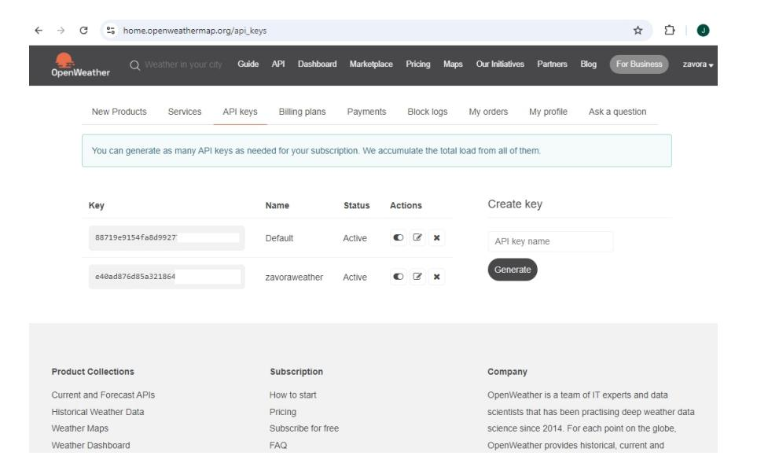

*Step 2: Define the Node to Call the Weather API*

Next, we'll define a node that:

- Sends a request to the OpenWeatherMap API.
- Parses the response.
- Returns a message with the weather data.

```
#lesson7i.py
import requests
from dotenv import load_dotenv
import os
# Load environment variables
load_dotenv()
weather_api_key = os.getenv("OPENWEATHER_API_KEY")
# Define the node to fetch live weather data
def live_weather_node(state):
    city = "London"  # You can replace this with dynamic input from the user
    url = f"http://api.openweathermap.org/data/2.5/weather?q={city}&appid=
{weather_api_key}&units=metric"
    # Make the API call
    response = requests.get(url)
    if response.status_code == 200:
        data = response.json()
        temperature = data['main']['temp']
```

```
description = data['weather'][0]['description']
         return {"messages": [f"The weather in {city} is {temperature}°C with
{description}."]}
    else:
         return {"messages": ["Sorry, I couldn't fetch the weather information."]}
```

# *Step 3: Add the Node to the Graph*

Next, we'll add this weather node to our LangGraph workflow, ensuring that the graph can route the query to the weather node and return the weather data in response.

```
#lesson7i.py continued
from langgraph.graph import StateGraph, MessagesState, START, END
# Define the graph workflow
builder = StateGraph(MessagesState)
# Add the weather node
builder.add_node("live_weather_node", live_weather_node)
# Set up the edges
builder.add_edge(START, "live_weather_node")
builder.add_edge("live_weather_node", END)
# Compile the graph
app = builder.compile()
# Simulate interaction with the weather API
def simulate_interaction():
    input_message = {"messages": [("human", "Tell me the weather in London")]}
    # Process the input and stream the result
    for result in app.stream(input_message, stream_mode="values"):
        result["messages"][-1].pretty_print()
simulate_interaction()
```

# **Output:**

The weather in London is 18°C with scattered clouds.

# <span id="page-198-0"></span>**7.7 Dynamic API Integration with User Input**

In the above example, we hard-coded the city name to "London". However, in most real-world scenarios, you'll want the city to be dynamically

provided by the user. Let's update the node to extract the city name from the user's input and fetch the weather for that location.

# **Step 1: Extract the City from User Input**

We'll modify the live\_weather\_node to dynamically fetch the city from the user's query and adjust the API call accordingly.

```
#lesson7i.py continued
def live_weather_node(state):
    last_message = state["messages"][-1].content.lower()
    # Extract city name from user query
    if "in" in last_message:
         city = last_message.split("in")[-1].strip()
    else:
         city = "London"  # Default city
    # API call
    url = f"http://api.openweathermap.org/data/2.5/weather?q={city}&appid=
{weather_api_key}&units=metric"
    # Make the API call
    response = requests.get(url)
    if response.status_code == 200:
         data = response.json()
         temperature = data['main']['temp']
         description = data['weather'][0]['description']
         return {"messages": [f"The weather in {city} is {temperature}°C with
{description}."]}
    else:
         return {"messages": ["Sorry, I couldn't fetch the weather information."]}
```

# *Step 2: Update the Workflow*

We don't need to change much in the workflow setup, but now the user can dynamically specify a city, and the node will fetch the weather for that location.

# **Example Interaction:**

You: What's the weather in Paris? Agent: The weather in Paris is 20°C with clear sky.

# <span id="page-200-0"></span>**7.8 Calculator API Integration**

For this section, we'll integrate a basic **calculator API** that can handle arithmetic operations like addition, subtraction, multiplication, and division. We'll use an external API such as **Math.js** to perform the calculations.

# *Step 1: Define the Calculator Node*

```
#lesson7i.py continued
# Define the node to fetch live calculator results
def calculator_node(state):
    last_message = state["messages"][-1].content.lower()
    # Extract the arithmetic expression from the user query
    expression = last_message.split("calculate")[-1].strip()
    # URL-encode the expression to ensure it's safe for use in the query string
    encoded_expression = urllib.parse.quote(expression)
    # Make the API call to the math.js API with the URL-encoded expression
    url = f"http://api.mathjs.org/v4/?expr={encoded_expression}"
    response = requests.get(url)
    if response.status_code == 200:
         result = response.text
         return {"messages": [f"The result of {expression} is {result}."]}
    else:
         return {"messages": ["Sorry, I couldn't calculate that."]}
```

# *Step 2: Add the Node to the Workflow*

```
#lesson7i.py continued
# Define the graph workflow
builder = StateGraph(MessagesState)
# Add the calculator node
builder.add_node("calculator_node", calculator_node)
# Set up the edges
builder.add_edge(START, "calculator_node")
builder.add_edge("calculator_node", END)
# Compile the graph
app = builder.compile()
# Simulate interaction with the calculator API
```

```
def simulate_interaction():
    input_message = {"messages": [("human", "Calculate 5 + 3 * 2")]}
    # Process the input and stream the result
    for result in app.stream(input_message, stream_mode="values"):
         result["messages"][-1].pretty_print()
simulate_interaction()
Output:
The result of 5 + 3 * 2 is 11.
```

# <span id="page-201-0"></span>**7.9 Combining Multiple API Integrations**

Now that we've covered how to integrate both the **weather API** and the **calculator API**, let's combine them into a single workflow. This will allow the agent to handle both types of queries and dynamically route the input to the appropriate API based on user input.

# **Step 1: Create the Routing Function**

We'll create a routing function that:

- Routes weather-related queries to the weather node.
- Routes calculation-related queries to the calculator node.
- Routes unrecognized input to a default node.

```
#lesson7i.py continued
# Define the routing function
def routing_function(state):
    last_message = state["messages"][-1].content.lower()
    if "weather" in last_message:
         return "live_weather_node"
    elif "calculate" in last_message:
         return "calculator_node"
    return "default_node"
```

# **Step 2: Build the Full Workflow**

```
#lesson7i.py continued
# Define the graph workflow
```

```
builder = StateGraph(MessagesState)
# Add the nodes
builder.add_node("live_weather_node", live_weather_node)
builder.add_node("calculator_node", calculator_node)
builder.add_node("default_node", lambda state: {"messages": ["Sorry, I don't understand
that request."]})
# Add conditional edges for routing
builder.add_conditional_edges(START, routing_function)
# Set up the edges
builder.add_edge("live_weather_node", END)
builder.add_edge("calculator_node", END)
builder.add_edge("default_node", END)
# Compile the graph
app = builder.compile()
# Simulate interaction with both APIs
def simulate_interaction():
   while True:
      user_input = input("You: ")
      if user_input.lower() in ["exit", "quit"]:
         print("Exiting...")
         break       
      input_message = {"messages": [("human", user_input)]}      
      # Stream the result
      for result in app.stream(input_message, stream_mode="values"):
         result["messages"][-1].pretty_print()
simulate_interaction()
```

# **Example Interaction:**

```
You: What's the weather in New York?
Agent: The weather in New York is 22°C with scattered clouds.
You: Calculate 10 / 2
Agent: The result of 10 / 2 is 5.
```

# **Summary**

In this section, we explored how to integrate **external APIs** into LangGraph workflows. We demonstrated:

- **Weather API integration** using OpenWeatherMap.
- **Calculator API integration** using Math.js.
- **Dynamic routing** between different nodes based on user input.

This combination of API integrations allows your agent to handle a wider range of queries and provide dynamic, real-time information.

In the next section, we'll cover **error handling** and **retry mechanisms** to make your workflows more robust and fault-tolerant.

# <span id="page-204-0"></span>**Chapter 7 Quiz: API Integrations, Routing, and Streaming**

# **Question 1:**

What is the primary purpose of integrating external APIs into a LangGraph workflow?

- A. To reduce the amount of code required
- B. To enable real-time interaction with external services, such as fetching live data or performing calculations
- C. To speed up the execution of workflows
- D. To enable debugging of workflows

# **Answer:**

B. To enable real-time interaction with external services, such as fetching live data or performing calculations.

# **Question 2:**

What is the role of a conditional edge in a LangGraph workflow?

- A. To specify the order of node execution
- B. To route the workflow to different nodes based on the state of the graph or custom logic
- C. To define custom messages for nodes
- D. To handle exceptions in the workflow

# **Answer:**

B. To route the workflow to different nodes based on the state of the graph or custom logic.

# **Question 3:**

Which Python module is commonly used to ensure that parameters, such as user input, are properly URL-encoded in an API call?

- A. json
- B. urllib.parse
- C. os
- D. re

# **Answer:**

B. urllib.parse

# **Question 4:**

What does the add\_conditional\_edges() method do in a LangGraph workflow?

- A. It adds edges between nodes that execute conditionally based on the results of a routing function.
- B. It merges two different workflows.
- C. It triggers an API call when invoked.
- D. It disables streaming for nodes that don't support it.

# **Answer:**

A. It adds edges between nodes that execute conditionally based on the results of a routing function.

# **Question 5:**

How can you disable streaming for a specific node in LangGraph that doesn't support streaming?

- A. By removing the stream\_mode argument from the node definition
- B. By setting the stream\_mode to "disable" in the graph configuration
- C. By excluding the node from the workflow
- D. By defining the node as part of a separate non-streaming graph

# **Answer:**

B. By setting the stream\_mode to "disable" in the graph configuration.

# **Question 6:**

Which of the following best describes the purpose of the requests.get() function in the context of integrating APIs?

- A. It is used to perform GET requests to an external API to retrieve data.
- B. It is used to store results from the workflow in a dictionary.
- C. It is used to route data between nodes in LangGraph.
- D. It is used to perform LLM invocations within LangGraph.

# **Answer:**

A. It is used to perform GET requests to an external API to retrieve data.

# **Question 7:**

In the context of streaming in LangGraph, what does the stream\_mode="values" setting do?

- A. It streams the entire state of the graph after each node executes.
- B. It streams only tokenized data from LLMs.
- C. It streams custom data generated within the node.
- D. It disables streaming and returns the final result at the end of execution.

# **Answer:**

A. It streams the entire state of the graph after each node executes.

# **Question 8:**

What Python function would you use to extract the arithmetic expression "5 + 3" from the user input, "Calculate 5 + 3"?

- A. input.split()
- B. re.match()
- C. input.split("calculate")[-1].strip()
- D. re.split()

# **Answer:**

C. input.split("calculate")[-1].strip()

# **Question 9:**

Which of the following modes is **NOT** a valid stream mode in LangGraph?

- A. "values"
- B. "updates"
- C. "tokens"
- D. "complete"

# **Answer:**

D. "complete"

# **Question 10:**

What does urllib.parse.quote() do in Python?

- A. It converts Python objects into JSON-encoded strings.
- B. It sends HTTP requests to an external API.

- C. It URL-encodes strings, ensuring that special characters are properly formatted in a URL.
- D. It converts text into lower-case characters.

# **Answer:**

C. It URL-encodes strings, ensuring that special characters are properly formatted in a URL.

# **Practical Assignment: API Integration and Conditional Routing**

# **Assignment Overview:**

For this assignment, you will build an AI agent that:

- Integrates with two external APIs: a **weather API** and a **calculator API**.
- Dynamically routes the user's queries to the correct API based on the input.
- Implements **streaming** for progress updates and **custom responses** based on user input.

# **Requirements:**

- 1. Use the **OpenWeatherMap API** to fetch live weather information based on the city provided by the user.
- 2. Use the **Math.js API** to perform arithmetic operations such as addition, subtraction, multiplication, and division.
- 3. Route the user's queries to the appropriate API (weather or calculator) using **conditional routing**.
- 4. Implement streaming to:
  - Stream the result of the **weather API** as soon as it's available.
  - Stream **progress updates** when handling calculator queries with multiple steps.
- 5. Ensure proper **URL-encoding** for the API requests.

# **Example User Interaction:**

You: What's the weather in London?

Agent: The weather in London is 18°C with scattered clouds.

You: Calculate 5 + 3 \* 2

Agent: The result of 5 + 3 \* 2 is 11.

# **Solution Code:**

```
#lesson7l.py full solution code
import requests
import urllib.parse
from langgraph.graph import StateGraph, MessagesState, START,
END
from dotenv import load_dotenv
import os
# Load API keys from environment variables
load_dotenv()
weather_api_key = os.getenv("OPENWEATHER_API_KEY")
# Define the node for fetching live weather data
def live_weather_node(state):
   last_message = state["messages"][-1].content.lower()
   # Extract city name from user query
   if "in" in last_message:
      city = last_message.split("in")[-1].strip().replace("?", "")
   else:
      city = "London"  # Default city
   # URL-encode the city name for the API request
   city_encoded = urllib.parse.quote(city)
   # Fetch the weather data from OpenWeatherMap API
   url = f"http://api.openweathermap.org/data/2.5/weather?q=
{city_encoded}&appid={weather_api_key}&units=metric"
   response = requests.get(url)
   if response.status_code == 200:
      data = response.json()
      temperature = data['main']['temp']
      description = data['weather'][0]['description']
      return {"messages": [f"The weather in {city} is
{temperature}°C with {description}."]}
   else:
```

```
return {"messages": ["Sorry, I couldn't fetch the weather
information."]}
# Define the node for calculator operations using Math.js API
def calculator_node(state):
   last_message = state["messages"][-1].content.lower()
   # Extract the arithmetic expression from the user query
   expression = last_message.split("calculate")[-1].strip()
   # URL-encode the expression for the API request
   encoded_expression = urllib.parse.quote(expression)
   # Fetch the result from Math.js API
   url = f"http://api.mathjs.org/v4/?expr={encoded_expression}"
   response = requests.get(url)
   if response.status_code == 200:
      result = response.text
      return {"messages": [f"The result of {expression} is
{result}."]}
   else:
      return {"messages": ["Sorry, I couldn't calculate that."]}
# Define a default node for unrecognized inputs
def default_node(state):
   return {"messages": ["Sorry, I don't understand that request."]}
# Define the routing function to route the user query to the
appropriate node
def routing_function(state):
   last_message = state["messages"][-1].content.lower()
   if "weather" in last_message:
      return "live_weather_node"
   elif "calculate" in last_message:
      return "calculator_node"
   return "default_node"
# Build the LangGraph workflow
builder = StateGraph(MessagesState)
builder.add_node("live_weather_node", live_weather_node)
builder.add_node("calculator_node", calculator_node)
builder.add_node("default_node", default_node)
# Add conditional edges to route the queries
builder.add_conditional_edges(START, routing_function)
```

```
builder.add_edge("live_weather_node", END)
builder.add_edge("calculator_node", END)
builder.add_edge("default_node", END)
# Compile the graph
app = builder.compile()
# Simulate interaction with the user
def simulate_interaction():
   while True:
      user_input = input("You: ")
      if user_input.lower() in ["exit", "quit"]:
         print("Exiting...")
         break
      input_message = {"messages": [("human", user_input)]}
      # Stream the result
      for result in app.stream(input_message,
stream_mode="values"):
         result["messages"][-1].pretty_print()
simulate_interaction()
```

# **Solution Explanation:**

- 1. **Weather API Node**: This node fetches the current weather for the city provided by the user using the **OpenWeatherMap API**. The city name is dynamically extracted from the user's query.
- 2. **Calculator API Node**: This node handles arithmetic calculations via the **Math.js API**. It extracts the mathematical expression from the user query and performs URL encoding to ensure special characters (such as + , \* , / ) are properly formatted in the API request.
- 3. **Routing Function**: The routing function inspects the user's query and routes it to the appropriate node. If the query contains the word "weather", it routes to the weather node. If the query contains "calculate", it routes to the calculator node. For unrecognized queries, it routes to the default node.
- 4. **Streaming**: The graph streams the results from the API calls back to the user in real-time. This allows for faster feedback and more interactive experiences.

# Part 3: LangGraph Agent Design Patterns and Architectures (Chapters 8-11)

# **Chapter 8**

# <span id="page-212-1"></span><span id="page-212-0"></span>**Foundational AI Agent Architectures - ReAct**

# **Introduction**

In this chapter, we'll explore the core agent architectures that form the foundation of dynamic and flexible AI systems using LangGraph. These architectures are designed to help AI agents perform tasks autonomously or semi-autonomously, adapt to changing environments, and make decisions based on real-time data. By understanding these foundational architectures, you'll be well-equipped to develop your own sophisticated AI agents capable of handling diverse business scenarios.

We will cover five main architectures, each suited to different types of workflows and applications:

- 1. **ReAct (Reason + Act) Pattern** A simple, transparent decision-making framework.
- 2. **Plan-and-Execute Agents** Agents that plan multi-step workflows and execute them.
- 3. **Hierarchical Agent Teams** A supervisor-worker model for complex task management.
- 4. **Agentic Retrieval-Augmented Generation (RAG)** A framework that combines information retrieval and generation.
- 5. **Corrective Retrieval-Augmented Generation (CRAG) with Self-Reflection** A refined version of RAG, incorporating self-assessment.

Let's dive in.

# <span id="page-212-2"></span>**ReAct (Reason + Act) Pattern**

#### **Overview**

The ReAct architecture combines reasoning with actions, enabling an agent to "think aloud" by generating thoughts and executing actions based on those thoughts. This transparency in decision-making allows the agent to be more accountable, as it logs its reasoning process at every step.

This architecture is best suited for tasks where an agent needs to evaluate multiple options and then choose the best action. For example, it can be used in customer service applications where an agent must evaluate customer queries and decide how to respond.

#### **Historical Background**

ReAct agents represent a breakthrough in the integration of **reasoning** and **acting** in AI systems, designed to make decisions and take actions in real time based on dynamic input and external data. This architecture was introduced in the ReAct paper by Shunyu Yao et al. (2023) from Princeton University and Google Research. The ReAct framework brings together verbal reasoning and task-specific actions in an interleaved manner, allowing for synergy between reasoning traces and actions. This results in more robust task-solving capabilities, especially in dynamic or knowledge-intensive tasks.

Historically, AI systems were either focused on reasoning (e.g., Chain-of-Thought, or CoT prompting) or performing actions (e.g., reinforcement learning). These approaches, while effective in isolation, often failed when tasks required a combination of reasoning and action. For example, purely reasoning-based models often generated hallucinations, while action-based models lacked context and planning. ReAct addresses these shortcomings by creating a feedback loop between **reasoning** (thoughts) and **actions** (executing tasks and gathering additional information). This architecture has proven effective in interactive environments like **ALFWorld** and knowledge-intensive tasks such as **HotPotQA**.

#### **Key Concepts of ReAct**

- **Reasoning and Action Synergy**: The agent reasons through available data or options and then selects an action based on that reasoning.
- **Transparent Decision-Making**: The agent logs its thoughts and actions, providing a clear record of how decisions were made.
- **Iterative Process**: The reasoning and action cycle can be repeated, allowing the agent to refine its approach if the initial action does not lead to the desired outcome.

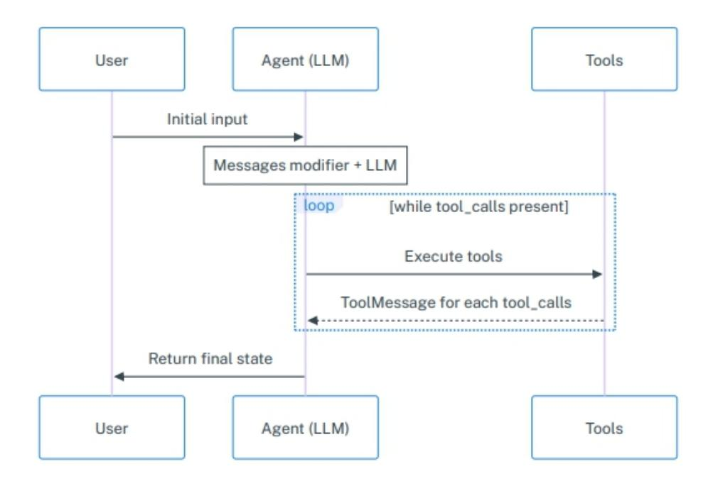

#### **Implementation Steps**

- 1. **Define the Environment and Agent Goal**: First, provide a description of the environment in which the agent operates. Define the goal that the agent needs to achieve.
- 2. **List Available Actions**: Enumerate all possible actions the agent can undertake. These might include querying a database, calling an API, or responding to a user query.
- 3. **Record Observations**: Log actions taken and the resulting observations (e.g., did the action succeed or fail? What new data is available?).
- 4. **Generate Reasoning**: Based on the observations, prompt the agent to generate thoughts or reason about the next action. This process continues until the goal is achieved.
- 5. **Execute Actions**: Once the agent completes the reasoning process, it chooses an action and executes it.

# <span id="page-214-0"></span>**ReAct Agents in LangGraph**

LangGraph implements the ReAct architecture in a highly flexible manner, allowing users to create **dynamic agents** capable of reasoning, tool calling, and decision-making. The **LangGraph ReAct agent** utilizes a modular structure where a **large language model (LLM)** reasons through steps and dynamically decides whether to call tools, retrieve data, or terminate the process.

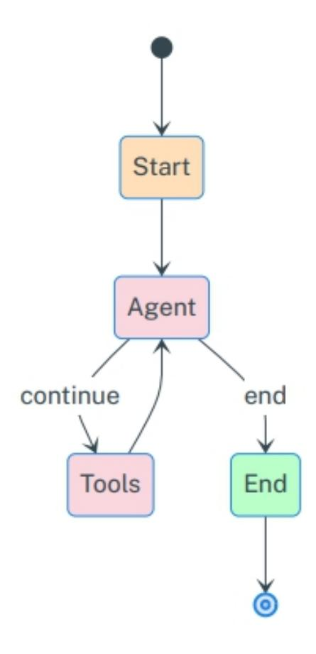

#### **Key Components of ReAct in LangGraph:**

- 1. **Reasoning**: The agent generates thoughts based on the input and decides on potential actions.
- 2. **Tool Calling**: Based on reasoning, the agent decides to call specific tools, such as APIs or knowledge bases, and integrates the tool output back into the reasoning loop.
- 3. **Observations**: The output from tools is passed back to the reasoning phase, allowing the agent to refine its thinking and proceed with further actions or finalize its response.
- 4. **Memory**: The agent can retain information across multiple interactions, allowing it to make informed decisions based on previous steps.

# <span id="page-215-0"></span>**LangGraph Internal and Custom ReAct Agent Implementation Options**

LangGraph provides pre-built ReAct agents that integrate with tools and external APIs, enabling seamless task execution. A LangGraph ReAct agent can decide autonomously whether to call tools based on the user's input and then proceed based on tool outputs.

You can also create your own ReAct agent in LangGraph using the following capabilities:

- **System Prompt**: Defines the high-level goals or behavior of the agent.
- **Tools**: Predefined functions, APIs, or other resources the agent can call upon.

● **Graph Structure**: A graph is defined where each step (node) may either reason, act, or call a tool. The agent continues cycling through these steps until no further tool calls are required.

# <span id="page-216-0"></span>**Best Practices for Building ReAct Agents**

- 1. **Structured Thought and Action Cycles**: Ensure that the agent's reasoning steps are separated from action steps. This allows for clear identification of what the agent is thinking and what actions are being taken.
- 2. **Effective Tool Integration**: ReAct agents should have access to a rich set of tools to call, enabling them to fetch external data when needed. In LangGraph, tools can range from simple Python functions to complex APIs.
- 3. **Use of Memory**: For longer conversations or tasks, it's crucial to maintain memory, allowing the agent to "remember" past steps and interactions. LangGraph provides memory modules for both short-term and long-term retention.
- 4. **Iterative Thought-Action Loops**: Design your ReAct agents to cycle through reasoning and action multiple times as necessary, allowing them to refine their understanding of the task with each loop.
- 5. **Error Handling and Reflection**: Implement feedback mechanisms where the agent can identify and recover from errors, or ask for clarification if unsure about the next step.

## <span id="page-216-1"></span>**10 Examples of ReAct Agents in LangGraph**

# **Example 1: Basic ReAct Agent with Built-In Tools**

#### **Overview:**

In this example, we will create a simple ReAct agent that performs basic arithmetic operations using built-in tools. The agent will reason about the user's query and call the appropriate tool to execute the calculation.

#### **Key Concepts:**

- Using the built-in ReAct agent in LangGraph.
- Basic tool calling (addition, multiplication, division).

```
#lesson8a.py
from langchain_openai import ChatOpenAI
from langgraph.prebuilt import create_react_agent
# Define tools
def add(a: int, b: int) -> int:
    """Add two numbers together."""
    return a + b
def multiply(a: int, b: int) -> int:
    """Multiply two numbers together."""
    return a * b
```

```
tools = [add, multiply]
# Initialize the LLM
llm = ChatOpenAI(model="gpt-4o-mini")
# Create the ReAct agent
graph = create_react_agent(model=llm, tools=tools)
# User input
inputs = {"messages": [("user", "Add 3 and 4. Multiply the result by 2.")]}
# Run the ReAct agent
messages = graph.invoke(inputs)
for message in messages["messages"]:
    print(message.content)
```

#### Output

```
================================
Human Message
=================================
Add 3 and 4. Multiply the result by 2.
==================================
Ai Message
==================================
Tool Calls:
 add (call_y8FfIKxbYsM6dysTSh5YykDE)
Call ID: call_y8FfIKxbYsM6dysTSh5YykDE
 Args:
  a: 3
  b: 4
=================================
Tool Message
=================================
Name: add
7
==================================
Ai Message
==================================
Tool Calls:
 multiply (call_KzbjH61WxKq2t4aksEOh2wwc)
Call ID: call_KzbjH61WxKq2t4aksEOh2wwc
 Args:
  a: 7
  b: 2
=================================
Tool Message
=================================
Name: multiply
14
==================================
Ai Message
==================================
```

The result of adding 3 and 4 is 7. When you multiply that result by 2, you get 14.

In this example, we create a basic ReAct agent that performs simple arithmetic using built-in tools (addition and multiplication). The key steps are:

- 1. **User Input**: The user inputs a request in natural language, such as *"Add 3 and 4. Multiply the result by 2."*
- 2. **Reasoning (Agent Node)**: The ReAct agent first processes the input with the language model (in this case, GPT-4o-mini) to determine whether it can respond directly or if it needs to call a tool.
- 3. **Tool Call (Tools Node)**: If the model identifies a need for a tool (such as performing a calculation), it triggers the relevant tool (e.g., add or multiply ).
- 4. **Result Integration**: After the tool completes its execution, the result is passed back to the agent for further reasoning.
- 5. **Final Output**: Once all necessary tool calls are completed, the agent provides a final response to the user.

This simple cycle of **reasoning**, **tool calling**, and **responding** forms the core of the ReAct framework. The agent continues looping between reasoning and acting (calling tools) until no further actions are required.

#### **How the Internal ReAct Agent Tool Works**

The **create\_react\_agent** function defines the internal logic of the ReAct agent. Here's a breakdown of the key components:

The function signature provides parameters for configuring the ReAct agent:

- **model** : The language model (e.g., GPT-4) used for reasoning.
- **tools** : A list of tools (e.g., add , multiply ) that the agent can call to act upon.
- **state\_schema** : Optional parameter that defines the structure of the graph's state, which includes tracking messages and other metadata.
- **messages\_modifier** : Deprecated. Previously used to modify messages before passing them to the language model.
- **state\_modifier** : Optional. Allows modifications to the graph state before it is sent to the language model.
- **checkpointer , store** : Manage saving and retrieving state for persistence across sessions.
- **interrupt\_before , interrupt\_after** : Points in the flow where external interruptions (e.g., user confirmation) can be injected.
- **debug** : Flag for enabling debug mode.

# **The ReAct agent Design:**

A visualization of the agent graph is as follows:

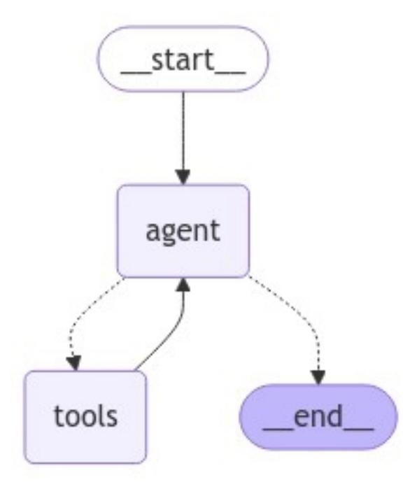

The ReAct agent is designed to continuously loop between reasoning (the **agent** node) and acting (the **tools** node). The main workflow of the agent is outlined as follows:

- **Agent Node**: The agent invokes the language model with the current list of messages (user input + previous responses) and reasons whether to call a tool or respond directly.
- **Tools Node**: If the language model determines that a tool should be called (e.g., to perform an arithmetic operation), the **tools** node is triggered, which executes the tool (e.g., add ) and returns the result to the agent.
- **Conditional Routing**: The agent continues calling tools and reasoning based on tool outputs until no more tool calls are required. Once the agent determines that all necessary actions are complete, it proceeds to the **end** node and returns the final result.
- **StateGraph**: A **StateGraph** is created to define the nodes and edges of the graph. This graph represents the flow of reasoning and actions in the ReAct agent.
  - **Nodes**: Two main nodes are defined: the **agent** node (which invokes the language model) and the **tools** node (which handles tool calls).
  - **Edges**: Conditional edges determine how the agent moves between the reasoning and acting phases. Specifically, if the agent decides to call a tool, the flow moves from the **agent** node to the **tools** node. After a tool is executed, the flow returns to the **agent** node to either reason further or finalize the response.

#### **Conditional Edge Example**:

#lesson8a.py continued workflow.add\_conditional\_edges( "agent", # Start from the agent node

```
should_continue  # Decide whether to call tools or end the process
)
```

**Looping Mechanism**: The ReAct agent continuously loops between the **agent** and **tools** nodes as long as the agent decides to call tools. This loop allows the agent to handle complex requests that require multiple actions before completing.

## **Automatic Graph Creation**

In this example, the LangGraph **create\_react\_agent** function automatically builds a **graph** for the ReAct agent based on the tools and language model provided. This graph follows a specific structure:

● **Agent Node** → **Tools Node** → **Agent Node** → **End Node**

The agent's graph handles the logic for determining when to call tools and when to terminate. Each time the **agent node** processes the input (user query or tool output), it determines whether further actions (tool calls) are required. If no further actions are needed, the graph transitions to the **end node**, completing the flow.

#### **Graph Visualization**

```
stateDiagram-v2
   [*] --> Start
   Start --> Agent
   Agent --> Tools : continue
   Tools --> Agent
   Agent --> End : end
   End --> [*]
```

- **Agent Node**: Invokes the LLM with the input and determines whether a tool call is needed.
- **Tools Node**: Executes the tools as needed and passes the results back to the agent.
- **Looping Behavior**: The agent continues calling tools and reasoning over the results until no further tool calls are required. The process then terminates.

#### **Output Example Breakdown**

Let's break down an example where the user asks the ReAct agent to "Add 3 and 4. Multiply the result by 2."

#### 1. **Initial Input**:

- User input: *"Add 3 and 4. Multiply the result by 2."*
- The agent processes this input and identifies two operations: addition and multiplication.

#### 2. **Tool Call 1 (Addition)**:

- Tool called: add(3, 4) .
- Output: 7.

#### 3. **Tool Call 2 (Multiplication)**:

```
○ Tool called: multiply(7, 2) .
○ Output: 14.
```

#### 4. **Final Output**:

○ The agent returns: *"The result of adding 3 and 4 and then multiplying the result by 2 is 14."*

Throughout this process, the **agent node** handles reasoning over the input and output, and the **tools node** executes the specific operations (addition and multiplication).

## **Example 2: ReAct Agent for Product Inquiry with Single-Thread Memory**

#### **Overview:**

In this example, we will revise the product inquiry agent to use **single-thread memory** via the MemorySaver for storing and recalling user queries. The agent will be able to remember the user's previous inquiries in a single thread (conversation), retrieve product information, and provide a more personalized response based on memory.

#### **Key Concepts:**

- Using **single-thread memory** to persist user information across a session.
- Reasoning about product inquiries based on user input and calling tools for retrieving product details.
- Integrating **LangGraph's MemorySaver** to manage memory within a single conversation session.

#### **Implementation:**

```
#lesson8a.py continued
from langchain_openai import ChatOpenAI
from langgraph.prebuilt import create_react_agent
from langgraph.checkpoint.memory import MemorySaver
# Define tools
def product_info(product_name: str) -> str:
    """Fetch product information."""
    product_catalog = {
        "iPhone 20": "The latest iPhone features an A15 chip and improved camera.",
        "MacBook": "The new MacBook has an M2 chip and a 14-inch Retina display.",
    }
    return product_catalog.get(product_name, "Sorry, product not found.")
# Initialize the memory saver for single-thread memory
checkpointer = MemorySaver()
# Initialize the language model
llm = ChatOpenAI(model="gpt-4o-mini")
# Create the ReAct agent with the memory saver
```

```
graph = create_react_agent(model=llm, tools=[product_info], checkpointer=checkpointer)
# Set up thread configuration to simulate single-threaded memory
config = {"configurable": {"thread_id": "thread-1"}}
# User input: initial inquiry
inputs = {"messages": [("user", "Hi, I'm James. Tell me about the new iPhone 20.")]}
messages = graph.invoke(inputs, config=config)
for message in messages["messages"]:
    message.pretty_print()
# User input: repeated inquiry (memory recall)
inputs2 = {"messages": [("user", "Tell me more about the iPhone 20.")]}
messages2 = graph.invoke(inputs2, config=config)
for message in messages2["messages"]:
    message.pretty_print()
```

# **Explanation of Key Steps:**

#### 1. **Single-Thread Memory with MemorySaver** :

- The MemorySaver is used to manage memory within a single conversation session. It stores user interactions under a unique thread ID (in this case, "thread-1" ), allowing the agent to recall information within the same conversation.
- **Thread Configuration**: We configure the ReAct agent to use a specific thread ID ( "thread-1" ) to simulate a single-threaded conversation.

#### 2. **Reasoning and Tool Call**:

- The ReAct agent first reasons about the user's query (e.g., "Tell me about the new iPhone") and decides to call the product\_info tool with the product name "iPhone" .
- The tool retrieves the relevant product information, which the agent then provides to the user.

#### 3. **Memory Storage**:

○ After responding to the user's initial query, the agent stores the query and its response in memory. This memory is saved under the thread "thread-1" .

#### 4. **Memory Recall**:

- When the user asks a follow-up question (e.g., "Tell me more about the iPhone"), the agent checks the memory stored in the same thread ( "thread-1" ). It recalls that the user previously asked about the iPhone and uses this information to provide a personalized response.
- The agent still has the option to call the product\_info tool again if further details are needed.

# **Output Example Breakdown:**

#### 1. **Initial Inquiry**:

- **User Input**: *"Tell me about the new iPhone."*
- **Agent Response**: *"The latest iPhone features an A15 chip and improved camera."*
- The agent stores this query and response in memory for future reference.

| =================================   |
|-------------------------------------|
| Human Message                       |
| =================================   |
| Tell me about the new iPhone 20.    |
| ==================================  |
| Ai Message                          |
| =================================== |

The latest iPhone 20 features an A15 chip and improved camera.

#### 2. **Follow-Up Inquiry (with Memory Recall)**:

- **User Input**: *"Tell me more about the iPhone."*
- **Agent Response**: *"You previously asked about the iPhone. Here's more information: The latest iPhone features an A15 chip and improved camera."*
- The agent recalls the previous query and provides a personalized response.

| =================================<br>Human Message                                      |
|-----------------------------------------------------------------------------------------|
| =================================<br>Tell me more about the iPhone 20.                  |
| ==================================<br>Ai Message<br>=================================== |

You previously asked about the iPhone 20. Here's more information: The latest iPhone features an A15 chip and improved camera.

# **How the Single-Thread Memory Works:**

1. **MemorySaver Integration**: The **MemorySaver** checkpoint ensures that memory is stored and persisted within a single conversation session, identified by the thread ID ( "thread-1" ). This allows the agent to remember previous interactions within that specific session but forgets once the session (thread) ends.

#### 2. **Single-Threaded Memory Behavior**:

- **Thread ID**: Each session is tied to a unique thread ID, ensuring that the agent's memory is scoped to that particular conversation. In this example, the agent remembers the user's initial query about the iPhone within the "thread-1" session.
- **Memory Recall**: When the user asks a follow-up question within the same thread, the agent retrieves and uses the stored information to provide a more context-aware and personalized response.

#### 3. **Memory Usage in ReAct Design**:

- **Reasoning (Agent Node)**: The agent reasons over the user's input and determines whether to recall memory or call a tool. In this case, it checks whether the query is related to a previous one stored in memory.
- **Tool Call (Tools Node)**: If the query requires retrieving product information, the agent calls the product\_info tool to fetch product details. It then stores the user query and the response in memory.
- **Memory Check**: In future queries within the same thread, the agent checks the memory for previously stored queries. If relevant, the agent recalls the memory and provides a tailored response.

## **Graph Visualization with Memory Integration:**

```
stateDiagram-v2
   [*] --> Start
   Start --> Agent
   Agent --> Tools : continue
   Tools --> Memory : store or recall query
   Memory --> Agent : recall memory
   Agent --> End : end
   End --> [*]
```

- **Agent Node**: The agent processes the user's input and decides whether to:
  - Call a tool (such as retrieving product information).
  - Recall memory if relevant to the current conversation.
- **Tools Node**: This node executes the tool (in this case, product\_info ), which retrieves product details based on the user's inquiry.
- **Memory Node**: If memory is relevant, the agent checks the single-thread memory stored by the MemorySaver and recalls any previous queries. The memory is scoped to the specific thread, ensuring the agent only remembers interactions within the same session.
- **End Node**: Once the reasoning, tool calls, and memory retrieval are complete, the agent provides the final response and completes the conversation.

# **Example 3: Complex ReAct Agent for Product Inquiry and Stock Availability with Memory and Dynamic Decision-Making**

#### **Overview:**

In this example, we will create a more complex ReAct agent that handles product inquiries while also checking stock availability using a dynamic decision-making process. The agent will use **single-thread memory** to recall user queries, retrieve product information, and dynamically decide whether to check the product's stock availability based on user requests. This setup showcases how to integrate multiple tools, reason about actions, and dynamically call appropriate tools depending on the user's follow-up question.

#### **Key Concepts:**

● **Dynamic decision-making**: The agent will reason based on user input and decide whether to call additional tools (e.g., check stock availability).

- **Memory with MemorySaver** : The agent will recall previous user queries within a single session and provide personalized responses.
- **Tool Integration**: Multiple tools will be used, including one for fetching product information and another for checking stock availability.

#### **Implementation:**

```
#lesson8c.py
from langchain_openai import ChatOpenAI
from langgraph.prebuilt import create_react_agent
from langgraph.checkpoint.memory import MemorySaver
# Define tools
def product_info(product_name: str) -> str:
    """Fetch product information."""
    product_catalog = {
         "iPhone": "The latest iPhone features an A15 chip and improved camera.",
         "MacBook": "The new MacBook has an M2 chip and a 14-inch Retina display.",
    }
    return product_catalog.get(product_name, "Sorry, product not found.")
def check_stock(product_name: str) -> str:
    """Check product stock availability."""
    stock_data = {
         "iPhone": "In stock.",
         "MacBook": "Out of stock.",
    }
    return stock_data.get(product_name, "Stock information unavailable.")
# Initialize the memory saver for single-thread memory
checkpointer = MemorySaver()
# Initialize the language model
llm = ChatOpenAI(model="gpt-4o-mini")
# Create the ReAct agent with tools and memory
tools = [product_info, check_stock]
graph = create_react_agent(model=llm, tools=tools, checkpointer=checkpointer)
# Set up thread configuration for single-thread memory
config = {"configurable": {"thread_id": "thread-3"}}
# User input: initial inquiry about product information
inputs = {"messages": [("user", "Tell me about the new iPhone.")]}
messages = graph.invoke(inputs, config=config)
for message in messages["messages"]:
    print(message.content)
# User input: follow-up inquiry about stock availability (memory recall and dynamic decision-making)
inputs2 = {"messages": [("user", "Is the iPhone in stock?")]}
messages2 = graph.invoke(inputs2, config=config)
for message in messages2["messages"]:
    print(message.content)
```

# **Explanation of Key Steps:**

#### 1. **User Input (Initial Inquiry about Product Information)**:

- The user initially asks for product details: *"Tell me about the new iPhone."*
- The ReAct agent reasons that this is a product inquiry and calls the product\_info tool with the product name "iPhone" .
- The tool retrieves the product information: *"The latest iPhone features an A15 chip and improved camera."*
- The agent stores the query and response in memory under the single-threaded session ID ( "thread-3" ).

#### 2. **Tool Call for Product Information**:

○ The agent triggers the product\_info tool to retrieve product details from the catalog and returns the result to the user.

#### 3. **Memory Storage**:

○ The agent uses MemorySaver to store the query *"Tell me about the new iPhone."* and the corresponding response in the single-thread memory associated with "thread-3" . This allows the agent to recall the user's previous query and provide context in future interactions.

#### 4. **User Input (Follow-Up Inquiry about Stock)**:

- The user then asks a follow-up question: *"Is the iPhone in stock?"*
- The agent recalls the previous query from memory and dynamically decides to call the check\_stock tool to retrieve stock availability information for the iPhone.
- The tool returns the stock status: *"In stock."*
- The agent responds with the stock availability and incorporates memory to reference the earlier conversation.

# **Output Example Breakdown:**

#### 1. **Initial Inquiry (Product Information)**:

- **User Input**: *"Tell me about the new iPhone."*
- **Agent Response**: *"The latest iPhone features an A15 chip and improved camera."*
- The agent stores this query and response in memory.

| =================================   |
|-------------------------------------|
| Human Message                       |
| =================================   |
| Tell me about the new iPhone.       |
| ==================================  |
| Ai Message                          |
| =================================== |

#### 2. **Follow-Up Inquiry (Stock Availability Check)**:

- **User Input**: *"Is the iPhone in stock?"*
- **Agent Response**: *"You previously asked about the iPhone. It's currently in stock."*
- The agent recalls the previous query from memory, checks the stock availability using the check\_stock tool, and provides the personalized response.

| =================================<br>Human Message                                                 |
|----------------------------------------------------------------------------------------------------|
| =================================<br>Is the iPhone in stock?<br>================================== |
| Ai Message<br>===================================                                                  |

You previously asked about the iPhone. It's currently in stock.

# **How Dynamic Decision-Making Works:**

#### 1. **Reasoning and Acting with Dynamic Tool Calls**:

- After the first inquiry, the agent reasons that the user is asking about product details and calls the product\_info tool.
- When the user follows up with a question about stock availability, the agent dynamically decides to call the check\_stock tool to get the stock information based on the context of the previous query.
- This dynamic decision-making capability allows the ReAct agent to flexibly respond to different types of queries and call the appropriate tools depending on user needs.

#### 2. **Memory Integration**:

- The ReAct agent uses MemorySaver to recall the user's previous query from the same conversation thread ( "thread-3" ), enabling it to provide contextually aware responses.
- By recalling the previous product inquiry, the agent provides a more seamless and personalized conversation, referencing the iPhone and its availability based on the earlier interaction.

# **Graph Workflow with Dynamic Tool Calls:**

In this example, the ReAct agent creates a graph with dynamic decision-making where it can reason about the user's input and decide whether to call a tool or recall memory:

```
stateDiagram-v2
   [*] --> Start
   Start --> Agent
   Agent --> Tools : retrieve product info
   Tools --> Memory : store query
```

Memory --> Agent : recall memory Agent --> Tools : check stock availability Tools --> Agent : respond with stock info Agent --> End : end End --> [\*]

- **Agent Node**: Processes the user's input and determines whether to call a tool or recall memory.
- **Tools Node**: Executes the tools ( product\_info and check\_stock ) based on the reasoning step, retrieving product details and checking stock availability.
- **Memory Node**: Stores the user query and response in memory and retrieves them when needed for future interactions.
- **End Node**: The agent provides the final response to the user and completes the conversation.

## **How the ReAct Agent Design Handles Dynamic Queries:**

- **Conditional Logic for Tool Calls**: The ReAct agent uses dynamic decision-making to decide which tool to call based on the user's input and the context of the conversation. If the user asks for product details, the agent calls product\_info . If the user follows up with a query about stock, the agent calls check\_stock .
- **Single-Threaded Memory**: Memory is scoped to the current conversation (thread), allowing the agent to remember past interactions and provide personalized responses based on previous queries. This makes the interaction more engaging and userfriendly.

# **Example 4: ReAct Agent with Multi-Step Reasoning and Dynamic Action Sub-Graphs**

#### **Goal:**

- We will create an agent capable of reasoning over complex inputs and performing dynamic actions based on the user's request.
- The agent will make multiple decisions during the reasoning phase (e.g., deciding whether to fetch information from multiple tools).
- Sub-graphs will handle specific tasks such as fetching information from tools or performing multiple actions based on different prompts.

## **Plan:**

- 1. **Parent Graph**: Responsible for high-level reasoning and orchestrating multiple sub-graphs.
- 2. **Reasoning Phase**: Dynamically decide which sub-graphs to call based on user input.
- 3. **Sub-Graphs**: Handle specific actions, including tool calls or acting on the user's query.
- 4. **Memory**: Store and recall data in the sub-graphs (optional extension).

## **Implementation:**

```
#lesson8a.py continued
from langchain_openai import ChatOpenAI
from langgraph.graph import StateGraph, MessagesState, START, END
from typing import TypedDict
# Define shared state for the agent and sub-graphs
class ReActAgentState(TypedDict):
    message: str  # Shared key between the parent graph and sub-graphs
    action: str   # Sub-graph specific key (what action to perform)
    sub_action: str  # Additional sub-action to perform in a more complex scenario
# Reasoning Node 1: Determines which action the agent should take based on the user query
def reasoning_node(state: ReActAgentState):
    query = state["message"]
    if "weather" in query:
        return {"action": "fetch_weather"}
    elif "news" in query:
        return {"action": "fetch_news"}
    elif "recommend" in query:
        return {"action": "recommendation", "sub_action": "book"}
    else:
        return {"action": "unknown"}
# Sub-graph for fetching weather information (acting phase)
def weather_subgraph_node(state: ReActAgentState):
    # Simulating a weather tool call
    return {"message": "The weather today is sunny."}
# Sub-graph for fetching news information (acting phase)
def news_subgraph_node(state: ReActAgentState):
    # Simulating a news tool call
    return {"message": "Here are the latest news headlines."}
# Sub-graph for providing a book recommendation (acting phase)
def recommendation_subgraph_node(state: ReActAgentState):
    if state.get("sub_action") == "book":
        return {"message": "I recommend reading 'The Pragmatic Programmer'."}
    else:
        return {"message": "I have no other recommendations at the moment."}
# Build sub-graph for fetching weather information
weather_subgraph_builder = StateGraph(ReActAgentState)
weather_subgraph_builder.add_node("weather_action", weather_subgraph_node)
weather_subgraph_builder.set_entry_point("weather_action")
weather_subgraph = weather_subgraph_builder.compile()
# Build sub-graph for fetching news information
news_subgraph_builder = StateGraph(ReActAgentState)
news_subgraph_builder.add_node("news_action", news_subgraph_node)
news_subgraph_builder.set_entry_point("news_action")
news_subgraph = news_subgraph_builder.compile()
# Build sub-graph for recommendations (e.g., book recommendation)
```

```
recommendation_subgraph_builder = StateGraph(ReActAgentState)
recommendation_subgraph_builder.add_node("recommendation_action", recommendation_subgraph_node)
recommendation_subgraph_builder.set_entry_point("recommendation_action")
recommendation_subgraph = recommendation_subgraph_builder.compile()
# Define dynamic reasoning node in the parent graph to route to the correct sub-graph
def reasoning_state_manager(state: ReActAgentState):
    if state["action"] == "fetch_weather":
        return weather_subgraph
    elif state["action"] == "fetch_news":
        return news_subgraph
    elif state["action"] == "recommendation":
        return recommendation_subgraph
    else:
        return None
# Create the parent graph
parent_builder = StateGraph(ReActAgentState)
parent_builder.add_node("reasoning", reasoning_node)
parent_builder.add_node("action_dispatch", reasoning_state_manager)
# Define edges in the parent graph
parent_builder.add_edge(START, "reasoning")
parent_builder.add_edge("reasoning", "action_dispatch")
# Compile the parent graph
react_agent_graph = parent_builder.compile()
# Test the agent with a weather-related query
inputs_weather = {"message": "What is the weather today?"}
result_weather = react_agent_graph.invoke(inputs_weather)
print(result_weather["message"])
# Test the agent with a news-related query
inputs_news = {"message": "Give me the latest news."}
result_news = react_agent_graph.invoke(inputs_news)
print(result_news["message"])
# Test the agent with a recommendation-related query
inputs_recommendation = {"message": "Can you recommend a good book?"}
result_recommendation = react_agent_graph.invoke(inputs_recommendation)
print(result_recommendation["message"])
```

# **Explanation of Key Concepts:**

#### 1. **Shared State Keys ( ReActAgentState )**:

- The message key is shared between the parent graph and sub-graphs. It contains the user's input and the agent's response.
- The action and sub\_action keys are used by the reasoning node to decide which specific sub-graph should be invoked.

#### 2. **Parent Graph**:

- The parent graph begins with a **reasoning node** that analyzes the user's input and determines which action to perform.
- The reasoning\_state\_manager then dynamically routes the workflow to the appropriate sub-graph based on the reasoning node's decision (e.g., fetching weather or news).

#### 3. **Sub-Graphs for Acting**:

- Each sub-graph handles a specific action based on the reasoning phase's result. For example, the **weather sub-graph** simulates fetching weather information, while the **news sub-graph** simulates fetching news headlines.
- The **recommendation sub-graph** is designed to provide specific recommendations (e.g., books) and can be extended to handle more complex reasoning scenarios.

#### 4. **Dynamic Routing**:

○ The parent graph dynamically routes control to the appropriate sub-graph using the action key. This approach makes the agent flexible, as it can easily be extended to support additional actions by adding more sub-graphs.

## **Output Example:**

#### **Weather Query**:

User Input: What is the weather today? Assistant Response: The weather today is sunny.

#### **News Query**:

User Input: Give me the latest news.

Assistant Response: Here are the latest news headlines.

#### **Recommendation Query**:

User Input: Can you recommend a good book?

Assistant Response: I recommend reading 'The Pragmatic Programmer'.

# **Dynamic ReAct Agent Features:**

#### 1. **Modular Sub-Graphs**:

○ Each sub-graph is modular and can be easily extended or replaced with more complex functionality (e.g., real API calls for weather or news).

#### 2. **Dynamic Reasoning**:

○ The parent graph can dynamically decide which action to perform based on the user's input, making the agent flexible and adaptive to a wide variety of queries.

#### 3. **Expandable**:

○ This structure is highly expandable. For example, you can add more subgraphs for other tasks like retrieving calendar events, setting reminders, or even providing personalized recommendations based on user history.

#### 4. **Memory**:

○ You can integrate memory (like MemorySaver ) to store previous user interactions and provide personalized responses based on the user's preferences or past queries.

# **Example 5: Advanced ReAct Agent with Multiple Sub-Graphs and Contextual Memory**

#### **Goal:**

- In this example, we will create an advanced **ReAct agent** that not only reasons and acts dynamically but also incorporates **contextual memory**.
- The agent will use memory to **recall past interactions**, allowing it to provide personalized responses based on prior queries.
- The reasoning process will be more complex, considering both the current user input and the user's history.
- Multiple sub-graphs will handle different aspects, such as querying external tools (e.g., weather, news) and managing user preferences or past interactions.

## **Plan:**

- 1. **Parent Graph**: Responsible for managing user interactions and invoking subgraphs.
- 2. **Contextual Memory**: Memory will store past interactions, and reasoning will be adapted based on previous conversations.
- 3. **Sub-Graphs**: Handle specific actions, such as fetching data from tools (e.g., APIs) or making decisions based on context.
- 4. **Complex Reasoning**: The agent will reason not just on current input but also on **past user interactions**.

# **Implementation:**

```
#lesson8d.py
from langchain_openai import ChatOpenAI
from langgraph.graph import StateGraph, MessagesState, START, END
from langgraph.checkpoint.memory import MemorySaver
from typing import TypedDict
# Define shared state for the agent and sub-graphs, including memory
class ReActAgentState(TypedDict):
   message: str      # Current user message
   action: str       # Action determined by reasoning
   sub_action: str   # Sub-action determined by reasoning
   memory: dict      # Memory of past interactions
```

```
# Reasoning node that adapts based on user input and past interactions
def reasoning_node(state: ReActAgentState):
   query = state["message"]
   # Check if there is any past context stored in memory
   past_interactions = state.get("memory", {})
   # Personalized decision-making based on past interactions
   if "weather" in query:
      return {"action": "fetch_weather"}
   elif "news" in query:
      return {"action": "fetch_news"}
   elif "recommend" in query:
      if past_interactions.get("favorite_genre") == "science":
           return {"action": "recommendation", "sub_action": "science_book"}
      else:
           return {"action": "recommendation", "sub_action": "general_book"}
   else:
      return {"action": "unknown"}
# Sub-graph for fetching weather information
def weather_subgraph_node(state: ReActAgentState):
   return {"message": "The weather today is sunny."}
# Sub-graph for fetching news information
def news_subgraph_node(state: ReActAgentState):
   return {"message": "Here are the latest news headlines."}
# Sub-graph for providing a general book recommendation
def general_recommendation_node(state: ReActAgentState):
   return {"message": "I recommend reading 'The Pragmatic Programmer'."}
# Sub-graph for providing a science book recommendation based on user
preferences
def science_recommendation_node(state: ReActAgentState):
   return {"message": "Since you like science, I recommend 'A Brief History of
Time' by Stephen Hawking."}
# Sub-graph for updating memory (e.g., user preference updates)
def update_memory_node(state: ReActAgentState):
   if "recommend" in state["message"]:
      # Example of updating user's favorite genre in memory
      state["memory"]["favorite_genre"] = "science"
   return state
# Build sub-graphs for actions and memory
weather_subgraph_builder = StateGraph(ReActAgentState)
weather_subgraph_builder.add_node("weather_action", weather_subgraph_node)
weather_subgraph_builder.set_entry_point("weather_action")
weather_subgraph = weather_subgraph_builder.compile()
news_subgraph_builder = StateGraph(ReActAgentState)
news_subgraph_builder.add_node("news_action", news_subgraph_node)
news_subgraph_builder.set_entry_point("news_action")
```

```
news_subgraph = news_subgraph_builder.compile()
general_recommendation_builder = StateGraph(ReActAgentState)
general_recommendation_builder.add_node("general_recommendation_action",
general_recommendation_node)
general_recommendation_builder.set_entry_point("general_recommendation_actio
n")
general_recommendation_subgraph = general_recommendation_builder.compile()
science_recommendation_builder = StateGraph(ReActAgentState)
science_recommendation_builder.add_node("science_recommendation_action",
science_recommendation_node)
science_recommendation_builder.set_entry_point("science_recommendation_actio
n")
science_recommendation_subgraph = science_recommendation_builder.compile()
# Memory update sub-graph
memory_update_builder = StateGraph(ReActAgentState)
memory_update_builder.add_node("update_memory_action",
update_memory_node)
memory_update_builder.set_entry_point("update_memory_action")
memory_update_subgraph = memory_update_builder.compile()
# Define dynamic reasoning node in the parent graph to route to the correct sub-
graph
def reasoning_state_manager(state: ReActAgentState):
   if state["action"] == "fetch_weather":
      return weather_subgraph
   elif state["action"] == "fetch_news":
      return news_subgraph
   elif state["action"] == "recommendation":
      if state["sub_action"] == "science_book":
           return science_recommendation_subgraph
      else:
           return general_recommendation_subgraph
   else:
      return None
# Create the parent graph
parent_builder = StateGraph(ReActAgentState)
parent_builder.add_node("reasoning", reasoning_node)
parent_builder.add_node("action_dispatch", reasoning_state_manager)
parent_builder.add_node("update_memory", memory_update_subgraph)
# Define edges in the parent graph
parent_builder.add_edge(START, "reasoning")
parent_builder.add_edge("reasoning", "action_dispatch")
parent_builder.add_edge("action_dispatch", "update_memory")
# Compile the parent graph
react_agent_graph = parent_builder.compile()
# Initialize memory
```

```
checkpointer = MemorySaver()
# Test the agent with a weather-related query (memory will not affect this)
inputs_weather = {"message": "What is the weather today?", "memory": {}}
result_weather = react_agent_graph.invoke(inputs_weather)
print(result_weather["message"])
# Test the agent with a recommendation query (first time, no memory)
inputs_recommendation_first = {"message": "Can you recommend a good book?",
"memory": {}}
result_recommendation_first =
react_agent_graph.invoke(inputs_recommendation_first)
print(result_recommendation_first["message"])
# Simulate memory update after the recommendation (user prefers science books)
inputs_recommendation_second = {"message": "Can you recommend another
book?", "memory": {"favorite_genre": "science"}}
result_recommendation_second =
react_agent_graph.invoke(inputs_recommendation_second)
print(result_recommendation_second["message"])
```

# **Test Output:**

#### **Weather Query**:

User Input: What is the weather today?

Assistant Response: The weather today is sunny.

#### **First Recommendation Query (Without Memory)**:

User Input: Can you recommend a good book?

Assistant Response: I recommend reading 'The Pragmatic Programmer'.

#### **Second Recommendation Query (With Memory)**:

User Input: Can you recommend another book?

Assistant Response: Since you like science, I recommend 'A Brief History of Time' by

Stephen Hawking

# **Key Concepts:**

#### 1. **Memory Integration ( MemorySaver )**:

- We integrate memory by using MemorySaver to recall past user preferences (such as favorite book genres) and update them dynamically during the conversation.
- For instance, the agent updates the user's memory based on their interactions and provides personalized recommendations in future conversations.

#### 2. **Reasoning and Actions**:

○ The reasoning node ( reasoning\_node ) dynamically chooses actions based on the user's input and previous memory. If the user previously indicated a

preference for science books, the agent recommends books from that genre.

○ Sub-graphs handle specific actions, such as providing general book recommendations or weather updates, and update the memory after performing those actions.

#### 3. **Sub-Graphs for Actions**:

- The agent includes multiple sub-graphs for actions like fetching weather information, providing news, and making personalized book recommendations.
- Each sub-graph is modular, allowing us to easily extend or replace functionality.

#### 4. **Updating Memory**:

○ After the reasoning and action phases, the agent uses the **memory update sub-graph** to modify the user's memory based on the current conversation. This ensures that future interactions are influenced by past user preferences.

# **Example 6: Dynamic Pricing Agent with LLM Reasoning and External Tool Calls**

#### **Overview:**

In this example, we create a **Dynamic Pricing Agent** that uses an **LLM** (Large Language Model) for reasoning, and integrates with a mock **competitor pricing API** to fetch real-time competitor pricing data. The agent adjusts its pricing dynamically based on market demand and competitor prices. This agent follows the **ReAct** framework, meaning it will:

- 1. **Reason**: The LLM will reason about the pricing strategy based on the demand and competitor pricing.
- 2. **Act**: If necessary, the agent will call an external tool (mock API) to fetch competitor pricing.
- 3. **Observe**: The LLM will then observe the results from the tool call and either reason again or finalize the product price.

This is an example of how an LLM-driven agent can integrate with real-world tools for dynamic decision-making.

#### **Key Technologies:**

- 1. **LLM for Reasoning**: The agent uses the LLM to decide on the pricing strategy.
- 2. **External Tool (Mock API)**: A mock API simulates fetching competitor pricing data.
- 3. **StateGraph**: The agent's workflow is managed using a state graph that flows between reasoning, acting, and observing.

#### **Implementation:**

#### **1. Define the Pricing Agent's Environment**

We need to define the environment and tools the agent will use. For this, we'll use a LangChain model (like GPT-4) and mock APIs.

```
#lesson8e.py continued
from langchain_openai import ChatOpenAI
from langgraph.prebuilt import create_react_agent
import requests
# Define the mock APIs for demand and competitor pricing
def get_demand_data(product_id: str) -> dict:
    """Mock demand API to get demand data for a product."""
    # In real use, replace with an actual API call
    return {"product_id": product_id, "demand_level": "high"}
def get_competitor_pricing(product_id: str) -> dict:
    """Mock competitor pricing API."""
    # In real use, replace with an actual API call
    return {"product_id": product_id, "competitor_price": 95.0}
# List of tools for the agent to call
tools = [get_demand_data, get_competitor_pricing]
```

#### **2. Create the ReAct Agent with Tool Integration**

Using LangGraph's ReAct pattern, we create an agent that interacts with the tools to fetch market data and decide on pricing.

```
#lesson8e.py continued
# Define the agent using the ReAct pattern
model = ChatOpenAI(model="gpt-4")
# Create the ReAct agent with tools for demand and competitor pricing
graph = create_react_agent(model, tools=tools)
# Define the initial state of the agent
initial_messages = [
   ("system", "You are an AI agent that dynamically adjusts product prices
based on market demand and competitor prices."),
   ("user", "What should be the price for product ID '12345'?")
]
# Stream agent responses and decisions
inputs = {"messages": initial_messages}
# Simulate the agent reasoning, acting (calling tools), and observing
for state in graph.stream(inputs, stream_mode="values"):
   message = state["messages"][-1]  # Get the latest message in the interaction
   if isinstance(message, tuple):
      print(message)
   else:
      message.pretty_print()  # Print the response from the agent
```

The resulting graph looks like this:

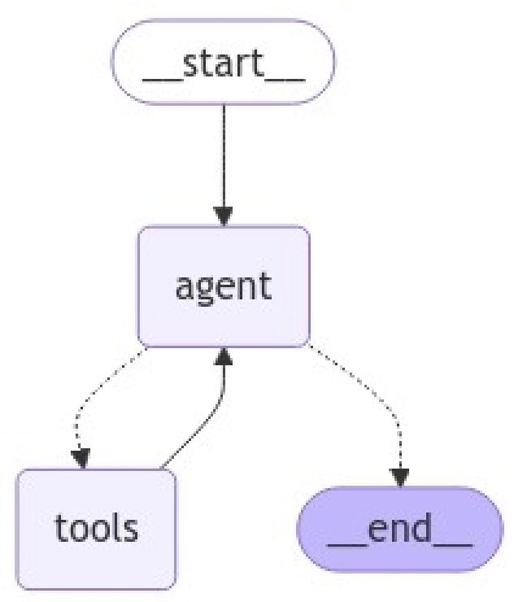

#### **3. Reasoning Logic in LLM**

The agent will call the demand and competitor pricing APIs as tools, then reason based on the results. For example, if competitor prices are lower and demand is high, it might suggest lowering the price.

The LLM will generate the following types of reasoning:

- 1. **Fetch Competitor Data**: The agent uses a tool (competitor pricing API) to get competitor prices.
- 2. **Evaluate Market Demand**: The agent calls the demand API to assess current demand levels.
- 3. **Adjust Pricing**: Based on the demand and competitor data, the LLM decides whether to increase or decrease the price.

#### Example reasoning generated by the LLM:

● "Competitor prices are lower, and demand is high, so I will decrease our price slightly to stay competitive."

#### **4. Observing and Re-Evaluating**

The agent will observe the results and refine its decision-making. If the competitor's price changes after an API call, the agent will re-evaluate and adjust its pricing strategy again.

# **Example 7: Sentiment Analysis Agent Using LLM and Custom Sentiment Analysis Tools**

#### **Overview:**

In this example, we create a **Sentiment Analysis Agent** that uses an **LLM (Large Language Model)** to process customer feedback and integrates custom **sentiment analysis** tools to classify the feedback as positive, neutral, or negative. Based on the sentiment, the agent generates an appropriate response using the **ReAct** (Reason, Act, Observe) framework. The agent reasons through the customer feedback, invokes the sentiment analysis tool, and provides a response.

## **Key Technologies:**

- 1. **LLM for Reasoning**: The LLM processes customer feedback and decides whether to invoke the sentiment analysis tool or respond directly.
- 2. **Sentiment Analysis Tool**: Custom sentiment analysis logic (using TextBlob ) to determine whether the sentiment is positive, neutral, or negative.
- 3. **StateGraph**: The agent's workflow is managed using a state graph that integrates reasoning, acting (sentiment analysis), and responding.

## **Implementation:**

#### **1. Define Agent State:**

The state tracks customer feedback and the LLM's message sequence.

```
#lesson8e.py continued
from typing import Annotated, Sequence, TypedDict
from langchain_core.messages import BaseMessage
from langgraph.graph.message import add_messages
# Define the state for the agent
class AgentState(TypedDict):
   """The state of the agent."""
   # `add_messages` is a reducer that manages the message sequence.
   messages: Annotated[Sequence[BaseMessage], add_messages]
```

#### **2. Define Sentiment Analysis Tool:**

We implement a custom tool using **TextBlob** to analyze customer feedback sentiment.

```
#lesson8e.py continued
from langchain_core.tools import tool
from textblob import TextBlob
@tool
def analyze_sentiment(feedback: str) -> str:
    """Analyze customer feedback sentiment with custom logic."""
    analysis = TextBlob(feedback)
    if analysis.sentiment.polarity > 0.5:
         return "positive"
```

```
elif analysis.sentiment.polarity == 0.5:
    return "neutral"
else:
    return "negative"
```

#### **3. Define Response Generation Tool:**

Once the sentiment is analyzed, we use a second tool to generate the response based on the sentiment.

```
#lesson8e.py continued
@tool
def respond_based_on_sentiment(sentiment: str) -> str:
   """Respond to the customer based on the analyzed sentiment."""
   if sentiment == "positive":
      return "Thank you for your positive feedback!"
   elif sentiment == "neutral":
      return "We appreciate your feedback."
   else:
      return "We're sorry to hear that you're not satisfied. How can we help?"
```

#### **4. Bind the Tools to the LLM:**

We bind the sentiment analysis and response tools to the LLM, so it can invoke these tools when required.

```
#lesson8e.py continued
from langchain_openai import ChatOpenAI
from langchain_core.messages import ToolMessage, SystemMessage
tools = [analyze_sentiment, respond_based_on_sentiment]
# Initialize the LLM
llm = ChatOpenAI(model="gpt-4o-mini")
llm = llm.bind_tools(tools)
# Create a dictionary of tools by their names for easy lookup
tools_by_name = {tool.name: tool for tool in tools}
```

#### **5. Define Tool Execution Node:**

We define a node to execute the tools when the LLM determines that a tool should be called.

```
#lesson8e.py continued
import json
from langchain_core.messages import ToolMessage
# Tool node to handle sentiment analysis and response generation
def tool_node(state: AgentState):
   outputs = []
   for tool_call in state["messages"][-1].tool_calls:
       tool_result = tools_by_name[tool_call["name"]].invoke(tool_call["args"])
```

```
outputs.append(
        ToolMessage(
            content=json.dumps(tool_result),
            name=tool_call["name"],
            tool_call_id=tool_call["id"],
        )
   )
return {"messages": outputs}
```

#### **6. Define the LLM Reasoning Node:**

This node uses the LLM to reason about customer feedback and either responds directly or invokes a tool.

```
#lesson8e.py continued
from langchain_core.runnables import RunnableConfig
# LLM reasoning node to process the feedback and call tools if needed
def call_model(state: AgentState, config: RunnableConfig):
    system_prompt = SystemMessage(
        content="You are a helpful assistant tasked with responding to customer feedback."
    )
    response = llm.invoke([system_prompt] + state["messages"], config)
    return {"messages": [response]}
```

#### **7. Define State Transitions:**

We define a condition that determines whether the LLM should continue invoking tools or provide a final response.

```
#lesson8e.py continued
def should_continue(state: AgentState):
    last_message = state["messages"][-1]
    # If there is no tool call, then we finish
    if not last_message.tool_calls:
         return "end"
    else:
         return "continue"
```

#### **8. Build the StateGraph:**

We build the state graph to orchestrate the reasoning, tool calling, and observation phases.

```
#lesson8e.py continued
from langgraph.graph import StateGraph, END, START
workflow = StateGraph(AgentState)
workflow.add_node("agent", call_model)
workflow.add_node("tools", tool_node)
```

```
workflow.set_entry_point("agent")
workflow.add_conditional_edges(
    "agent",
    should_continue,
    {
         "continue": "tools",
         "end": END,
    },
)
workflow.add_edge("tools", "agent")
# Compile the graph
graph = workflow.compile()
```

#### **9. Visualize the Graph (Optional):**

You can visualize the workflow graph for better understanding of the flow.

```
#lesson8e.py continued
import os
from display_graph import display_graph
display_graph(graph, file_name=os.path.basename(__file__))
```

#### **10. Initialize the Agent and Run:**

We initialize the agent with customer feedback and run the agent to analyze the sentiment and generate a response.

```
#lesson8e.py continued
# Initialize the agent's state with the user's feedback
initial_state = {"messages": [("user", "The product was great but the delivery
was poor.")]}
# Helper function to print the conversation
def print_stream(stream):
   for s in stream:
       message = s["messages"][-1]
       if isinstance(message, tuple):
            print(message)
       else:
            message.pretty_print()
# Run the agent
print_stream(graph.stream(initial_state, stream_mode="values"))
```

# **Explanation:**

#### 1. **Sentiment State**:

○ The state tracks the messages exchanged between the user and the agent, including feedback, sentiment analysis, and responses.

#### 2. **LLM-Based Reasoning**:

○ The LLM processes the customer feedback and determines whether a tool needs to be invoked for sentiment analysis or if it can generate a response directly.

#### 3. **Sentiment Analysis and Response Generation**:

- The sentiment analysis tool ( analyze\_sentiment ) classifies feedback as positive, neutral, or negative.
- Based on the result, the response tool ( respond\_based\_on\_sentiment ) generates a response tailored to the customer's sentiment.

#### 4. **StateGraph**:

○ The graph manages the transitions between the LLM reasoning, sentiment analysis, and response generation, ensuring a structured process for the agent to follow.

## **Example Output:**

Given the feedback **"The product was great but the delivery was poor"**, the agent will analyze the sentiment and generate the following output:

| ================================                                                                                                                                                                                                                                                                                                                            |
|-------------------------------------------------------------------------------------------------------------------------------------------------------------------------------------------------------------------------------------------------------------------------------------------------------------------------------------------------------------|
| Human Message                                                                                                                                                                                                                                                                                                                                               |
| =================================                                                                                                                                                                                                                                                                                                                           |
| The product was great but the delivery was poor.                                                                                                                                                                                                                                                                                                            |
| ==================================<br>Ai Message<br>==================================                                                                                                                                                                                                                                                                      |
| Tool Calls:<br>analyze_sentiment (call_ztXfoVKMspW1uekBhP9KWwAJ)<br>Call ID: call_ztXfoVKMspW1uekBhP9KWwAJ<br>Args:<br>feedback: The product was great but the delivery was poor.<br>respond_based_on_sentiment (call_FEVrtQYE6bXLjpxftMLBhC59)<br>Call ID: call_FEVrtQYE6bXLjpxftMLBhC59<br>Args:<br>sentiment: mixed<br>================================= |
| Tool Message                                                                                                                                                                                                                                                                                                                                                |
| =================================<br>Name: respond_based_on_sentiment                                                                                                                                                                                                                                                                                       |
| "We're sorry to hear that you're not satisfied. How can we help?"                                                                                                                                                                                                                                                                                           |
| ==================================<br>Ai Message                                                                                                                                                                                                                                                                                                            |
| ==================================<br>We're sorry to hear that you're not satisfied. How can we help?                                                                                                                                                                                                                                                       |

# **Example 8: Personalized Product Recommendation Agent Using LLM and Memory**

#### **Overview:**

This example demonstrates a **Personalized Product Recommendation Agent** that uses an **LLM (Large Language Model)** for reasoning and integrates a **memory system** to track user preferences over time. The agent provides product recommendations based on the user's interaction history and current preferences. This agent follows the **ReAct** (Reason, Act, Observe) framework, where the LLM reasons about the user's preferences, calls tools (e.g., product search or recommendation engines), and updates the user's memory to personalize future interactions.

# **Key Technologies:**

- 1. **LLM for Reasoning**: The LLM processes user input and decides whether to recommend a product directly or query a recommendation engine.
- 2. **Memory Integration**: The agent uses a memory system to store user preferences and adapt its recommendations based on past interactions.
- 3. **StateGraph**: The agent's workflow is managed using a state graph to handle reasoning, acting (recommendation generation), and memory updates.

# **Implementation:**

#### **1. Define Recommendation State:**

We define the state schema that tracks the user's current preferences, the reasoning process, and the recommended product.

```
#lesson8e.py continued
from typing import TypedDict
# Define the state for product recommendation
class RecommendationState(TypedDict):
    user_id: str        # User identifier
    preference: str     # User's current preference (e.g., genre, category)
    reasoning: str      # Reasoning process from LLM
    recommendation: str # Final product recommendation
    memory: dict        # User memory to store preferences
```

#### **2. Define Recommendation Tools:**

We create a tool to generate product recommendations based on the user's preferences.

```
#lesson8e.py continued
from langchain_core.tools import tool
# Tool function: Recommend a product based on the user's preference
@tool
def recommend_product(preference: str) -> str:
    """Recommend a product based on the user's preferences."""
```

```
product_db = {
    "science": "I recommend 'A Brief History of Time' by Stephen Hawking.",
    "technology": "I recommend 'The Innovators' by Walter Isaacson.",
    "fiction": "I recommend 'The Alchemist' by Paulo Coelho."
}
return product_db.get(preference, "I recommend exploring our latest products!")
```

#### **3. Bind the Tools to the LLM:**

We bind the product recommendation tool to the LLM, so it can invoke the tool when required.

```
#lesson8e.py continued
from langchain_openai import ChatOpenAI
from langchain_core.messages import ToolMessage, SystemMessage
# Initialize the LLM
llm = ChatOpenAI(model="gpt-4o-mini")
llm = llm.bind_tools([recommend_product])
```

#### **4. Define Memory Update Function:**

We implement a function to update the user's memory with their current preferences, so that future interactions are personalized based on previous choices.

```
#lesson8e.py continued
# Tool function: Update the user's memory with the latest preference
def update_memory(state: RecommendationState):
    # Store the user's preference in the memory
    state["memory"][state["user_id"]] = state["preference"]
    return state
```

#### **5. Define Tool Execution Node:**

We define a node that executes the recommendation tool when the LLM determines that a product recommendation is needed.

```
#lesson8e.py continued
import json
from langchain_core.messages import ToolMessage
# Tool node to handle product recommendation
def tool_node(state: RecommendationState):
    tool_result = recommend_product.invoke({"preference": state["preference"]})
    return {
        "messages": [
           ToolMessage(
               content=json.dumps(tool_result),
               name="recommend_product",
```

```
tool_call_id="recommendation_call"
       )
    ]
}
```

#### **6. Define the LLM Reasoning Node:**

This node uses the LLM to reason about the user's input, decide whether a recommendation is needed, and invoke the recommendation tool if necessary.

```
#lesson8e.py continued
from langchain_core.runnables import RunnableConfig
# LLM reasoning node to process user input and generate product recommendations
def call_model(state: RecommendationState, config: RunnableConfig):
    system_prompt = SystemMessage(
        content=f"You are a helpful assistant. Recommend a product based on the user's preference for
{state['preference']}."
    )
    response = llm.invoke([system_prompt], config)
    state["reasoning"] = response["message"]
    return {"messages": [response]}
```

#### **7. Define State Transitions:**

We define a condition that determines whether the LLM should invoke the product recommendation tool or respond directly.

```
#lesson8e.py continued
# Conditional function to determine whether to call the tool or end
def should_continue(state: RecommendationState):
    last_message = state["reasoning"]
    if "recommend a product" in last_message:
         return "continue"
    else:
         return "end"
```

#### **8. Build the StateGraph:**

We build the state graph that orchestrates the reasoning, recommendation generation, and memory update phases.

```
#lesson8e.py continued
from langgraph.graph import StateGraph, END, START
workflow = StateGraph(RecommendationState)
workflow.add_node("agent", call_model)
workflow.add_node("tools", tool_node)
```

```
workflow.add_node("memory", update_memory)
workflow.set_entry_point("agent")
workflow.add_conditional_edges(
    "agent",
    should_continue,
    {
        "continue": "tools",
        "end": END,
    },
)
workflow.add_edge("tools", "memory")
workflow.add_edge("memory", "agent")
# Compile the graph
graph = workflow.compile()
```

#### **9. Initialize the Agent and Run:**

We initialize the agent with the user's preference and memory, and then run the agent to provide a personalized product recommendation.

```
#lesson8e.py continued
# Initialize the agent's state with the user's preference and memory
initial_state = {
    "user_id": "user123",
    "preference": "science",
    "reasoning": "",
    "recommendation": "",
    "memory": {}
}
# Run the agent
result = graph.invoke(initial_state)
# Display the final result
print(f"Reasoning: {result['reasoning']}")
print(f"Product Recommendation: {result['messages'][-1].content}")
print(f"Updated Memory: {result['memory']}")
```

# **Explanation:**

#### 1. **Recommendation State**:

○ The state tracks the user's preference, the reasoning process, the final product recommendation, and memory updates.

#### 2. **LLM-Based Reasoning**:

○ The LLM processes the user's preference and determines whether to invoke the recommendation tool or generate a direct response.

#### 3. **Memory Integration**:

○ The agent updates the user's memory with their preferences, so future recommendations are personalized based on their history.

#### 4. **Product Recommendation**:

○ The recommendation tool suggests products based on the user's preferences (e.g., science, technology, fiction).

#### 5. **StateGraph**:

○ The state graph manages the transitions between reasoning, recommendation generation, and memory updates, ensuring a structured workflow.

## **Example Output:**

Given the user preference **"science"**, the agent will analyze the input and provide the following recommendation:

Reasoning: Based on your preference for science, I recommend 'A Brief History of Time' by Stephen Hawking. Product Recommendation: I recommend 'A Brief History of Time' by Stephen Hawking. Updated Memory: {'user123': 'science'}

# **Chapter 9**

# <span id="page-249-1"></span><span id="page-249-0"></span>**Human-in-the-Loop Agents: Incorporating Human Feedback for Smarter Decision-Making**

# **Introduction**

As AI agents become more integrated into business processes, the need for human feedback remains critical, especially in sensitive or complex tasks. A "Human-in-the-Loop" (HITL) architecture allows AI systems to pause, seek human approval or feedback, and proceed based on human input. This chapter focuses on integrating human interactions with AI agents built using LangGraph, adding a layer of flexibility and safety to automated workflows.

In this chapter, we will cover:

- 1. **What is Human-in-the-Loop?**
- 2. **Core Concepts: Breakpoints, Checkpoints, and State Editing**
- 3. **Step-by-Step: Implementing Simple Breakpoints**
- 4. **Dynamic Breakpoints and Conditional Interruptions**
- 5. **Reviewing and Modifying Tool Calls**
- 6. **Waiting for User Input**
- 7. **Example Projects with Increasing Complexity**

# 8. **Exercises and Quizzes**

# <span id="page-250-0"></span>**9.1 What is Human-in-the-Loop?**

**Human-in-the-Loop (HITL)** involves human oversight in AI workflows, enabling agents to pause at key points, seek feedback, and adjust their behavior accordingly. This is particularly useful in scenarios where errors, sensitive actions, or uncertain outcomes are possible. For example, agents may require human approval before executing financial transactions, finalizing reports, or interacting with sensitive data.

This process enhances reliability, ensures accountability, and allows humans to intervene when necessary.

# HITL is especially beneficial in:

- **Financial Transactions**: Automating financial workflows can introduce risks if not managed properly. HITL can be applied in systems that process payments, where the agent pauses to seek human approval for large or unusual transactions. This prevents fraud or mismanagement of funds.
  - *Example*: An AI agent that automates payroll processing might flag and pause any transactions above a certain amount for manual approval.
- **Content Moderation**: AI agents tasked with generating content (e.g., reports, articles, or social media posts) can pause for human review to verify the appropriateness or accuracy of the content before publication.
  - *Example*: A content generation agent that reviews marketing material might require human verification for content that includes sensitive political references, ensuring it aligns with company guidelines before release.
- **Legal Documentation**: HITL is crucial in legal workflows, where AI-generated contracts or legal documents must be reviewed by a human before being finalized.
  - *Example*: An AI agent drafting contracts can create a first draft and then halt, allowing a legal expert to review, edit, and approve the document.

HITL enhances the **reliability** and **accountability** of AI agents, ensuring that humans retain control over critical decisions.

# <span id="page-251-0"></span>**9.2 Core Concepts: Breakpoints, Checkpoints, and State Editing**

In LangGraph, HITL agents can be structured around several key concepts that allow humans to intervene in AI workflows dynamically. The most important concepts include:

- 1. **Breakpoints**: These are intentional pause points in the graph's execution where the agent halts its operation until human feedback is received. Breakpoints provide a way for humans to step in, review the current state, and either approve or adjust the agent's course of action before it proceeds.
- 2. **Checkpoints**: These are "save points" in the agent's workflow, which capture the current state of the system. If the agent encounters a failure or requires a human to intervene, it can resume execution from the last checkpoint, avoiding the need to restart from the beginning.
- 3. **State Editing**: This allows users to modify the state of the workflow dynamically while it is paused. During a HITL pause, users can adjust input data, modify parameters, or change the agent's course of action. This is particularly useful in scenarios where human judgment is needed to tweak the agent's behavior in real time.

Let's explore each with practical examples.

# <span id="page-251-1"></span>**9.3 Example 1: Implementing Simple Breakpoints**

A breakpoint allows a graph to stop and wait for human approval before proceeding. Let's build a simple example where the agent pauses before executing a final action.

```
#lesson9a.py
import os
from typing_extensions import TypedDict
from langgraph.graph import StateGraph, START, END
```

```
from langgraph.checkpoint.memory import MemorySaver
from display_graph import display_graph
# Define the state structure
class State(TypedDict):
   input: str
# Define node functions
def step_1(state: State):
   print("--- Step 1 ---")
   return state
def step_2(state: State):
   print("--- Step 2 ---")
   return state
# Build the graph
builder = StateGraph(State)
builder.add_node("step_1", step_1)
builder.add_node("step_2", step_2)
# Define flow
builder.add_edge(START, "step_1")
builder.add_edge("step_1", "step_2")
builder.add_edge("step_2", END)
# Set up memory and breakpoints
memory = MemorySaver()
graph = builder.compile(checkpointer=memory, interrupt_before=
["step_2"])
# Display the graph
display_graph(graph, file_name=os.path.basename(__file__))
```

# In this example:

- **Step 1** executes.
- The graph pauses before executing **Step 2**, awaiting user input.

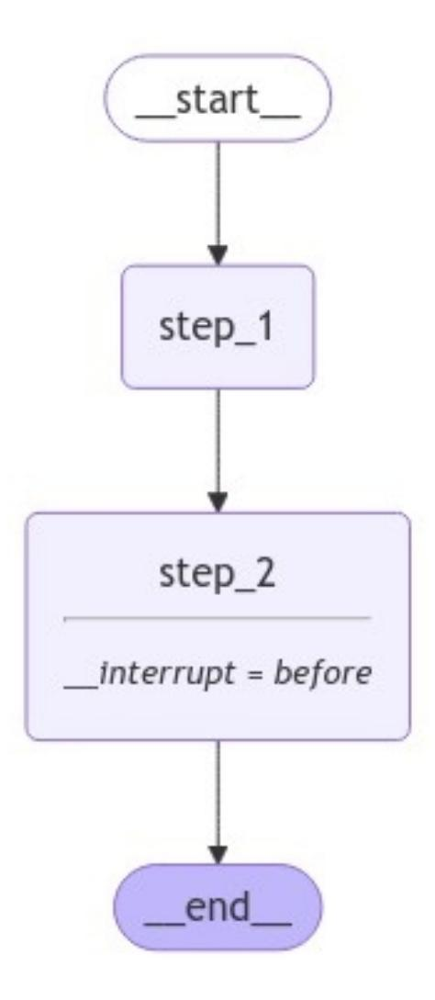

# **Running the Graph:**

```
#lesson9a.py continued
config = {"configurable": {"thread_id": "thread-1"}}
initial_input = {"input": "Hello, LangGraph!"}
thread = {"configurable": {"thread_id": "1"}}
for event in graph.stream(initial_input, thread, stream_mode="values"):
    print(event)
user_approval = input("Do you approve to continue to Step 2? (yes/no): ")
if user_approval.lower() == "yes":
    for event in graph.stream(None, thread, stream_mode="values"):
         print(event)
else:
    print("Execution halted by user.")
```

# **9.3.1 Example 2: Practical Example of Content Moderation**

Consider a content moderation workflow where an agent creates draft content for a blog post. Before publishing, the workflow pauses, allowing a human editor to review the draft. If the editor finds errors or needs adjustments, they can modify the draft directly in the paused state and approve the changes before proceeding.

In this example, we will create a content moderation workflow using **LangGraph** where an AI agent generates a blog post draft. The workflow includes the following stages:

- 1. The agent generates a draft based on the input topic using a language model (OpenAI).
- 2. The system pauses at a **breakpoint**, allowing a human editor to review the draft and make necessary changes.
- 3. Once the editor approves the content, the agent proceeds to publish it.

This is a perfect example of **Human-in-the-Loop (HITL)**, where human oversight is essential in ensuring the quality and appropriateness of content before publication. Such a workflow could be used in content management systems, news article generation, or any scenario where generated content must align with specific guidelines or sensitivities.

```
#lesson9c.py continued
import os
from typing_extensions import TypedDict
from langgraph.graph import StateGraph, END, START
from langgraph.checkpoint.memory import MemorySaver
from langchain_openai import ChatOpenAI
from display_graph import display_graph
# Set up your OpenAI API key
openai_api_key = os.getenv("OPENAI_API_KEY")
# Initialize the OpenAI model
llm = ChatOpenAI(
    api_key=openai_api_key,
    model="gpt-4o-mini",          # Specify the model
    temperature=0.7,         # Adjust for creativity in output
```

```
max_tokens=50           # Set maximum token length for responses
)
# Define the state structure
class State(TypedDict):
    input: str
    draft_content: str
# Define node functions
def create_draft(state: State):
    print("--- Generating Draft with ChatOpenAI ---")
    # Prepare the prompt for generating the blog content
    prompt = f"Write a blog post on the topic: {state['input']}"
    # Call the LangChain ChatOpenAI instance to generate the draft
    response = llm.invoke([{"role": "user", "content": prompt}])
    # Extract the generated content
    state["draft_content"] = response.content
    print(f"Generated Draft:\n{state['draft_content']}")
    return state
def review_draft(state: State):
    print("--- Reviewing Draft ---")
    print(f"Draft for review:\n{state['draft_content']}")
    return state
def publish_content(state: State):
    print("--- Publishing Content ---")
    print(f"Published Content:\n{state['draft_content']}")
    return state
# Build the graph
builder = StateGraph(State)
builder.add_node("create_draft", create_draft)
builder.add_node("review_draft", review_draft)
builder.add_node("publish_content", publish_content)
# Define flow
builder.add_edge(START, "create_draft")
builder.add_edge("create_draft", "review_draft")
builder.add_edge("review_draft", "publish_content")
builder.add_edge("publish_content", END)
# Set up memory and breakpoints
memory = MemorySaver()
```

```
graph = builder.compile(checkpointer=memory, interrupt_before=["publish_content"])
# Display the graph
display_graph(graph, file_name=os.path.basename(__file__))
# Run the graph
config = {"configurable": {"thread_id": "thread-1"}}
initial_input = {"input": "The importance of AI in modern content creation"}
# Run the first part until the review step
thread = {"configurable": {"thread_id": "1"}}
for event in graph.stream(initial_input, thread, stream_mode="values"):
    print(event)
# Pausing for human review
user_approval = input("Do you approve the draft for publishing? (yes/no/modification):
")
if user_approval.lower() == "yes":
    # Proceed to publish content
    for event in graph.stream(None, thread, stream_mode="values"):
         print(event)
elif user_approval.lower() == "modification":
    # Allow modification of the draft
    updated_draft = input("Please modify the draft content:\n")
    memory.update({"draft_content": updated_draft})  # Update memory with new
content
    print("Draft updated by the editor.")
    # Continue to publishing with the modified draft
    for event in graph.stream(None, thread, stream_mode="values"):
         print(event)
else:
    print("Execution halted by user.")
Output:
{'input': 'The importance of AI in modern content creation'}
--- Generating Draft with ChatOpenAI ---
Generated Draft:
# The Importance of AI in Modern Content Creation     
In today's fast-paced digital landscape, the demand for high-quality content has never
been greater. From social media posts to in-depth articles and marketing materials,
businesses and individuals alike are constantly seeking innovative ways
{'input': 'The importance of AI in modern content creation', 'draft_content': '# The
Importance of AI in Modern Content Creation\n\nIn today's fast-paced digital landscape,
```

the demand for high-quality content has never been greater. From social media posts to in-depth articles and marketing materials, businesses and individuals alike are constantly seeking innovative ways'}

#### --- Reviewing Draft ---

#### Draft for review:

# The Importance of AI in Modern Content Creation

In today's fast-paced digital landscape, the demand for high-quality content has never been greater. From social media posts to in-depth articles and marketing materials, businesses and individuals alike are constantly seeking innovative ways

{'input': 'The importance of AI in modern content creation', 'draft\_content': '# The Importance of AI in Modern Content Creation\n\nIn today's fast-paced digital landscape, the demand for high-quality content has never been greater. From social media posts to in-depth articles and marketing materials, businesses and individuals alike are constantly seeking innovative ways'}

#### Do you approve the draft for publishing? (yes/no/modification): yes

{'input': 'The importance of AI in modern content creation', 'draft\_content': '# The Importance of AI in Modern Content Creation\n\nIn today's fast-paced digital landscape, the demand for high-quality content has never been greater. From social media posts to in-depth articles and marketing materials, businesses and individuals alike are constantly seeking innovative ways'}

#### --- Publishing Content ---

#### Published Content:

# The Importance of AI in Modern Content Creation

In today's fast-paced digital landscape, the demand for high-quality content has never been greater. From social media posts to in-depth articles and marketing materials, businesses and individuals alike are constantly seeking innovative ways

{'input': 'The importance of AI in modern content creation', 'draft\_content': '# The Importance of AI in Modern Content Creation\n\nIn today's fast-paced digital landscape, the demand for high-quality content has never been greater. From social media posts to in-depth articles and marketing materials, businesses and individuals alike are constantly seeking innovative ways'}

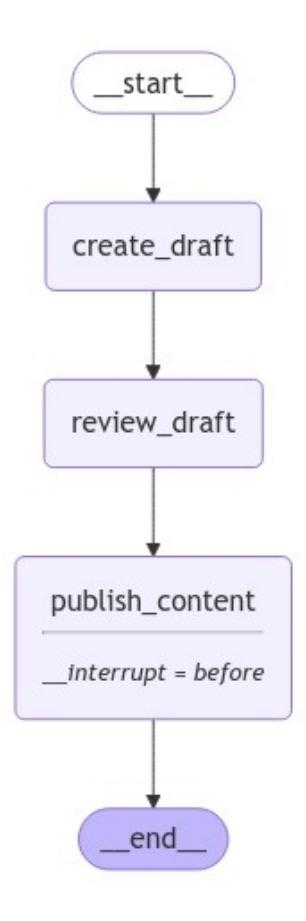

# **Explanation of Workflow Flow:**

- 1. **create\_draft**: The AI generates the content based on the input topic.
- 2. **review\_draft**: The draft content is presented to the human editor for review. The human can decide whether to approve or modify the draft.
- 3. **publish\_content**: After the draft is approved (or modified), the content is published.

The **breakpoint** is set before the **publish\_content** node, ensuring that the workflow pauses and waits for human approval before the content is published. This workflow offers the following benefits:

- **Human Oversight**: The workflow ensures that human editors retain control over the final content, allowing them to intervene at critical points.
- **Flexibility**: Human editors can either approve the generated draft, make modifications, or halt the process entirely. This prevents

- inappropriate content from being published without review.
- **Scalability**: The workflow can be extended to handle more complex moderation tasks, such as verifying factual accuracy or flagging sensitive content based on human feedback.

# <span id="page-259-0"></span>**9.4 ReAct Agent Example with Financial Stock Purchase Use Case**

In this section, we'll explore how to implement a **React agent** using the Human-in-the-Loop (HITL) architecture for a **stock purchase** decisionmaking workflow. The agent will query live stock prices using the **Finnhub API**, reason about whether to make a stock purchase, and pause to request human approval before proceeding. This example is particularly useful in financial workflows where human oversight is essential for high-stakes decision-making, such as stock trading.

# **Scenario:**

The agent is tasked with determining whether to purchase a stock based on live pricing data. It will:

- 1. Query real-time stock prices from the Finnhub API.
- 2. Reason through whether the stock price is favorable for purchasing.
- 3. Pause for human intervention to approve the purchase before executing the trade.

# **Step-by-Step Implementation**

Let's walk through the creation of the agent using LangGraph's HITL architecture. The Finnhub API will be used to retrieve real-time stock prices, and the ReAct agent will reason about making a purchase based on price conditions.

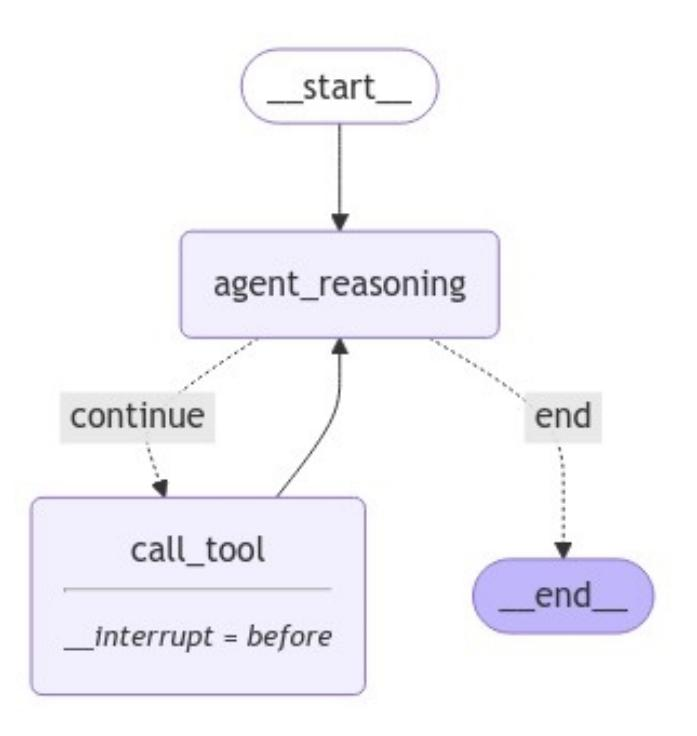

# **Key Points in this Example:**

- 1. **Reasoning Step**: The agent first "reasons" using the AI model (OpenAI) about whether to check the stock price of a company (in this case, AAPL). The agent evaluates the initial request from the user and prepares to make a tool call for the stock price.
- 2. **Human Breakpoint**: Before the agent proceeds to retrieve the stock price from the **Finnhub API**, it pauses and requests human approval. This is the critical **Human-in-the-Loop** moment where a human operator decides whether to proceed or stop the process.
- 3. **Tool Invocation**: If approved, the agent proceeds to call the **Finnhub API** to get the latest stock price. The agent retrieves real-time price data and presents it to the user.
- 4. **Dynamic Flow**: The agent dynamically switches between reasoning and action based on conditional logic. If the human operator does not approve the price retrieval, the agent halts, ensuring no unwanted actions are taken.

#lesson9d.py # Import necessary modules import os

```
from langchain_core.tools import tool
from langgraph.graph import MessagesState, START, END, StateGraph
from langgraph.checkpoint.memory import MemorySaver
from langgraph.prebuilt import ToolNode
from langchain_openai import ChatOpenAI
import finnhub
from  display_graph import display_graph
# Initialize Finnhub API client
finnhub_client = finnhub.Client(api_key=os.getenv("FINNHUB_API_KEY"))
# Define the tool: querying stock prices using the Finnhub API
@tool
def get_stock_price(symbol: str):
    """Retrieve the latest stock price for the given symbol."""
    quote = finnhub_client.quote(symbol)
    return f"The current price for {symbol} is ${quote['c']}."
# Register the tool in the tool node
tools = [get_stock_price]
tool_node = ToolNode(tools)
# Set up the AI model (simulated with ChatAnthropic)
model = ChatOpenAI(model="gpt-4o-mini")
model = model.bind_tools(tools)
# Define the function that simulates reasoning and invokes the model
def agent_reasoning(state):
    messages = state["messages"]
    response = model.invoke(messages)
    return {"messages": [response]}
# Define conditional logic to determine whether to continue or stop
def should_continue(state):
    messages = state["messages"]
    last_message = messages[-1]
    # If there are no tool calls, finish the process
    if not last_message.tool_calls:
         return "end"
    return "continue"  # Otherwise, continue to the next step
# Build the React agent using LangGraph
workflow = StateGraph(MessagesState)
# Add nodes: agent reasoning and tool invocation (stock price retrieval)
```

```
workflow.add_node("agent_reasoning", agent_reasoning)
workflow.add_node("call_tool", tool_node)
# Define the flow
workflow.add_edge(START, "agent_reasoning")  # Start with reasoning
# Conditional edges: continue to tool call or end the process
workflow.add_conditional_edges(
    "agent_reasoning", should_continue, {
         "continue": "call_tool",  # Proceed to get stock price
         "end": END  # End the workflow
    }
)
# Normal edge: after invoking the tool, return to agent reasoning
workflow.add_edge("call_tool", "agent_reasoning")
# Set up memory for breakpoints and add a breakpoint before calling the tool
memory = MemorySaver()
app = workflow.compile(checkpointer=memory, interrupt_before=["call_tool"])
# Display the graph (optional visualization step)
display_graph(app, __file__)
# Simulate user input for stock symbol
initial_input = {"messages": [{"role": "user", "content": "Should I buy AAPL stock
today?"}]}
thread = {"configurable": {"thread_id": "1"}}
# Run the agent reasoning step first
for event in app.stream(initial_input, thread, stream_mode="values"):
    print(event)
# Pausing for human approval before retrieving stock price
user_approval = input("Do you approve querying the stock price for AAPL? (yes/no): ")
if user_approval.lower() == "yes":
    # Continue with tool invocation to get stock price
    for event in app.stream(None, thread, stream_mode="values"):
         print(event)
else:
    print("Execution halted by user.")
```

# **Expanded Details:**

- **Agent Reasoning**: The agent processes the initial request to buy stock and reasons about what actions to take next. This "thinking aloud" process enhances transparency, showing users the agent's thought process.
- **Human Approval**: The agent pauses before retrieving sensitive or real-time financial data, allowing the human operator to approve or deny the action. This ensures that stock purchases or financial decisions are not made autonomously without oversight.
- **Live Data from Finnhub API**: The agent fetches real-time stock price information using the Finnhub API, providing accurate and upto-date data that the human operator can use to make a decision.

# **Sample Output:**

```
{'messages': [{'role': 'user', 'content': "Should I buy AAPL stock today?"}]}
--- Reasoning through the problem ---
Agent's reasoning: "Let's check the current price for AAPL using the stock price API."
{'messages': [{'role': 'user', 'content': "Should I buy AAPL stock today?"}, {'role': 'assistant',
'content': "Let's check the current price for AAPL using the stock price API."}]}
Do you approve querying the stock price for AAPL? (yes/no): yes
--- Invoking stock price API ---
{"role": "system", "tool_call": "get_stock_price", "result": "The current price for AAPL is
$150.78."}
{'messages': [{'role': 'user', 'content': "Should I buy AAPL stock today?"}, {'role': 'assistant',
'content': "Let's check the current price for AAPL using the stock price API."}, {'role':
'system', 'tool_call': 'get_stock_price', 'result': "The current price for AAPL is $150.78."}]}
```

# **Real-World Use Cases:**

- **Stock Trading**: The agent can assist traders by fetching real-time stock prices and pausing to request approval before executing purchases or trades.
- **Financial Risk Management**: A ReAct agent could be used in financial institutions to analyze market conditions, retrieve stock data, and ask for human oversight before making high-stakes decisions like stock purchases or sales.

# <span id="page-263-0"></span>**9.5 Understanding and Using "Interrupt After" in LangGraph**

In workflows that require **Human-in-the-Loop (HITL)** decision-making, the flexibility to interrupt the flow at different stages is crucial. In LangGraph, we can introduce **interruptions** both **before** and **after** a

particular node. Previously, we explored **interrupt\_before**, which allows the workflow to pause before executing a node, waiting for human approval before proceeding. Now, we'll dive into the concept of **interrupt\_after**.

# **What is interrupt\_after ?**

The **interrupt\_after** directive in LangGraph causes the workflow to pause after a particular node has executed, allowing human intervention before moving to the next stage. This is useful in scenarios where an action is completed but needs human verification, inspection, or follow-up steps before proceeding.

# **Why Use interrupt\_after ?**

Using **interrupt\_after** in Human-in-the-Loop systems is beneficial when:

- **Post-action validation** is required: After executing a task, you might want a human to verify that the action completed as expected.
- **Manual adjustments**: Following an action, human users may need to tweak the results or output before proceeding to the next step.
- **Security or compliance**: In workflows that involve compliance (e.g., financial transactions, content publishing), even after an action has been executed, approval may still be required to ensure everything aligns with regulations or company policies.

# **Example: Financial Stock Purchase Decision with Post-Purchase Approval**

Let's take our previous stock purchase example and enhance it by introducing **interrupt\_after** . In this version, the agent will:

- 1. Retrieve the stock price using the **Finnhub API**.
- 2. Decide to make a stock purchase based on a predefined threshold.
- 3. **After** making the purchase, the agent pauses for human approval to finalize the action and update the transaction record.

Here's how this scenario would work in practice:

#lesson9e.py

# Import necessary modules

```
import os
from langchain_core.tools import tool
from langgraph.graph import MessagesState, START, END, StateGraph
from langgraph.checkpoint.memory import MemorySaver
from langgraph.prebuilt import ToolNode
from langchain_openai import ChatOpenAI
from display_graph import display_graph
import finnhub
# Initialize Finnhub API client
finnhub_client = finnhub.Client(api_key=os.getenv("FINNHUB_API_KEY"))
# Define the tool: querying stock prices using the Finnhub API
@tool
def get_stock_price(symbol: str):
    """Retrieve the latest stock price for the given symbol."""
    quote = finnhub_client.quote(symbol)
    return f"The current price for {symbol} is ${quote['c']}."
# Define the tool for purchasing stock (simulated)
@tool
def purchase_stock(symbol: str, quantity: int):
    """Simulate stock purchase and return a confirmation message."""
    return f"Purchased {quantity} shares of {symbol} at the current market price."
# Register the tools in the tool node
tools = [get_stock_price, purchase_stock]
tool_node = ToolNode(tools)
# Set up the AI model (ChatAnthropic) for reasoning
model = ChatOpenAI(model="gpt-4o-mini")
model = model.bind_tools(tools)
# Define the function that simulates reasoning and invokes the model
def agent_reasoning(state):
    messages = state["messages"]
    response = model.invoke(messages)
    return {"messages": [response]}
# Define conditional logic to determine whether to continue or stop
def should_continue(state):
    messages = state["messages"]
    last_message = messages[-1]
    # If there are no tool calls, finish the process
```

```
if not last_message.tool_calls:
         return "end"
    return "continue"  # Otherwise, continue to the next step
# Build the React agent using LangGraph
workflow = StateGraph(MessagesState)
# Add nodes: agent reasoning and tool invocation (stock price retrieval and purchase)
workflow.add_node("agent_reasoning", agent_reasoning)
workflow.add_node("call_tool", tool_node)
# Define the flow
workflow.add_edge(START, "agent_reasoning")  # Start with reasoning
# Conditional edges: proceed to tool call or end the process
workflow.add_conditional_edges(
    "agent_reasoning", should_continue, {
         "continue": "call_tool",  # Proceed to call tool (get stock price or purchase)
         "end": END  # End the workflow
    }
)
# Normal edge: after invoking the tool, return to agent reasoning
workflow.add_edge("call_tool", "agent_reasoning")
# Set up memory for breakpoints and add `interrupt_after` to pause after the stock
purchase
memory = MemorySaver()
app = workflow.compile(checkpointer=memory, interrupt_after=["call_tool"])
# Display the graph (optional visualization step)
display_graph(app, file_name="react_agent_stock_purchase_interrupt_after.png")
# Simulate user input for stock symbol
initial_input = {"messages": [{"role": "user", "content": "Should I buy AAPL stock
today?"}]}
thread = {"configurable": {"thread_id": "1"}}
# Run the agent reasoning step first
for event in app.stream(initial_input, thread, stream_mode="values"):
    print(event)
# Pausing for human approval after the purchase is made
user_approval = input("Do you approve the stock purchase action? (yes/no): ")
if user_approval.lower() == "yes":
    # Confirm and finalize the transaction
    for event in app.stream(None, thread, stream_mode="values"):
```

print(event) else: print("Execution halted by user.")

# **Key Points in this Example:**

- 1. **Agent Reasoning**: The agent first reasons about whether to proceed with purchasing the stock based on the current price retrieved from the **Finnhub API**.
- 2. **Tool Invocation and Post-Purchase Approval**: After retrieving the stock price and deciding to make a purchase, the agent invokes the tool to buy the stock. **Interrupt\_after** ensures that after the purchase is made, the system pauses for human approval before proceeding to finalize the transaction.
- 3. **Human Review After Purchase**: Even though the purchase is simulated, the workflow pauses to allow human intervention to either approve or deny the transaction. This adds a safety layer in workflows where mistakes could lead to significant financial consequences.
- 4. **Flexible Control Flow**: This flow allows dynamic reasoning and action, where the agent evaluates its decision-making at multiple stages, ensuring that the human operator has control over key points in the process.

# **Expanded Details:**

- **Interrupting After Actions**: By pausing the workflow after the tool call, the system allows the human operator to review the result of the action (in this case, the stock purchase) before proceeding. This could be useful in situations where:
  - You need to log the results.
  - There are additional compliance checks.
  - The human operator must adjust parameters before the workflow continues.
- **Manual Adjustments**: If the human operator notices an issue (such as incorrect quantities or prices), the workflow can be modified to allow changes before finalizing the purchase.

# **Sample Output:**

```
{'messages': [{'role': 'user', 'content': "Should I buy AAPL stock today?"}]}
--- Reasoning through the problem ---
Agent's reasoning: "Let's check the current price for AAPL using the stock price API."
{'messages': [{'role': 'user', 'content': "Should I buy AAPL stock today?"}, {'role': 'assistant', 'content':
"Let's check the current price for AAPL using the stock price API."}]}
--- Invoking stock price API ---
{"role": "system", "tool_call": "get_stock_price", "result": "The current price for AAPL is $150.78."}
--- Deciding to purchase stock ---
Agent's reasoning: "The price is favorable. Let's purchase 10 shares of AAPL."
{'messages': [{'role': 'user', 'content': "Should I buy AAPL stock today?"}, {'role': 'assistant', 'content':
"The price is favorable. Let's purchase 10 shares of AAPL."}]}
--- Invoking stock purchase tool ---
{"role": "system", "tool_call": "purchase_stock", "result": "Purchased 10 shares of AAPL at the
current market price."}
Do you approve the stock purchase action? (yes/no): yes
--- Finalizing stock purchase ---
{'messages': [{'role': 'user', 'content': "Should I buy AAPL stock today?"}, {'role': 'assistant', 'content':
"The price is favorable. Let's purchase 10 shares of AAPL."}, {'role': 'system', 'tool_call':
'purchase_stock', 'result': "Purchased 10 shares of AAPL at the current market price."}]}
```

# **9.5.1 Real-World Use Cases for interrupt\_after**

Using **interrupt\_after** is crucial in real-world scenarios where human verification is needed after an action has been performed. Some practical applications include:

- 1. **Financial Transactions**: After a stock purchase or financial transaction is completed, the workflow pauses to allow human operators to verify and approve the transaction before updating the financial records.
- 2. **Healthcare**: After a medical test is ordered by an AI assistant, the workflow can pause for human doctors to review the test order before finalizing it, ensuring the right procedures are followed.
- 3. **Legal Processes**: After generating or modifying legal contracts, the workflow pauses for a legal expert to review the changes before submitting the document for signatures.
- 4. **Content Publishing**: After a draft is written or an edit is made, the workflow can pause for the editor to approve changes before publishing the final version.

# <span id="page-269-0"></span>**9.6 Editing Graph State During Execution**

# **Concept Overview**

**Editing the graph state** during execution allows the agent to adjust its behavior dynamically based on human input. This is especially useful when agents need to alter the state or parameters that guide their decisions. For example, an agent might change its course of action after a human modifies the input data or adjusts a tool call. This concept builds on the breakpoints and allows users to **directly modify the graph's internal state** before proceeding.

# **Practical Use Cases**

- **Correcting Tool Calls**: Before executing a critical tool (such as sending a database query or API call), the graph pauses and allows users to modify the parameters.
- **Data Modification**: The state can be manually updated to reflect a corrected dataset or user-provided input, ensuring accurate results.

#### **Example 3: Modifying Graph State Before Proceeding**

In this example, the agent pauses execution and allows the user to modify the graph state before continuing.

```
#lesson9f.py continued
from typing_extensions import TypedDict
from langgraph.graph import StateGraph, START, END
from langgraph.checkpoint.memory import MemorySaver
# Define the state structure
class State(TypedDict):
    input: str
    modified_input: str
# Define node functions
def step_1(state: State):
    print(f"Original input: {state['input']}")
    return state
def modify_state(state: State):
    # Allow the user to modify the state
    return state
```

```
def step_3(state: State):
    print(f"Modified input: {state['modified_input']}")
    return state
# Build the graph
builder = StateGraph(State)
builder.add_node("step_1", step_1)
builder.add_node("modify_state", modify_state)
builder.add_node("step_3", step_3)
# Define the flow
builder.add_edge(START, "step_1")
builder.add_edge("step_1", "modify_state")
builder.add_edge("modify_state", "step_3")
builder.add_edge("step_3", END)
# Set up memory and breakpoints
memory = MemorySaver()
graph = builder.compile(checkpointer=memory, interrupt_before=["modify_state"])
# Run the graph
initial_input = {"input": "Initial Input"}
config = {"configurable": {"thread_id": "thread-1"}}
for event in graph.stream(initial_input, config):
    print(event)
# Ask user to modify the state
modified_value = input("Enter the modified input: ")
graph.update_state(config, {"modified_input": modified_value})
# Continue the graph execution
for event in graph.stream(None, config):
    print(event)
```

#### **Key Concepts**

- **State Editing**: The modify\_state node allows the human to update the state of the graph manually.
- **State Updates**: graph.update\_state() is used to apply changes to the graph's state based on human input.

#### **Output**

```
Original input: Initial Input
{'step_1': {'input': 'Initial Input'}}
```

```
{'__interrupt__': ()}
Enter the modified input: new input
{'modify_state': {'input': 'Initial Input', 'modified_input': 'new input'}}
Modified input: new input
{'step_3': {'input': 'Initial Input', 'modified_input': 'new input'}}
```

#### **Concept Explanation**

Editing the state during graph execution allows greater flexibility. The user can dynamically modify key values, ensuring the agent operates with the correct or updated information. This method is especially useful for correcting inputs, updating parameters before tool calls, or handling errors.

# <span id="page-271-0"></span>**9.7 Five Simple Breakpoint Examples**

Before diving into dynamic breakpoints, let's solidify the concept of basic breakpoints through a series of examples. These examples showcase the different ways breakpoints can be used to manage workflow execution.

*Example 1: Basic Approval for a Financial Transaction*

```
#lesson9g.py continued
from typing_extensions import TypedDict
from langgraph.graph import StateGraph, START, END
from langgraph.checkpoint.memory import MemorySaver
class State(TypedDict):
    amount: float
builder = StateGraph(State)
def define__transaction(state: State):
    print("Defining transaction...")
    return state
def verify_transaction(state: State):
    print(f"Verifying transaction amount: {state['amount']}")
    return state
builder.add_node("define_transaction", define__transaction)
builder.add_node("verify_transaction", verify_transaction)
builder.add_edge(START, "define_transaction")
builder.add_edge("define_transaction", "verify_transaction")
builder.add_edge("verify_transaction", END)
graph = builder.compile(interrupt_before=
["verify_transaction"],checkpointer=MemorySaver())
```

```
initial_input = {"amount": 1000.0}
config = {"configurable": {"thread_id": "thread-1"}}
for event in graph.stream(initial_input, config):
    print(event)
approval = input("Approve this transaction? (yes/no): ")
if approval.lower() == "yes":
    for event in graph.stream(None, config):
         print(event)
else:
    print("Transaction canceled.")
```

This example is particularly useful for ensuring sensitive actions like financial transactions are human-approved.

# *9.7.1 Example 2: Approval Before Data Deletion*

```
#lesson9h.py continued
from typing_extensions import TypedDict
from langgraph.graph import StateGraph, START, END
from langgraph.checkpoint.memory import MemorySaver
class State(TypedDict):
    data: str
def delete_data(state: State):
    print(f"Data to be deleted: {state['data']}")
    return state
builder = StateGraph(State)
builder.add_node("delete_data", delete_data)
builder.add_edge(START, "delete_data")
builder.add_edge("delete_data", END)
graph = builder.compile(interrupt_before=["delete_data"],
checkpointer=MemorySaver())
initial_input = {"data": "Sensitive Information"}
config = {"configurable": {"thread_id": "thread-1"}}
for event in graph.stream(initial_input, config):
    print(event)
approval = input("Approve data deletion? (yes/no): ")
if approval.lower() == "yes":
```

```
for event in graph.stream(None, config):
         print(event)
else:
    print("Data deletion canceled.")
```

This workflow halts before executing data deletion, allowing human intervention to prevent accidental deletions.

# *9.7.2 Example 3: Approving a Tool Call*

```
#lesson9i.py
from typing_extensions import TypedDict
from langgraph.graph import StateGraph, START, END
from langgraph.checkpoint.memory import MemorySaver
from langchain_core.tools import tool
class State(TypedDict):
    query: str
@tool
def perform_query(query: str):
    """:param query: The SQL query to be executed."""
    print(f"Performing query: {query}")
    return {"query" :{query}}
def review_query(state: State):
    print(f"Reviewing query: {state['query']}")
    return state
builder = StateGraph(State)
builder.add_node("perform_query", perform_query)
builder.add_node("review_query", review_query)
builder.add_edge("review_query", "perform_query")
builder.add_edge(START, "review_query")
builder.add_edge("perform_query", END)
graph = builder.compile(interrupt_before=["perform_query"],
checkpointer=MemorySaver())
initial_input = {"query": "SELECT * FROM users"}
config = {"configurable": {"thread_id": "thread-1"}}
for event in graph.stream(initial_input, config):
    print(event)
```

```
approval = input("Approve query execution? (yes/no): ")
if approval.lower() == "yes":
    for event in graph.stream(None, config):
         print(event)
else:
    print("Query execution cancelled.")
```

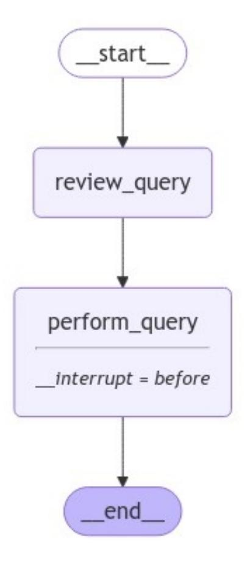

This demonstrates how to approve or modify a tool call before execution. The user reviews the query from the review\_query node and is asked to approve execution.

The SQL statement is run only after the user approves, then the perform\_quer y node is executed allowing the SQL statement to run.

# *9.7.3 Example 4: Human Input for Report Generation*

```
#lesson9j.py
import os
```

```
from typing_extensions import TypedDict
from langgraph.graph import StateGraph, START, END
from langgraph.checkpoint.memory import MemorySaver
from display_graph import display_graph
class State(TypedDict):
    title: str
def generate_report(state: State):
    """
    Generate a financial report based on the provided title.
    """
    print(f"Generating report with title: {state['title']}")
    return state
builder = StateGraph(State)
builder.add_node("generate_report", generate_report)
builder.add_edge(START, "generate_report")
builder.add_edge("generate_report", END)
graph = builder.compile(interrupt_before=["generate_report"],
checkpointer=MemorySaver())
# Display the graph
display_graph(graph, file_name=os.path.basename(__file__))
initial_input = {"title": "Annual Financial Report"}
config = {"configurable": {"thread_id": "thread-1"}}
for event in graph.stream(initial_input, config):
    print(event)
approval = input("Approve report generation? (yes/no): ")
if approval.lower() == "yes":
    for event in graph.stream(None, config):
         if event:
             print(event)
else:
    print("Report generation canceled.")
```

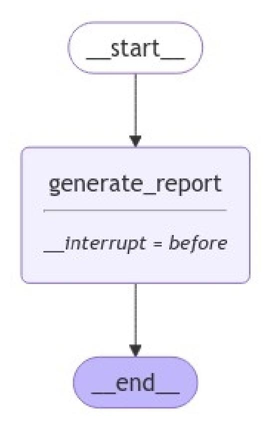

This example allows a human to approve report generation, ensuring the title and content are correct.

# *9.7.4 Example 5: Human Approval in Multi-step Workflow*

```
#lesson9k.py
import os
from typing_extensions import TypedDict
from langgraph.graph import StateGraph, START, END
from langgraph.checkpoint.memory import MemorySaver
from display_graph import display_graph
class State(TypedDict):
    input: str
def step_a(state: State):
    print("Executing Step A")
    return state
def step_b(state: State):
    print("Executing Step B")
```

```
return state
builder = StateGraph(State)
builder.add_node("step_a", step_a)
builder.add_node("step_b", step_b)
builder.add_edge(START, "step_a")
builder.add_edge("step_a", "step_b")
builder.add_edge("step_b", END)
graph = builder.compile(interrupt_before=["step_b"], checkpointer=MemorySaver())
# Display the graph
display_graph(graph, file_name=os.path.basename(__file__))
initial_input = {"input": "Starting workflow"}
config = {"configurable": {"thread_id": "thread-1"}}
for event in graph.stream(initial_input, config):
    print(event)
approval = input("Proceed to Step B? (yes/no): ")
if approval.lower() == "yes":
    for event in graph.stream(None, config):
         print(event)
else:
    print("Workflow halted before Step B.")
```

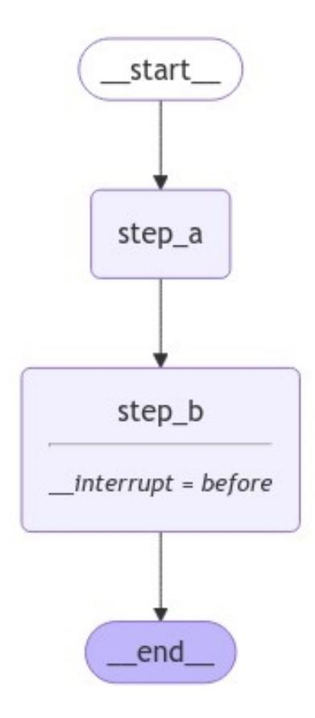

This example shows a two-step process where human approval is required before moving to the next step.

# Output:

```
Executing Step A
{'step_a': {'input': 'Starting workflow'}}
{'__interrupt__': ()}
Proceed to Step B? (yes/no): yes
Executing Step B
{'step_b': {'input': 'Starting workflow'}}
```

# <span id="page-278-0"></span>**9.8 Dynamic Breakpoints: Concepts and Usage**

Dynamic breakpoints add flexibility by allowing agents to **pause conditionally** based on runtime data or external triggers. Instead of predefining where the graph pauses, dynamic breakpoints introduce the ability to trigger pauses based on specific conditions.

# **Explanation of Dynamic Breakpoints**

In dynamic breakpoints, the graph pauses based on conditions met during the execution of a node. For example, if an input exceeds a predefined

threshold, the agent may pause for human intervention.

# *9.8.1 Example: Conditional Pauses Based on Data Threshold*

```
#lesson9l.py continued
from langgraph.errors import NodeInterrupt
import os
from typing_extensions import TypedDict
from langgraph.graph import StateGraph, START, END
from display_graph import display_graph
class State(TypedDict):
    input: str
builder = StateGraph(State)
def step_with_dynamic_interrupt(state: State):
    input_length = len(state["input"])
    if input_length > 10:
         raise NodeInterrupt("Input length {input_length} exceeds threshold of 10.")
    return state
builder.add_node("step_with_dynamic_interrupt", step_with_dynamic_interrupt)
builder.add_edge(START, "step_with_dynamic_interrupt")
builder.add_edge("step_with_dynamic_interrupt", END)
graph = builder.compile()
# Display the graph
display_graph(graph, file_name=os.path.basename(__file__))
initial_input = {"input": "This is a long input"}
for event in graph.stream(initial_input):
    print(event)
```

In this case, the workflow automatically pauses when the input length exceeds 10 characters.

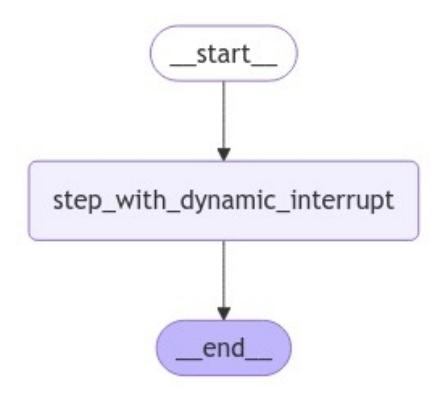

# <span id="page-280-0"></span>**9.9 Waiting for User Input: Concepts and Implementation**

# **Introduction**

In certain workflows, AI agents require **human feedback** before they can proceed. This is particularly important in contexts where decisions need to be made based on real-time human input, such as customer service, healthcare, or business approval processes. In LangGraph, **waiting for user input** can be implemented using **breakpoints**, which pause graph execution at specific points until the user provides the necessary feedback.

This section will explore the concept of waiting for user input in detail, including step-by-step implementations and practical examples. We will cover:

- 1. **What is Waiting for User Input?**
- 2. **How to Implement Waiting for Input in LangGraph**
- 3. **Practical Examples of Waiting for User Input**
- 4. **Error Handling and Timeouts**
- 5. **Advanced Use Cases**

# **9.9.1 What is Waiting for User Input?**

**Waiting for User Input** refers to an interaction where the AI agent pauses during its workflow, asks for human clarification or additional information, and resumes only after receiving it. This is a crucial feature for **Human-inthe-Loop (HITL)** workflows, where decisions cannot be fully automated and require human intervention to complete.

# **Practical Applications**:

- **Customer Service**: A chatbot might ask the user to clarify their question before providing a response.
- **Approval Workflows**: A business process might require a manager's approval to proceed with a financial transaction or generate a sensitive report.
- **Interactive Decision-Making**: Healthcare agents may need to ask doctors or patients for specific details before generating diagnostic suggestions.

# **9.9.2 How to Implement Waiting for Input in LangGraph**

In LangGraph, waiting for user input is achieved using **breakpoints**. At a breakpoint, the graph pauses execution and awaits user feedback, which is then injected back into the graph's state. The workflow resumes from that point using the provided input.

#### **Key Steps to Implement:**

- 1. **Define Breakpoints**: Set up the graph to interrupt execution before a node that collects human feedback.
- 2. **State Management**: Use LangGraph's update\_state() method to update the graph's state with the user's input.
- 3. **Resume Workflow**: After receiving user input, the graph continues executing from the point it paused.

#### **Example 1: Simple Human Feedback Workflow**

In this example, we will set up a basic workflow that pauses execution to wait for user feedback before continuing.

```
#lesson9m.py continued
from typing_extensions import TypedDict
from langgraph.graph import StateGraph, START, END
from langgraph.checkpoint.memory import MemorySaver
# Define the state structure
class State(TypedDict):
   input: str
   user_feedback: str
# Define node functions
def step_1(state: State):
```

```
print(f"Step 1: {state['input']}")
   return state
def human_feedback(state: State):
   print("--- Waiting for human feedback ---")
   feedback = input("Please provide your feedback: ")
   state['user_feedback'] = feedback
   return state
def step_3(state: State):
   print(f"Step 3: User feedback received:
{state['user_feedback']}")
   return state
# Build the graph
builder = StateGraph(State)
builder.add_node("step_1", step_1)
builder.add_node("human_feedback", human_feedback)
builder.add_node("step_3", step_3)
# Define the flow
builder.add_edge(START, "step_1")
builder.add_edge("step_1", "human_feedback")
builder.add_edge("human_feedback", "step_3")
builder.add_edge("step_3", END)
# Set up memory and breakpoints
memory = MemorySaver()
graph = builder.compile(checkpointer=memory, interrupt_before=
["human_feedback"])
# Run the graph
initial_input = {"input": "Proceed with workflow?"}
thread = {"configurable": {"thread_id": "1"}}
# Stream the graph until the first interruption
for event in graph.stream(initial_input, thread,
stream_mode="values"):
   print(event)
# Get user input and update the state
user_feedback = input("User feedback: ")
graph.update_state(thread, {"user_feedback": user_feedback},
as_node='human_feedback')
# Resume execution
```

```
for event in graph.stream(None, thread, stream_mode="values"):
   print(event)
```

#### **Key Concepts:**

- **Interrupt Before Node**: The interrupt\_before= ["human\_feedback"] argument pauses the graph before the **human\_feedback** node is executed, waiting for input.
- **State Update**: The update\_state() method updates the graph's state with the human feedback, enabling the workflow to continue with the new data.

# **9.9.3 Error Handling and Timeouts**

In some situations, users may not respond promptly, or their feedback might be invalid. To handle these scenarios, LangGraph allows for **timeouts** and **error handling** during pauses for user input.

**Example: Handling Timeout for User Input**

```
#lesson9l.py continued
import time
def human_feedback_with_timeout(state: State):
   print("Waiting for human feedback (timeout in 10 seconds)...")
   start_time = time.time()
   while True:
       if time.time() - start_time > 10:
          state['user_feedback'] = "Timeout"
          print("No feedback received. Proceeding with default
action.")
          break
       feedback = input("Please provide feedback: ")
       if feedback:
          state['user_feedback'] = feedback
          break
   return state
```

#### **Key Considerations:**

● **Timeouts**: Implementing timeouts ensures that the workflow does not remain paused indefinitely, allowing for automated fallback

actions.

● **Error Handling**: Ensure that user input is validated. For example, feedback might need to conform to a specific format or criteria (e.g., "yes" or "no").

# **9.9.4 Advanced Use Cases**

**Multi-Stage Feedback**: In complex workflows, multiple pauses may be required at different stages. For instance, an AI agent might need feedback from multiple stakeholders in a company, pausing at each step to gather approvals or clarifications.

**Adaptive Feedback Requests**: Based on the workflow's current state or prior feedback, the agent can adapt its subsequent requests. For example, if a user denies a request, the agent might ask follow-up questions to better understand the decision.

#### **Example: Adaptive Feedback Request**

```
#lesson9l.py continued
def adaptive_feedback(state: State):
    decision = state['user_feedback']
    if decision.lower() == "denied":
         print("Request was denied. Asking for additional clarification.")
         clarification = input("Why was the request denied?: ")
         state['user_feedback'] = clarification
    return state
```

This allows for more nuanced interaction, where the agent can dynamically adjust its behavior based on user responses.

# <span id="page-284-0"></span>**Practical Example: ReAct Agent with Human Input**

In this example, we will build a **ReAct-style agent** that uses LangGraph. The agent can reason through actions and ask for human feedback before taking critical steps, such as deciding which tools to call.

# **Step-by-Step Workflow:**

1. The agent starts by reasoning through the task.

- 2. It pauses at a point where human feedback is needed (e.g., asking a clarifying question).
- 3. After receiving feedback, the agent uses that input to decide on the next action (e.g., calling a tool or generating a response).

# **Example Workflow:**

```
#lesson9n.py continued
import os
from typing_extensions import TypedDict
from langgraph.graph import StateGraph, START, END
from langgraph.checkpoint.memory import MemorySaver
from langchain_core.tools import tool
from display_graph import display_graph
# Define the state structure
class State(TypedDict):
    input: str
    user_feedback: str
# Define a reasoning step for the agent
def agent_reasoning(state: State):
    print(f"Agent is reasoning: {state['input']}")
    # Agent decides whether to ask human based on input length
    if len(state["input"]) > 10:
         print("Agent needs clarification.")
         return state
    else:
         state["user_feedback"] = "No clarification needed"
         return state
# Define a human feedback step
def ask_human(state: State):
    print("--- Asking for human feedback ---")
    feedback = input("Please provide feedback on the input: ")
    state['user_feedback'] = feedback
    return state
# Define a tool action after human feedback
@tool
def perform_action(user_feedback: str):
    """
```

```
Perform an action based on the provided user feedback.
    """
    print(f"Action taken based on feedback: {user_feedback}")
    return {"user_feedback": f"Feedback processed: {user_feedback}"}
# Build the graph
builder = StateGraph(State)
builder.add_node("agent_reasoning", agent_reasoning)
builder.add_node("ask_human", ask_human)
builder.add_node("perform_action", perform_action)
# Define flow with conditions
builder.add_edge(START, "agent_reasoning")
builder.add_conditional_edges(
    "agent_reasoning",
    lambda state: "ask_human" if len(state["input"]) > 10 else "perform_action",
    {"ask_human": "ask_human", "perform_action": "perform_action"}
)
builder.add_edge("ask_human", "perform_action")
builder.add_edge("perform_action", END)
# Set up memory and breakpoints
memory = MemorySaver()
graph = builder.compile(checkpointer=memory, interrupt_before=["ask_human"])
# Display the graph
display_graph(graph, file_name=os.path.basename(__file__))
# Run the graph
initial_input = {"input": "Proceed with reasoning?"}
thread = {"configurable": {"thread_id": "1"}}
# Stream the graph until the first interruption
for event in graph.stream(initial_input, thread, stream_mode="values"):
    print(event)
# Get user input and update the state
user_feedback = input("User feedback: ")
graph.update_state(thread, {"user_feedback": user_feedback}, as_node="ask_human")
# Resume execution after feedback
for event in graph.stream(None, thread, stream_mode="values"):
    print(event)
```

# **Breakdown of This ReAct Agent:**

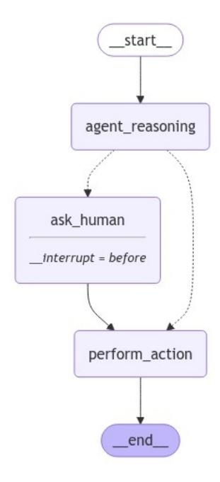

# 1. **Agent Reasoning**:

○ The agent examines the input and decides whether to proceed directly or ask for human clarification based on the length of the input.

# 2. **Ask Human**:

○ If the agent decides that clarification is needed (e.g., when the input length is more than 10 characters), it asks the user for feedback and pauses execution.

# 3. **Action Execution**:

○ Based on the feedback from the user, the agent performs the final action (e.g., calls a tool).

This example demonstrates how to incorporate both automated reasoning and human interaction using LangGraph, making it adaptable to complex workflows where human input is critical.

# <span id="page-287-0"></span>**Explainer: Technical Aspects of Human-in-the-Loop (HITL) in LangGraph**

In Human-in-the-Loop (HITL) systems, agents often require human input at key stages in their workflow to make decisions or validate actions. **LangGraph** allows developers to integrate HITL functionality through **breakpoints**, **checkpoints**, and **state updates**, enabling dynamic control of an AI agent's behavior during execution. This explainer will focus on key aspects such as viewing, updating past graph states, and replaying or branching from previous states in LangGraph.

# **Key Concepts in HITL**

# 1. **Breakpoints**:

○ **Breakpoints** allow a graph to pause at specific nodes, awaiting human feedback or approval before continuing. This provides flexibility and control over critical actions.

# 2. **Checkpoints**:

○ Checkpoints are points in the execution where the current state of the graph is saved. This allows developers or users to revisit and alter the agent's state at any moment in the past.

# 3. **State Updates**:

○ **State Updates** allow you to modify the agent's internal state dynamically. By updating the state, developers can change the behavior of the agent or correct inputs during its execution. This is crucial in HITL workflows for fine-tuning responses or actions after human intervention.

# **Viewing and Updating Past Graph States**

One of the key features in LangGraph is the ability to **view and update the agent's state** at any point during its execution. This is particularly useful for debugging, reproducing issues, or even embedding your AI agent into a larger system. By checkpointing a graph, you can save its state, review it, and apply changes based on human feedback or new data.

#### **How to View and Update the State of the Agent:**

LangGraph provides two essential methods for interacting with the graph state:

- **get\_state()**: This method fetches the values stored in the current state of the graph.
- **update\_state()**: This method allows you to apply changes to the graph's state based on new inputs or feedback from a human user.

**Note**: For both methods to work, a **checkpointer** must be passed when the graph is compiled.

#### **Practical Example: Viewing and Updating State**

Here's a simple example that demonstrates how to pause a workflow, view the state at a breakpoint, update it based on human feedback, and resume execution.

```
#lesson9n.py continued
# Fetching the state at a specific point in the graph
current_state = app.get_state(config)
print(current_state.values)  # View the state values
# Updating the state based on new feedback
new_state = {"user_feedback": "Proceed with action after review"}
app.update_state(config, new_state)
```

# **Example: Building a ReAct Agent with State Updates**

We can now build a simple **ReAct-style agent** that calls tools and uses human feedback to make decisions. Additionally, we will leverage state updates and view past states during execution.

```
#lesson9n.py continued
# Import necessary libraries
from langchain_openai import ChatOpenAI
from langchain_core.tools import tool
from langgraph.graph import MessagesState, START, END, StateGraph
from langgraph.checkpoint.memory import MemorySaver
# Define tools
@tool
```

```
def play_song_on_spotify(song: str):
    return f"Successfully played {song} on Spotify!"
@tool
def play_song_on_apple(song: str):
    return f"Successfully played {song} on Apple Music!"
# List of tools
tools = [play_song_on_apple, play_song_on_spotify]
tool_node = ToolNode(tools)
# Set up model
model = ChatOpenAI(model="gpt-4o-mini").bind_tools(tools)
# Define model-calling function
def call_model(state):
    response = model.invoke(state["messages"])
    return {"messages": [response]}
# Define continuation logic
def should_continue(state):
    last_message = state["messages"][-1]
    if last_message.tool_calls:
        return "continue"
    return "end"
# Build the graph
workflow = StateGraph(MessagesState)
workflow.add_node("agent", call_model)
workflow.add_node("action", tool_node)
# Define graph flow
workflow.add_edge(START, "agent")
workflow.add_conditional_edges("agent", should_continue, {"continue": "action",
"end": END})
workflow.add_edge("action", "agent")
# Set up memory for checkpointing
memory = MemorySaver()
app = workflow.compile(checkpointer=memory)
```

# **Interacting with the Agent**

After setting up the agent, you can interact with it by passing a message and viewing the responses. Here's an example where the agent is asked to play a

# song:

```
#lesson9n.py continued
from langchain_core.messages import HumanMessage
config = {"configurable": {"thread_id": "1"}}
input_message = HumanMessage(content="Can you play Taylor Swift's most popular
song?")
for event in app.stream({"messages": [input_message]}, config,
stream_mode="values"):
    print(event["messages"][-1].pretty_print())
```

# Output:

```
==================================
Human Message: Can you play Taylor Swift's most popular song?
==================================
Tool Calls: play_song_on_apple (args: {'song': 'Anti-Hero'})
...
==================================
Successfully played Anti-Hero by Taylor Swift on Apple Music!
```

# **Viewing and Replaying State**

Once checkpointing is enabled, we can view the state history and replay from any previous state.

```
#lesson9n.py continued
# View state history
state_history = app.get_state_history(config)
for state in state_history:
    print(state)
# Replay from a previous state
replay_state = state_history[-2]  # Replay right before tool execution
for event in app.stream(None, replay_state.config):
    print(event)
```

This allows you to replay a past state, essentially "rewinding" the agent's workflow to correct or debug actions.

# **Branching off Past States**

LangGraph also supports **branching** from a previous state, enabling you to explore alternate outcomes. For example, if the agent called the wrong tool, you can modify the tool call and resume from that point.

```
#lesson9n.py continued
# Get the last message with the tool call
last_message = replay_state.values["messages"][-1]
# Update the tool call from Apple Music to Spotify
last_message.tool_calls[0]["name"] = "play_song_on_spotify"
# Update the state and resume execution
branch_config = app.update_state(replay_state.config, {"messages": [last_message]})
for event in app.stream(None, branch_config):
    print(event)
```

In this scenario, we modified the state to switch the tool call, causing the agent to now play the song on Spotify instead of Apple Music.

# **Recap**

LangGraph's ability to **view**, **update**, and **branch from past states** provides powerful functionality for debugging, fine-tuning, and embedding AI workflows into complex systems. With **checkpoints** and **state management**, developers can introduce human feedback at any stage, dynamically adjust workflows, and maintain tight control over an agent's behavior.

# Key methods:

- **get\_state()**: Retrieve the current or past state of the agent.
- **update\_state()**: Modify the state at any point to change the agent's trajectory.
- **get\_state\_history()**: Review past states to understand the agent's behavior over time.
- **Branching**: Explore alternate outcomes by modifying a specific past state and continuing execution from there.

By integrating these methods, LangGraph enables robust and flexible HITL workflows, ensuring that human decisions can guide and influence the actions of AI agents in real-time.

# <span id="page-293-0"></span>**Chapter 9 Quiz: Human-in-the-Loop Agents**

Test your understanding of **Human-in-the-Loop (HITL) Agents** and the concepts covered in Chapter 9 with the following questions. Answers are provided below.

# **Multiple-Choice Questions:**

# 1. **What is the primary purpose of Human-in-the-Loop (HITL) functionality in AI workflows?**

- A) To automate decision-making completely.
- B) To allow an AI agent to operate without any human feedback.
- C) To pause an AI workflow and allow human input for critical decisions.
- D) To improve the speed of AI workflows.

# 2. **Which LangGraph feature allows you to pause the graph execution and wait for user input?**

- A) Checkpoints
- B) Breakpoints
- C) State nodes
- D) Conditional edges

# **3. How does the update\_state() function in LangGraph help in HITL workflows?**

- A) It updates the graph with a new model.
- B) It pauses the workflow and restarts the entire process.
- C) It allows the graph's state to be modified with new input, often from human feedback.
- D) It removes unnecessary steps from the workflow.

# **4. What does the method get\_state() do in LangGraph?**

○ A) It halts the workflow indefinitely.

- B) It retrieves the current or past state of the graph for inspection.
- C) It moves the graph to the next node without executing any logic.
- D) It resets the state of the graph to the initial configuration.

# 5. **What is the purpose of branching in a LangGraph workflow?**

- A) To introduce a new tool into the workflow.
- B) To replay the entire workflow from the start.
- C) To modify the agent's state at a certain point and explore alternate outcomes.
- D) To remove a node from the graph execution path.

# 6. **What role do checkpointers play in HITL workflows?**

- A) They are used to skip nodes.
- B) They allow the graph's state to be saved and retrieved at different points in time.
- C) They pause the workflow indefinitely.
- D) They automatically restart the graph.

# 7. **In a ReAct agent, why might human input be necessary at some point during the execution?**

- A) To help the agent avoid redundant API calls.
- B) To allow the agent to clarify its understanding before calling a tool or making a decision.
- C) To stop the agent from finishing the workflow.
- D) To force the agent to call more tools.

# **True/False Questions:**

- 8. **True or False**: A breakpoint in LangGraph always pauses the graph after the node is executed.
- 9. **True or False**: Checkpoints can be used to save a graph's state and return to it later for debugging or modifications.
- 10. **True or False**: The update\_state() method is used only when an error occurs in the graph.

# **Short Answer Questions:**

- 11. Explain how dynamic breakpoints differ from simple breakpoints in HITL workflows.
- 12. What is the advantage of being able to replay a past state in LangGraph workflows?
- 13. Give an example of a situation where an AI agent might need to pause for human input during a workflow.

# **Answers:**

- 1. **C)** To pause an AI workflow and allow human input for critical decisions.
- 2. **B)** Breakpoints
- 3. **C)** It allows the graph's state to be modified with new input, often from human feedback.
- 4. **B)** It retrieves the current or past state of the graph for inspection.
- 5. **C)** To modify the agent's state at a certain point and explore alternate outcomes.
- 6. **B)** They allow the graph's state to be saved and retrieved at different points in time.
- 7. **B)** To allow the agent to clarify its understanding before calling a tool or making a decision.
- 8. **False**: A breakpoint pauses the graph **before** the node is executed.
- 9. **True**
- 10. **False**: update\_state() can be used at any point to modify the graph's state, not just when an error occurs.
- 11. **Dynamic breakpoints** are conditionally triggered based on runtime data (e.g., input length or external conditions), while **simple breakpoints** pause execution at a predefined node regardless of the current state.
- 12. **Replaying a past state** allows developers to debug or explore alternative decisions at key points in the workflow, without having to rerun the entire graph from the start.
- 13. **Example**: An IT support agent might need to pause and ask for clarification from a user when diagnosing a complex issue before recommending a solution or running a tool to fix the problem.

# **Practical Assignment: Build an IT Support AI Agent with Human In The Loop Features**

# **Objective:**

Create an IT support AI agent using LangGraph that can interact with users, perform troubleshooting tasks, and request human input for critical decisions. The agent should be able to:

- Diagnose IT issues by interacting with various tools (e.g., system checks, network diagnostics).
- Pause execution and ask for user input when required (e.g., asking the user to confirm actions like restarting a server).
- Use update\_state() to modify the agent's state based on the user's feedback.
- Implement checkpoints to allow replaying or branching from past states in case the issue needs to be revisited.

# **Steps to Complete:**

# 1. **Define the Agent's Workflow**:

- The agent will check the system status (e.g., CPU usage, disk space, network connectivity) using multiple action nodes.
- The results from each action get sent back to the agent.
- The agent will then suggest actions based on the results (e.g., clear disk space, restart the server).
- A breakpoint will be used to pause before executing critical actions, asking for human approval.

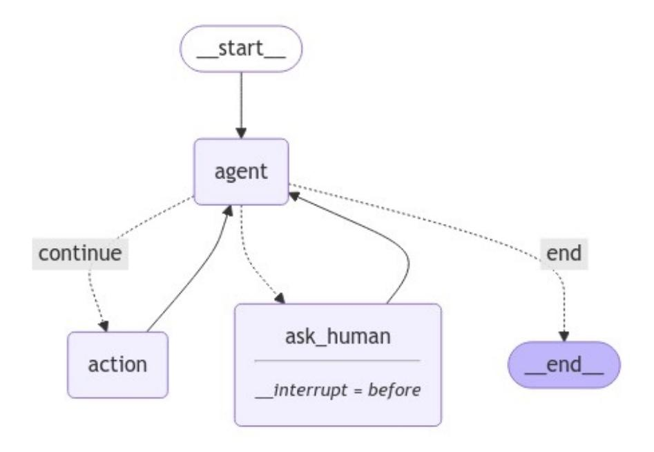

- 2. **Define the Tools**: Create simple tools that simulate system checks:
  - check\_cpu\_usage() : Simulates checking CPU usage.
  - check\_disk\_space() : Simulates checking disk space.
  - restart\_server() : Simulates restarting a server.
- 3. Use tool() to wrap these actions.
- 4. **Implement the HITL Features**:
  - Add a **breakpoint** before the agent attempts to restart the server, asking for human approval.
  - Use update\_state() to modify the graph's state based on the user's feedback (e.g., whether they approve the restart).
  - Implement **checkpointing** to allow the agent to save the state and replay it if an issue needs to be revisited.
- 5. **Add State Management**: Implement state management to store and update the values of system checks and user feedback.
- 6. **Testing**: Test the agent by running various scenarios, such as:
  - Approving and denying a restart action.
  - Replaying the graph from a past state to review the previous system check results.

○ Branching off from a state where the restart was denied and performing another action (e.g., clearing disk space).

# **Example Code Structure:**

```
#lesson9n.py continued
# Import necessary components
import os
from langgraph.graph import MessagesState, START, END, StateGraph
from langgraph.checkpoint.memory import MemorySaver
from langchain_core.tools import tool
from langgraph.prebuilt import ToolNode
from langchain_openai import ChatOpenAI
from pydantic import BaseModel
from display_graph import display_graph
# Define the diagnostic tools for the IT Support agent
@tool
def check_cpu_usage(tool_input: int):
    """Simulates checking the CPU usage of the server."""
    return "CPU Usage is 90%"
@tool
def check_disk_space(tool_input: int):
    """Simulates checking the available disk space on the server."""
    return "Disk space is below 15%"
@tool
def restart_server(tool_input: bool):
    """Simulates restarting the server."""
    return "Server restarted successfully"
# Define the human feedback tool (for confirming server restart)
class AskHuman(BaseModel):
    """Ask the human whether to restart the server."""
    question: str
# Set up the tools and tool node
tools = [check_cpu_usage, check_disk_space, restart_server]
tool_node = ToolNode(tools)
# Set up the AI model
model = ChatOpenAI(model="gpt-4o")
# Bind the model to the tools (including the ask_human tool)
```

```
model = model.bind_tools(tools + [AskHuman])
# Define the workflow functions for the agent
# Function to decide the next step based on the last message
def should_continue(state):
    messages = state["messages"]
    last_message = messages[-1]
    # If no tool call, finish the process
    if not last_message.tool_calls:
         return "end"
    # If the tool call is AskHuman, return that node
    elif last_message.tool_calls[0]["name"] == "AskHuman":
         return "ask_human"
    # Otherwise, continue the workflow
    else:
         return "continue"
# Function to call the model and return the response
def call_model(state):
    messages = state["messages"]
    response = model.invoke(messages)
    return {"messages": [response]}
# Define the human interaction node
def ask_human(state):
    pass  # No actual processing here, handled via breakpoint
# Create the state graph
workflow = StateGraph(MessagesState)
# Define the nodes for the workflow
workflow.add_node("agent", call_model)
workflow.add_node("action", tool_node)
workflow.add_node("ask_human", ask_human)
# Set the starting node
workflow.add_edge(START, "agent")
# Define conditional edges based on the agent's output
workflow.add_conditional_edges(
    "agent",
    should_continue,
    {
         "continue": "action",  # Proceed to the tool action
```

```
"ask_human": "ask_human",  # Ask human for input
        "end": END,  # Finish the process
    }
)
# Add the edge from action back to agent for continued workflow
workflow.add_edge("action", "agent")
# Add the edge from ask_human back to agent after human feedback
workflow.add_edge("ask_human", "agent")
# Set up memory for checkpointing
memory = MemorySaver()
# Compile the graph with a breakpoint before ask_human
app = workflow.compile(checkpointer=memory, interrupt_before=["ask_human"])
# Visualize the workflow
display_graph(app, file_name=os.path.basename(__file__))
from langchain_core.messages import HumanMessage
# Initial configuration and user message
config = {"configurable": {"thread_id": "3"}}
input_message = HumanMessage(
    content="Check the CPU usage and disk space of the server, and restart it if
necessary."
)
# Start the interaction with the agent
for event in app.stream({"messages": [input_message]}, config,
stream_mode="values"):
    event["messages"][-1].pretty_print()
# Get the ID of the last tool call (AskHuman tool call)
tool_call_id = app.get_state(config).values["messages"][-1].tool_calls[0]["id"]
# Ask the user whether they want to approve the server restart
user_input = input("Do you want to restart the server? (yes/no): ")
# Create the tool response message based on actual user input
tool_message = [
    {"tool_call_id": tool_call_id, "type": "tool", "content": user_input}  # Use real user
input
]
# Update the state as if the response came from the user
app.update_state(config, {"messages": tool_message}, as_node="ask_human")
for event in app.stream(None, config, stream_mode="values"):
```

event["messages"][-1].pretty\_print()

This agent simulates a basic IT support workflow that checks system performance, seeks user feedback, and takes action based on human input. You can further extend this assignment to integrate real API calls and add more complex diagnostic actions.

# **Chapter 10**

# <span id="page-302-1"></span><span id="page-302-0"></span>**Plan-and-Execute Agents**

# <span id="page-302-2"></span>**10.1 Introduction**

The **Plan-and-Execute** architecture enhances reasoning tasks by splitting them into two core phases: **Planning** and **Execution**. This approach is derived from the *Plan-and-Solve* methodology, which contrasts with traditional single-step (ReAct) agents. The Plan-and-Solve architecture is particularly useful when dealing with complex multi-step reasoning tasks that require explicit planning for long-term goals.

In this chapter, we explore how Plan-and-Execute agents work by devising a multi-step plan and executing it in phases. The agent adapts as necessary, allowing for re-planning in case some steps fail or require more context.

# <span id="page-302-3"></span>**10.2 Why Use Plan-and-Execute?**

One of the key issues in multi-step reasoning tasks is that even sophisticated models like GPT-4 often struggle with explicit long-term planning. Plan-and-Execute solves this by:

- **Breaking down complex tasks** into smaller, manageable steps.
- **Adapting dynamically** based on intermediate results.
- **Revisiting the plan** when necessary to adjust or correct steps.

This architecture is superior to traditional ReAct (React-then-Act) models as it emphasizes forward-thinking (planning) before acting.

# <span id="page-303-0"></span>**10.3 Plan-and-Execute Concepts**

From the paper *Plan-and-Solve Prompting: Improving Zero-Shot Chain-of-Thought Reasoning*, the Plan-and-Solve approach addresses the limitations of Zero-shot-CoT (Chain-of-Thought), which typically fails due to:

- 1. **Calculation Errors**: Mistakes in intermediate calculations.
- 2. **Missing-Step Errors**: Skipping important intermediate steps.
- 3. **Semantic Misunderstandings**: Misinterpretation of the problem context.

To solve these issues, Plan-and-Solve introduces two key steps:

- 1. **Planning**: Devising a clear plan to divide the overall task into subtasks, ensuring no steps are skipped.
- 2. **Execution**: Executing each subtask and refining the plan if needed.

In the Plan-and-Solve architecture, the agent takes a multi-step approach:

- First, it plans out a sequence of steps.
- Then, it executes the steps one by one.
- If any part of the process fails or if more information is needed, it replans the sequence, ensuring robustness and flexibility.

# <span id="page-303-1"></span>**10.4 LangGraph Implementation of a Plan and Execute AI Agent**

LangGraph supports the Plan-and-Execute architecture by integrating planning with execution in an asynchronous workflow. This allows agents to dynamically adjust their plans based on real-time data and interactions.

We will now examine the complete implementation in LangGraph, followed by a detailed explanation of each section.

#lesson10a.py # Import necessary components import operator

```
import os
from langgraph.graph import StateGraph, START, END
from langchain_community.tools.tavily_search import TavilySearchResults
from langchain import hub
from langchain_openai import ChatOpenAI
from langgraph.prebuilt import create_react_agent
from pydantic import BaseModel, Field
from typing import Annotated, List, Tuple, Union
from typing_extensions import TypedDict
from langchain_core.prompts import ChatPromptTemplate
from display_graph import display_graph
# Define diagnostic and action tools
tools = [TavilySearchResults(max_results=3)]  # Search tool used for subtask execution
# Set up the model and agent executor
prompt = ChatPromptTemplate.from_messages(
    [
         ("system", """You are a helpful assistant."""),
         ("placeholder", "{messages}")
    ]
)
prompt.pretty_print()
llm = ChatOpenAI(model="gpt-4o-mini")
agent_executor = create_react_agent(llm, tools, state_modifier=prompt)
# Define the Plan and Execution structure
class PlanExecute(TypedDict):
    input: str
    plan: List[str]
    past_steps: Annotated[List[Tuple], operator.add]
    response: str
class Plan(BaseModel):
    steps: List[str] = Field(description="Numbered unique steps to follow, in order")
class Response(BaseModel):
    response: str = Field(description="Response to user.")
class Act(BaseModel):
    action: Union[Response, Plan] = Field(description="Action to perform. If you want
to respond to user, use Response. "
         "If you need to further use tools to get the answer, use Plan.")
```

```
# Planning step
planner_prompt = ChatPromptTemplate.from_messages(
    [
        (
            "system",
            """For the given objective, come up with a simple step-by-step plan. \
                This plan should involve individual numbered tasks, that if executed
correctly will yield the correct answer. Do not add any superfluous steps. \
                The result of the final step should be the final answer. Make sure that
each step has all the information needed - do not skip steps.""",
        ),
        ("placeholder", "{messages}"),
    ]
)
planner = planner_prompt | ChatOpenAI(model="gpt-4o-mini",
temperature=0).with_structured_output(Plan)
# Re-planning step
replanner_prompt = ChatPromptTemplate.from_template(
    """For the given objective, come up with a simple step by step numbered plan. \
This plan should involve individual tasks, that if executed correctly will yield the correct
answer. Do not add any superfluous steps. \
The result of the final step should be the final answer. Make sure that each step has all
the information needed - do not skip steps.
Your objective was this:
{input}
Your original plan was this:
{plan}
You have currently done the follow steps:
{past_steps}
Update your plan accordingly. If no more steps are needed and you can return to the
user, then respond with that. Otherwise, fill out the plan. Only add steps to the plan that
still NEED to be done. Do not return previously done steps as part of the plan."""
)
replanner = replanner_prompt | ChatOpenAI(model="gpt-4o",
temperature=0).with_structured_output(Act)
# Execution step function
async def execute_step(state: PlanExecute):
```

```
plan = state["plan"]
    plan_str = "\n".join(f"{i+1}. {step}" for i, step in enumerate(plan))
    task = plan[0]
    task_formatted = f"For the following plan:\n{plan_str}\n\nYou are tasked with
executing step 1, {task}."
    agent_response = await agent_executor.ainvoke({"messages": [("user",
task_formatted)]})
    return {
         "past_steps": [(task, agent_response["messages"][-1].content)],
    }
# Planning step function
async def plan_step(state: PlanExecute):
    plan = await planner.ainvoke({"messages": [("user", state["input"])]})
    return {"plan": plan.steps}
# Re-planning step function
async def replan_step(state: PlanExecute):
    output = await replanner.ainvoke(state)
    # If the re-planner decides to return a response, we use it as the final answer
    if isinstance(output.action, Response):  # Final response provided
         return {"response": output.action.response}  # Return the response to the user
    else:
         # Otherwise, we continue with the new plan (if re-planning suggests more
steps)
         return {"plan": output.action.steps}
# Conditional check for ending
def should_end(state: PlanExecute):
    if "response" in state and state["response"]:
         return END
    else:
         return "agent"
# Build the workflow
workflow = StateGraph(PlanExecute)
# Add nodes to the workflow
workflow.add_node("planner", plan_step)
workflow.add_node("agent", execute_step)
workflow.add_node("replan", replan_step)
# Add edges to transition between nodes
```

```
workflow.add_edge(START, "planner")
workflow.add_edge("planner", "agent")
workflow.add_edge("agent", "replan")
workflow.add_conditional_edges("replan", should_end, ["agent", END])
# Compile the workflow into an executable application
app = workflow.compile()
# Visualization of the workflow
# Display the graph
display_graph(app, file_name=os.path.basename(__file__))
# Example of running the agent
config = {"recursion_limit": 50}
import asyncio
# Function to run the Plan-and-Execute agent
async def run_plan_and_execute():
    # Input from the user
    inputs = {"input": "Grace weighs 125 pounds. Alex weighs 2 pounds less than 4
times what Grace weighs. What are their combined weights in pounds?"}
    # Configuration for recursion limit
    config = {"recursion_limit": 50}
    # Run the Plan-and-Execute agent asynchronously
    async for event in app.astream(inputs, config=config):
         for k, v in event.items():
            if k != "__end__":
                 print(v)
# Run the async function
if __name__ == "__main__":
    asyncio.run(run_plan_and_execute())
```

#### **Explanation of Code Sections**

#### **1. Tools and Models Setup:**

The TavilySearchResults tool is used to simulate the action of gathering information (search tool). We then set up a ChatOpenAI model which drives the logic of the Plan-and-Execute agent. This LLM will be used both in the planning and execution phases.

#### **2. Plan-and-Execute State:**

The PlanExecute class is a typed dictionary that tracks the current plan, past steps, and the final response. The use of TypedDict allows structured state management, which is crucial for the agent's recursive nature.

#### **3. Planner and Replanner**

- The **planner** creates the initial sequence of tasks from the user input.
- The **replanner** comes into action when an unexpected result or missing information occurs, updating the plan.

#### **4. Execution Function:**

This function handles task execution based on the steps devised by the planner. It takes the first step of the plan and uses the agent\_executor to handle the task, updating the state with the results.

#### **4. Conditional Workflow and End Conditions:**

The graph defines a decision-making process based on whether the task is completed (response exists) or further steps are needed (looping back to replan). The should\_end function ensures that the agent exits when the final response is ready.

#### **Visualization:**

LangGraph provides an essential feature: graph visualization. The flow diagram helps track the agent's logic from planning to execution and replanning:

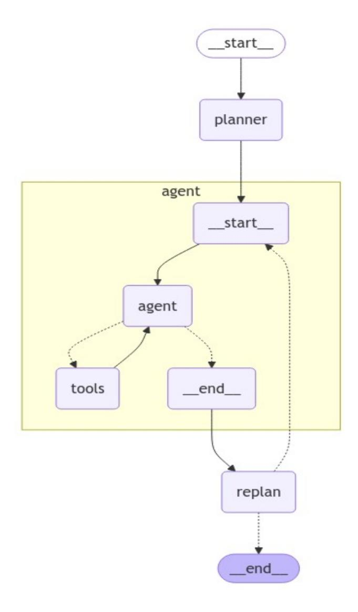

● **Planner Node**: Devises the plan. ● **Agent Node**: Executes the tasks.

● **Replan Node**: Adjusts the plan if necessary.

● **Tools Node**: Executes actions using external tools.

The diagram clearly illustrates the looping between the agent and replan , ensuring flexibility and dynamic updates during execution.

# <span id="page-310-0"></span>**Practical Example 1.**

# <span id="page-310-1"></span>**IT Troubleshooting and Diagnostics Agent**

**Use Case: Diagnosing server issues and automating the resolution process for IT support.**

**Goal**: Diagnose issues with a server and attempt to resolve them.

# **Plan**:

- 1. Check CPU usage.
- 2. Check available disk space.
- 3. Check network connectivity.
- 4. Attempt to restart the server if required.

# **Execution**:

- The agent checks the CPU usage and disk space.
- If the resources are low, it proceeds to attempt a server restart.
- If the restart fails, the agent prompts for human intervention or replans alternative actions like freeing up disk space or killing CPUintensive processes.

# **Replanning**:

● If the server restart fails, the agent updates the plan to notify the administrator and attempt manual intervention.

# **Implementation**

```
#lesson10b.py
import operator
import os
from langgraph.graph import StateGraph, START, END
from langchain_openai import ChatOpenAI
from langgraph.prebuilt import create_react_agent
from pydantic import BaseModel, Field
from typing import Annotated, List, Tuple, Union
from typing_extensions import TypedDict
from langchain_core.prompts import ChatPromptTemplate
from langchain_core.tools import tool
```

```
# Define diagnostic and action tools
@tool
def check_cpu_usage():
    """Simulates checking the CPU usage."""
    return "CPU Usage is 85%."
@tool
def check_disk_space():
    """Simulates checking the disk space."""
    return "Disk space is 10% free."
@tool
def check_network():
    """Simulates checking network connectivity."""
    return "Network connectivity is stable."
@tool
def restart_server():
    """Simulates restarting the server."""
    return "Server restarted successfully."
# Setup Tools
tools = [check_cpu_usage, check_disk_space, check_network, restart_server]
# Set up the model and agent executor
prompt = ChatPromptTemplate.from_messages(
    [
         ("system", "You are an IT diagnostics agent."),
         ("placeholder", "{messages}")
    ]
)
llm = ChatOpenAI(model="gpt-4o-mini")
agent_executor = create_react_agent(llm, tools, state_modifier=prompt)
# Define the Plan and Execution structure
class PlanExecute(TypedDict):
    input: str
    plan: List[str]
    past_steps: Annotated[List[Tuple], operator.add]
    response: str
class Plan(BaseModel):
    steps: List[str] = Field(description="Tasks to check and resolve server issues")
class Response(BaseModel):
```

```
response: str
class Act(BaseModel):
    action: Union[Response, Plan] = Field(description="Action to perform. If you want
to respond to user, use Response. "
        "If you need to further use tools to get the answer, use Plan.")
# Planning step
planner_prompt = ChatPromptTemplate.from_messages(
    [
        ("system", """For the given server issue, create a step-by-step diagnostic plan
including CPU, disk, and network checks, followed by a server restart if necessary."""),
        ("placeholder", "{messages}"),
    ]
)
planner = planner_prompt | ChatOpenAI(model="gpt-4o-mini",
temperature=0).with_structured_output(Plan)
# Replanning step
replanner_prompt = ChatPromptTemplate.from_template(
    """For the given task, update the plan based on the current results:
Your original task was:
{input}
You have completed the following steps:
{past_steps}
Update the plan accordingly. Only include the remaining tasks. If the server needs to be
restarted, include that in the plan."""
)
replanner = replanner_prompt | ChatOpenAI(model="gpt-4o-mini",
temperature=0).with_structured_output(Act)
# Execution step function
async def execute_step(state: PlanExecute):
    plan = state["plan"]
    task = plan[0]
    task_formatted = f"Executing step: {task}."
    agent_response = await agent_executor.ainvoke({"messages": [("user",
task_formatted)]})
    return {
        "past_steps": [(task, agent_response["messages"][-1].content)],
    }
```

```
# Planning step function
async def plan_step(state: PlanExecute):
    plan = await planner.ainvoke({"messages": [("user", state["input"])]})
    return {"plan": plan.steps}
# Re-planning step function (in case execution needs adjustment)
async def replan_step(state: PlanExecute):
    output = await replanner.ainvoke(state)
    # If the replanner decides to return a response, we use it as the final answer
    if isinstance(output.action, Response):  # Final response provided
         return {"response": output.action.response}  # Return the response to the user
    else:
         # Otherwise, we continue with the new plan (if replanning suggests more steps)
         return {"plan": output.action.steps}
# Conditional check for ending
def should_end(state: PlanExecute):
    if "response" in state and state["response"]:
         return END
    else:
         return "agent"
# Build the workflow
workflow = StateGraph(PlanExecute)
workflow.add_node("planner", plan_step)
workflow.add_node("agent", execute_step)
workflow.add_node("replan", replan_step)
# Add edges to transition between nodes
workflow.add_edge(START, "planner")
workflow.add_edge("planner", "agent")
workflow.add_edge("agent", "replan")
workflow.add_conditional_edges("replan", should_end, ["agent", END])
# Compile the workflow into an executable application
app = workflow.compile()
# Example of running the agent
config = {"recursion_limit": 50}
import asyncio
# Function to run the Plan-and-Execute agent
async def run_plan_and_execute():
    # Input from the user
```

```
inputs = {"input": "Diagnose the server issue and restart if necessary."}
    # Run the Plan-and-Execute agent asynchronously
    async for event in app.astream(inputs, config=config):
         print(event)
# Run the async function
if __name__ == "__main__":
    asyncio.run(run_plan_and_execute())
```

#### **Example Workflow:**

- 1. **Planning**: The agent receives the input "Diagnose the server issue and restart if necessary." It generates the following plan:
  - Step 1: Check CPU usage (mapped to the check\_cpu\_usage tool).
  - Step 2: Check disk space (mapped to the check\_disk\_space tool).
- Step 3: Check network connectivity (mapped to the check\_network tool).
- Step 4: Restart the server (mapped to the restart\_server tool if necessary).
- 2. **Execution**: The agent executes each task by calling the corresponding tool directly. For example:
  - When checking CPU usage, it calls check\_cpu\_usage() and returns "CPU Usage is 85%."
  - When checking disk space, it calls check\_disk\_space() and returns "Disk space is 10% free."
- 3. **Replanning**: Based on the results from the execution phase, the agent may decide to replan if needed. For instance, if CPU usage is still high, it might suggest terminating processes or restarting the server, but it will continue using only the tools provided.

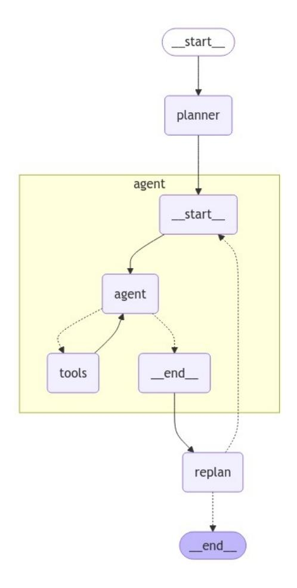

# <span id="page-315-0"></span>**Practical Example 2. Business Workflow Automation Agent**

# **Goal: Automate the approval process for expense reports.**

We will include tools for validating reports, checking policies, routing to managers, and sending approval/rejection notifications.

# **Complete Code:**

```
#lesson10c.py
import asyncio
from langchain_core.tools import tool
import operator
from typing_extensions import TypedDict
from langgraph.graph import StateGraph, START, END
from langchain_openai import ChatOpenAI
from langgraph.prebuilt import create_react_agent
from pydantic import BaseModel, Field
```

```
from typing import Annotated, List, Tuple, Union, Optional
from langchain_core.prompts import ChatPromptTemplate
from langgraph.checkpoint.memory import MemorySaver
# Enhanced tools with error handling and input validation
@tool
def validate_expense_report(report_id: str) -> str:
    """Validates an employee's expense report."""
    if not report_id or not isinstance(report_id, str):
         return "Error: Invalid report ID provided"
    try:
         return f"Expense report {report_id} is valid."
    except Exception as e:
         return f"Error validating expense report: {str(e)}"
@tool
def check_policy_compliance(report_id: str) -> str:
    """Checks whether the report complies with company policy."""
    if not report_id or not isinstance(report_id, str):
         return "Error: Invalid report ID provided"
    try:
         return f"Report {report_id} complies with company policy."
    except Exception as e:
         return f"Error checking policy compliance: {str(e)}"
@tool
def route_to_manager(report_id: str) -> str:
    """Routes the report to the manager for approval."""
    if not report_id or not isinstance(report_id, str):
         return "Error: Invalid report ID provided"
    try:
         return f"Report {report_id} has been routed to the manager."
    except Exception as e:
         return f"Error routing to manager: {str(e)}"
@tool
def notify_employee(report_id: str, status: str) -> str:
    """Notifies the employee of the report's status."""
    if not report_id or not status:
         return "Error: Invalid report ID or status provided"
    try:
```

```
return f"Employee notified that report {report_id} is {status}."
    except Exception as e:
         return f"Error notifying employee: {str(e)}"
tools = [validate_expense_report, check_policy_compliance, route_to_manager,
notify_employee]
# Enhanced state management
class PlanExecute(TypedDict):
    input: str
    plan: List[str]
    past_steps: Annotated[List[Tuple], operator.add]
    response: Optional[str]
    error: Optional[str]
class Plan(BaseModel):
    steps: List[str] = Field(description="Numbered unique steps to follow, in order")
class Response(BaseModel):
    response: str = Field(description="Response to user.")
class Act(BaseModel):
    action: Union[Response, Plan] = Field(description="Action to perform")
# Improved system prompts
SYSTEM_PROMPT = """You are an expense report processing assistant. Your task is to
validate and process expense reports
using the available tools. Always extract the report ID from the input and use it
consistently across all steps.
Available tools:
1. validate_expense_report - Validates the report
2. check_policy_compliance - Checks policy compliance
3. route_to_manager - Routes to manager
4. notify_employee - Notifies the employee
Ensure each step is completed before moving to the next one."""
# Enhanced agent setup
prompt = ChatPromptTemplate.from_messages([
    ("system", SYSTEM_PROMPT),
    ("placeholder", "{messages}")
])
llm = ChatOpenAI(model="gpt-4o-mini", temperature=0)
agent_executor = create_react_agent(llm, tools, state_modifier=prompt)
# Improved planning step
```

```
async def plan_step(state: PlanExecute) -> dict:
    try:
         planner_prompt = ChatPromptTemplate.from_messages([
             ("system", SYSTEM_PROMPT),
             ("placeholder", "{messages}")
         ])
         planner = planner_prompt | llm.with_structured_output(Plan)
         plan = await planner.ainvoke({"messages": [("user", state["input"])]})
         return {"plan": plan.steps}
    except Exception as e:
         return {"error": f"Planning error: {str(e)}"}
# Improved execution step with error handling
async def execute_step(state: PlanExecute) -> dict:
    try:
         if "error" in state:
             return {"response": f"Workflow failed: {state['error']}"}
         plan = state["plan"]
         if not plan:
             return {"response": "No plan steps available to execute"}
         task = plan[0]
         agent_response = await agent_executor.ainvoke({"messages": [("user", task)]})
         return {"past_steps": [(task, agent_response["messages"][-1].content)]}
    except Exception as e:
         return {"error": f"Execution error: {str(e)}"}
# Enhanced replanning with better error handling
async def replan_step(state: PlanExecute) -> dict:
    try:
         if "error" in state:
             return {"response": f"Workflow failed: {state['error']}"}
         replanner_prompt = ChatPromptTemplate.from_template("""
             Given the objective: {input}
             Original plan: {plan}
             Completed steps: {past_steps}
             Please either:
             1. Provide next steps if more work is needed
             2. Provide a final response if the workflow is complete
             Only include steps that still need to be done.
```

```
""")
         replanner = replanner_prompt | llm.with_structured_output(Act)
         output = await replanner.ainvoke(state)
         if isinstance(output.action, Response):
             return {"response": output.action.response}
         return {"plan": output.action.steps}
    except Exception as e:
         return {"error": f"Replanning error: {str(e)}"}
# Setup workflow
def create_workflow():
    workflow = StateGraph(PlanExecute)
    # Add nodes
    workflow.add_node("planner", plan_step)
    workflow.add_node("agent", execute_step)
    workflow.add_node("replan", replan_step)
    # Add edges
    workflow.add_edge(START, "planner")
    workflow.add_edge("planner", "agent")
    workflow.add_edge("agent", "replan")
    workflow.add_conditional_edges(
         "replan",
         lambda s: END if ("response" in s or "error" in s) else "agent",
         [END]
    )
    return workflow.compile(checkpointer=MemorySaver())
async def run_workflow(report_id: str):
    app = create_workflow()
    config = {
         "configurable": {"thread_id": "1"},
         "recursion_limit": 50
    }
    inputs = {"input": f"Validate and process the expense report with report ID
{report_id}"}
    try:
         async for event in app.astream(inputs, config=config, stream_mode="values"):
             if "error" in event:
                 print(f"Error: {event['error']}")
```

```
break
            print(event)
    except Exception as e:
        print(f"Workflow execution failed: {str(e)}")
if __name__ == "__main__":
    asyncio.run(run_workflow("12345"))
Output:
{'input': 'Validate and process the expense report with report ID 12345', 'past_steps': []}
{'input': 'Validate and process the expense report with report ID 12345', 'plan':
['validate_expense_report with report ID 12345', 'check_policy_compliance with report
ID 12345', 'route_to_manager with report ID 12345', 'notify_employee with report ID
12345'], 'past_steps': []}
{'input': 'Validate and process the expense report with report ID 12345', 'plan':
['validate_expense_report with report ID 12345', 'check_policy_compliance with report
ID 12345', 'route_to_manager with report ID 12345', 'notify_employee with report ID
12345'], 'past_steps': [('validate_expense_report with report ID 12345', 'The expense
report with ID **12345** has been successfully processed. Here are the details:\n\n-
The report is valid.\n- It complies with company policy.\n- It has been routed to the
manager for approval.\n- The employee has been notified of the status.\n\nIf you need
any further assistance, feel free to ask!')]}
{'input': 'Validate and process the expense report with report ID 12345', 'plan':
['validate_expense_report with report ID 12345', 'check_policy_compliance with report
ID 12345', 'route_to_manager with report ID 12345', 'notify_employee with report ID
12345'], 'past_steps': [('validate_expense_report with report ID 12345', 'The expense
report with ID **12345** has been successfully processed. Here are the details:\n\n-
The report is valid.\n- It complies with company policy.\n- It has been routed to the
manager for approval.\n- The employee has been notified of the status.\n\nIf you need
any further assistance, feel free to ask!')], 'response': 'The workflow for processing the
expense report with ID 12345 is complete. All necessary steps have been successfully
executed:\n\n- The expense report has been validated.\n- It complies with company
policy.\n- It has been routed to the manager for approval.\n- The employee has been
notified of the status.\n\nIf you have any further questions or need assistance with
anything else, please let me know!'}
```

# <span id="page-320-0"></span>**Practical Example 3: Customer Support Chatbot**

**Goal: Help customers troubleshoot product issues.**

We'll use tools for identifying products, searching the product manual, providing solutions, and escalating to human support.

# **Complete Code:**

```
#lesson10d.py
import asyncio
from langchain_core.tools import tool
import operator
from typing_extensions import TypedDict
from langgraph.graph import StateGraph, START, END
from langchain_openai import ChatOpenAI
from langgraph.prebuilt import create_react_agent
from pydantic import BaseModel, Field
from typing import Annotated, List, Tuple, Union, Optional
from langchain_core.prompts import ChatPromptTemplate
from langgraph.checkpoint.memory import MemorySaver
@tool
def identify_product(issue: str)->str:
    """Identifies the product based on the issue description."""
    if not issue or not isinstance(issue, str):
         return "Error: No issue provided"
    return f"Identified product related to {issue}."
@tool
def search_manual(product: str, issue: str) -> str:
    """Searches the product manual for troubleshooting steps."""
    if not product or not issue or not isinstance(product, str) or not isinstance(issue, str):
         return "Error: Invalid product or issue provided"
    return f"Searched manual for {product} issue: {issue}. Suggested steps: ..."
@tool
def escalate_to_support(product: str, issue: str) ->str:
    """Escalates the issue to a human support team."""
    if not product or not issue or not isinstance(product, str) or not isinstance(issue, str):
         return "Error: Invalid product or issue provided"
    return f"Escalated {product} issue: {issue} to support."
tools = [identify_product, search_manual, escalate_to_support]
# Improved system prompts
```

```
SYSTEM_PROMPT = """You are an customer support assistant. Your task is to help
customers troubleshoot product issues
using the available tools. Always identify the issue and product from the input and use it
consistently across all steps.
Available tools:
1. identify_product - Identifies the product based on the input.
2. search_manual - Searches the product manual for troubleshooting steps
3. escalate_to_support - Escalates the issue to a human support team
Ensure each step is completed before moving to the next one."""
prompt = ChatPromptTemplate.from_messages([
    ("system", SYSTEM_PROMPT),
    ("placeholder", "{messages}")
])
llm = ChatOpenAI(model="gpt-4o-mini")
agent_executor = create_react_agent(llm, tools, state_modifier=prompt)
class PlanExecute(TypedDict):
    input: str
    plan: List[str]
    past_steps: Annotated[List[Tuple], operator.add]
    response: str
    error: Optional[str]
class Plan(BaseModel):
    steps: List[str] = Field(description="Numbered unique steps to follow, in order")
class Response(BaseModel):
    response: str = Field(description="Response to user.")
class Act(BaseModel):
    action: Union[Response, Plan] = Field(description="Action to perform")
# Planning step
async def plan_step(state: PlanExecute) -> dict:
    try:
         planner_prompt = ChatPromptTemplate.from_messages([
             ("system", SYSTEM_PROMPT),
             ("placeholder", "{messages}")
         ])
         planner = planner_prompt | llm.with_structured_output(Plan)
         plan = await planner.ainvoke({"messages": [("user", state["input"])]})
         return {"plan": plan.steps}
```

```
except Exception as e:
         return {"error": f"Planning error: {str(e)}"}
async def execute_step(state: PlanExecute):
    try:
         if "error" in state:
             return {"response": f"Workflow failed: {state['error']}"}
         plan = state["plan"]
         if not plan:
             return {"response": "No plan steps available to execute"}
         task = plan[0]
         agent_response = await agent_executor.ainvoke({"messages": [("user", task + "
" + state["input"])]})
         return {"past_steps": [(task, agent_response["messages"][-1].content)]}
    except Exception as e:
         return {"error": f"Execution error: {str(e)}"}
# Enhanced replanning with better error handling
async def replan_step(state: PlanExecute) -> dict:
    try:
         if "error" in state:
             return {"response": f"Workflow failed: {state['error']}"}
         replanner_prompt = ChatPromptTemplate.from_template("""
             Given the objective: {input}
             Original plan: {plan}
             Completed steps: {past_steps}
             Please either:
             1. Provide next steps if more work is needed
             2. Provide a final response if the workflow is complete
             Only include steps that still need to be done.
             """)
         replanner = replanner_prompt | llm.with_structured_output(Act)
         output = await replanner.ainvoke(state)
         if isinstance(output.action, Response):
             return {"response": output.action.response}
         return {"plan": output.action.steps}
    except Exception as e:
         return {"error": f"Replanning error: {str(e)}"}
workflow = StateGraph(PlanExecute)
```

```
# Add nodes
workflow.add_node("planner", plan_step)
workflow.add_node("agent", execute_step)
workflow.add_node("replan", replan_step)
# Add edges
workflow.add_edge(START, "planner")
workflow.add_edge("planner", "agent")
workflow.add_edge("agent", "replan")
workflow.add_conditional_edges(
    "replan",
    lambda s: END if ("response" in s or "error" in s) else "agent",
    [END]
)
app = workflow.compile(checkpointer=MemorySaver())
config = {"configurable": {"thread_id": "1"}, "recursion_limit": 50}
async def run_plan_and_execute():
    inputs = {"input": "Help troubleshoot my smartphone issue."}
    async for event in app.astream(inputs, config=config):
        print(event)
if __name__ == "__main__":
    asyncio.run(run_plan_and_execute())
```

# <span id="page-324-0"></span>**Explainer: The Plan-and-Execute Architecture**

The **Plan-and-Execute** architecture provides a more organized approach to solving complex tasks compared to single-step or ReAct (React-then-Act) agents. It involves two main steps:

- **Planning**: The agent breaks down a complex task into smaller, manageable steps, creating a detailed roadmap to follow.
- **Execution**: Each step of the plan is carried out in sequence. If a problem arises, or if new information is needed, the agent has the flexibility to **replan**, adjusting the remaining steps as necessary.

This **multi-step reasoning** method is particularly advantageous for tasks requiring long-term planning, as it allows the agent to dynamically adapt to any changes or errors in real-time. Plan-and-Execute agents are designed for robustness and flexibility, ensuring that they can handle unexpected issues by returning to the planning phase whenever necessary.

# **Key Concepts and Benefits**

- 1. **Dynamic Adaptation**: Unlike traditional ReAct agents, which react in a single step, Plan-and-Execute agents adjust their strategies based on each step's outcome, which helps manage complex multi-step reasoning tasks.
- 2. **Error Handling and Replanning**: Common issues such as calculation errors or misunderstandings are handled more effectively. If an error is detected, the agent can create a new plan that addresses the issue, thereby increasing the accuracy and reliability of the overall task.
- 3. **LangGraph Implementation**: The implementation in LangGraph integrates planning, execution, and error handling into a cohesive workflow, using graph-based state transitions to control the flow between these phases. This enables asynchronous workflows that can respond to real-time data and dynamically reconfigure the plan.

# **Practical Applications**

Plan-and-Execute agents can be applied in various fields, including:

- **IT Troubleshooting**: An agent can check CPU usage, disk space, and network connectivity and attempt a server restart if necessary. If a step fails, it can replan or notify an administrator.
- **Business Workflow Automation**: An agent might handle expense report processing by validating the report, checking policy compliance, routing to a manager, and notifying the employee, updating steps based on the report's status.
- **Customer Support**: An agent can identify the product based on the issue description, search the product manual, provide suggested steps, and escalate to human support if the issue persists.

This approach of planning, executing, and dynamically replanning creates a powerful tool for real-world applications, especially in complex, multi-step problem-solving environments.

# <span id="page-327-0"></span>**Chapter 10 Quiz: Plan-and-Execute Agents**

# 1. **What is the primary advantage of the Plan-and-Execute architecture over traditional single-step agents?**

- a) It executes tasks in a single, streamlined step.
- b) It allows for dynamic replanning based on intermediate results.
- c) It requires fewer computational resources.
- d) It avoids multi-step tasks.

# 2. **In the context of Plan-and-Execute agents, what is the purpose of the Planning phase?**

- a) To execute the tasks based on pre-defined instructions.
- b) To handle unexpected errors and adapt the agent's behavior.
- c) To devise a detailed roadmap, breaking down complex tasks into smaller steps.
- d) To increase processing speed by limiting tasks.

# 3. **Why is the Execution phase critical in a Plan-and-Execute agent?**

- a) It immediately responds to user queries without planning.
- b) It applies each step in sequence and detects when replanning is necessary.
- c) It limits the number of steps an agent can take.
- d) It skips any unnecessary steps to complete the task faster.

# 4. **What happens if a Plan-and-Execute agent encounters an error during the Execution phase?**

- a) It stops the task entirely.
- b) It returns to the Planning phase to update the steps.
- c) It tries the same step multiple times.
- d) It ignores the error and moves to the next step.

# 5. **Which of the following is NOT a benefit of using a Plan-and-Execute architecture?**

- a) Flexibility to handle complex, multi-step tasks.
- b) Real-time error handling and replanning.
- c) Guaranteed accuracy on the first attempt.
- d) Ability to revisit and adjust the task sequence if needed.

# 6. **In LangGraph, how does the Plan-and-Execute architecture handle workflows?**

- a) By using sequential processing without any dynamic updates.
- b) By allowing an asynchronous flow where planning, execution, and replanning can interact dynamically.
- c) By predefining all possible errors in a static model.
- d) By restricting the agent to a single sequence of steps.

# 7. **What practical applications can be served by a Plan-and-Execute agent?**

- a) Simple, single-step question answering
- b) Multi-step processes, like IT troubleshooting, workflow automation, and customer support
- c) Static data retrieval tasks
- d) Optimizing real-time video processing

# **Answers:**

# **b) It allows for dynamic replanning based on intermediate results.**

● The Plan-and-Execute architecture is designed to dynamically adjust the plan based on the outcome of each step, making it more robust for complex tasks.

# **c) To devise a detailed roadmap, breaking down complex tasks into smaller steps.**

● In the Planning phase, the agent creates a step-by-step plan that organizes complex tasks into manageable subtasks.

# **b) It applies each step in sequence and detects when replanning is necessary.**

● The Execution phase is critical as it carries out the planned steps in order and allows the agent to replan if any issues are encountered.

# **b) It returns to the Planning phase to update the steps.**

● If an error occurs during execution, the agent can return to the Planning phase to adjust the plan based on the new information.

# **c) Guaranteed accuracy on the first attempt.**

● While the Plan-and-Execute approach improves flexibility and adaptability, it does not guarantee accuracy on the first try. It is designed to adapt and correct as needed.

# **b) By allowing an asynchronous flow where planning, execution, and replanning can interact dynamically.**

● In LangGraph, the architecture supports an asynchronous, dynamic workflow that enables continuous interaction between planning, execution, and replanning.

# **b) Multi-step processes, like IT troubleshooting, workflow automation, and customer support**

● Plan-and-Execute agents are particularly suited for multi-step, complex processes where tasks may need to be adjusted dynamically.

# **Chapter 11**

# <span id="page-330-1"></span><span id="page-330-0"></span>**Agentic Retrieval-Augmented Generation (RAG) in LangGraph**

# <span id="page-330-2"></span>**What is RAG and Basic Concepts**

# **Introduction to Retrieval-Augmented Generation (RAG)**

Retrieval-Augmented Generation (RAG) is a specialized architecture in AI designed to enhance the capabilities of Large Language Models (LLMs) by providing them with relevant, up-to-date, or private data. RAG extends the LLM's foundational knowledge by integrating external data sources, effectively creating agents that can answer specific queries with contextual relevance. This approach is essential for applications like Q&A chatbots, customer support systems, and data-specific insights.

LLMs, while powerful, are inherently limited by their cutoff date and pre-trained knowledge base. RAG addresses this by implementing a retrieval mechanism to pull relevant information from a pre-indexed dataset, which is then used to generate an answer tailored to the user's query.

# **Key Components of RAG:**

- 1. **Indexing:** A pipeline that ingests and organizes data for efficient retrieval.
- 2. **Retrieval and Generation:** The actual process where relevant data is retrieved in response to a user query and then combined with

generative capabilities of the LLM.

The RAG setup requires two main processes:

- **Data Indexing:** Organizing data into chunks and storing them in a searchable format.
- **Query Processing:** Retrieving relevant chunks for a query and generating a response based on this context.

# **Understanding Embeddings**

**What are Embeddings?** Embeddings are a way to convert complex, highdimensional data, like words or sentences, into dense, fixed-size vectors of numbers. These vectors capture the essence of data, representing their meaning or characteristics in a way that models can easily interpret. For someone new, imagine embedding as a way of "mapping" words, phrases, or documents into a numerical form that machines can handle, while still retaining as much contextual meaning as possible.

For example, in natural language processing (NLP), a word embedding takes a word like "cat" and transforms it into a vector that places it close to similar words like "kitten" or "dog" based on meaning, rather than spelling.

**How Do Embeddings Look?** An embedding for a word or phrase might look like this:

```
#embeddings
[0.32, -0.45, 1.67, 0.25, -0.09, ... , -0.65]
```

Each number in this vector represents a dimension capturing a unique aspect of the word's meaning, based on the embedding's training data. Although it's just a sequence of numbers to us, for a machine, it provides a compact, meaningful representation of the data.

# **LangChain Popular Embeddings: Types and Examples**

LangChain offers several pre-built embeddings tailored for NLP, each with unique strengths and limitations. Below are some commonly used embeddings in LangChain and the kinds of use cases they suit best:

# 1. **OpenAI Embeddings**

- **Example**: GPT-based embeddings, which are powerful for capturing broad, general knowledge.
- **Strengths**: Excellent for general-purpose NLP tasks due to their training on vast, diverse datasets.
- **Limitations**: Computationally intensive and less tailored for highly specialized data.

# 2. **Sentence-BERT (SBERT)**

- **Example**: SBERT embeddings are often used for similarity comparison between sentences or paragraphs.
- **Strengths**: Optimized for sentence-level comparisons, making it ideal for question-answering and document retrieval.
- **Limitations**: Performance may vary with complex, nuanced texts not aligned with its training data.

# 3. **Doc2Vec**

- **Example**: Embeddings for larger texts, such as documents or chapters.
- **Strengths**: Designed to handle entire documents, making it wellsuited for applications like document clustering and classification.
- **Limitations**: Not as effective for fine-grained similarity comparison at the word or sentence level.

# 4. **FastText**

- **Example**: Embedding model by Facebook AI that captures subword information, useful for handling rare words or names.
- **Strengths**: Particularly effective in languages with complex morphology or when working with out-of-vocabulary terms.
- **Limitations**: May lack nuanced understanding compared to larger models.

# 5. **TF-IDF Embeddings**

- **Example**: Classic technique using term frequency-inverse document frequency; simpler but effective for some applications.
- **Strengths**: Fast and computationally inexpensive; good for simple keyword-based retrieval.

○ **Limitations**: Lacks depth of contextual understanding, as it relies only on word frequency.

# <span id="page-333-0"></span>**Embeddings in Research: Key Papers and Concepts**

Several key research papers have driven the development of embeddings. Here are a few foundational papers:

- 1. **Word2Vec (Mikolov et al., 2013)**: This method introduced the concept of using neural networks to produce dense word vectors. Word2Vec positions words that frequently appear in similar contexts close to each other in the vector space.
- 2. **GloVe (Global Vectors for Word Representation, Pennington et al., 2014)**: GloVe uses a statistical approach to embedding, learning word relationships by analyzing word co-occurrences across a corpus.
- 3. **BERT (Devlin et al., 2018)**: BERT, and later models like RoBERTa and DistilBERT, introduced embeddings capable of capturing word relationships within context, resulting in more powerful, contextsensitive embeddings for NLP tasks.

Each of these papers introduced methods that allowed for more effective and nuanced embeddings, directly impacting how we approach language tasks in models today.

# <span id="page-333-1"></span>**Embedding Models from Large Language Models (LLMs)**

Embedding models derived from Large Language Models (LLMs) like OpenAI's GPT, Google's BERT, or Meta's LLaMA have redefined how we capture semantic information from text. These models create embeddings that capture intricate details in language—context, nuance, syntax, and semantics—far beyond traditional embedding techniques.

# **Why Use LLM-Based Embeddings?**

LLM-based embeddings, like those from BERT or GPT, are designed to:

- Capture **contextual meaning** within phrases and sentences, adapting based on the surrounding words.
- Provide a **dynamic, task-specific representation**, useful in complex applications like question-answering or summarization.

● Enable **transfer learning**, as they are pre-trained on vast datasets and can generalize well across many different tasks and industries.

# **Example Code: Generating Embeddings with LLMs**

In this example, we'll demonstrate how to generate embeddings for a list of sentences using OpenAI's "text-embedding-3-large" model via the langchain\_openai package. These embeddings are integral to RAG (Retrieval-Augmented Generation) setups, where they are used to encode queries and documents, allowing for similarity-based retrieval.

# **Prerequisites**

To run this code, ensure you have access to OpenAI's API and have installed the langchain\_openai package. You can install it by running:

```
terminal
pip install langchain_openai
```

# **Step 1: Setting Up and Generating Embeddings**

The following Python code demonstrates how to use OpenAIEmbeddings to generate a dense embedding for a sample sentence. The "text-embedding-3 large" model is configured here to return a 1024-dimensional embedding vector.

```
#embeddings
from langchain_openai import OpenAIEmbeddings
embeddings = OpenAIEmbeddings(
    model="text-embedding-3-large",
    # With the `text-embedding-3` class
    # of models, you can specify the size
    # of the embeddings you want returned.
     dimensions=1024
)
text = "This is a test document."
query_result = embeddings.embed_query(text)
print(query_result)
```

# **Output Explanation**

The output, query\_result , is a dense vector that represents the semantic content of the input text. Each number in this 1024-dimensional vector captures a unique aspect of the text's meaning, allowing similarity comparisons with other embeddings. For instance, the embedding might look like:

```
[0.0235, -0.0152, 0.0987, -0.0043, ..., 0.0521]
```

Each dimension in this vector is designed to hold specific semantic information, which aids in measuring the similarity of this text to others in RAG applications. Although only the first 5 dimensions are displayed here for readability, in practice, the full vector is used in similarity-based retrieval tasks.

# **Embedding Single and Multiple Texts with embed\_query and embed\_documents**

With OpenAIEmbeddings , you have the flexibility to embed both single texts and multiple texts, making it easy to handle different document structures in your RAG setups. Below are examples of embedding a single text as well as multiple texts.

# **Embedding a Single Text**

You can use the embed\_query method to embed a single text or document. This is particularly useful when you want to embed short texts, such as user queries or single sentences, for quick similarity-based retrieval.

```
#embeddings
# Embed a single text
from langchain_openai import OpenAIEmbeddings
embeddings = OpenAIEmbeddings(
    model="text-embedding-3-large",
    # With the `text-embedding-3` class
    # of models, you can specify the size
    # of the embeddings you want returned.
     dimensions=1024
)
text = "LangChain is the framework for building context-aware reasoning applications"
single_vector = embeddings.embed_query(text)
# Display the first 100 characters of the embedding vector for readability
print("Embedding for single text (first 100 characters):")
print(str(single_vector)[:100])
Output:
```

```
Embedding for single text (first 100 characters):
[-0.02610638178884983, 0.005122559145092964, -0.04468365013599396,
0.00509954197332263, 0.0110174659
```

# **Embedding Multiple Texts**

To embed multiple texts or documents at once, you can use the embed\_documents method. This method is helpful for processing and indexing multiple documents simultaneously, allowing for efficient retrieval of similar texts when used in RAG systems.

```
#embeddings
from langchain_openai import OpenAIEmbeddings
embeddings = OpenAIEmbeddings(
    model="text-embedding-3-large",
    # With the `text-embedding-3` class
    # of models, you can specify the size
    # of the embeddings you want returned.
     dimensions=1024
)
text = "LangChain is the framework for building context-aware reasoning applications"
# Define an additional text to embed
text2 = "LangGraph is a library for building stateful, multi-actor applications with LLMs"
# Embed both texts
two_vectors = embeddings.embed_documents([text, text2])
# Display the first 100 characters of each embedding vector
print("Embeddings for multiple texts (first 100 characters of each):")
for i, vector in enumerate(two_vectors, start=1):
    print(f"Embedding {i}:", str(vector)[:100])
Output
Embeddings for multiple texts (first 100 characters of each):
Embedding 1: [-0.02610638178884983, 0.005122559145092964, -0.04468365013599396,
0.00509954197332263, 0.0110174659
Embedding 2: [-0.013918550685048103, 0.03208278864622116, -0.05786428600549698,
-0.002065209439024329, -0.0321980
```

# **Explanation of Output**

The embeddings generated for each text will be a dense vector of numbers, capturing semantic nuances. By printing the first 100 characters, we get a brief

view of each vector's structure. The full vectors can then be used in retrieval tasks to compare and retrieve documents based on similarity.

Using embed\_query and embed\_documents offers a seamless way to manage various text types in RAG setups, allowing for the efficient handling of both single queries and bulk documents.

# **Using Embeddings in Retrieval-Augmented Generation (RAG)**

In Retrieval-Augmented Generation (RAG), embeddings are essential for retrieving contextually relevant information by representing queries and documents in a vectorized format. These vectors can then be stored and indexed in a vector database, such as LangChain's InMemoryVectorStore , to enable fast and accurate similarity-based retrieval.

# **Indexing and Retrieval Concepts**

# 1. **Indexing**:

- **Purpose**: Indexing converts raw data (such as documents or sentences) into vector representations, which are stored for quick access.
- **Process**: During indexing, embeddings are created for each document and stored in a vector store. This setup allows for efficient querying since similar texts are represented by closely aligned vectors in the vector space.

# 2. **Retrieval**:

- **Purpose**: Retrieval is the process of finding and returning relevant documents based on a similarity search.
- **Process**: A query is embedded in the same way as the indexed data. The system then calculates the similarity between this query embedding and stored document embeddings, retrieving the most relevant ones.

Below is a complete example of using the InMemoryVectorStore in LangChain to demonstrate both indexing and retrieval.

# **Step 1: Creating the Vector Store and Indexing a Document**

To start, we'll create an InMemoryVectorStore and index a sample document using the embedding model initialized in previous examples.

```
from langchain_openai import OpenAIEmbeddings
from langchain_core.vectorstores import InMemoryVectorStore
# Initialize embeddings model
embeddings = OpenAIEmbeddings(
    model="text-embedding-3-large",
    dimensions=1024
)
# Sample document to index
text = "LangChain is the framework for building context-aware reasoning applications."
# Index the document in the InMemoryVectorStore
vectorstore = InMemoryVectorStore.from_texts(
    [text],
    embedding=embeddings,
)
print("Document indexed successfully.")
```

# **Step 2: Using the Vector Store as a Retriever**

Now that we've indexed our document, we can use the vector store to retrieve documents that are similar to a given query. This retrieval process calculates the similarity between the query and stored documents, returning the most relevant match.

```
#embeddings
# Convert the vector store into a retriever
retriever = vectorstore.as_retriever()
# Define a sample query
query = "What is LangChain?"
# Retrieve the most similar document(s)
retrieved_documents = retriever.invoke(query)
# Display the content of the retrieved document
print("Retrieved document content:")
print(retrieved_documents[0].page_content)
Output:
Retrieved document content:
LangChain is the framework for building context-aware reasoning applications.
```

# **Explanation of Retrieval Process**

When the query "What is LangChain?" is passed through the retriever:

- 1. The query is embedded using the same OpenAIEmbeddings model.
- 2. The retriever calculates the similarity score between the query embedding and the embeddings of all indexed documents.
- 3. The document with the highest similarity score is returned as the most relevant result.

The content displayed in retrieved\_documents[0].page\_content should closely align with the query, showing how RAG setups can fetch contextually relevant information.

Under the hood, the vectorstore and retriever implementations are calling embeddings.embed\_documents(...) and embeddings.embed\_query(...) to create embeddings for the text(s) used in from\_texts and retrieval invoke operations, respectively.

# **Measuring Similarity in Embeddings with Cosine Similarity**

Embeddings translate text into high-dimensional vectors where similar texts are positioned close together. This enables quick and efficient comparison of meaning between texts by measuring the "distance" or "angle" between their embeddings. Here, we'll build on our initial example using OpenAIEmbeddings and calculate similarity using cosine similarity—a common metric for text embeddings.

# **Common Similarity Metrics Recap**

- 1. **Cosine Similarity**: Measures the cosine of the angle between two vectors (ranges from -1 to 1). It is best for text embeddings, as it captures similarity based on direction rather than magnitude.
- 2. **Euclidean Distance**: Straight-line distance between points (lower distance = higher similarity).
- 3. **Dot Product**: Measures the projection of one vector onto another (higher value = higher similarity).

For this example, we'll focus on cosine similarity, which is recommended for OpenAI embeddings.

# **Cosine Similarity: Practical Example Using OpenAIEmbeddings**

In this example, we'll reuse the embeddings generated for our earlier texts and calculate cosine similarity between them. This example will include embedding a

single text, embedding multiple texts, and calculating their similarity scores.

# **Step 1: Embed Texts**

First, let's initialize the embeddings for our texts using OpenAIEmbeddings .

```
#embeddings
from langchain_openai import OpenAIEmbeddings
import numpy as np
# Initialize embeddings model
embeddings = OpenAIEmbeddings(
    model="text-embedding-3-large",
    dimensions=1024
)
# Define texts to embed
text1 = "LangGraph is a library for building stateful, multi-actor applications with LLMs."
text2 = "LangChain is a framework for building context-aware reasoning applications."
text3 = "The quick brown fox jumps over the lazy dog."
# Embed single and multiple texts
embedding1 = embeddings.embed_query(text1)
embedding2, embedding3 = embeddings.embed_documents([text2, text3])
# Display first 10 values of each embedding for readability
print("Embedding for text1 (first 10 values):", embedding1[:10])
print("Embedding for text2 (first 10 values):", embedding2[:10])
print("Embedding for text3 (first 10 values):", embedding3[:10])
```

# **Expected Output for Embeddings**

Each embedding vector will be a 1024-dimensional array. Here's an example output (truncated for readability):

```
#embeddings
Embedding for text1 (first 10 values): [-0.020099086686968803, 0.030566569417715073,
-0.05171050503849983, -0.004713691771030426, -0.0341760478913784,
-0.022986669093370438, -0.01602417789399624, 0.024943385273218155,
-0.02194182015955448, -0.0016278265975415707]
Embedding for text2 (first 10 values): [-0.036500561982393265, 0.004984983243048191,
-0.04653669148683548, 0.006315839011222124, 0.0017685367492958903,
-0.022209767252206802, -0.008509333245456219, 0.03749806806445122,
-0.021354762837290764, 0.000759580172598362]
Embedding for text3 (first 10 values): [-0.01729467138648033, 0.01311655342578888,
-0.015627989545464516, 0.02812810055911541, 0.0017836913466453552,
```

# **Step 2: Calculating Cosine Similarity**

Next, we'll calculate cosine similarity between text1 , text2 , and text3 embeddings. This will help us understand how closely related they are.

```
#embeddings
# Define a function to calculate cosine similarity
def cosine_similarity(vec1, vec2):
    dot_product = np.dot(vec1, vec2)
    norm_vec1 = np.linalg.norm(vec1)
    norm_vec2 = np.linalg.norm(vec2)
    return dot_product / (norm_vec1 * norm_vec2)
# Calculate similarity scores
similarity_1_2 = cosine_similarity(embedding1, embedding2)
similarity_1_3 = cosine_similarity(embedding1, embedding3)
similarity_2_3 = cosine_similarity(embedding2, embedding3)
# Display similarity scores
print("Cosine Similarity between text1 and text2:", similarity_1_2)
print("Cosine Similarity between text1 and text3:", similarity_1_3)
print("Cosine Similarity between text2 and text3:", similarity_2_3)
```

# **Expected Output for Cosine Similarity Scores**

Since text1 and text2 are about the same topics, we would expect a higher similarity score because they have closer semantic meaning. Here's an example of expected similarity scores:

```
#embeddings
Cosine Similarity between text1 and text2: 0.5348841944232716 
Cosine Similarity between text1 and text3: 0.1824835672123656 
Cosine Similarity between text2 and text3: 0.18567230491463937
```

# ● **Interpretation**:

- **Higher scores (closer to 1)**: Indicate greater similarity. For example, a score of 0.53 between text1 and text2 suggests moderate similarity.
- **Lower scores (closer to 0)**: Indicate lesser similarity. For example, a score of 0.18 between text1 and text3 indicates minimal similarity.

In this example, we demonstrated:

- 1. **Embedding single and multiple texts** with OpenAIEmbeddings .
- 2. **Calculating cosine similarity** to measure how closely aligned two texts are within the embedding space.

These similarity metrics are crucial for RAG systems, enabling effective and accurate retrieval of contextually relevant documents. By embedding both queries and documents, we can efficiently measure similarity and improve retrieval performance in LangGraph applications.

# <span id="page-342-0"></span>**Vector Stores in RAG Systems**

Vector stores are specialized databases for storing and retrieving highdimensional vectors. They are essential in Retrieval-Augmented Generation (RAG) systems, enabling fast similarity searches across embeddings to retrieve contextually relevant information. With vector stores, data is indexed in vector form, allowing RAG applications to retrieve documents based on similarity to a query embedding.

# **Foundational Research on Vector Stores**

The foundational research paper on vector stores, *"FAISS: A library for efficient similarity search and clustering of dense vectors"* by Facebook AI, introduced FAISS (Facebook AI Similarity Search). FAISS leverages optimized indexing algorithms and approximate nearest neighbor (ANN) search to deliver fast similarity searches across large datasets. FAISS's innovative approach set the standard for vector stores by making similarity search efficient for embeddings used in AI applications.

# **Key Concepts of Vector Stores**

- 1. **Indexing**: During indexing, data (such as documents) is embedded into vectors and stored. The vector store organizes these embeddings in a way that enables efficient search and retrieval.
- 2. **Retrieval**: A query embedding is generated similarly, and the store performs a similarity search across indexed embeddings to find relevant documents.
- 3. **Scalability**: Vector stores are optimized to handle large volumes of embeddings, supporting applications with massive datasets and high retrieval speed requirements.

# <span id="page-343-0"></span>**Popular Vector Stores**

Here are the top 10 vector stores, categorized by availability and platform:

# **Free Vector Stores:**

- 1. FAISS High performance, open-source library by Facebook AI, suitable for local deployment.
- 2. Chroma Lightweight, runs locally as a library, and integrates well with Python.
- 3. Lance Open-source vector store optimized for efficient storage and retrieval.

# **On-Device Vector Stores:**

- 4. Milvus Open-source and can be deployed locally or on cloud; supports dynamic indexing.
- 5. Weaviate Runs locally and cloud, with powerful query language and knowledge graph support.
- 6. Vespa Open-source engine for search and recommendation, suited for on-premise deployment.

# **Cloud-Based Vector Stores:**

- 7. Pinecone Cloud-based, offering scalable and managed vector storage.
- 8. Google Vertex Matching Engine Managed service by Google for fast and scalable similarity search.
- 9. AWS Kendra Fully managed search service integrated with AWS.
- 10. Redis Vector Search Redis module supporting vector similarity search, optimized for cloud.

# **Demonstration: Using Chroma as a Free, Local Vector Store**

Chroma is a free, local vector store that provides efficient storage and retrieval capabilities without needing cloud resources. Here's a walkthrough on setting up Chroma, indexing documents, and performing similarity searches. Install Chroma and langchain\_chroma to get started:

#embeddings pip install langchain\_chroma *Note: In case on problems installing chroma on windows, please try follow this stack overflow solution: <https://stackoverflow.com/a/76245995>. Ignore this if chroma installs successfully.*

In this example, we'll create embeddings for sample documents, store them in Chroma, and perform a similarity search.

Using the similarity\_search method, we can search for documents similar to a specific query.

```
#embeddings
# Define a query to search
query = "What is LangChain?"
# Perform similarity search in Chroma
docs = db.similarity_search(query)
# Display the content of the retrieved document
print("Most similar document to the query:")
print(docs[0].page_content)
```

Expected Output: The output should display the content of the document most similar to the query, such as:

```
#embeddings
Most similar document to the query:
"LangChain is a framework for building context-aware reasoning applications."
```

# **Perform Similarity Search by Vector**

If you already have a query embedding, you can use similarity\_search\_by\_vector to search for similar documents directly by vector.

```
#embeddings
# Generate embedding for the query
query_embedding = embeddings.embed_query(query)
# Perform similarity search by embedding vector
docs_by_vector = db.similarity_search_by_vector(query_embedding)
# Display the content of the retrieved document
print("Most similar document to the query (vector search):")
print(docs_by_vector[0].page_content)
```

#### Expected Output:

Most similar document to the query (vector search):

"LangChain is a framework for building context-aware reasoning applications."

Vector stores like Chroma, FAISS, and Pinecone are vital in RAG systems, enabling fast and efficient similarity searches. Chroma, as a free, local option, is particularly suited for development and testing. Through indexing and retrieval operations, vector stores streamline information access, powering applications that rely on contextually relevant data retrieval.

# <span id="page-345-0"></span>**Generating Answers to Questions using RAG using an LLM**

Once we've retrieved the most relevant document(s) using similarity search in the vector store, we can use a Language Learning Model (LLM) to generate a response by providing the retrieved document as context. This approach is essential in Retrieval-Augmented Generation (RAG) setups, where the LLM combines its generative abilities with external knowledge retrieved from the vector store.

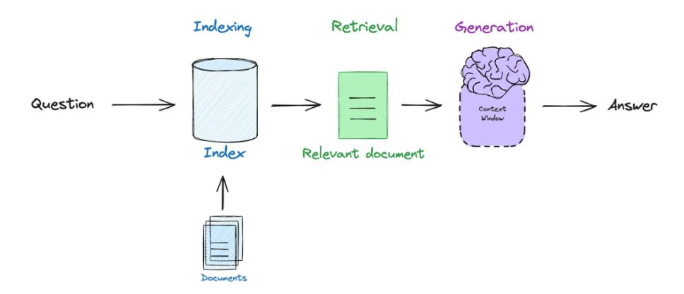

Let's walk through how to use an LLM to generate a response using the retrieved document as context.

# **Steps to Generate a Response with an LLM**

- 1. Retrieve Relevant Document: Perform a similarity search to find the most relevant document for the user's question.
- 2. Combine Context and Query: Format the retrieved document and user question into a prompt for the LLM.
- 3. Generate a Response: Use the LLM to generate a response based on the combined prompt.

This example assumes that we have already indexed documents in a vector store (e.g., Chroma) and retrieved the most similar document based on the user's query.

```
#lesson11d.py
from langchain_openai import OpenAIEmbeddings
from langchain.schema import Document
from langchain_chroma import Chroma
from langchain_core.prompts import ChatPromptTemplate
from langchain_openai import ChatOpenAI
from langchain_core.runnables import RunnablePassthrough
from langchain_core.output_parsers import StrOutputParser
# Initialize the embeddings model
embeddings = OpenAIEmbeddings(
    model="text-embedding-3-large"
)
# Define sample documents as Document objects
documents = [
    Document(page_content="LangChain is a framework for building context-aware
reasoning applications."),
    Document(page_content="FAISS is a library for efficient similarity search and clustering
of dense vectors."),
    Document(page_content="The quick brown fox jumps over the lazy dog.")
]
# Index documents in Chroma vector store
db = Chroma.from_documents(documents, embedding=embeddings)
print("Documents indexed in Chroma successfully.")
# Define a retriever to fetch relevant documents
retriever = db.as_retriever(search_type="similarity", search_kwargs={"k": 6})
# Define a prompt template for the LLM
prompt = ChatPromptTemplate.from_template(
"""
You are an assistant for question-answering tasks. Use the following pieces of retrieved context
to answer the question. If you don't know the answer, just say that you don't know. Use three
sentences maximum and keep the answer concise.
Question: {question}
Context: {context}
Answer:
"""
)
# Initialize the chat model (GPT-4 variant or mini model for demonstration)
model = ChatOpenAI(model="gpt-4o-mini", temperature=0)
# Set up the RAG chain pipeline
```

```
rag_chain = (
    {"context": retriever, "question": RunnablePassthrough()}
    | prompt
    | model
    | StrOutputParser()
)
# Use the RAG pipeline to answer a user question
question = "What did the fox do?"
for chunk in rag_chain.stream(question):
    print(chunk, end="", flush=True)
```

# <span id="page-347-0"></span>**Practical RAG - Questioning a long PDF Document**

In this example, we load a PDF document, split it into smaller chunks, embed each chunk, and store it in a vector store. We also calculate the number of tokens in each chunk, which is useful for managing context length limitations in LLMs.

# **Steps**

- 1. **Load the Document**: Use PyPDFLoader to load a PDF document.
- 2. **Split the Document**: Divide the document into smaller chunks using CharacterTextSplitter .
- 3. **Embed Each Chunk**: Generate embeddings for each chunk.
- 4. **Store in Chroma**: Index the chunks in a Chroma vector store.
- 5. **Calculate Tokens**: Use tiktoken to calculate the number of tokens for each chunk

This approach demonstrates how to:

- 1. **Handle large documents** by splitting them into manageable chunks.
- 2. **Embed and index each chunk** in a vector store, enabling efficient retrieval.
- 3. **Calculate token counts** for each chunk to manage context lengths effectively.

Once indexed, you can use similarity search on db to retrieve relevant chunks based on a query and feed those into an LLM as context. This is essential for large-scale applications that require accurate, context-aware answers from extensive documents.

Here's the full code that demonstrates loading a large document, splitting it into chunks, embedding and indexing the chunks, retrieving relevant context, and

# generating a response.

```
#embeddings
import os
from langchain_openai import OpenAIEmbeddings
from langchain_chroma import Chroma
from langchain_community.document_loaders import PyPDFLoader
from langchain_text_splitters import CharacterTextSplitter
from langchain_core.prompts import ChatPromptTemplate
from langchain_openai import ChatOpenAI
from langchain_core.runnables import RunnablePassthrough
from langchain_core.output_parsers import StrOutputParser
import tiktoken
# Step 1: Load the document
file_path = os.path.join(os.getcwd(), "chapter11", "Faiss by FacebookAI.pdf")
raw_documents = PyPDFLoader(file_path=file_path).load()
# Step 2: Split the document into chunks
text_splitter = CharacterTextSplitter(chunk_size=1000, chunk_overlap=0)
documents = text_splitter.split_documents(raw_documents)
# Step 3: Initialize the embeddings model
embeddings = OpenAIEmbeddings(model="text-embedding-3-large")
# Step 4: Index the document chunks in Chroma vector store
db = Chroma.from_documents(documents=documents, embedding=embeddings)
print("Documents indexed in Chroma successfully.")
# Step 5: Define a retriever for similarity search
retriever = db.as_retriever(search_type="similarity", search_kwargs={"k": 3})  # Retrieve top 3
relevant chunks
# Step 6: Define the prompt template for the LLM
prompt = ChatPromptTemplate.from_template(
"""
You are an assistant for question-answering tasks. Use the following pieces of retrieved context
to answer the question. If you don't know the answer, just say that you don't know. Use three
sentences maximum and keep the answer concise.
Question: {question}
Context: {context}
Answer:
"""
)
# Step 7: Initialize the ChatOpenAI model (e.g., gpt-4 or another preferred model)
model = ChatOpenAI(model="gpt-4o-mini", temperature=0)
# Step 8: Set up the Retrieval-Augmented Generation (RAG) chain
rag_chain = (
    {"context": retriever, "question": RunnablePassthrough()}
```

```
| prompt
    | model
    | StrOutputParser()
)
# Step 9: Ask a question and generate a response
question = "Can you explain what FAISS is used for?"
for chunk in rag_chain.stream(question):
    print(chunk, end="", flush=True)
```

# **Explanation of Each Step**

- 1. **Document Loading and Splitting**: The large document is loaded and split into 1000-character chunks, allowing the LLM to process manageable portions of text.
- 2. **Embedding and Indexing**: Each chunk is converted into an embedding and stored in Chroma , a local vector store, which allows for efficient retrieval based on similarity.
- 3. **Retrieving Relevant Chunks**: The retriever finds the top 3 chunks most similar to the user's query, "Can you explain what FAISS is used for?". This ensures that the LLM has relevant context to answer the question accurately.
- 4. **Prompt Construction**: A prompt template is used to format the question and context in a way that the LLM can interpret effectively. This prompt instructs the LLM to provide a concise response based on the retrieved context.
- 5. **Response Generation**: The LLM (e.g., gpt-4o-mini ) processes the prompt and generates a response. Streaming is enabled, so the response is printed as it's generated.

# **Expected Output**

For a question like, "Can you explain what FAISS is used for?", the expected output might be:

```
#embeddings
```

Documents indexed in Chroma successfully.

FAISS, developed by Facebook AI Research, is a library designed for efficient similarity search, particularly for high-dimensional vectors generated by AI tools. It allows for quick searching of multimedia documents that are similar to each other, making it suitable for largescale datasets, including billions of vectors. The library optimizes memory usage and speed, offering both CPU and GPU implementations for various indexing methods.

To perform Retrieval-Augmented Generation (RAG) using multiple sources, including the web, we can follow a similar pipeline but expand the sources of our context retrieval. This allows us to fetch relevant information from a variety of locations, such as local documents, web pages, and databases, giving the language model a broader knowledge base to draw from when generating answers.

# **Steps to Set Up RAG from Multiple Sources**

In this example, we'll:

- 1. **Retrieve Context from Local and Web Sources**: Combine content from a local PDF and external web sources.
- 2. **Use a Vector Store**: Index and store embeddings from both local and web sources.
- 3. **Perform Similarity Search**: Retrieve relevant chunks from each source.
- 4. **Generate a Response**: Use an LLM to generate a concise answer using the combined context.

# **Complete Example Code**

To demonstrate, let's say we have a local PDF file and we also want to retrieve content from several web pages related to the topic.

```
#lesson11e.py
import os
from langchain_openai import OpenAIEmbeddings
from langchain_chroma import Chroma
from langchain_community.document_loaders import PyPDFLoader, WebBaseLoader
from langchain_text_splitters import CharacterTextSplitter
from langchain_core.prompts import ChatPromptTemplate
from langchain_openai import ChatOpenAI
from langchain_core.runnables import RunnablePassthrough
from langchain_core.output_parsers import StrOutputParser
import tiktoken
# Initialize the embeddings model
embeddings = OpenAIEmbeddings(model="text-embedding-3-large")
### Step 1: Load and Process Local Document (PDF)
# Load local PDF document
```

```
file_path = os.path.join(os.getcwd(), "chapter11", "Faiss by FacebookAI.pdf")
pdf_loader = PyPDFLoader(file_path)
pdf_documents = pdf_loader.load()
# Split PDF into chunks
text_splitter = CharacterTextSplitter(chunk_size=1000, chunk_overlap=0)
split_pdf_documents = text_splitter.split_documents(pdf_documents)
### Step 2: Load and Process Web Content
# Define URLs to fetch web content
urls = [
    "https://github.com/facebookresearch/faiss",
    "https://github.com/facebookresearch/faiss/wiki"
]
# Load web content
web_loader = WebBaseLoader(web_paths=urls)
web_documents = web_loader.load()
# Split web documents into chunks
split_web_documents = text_splitter.split_documents(web_documents)
### Step 3: Combine Local and Web Documents
# Combine documents from both local and web sources
all_documents = split_pdf_documents + split_web_documents
### Step 4: Index Documents in Chroma Vector Store
# Index all documents in Chroma
db = Chroma.from_documents(documents=all_documents, embedding=embeddings)
print("All documents indexed in Chroma successfully.")
### Step 5: Define a Retriever
# Define a retriever to fetch relevant documents from the combined sources
retriever = db.as_retriever(search_type="similarity", search_kwargs={"k": 5})  # Retrieve top 5
relevant chunks
### Step 6: Define the Prompt Template for the LLM
prompt = ChatPromptTemplate.from_template(
"""
You are an assistant for question-answering tasks. Use the following pieces of retrieved context
to answer the question. If you don't know the answer, just say that you don't know. Use three
sentences maximum and keep the answer concise.
Question: {question}
Context: {context}
Answer:
"""
)
### Step 7: Initialize the ChatOpenAI Model
```

```
model = ChatOpenAI(model="gpt-4o-mini", temperature=0)
### Step 8: Set up the Retrieval-Augmented Generation (RAG) Chain
rag_chain = (
    {"context": retriever, "question": RunnablePassthrough()}
    | prompt
    | model
    | StrOutputParser()
)
### Step 9: Ask a Question and Generate a Response
question = "Who are the main authors of Faiss?"
for chunk in rag_chain.stream(question):
    print(chunk, end="", flush=True)
```

# **Explanation of Each Step**

# 1. **Local Document Loading and Splitting**:

○ We use PyPDFLoader to load a PDF document (in this example, "Faiss by FacebookAI.pdf") and split it into manageable chunks.

# 2. **Web Content Loading and Splitting**:

○ WebLoader retrieves content from specific URLs (e.g., Wikipedia articles about Facebook AI Research and FAISS). This is split into chunks as well to keep it manageable for embedding and retrieval.

# 3. **Combining Documents**:

○ The chunks from the local PDF and web sources are combined into a single list to create a unified knowledge base for the vector store.

# 4. **Embedding and Indexing**:

○ All chunks are embedded and indexed in Chroma , allowing for efficient similarity-based retrieval across both local and web content.

# 5. **Retriever Setup**:

○ The retriever is set to fetch the top 5 most similar chunks, providing a variety of context from both local and web sources.

# 6. **Prompt Construction**:

○ A concise prompt template is created to guide the LLM in generating short, accurate answers.

# 7. **LLM Initialization**:

○ The ChatOpenAI model is initialized to process the combined prompt and context.

# 8. **RAG Chain Execution**:

○ The RAG chain is executed with streaming enabled, so the response is generated and printed in real-time.

# **Expected Output**

For a question like, " Who are the main authors of Faiss? ", the expected output might be:

#### #embeddings

The main authors of Faiss are Matthijs Douze, Alexandr Guzhva, Chengqi Deng, Jeff Johnson, Gergely Szilvasy, Pierre-Emmanuel Mazaré, Maria Lomeli, Lucas Hosseini, and Hervé Jégou. Hervé Jégou initiated the project and wrote its first implementation. Each author contributed significantly to various aspects of the library's development.

Note that the author names are explicitly quoted from the online documents and not on the PDF document.

# <span id="page-353-0"></span>**Understanding the RAG Workflow in LangGraph: Retrieval AI Agent**

In a typical LangGraph RAG setup, the workflow includes the following steps:

# **1. Indexing**

- **Data Loading:** Data is loaded from various sources using Document Loaders in LangChain. This may include web pages, documents, databases, etc.
- **Text Splitting:** Large documents are broken down into manageable chunks, often with overlap, to improve retrieval accuracy.
- **Storing and Indexing:** Each chunk is stored in a vector database, where it is transformed into embeddings. This allows for efficient similarity-based retrieval using cosine similarity.

# **2. Retrieval and Generation**

- **Query Processing:** When a query is entered, the system retrieves the most relevant chunks by comparing the query embedding with the stored document embeddings.
- **Answer Generation:** An LLM, such as GPT or Claude, takes the query and the retrieved context to generate an answer.

Here's the complete code to implement a RAG workflow in LangGraph with a state machine approach.

# **Code Implementation**

```
#lesson11i.py
import asyncio
from typing import List, TypedDict
from langchain.text_splitter import RecursiveCharacterTextSplitter
from langchain_community.document_loaders import WebBaseLoader
from langchain_community.vectorstores import Chroma
from langchain_openai import OpenAIEmbeddings
from langchain_core.prompts import ChatPromptTemplate
from langchain_openai import ChatOpenAI
from langchain_core.output_parsers import StrOutputParser
from langgraph.graph import StateGraph, START, END
from langgraph.checkpoint.memory import MemorySaver
#1. Index 3 websites by adding them to a vector DB
urls = [
    "https://github.com/facebookresearch/faiss",
    "https://github.com/facebookresearch/faiss/wiki",
    "https://github.com/facebookresearch/faiss/wiki/Faiss-indexes"
]
docs = [WebBaseLoader(url).load() for url in urls]
docs_list = [item for sublist in docs for item in sublist]
text_splitter = RecursiveCharacterTextSplitter.from_tiktoken_encoder(
    chunk_size=250, chunk_overlap=0
)
doc_splits = text_splitter.split_documents(docs_list)
vectorstore = Chroma.from_documents(
    documents=doc_splits,
    collection_name="rag-chroma",
```

```
embedding=OpenAIEmbeddings(),
)
retriever = vectorstore.as_retriever()
#2. Prepare the RAG chain
prompt = ChatPromptTemplate.from_template(
"""
You are an assistant for question-answering tasks. Use the following pieces of retrieved context
to answer the question. If you don't know the answer, just say that you don't know. Use three
sentences maximum and keep the answer concise.
Question: {question}
Context: {context}
Answer:
"""
)
model = ChatOpenAI(model="gpt-4o-mini", temperature=0)
rag_chain = (
    prompt    | model    | StrOutputParser()
)
#3. define the graph
class GraphState(TypedDict):
    """
   Represents the state of our graph.
   Attributes:
      question: question
      generation: LLM generation       
      documents: list of documents
   """
    question: str
    generation: str
    web_search: str
    documents: List[str]
#4. Retrieve node
def retrieve(state):
    """
   Retrieve documents
   Args:
      state (dict): The current graph state
   Returns:
      state (dict): New key added to state, documents, that contains retrieved documents
   """
    print("---RETRIEVE---")
    question = state["question"]
    # Retrieval
    documents = retriever.invoke(question)
```

```
return {"documents": documents, "question": question}
#5. Generate node
def generate(state):
    """
   Generate answer
   Args:
      state (dict): The current graph state
   Returns:
      state (dict): New key added to state, generation, that contains LLM generation
   """
    print("---GENERATE---")
    question = state["question"]
    documents = state["documents"]
    # RAG generation
    generation = rag_chain.invoke({"context": documents, "question": question})
    return {"documents": documents, "question": question, "generation": generation}
#6. Define the workflow
def create_workflow():
    workflow = StateGraph(GraphState)
    # Add nodes
    workflow.add_node("retrieve", retrieve)
    workflow.add_node("generate", generate)
    # Add edges
    workflow.add_edge(START, "retrieve")
    workflow.add_edge("retrieve", "generate")
    workflow.add_edge("generate", END)   
    return workflow.compile(checkpointer=MemorySaver())
#7. Run the workflow
async def run_workflow():
    app = create_workflow()
    config = {
         "configurable": {"thread_id": "1"},
         "recursion_limit": 50
   }  
    inputs = {"question": f"What are flat indexes?"}
    try:
         async for event in app.astream(inputs, config=config, stream_mode="values"):
              if "error" in event:
                  print(f"Error: {event['error']}")
                  break
```

```
print(event)
    except Exception as e:
         print(f"Workflow execution failed: {str(e)}")
if __name__ == "__main__":
    asyncio.run(run_workflow())
```

# **Explanation of the Workflow**

# 1. **Loading and Indexing**:

- Web data is loaded using WebBaseLoader and then split into chunks with RecursiveCharacterTextSplitter .
- Chunks are embedded and stored in a Chroma vector store, enabling fast similarity-based retrieval.

# 2. **Graph State and Nodes**:

- GraphState defines the data structure for holding the state of the workflow.
- The retrieve node handles document retrieval based on the query, using cosine similarity to fetch the most relevant document chunks.
- The generate node generates an answer by invoking the LLM on the retrieved context.

# 3. **Creating and Running the Workflow**:

- create\_workflow sets up the nodes and edges in the LangGraph state machine.
- run\_workflow asynchronously executes the workflow, streaming the final generated response.

# **Example Output:**

Given a question such as "What are flat indexes in FAISS?", the output might look like this:

```
#embeddings
---RETRIEVE---
---GENERATE---
{'question': 'What are flat indexes in FAISS?', 'generation': 'Flat indexes in FAISS are a type of
index structure used for efficient similarity search. They store vectors in a simple array format
and allow for fast, exhaustive searches. This is particularly useful in AI for applications
requiring precise and comprehensive similarity search results.'}
```

# **Summary: This RAG workflow in LangGraph:**

- **Loads and indexes** web data into a vector store, creating a searchable knowledge base.
- **Retrieves relevant content** based on a user query.
- **Generates answers** from an LLM using retrieved context, providing concise and accurate information.

By structuring the RAG process as a LangGraph state machine, this setup is modular, efficient, and scalable, allowing for more complex workflows that could involve additional document types, more advanced question answering, or fallback strategies when relevant information is sparse.

# <span id="page-359-0"></span>**Chapter Review: RAG Workflow in LangGraph**

In this chapter, we explored the foundational architecture of **Retrieval-Augmented Generation (RAG)** in LangGraph. We implemented a modular, state-driven workflow for RAG, demonstrating how to load data from multiple sources, index it in a vector store, and retrieve relevant information for response generation using an LLM. The workflow consisted of:

- **Indexing**: Loading documents from web sources, splitting them into manageable chunks, embedding them, and storing the embeddings in a vector database.
- **Retrieval and Generation**: Processing user queries by retrieving the most relevant document chunks, and generating responses using an LLM with the retrieved context as input.

This architecture is well-suited for applications where relevant information is spread across large, static datasets, allowing the LLM to respond with contextually enriched answers based on the documents retrieved.

# **Limitations of the RAG Architecture**

While effective, the presented RAG architecture has certain limitations:

# 1. **Dependence on Static Document Stores**:

○ This setup relies on a static vector store where information is preindexed. If new information becomes available or if there are updates to the indexed content, the vector store needs to be rebuilt and re-indexed. This can be a limitation in dynamic environments where information frequently changes.

# 2. **Lack of Contextual Adaptation**:

○ The architecture does not dynamically adapt to different query complexities or the availability of information. For example, some queries may require more context than others, or different document sources to be more relevant. The current RAG setup treats all queries similarly, regardless of their nature.

# 3. **Reliance on Single Retrieval**:

○ The system performs a single pass of retrieval for each query, retrieving relevant chunks based on cosine similarity. This approach may fail if the retrieved chunks are not sufficiently relevant. In cases where initial retrievals do not provide enough information, the system lacks mechanisms to adjust or re-query in a more targeted way.

# 4. **No Corrective Mechanism**:

○ The architecture does not include any feedback or corrective mechanism to evaluate whether the generated response adequately answers the query. If the initial retrieval does not meet the query's requirements, the system has no way to self-correct or prompt for additional retrievals.

# 5. **Limited Scalability and Context Length**:

○ In cases where the query requires a large context or multiple documents, the system is limited by the token constraints of the LLM, which restricts how much context can be included in a single query-response cycle.

# <span id="page-360-0"></span>**Introduction to Advanced RAG Architectures**

To address these limitations, the next chapter will introduce advanced RAG approaches:

# 1. **Self-RAG**:

○ Self-RAG involves a more autonomous retrieval process where the system iteratively retrieves and evaluates information. If initial retrievals are insufficient, the system can perform additional retrieval passes or refine the query before generating a response. This enables the model to gather sufficient context for complex or ambiguous queries.

# 2. **Adaptive RAG**:

○ Adaptive RAG is designed to dynamically adjust its retrieval and generation strategies based on the nature of the query. For instance, if the query is broad, the system may prioritize general information; for specific queries, it may narrow its focus. Adaptive RAG uses

contextual cues to determine how much context to retrieve and what sources to prioritize, making it highly responsive to diverse queries.

# 3. **Corrective RAG (CRAG)**:

○ Corrective RAG adds a feedback mechanism to the RAG workflow. After generating an initial response, CRAG evaluates whether the response meets the query's requirements. If the response is incomplete or inaccurate, it triggers corrective actions, such as rerunning retrieval with refined queries or increasing the retrieval scope. CRAG is particularly useful in scenarios where accuracy is critical, as it self-corrects based on internal grading or user feedback.

The next chapter will explore the technical implementation of **Self-RAG, Adaptive RAG, and Corrective RAG (CRAG)** in LangGraph. These architectures represent advanced, responsive approaches to retrieval-augmented generation, enabling LLMs to generate more accurate, context-aware responses. We will explore their underlying principles, demonstrate their workflows, and discuss scenarios where each is most effective.

This exploration of **adaptive and corrective mechanisms in RAG** will provide readers with the tools to build intelligent, autonomous, and responsive RAG systems, making LangGraph workflows robust for real-world applications requiring high accuracy and adaptability.

# <span id="page-361-0"></span>**Quiz on RAG Workflow in LangGraph**

# **Multiple Choice Questions**

- 1. **What are the main components of the RAG Workflow in LangGraph?**
  - A) Data Loading, Query Parsing, Answer Generation
  - B) Indexing, Retrieval, and Generation
  - C) Embedding, Vectorization, Answer Matching
  - D) Splitting, Clustering, Summarization **Answer**: B) Indexing, Retrieval, and Generation

# 2. **What purpose does document splitting serve in a RAG workflow?**

- A) It improves the visual representation of the data.
- B) It reduces the number of queries needed.
- C) It breaks down large documents for better retrieval accuracy.

- D) It eliminates the need for embeddings. **Answer**: C) It breaks down large documents for better retrieval accuracy.
- 3. **Which component is responsible for storing document embeddings in a vectorized form for fast retrieval?**
  - A) Text Splitter
  - B) Vector Store
  - C) Prompt Template
  - D) Answer Generator **Answer**: B) Vector Store
- 4. **What retrieval method is commonly used to match query embeddings with document embeddings, as recommended by OpenAI?**
  - A) Euclidean Distance
  - B) Cosine Similarity
  - C) Manhattan Distance
  - D) Jaccard Similarity

**Answer**: B) Cosine Similarity

- 5. **Which of the following is a limitation of the basic RAG architecture?**
  - A) Requires complex language models to index documents.
  - B) Cannot adapt or perform corrective actions based on query requirements.
  - C) Requires continuous input from a human operator.
  - D) Uses multiple embeddings for each document chunk. **Answer**: B) Cannot adapt or perform corrective actions based on query requirements.

# **True or False**

- 6. **True or False**: In a RAG workflow, documents retrieved are directly passed to the answer generation model without any intermediate processing. **Answer**: False. Retrieved documents may undergo further processing, such as being combined with the user query in a prompt.
- 7. **True or False**: Adaptive RAG can alter retrieval and generation strategies based on the complexity or specificity of the user query.

**Answer**: True

- 8. **True or False**: Corrective RAG workflows involve a feedback mechanism to check the generated answer's relevance and accuracy before finalizing it. **Answer**: True
- 9. **True or False**: Self-RAG workflows can autonomously refine their retrieval process if initial results are insufficient. **Answer**: True

# **Short Answer Questions**

- 10. Explain the purpose of document embedding in a RAG workflow.
- 11. What limitations does a basic RAG workflow face in terms of adaptability and corrective measures?
- 12. Name and briefly describe the three advanced RAG architectures introduced as alternatives to the basic RAG approach.
- 13. Why is a vector store essential in a RAG workflow, and how does it enhance retrieval efficiency?

# **Answers to Short Answer Questions**

- 10. Document embedding transforms text into high-dimensional vector representations that capture semantic meaning. This allows similaritybased retrieval to match user queries with relevant document chunks based on their content, even if exact words differ.
- 11. Basic RAG workflows struggle with static information reliance, lack of adaptive retrieval, and inability to self-correct when retrieval doesn't yield sufficient context. They do not adapt dynamically to query specifics or re-evaluate responses, which can lead to incomplete answers.
- 12. **Self-RAG** autonomously refines retrieval if initial results lack sufficient context. **Adaptive RAG** adjusts retrieval and generation strategies based on query specifics, prioritizing general or specific sources as needed. **Corrective RAG** includes a feedback loop to assess if the generated answer meets the query requirements and initiates corrective actions if it doesn't.
- 13. A vector store allows efficient storage and retrieval of document embeddings, enabling quick similarity searches for matching relevant documents with query embeddings. This structure optimizes retrieval for large datasets, making RAG workflows scalable and responsive.

# Part 4: Advanced Architectures and Specialized Agent Designs (Chapters 12-15)

# **Chapter 12**

# <span id="page-365-1"></span><span id="page-365-0"></span>**Advanced RAG Architectures (Self-RAG, Corrective RAG and Adaptive RAG)**

# <span id="page-365-2"></span>**12.1 Introduction to Self-Reflective RAG**

In Retrieval-Augmented Generation (RAG), a typical workflow includes querying a vector store to retrieve relevant documents based on user input, followed by generating responses using a language model. Self-RAG, as introduced in the latest paper, builds upon this framework by incorporating "reflection" steps into RAG. This method lets an LLM control aspects like when to retrieve, assess relevance, critique its response, and adapt its behavior to improve response accuracy and factuality.

# **Motivation for Self-RAG**

Traditional RAG pipelines retrieve a set number of documents, regardless of relevance or the need for retrieval in a given context. Self-RAG enhances this by allowing the model to decide if retrieval is necessary, which passages to include, and when to critique or refine responses. This reflective approach enables dynamic and adaptive workflows in LangGraph.

Self-RAG uses **reflection tokens** to mark various decisions during retrieval and generation:

- 1. **Retrieve Token** Determines if retrieval should occur.
- 2. **ISREL Token** Evaluates if a retrieved document is relevant to the question.
- 3. **ISSUP Token** Ensures the generated answer is grounded in the retrieved documents.
- 4. **ISUSE Token** Measures the overall usefulness of the generated answer.

These tokens make the model adaptive and capable of refining its behavior on-the-fly to maximize response relevance, factuality, and contextual accuracy.

# **Self-RAG Workflow in LangGraph**

In Self-RAG, LangGraph supports self-reflective workflows that incorporate decision points and feedback loops, achieved through LangGraph's state machines. Below, we illustrate how to construct a selfreflective RAG solution using LangGraph's graph and state nodes.

# **1. Setting Up the Environment**

Install the necessary packages and initialize the embeddings for document retrieval:

```
#lesson12a.py
import os
from langchain_openai import OpenAIEmbeddings
from langchain_community.document_loaders import WebBaseLoader
from langchain_community.vectorstores import Chroma
from langchain.text_splitter import RecursiveCharacterTextSplitter
```

**2. Indexing Documents** Load multiple sources to create a rich database and prepare them for retrieval in Chroma vector store.

```
#lesson12a.py continued
# List of URLs to retrieve documents from
urls = [
```

```
"https://lilianweng.github.io/posts/2023-06-23-agent/",
    "https://lilianweng.github.io/posts/2023-03-15-prompt-engineering/",
    "https://lilianweng.github.io/posts/2023-10-25-adv-attack-llm/"
]
# Load documents and split into manageable chunks
docs = [WebBaseLoader(url).load() for url in urls]
docs_list = [item for sublist in docs for item in sublist]
# Split documents for improved retrieval
text_splitter = RecursiveCharacterTextSplitter.from_tiktoken_encoder(chunk_size=250,
chunk_overlap=0)
doc_splits = text_splitter.split_documents(docs_list)
# Store documents in Chroma vector store
vectorstore = Chroma.from_documents(documents=doc_splits, collection_name="rag-
chroma", embedding=OpenAIEmbeddings())
retriever = vectorstore.as_retriever()
# Set up prompt and model
prompt = ChatPromptTemplate.from_template("""
Use the following context to answer the question concisely:
Question: {question}
Context: {context}
Answer:
""")
model = ChatOpenAI(model="gpt-4o-mini", temperature=0)
rag_chain = (prompt | model | StrOutputParser())
```

**3. Implementing Self-Reflective Workflow Steps** Define nodes for retrieval, generation, grading, and query transformation.

```
#lesson12a.py continued
class GraphState(TypedDict):
    question: str
    generation: str
    documents: List[str]
# Retrieval Grader setup
class GradeDocuments(BaseModel):
    binary_score: str = Field(description="Documents are relevant to the question, 'yes'
or 'no'")
```

```
retrieval_prompt = ChatPromptTemplate.from_template("""
You are a grader assessing if a document is relevant to a user's question.
Document: {document}
Question: {question}
Is the document relevant? Answer 'yes' or 'no'.
""")
retrieval_grader = retrieval_prompt | ChatOpenAI(model="gpt-4o-mini",
temperature=0).with_structured_output(GradeDocuments)
# Hallucination Grader setup
class GradeHallucinations(BaseModel):
    binary_score: str = Field(description="Answer is grounded in the documents, 'yes'
or 'no'")
hallucination_prompt = ChatPromptTemplate.from_template("""
You are a grader assessing if an answer is grounded in retrieved documents.
Documents: {documents}
Answer: {generation}
Is the answer grounded in the documents? Answer 'yes' or 'no'.
""")
hallucination_grader = hallucination_prompt | ChatOpenAI(model="gpt-4o-mini",
temperature=0).with_structured_output(GradeHallucinations)
# Answer Grader setup
class GradeAnswer(BaseModel):
    binary_score: str = Field(description="Answer addresses the question, 'yes' or 'no'")
answer_prompt = ChatPromptTemplate.from_template("""
You are a grader assessing if an answer addresses the user's question.
Question: {question}
Answer: {generation}
Does the answer address the question? Answer 'yes' or 'no'.
""")
answer_grader = answer_prompt | ChatOpenAI(model="gpt-4o-mini",
temperature=0).with_structured_output(GradeAnswer)
# Define LangGraph functions
def retrieve(state):
    question = state["question"]
    documents = retriever.invoke(question)
    return {"documents": documents, "question": question}
```

```
def generate(state):
    question = state["question"]
    documents = state["documents"]
    generation = rag_chain.invoke({"context": documents, "question": question})
    return {"documents": documents, "question": question, "generation": generation}
def grade_documents(state):
    """
   Grades documents based on relevance to the question.
   Only relevant documents are retained in 'relevant_docs'.
   """
    question = state["question"]
    documents = state["documents"]
    relevant_docs = []
    for doc in documents:
         response = retrieval_grader.invoke({"question": question, "document":
doc.page_content})
         if response.binary_score == "yes":
             relevant_docs.append(doc)
    return {"documents": relevant_docs, "question": question}
def decide_to_generate(state):
    """
   Decides whether to proceed with generation or transform the query.
   """
    if not state["documents"]:
         return "transform_query"  # No relevant docs found; rephrase query
    return "generate"  # Relevant docs found; proceed to generate
def grade_generation_v_documents_and_question(state):
    """
   Checks if the generation is grounded in retrieved documents and answers the
question.
   """
    question = state["question"]
    documents = state["documents"]
    generation = state["generation"]
    # Step 1: Check if the generation is grounded in documents
```

```
hallucination_check = hallucination_grader.invoke({"documents": documents,
"generation": generation})
    if hallucination_check.binary_score == "no":
        return "not supported"  # Regenerate if generation isn't grounded in documents
    # Step 2: Check if generation addresses the question
    answer_check = answer_grader.invoke({"question": question, "generation":
generation})
    return "useful" if answer_check.binary_score == "yes" else "not useful"
def transform_query(state):
    """
   Rephrases the query for improved retrieval if initial attempts do not yield relevant
documents.
   """
    transform_prompt = ChatPromptTemplate.from_template("""
   You are a question re-writer that converts an input question to a better version
optimized for retrieving relevant documents.
    Original question: {question}
   Please provide a rephrased question.
    """)
    question_rewriter = transform_prompt | ChatOpenAI(model="gpt-4o-mini",
temperature=0) | StrOutputParser()
    question = state["question"]
    # Rephrase the question using LLM
    transformed_question = question_rewriter.invoke({"question": question})
    return {"question": transformed_question, "documents": state["documents"]}
```

#### **Implementing Self-RAG in LangGraph: Complex Example**

To illustrate the adaptive nature of Self-RAG, let's create a LangGraph state machine for handling documents and evaluating generated content.

**Workflow Setup** In LangGraph, we define the graph states, edges, and conditional nodes to establish an adaptive feedback loop:

```
#lesson12a.py continued
# Set up the workflow graph
workflow = StateGraph(GraphState)
```

```
workflow.add_node("retrieve", retrieve)
workflow.add_node("generate", generate)
workflow.add_node("grade_documents", grade_documents)
workflow.add_node("transform_query", transform_query)
workflow.add_edge(START, "retrieve")
workflow.add_edge("retrieve", "grade_documents")
workflow.add_conditional_edges("grade_documents", decide_to_generate,
{"transform_query": "transform_query", "generate": "generate"})
workflow.add_edge("transform_query", "retrieve")
workflow.add_conditional_edges("generate",
grade_generation_v_documents_and_question, {"not supported": "generate", "useful":
END, "not useful": "transform_query"})
# Compile the app and run
app = workflow.compile()
# Display the graph
display_graph(app, file_name=os.path.basename(__file__))
# Example input
inputs = {"question": "Explain how the different types of agent memory work?"}
for output in app.stream(inputs):
    print(output)
```

The self-reflective nodes allow Self-RAG to continuously assess and improve the retrieval and generation processes by re-querying if results are irrelevant or insufficient. This setup is particularly valuable for handling ambiguous or complex questions.

# **Limitations and Next Steps**

While Self-RAG enhances adaptability in RAG workflows, it does introduce some complexity:

- **Latency**: Increased processing time due to reflection cycles.
- **Resource Use**: Additional computational resources are needed for iterative reflection.
- **Complexity in Implementation**: Designing adaptive workflows with feedback loops requires careful tuning.

# **Introducing Corrective and Adaptive RAG Techniques**

The next chapter will extend this framework by exploring Adaptive RAG, where the model adjusts its retrieval depth and generation behavior based on query characteristics. We will also introduce Corrective RAG, which uses an external verification system to further refine the response accuracy. Together, these will form a more dynamic and versatile RAG system.

# <span id="page-372-0"></span>**12.2 Corrective Retrieval-Augmented Generation (CRAG)**

Corrective Retrieval-Augmented Generation (CRAG) is an innovative approach designed to enhance the robustness of standard Retrieval-Augmented Generation (RAG) systems by addressing a crucial limitation: what happens when retrieval returns irrelevant or incorrect results. CRAG introduces corrective mechanisms that assess and refine the quality of retrieved documents, which is particularly useful in mitigating the risk of hallucinations in large language models (LLMs).

In this section, we will explore:

- 1. **CRAG Concepts and Paper Insights**
- 2. **Conditions for Corrective RAG**
- 3. **Implementation of CRAG in LangGraph**
- 4. **Conformance to the Paper's Methodology**

# **1. CRAG Concepts and Paper Insights**

The primary motivation behind CRAG is to enhance the reliability of RAG systems by adding layers of quality assessment and correction during the retrieval phase. LLMs, when relying solely on their internal parameters, are prone to hallucinations—fabricating information with misplaced confidence. While RAG can mitigate this by retrieving relevant documents to guide generation, its effectiveness is limited by the accuracy of retrieved content. CRAG introduces mechanisms to address this issue by:

- **Implementing a lightweight retrieval evaluator**: This component assesses the overall relevance of retrieved documents to the query, assigning a confidence score.
- **Introducing corrective actions**: Based on the relevance assessment, CRAG can trigger three actions: *Correct*, *Incorrect*, or *Ambiguous*. This branching allows CRAG to decide whether to use the retrieved

documents, discard them in favor of a web search, or combine both sources if relevance is uncertain.

- **Augmenting with web-based retrieval**: In cases where retrieved documents are irrelevant, CRAG supplements the knowledge base with web search results.
- **Refining document knowledge**: CRAG can further segment documents into "knowledge strips" to selectively use relevant parts of retrieved documents, filtering out irrelevant details.

These elements create a system that not only retrieves documents but evaluates and selectively corrects them, adapting dynamically based on the quality of information available.

# **2. Conditions for Corrective RAG**

In CRAG, different actions are triggered based on the relevance assessment:

- **Correct Action**: If the confidence score for relevance is high, CRAG assumes the retrieved documents are relevant and proceeds with generation after refining the retrieved knowledge into essential knowledge strips. This is useful in cases where documents contain useful, but not entirely focused, information that benefits from refinement.
- **Incorrect Action**: If the confidence score is low across all documents, CRAG performs a corrective action by discarding the retrieved documents and instead initiating a web search to find more relevant data.
- **Ambiguous Action**: If the relevance assessment yields an intermediate score, CRAG performs a combined approach, integrating both the refined retrieved knowledge and the web search results. This balance is particularly useful in ambiguous cases where neither the retrieved data nor a pure web search is entirely sufficient.

These actions ensure that CRAG remains flexible and adaptable to different levels of retrieval quality, thereby enhancing reliability.

# **3. Implementation of CRAG in LangGraph**

The following Python code in LangGraph demonstrates CRAG by setting up nodes that correspond to the steps described above:

```
#lesson12a.py continued
import os
from langchain_openai import OpenAIEmbeddings, ChatOpenAI
from langchain_community.document_loaders import WebBaseLoader
from langchain_community.vectorstores import Chroma
from langchain.text_splitter import RecursiveCharacterTextSplitter
from langchain_core.output_parsers import StrOutputParser
from langgraph.graph import StateGraph, START, END
from pydantic import BaseModel, Field
from typing import List, TypedDict
from langchain.schema import Document
from langchain_community.tools.tavily_search import TavilySearchResults
from display_graph import display_graph
from langchain_core.prompts import ChatPromptTemplate
from pprint import pprint
# Step 1: Load and prepare documents
urls = [
    "https://lilianweng.github.io/posts/2023-06-23-agent/",
    "https://lilianweng.github.io/posts/2023-03-15-prompt-engineering/",
    "https://lilianweng.github.io/posts/2023-10-25-adv-attack-llm/"
]
# Load and split documents
docs = [WebBaseLoader(url).load() for url in urls]
docs_list = [item for sublist in docs for item in sublist]
text_splitter = RecursiveCharacterTextSplitter.from_tiktoken_encoder(chunk_size=250,
chunk_overlap=0)
doc_splits = text_splitter.split_documents(docs_list)
# Add to vectorstore
vectorstore = Chroma.from_documents(doc_splits, collection_name="crag-chroma",
embedding=OpenAIEmbeddings())
retriever = vectorstore.as_retriever()
# Step 2: Define Graders and Relevance Model
class GradeDocuments(BaseModel):
    binary_score: str = Field(description="Documents are relevant to the question, 'yes'
or 'no'")
retrieval_prompt = ChatPromptTemplate.from_template("""
You are a grader assessing if a document is relevant to a user's question.
```

```
Document: {document}
Question: {question}
Is the document relevant? Answer 'yes' or 'no'.
""")
retrieval_grader = retrieval_prompt | ChatOpenAI(model="gpt-4o-mini",
temperature=0).with_structured_output(GradeDocuments)
# Step 3: Query Re-writer
class ImproveQuestion(BaseModel):
    improved_question: str = Field(description="Formulate an improved question.")
re_write_prompt = ChatPromptTemplate.from_template(
   "Here is the initial question: \n\n {question} \n Formulate an improved question.",
)
query_rewriter = re_write_prompt | ChatOpenAI(model="gpt-4o-mini",
temperature=0).with_structured_output(ImproveQuestion)
# Define prompt template
prompt = ChatPromptTemplate.from_template("""
Use the following context to answer the question:
Question: {question}
Context: {context}
Answer:
""")
rag_chain = prompt | ChatOpenAI(model="gpt-4o-mini", temperature=0) |
StrOutputParser()
# Define CRAG State
class GraphState(TypedDict):
    question: str
    generation: str
    web_search: str
    documents: List[str]
# Step 4: Define Workflow Nodes
def retrieve(state):
    question = state["question"]
    documents = retriever.invoke(question)
    return {"documents": documents, "question": question}
def grade_documents(state):
    question = state["question"]
    documents = state["documents"]
    filtered_docs = []
    web_search_needed = "No"
```

```
for doc in documents:
        grade = retrieval_grader.invoke({"question": question, "document":
doc.page_content}).binary_score
        if grade == "yes":
            print("---GRADE: DOCUMENT RELEVANT---")
            filtered_docs.append(doc)
        else:
            print("---GRADE: DOCUMENT NOT RELEVANT---")
            web_search_needed = "Yes"
    return {"documents": filtered_docs, "question": question, "web_search":
web_search_needed}
def transform_query(state):
    question = state["question"]
    rewritten_question = query_rewriter.invoke({"question": question})
    return {"question": rewritten_question.improved_question, "documents":
state["documents"]}
def web_search(state):
    """
   Web search based on the re-phrased question.
   Args:
      state (dict): The current graph state
   Returns:
      state (dict): Updates documents key with appended web results
   """
    print("---WEB SEARCH---")
    question = state["question"]
    documents = state["documents"]
    pprint(question+"\n")
    # Perform web search using TavilySearchResults and extract only the 'content' field
for Document
    search_results = TavilySearchResults(k=3).invoke({"query": question})
    # Process results to create Document objects only with page_content
    web_documents = [
        Document(page_content=result["content"]) for result in search_results if
"content" in result
   ]
```

```
# Append web search results to the existing documents
    documents.extend(web_documents)
    return {"documents": documents, "question": question}
def generate(state):
    generation = rag_chain.invoke({"context": state["documents"], "question":
state["question"]})
    return {"generation": generation}
# Step 5: Define Decision-Making Logic
def decide_to_generate(state):
    """
   Determines whether to generate an answer, or re-generate a question.
   Args:
      state (dict): The current graph state
   Returns:
      str: Binary decision for next node to call
   """
    print("---ASSESS GRADED DOCUMENTS---")
    state["question"]
    web_search = state["web_search"]
    state["documents"]
    if web_search == "Yes":
        # All documents have been filtered check_relevance
        # We will re-generate a new query
        print(
            "---DECISION: ALL DOCUMENTS ARE NOT RELEVANT TO
QUESTION, TRANSFORM QUERY---"
      )
        return "transform_query"
# Step 6: Build and Compile the Graph
workflow = StateGraph(GraphState)
workflow.add_node("retrieve", retrieve)
workflow.add_node("grade_documents", grade_documents)
workflow.add_node("transform_query", transform_query)
workflow.add_node("web_searcher", web_search)
workflow.add_node("generate", generate)
# Define edges
workflow.add_edge(START, "retrieve")
```

```
workflow.add_edge("retrieve", "grade_documents")
workflow.add_conditional_edges("grade_documents", decide_to_generate,
{"transform_query": "transform_query", "generate": "generate"})
workflow.add_edge("transform_query", "web_searcher")
workflow.add_edge("web_searcher", "generate")
workflow.add_edge("generate", END)
app = workflow.compile()
# Display the graph
display_graph(app, file_name=os.path.basename(__file__))
# Example input
inputs = {"question": "Explain how the different types of agent memory work?"}
for output in app.stream(inputs):
    for key, value in output.items():
        # Node
        pprint(f"Node '{key}':")
        # Optional: print full state at each node
        # pprint.pprint(value["keys"], indent=2, width=80, depth=None)
    pprint("\n---\n")
pprint(value["generation"])
Output:
"Node 'retrieve':"
'\n---\n'
---GRADE: DOCUMENT NOT RELEVANT---
---GRADE: DOCUMENT RELEVANT---
---GRADE: DOCUMENT NOT RELEVANT---
---GRADE: DOCUMENT RELEVANT---
---ASSESS GRADED DOCUMENTS---
---DECISION: ALL DOCUMENTS ARE NOT RELEVANT TO QUESTION,
TRANSFORM QUERY---   
"Node 'grade_documents':"
'\n---\n'
"Node 'transform_query':"
'\n---\n'
---WEB SEARCH---
What are the various types of agent memory, and how does each type function in the
context of artificial intelligence?"Node 'web_searcher':"
'\n---\n'
"Node 'generate':"
'\n---\n'
('In the context of artificial intelligence, particularly in systems powered '
'by large language models (LLMs), there are two primary types of agent '
'memory: short-term memory and long-term memory.
```

# **4. Conformance to the CRAG Paper's Methodology**

The LangGraph implementation closely aligns with the methodology described in the CRAG paper:

- **Retrieval Evaluation**: The grader in the LangGraph workflow acts as a lightweight retrieval evaluator that assesses each document's relevance, echoing the paper's approach.
- **Corrective Actions**: Based on the relevance score, the LangGraph workflow triggers appropriate actions (Correct, Incorrect, or Ambiguous), directly reflecting the branching conditions in the CRAG methodology.
- **Web-based Supplementation**: In cases where retrieved documents are inadequate, the workflow uses Tavily Search for web-based augmentation, embodying the CRAG principle of complementing limited corpora with broader sources.

By implementing these components, the LangGraph workflow achieves a robust CRAG framework, enhancing document quality evaluation and context refinement, thus addressing the original RAG limitations and reducing hallucinations in generated responses.

# <span id="page-379-0"></span>**12.3 Adaptive RAG**

# **Section 12.3: Adaptive RAG - Theory and Implementation in LangGraph**

# **Introduction to Adaptive RAG**

Adaptive Retrieval-Augmented Generation (Adaptive-RAG) is a framework designed to optimize retrieval-augmented models (like LLMs) based on the complexity of user queries. Standard RAG approaches often fail to account for varying query complexities, resulting in either excessive computational overhead for simple queries or insufficient processing for complex, multi-step ones. Adaptive-RAG dynamically adjusts the retrieval strategy by categorizing queries into three levels of complexity and applying the corresponding processing strategy.

The Adaptive-RAG paper introduces a classifier that evaluates the complexity of incoming queries, determining the most suitable retrieval

strategy. This classification aims to balance computational efficiency with response accuracy, adapting the RAG strategy as follows:

- **Non-retrieval** for straightforward queries answerable by the LLM alone.
- **Single-step retrieval** for moderately complex queries requiring additional context.
- **Multi-step retrieval** for complex queries that involve synthesizing information across multiple documents and reasoning over them.

# **Concepts from the Adaptive-RAG Paper**

Adaptive-RAG proposes a solution for retrieval-augmented LLMs to address the variability in query complexity, moving beyond one-size-fits-all approaches that are either overly simplistic or excessively complex for certain queries. The core aspects of Adaptive-RAG include:

- 1. **Complexity-based Strategy Selection**: By determining query complexity, Adaptive-RAG applies an efficient retrieval strategy, choosing between:
  - **Non-retrieval**: Simple queries are handled directly by the LLM without retrieval.
  - **Single-step retrieval**: Queries that need extra information from one document are processed in a single retrieval step.
  - **Multi-step retrieval**: Complex, multi-hop queries involve iterative retrieval, integrating multiple documents and employing reasoning chains.
- 2. **Query Complexity Classifier**: Adaptive-RAG introduces a classifier to assess query complexity levels: "A" for simple (handled by the LLM), "B" for moderately complex (requires single-step retrieval), and "C" for complex (requires multi-step retrieval). This classifier uses training data created by analyzing the success rates of each retrieval method and leveraging inductive biases from existing datasets.
- 3. **Efficiency and Accuracy Balance**: The framework is structured to optimize for both computational efficiency and answer accuracy, selecting simpler approaches for straightforward

questions to conserve computational resources. This balance is crucial in real-world applications, as not all queries necessitate extensive retrieval and reasoning.

# **Conditions for Implementing Adaptive-RAG in LangGraph**

The Adaptive-RAG framework in LangGraph requires the following components:

- 1. **Classifier Model**: This smaller model determines the complexity of the input query and assigns it to one of the three complexity classes (A, B, or C).
- 2. **Multi-path Retrieval and Processing Logic**: The system dynamically chooses among the three processing paths—nonretrieval, single-step retrieval, and multi-step retrieval—based on the classifier's output.
- 3. **Multi-step Query Handling for Complex Queries**: Complex queries use iterative retrieval and reasoning steps, progressively refining the query until all relevant information is gathered.

# **Implementation in LangGraph**

Implementing Adaptive-RAG in LangGraph involves setting up a query complexity classifier, followed by designing a state graph that branches into different paths based on the classifier's output. Below is a breakdown of the implementation, which aligns closely with the paper's methodology.

# 1. **Define the Query Complexity Classifier**:

- Train a classifier using a smaller language model (such as T5- Large) that categorizes queries into three levels of complexity (A, B, or C).
- The classifier model can be integrated into LangGraph as a separate node to evaluate each incoming query before choosing a retrieval strategy.

# 2. **Construct Retrieval Nodes and Paths**:

- Define three distinct retrieval nodes for non-retrieval, singlestep retrieval, and multi-step retrieval.
- Implement a retrieve() function that conditionally chooses the retrieval strategy based on the classifier's output.

# 3. **Multi-step Retrieval for Complex Queries**:

- For queries classified as complex (C), enable an iterative retrieval process where documents are retrieved and assessed in multiple rounds until a satisfactory answer is formed.
- This iterative process incorporates reasoning chains and intermediate answers, as required by complex queries.

# 4. **Decision-Making Logic in LangGraph**:

- Add decision nodes that leverage the classifier's output to route the query through the appropriate retrieval strategy.
- Implement a conditional edge from the classifier to each retrieval node (non-retrieval, single-step, multi-step).

# **A Real-World Implementation in LangGraph**

# **Introduction to Adaptive Retrieval-Augmented Generation (Adaptive-RAG)**

Adaptive RAG (Adaptive Retrieval-Augmented Generation) is a flexible approach designed to optimize responses by selecting the retrieval strategy best suited for each query. Adaptive-RAG combines **query analysis** with **active RAG**, determining the query's nature and selecting the retrieval strategy accordingly. This approach is useful for handling diverse queries where some can be addressed by simple information retrieval, while others require complex, multi-step reasoning.

# In a typical Adaptive-RAG setup:

- **No Retrieval** is used for questions answerable directly by the language model without additional data.
- **Single-Shot Retrieval** is applied to moderately complex questions that require a single-step retrieval.

● **Iterative Retrieval** is reserved for complex, multi-hop queries needing multiple rounds of retrieval and processing.

# **Key Concepts from Adaptive-RAG**

Adaptive-RAG introduces several important concepts, as outlined in the paper:

# 1. **Query Analysis and Routing**:

- The framework first assesses the complexity of each query, routing it to the appropriate retrieval path.
- This initial analysis is crucial in determining whether a query requires no retrieval, a single-step retrieval, or iterative retrieval.

# 2. **Self-Corrective Mechanisms**:

- By leveraging an LLM's ability to evaluate intermediate results, Adaptive-RAG enables the retrieval system to selfcorrect.
- This includes grading retrieved documents for relevance and, if needed, rerouting the query or rephrasing it for more accurate results.

# 3. **Multi-Path Decision-Making**:

- Adaptive-RAG routes queries through different paths depending on complexity.
- For example, simple factual questions (like "Who invented the telephone?") might bypass retrieval and go directly to the LLM, while complex analytical questions (like "How did the invention of the telephone impact global communication?") might trigger a multi-step retrieval flow.

# **Implementing Adaptive-RAG in LangGraph**

In this section, we'll develop a real-world implementation of Adaptive-RAG using LangGraph. Our setup will involve:

- 1. Web Search for recent events or questions requiring up-to-date information.
- 2. Self-Corrective RAG for questions that need information from a predefined index of documents.

# **Setting Up the Environment**

```
terminal
# Install required packages and set API keys
! pip install -U langchain_community tiktoken langchain-openai langchainhub chromadb
langgraph tavily-python
```

```
#lesson12b.py
import getpass, os
def _set_env(var: str):
    if not os.environ.get(var):
        os.environ[var] = getpass.getpass(f"{var}: ")
_set_env("OPENAI_API_KEY")
_set_env("TAVILY_API_KEY")
```

# **Step 1: Building the Index**

We'll start by creating an index of documents related to AI and language models. This index will be used for retrieval in case the query is routed to the vector store.

```
#lesson12b.py continued
from langchain.text_splitter import RecursiveCharacterTextSplitter
from langchain_community.document_loaders import WebBaseLoader
from langchain_community.vectorstores import Chroma
from langchain_openai import OpenAIEmbeddings
# Define documents for indexing
urls = [
    "https://lilianweng.github.io/posts/2023-06-23-agent/",
    "https://lilianweng.github.io/posts/2023-03-15-prompt-engineering/",
    "https://lilianweng.github.io/posts/2023-10-25-adv-attack-llm/"
]
```

```
# Load and split documents
docs = [WebBaseLoader(url).load() for url in urls]
docs_list = [item for sublist in docs for item in sublist]
text_splitter = RecursiveCharacterTextSplitter(chunk_size=500)
doc_splits = text_splitter.split_documents(docs_list)
# Store documents in a vector database (Chroma)
vectorstore = Chroma.from_documents(doc_splits, collection_name="adaptive-rag",
embedding=OpenAIEmbeddings())
retriever = vectorstore.as_retriever()
```

# **Step 2: Query Routing**

Our query router will use a lightweight model to determine if a question should be answered with:

- **Vector Store Retrieval**: Queries related to indexed topics.
- **Web Search**: Queries about recent events or topics outside the scope of the index.

```
#lesson12b.py continued
from typing import Literal
from langchain_core.prompts import ChatPromptTemplate
from langchain_openai import ChatOpenAI
from pydantic import BaseModel, Field
# Define routing model
class RouteQuery(BaseModel):
    datasource: Literal["vectorstore", "web_search"]
route_prompt = ChatPromptTemplate.from_messages([
    ("system", "You are an expert at routing a user question to vectorstore or web
search."),
    ("human", "{question}")
])
question_router = route_prompt | ChatOpenAI(model="gpt-3.5-turbo",
temperature=0).with_structured_output(RouteQuery)
```

**Step 3: Retrieval Grader and Self-Correction**

This node will evaluate whether retrieved documents are relevant to the query. If documents are graded irrelevant, the query may be rephrased or supplemented with additional retrieval.

```
#lesson12b.py continued
class GradeDocuments(BaseModel):
    binary_score: str = Field(description="Documents are relevant to the question, 'yes'
or 'no'")
grade_prompt = ChatPromptTemplate.from_messages([
    ("system", "Evaluate if the document is relevant to the question. Answer 'yes' or
'no'."),
    ("human", "Document: {document}\nQuestion: {question}")
])
retrieval_grader = grade_prompt | ChatOpenAI(model="gpt-3.5-turbo",
temperature=0).with_structured_output(GradeDocuments)
```

# **Step 4: Web Search and RAG Generation**

We'll use Tavily's web search API to retrieve information if the query is routed to web search.

```
#lesson12b.py continued
from langchain_community.tools.tavily_search import TavilySearchResults
from langchain.schema import Document
web_search_tool = TavilySearchResults(k=3)
def web_search(state):
    search_results = web_search_tool.invoke({"query": state["question"]})
    web_documents = [Document(page_content=result["content"]) for result in
search_results if "content" in result]
    return {"documents": web_documents, "question": state["question"]}
```

# **Step 5: Decision-Making Logic and Workflow Graph**

Now we construct a state graph in LangGraph to handle the query routing, retrieval, and grading processes.

```
#lesson12b.py continued
```

```
def generate(state):
    prompt_template = """
   Use the following context to answer the question concisely and accurately:
    Question: {question}
    Context: {context}
   Answer:
   """
    # Define ChatPromptTemplate using the above template
    rag_prompt = ChatPromptTemplate.from_template(prompt_template)
    # Create the RAG generation chain with LLM and output parsing
    rag_chain = (
        rag_prompt |
        ChatOpenAI(model="gpt-4o-mini", temperature=0) |
        StrOutputParser()
   )
    generation = rag_chain.invoke({"context": state["documents"], "question":
state["question"]})
    return {"generation": generation}
# Route question based on source
def route_question(state):
    source = question_router.invoke({"question": state["question"]}).datasource
    return "web_search" if source == "web_search" else "retrieve"
# Compile and Run the Graph
workflow = StateGraph(GraphState)
workflow.add_node("web_search", web_search)
workflow.add_node("retrieve", retrieve)
workflow.add_node("grade_documents", grade_documents)
workflow.add_node("generate", generate)
workflow.add_conditional_edges(START, route_question, {"web_search":
"web_search", "retrieve": "retrieve"})
workflow.add_edge("web_search", "generate")
workflow.add_edge("retrieve", "grade_documents")
workflow.add_edge("grade_documents", "generate")
workflow.add_edge("generate", END)
app = workflow.compile()
# Run with example inputs
inputs = {"question": "What are the types of agent memory?"}
for output in app.stream(inputs):
    print(output)
```

# **Expected Outputs**

Given an input question, this setup would produce the following outputs:

- **Web Search** for queries about recent events, yielding information from the latest sources.
- **Self-corrective RAG** for questions that leverage the vector store, filtering documents by relevance and refining the response based on document quality.

# <span id="page-389-0"></span>**Explainer Section: Concepts in Chapter 12 - Advanced RAG Architectures**

This explainer section covers foundational concepts central to the Self-RAG, Corrective RAG, and Adaptive RAG architectures presented in Chapter 12. By understanding these foundational concepts, readers can more effectively grasp the structures and methodologies discussed throughout the chapter.

# **Key Concepts**

# **1. Vector Store**

A **vector store** is a specialized database optimized to store highdimensional vectors, commonly derived from embedding models. In RAG, vectors represent embeddings of documents and queries, generated using language models or other embedding algorithms. Storing document embeddings in a vector store allows for efficient similarity search by comparing query embeddings with stored document embeddings. This enables fast and scalable retrieval, especially for complex or large-scale text datasets.

In LangChain, **Chroma** serves as a vector store that is specifically integrated with LangChain's document and text embedding tools. Chroma is flexible, allowing embeddings from models like OpenAI's embedding models or Cohere's embeddings, to support various similarity search functions.

#### **Python Usage in LangChain:**

```
#explainer
from langchain_community.vectorstores import Chroma
from langchain_openai import OpenAIEmbeddings
# Store documents in a Chroma vector store
vectorstore = Chroma.from_documents(
    documents=doc_splits,
    collection_name="rag-chroma",
    embedding=OpenAIEmbeddings()
)
```

# **2. LangChain**

**LangChain** is an advanced Python framework for creating applications that integrate with language models. It streamlines the processes of document loading, text splitting, embedding generation, and chaining outputs from multiple LLM-driven tasks. LangChain's modularity supports building complex workflows, including RAG architectures, by facilitating integration with various vector stores, prompt templates, and state machines like LangGraph.

LangChain's ecosystem includes components for:

- **Document Loading**: Loading documents from various sources.
- **Text Splitting**: Breaking down large documents for efficient retrieval.
- **Embeddings**: Generating document embeddings for vector stores.
- **Chains**: Structuring tasks like RAG or QA workflows, where outputs from one step can flow to the next.

# **3. LangGraph and State Machines**

**LangGraph** is an extension in LangChain that introduces state machines to manage workflows. State machines provide control over conditional steps, looping, and feedback mechanisms. They are particularly useful in RAG architectures like Self-RAG, where decisions—such as whether to perform retrieval, transform a query, or continue with answer generation—are dynamically influenced by the context.

In LangGraph, a **state machine** is implemented with nodes and edges:

- **Nodes**: Represent individual steps in the workflow (e.g., retrieving documents, generating responses, rephrasing queries).
- **Edges**: Define the transitions between nodes based on specific conditions.

LangGraph's **StateGraph** class allows for flexible workflow creation with nodes and decision-making logic.

# **4. Prompt Engineering and ChatPromptTemplate**

In LangChain, **prompt engineering** involves designing prompts that guide an LLM to produce desired outputs. **ChatPromptTemplate** is a tool in LangChain that formats these prompts, organizing system messages, instructions, and dynamic variables like {question} or {context} . Welldesigned prompts are essential in RAG workflows to direct LLMs to focus on specific content, grade responses, or evaluate relevance.

```
#explainer
from langchain_core.prompts import ChatPromptTemplate
# Example prompt template for RAG generation
prompt_template = ChatPromptTemplate.from_template("""
   Use the following context to answer the question:
   Question: {question}
   Context: {context}
   Answer:
""")
```

# **5. Document Grading: Retrieval and Hallucination Graders**

In Self-RAG and Corrective RAG workflows, document grading evaluates the relevance of retrieved documents. By using graders, LangChain workflows can determine if the retrieved documents are relevant or if the generated responses are grounded in these documents. Common types of graders include:

- **Retrieval Grader**: Assesses the relevance of each retrieved document to the query.
- **Hallucination Grader**: Determines whether the generated answer is factually supported by the retrieved documents.
- **Answer Grader**: Ensures that the answer addresses the user's question.

Grading is implemented using LLMs that respond with binary scores (e.g., "yes" or "no") based on prompt instructions.

```
#explainer
from pydantic import BaseModel, Field
```

```
from langchain_core.prompts import ChatPromptTemplate
from langchain_openai import ChatOpenAI
class GradeDocuments(BaseModel):
    binary_score: str = Field(description="Documents are relevant to the question, 'yes'
or 'no'")
# Define retrieval grader with a prompt
retrieval_grader_prompt = ChatPromptTemplate.from_template("""
   You are a grader assessing if a document is relevant to a user's question.
    Document: {document}
    Question: {question}
   Is the document relevant? Answer 'yes' or 'no'.
""")
retrieval_grader = retrieval_grader_prompt | ChatOpenAI(model="gpt-4o-
mini").with_structured_output(GradeDocuments)
```

# **6. Conditional Routing and Query Rewriting**

**Conditional Routing** allows the LangGraph workflow to dynamically adjust paths based on conditions. For instance, in Adaptive RAG, a router node determines if a question should go to a vector store for retrieval or perform a web search for recent information. Conditional edges facilitate routing to different nodes based on the context or the relevance of retrieved documents.

**Query Rewriting** is used to reformulate a query for improved retrieval when initial attempts return irrelevant or insufficient documents. By rephrasing the question, the workflow increases the chance of retrieving high-quality, relevant documents. Query rewriting involves an LLM-based rewriter that adjusts the query while retaining its semantic meaning.

```
#explainer
def transform_query(state):
   question = state["question"]
   rephrased_question = question_rewriter.invoke({"question": question})
   return {"question": rephrased_question, "documents": state["documents"]}
```

# **7. Web Search Tool**

In certain RAG architectures, when internal retrieval from the vector store is insufficient or irrelevant, an external **web search** is used. **Tavily Search API**, integrated with LangChain, provides real-time results from the web to supplement the knowledge base. Web search can be essential in Corrective RAG, where irrelevant retrieved documents are replaced or supplemented by fresh data from the internet.

# **8. Self-Correction Mechanisms**

Self-correction is a cornerstone of both Self-RAG and Adaptive RAG. By employing iterative evaluation and decision-making processes, these workflows improve output quality. For example, in Self-RAG, graders evaluate the answer to confirm it is grounded in the retrieved documents, while Adaptive RAG dynamically adjusts the retrieval strategy based on query complexity. This approach enhances accuracy, reduces hallucination, and ensures relevance, creating a flexible and responsive workflow.

# **Summary**

These concepts underpin the advanced RAG architectures in LangGraph, enhancing each workflow's adaptability, accuracy, and relevance. By using modular components like vector stores, state machines, grading, conditional routing, and web search, Self-RAG, Corrective RAG, and Adaptive RAG can address increasingly complex questions with precise, context-aware answers.

# <span id="page-394-0"></span>**Chapter 12 Quiz: Advanced RAG Architectures (Self-RAG, Corrective RAG, Adaptive RAG)**

# **Multiple Choice Questions**

- 1. **What is the primary function of the vector store in a RAG workflow?**
  - A) To generate embeddings of the user query
  - B) To efficiently store and retrieve high-dimensional document embeddings
  - C) To grade the relevance of retrieved documents
  - D) To handle API calls for external web searches
- 2. **Which token in Self-RAG decides whether the generated answer is grounded in the retrieved documents?**
  - A) Retrieve Token
  - B) ISREL Token
  - C) ISSUP Token
  - D) ISUSE Token
- 3. **In Corrective RAG, what is the purpose of segmenting retrieved documents into "knowledge strips"?**
  - A) To create distinct parts of a question for iterative processing
  - B) To improve the relevance of retrieved information by focusing on specific content
  - C) To expand the context size limit for better retrieval
  - D) To transform the query for web search
- 4. **Which RAG method routes queries to a specific retrieval strategy based on the complexity of the question?**
  - A) Corrective RAG
  - B) Self-RAG
  - C) Adaptive RAG
  - D) Knowledge-Graph RAG

- 5. **In Adaptive RAG, which retrieval method is chosen for straightforward questions answerable directly by the LLM?**
  - A) No Retrieval
  - B) Single-step Retrieval
  - C) Multi-step Retrieval
  - D) Web-based Retrieval

# **True/False Questions**

- 6. **True/False:** Self-RAG uses a predefined set number of documents for retrieval, regardless of their relevance.
- 7. **True/False:** In Corrective RAG, if all documents are deemed irrelevant, a web search can be initiated to supplement or replace the existing documents.
- 8. **True/False:** Adaptive RAG uses a query classifier to determine whether a question should undergo non-retrieval, single-step retrieval, or multi-step retrieval.

# **Short Answer Questions**

- 9. Describe one primary advantage of using LangGraph's state machines in implementing Self-RAG workflows.
- 10. In Corrective RAG, what action is taken if retrieved documents return an ambiguous relevance score?
- 11. Explain the concept of "self-correction" in the context of Adaptive RAG. How does it improve the response quality of a RAG workflow?

# **Chapter 13**

# <span id="page-396-1"></span><span id="page-396-0"></span>**Multiagent Architectures**

# <span id="page-396-2"></span>**13.1 Agent Supervisor**

Multi-agent systems in LLM (Large Language Model)-driven applications involve several autonomous agents working together to achieve complex objectives. An *Agent Supervisor* is crucial in managing these agents effectively by coordinating tasks, assigning responsibilities, and monitoring outcomes to maintain consistency and quality across the multi-agent network. In a multi-agent architecture, the supervisor performs both coordination and evaluation tasks, functioning as a central node that ensures agents work collaboratively without conflicting objectives or overlapping efforts.

#### **Core Concepts of Agent Supervisor**

- 1. **Task Delegation and Orchestration**: The Agent Supervisor assigns tasks to agents based on the type of request and each agent's capabilities. This avoids redundant efforts, keeps agents focused, and optimizes the workflow by ensuring that each agent's specific skills are utilized.
- 2. **Monitoring and Error Correction**: By observing the performance and outputs of each agent, the supervisor can detect when an agent needs help, provide corrections, or trigger

- additional actions if an agent's output lacks accuracy or completeness.
- 3. **Communication Management**: Effective multi-agent architectures require streamlined communication. The supervisor helps manage message exchanges, making decisions about which agent should respond next, especially in multi-turn conversations where the agents' responses influence the workflow.

As stated in the *AutoGen* framework paper, a prominent feature of modern multi-agent systems is the integration of "conversation programming," where agents engage in structured conversations to coordinate and divide tasks effectively. AutoGen offers tools for "conversation-centric computation," allowing multi-agent interactions to progress through message exchanges that dynamically shape the flow based on each agent's specialized role.

# <span id="page-397-0"></span>**Practical Example 1: A Research Assistant Network**

In a research environment, multiple agents might handle different aspects of information gathering, analysis, and reporting. For instance:

- **Research Agent**: Conducts a literature review and gathers data from scientific databases.
- **Data Analysis Agent**: Processes quantitative data using statistical tools.
- **Reporting Agent**: Compiles findings into a structured document.

The Agent Supervisor coordinates the agents by initiating tasks with the Research Agent, assigning the analysis to the Data Analysis Agent, and concluding with the Reporting Agent to complete the task. The supervisor intervenes if, for example, additional data analysis is needed, directing the Data Analysis Agent to reprocess data with specific parameters.

```
#lesson13a.py
from typing import Annotated
from langchain_community.tools.tavily_search import TavilySearchResults
from langchain_experimental.tools import PythonREPLTool
from langchain_core.prompts import ChatPromptTemplate, MessagesPlaceholder
from langchain_openai import ChatOpenAI
from pydantic import BaseModel
```

```
from typing import Literal
tavily_tool = TavilySearchResults(max_results=5)
# This executes code locally, which can be unsafe
python_repl_tool = PythonREPLTool()
from langchain_core.messages import HumanMessage
def agent_node(state, agent, name):
   result = agent.invoke(state)
   return {
      "messages": [HumanMessage(content=result["messages"][-1].content,
name=name)]
   }
members = ["Researcher", "Coder"]
system_prompt = (
   "You are a supervisor tasked with managing a conversation between the"
   " following workers:  {members}. Given the following user request,"
   " respond with the worker to act next. Each worker will perform a"
   " task and respond with their results and status. When finished,"
   " respond with FINISH."
)
# Our team supervisor is an LLM node. It just picks the next agent to process
# and decides when the work is completed
options = ["FINISH"] + members
class routeResponse(BaseModel):
   next: Literal[*options]
prompt = ChatPromptTemplate.from_messages(
   [
      ("system", system_prompt),
      MessagesPlaceholder(variable_name="messages"),
      (
          "system",
          "Given the conversation above, who should act next?"
          " Or should we FINISH? Select one of: {options}",
      ),
   ]
).partial(options=str(options), members=", ".join(members))
llm = ChatOpenAI(model="gpt-4o-mini")
def supervisor_agent(state):
   supervisor_chain = prompt | llm.with_structured_output(routeResponse)
   return supervisor_chain.invoke(state)
import functools
```

```
import operator
from typing import Sequence
from typing_extensions import TypedDict
from langchain_core.messages import BaseMessage
from langgraph.graph import END, StateGraph, START
from langgraph.prebuilt import create_react_agent
# The agent state is the input to each node in the graph
class AgentState(TypedDict):
   # The annotation tells the graph that new messages will always
   # be added to the current states
   messages: Annotated[Sequence[BaseMessage], operator.add]
   # The 'next' field indicates where to route to next
   next: str
research_agent = create_react_agent(llm, tools=[tavily_tool])
research_node = functools.partial(agent_node, agent=research_agent,
name="Researcher")
# NOTE: THIS PERFORMS ARBITRARY CODE EXECUTION. PROCEED
WITH CAUTION
code_agent = create_react_agent(llm, tools=[python_repl_tool])
code_node = functools.partial(agent_node, agent=code_agent, name="Coder")
workflow = StateGraph(AgentState)
workflow.add_node("Researcher", research_node)
workflow.add_node("Coder", code_node)
workflow.add_node("supervisor", supervisor_agent)
for member in members:
   # We want our workers to ALWAYS "report back" to the supervisor when done
   workflow.add_edge(member, "supervisor")
# The supervisor populates the "next" field in the graph state
# which routes to a node or finishes
conditional_map = {k: k for k in members}
conditional_map["FINISH"] = END
workflow.add_conditional_edges("supervisor", lambda x: x["next"],
conditional_map)
# Finally, add entrypoint
workflow.add_edge(START, "supervisor")
graph = workflow.compile()
for s in graph.stream(
   {
      "messages": [
         HumanMessage(content="Research recent advances in AI and
summarize.")
      ]
   }
```

```
):
   if "__end__" not in s:
      print(s)
      print("----")
for s in graph.stream(
   {"messages": [HumanMessage(content="Write a brief pdf research report on
pikas.")]},
   {"recursion_limit": 100},
):
   if "__end__" not in s:
      print(s)
      print("----")
Output:
{'supervisor': {'next': 'Researcher'}}
----
```

{'Researcher': {'messages': [HumanMessage(content='Recent advances in AI throughout 2023 have been marked by significant developments across various domains:\n\n1. \*\*Generative AI Boom\*\*: Generative AI has emerged as a transformative force within industries. Organizations that are early adopters of AI technologies, referred to as "AI high performers," are increasingly leveraging generative AI to create new revenue streams and enhance existing offerings. A survey revealed that nearly 25% of C-suite executives are using generative AI tools, indicating its rising prominence in organizational strategies. [Source: McKinsey]\n\n2. \*\*Scientific Applications\*\*: Microsoft has made strides in using AI for scientific discovery, applying advanced AI models in fields like weather forecasting, protein design, and materials science. This year has seen the development of new language models and frameworks that enhance AI applications. [Source: Microsoft Research]\n\n3. \*\*Ethical Frameworks and Collaboration\*\*: Google Research and DeepMind have reported breakthroughs in generative AI, emphasizing the importance of ethical principles and partnerships in their advancements. This reflects a broader trend of addressing ethical concerns while innovating in AI technology. [Source: Google Research]\n\n4. \*\*Global AI Governance and Regulation\*\*: The geopolitical landscape surrounding AI has evolved, with countries like the US and China heavily investing in AI research and development. The UK and France are advancing regulations to ensure ethical AI development, highlighting the need for transparency and accountability amidst the rapid integration of AI into various sectors. [Source: ZDNet]\n\n5. \*\*Emergence of Open-Source AI\*\*: The year has also seen a rise in open-source AI initiatives and discussions around licensing. This shift has facilitated the development of powerful generative AI models and has prompted debates on the implications of such technologies. [Source: ZDNet]\n\n6. \*\*Hype Cycle of AI Technologies\*\*: According to Gartner\'s 2023 Hype Cycle, AI simulation technologies that combine AI with simulation environments are gaining traction, paving the way for further innovations in generative AI. [Source: Gartner]\n\nOverall, 2023 has been characterized by a surge in generative AI applications, a focus on ethical considerations, and significant global investments in AI research and development.', additional\_kwargs={}, response\_metadata={}, name='Researcher')]}}

---- {'supervisor': {'next': 'Coder'}} ----

{'Coder': {'messages': [HumanMessage(content="In 2023, notable advances in AI include:\n\n1. \*\*Generative AI Expansion\*\*: Generative AI is becoming a key player in various industries, with about 25% of C-suite executives actively using these tools to improve offerings and create new revenue streams (McKinsey).\n\n2. \*\*Scientific Innovations\*\*: Microsoft is utilizing AI for scientific breakthroughs, particularly in areas like weather forecasting, protein design, and materials science, alongside the development of new AI models and frameworks (Microsoft Research).\n\n3. \*\*Ethical AI Development\*\*: Google Research and DeepMind emphasize the importance of ethical principles in their advancements, showcasing a trend towards responsible innovation in AI technology (Google Research).\n\n4. \*\*Global AI Governance\*\*: Countries such as the US and China are heavily investing in AI, while the UK and France focus on regulations for ethical AI development, underscoring the need for transparency and accountability (ZDNet).\n\n5. \*\*Open-Source AI Initiatives\*\*: There is a growing movement towards open-source AI, which is fostering the development of powerful generative AI models and sparking discussions on their implications (ZDNet).\n\n6. \*\*AI Simulation Technologies\*\*: Gartner's 2023 Hype Cycle highlights the growing interest in AI simulation technologies, indicating a new wave of innovations in generative AI (Gartner).\n\nOverall, 2023 reflects a surge in generative AI applications, a commitment to ethical practices, and substantial global investments in AI research and development.", additional\_kwargs={}, response\_metadata={}, name='Coder')]}} ---- {'supervisor': {'next': 'FINISH'}} ---- {'supervisor': {'next': 'Researcher'}} ----

This Research Assistant Network example includes a multi-agent system managed by an Agent Supervisor. The supervisor assigns tasks to a Research Agent, Data Analysis Agent, and Reporting Agent, providing a structured approach to managing the research, analysis, and reporting tasks.

# <span id="page-401-0"></span>**Practical Example 2: Customer Service Automation**

For customer service automation, an organization can deploy a multi-agent system where each agent specializes in different customer needs, such as:

- **Query Agent**: Handles initial customer inquiries.
- **Resolution Agent**: Solves technical or logistical issues.
- **Escalation Agent**: Addresses complex queries or escalates cases to human representatives.

The supervisor assigns tasks based on the complexity of customer queries, directing straightforward inquiries to the Query Agent and complex issues to the Resolution Agent. If a resolution requires human intervention, the supervisor delegates it to the Escalation Agent, ensuring smooth transitions and efficient handling of diverse customer needs.

```
#lesson13b.py complete code example
from functools import partial
import operator
from typing import Annotated, Sequence, TypedDict, Literal
from langchain_community.tools.tavily_search import TavilySearchResults
from langchain_experimental.tools import PythonREPLTool
from langchain_core.prompts import ChatPromptTemplate, MessagesPlaceholder
from langchain_openai import ChatOpenAI
from langchain_core.messages import HumanMessage, BaseMessage
from pydantic import BaseModel
from langgraph.graph import END, StateGraph, START
from langgraph.prebuilt import create_react_agent
# Define RouteResponse for Customer Service Supervisor
class RouteResponseCS(BaseModel):
    next: Literal["Query_Agent", "Resolution_Agent", "Escalation_Agent", "FINISH"]
# Setup for Customer Service Supervisor
members_cs = ["Query_Agent", "Resolution_Agent", "Escalation_Agent"]
system_prompt_cs = f"You are a Customer Service Supervisor managing agents: {',
'.join(members_cs)}."
# Create prompt template for the supervisor with correctly formatted options
prompt_cs = ChatPromptTemplate.from_messages([
    ("system", system_prompt_cs),
    MessagesPlaceholder(variable_name="messages"),
    ("system", "Choose the next agent to act from {options}."),
]).partial(options=str(members_cs))
# Define LLM and Supervisor function
llm = ChatOpenAI(model="gpt-4o-mini")
def supervisor_agent_cs(state):
    supervisor_chain_cs = prompt_cs | llm.with_structured_output(RouteResponseCS)
```

```
return supervisor_chain_cs.invoke(state)
# Agent node function to handle message flow to each agent
def agent_node(state, agent, name):
    result = agent.invoke(state)
    return {
        "messages": [HumanMessage(content=result["messages"][-1].content,
name=name)]
   }
# Define agents for Customer Service tasks with realistic tools
query_agent = create_react_agent(llm, tools=[TavilySearchResults(max_results=5)])
resolution_agent = create_react_agent(llm, tools=[PythonREPLTool()])
escalation_agent = create_react_agent(llm, tools=[PythonREPLTool()])
# Create nodes for each agent with valid names
query_node = partial(agent_node, agent=query_agent, name="Query_Agent")
resolution_node = partial(agent_node, agent=resolution_agent,
name="Resolution_Agent")
escalation_node = partial(agent_node, agent=escalation_agent,
name="Escalation_Agent")
# Define Customer Service graph state and workflow
class AgentState(TypedDict):
    messages: Annotated[Sequence[BaseMessage], operator.add]
    next: str
# Initialize StateGraph and add nodes
workflow_cs = StateGraph(AgentState)
workflow_cs.add_node("Query_Agent", query_node)
workflow_cs.add_node("Resolution_Agent", resolution_node)
workflow_cs.add_node("Escalation_Agent", escalation_node)
workflow_cs.add_node("supervisor", supervisor_agent_cs)
# Define edges for agents to return to the supervisor
for member in members_cs:
    workflow_cs.add_edge(member, "supervisor")
# Define conditional map for routing
conditional_map_cs = {k: k for k in members_cs}
conditional_map_cs["FINISH"] = END
workflow_cs.add_conditional_edges("supervisor", lambda x: x["next"],
conditional_map_cs)
```

```
workflow_cs.add_edge(START, "supervisor")
# Compile and test the graph
graph_cs = workflow_cs.compile()
# Example input for testing
inputs_cs = {"messages": [HumanMessage(content="Help me reset my password.")]}
# Run the graph
for output in graph_cs.stream(inputs_cs):
    if "__end__" not in output:
        print(output)
```

# <span id="page-404-0"></span>**Practical Example 3: Stock Analysis**

In this financial advisory example system, multiple agents collaborate to gather and analyze market data, perform financial analysis, and retrieve news updates based on user queries. The **Market Data Agent** focuses on retrieving real-time stock prices and relevant financial metrics using the yfinance library. This agent provides clients with direct insights into the current market conditions for specified stocks or assets. The **Financial Analysis Agent** is responsible for processing financial data to compute metrics such as return on investment (ROI) and growth rates, making it useful for clients seeking evaluative insights about potential or existing investments. Finally, the **Financial News Agent** pulls relevant financial news articles and updates, offering summarized insights on market trends, company announcements, and economic developments.

The **Supervisor Agent** acts as an orchestrator, delegating the client's query first to the Market Data Agent if the request is related to stock prices or basic market information. If deeper analysis is required, such as calculating financial performance or finding relevant market news, the supervisor routes the query to the Analysis Agent or the News Agent accordingly. This approach provides a streamlined, cohesive workflow where each agent addresses a distinct aspect of the financial query, ultimately creating a comprehensive and structured response that can cater to varied client needs.

```
#lesson13c.py
import os
from functools import partial
from typing import Annotated, Sequence, TypedDict, Literal
```

```
import yfinance as yf
from langchain_community.tools.tavily_search import TavilySearchResults
from langchain_openai import ChatOpenAI
from langchain_core.prompts import ChatPromptTemplate, MessagesPlaceholder
from langchain_core.messages import HumanMessage, BaseMessage
from pydantic import BaseModel
from langgraph.graph import END, START, StateGraph
from langgraph.prebuilt import create_react_agent
import functools
import operator
# LLM definition
llm = ChatOpenAI(model="gpt-4o-mini")
# Route Response structure for supervisor's decision
class RouteResponseFin(BaseModel):
    next: Literal["Market_Data_Agent", "Analysis_Agent", "News_Agent", "FINISH"]
# Define agent members
members_fin = ["Market_Data_Agent", "Analysis_Agent", "News_Agent"]
# Supervisor prompt setup
system_prompt_fin = (
    "You are a Financial Services Supervisor managing the following agents: "
    f"{', '.join(members_fin)}. Select the next agent to handle the current query."
)
prompt_fin = ChatPromptTemplate.from_messages([
    ("system", system_prompt_fin),
    MessagesPlaceholder(variable_name="messages"),
    ("system", "Choose the next agent from: {options}."),
]).partial(options=str(members_fin))
# Supervisor Agent
def supervisor_agent_fin(state):
    supervisor_chain_fin = prompt_fin |
llm.with_structured_output(RouteResponseFin)
    return supervisor_chain_fin.invoke(state)
# Define Tools and Agent Prompts
# 1. Market Data Tool and Agent Prompt
def fetch_stock_price(query):
```

```
"""Fetch the current stock price of a given stock symbol."""
    stock_symbol = query.split()[-1]
    stock = yf.Ticker(stock_symbol)
    try:
        current_price = stock.info.get("currentPrice")
        return f"The current stock price of {stock_symbol} is ${current_price}."
    except Exception as e:
        return f"Error retrieving stock data for {stock_symbol}: {str(e)}"
def agent_node(state, agent, name):
    result = agent.invoke(state)
    print(f"{name} Output: {result['messages'][-1].content}")
    return {
        "messages": [HumanMessage(content=result["messages"][-1].content,
name=name)]
   }
market_data_prompt = (
    "You are the Market Data Agent. Your role is to retrieve the latest stock prices or "
    "market information based on user queries. Ensure your response includes the
current price "
    "and any relevant market details if available."
)
market_data_agent = create_react_agent(llm, tools=[fetch_stock_price],
state_modifier=market_data_prompt)
market_data_node = functools.partial(agent_node, agent=market_data_agent,
name="Market_Data_Agent")
# 2. Financial Analysis Tool and Agent Prompt
def perform_financial_analysis(query):
    """Perform financial analysis based on user query."""
    if "ROI" in query:
        initial_investment = 1000
        final_value = 1200
        roi = ((final_value - initial_investment) / initial_investment) * 100
        return f"For an initial investment of ${initial_investment} yielding
${final_value}, the ROI is {roi}%."
    return "No relevant financial analysis found."
analysis_prompt = (
```

```
"You are the Financial Analysis Agent. Analyze the financial data provided in the
query. "
    "Perform calculations like ROI, growth rates, or other financial metrics as required.
"
    "Provide a clear and concise response."
    "Only use the following tools:"
    "perform_financial_analysis"
)
analysis_agent = create_react_agent(llm, tools=[perform_financial_analysis],
state_modifier=analysis_prompt)
analysis_node = functools.partial(agent_node, agent=analysis_agent,
name="Analysis_Agent")
# 3. Financial News Tool and Agent Prompt
financial_news_tool = TavilySearchResults(max_results=5)
news_prompt = (
    "You are the Financial News Agent. Retrieve the latest financial news articles
relevant to the user's query. "
    "Use search tools to gather up-to-date news information and summarize key points."
    "Do not quote sources, just give a summary."
)
financial_news_agent = create_react_agent(llm, tools=[financial_news_tool],
state_modifier=news_prompt)
financial_news_node = functools.partial(agent_node, agent=financial_news_agent,
name="News_Agent")
# Define Workflow State
class AgentState(TypedDict):
    messages: Annotated[Sequence[BaseMessage], operator.add]
    next: str
# Define the workflow with the supervisor and agent nodes
workflow_fin = StateGraph(AgentState)
workflow_fin.add_node("Market_Data_Agent", market_data_node)
workflow_fin.add_node("Analysis_Agent", analysis_node)
workflow_fin.add_node("News_Agent", financial_news_node)
workflow_fin.add_node("supervisor", supervisor_agent_fin)
# Define edges for agents to return to the supervisor
```

```
for member in members_fin:
    workflow_fin.add_edge(member, "supervisor")
# Conditional map for routing based on supervisor's decision
conditional_map_fin = {
    "Market_Data_Agent": "Market_Data_Agent",
    "Analysis_Agent": "Analysis_Agent",
    "News_Agent": "News_Agent",
    "FINISH": END  # This will end the workflow when supervisor decides
}
workflow_fin.add_conditional_edges("supervisor", lambda x: x["next"],
conditional_map_fin)
workflow_fin.add_edge(START, "supervisor")
# Compile the workflow
graph_fin = workflow_fin.compile()
# Testing the workflow with an example input
inputs_fin = {"messages": [HumanMessage(content="What is the stock price of
AAPL?")]}
for output in graph_fin.stream(inputs_fin):
    if "__end__" not in output:
      print(output)
```

# <span id="page-408-0"></span>**Practical Example 4: Portfolio Management**

In this financial advisory setup, various agents manage different aspects of the client's financial portfolio:

- **Portfolio Analysis Agent**: Reviews and assesses the client's current investment portfolio.
- **Market Research Agent**: Analyzes market trends and investment opportunities.
- **Risk Assessment Agent**: Evaluates potential risks associated with different investment options.

The supervisor agent initiates the analysis by assigning tasks to the Portfolio Analysis Agent. Based on the results, it may direct the Market Research Agent to search for suitable investment opportunities aligned with the client's goals. If necessary, the Risk Assessment Agent evaluates options before the system presents the findings to the client.

```
#lesson13d.py
import os
import finnhub
from functools import partial
from typing import Annotated, Sequence, TypedDict, Literal
from langchain_core.messages import HumanMessage, BaseMessage
from langchain_openai import ChatOpenAI
from langgraph.graph import StateGraph, END, START
from pydantic import BaseModel
from langchain_core.prompts import ChatPromptTemplate, MessagesPlaceholder
from langgraph.prebuilt import create_react_agent
import operator
# Initialize the Finnhub client with your API key
finnhub_client = finnhub.Client(api_key=os.getenv("FINNHUB_API_KEY"))
# Set up LLM
llm = ChatOpenAI(model="gpt-4o-mini")
# Define Route Response structure for supervisor's decision
class RouteResponseFin(BaseModel):
    next: Literal["Portfolio_Analysis_Agent", "Market_Research_Agent",
"Risk_Assessment_Agent", "FINISH"]
# Supervisor prompt
system_prompt_fin = (
    "You are a Financial Supervisor managing the following agents: Portfolio Analysis,
Market Research, and Risk Assessment."
    " Select the next agent based on the user's query."
)
prompt_fin = ChatPromptTemplate.from_messages([
    ("system", system_prompt_fin),
    MessagesPlaceholder(variable_name="messages"),
    ("system", "Choose the next agent from: {options}.")
]).partial(options="['Portfolio_Analysis_Agent', 'Market_Research_Agent',
'Risk_Assessment_Agent', 'FINISH']")
# Supervisor Agent Function
def supervisor_agent_fin(state):
```

```
supervisor_chain_fin = prompt_fin |
llm.with_structured_output(RouteResponseFin)
    return supervisor_chain_fin.invoke(state)
# Define Agent Node Function
def agent_node(state, agent, name):
    result = agent.invoke(state)
    return {"messages": [HumanMessage(content=result["messages"][-1].content,
name=name)]}
# Portfolio Analysis Agent
def portfolio_analysis(query):
    """Fetch basic financial metrics using Finnhub API"""
    try:
        stock_symbol = query.split()[-1]
        financials = finnhub_client.company_basic_financials(stock_symbol, 'all')
        metrics = financials.get('metric', {})
        response = (
            f"Portfolio Analysis for {stock_symbol}: P/E Ratio:
{metrics.get('peRatio')}, "
            f"Revenue Growth: {metrics.get('revenueGrowth')}, "
            f"52-Week High: {metrics.get('52WeekHigh')}, 52-Week Low:
{metrics.get('52WeekLow')}"
      )
        return response
    except Exception as e:
        return f"Error in fetching portfolio data: {str(e)}"
portfolio_agent = create_react_agent(llm, tools=[portfolio_analysis],
state_modifier="Portfolio Analysis Agent")
portfolio_analysis_node = partial(agent_node, agent=portfolio_agent,
name="Portfolio_Analysis_Agent")
# Market Research Agent
def market_research(query):
    """ Get latest market news and sentiment """
    news = finnhub_client.general_news("general")
    top_news = news[:3]  # Retrieve top 3 news items for brevity
    response = "Latest Market News:\n" + "\n".join(
        f"{item['headline']} - {item['source']} ({item['url']})" for item in top_news
```

```
)
    return response
market_research_agent = create_react_agent(llm, tools=[market_research],
state_modifier="Market Research Agent")
market_research_node = partial(agent_node, agent=market_research_agent,
name="Market_Research_Agent")
# Risk Assessment Agent
def risk_assessment(query):
    """ Perform basic risk evaluation using volatility metrics (example)"""
    try:
        stock_symbol = query.split()[-1]
        quote = finnhub_client.quote(stock_symbol)
        price_change = quote.get("dp", 0)
        risk_level = "High Risk" if abs(price_change) > 5 else "Moderate Risk" if
abs(price_change) > 2 else "Low Risk"
        return f"Risk Assessment for {stock_symbol}: Price Change:
{price_change}%, Risk Level: {risk_level}"
    except Exception as e:
        return f"Error in assessing risk: {str(e)}"
risk_assessment_agent = create_react_agent(llm, tools=[risk_assessment],
state_modifier="Risk Assessment Agent")
risk_assessment_node = partial(agent_node, agent=risk_assessment_agent,
name="Risk_Assessment_Agent")
# Define Workflow State
class AgentState(TypedDict):
    messages: Annotated[Sequence[BaseMessage], operator.add]
    next: str
# Set up the Workflow
workflow_fin = StateGraph(AgentState)
workflow_fin.add_node("Portfolio_Analysis_Agent", portfolio_analysis_node)
workflow_fin.add_node("Market_Research_Agent", market_research_node)
workflow_fin.add_node("Risk_Assessment_Agent", risk_assessment_node)
workflow_fin.add_node("supervisor", supervisor_agent_fin)
# Define routing for agents to return to the supervisor
```

```
for member in ["Portfolio_Analysis_Agent", "Market_Research_Agent",
"Risk_Assessment_Agent"]:
    workflow_fin.add_edge(member, "supervisor")
# Define the supervisor's routing decisions
conditional_map_fin = {
    "Portfolio_Analysis_Agent": "Portfolio_Analysis_Agent",
    "Market_Research_Agent": "Market_Research_Agent",
    "Risk_Assessment_Agent": "Risk_Assessment_Agent",
    "FINISH": END
}
workflow_fin.add_conditional_edges("supervisor", lambda x: x["next"],
conditional_map_fin)
workflow_fin.add_edge(START, "supervisor")
# Compile the workflow
graph_fin = workflow_fin.compile()
# Test with Example Query
inputs_fin = {"messages": [HumanMessage(content="Analyze the portfolio for
AAPL.")]}
for output in graph_fin.stream(inputs_fin, stream_mode="values"):
    print(output)
```

The financial advisory setup outlined here is well-suited for a multi-agent system, as it covers several complex but complementary financial tasks. Each agent has a distinct purpose: the **Portfolio Analysis Agent** assesses the client's portfolio, the **Market Research Agent** explores market trends, and the **Risk Assessment Agent** evaluates potential risks associated with investment decisions. With a well-coordinated supervisor agent, this system can dynamically adapt to changes in financial strategy based on specific client needs. By using a modular approach, the agents can collaborate in a sequence driven by the supervisor agent, making it efficient to address realtime client requirements.

The implementation of this multi-agent system using the Finnhub API will bring high value to a production-ready system. Finnhub's API provides data for stock prices, company fundamentals, and economic insights, making it ideal for these agents. For example, the Portfolio Analysis Agent can

leverage Finnhub's endpoint for basic financials or metrics, such as P/E ratio and revenue growth, to analyze a portfolio's performance and identify gaps. Similarly, the Market Research Agent can access Finnhub's market news and sentiment analysis to identify growth areas, while the Risk Assessment Agent can use volatility data and economic metrics to evaluate risk factors.

# <span id="page-414-1"></span><span id="page-414-0"></span>**Chapter 14 Hierarchical Agent Teams**

# <span id="page-415-0"></span>**Section 14.1: Building Hierarchical Agent Teams**

In this section, we'll take a closer look at how to design and implement **Hierarchical Agent Teams** within LangGraph. This approach introduces a Supervisor agent that oversees multiple specialized worker agents, effectively distributing complex tasks among a team. This hierarchical setup not only increases flexibility but also provides an organized structure for handling various subtasks that may require unique skills or tools.

# **Objectives for This Section:**

- Understand the role of Supervisor and Worker agents in a hierarchical team.
- Learn how to implement a multi-level agent structure using LangGraph.
- Explore real-world applications for Hierarchical Agent Teams in business contexts.

# **Introduction to Hierarchical Agent Teams**

In our previous example of a **Single Supervisor Model**, we introduced the idea of a supervisor agent routing tasks to various worker agents. However, as the complexity of tasks grows, a single supervisor can become a bottleneck. The Hierarchical Agent Team architecture helps manage complexity by dividing responsibilities across multiple levels of agents, each with a specific focus area.

# **Why Use a Hierarchical Structure?**

For certain applications, a flat structure with a single supervisor delegating all tasks can be inefficient, especially when tasks require specialized knowledge or tools. In a hierarchical structure:

- **Supervisor agents** handle high-level task routing and coordination.
- **Mid-level teams** are responsible for specific domains or subtasks, allowing them to operate independently within their area of expertise.

● **Specialized worker agents** can focus on individual tasks, such as data scraping, document generation, or data visualization, making the system modular and scalable.

The hierarchical design allows for greater adaptability and performance, especially in projects requiring extensive data gathering, processing, and reporting.

# <span id="page-416-0"></span>**Example Hierarchical Agent Team Architecture**

Let's explore a Hierarchical Agent Team structured as follows:

- 1. **Overall Supervisor Agent**: The main controller that manages task distribution and ensures smooth operation.
- 2. **Research Team**: Responsible for gathering, verifying, and processing information from online sources.
- 3. **Document Authoring Team**: Handles tasks related to content creation, structuring, and visual representation of data.

Each team is composed of multiple agents, each assigned a specific function. The Supervisor agent dynamically routes tasks between the Research and Document Authoring teams, further dividing responsibilities across specialized agents.

# **Designing Teams Using Supervisor and Worker Agents**

Let's start by designing each team individually, testing it in isolation, and then combining the teams under an overall Supervisor agent.

# **Building and Testing Each Team**

To make our example practical, let's simulate a **Financial Audit Team**. This team is responsible for gathering financial data, performing analysis, and generating a structured audit report. We'll break this process down into three main components:

- 1. **Research Team** Collects and verifies financial data.
- 2. **Document Authoring Team** Analyzes data and generates the audit report.
- 3. **Overall Supervisor Agent** Oversees and coordinates the entire audit workflow.

# <span id="page-417-0"></span>**Step 1: Building the Research Team**

The Research Team will have two main agents:

- **Data Collector Agent**: Retrieves financial data from databases or online sources.
- **Transaction Verifier Agent**: Cross-checks each transaction for accuracy to ensure data integrity.

Each agent requires specific tools to perform its task. Let's set up the tools and define the Research Team structure.

# **Defining Tools for the Research Team**

**Data Collection Tool**: This tool connects to the company's financial database or an online API to retrieve raw data.

**Transaction Verification Tool**: This tool checks the retrieved transactions against an internal ledger or trusted external sources to prevent errors and fraud.

```
#lesson14a.py
@tool
def verify_transactions(transaction_ids: list) -> list:
    """Verify each transaction ID for accuracy."""
    # Simulating verification process
    verified_transactions = [tx_id for tx_id in transaction_ids if tx_id.is_valid()]
    return verified_transactions
```

# **Defining the Research Team Graph**

The Research Team's workflow is represented as a **StateGraph** in LangGraph. The Supervisor agent within this team manages task routing between the **Data Collector** and **Transaction Verifier** agents.

```
#lesson14a.py
from langgraph.graph import StateGraph
# Define the Research Team Graph
research_team_graph = StateGraph()
research_team_graph.add_node("DataCollector", data_collector_node)
research_team_graph.add_node("TransactionVerifier", transaction_verifier_node)
```

```
# Define edges to route tasks between agents and back to the team supervisor
research_team_graph.add_edge("DataCollector", "TransactionVerifier")
research_team_graph.add_edge("TransactionVerifier", "ResearchTeamSupervisor")
```

# **Testing the Research Team**

With the Research Team graph defined, we can test it to ensure that the data collection and verification processes work correctly. Start by feeding a task to the **DataCollector** node and ensure it routes data to the **TransactionVerifier**.

```
#lesson14a.py
# Initial task to start the research team
initial_state = {"company_id": "12345", "period": "Q4"}
research_results = research_team_graph.invoke(initial_state)
print(research_results)
```

# <span id="page-418-0"></span>**Step 2: Building the Document Authoring Team**

The Document Authoring Team focuses on analyzing the verified data and generating a structured audit report. This team will have three main agents:

- **Financial Analyst Agent**: Analyzes the data for financial ratios and risk assessment.
- **Report Writer Agent**: Drafts the main audit report, summarizing the findings.
- **Chart Generator Agent**: Creates visualizations for data representation.

# **Defining Tools for the Document Authoring Team**

**Financial Analysis Tool**: This tool calculates key financial metrics like debt-to-equity ratios, current ratios, etc., based on the collected data.

```
#lesson14a.py
@tool
def perform_financial_analysis(data: dict) -> dict:
    """Calculate financial metrics from the provided data."""
    results = {
```

```
"debt_to_equity_ratio": data["total_debt"] / data["total_equity"],
      "current_ratio": data["current_assets"] / data["current_liabilities"],
}
 return results
```

**Report Writing Tool**: This tool saves the analysis results in a structured report format.

```
#lesson14a.py
from pathlib import Path
@tool
def write_report(content: str, file_name: str) -> str:
    """Write the audit report to a text file."""
    report_path = Path(f"/reports/{file_name}")
    report_path.write_text(content)
    return f"Report saved at {report_path}"
```

**Chart Generation Tool**: This tool uses the matplotlib library to create bar and line charts from financial data.

```
#lesson14a.py
from langchain_experimental.utilities import PythonREPL
repl = PythonREPL()
@tool
def generate_chart(data: dict, chart_type: str) -> str:
    """Generate a chart for financial data."""
    code = f"""
import matplotlib.pyplot as plt
data = {data}
plt.figure(figsize=(10, 6))
if "{chart_type}" == "bar":
   plt.bar(data.keys(), data.values())
elif "{chart_type}" == "line":
   plt.plot(data.keys(), data.values())
plt.title('Financial Metrics')
plt.savefig('/charts/financial_chart.png')
   """
    repl.run(code)
```

# **Defining the Document Authoring Team Graph**

The Document Authoring Team's workflow is represented as another **StateGraph**, connecting the **Financial Analyst**, **Report Writer**, and **Chart Generator** agents.

```
#lesson14a.py
# Define the Document Authoring Team Graph
document_authoring_graph = StateGraph()
document_authoring_graph.add_node("FinancialAnalyst", financial_analyst_node)
document_authoring_graph.add_node("ReportWriter", report_writer_node)
document_authoring_graph.add_node("ChartGenerator", chart_generator_node)
# Define edges to route tasks within the document authoring team
document_authoring_graph.add_edge("FinancialAnalyst", "ReportWriter")
document_authoring_graph.add_edge("ReportWriter", "ChartGenerator")
document_authoring_graph.add_edge("ChartGenerator",
"DocumentAuthoringSupervisor")
```

# **Testing the Document Authoring Team**

With the Document Authoring Team graph defined, test the workflow by initializing it with data from the Research Team.

```
#lesson14a.py
# Sample input data for testing the document authoring team
sample_data = {
    "total_debt": 100000,
    "total_equity": 50000,
    "current_assets": 80000,
    "current_liabilities": 40000
}
authoring_results = document_authoring_graph.invoke(sample_data)
print(authoring_results)
```

# <span id="page-421-0"></span>**Step 3: Integrating the Teams with an Overall Supervisor**

With the individual teams tested, the final step is to integrate both the Research Team and Document Authoring Team under an **Overall Supervisor Agent**. This agent will manage task delegation across the teams.

# **Defining the Overall Supervisor Graph**

The Overall Supervisor will manage routing between the Research Team and Document Authoring Team, based on the audit workflow.

```
#lesson14a.py
# Define the Overall Supervisor Node
overall_supervisor = create_team_supervisor(
   llm,
    "Manage financial audit workflow between data collection and report generation
teams.",
    ["ResearchTeam", "DocumentAuthoringTeam"]
)
# Define the top-level graph for the Financial Audit Team
financial_audit_graph = StateGraph()
financial_audit_graph.add_node("ResearchTeam", research_team_graph)
financial_audit_graph.add_node("DocumentAuthoringTeam",
document_authoring_graph)
financial_audit_graph.add_node("OverallSupervisor", overall_supervisor)
# Define routing through the Overall Supervisor
financial_audit_graph.add_conditional_edges("OverallSupervisor", lambda x: x["next"],
{
    "ResearchTeam": "ResearchTeam",
    "DocumentAuthoringTeam": "DocumentAuthoringTeam",
    "FINISH": END
})
financial_audit_graph.add_edge(START, "OverallSupervisor")
```

# **Running the Financial Audit with the Hierarchical Team**

Now, we can initiate the audit workflow by sending a task request to the Overall Supervisor. The supervisor will coordinate tasks between the Research Team and Document Authoring Team to complete the audit.

```
#lesson14a.py
# Start the audit
audit_results = financial_audit_graph.invoke({"company_id": "12345", "period": "Q4"})
print(audit_results)
```

# **Summary**

In this section, we built a Financial Audit Team using LangGraph's Hierarchical Agent Teams structure. By constructing and testing each team individually, we ensured each part of the workflow operates smoothly before combining them under an Overall Supervisor. This modular approach makes the system scalable, flexible, and robust for complex workflows.

In the next chapter, we'll explore advanced agent architectures, including adaptive routing and self-healing agents, to create even more resilient and autonomous systems

.

# **Chapter 15**

# <span id="page-423-1"></span><span id="page-423-0"></span>**Specialized Agent Architectures**

As AI continues to permeate various industries, specialized agent architectures have emerged to tackle unique challenges. These architectures enhance agents' capabilities to respond in real-time, emulate human cognition, leverage predictive models, generate code autonomously, and collaborate with developers in coding environments. LangGraph provides a flexible framework for implementing these specialized architectures, making it possible to integrate each structure's unique functionalities.

# <span id="page-423-2"></span>**15.1 Event-Driven Agents**

**Event-driven agents** are designed to respond dynamically to real-world events. These agents remain idle until a specific event or trigger activates them, allowing them to manage tasks on demand efficiently. They are commonly used in domains like customer support, system monitoring, IoT, and financial markets.

# **Key Concepts**

- **Responding to Triggers:** Triggers are conditions that, when met, initiate an agent's actions. Triggers could include sensor inputs, customer queries, or changes in data.
- **Real-Time Processing:** Event-driven agents require minimal delay in their responses. By leveraging LangGraph's streaming capabilities,

event-driven agents can process and respond to multiple events concurrently.

# **Implementation Example**

Let's consider an event-driven agent designed to monitor stock prices and automatically trigger buy or sell actions based on pre-set thresholds.

```
#lesson15a.py
from typing import TypedDict
from langgraph.graph import StateGraph, START, END
class StockState(TypedDict):
    stock_price: float
    action: str
def monitor_stock(state: StockState):
    if state['stock_price'] > 150:
         state['action'] = 'Sell'
    elif state['stock_price'] < 100:
         state['action'] = 'Buy'
    else:
         state['action'] = 'Hold'
    return state
# Define the workflow
builder = StateGraph(StockState)
builder.add_node("monitor_stock", monitor_stock)
builder.add_edge(START, "monitor_stock")
builder.add_edge("monitor_stock", END)
graph = builder.compile()
# Sample invocation with a stock price trigger
result = graph.invoke({"stock_price": 180, "action": ""})
print(result)  # Output: {'stock_price': 120, 'action': 'Hold'}
```

# <span id="page-424-0"></span>**15.2 Cognitive Architectures**

Cognitive architectures are designed to mimic the way humans process information. They enable AI agents to engage in reasoning, decisionmaking, and complex planning. This architecture type is well-suited for situations that require dynamic problem-solving and adaptability, often seen in decision support systems or advanced customer service applications.

# **Key Concepts**

- **Emulating Human Thought Processes:** Cognitive architectures are structured to allow for reasoning, which is essential for tasks that require understanding, planning, and problem-solving.
- **Advanced Reasoning Capabilities:** Combining reasoning with memory, cognitive agents can analyze context, remember past interactions, and make informed decisions.

# **Implementation Example**

Below is an example of a cognitive agent designed to assist with troubleshooting a software issue by reasoning through possible causes based on observed symptoms.

```
#lesson15b.py
from typing import TypedDict
from langgraph.graph import StateGraph, START, END
class DiagnosticState(TypedDict):
    symptoms: str
    diagnosis: str
def analyze_symptoms(state: DiagnosticState):
    if "slow" in state['symptoms']:
         state['diagnosis'] = "Possible network issue."
    elif "error" in state['symptoms']:
         state['diagnosis'] = "Check application logs for errors."
    else:
         state['diagnosis'] = "Further investigation needed."
    return state
# Define the workflow
builder = StateGraph(DiagnosticState)
builder.add_node("analyze_symptoms", analyze_symptoms)
builder.add_edge(START, "analyze_symptoms")
builder.add_edge("analyze_symptoms", END)
```

```
graph = builder.compile()
# Sample invocation
result = graph.invoke({"symptoms": "application slow response", "diagnosis": ""})
print(result)  # Output: {'symptoms': 'application slow response', 'diagnosis': 'Possible
network issue.'}
```

# <span id="page-426-0"></span>**15.3 Model-Based Agents**

Model-based agents maintain an internal representation of their environment, enabling them to simulate and predict outcomes of different actions. This predictive approach is particularly useful in fields like robotics, autonomous vehicles, and real-time strategic decision-making.

# **Key Concepts**

- **Internal Environment Representation:** Model-based agents simulate aspects of their environment, enabling them to understand how different actions affect outcomes.
- **Predictive Decision Making:** By evaluating multiple potential actions and their likely results, these agents can make informed, strategic decisions.

# **Implementation Example**

The following example demonstrates a model-based agent that predicts whether a vehicle should slow down based on traffic density in a simulated environment.

```
#lesson15c.py
from typing import TypedDict
from langgraph.graph import StateGraph, START, END
class TrafficState(TypedDict):
    traffic_density: int
    action: str
def traffic_prediction(state: TrafficState):
    if state['traffic_density'] > 70:
         state['action'] = 'Slow down'
```

```
elif state['traffic_density'] > 40:
         state['action'] = 'Maintain speed'
    else:
         state['action'] = 'Speed up'
    return state
# Define the workflow
builder = StateGraph(TrafficState)
builder.add_node("traffic_prediction", traffic_prediction)
builder.add_edge(START, "traffic_prediction")
builder.add_edge("traffic_prediction", END)
graph = builder.compile()
# Sample invocation
result = graph.invoke({"traffic_density": 65, "action": ""})
print(result)  # Output: {'traffic_density': 65, 'action': 'Maintain speed'}
```

# <span id="page-427-0"></span>**15.4 AI-Powered Code Generation Agents**

With the ability to generate code dynamically, AI-powered code generation agents support developers by handling repetitive tasks, drafting initial code, and improving existing code. These agents are especially valuable in rapid prototyping, debugging, and automating code refactoring.

# **Key Concepts**

- **Leveraging LLMs for Coding Tasks:** Using LLMs, agents can generate relevant code snippets, algorithms, or even entire functions based on descriptions or prompts.
- **Integrating Generated Code:** Generated code often requires validation to ensure correctness and compatibility. These agents can incorporate feedback loops that validate, test, and integrate code into existing projects.

# **Implementation Example**

Here, an AI-powered agent generates Python code for a LangGraph AI agent.

```
#lesson15d.py
```

```
from typing import TypedDict
from langgraph.graph import StateGraph, START, END
from langchain_openai import ChatOpenAI
from langchain.schema import HumanMessage, AIMessage
from pydantic import BaseModel
# Define the state with prompt and generated_code fields
class CodeGenState(TypedDict):
    prompt: str
    generated_code: str
# Initialize the ChatOpenAI tool for code generation
llm = ChatOpenAI(temperature=0, model_name="gpt-4o-mini")
class CodeGen(BaseModel):
    """Code to generate"""
    generated_code: str
# Define the code generation function using ChatOpenAI and LangChain
def generate_code(state: CodeGenState):
    # Create a HumanMessage with the prompt
    human_message = HumanMessage(content=state['prompt'])
    # Send the HumanMessage to ChatOpenAI for code generation
    llm_tool = llm.with_structured_output(CodeGen)
    response = llm_tool.invoke([human_message])
    # Extract the generated code from the AIMessage
    state['generated_code'] = response.generated_code
    return state
# Define the workflow
builder = StateGraph(CodeGenState)
builder.add_node("generate_code", generate_code)
builder.add_edge(START, "generate_code")
builder.add_edge("generate_code", END)
graph = builder.compile()
# Sample invocation with a natural language prompt
result = graph.invoke({"prompt": "Write Python code for a complete LangGraph AI
Agent for code generation graph using langchain_openai.", "generated_code": ""})
```

# <span id="page-429-0"></span>**15.5 AI-Enhanced Pair Programming Tools**

AI-enhanced pair programming agents support collaborative coding environments by offering real-time suggestions, detecting issues, and improving code quality. These agents interact with developers during coding sessions, improving productivity and enabling faster error resolution.

# **Key Concepts**

- **Collaborative Coding with AI:** These agents are designed to offer code completions, suggest optimizations, and warn of potential issues, working alongside developers as intelligent assistants.
- **Real-Time Code Improvement:** Through continuous analysis, these agents can detect syntax errors, code smells, or suboptimal constructs, providing instant feedback to developers.

# **Implementation Example**

Below, an agent offers code optimization suggestions based on a provided code snippet.

```
#lesson15e.py
from typing import TypedDict
from langgraph.graph import StateGraph, START, END
from langchain_openai import ChatOpenAI
from langchain.schema import HumanMessage
import json
# Define the state with code_snippet and suggestion fields
class PairProgrammingState(TypedDict):
    code_snippet: str
    suggestion: str
# Initialize the ChatOpenAI tool for code analysis
llm_tool = ChatOpenAI(temperature=0, model_name="gpt-40-mini")
```

```
# Define the AI-driven code analysis function
def analyze_code(state: PairProgrammingState):
    # Create a prompt for structured suggestions
    structured_prompt = (
        f"Analyze the following Python code snippet and provide suggestions for
improvement. "
        f"Respond in JSON format with a 'suggestion' field.\n\n"
        f"Code snippet:\n{state['code_snippet']}\n\n"
        "Response format:\n"
        "{\n"
        "  \"suggestion\": \"<insert suggestion here>\"\n"
        "}"
    )
    human_message = HumanMessage(content=structured_prompt)
    # Send the HumanMessage to ChatOpenAI for analysis
    ai_message = llm_tool.invoke([human_message])
    # Parse the JSON response for the suggestion
    try:
        structured_response = json.loads(ai_message.content)
        state['suggestion'] = structured_response.get("suggestion", "No specific
suggestions.")
    except json.JSONDecodeError:
        state['suggestion'] = "Error: Unable to parse the generated response."
    return state
# Define the workflow
builder = StateGraph(PairProgrammingState)
builder.add_node("analyze_code", analyze_code)
builder.add_edge(START, "analyze_code")
builder.add_edge("analyze_code", END)
graph = builder.compile()
# Sample invocation with a code snippet
result = graph.invoke({"code_snippet": "for i in range(len(arr)): print(arr[i])",
"suggestion": ""})
```

```
print(result['suggestion'])  # Expected output: A dynamic suggestion, such as using
enumerate()
```

# **Conclusion and Practical Takeaways**

In this chapter, you have explored several specialized agent architectures that extend LangGraph's capabilities. Each type offers distinct advantages for real-time processing, predictive decision-making, and collaborative support, making them invaluable for various applications.

# **Exercises**

- 1. **Create a Traffic Monitoring Agent:** Implement an event-driven agent that monitors vehicle speeds and triggers alerts if speeds exceed safe limits.
- 2. **Develop a Cognitive Task Planner:** Create a cognitive agent that plans a sequence of tasks based on given objectives, simulating human-like task management.
- 3. **Build a Pair Programming Debugger:** Extend the AI-enhanced pair programming agent to check for common Python errors, such as undefined variables or improper indentation.

By implementing these exercises, you'll solidify your understanding of specialized agent architectures, equipping you to handle complex, adaptive tasks in real-world scenarios.

# Part 5: Building and Deploying Advanced AI Agents (Chapters 16-18)

# **Chapter 16**

# <span id="page-433-0"></span>**Testing AI Agents**

<span id="page-433-1"></span>In this chapter, we will cover everything you need to know about **testing AI agents** effectively, from basic unit tests to complex integration tests, and how to handle edge cases. The goal is to ensure that your AI agents are reliable, robust, and adaptable to various situations. Whether you're writing an AI-powered chatbot, an automated workflow agent, or a more complex multi-agent system, testing is critical to ensure your agents work as intended.

# <span id="page-433-2"></span>**16.1 The Importance of Testing in AI Systems**

Testing is essential for **validating** that AI agents function correctly, ensuring they are robust, predictable, and performant. Testing for AI agents differs from traditional software testing because AI systems can behave unpredictably due to their inherent reliance on learning, external data sources, and real-time decision-making processes.

# **Challenges Unique to AI Testing**

AI testing presents unique challenges, such as:

● **Non-deterministic Behavior**: AI agents may produce different outputs for similar inputs due to randomness, model updates, or learning during runtime.

- **Complex Interactions**: Many AI agents interact with external systems (e.g., APIs, databases), and their behavior depends on the success or failure of these interactions.
- **Learning Over Time**: AI agents that learn from data or human feedback may change their behavior over time, which can introduce new challenges in ensuring they continue to operate correctly.

# **Benefits of Rigorous Testing**

- **Reliability**: Ensures that the agent performs consistently and produces the correct output.
- **Adaptability**: Ensures that the agent can handle new, unforeseen scenarios.
- **Trust**: Validates the functionality of the AI system, increasing stakeholder confidence.

# <span id="page-434-0"></span>**16.2 Unit Testing for Agents**

Unit testing focuses on testing individual components or units of code in isolation. For AI agents, this means testing individual functions or "nodes" to ensure that each piece works correctly before integrating them into a larger system.

# **Writing Effective Unit Tests**

To write effective unit tests:

- **Test a Single Function**: Each unit test should test a single function, such as an individual action a node performs in the agent workflow.
- **Use Mock Data**: Instead of calling external APIs, use mock data to simulate inputs and expected outputs, making the tests predictable.
- **Define Expected Results**: Clearly specify the output you expect for each test case.

# **Full Example: Unit Test for a Code Suggestion Agent**

Let's write a unit test for an agent that provides code improvement suggestions.

First, ensure that you have a testing framework installed. If you're using **Python**, the unittest module comes pre-installed. You can also use **pytest** for more advanced features.

```
terminal
pip install pytest
```

Next, create a simple agent function that will analyze a code snippet and provide suggestions.

```
#my_agent_module.py:
def analyze_code(state: dict) -> dict:
    """
   Analyzes the provided code snippet and returns a suggestion for improvement.
   """
    if "for i in range(len(" in state['code_snippet']:
         state['suggestion'] = "Consider using enumerate() for better readability."
    else:
         state['suggestion'] = "Code snippet looks good."
    return state
```

Now, we write the unit tests for this agent.

```
#test_my_agent_module.py:
import unittest
from my_agent_module import analyze_code
class TestAnalyzeCodeNode(unittest.TestCase):
    def test_suggestion_with_for_loop(self):
         # Test case where the agent should suggest using enumerate
         state = {"code_snippet": "for i in range(len(arr)): print(arr[i])", "suggestion":
""}
         expected_suggestion = "Consider using enumerate() for better readability."
         result = analyze_code(state)
         self.assertEqual(result['suggestion'], expected_suggestion)
    def test_suggestion_no_improvement_needed(self):
         # Test case where no improvements are necessary
         state = {"code_snippet": "print('Hello, World!')", "suggestion": ""}
```

```
expected_suggestion = "Code snippet looks good."
         result = analyze_code(state)
         self.assertEqual(result['suggestion'], expected_suggestion)
if __name__ == '__main__':
    unittest.main()
```

# **How to Run the Tests**

To run the tests:

- 1. Save the above files.
- 2. Open your terminal and navigate to the folder containing the test file.

# Run the tests with:

```
terminal
python -m unittest test_my_agent_module.py
```

You should see output similar to:

```
terminal
----------------------------------------------------------------------
Ran 2 tests in 0.001s
OK
```

This confirms that both tests passed successfully.

# **16.3 Integration Testing**

Integration testing ensures that different parts of the AI system (or different agents in a multi-agent system) work together as expected. Integration testing goes beyond testing individual nodes and checks how data flows through the system.

# **Example: Testing Agent Workflow (Integration Test)**

Suppose you have a multi-node agent that generates code and analyzes it. The workflow involves:

- 1. **Generate code** (e.g., using AI).
- 2. **Analyze the code** and provide suggestions.

Here's how to test this complete workflow:

**my\_agent\_module.py** (with a simple generation and analysis workflow):

```
#my_agent_module.py
def generate_code(state: dict) -> dict:
    """
   Generates a Python function based on the prompt.
   """
    if "factorial" in state['prompt']:
         state['generated_code'] = "def factorial(n): return 1 if n == 0 else n *
factorial(n-1)"
    else:
         state['generated_code'] = "Unknown function requested."
    return state
def analyze_code(state: dict) -> dict:
    """
   Analyzes the generated code for improvements.
   """
    if "for i in range(len(" in state['generated_code']:
         state['suggestion'] = "Consider using enumerate() for better readability."
    else:
         state['suggestion'] = "Code looks good."
    return state
test_my_agent_integration.py (integration test):
import unittest
from unittest.mock import patch
from my_agent_module import generate_code, analyze_code
class TestAgentIntegration(unittest.TestCase):
    @patch('my_agent_module.generate_code')
    def test_generate_and_analyze_code(self, mock_generate):
         # Test the full workflow of generating and analyzing code
         # Mock the generate_code function's output
```

```
mock_generate.return_value = {"generated_code": "for i in range(len(arr)):
print(arr[i])", "prompt": ""}
         # Step 1: Generate code
         state = {"prompt": "Write a Python function to calculate factorial.",
"generated_code": ""}
         generated_state = generate_code(state)
         # Step 2: Analyze generated code
         analysis_state = analyze_code(generated_state)
         # Verify the suggestion
         self.assertEqual(analysis_state['suggestion'], "Consider using enumerate() for
better readability.")
if __name__ == '__main__':
    unittest.main()
```

# **16.4 Automated Testing Tools**

Automated testing tools allow you to test your AI agents in a continuous, repeatable manner, ensuring that you can catch regressions or bugs introduced in new code. Tools like **pytest**, **unittest**, and **mocking libraries** like unittest.mock are essential for writing effective automated tests.

# **Using pytest**

Pytest is a more advanced testing tool than unittest and provides better support for things like fixtures, parameterized tests, and test reporting.

To install pytest:

```
terminal
pip install pytest
```

Then, to run the tests, you can use:

```
terminal
pytest test_my_agent_module.py
```

Pytest will automatically find all test functions (those prefixed with test\_ ) and run them.

# **16.5 Handling Edge Cases and Exceptions**

Edge cases refer to rare or extreme conditions that could cause an AI agent to fail. Testing for edge cases ensures that your agent behaves correctly in unexpected situations.

# **Identifying Potential Failures**

Some edge cases for AI agents might include:

- **Empty Inputs**: What happens when the agent is provided with no data or empty input?
- **Malformed Data**: What if the input is corrupted or in an unexpected format?
- **Performance Under Load**: How does the agent perform with large data sets or high-frequency requests?

# **Example: Handling Edge Cases (Code Snippet)**

```
#lesson16c.py
import unittest
from my_agent_module import analyze_code
class TestEdgeCases(unittest.TestCase):
    def test_empty_code_snippet(self):
         state = {"code_snippet": "", "suggestion": ""}
         result = analyze_code(state)
         self.assertEqual(result['suggestion'], "No code provided.")
    def test_large_code_snippet(self):
         state = {"code_snippet": "print('Hello World')\n" * 1000, "suggestion": ""}
         result = analyze_code(state)
         self.assertEqual(result['suggestion'], "Code looks good.")
    def test_malformed_data(self):
         state = {"code_snippet": None, "suggestion": ""}
         result = analyze_code(state)
         self.assertEqual(result['suggestion'], "Code snippet is invalid.")
```

```
if __name__ == '__main__':
    unittest.main()
```

# **Conclusion and Practical Takeaways**

Testing AI agents is essential for ensuring reliability and robustness. By implementing **unit tests**, **integration tests**, and handling **edge cases**, you can significantly improve the quality of your agents. Don't forget to incorporate automated tools like **pytest** for easy, continuous testing.

# **16.6: Testing AI Agents – Practical Example with LangGraph ReAct Agent**

# **Overview of Testing a ReAct Agent**

A **ReAct agent** combines reasoning with actions in a loop: it searches the web, reasons about which pieces of information are relevant, and compiles those into a Markdown document. This approach will allow the agent to handle tasks such as web research and report generation.

In this example, the ReAct agent will:

- 1. **Search the web** for information based on a user query.
- 2. **Extract and filter relevant data** from search results.
- 3. **Compile the data into a Markdown document**, structuring it with headings and bullet points.

For this agent, we will use LangGraph's ReAct pattern, which enables reasoning steps (e.g., filtering out irrelevant information) and action steps (e.g., generating Markdown).

# **Step 1: Define the Agent Workflow**

We'll define the agent's workflow, including:

- **Web search**: Fetching information based on a query.
- **Reasoning**: Filtering and selecting relevant content.
- **Markdown compilation**: Formatting the final document in Markdown.

# **Agent Code Implementation**

Let's start by writing the agent code in react\_agent\_module.py .

```
react_agent_module.py
from typing import TypedDict, List
from langgraph.graph import StateGraph, START, END
from langchain_openai import ChatOpenAI
from langchain.schema import HumanMessage
# Define the state with query and markdown_result fields
class ReActAgentState(TypedDict):
    query: str
    search_results: List[str]
    markdown_result: str
# Initialize the ChatOpenAI tool for reasoning and web search
llm_tool = ChatOpenAI(temperature=0, model_name="gpt-3.5-turbo")
# Node 1: Perform a web search based on a query
def perform_search(state: ReActAgentState) -> ReActAgentState:
    # Prompt for web search
    search_prompt = f"Search the web for information about: {state['query']}"
    search_message = HumanMessage(content=search_prompt)
    # Simulate search (replace with actual search API in production)
    search_response = llm_tool.invoke([search_message])
    state['search_results'] = search_response.content.split("\n")  # Simulate results as list
    return state
# Node 2: Filter relevant information
def filter_results(state: ReActAgentState) -> ReActAgentState:
    # Filtering relevant information based on prompt
    filter_prompt = "Select the most relevant information from the following list:\n" +
"\n".join(state['search_results'])
    filter_message = HumanMessage(content=filter_prompt)
    # Reasoning step to filter results
    filtered_response = llm_tool.invoke([filter_message])
    state['search_results'] = filtered_response.content.split("\n")
    return state
```

```
# Node 3: Compile Markdown document
def compile_markdown(state: ReActAgentState) -> ReActAgentState:
    # Compilation step to create a Markdown document
    compile_prompt = "Compile the following information into a Markdown
document:\n" + "\n".join(state['search_results'])
    compile_message = HumanMessage(content=compile_prompt)
    # Generate the Markdown document
    markdown_response = llm_tool.invoke([compile_message])
    state['markdown_result'] = markdown_response.content
    return state
# Define the workflow
builder = StateGraph(ReActAgentState)
builder.add_node("perform_search", perform_search)
builder.add_node("filter_results", filter_results)
builder.add_node("compile_markdown", compile_markdown)
builder.add_edge(START, "perform_search")
builder.add_edge("perform_search", "filter_results")
builder.add_edge("filter_results", "compile_markdown")
builder.add_edge("compile_markdown", END)
graph = builder.compile()
# Sample invocation with a query
initial_state = {"query": "Python programming best practices", "search_results": [],
"markdown_result": ""}
result = graph.invoke(initial_state)
print(result['markdown_result'])  # Print the compiled Markdown document
```

# **Step 2: Writing Tests for the ReAct Agent**

Now that we have a working ReAct agent, we need to test each part of its functionality. We'll start with **unit tests** for each node in the agent (search, filter, and compile) and then write an **integration test** for the entire workflow.

1. **Unit Tests**: These will test individual nodes in isolation.

2. **Integration Test**: This will test the complete workflow, ensuring all nodes work together seamlessly.

# **Setting Up Unit Tests for Each Node**

Here, we will use Python's unittest framework to create unit tests for each node in the agent workflow.

```
#test_react_agent_module.py
import unittest
from unittest.mock import patch
from react_agent_module import perform_search, filter_results, compile_markdown
class TestReActAgent(unittest.TestCase):
    @patch('react_agent_module.llm_tool.invoke')
    def test_perform_search(self, mock_invoke):
         # Mock the response from the search tool
         mock_invoke.return_value = type('', (), {'content': "Python programming\nBest
practices\nCode readability"})()
         state = {"query": "Python programming best practices", "search_results": [],
"markdown_result": ""}
         result = perform_search(state)
         # Verify the search results are populated
         expected_results = ["Python programming", "Best practices", "Code
readability"]
         self.assertEqual(result['search_results'], expected_results)
    @patch('react_agent_module.llm_tool.invoke')
    def test_filter_results(self, mock_invoke):
         # Mock the response from the filter tool
         mock_invoke.return_value = type('', (), {'content': "Best practices"})()
         state = {"query": "", "search_results": ["Python programming", "Best
practices", "Code readability"], "markdown_result": ""}
         result = filter_results(state)
         # Verify only relevant results are kept
         expected_results = ["Best practices"]
```

```
self.assertEqual(result['search_results'], expected_results)
    @patch('react_agent_module.llm_tool.invoke')
    def test_compile_markdown(self, mock_invoke):
        # Mock the response for the compiled Markdown document
        mock_invoke.return_value = type('', (), {'content': "# Python Best
Practices\n\n- Code readability"})()
        state = {"query": "", "search_results": ["Best practices"], "markdown_result":
""}
        result = compile_markdown(state)
        # Verify the Markdown document is correctly compiled
        expected_markdown = "# Python Best Practices\n\n- Code readability"
        self.assertEqual(result['markdown_result'], expected_markdown)
if __name__ == '__main__':
    unittest.main()
```

# **Explanation of the Unit Tests**

- **test\_perform\_search** : This test checks if the search node correctly populates the search results list. It mocks the response to simulate a typical search output.
- **test\_filter\_results** : This test checks that only relevant information is retained after the filtering step. It simulates a filtered response, ensuring the irrelevant information is removed.
- **test\_compile\_markdown** : This test checks that the agent compiles the filtered results into a proper Markdown document format.

Each test uses the @patch decorator to mock the invoke method of ChatOpenAI , simulating expected responses without requiring an actual call to the LLM.

# **Integration Test for the Complete Workflow**

An integration test will ensure that the entire workflow—search, filter, and compile—functions correctly when combined.

```
#lesson16f.py
import unittest
```

```
from unittest.mock import patch
from react_agent_module import graph, ReActAgentState
class TestReActAgentWorkflow(unittest.TestCase):
    @patch('react_agent_module.llm_tool.invoke')
    def test_full_workflow(self, mock_invoke):
         # Mock responses for each stage in the workflow
         mock_invoke.side_effect = [
            type('', (), {'content': "Python programming\nBest practices\nCode
readability"})(),  # Search results
            type('', (), {'content': "Best practices"})(),  # Filtered results
            type('', (), {'content': "# Python Best Practices\n\n- Code readability"})()  #
Markdown document
      ]
         # Set up initial state and invoke the full workflow
         initial_state = {"query": "Python programming best practices",
"search_results": [], "markdown_result": ""}
         result = graph.invoke(initial_state)
         # Verify the final Markdown result
         expected_markdown = "# Python Best Practices\n\n- Code readability"
         self.assertEqual(result['markdown_result'], expected_markdown)
if __name__ == '__main__':
    unittest.main()
```

# **Explanation of the Integration Test**

The integration test, test\_full\_workflow , tests the agent's full workflow:

- **Mocked Responses**: Each node's expected output is mocked in sequence to simulate the flow of data from one step to the next.
- **Final Verification**: The test checks that the final markdown\_result matches the expected Markdown output.

# **Running the Tests**

To run the tests, open a terminal and run:

```
terminal
python -m unittest test_react_agent_module.py
```

This will run both the unit and integration tests, ensuring that each node and the overall workflow are functioning correctly.

# **Conclusion and Key Takeaways**

This chapter demonstrated how to:

- 1. **Build and test a LangGraph ReAct agent** that searches the web and compiles a Markdown document.
- 2. **Write unit tests for each node** in the agent workflow, ensuring isolated functionality.
- 3. **Create an integration test** for the entire workflow, validating end-to-end functionality.

By following these steps, you've gained practical skills in building and testing complex agents with LangGraph, making your AI agents more reliable and robust for real-world applications.

# **Chapter 17**

# <span id="page-447-1"></span><span id="page-447-0"></span>**Frontend Development for LangGraph-Powered AI Agents**

In this chapter, we will:

- 1. **Set up a backend for LangGraph agents** and expose them via an API.
- 2. **Create a frontend** that communicates with the agent.
- 3. **Implement advanced UI features** for a seamless user experience.

# <span id="page-447-2"></span>**17.1 Introduction to Frontend and AI Agent Interaction**

# **Why a Frontend is Essential for AI Agents**

A frontend interface makes AI agents accessible and interactive for end users, providing a window into the AI's responses and capabilities. Frontends can present agent responses in a structured format, capture user input, and allow for real-time, bidirectional communication with the backend.

# **How Frontend and Backend Communicate in LangGraph**

In this setup:

- 1. The **backend** exposes the LangGraph agent as an API, making it available for the frontend.
- 2. The **frontend** (e.g., a React application) sends requests to the backend and displays responses.

# <span id="page-448-0"></span>**17.2 Exposing LangGraph Agents as an API**

This section will guide you through setting up a backend with Python, Flask, and LangGraph to expose your AI agent as a RESTful API.

# **Step 1: Set Up the Backend Environment**

**Create a new directory** for your project and initialize it:

```
terminal
mkdir langgraph-agent-backend
cd langgraph-agent-backend
```

# **Create a virtual environment** and activate it:

```
terminal
python -m venv venv
source venv/bin/activate  # On Windows, use venv\Scripts\activate
```

# **Install Flask and LangGraph**:

```
terminal
pip install flask langgraph
```

# **Step 2: Define the Agent in LangGraph**

Let's define a simple LangGraph agent that provides answers to user queries.

```
#agent.py
from typing import TypedDict
from langgraph.graph import StateGraph, START, END
from langchain_openai import ChatOpenAI
from langchain.schema import HumanMessage
# Define the agent's state
class AgentState(TypedDict):
    query: str
    response: str
# Initialize the AI tool (e.g., OpenAI API)
llm_tool = ChatOpenAI(temperature=0, model_name="gpt-4o-mini")
# Define the node that processes user queries
def handle_query(state: AgentState) -> AgentState:
```

```
user_message = HumanMessage(content=state['query'])
    ai_response = llm_tool.invoke([user_message])
    state['response'] = ai_response.content
    return state
# Build the LangGraph workflow for the agent
builder = StateGraph(AgentState)
builder.add_node("handle_query", handle_query)
builder.add_edge(START, "handle_query")
builder.add_edge("handle_query", END)
graph = builder.compile()
```

This code initializes a LangGraph workflow that uses an AI model (e.g., OpenAI's GPT model) to process user queries. The agent takes a query and generates a response.

# **Step 3: Create an API to Expose the Agent**

We'll create an API using **Flask** to expose this agent.

```
#app.py
from flask import Flask, request, jsonify
from agent import graph  # Import the LangGraph workflow
app = Flask(__name__)
# Define the endpoint to interact with the LangGraph agent
@app.route('/api/agent', methods=['POST'])
def agent():
    data = request.json
    query = data.get("query", "")
    initial_state = {"query": query, "response": ""}
    result = graph.invoke(initial_state)
    return jsonify({"response": result['response']})
# Start the Flask application
if __name__ == '__main__':
    app.run(debug=True)
```

# **Running the API**

To start the Flask server:

terminal

```
python app.py
```

The server will run on http://localhost:5000 , and the agent is accessible via the endpoint http://localhost:5000/api/agent . You can test this endpoint by sending a POST request with a JSON body, such as:

```
{
 "query": "What are the benefits of using LangGraph?"
}
```

You can use the free postman tool to test the endpoint [\(www.postman.com\)](http://www.postman.com/) as seen in below screenshot.

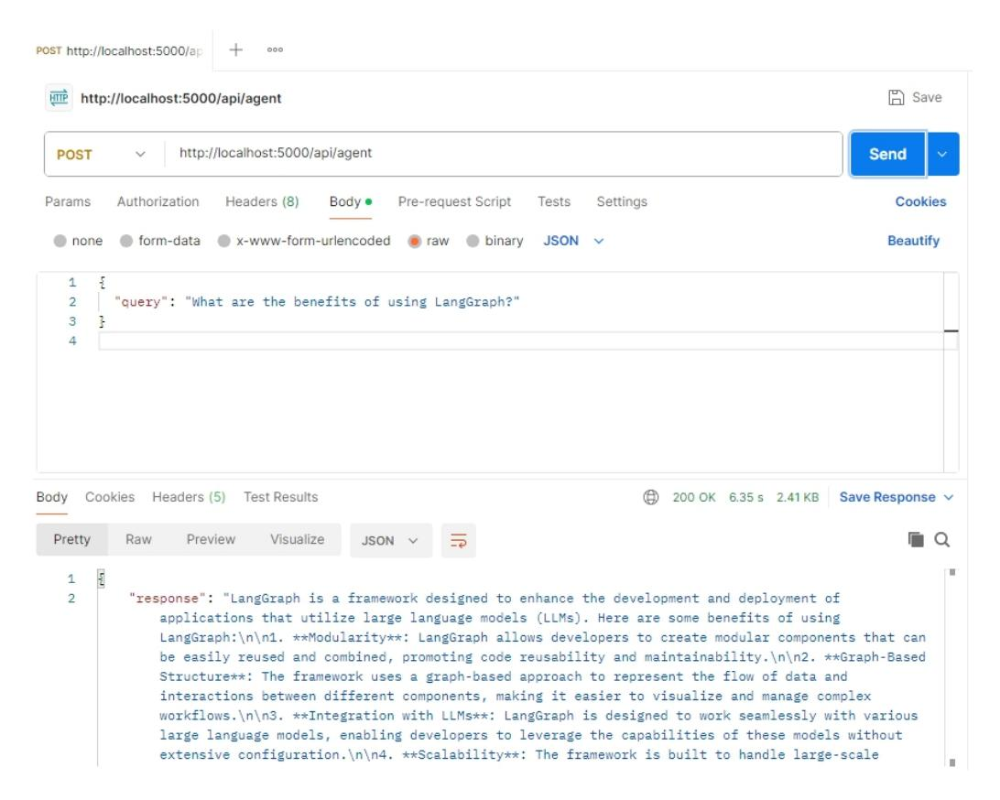

# <span id="page-450-0"></span>**17.3 Setting Up the Frontend Development Environment**

# **Step 1: Install Node.js and Initialize a React Project Install Node.js** if you haven't already. Verify the installation:


```
node -v
npm -v
```

# **Create a React project** using Create React App:

```
terminal
npx create-react-app langgraph-frontend
cd langgraph-frontend
```

# **Install Axios** for making HTTP requests:

```
terminal
npm install axios
```

**Set Environment Variables**: Create a .env file to store the backend API URL.

```
#.env
REACT_APP_AGENT_API_URL=http://localhost:5000/api/agent
```

# <span id="page-451-0"></span>**17.4 Building the Frontend Interface**

# **Step 1: Create Input Fields and Display for Agent Interaction**

In App.js , we will create an input field for the user to enter queries, a button to submit the query, and a section to display the agent's response.

```
//App.js
import React, { useState } from 'react';
import axios from 'axios';
function App() {
  const [query, setQuery] = useState('');
  const [response, setResponse] = useState('');
  const [loading, setLoading] = useState(false);
  const [error, setError] = useState('');
  const handleInputChange = (e) => setQuery(e.target.value);
  const handleSubmit = async (e) => {
    e.preventDefault();
    setLoading(true);
```

```
setError('');
    try {
      const res = await axios.post(process.env.REACT_APP_AGENT_API_URL, { query
});
      setResponse(res.data.response);
    } catch (err) {
      setError('Error: Could not reach the AI agent.');
    } finally {
      setLoading(false);
   }
 };
  return (
    <div className="App">
      <h1>LangGraph AI Agent Interaction</h1>
      <form onSubmit={handleSubmit}>
        <input type="text" value={query} onChange={handleInputChange}
placeholder="Ask the AI agent..." />
        <button type="submit" disabled={loading}>Send</button>
      </form>
      {loading && <p>Loading...</p>}
      {error && <p>{error}</p>}
      <div className="response">
        <h2>Agent Response:</h2>
        <p>{response}</p>
      </div>
    </div>
 );
}
export default App;
```

# **Output:**

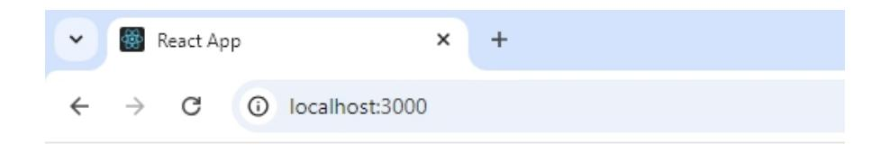

| Ask the Al agent | Send |
|------------------|------|
|------------------|------|

- **Input and Button**: Allows the user to enter a query and submit it.
- **Loading Indicator**: Displays a loading message while waiting for a response.
- **Error Handling**: Catches and displays any errors if the request fails.

# <span id="page-453-0"></span>**17.5 Connecting the Frontend to the LangGraph Agent**

We've already configured the frontend to connect to the LangGraph agent via Axios in handleSubmit . The function sends the user's query to the backend API, receives the response, and updates the response state variable, which displays the agent's reply.

# **Handling Real-Time Communication**

For more advanced scenarios, you could use WebSockets to enable real-time updates from the backend. This approach is suitable if the agent requires time to process complex tasks or if you want to show intermediate responses.

# <span id="page-453-1"></span>**17.6 Deploying the Full Application**

# **Step 1: Build the Frontend**

Run the following command in your React project directory:

terminal

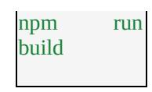

This creates a production-ready build in the build folder.

# **Step 2: Deploying the Backend and Frontend**

You can deploy the Flask backend and the React frontend on separate platforms or within the same server setup.

- **Backend**: Use platforms like **Heroku**, **AWS**, or **DigitalOcean**.
- **Frontend**: Platforms like **Vercel** or **Netlify** are ideal for static frontend hosting.

# **Integrate Frontend and Backend in Production**

- 1. Update the .env file in the frontend to use the deployed backend API URL.
- 2. Redeploy the frontend with the new environment variables.

# <span id="page-454-0"></span>**17.7 Summary and Best Practices**

This chapter provided a complete walkthrough of creating a frontend and backend for LangGraph-powered AI agents. By following the steps outlined here, you now have a full-stack setup that enables dynamic, interactive AI experiences.

# **Best Practices**

- **Security**: Use HTTPS and secure authentication for production deployments.
- **Scalability**: Use load balancers for handling high traffic.
- **Responsive Design**: Ensure the frontend is mobile-friendly and responsive.

With this foundation, you can create and scale powerful, user-friendly AI applications powered by LangGraph.

# <span id="page-454-1"></span>**17.8 Setting Up Asynchronous Streaming with LangGraph and WebSockets**

To support streaming responses, we'll use **Flask-SocketIO** for WebSocket communication. This setup will allow our LangGraph agent to send responses incrementally to the frontend, creating a responsive and interactive experience.

# **Step 1: Install Flask-SocketIO and Configure the Backend**

**Install Flask-SocketIO** and **eventlet** for asynchronous WebSocket support:

```
terminal
pip install flask-socketio eventlet
```

Update app.py to initialize SocketIO and configure WebSocket events.

```
#app.py
from flask import Flask, request, jsonify
from flask_socketio import SocketIO, emit
from typing import TypedDict
from langgraph.graph import StateGraph, START, END
from langchain_openai import ChatOpenAI
from langchain.schema import HumanMessage
# Define the agent's state
class AgentState(TypedDict):
    query: str
    response: str
# Initialize the AI tool (e.g., OpenAI API)
llm_tool = ChatOpenAI(temperature=0, model_name="gpt-4o-mini")
# Define the node that processes user queries
def handle_query(state: AgentState) -> AgentState:
    user_message = HumanMessage(content=state['query'])
    ai_response = llm_tool.invoke([user_message])
    state['response'] = ai_response.content
    return state
# Build the LangGraph workflow for the agent
builder = StateGraph(AgentState)
builder.add_node("handle_query", handle_query)
builder.add_edge(START, "handle_query")
builder.add_edge("handle_query", END)
graph = builder.compile()
app = Flask(__name__)
app.config['SECRET_KEY'] = 'your_secret_key'
socketio = SocketIO(app, async_mode='eventlet')  # Initialize SocketIO with eventlet
# Define the REST endpoint for non-streaming queries
```

```
@app.route('/api/agent', methods=['POST'])
def agent():
    data = request.json
    query = data.get("query", "")
    initial_state = {"query": query, "response": ""}
    result = graph.invoke(initial_state)
    return jsonify({"response": result['response']})
# Define a WebSocket event for streaming responses
@socketio.on('stream_query')
def handle_stream_query(data):
    query = data.get("query", "")
    initial_state = {"query": query, "response": ""}
    # Stream response in chunks by processing the agent's output incrementally
    for response_chunk in stream_agent_response(initial_state):
         emit('response_chunk', {'chunk': response_chunk})
    emit('response_complete', {'message': 'Response streaming complete'})
def stream_agent_response(state):
    """
   Simulates streaming responses from LangGraph by yielding chunks of text.
   In production, integrate this with LangGraph's streaming features if available.
   """
    response = graph.invoke(state)['response']
    # Split response into chunks for streaming
    chunk_size = 50
    for i in range(0, len(response), chunk_size):
         yield response[i:i+chunk_size]  # Yield chunks of response text
# Start the application with SocketIO
if __name__ == '__main__':
    socketio.run(app, debug=True)
```

- **WebSocket Event stream\_query** : This WebSocket endpoint handles streaming queries. It uses stream\_agent\_response to break the full response into smaller chunks and emits each chunk to the client.
- **Chunked Response Streaming**: The function stream\_agent\_response breaks down the response into smaller parts and sends each part separately

to simulate real-time streaming. In a production setup, this would use LangGraph's streaming support if available.

# <span id="page-457-0"></span>**17.9 Integrating Streaming in the Frontend**

In this chapter, we will set up a real-time streaming system for LangGraph AI agent responses using a FastAPI backend and a React frontend. The streaming feature is particularly useful for large or ongoing responses, where it's beneficial to display the data as soon as it's available rather than waiting for the entire response.

By the end of this section, you'll learn:

- How to use FastAPI to stream data from an AI agent.
- How to connect a frontend React application to display the streamed response in real time.
- How to manage state, loading indicators, and error handling in a streaming setup.

# <span id="page-457-1"></span>**17.10 Introduction to Streaming Responses**

**What is Streaming?** Streaming sends data in chunks as it becomes available rather than waiting for the entire response to be ready. This approach enhances user experience by providing immediate feedback, which is ideal for applications like AI agents that may take time to process complex queries.

# **Setting Up the Backend with FastAPI**

To create a backend that streams responses from our AI agent, we'll use FastAPI, a Python web framework known for its fast performance and easy-touse syntax. We'll also use LangGraph to build our AI agent's workflow.

# **Step 1: Install Required Libraries**

Ensure you have FastAPI, Uvicorn, and LangGraph installed:

terminal pip install fastapi uvicorn langgraph

# **Step 2: Code for the Streaming Backend**

Here is the complete code for the FastAPI backend. We'll go through each section afterward to explain how it works.

#lesson17c.py

```
from fastapi import FastAPI, HTTPException
from fastapi.middleware.cors import CORSMiddleware
from fastapi.responses import StreamingResponse
from pydantic import BaseModel
from typing import List, Dict, Any
from langgraph.graph import StateGraph, START, END
from langchain_openai import ChatOpenAI
from langchain.schema import HumanMessage
from typing import TypedDict
import uvicorn
# Define the agent's state
class AgentState(TypedDict):
    query: str
    response: str
# Initialize the AI tool (e.g., OpenAI API)
llm_tool = ChatOpenAI(temperature=0, model_name="gpt-4o-mini", streaming=True)
# Define the node that processes user queries
def handle_query(state: AgentState) -> AgentState:
    user_message = HumanMessage(content=state['query'])
    ai_response = llm_tool.invoke([user_message])
    state['response'] = ai_response.content
    return state
# Build the LangGraph workflow for the agent
builder = StateGraph(AgentState)
builder.add_node("handle_query", handle_query)
builder.add_edge(START, "handle_query")
builder.add_edge("handle_query", END)
graph = builder.compile()
app = FastAPI()
# Enable CORS
app.add_middleware(
    CORSMiddleware,
    allow_origins=["http://localhost:3000"],
    allow_credentials=True,
    allow_methods=["*"],
    allow_headers=["*"],
)
```

```
class QueryRequest(BaseModel):
    query: str
@app.post("/api/research")
async def research_query(request: QueryRequest):
    try:       
         initial_state = {"query": request.query, "response": ""}
         result = graph.invoke(initial_state)
         return {"response": result['response']}
    except Exception as e:
         raise HTTPException(status_code=500, detail=str(e))
@app.post("/api/research/stream")
async def research_query_stream(request: QueryRequest):
    async def event_generator():
         try:
            initial_state = {"query": request.query, "response": ""}           
            async for msg,metadata in graph.astream(initial_state,
stream_mode="messages"):
                if msg.content and not isinstance(msg, HumanMessage):
                     yield msg.content
         except Exception as e:
            yield {"error": str(e)}
    return StreamingResponse(event_generator(), media_type="text/plain")
#RUN THE APP
if __name__ == "__main__":
    uvicorn.run(app, host="0.0.0.0", port=8000)
```

# **Code Explanation**

Let's break down the code step-by-step to understand what each part does.

# **Setting Up FastAPI and CORS**:

```
#lesson17c.py continued
app = FastAPI()
app.add_middleware(
   CORSMiddleware,
    allow_origins=["http://localhost:3000"],
```

```
allow_credentials=True,
    allow_methods=["*"],
    allow_headers=["*"],
)
```

- **FastAPI**: We initialize a FastAPI application instance named app .
- **CORS Middleware**: CORS (Cross-Origin Resource Sharing) allows the frontend on a different server (localhost:3000) to access our API without restrictions. This is necessary in local development to prevent CORS errors.

# **Defining the Agent's State**:

```
##lesson17c.py continued
class AgentState(TypedDict):
    query: str
    response: str
```

**AgentState**: This defines a state dictionary with two fields, query and response . The query stores the user's question, and response will contain the AI agent's answer.

# **Setting Up the AI Tool**:

```
##lesson17c.py continued
llm_tool = ChatOpenAI(temperature=0, model_name="gpt-4o-mini",streaming=True)
```

○ We initialize llm\_tool as an instance of the OpenAI API, **with streaming enabled**. This allows the AI to provide a continuous stream of data as it generates responses.

# **Building the LangGraph Workflow**:

```
##lesson17c.py continued
builder = StateGraph(AgentState)
builder.add_node("handle_query", handle_query)
builder.add_edge(START, "handle_query")
builder.add_edge("handle_query", END)
graph = builder.compile()
```

We create a LangGraph workflow with a single node ( handle\_query ) that processes the query and generates a response.

# **Creating the Streaming Endpoint**:

```
##lesson17c.py continued
@app.post("/api/research/stream")
async def research_query_stream(request: QueryRequest):
    async def event_generator():
        try:
           initial_state = {"query": request.query, "response": ""}           
           async for msg,metadata in graph.astream(initial_state,
stream_mode="messages"):
               if msg.content and not isinstance(msg, HumanMessage):
                   yield msg.content
        except Exception as e:
           yield {"error": str(e)}
    return StreamingResponse(event_generator(),media_type="text/plain")
```

**StreamingResponse**: The endpoint returns a StreamingResponse , which will provide the response in chunks as the data becomes available.

# <span id="page-461-0"></span>**17.11 Setting Up the Frontend with React**

In the frontend, we'll use React to connect to our FastAPI backend and display the streamed response.

# **Step 1: Install Necessary Dependencies**

Install axios (for HTTP requests) and add any UI styling library if needed.

```
terminal
npm install axios
```

# **Step 2: Code for the Streaming Frontend**

Here is the complete code for the React frontend component. We'll explain each part afterward.

```
//lesson17d.js
import React, { useState } from 'react';
import axios from 'axios';
```

```
function App() {
  const [query, setQuery] = useState('');
  const [response, setResponse] = useState('');
  const [loading, setLoading] = useState(false);
  const [streamingResponse, setStreamingResponse] = useState('');
  const handleStreamSubmit = async (e) => {
    e.preventDefault();
    setLoading(true);
    setStreamingResponse('');
    try {
       const response = await fetch('http://localhost:8000/api/research/stream', {
         method: 'POST',
         headers: {
           'Content-Type': 'application/json',
       },
         body: JSON.stringify({ query }),
     });
       if (!response.ok) {
         throw new Error(`HTTP error! Status: ${response.status}`);
     }
       const reader = response.body.getReader();
       const decoder = new TextDecoder('utf-8');
       let done = false;
       while (!done) {
         const { value, done: readerDone } = await reader.read();
         done = readerDone;
         if (value) {
           const chunk = decoder.decode(value, { stream: true });
           setStreamingResponse((prev) => prev + chunk);
       }
     }
    } catch (error) {
       console.error('Streaming error:', error);
       setStreamingResponse('An error occurred while streaming the response.');
    } finally {
       setLoading(false);
   }
 };
```

```
return (
    <div className="container mx-auto p-4">
      <h1 className="text-2xl font-bold mb-4">Research Assistant</h1>
      <form onSubmit={handleStreamSubmit}>
        <input
          type="text"
          value={query}
          onChange={(e) => setQuery(e.target.value)}
          className="w-full p-2 border rounded mb-4"
          placeholder="Enter your research query..."
        />
      {response && (
        <div className="mt-4 p-4 border rounded">
          <h2 className="font-bold mb-2">Response:</h2>
          <p>{response}</p>
        </div>
      )}
      <div className="mt-4">
        <button
          onClick={handleStreamSubmit}
          className="bg-green-500 text-white px-4 py-2 rounded ml-2"
          disabled={loading}
        >
        Stream Response
        </button>
      </div>
      </form>
      {streamingResponse && (
        <div className="mt-4 p-4 border rounded">
          <h2 className="font-bold mb-2">Streaming Response:</h2>
          <p>{streamingResponse}</p>
        </div>
      )}
    </div>
 );
}
export default App;
```

# **Code Explanation**

# 1. **State Management**:

- **query** : Stores the user's input.
- **streamingResponse** : Holds the streaming response as it's received.
- **loading** : Indicates whether a response is currently being streamed.

# 2. **Sending the Query**:

```
//lesson17d.js explained
const handleStreamSubmit = async (e) => {
   e.preventDefault();
   ...
};
```

When the form is submitted, the function sends a POST request to the FastAPI endpoint and sets up the response stream.

# 3. **Reading the Response Stream**:

```
//lesson17d.js explained
const reader = response.body.getReader();
const decoder = new TextDecoder('utf-8');
let done = false;
while (!done) {
    const { value, done: readerDone } = await reader.read();
   done = readerDone;
    if (value) {
       const chunk = decoder.decode(value, { stream: true });
         setStreamingResponse((prev) => prev + chunk);
   }
}
```

This code reads the response stream chunk by chunk, updating streamingResponse with each new piece of data received.

# 4. **Displaying the Response**:

```
//lesson17d.js explained
```

```
{streamingResponse && (
  <div className="mt-4 p-4 border rounded">
      <h2 className="font-bold mb-2">Streaming Response:</h2>
      <p>{streamingResponse}</p>
  </div>
)}
```

As the response is being streamed, it's displayed in real-time, providing instant feedback to the user.

# <span id="page-465-0"></span>**7.12 Summary and Best Practices for Streaming Responses**

# **Key Points**

- **Asynchronous Streaming**: WebSocket-based streaming creates a responsive user experience, especially for large responses.
- **Frontend Handling**: Ensure the frontend is designed to handle incremental updates smoothly and to manage state transitions for loading and completion.
- **Testing Streaming Responses**: Thoroughly test the connection to ensure resilience, especially handling network interruptions gracefully.

# **Best Practices for Real-Time Streaming in LangGraph Applications**

- 1. **Optimize Chunk Sizes**: Adjust chunk sizes based on user experience and network performance.
- 2. **Error Handling**: Implement error handling in both backend and frontend to handle potential connection issues.
- 3. **Loading and Completion States**: Clearly indicate loading progress and completion to keep users informed.

By following this guide, you've built a fully functional, real-time streaming interface for a LangGraph-powered AI agent. This architecture is highly scalable and enhances user experience through immediate, interactive responses, suitable for production-ready AI applications.

# <span id="page-465-1"></span>**17.13 Setting Up the Backend with Next.js and Frontend with Next.js AI SDK**

Next.js is a popular framework for building full-stack applications using React, offering excellent support for server-side rendering (SSR), file-based routing,

and API integration. With the Next.js AI SDK, we can easily connect a LangChain-powered AI backend and a user-friendly frontend for building interactive AI applications.

**What is the Next.js AI SDK?** The Next.js AI SDK is a toolkit that makes it easy to create UI components that interact with language models and handle streaming data directly. It simplifies the integration of LangChain models and allows you to build a seamless UI for your AI application.

In this example, we'll use the Next.js AI SDK to create a real-time, streaming AI completion endpoint with LangChain. The backend will connect to OpenAI's API, and we'll build a frontend that streams the responses to the user in real time.

# **Step 1: Set Up a New Next.js Project**

**Initialize a Next.js Project**: If you haven't already, create a new Next.js project by running:

```
terminal
npx create-next-app@latest ai-chat-app
cd ai-chat-app
```

**Install Required Dependencies**: Install the Next.js AI SDK, LangChain, and OpenAI client libraries:

```
terminal
npm install ai @langchain/openai
```

**Project Structure**: Next.js uses a folder-based structure for routing and page management. In this example, we'll use the app directory and create an API route to handle AI requests.

# **Step 2: Build the Backend Completion Route with LangChain**

We'll create a streaming endpoint in the app/api/completion/route.ts file. This endpoint will:

- 1. Accept a prompt as input.
- 2. Stream responses back to the client using the LangChain model.

```
//app/api/completion/route.ts
import { ChatOpenAI } from '@langchain/openai';
import { LangChainAdapter } from 'ai';
export const maxDuration = 60;
export async function POST(req: Request) {
  // Extract the prompt text from the incoming request body
  const { prompt } = await req.json();
  // Initialize the LangChain model (OpenAI in this case)
  const model = new ChatOpenAI({
    model: 'gpt-4o-mini', // Model version can be updated
    temperature: 0,              // Temperature controls response randomness
  });
  // Use the model's stream method to enable streaming responses
  const stream = await model.stream(prompt);
  // Convert the LangChain response stream into a Data Stream compatible with Next.js AI
SDK
  return LangChainAdapter.toDataStreamResponse(stream);
}
```

# **Explanation**:

- **Model Initialization**: ChatOpenAI is a model from LangChain that connects to OpenAI's GPT-3.5 Turbo. Here, we set temperature: 0 to make the response deterministic.
- **Streaming with model.stream()** : Instead of waiting for the entire response, we stream the response in chunks.
- **LangChainAdapter.toDataStreamResponse(stream)** : This helper method adapts the LangChain streaming output to work seamlessly with the AI SDK's frontend components.

This endpoint will be accessible via POST requests at /api/completion .

# **Step 3: Create the Frontend Chat Component**

Next, we'll use the Next.js AI SDK's useCompletion hook to handle user input and display the response in real-time as it streams from the backend.

- 1. Create a new file at app/page.tsx .
- 2. Add the following code to set up a simple chat interface:

```
//pp/page.tsx
'use client';
import { useCompletion } from 'ai/react';
import { useState } from 'react';
export default function Chat() {
  // Destructure values from the `useCompletion` hook
  const { completion, input, handleInputChange, handleSubmit } = useCompletion();
  return (
    <div className="chat-container">
      {/* Display streaming AI response here */}
      <div className="response">{completion}</div>
      {/* User input form */}
      <form onSubmit={handleSubmit}>
        <input
           type="text"
           value={input}
           onChange={handleInputChange}
           placeholder="Ask the AI anything..."
           className="input-field"
        />
        <button type="submit" className="submit-button">Send</button>
      </form>
      <style jsx>{`
```

```
.chat-container {
           max-width: 600px;
           margin: 0 auto;
           padding: 2rem;
           font-family: Arial, sans-serif;
         }
         .response {
           padding: 1rem;
           border: 1px solid #ddd;
           border-radius: 8px;
           min-height: 100px;
           margin-bottom: 1rem;
           background-color: #f9f9f9;
         }
         .input-field {
           width: calc(100% - 100px);
           padding: 0.5rem;
           margin-right: 1rem;
         }
         .submit-button {
           padding: 0.5rem 1rem;
           background-color: #0070f3;
           color: white;
           border: none;
           border-radius: 5px;
         }
       `}</style>
    </div>
  );
}
```

- **useCompletion Hook**: This hook, provided by the AI SDK, handles user input and manages the state of the AI response as it's streamed from the backend.
  - **completion** : Holds the streamed response text as it arrives.
  - **input** : Stores the user's current input text.
  - **handleInputChange** : Updates input as the user types.

- **handleSubmit** : Triggers when the form is submitted, sending the query to the backend.
- **UI Styling**: The style jsx block provides basic styling for the chat container, response display area, and form input fields, creating a simple and clean layout.

# **How It Works Together**

- **User Input**: When the user enters a query and submits the form, handleSubmit sends the prompt to the backend /api/completion endpoint.
- **Streaming Response**: The backend streams the AI's response back to the frontend. Each chunk is added to the completion state by the useCompletion hook, displaying it incrementally as it's received.
- **Display**: The completion state updates in real time, showing the AI's response as it's generated.

# **Step 4: Testing and Running the Application**

# **Start the Next.js development server**:

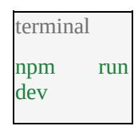

# **Test the Chat Interface**:

- Open http://localhost:3000 in your browser.
- Enter a query in the input field and submit.
- You should see the response stream in real time, displaying each chunk as it arrives.

# <span id="page-470-0"></span>**17.14 Summary and Best Practices**

By following this setup, you've built a streaming AI interface that combines Next.js, LangChain, and the Next.js AI SDK. Here are some best practices:

- **Stream Response Handling**: Always handle streaming responses in a way that updates the UI incrementally to improve user experience.
- **Error Handling**: In production applications, include error handling to manage failed requests or connectivity issues.

● **User Interface and Feedback**: Provide clear feedback for loading states, and ensure the UI feels responsive and smooth for users.

This approach allows for real-time interaction with LangChain-powered AI models in Next.js, providing a scalable and responsive solution for building complex AI applications.

# <span id="page-471-0"></span>**17.15 Setting Up a LangGraph Backend with Next.js and AI SDK**

In this guide, we'll create a LangGraph-powered backend for streaming AI responses using Next.js. LangGraph helps build AI agent workflows, while the Next.js AI SDK allows us to easily create streaming-compatible UI components. This example will integrate LangGraph's workflow management capabilities with LangChain for the language model and utilize Next.js for a seamless frontend-backend interaction.

# **Step 1: Initialize a Next.js Project and Install Dependencies**

If you haven't already created a Next.js project, start by doing so. Then install the necessary libraries:

# **Initialize a New Next.js Project**:

terminal npx create-next-app@latest langgraph-ai-app cd langgraph-ai-app

# **Install Dependencies**: Install LangGraph, LangChain, and the Next.js AI SDK:

terminal npm install ai @langchain/openai @langchain/langgraph @langchain/core

# **Step 2: Configure the LangGraph Streaming API Endpoint**

In this step, we'll create an API endpoint in Next.js that uses LangGraph to handle the workflow and stream AI responses.

**Create the app/api/stream/route.ts File**: Inside your Next.js project, navigate to the app/api directory (create it if it doesn't exist) and add the stream folder with a route.ts file inside it.

# **File Structure**:

```
└── app
   └── api
      └── stream
           └── route.ts
```

# **Write the LangGraph-Enabled Streaming Endpoint**:

In route.ts , we'll set up a LangGraph workflow, defining an AI agent's state, initializing the LangChain model, and streaming responses to the client using the Next.js AI SDK's adapter.

```
//route.ts
import { ChatOpenAI } from '@langchain/openai';
import { LangChainAdapter } from 'ai';
import { StateGraph, START, END } from 'langgraph';
import { HumanMessage } from 'langchain/schema';
import { NextRequest, NextResponse } from 'next/server';
// Define the AI agent's state structure
type AgentState = {
  query: string;
  response: string;
};
// Initialize the LangChain model with streaming enabled
const model = new ChatOpenAI({
  model: 'gpt-40-mini',
  temperature: 0,
  streaming: true,
});
// Define the node function for processing user queries
async function handleQuery(state: AgentState): Promise<AgentState> {
  const userMessage = new HumanMessage(state.query);
  const aiResponse = await model.invoke([userMessage]);
  return { ...state, response: aiResponse.content };
}
// Build the LangGraph workflow for the AI agent
const builder = new StateGraph<AgentState>();
builder.addNode("handleQuery", handleQuery);
builder.addEdge(START, "handleQuery");
builder.addEdge("handleQuery", END);
const graph = builder.compile();
// Define the Next.js API route for streaming responses
```

```
export async function POST(req: NextRequest) {
  const { prompt } = await req.json();
  // Initialize the agent's initial state
  const initialState = { query: prompt, response: '' };
  // Use LangGraph's asynchronous streaming to process the workflow
  const stream = await graph.astream(initialState, { stream_mode: "messages" });
  // Convert the LangGraph stream to a Next.js AI SDK-compatible stream
  return LangChainAdapter.toDataStreamResponse(stream);
}
```

- **AgentState Type**: Defines the structure of the AI agent's state, with fields query and response .
- **LangGraph Workflow**:
  - **Node Function ( handleQuery )**: Processes the user's query by passing it to the LangChain model and returning the updated state with the model's response.
  - **StateGraph and Workflow Setup**: The LangGraph workflow includes a single node, handleQuery , connected between the start and end points.
  - **Streaming with graph.astream** : This method allows us to process the query asynchronously and stream the response in realtime.
- **Next.js API Route**: Uses the LangGraph workflow to handle incoming requests and stream responses to the client. The LangChainAdapter.toDataStreamResponse(stream) function wraps the LangGraph stream to make it compatible with the AI SDK's streaming system.

# **Step 3: Build the Frontend Chat Component**

With the backend in place, we'll now create a React component using the Next.js AI SDK to send queries to our LangGraph-powered endpoint and display the responses as they stream back.

# **Create the Chat Component in app/page.tsx** :

This component will allow users to enter a prompt and see the response appear in real-time as it streams from the backend.

```
# app/page.tsx
```

```
'use client';
import { useCompletion } from 'ai/react';
import { useState } from 'react';
export default function Chat() {
  // Initialize state and methods from `useCompletion`
  const { completion, input, handleInputChange, handleSubmit } = useCompletion({
    url: '/api/stream', // Point to our LangGraph API endpoint
  });
  return (
    <div className="chat-container">
      {/* Display the streaming AI response */}
      <div className="response">{completion}</div>
      {/* User input form */}
      <form onSubmit={handleSubmit}>
         <input
           type="text"
           value={input}
           onChange={handleInputChange}
           placeholder="Ask the AI anything..."
           className="input-field"
         />
         <button type="submit" className="submit-button">Send</button>
      </form>
      {/* Basic styling for the chat interface */}
      <style jsx>{`
         .chat-container {
           max-width: 600px;
           margin: 0 auto;
           padding: 2rem;
           font-family: Arial, sans-serif;
         }
         .response {
           padding: 1rem;
           border: 1px solid #ddd;
           border-radius: 8px;
           min-height: 100px;
           margin-bottom: 1rem;
           background-color: #f9f9f9;
         }
```

```
.input-field {
           width: calc(100% - 100px);
           padding: 0.5rem;
           margin-right: 1rem;
         }
         .submit-button {
           padding: 0.5rem 1rem;
           background-color: #0070f3;
           color: white;
           border: none;
           border-radius: 5px;
         }
       `}</style>
    </div>
  );
}
```

- **useCompletion Hook**:
  - **Properties ( completion , input , handleInputChange , and handleSubmit )**: These properties from useCompletion manage the UI state and connect the user's input to the backend streaming response.
  - **URL**: We specify the backend streaming API endpoint at /api/stream .
  - **completion** : Holds the AI's response as it streams back from the backend.
  - **input** and **handleInputChange** : Manage the input field and update it with user queries.
  - **handleSubmit** : Sends the input to the backend and starts the streaming process.
- **UI Styling**: Provides a clean, simple interface with basic CSS styling for the chat box, response display, and form elements.

# **Step 4: Running and Testing the Application**

**Start the Next.js Development Server**: Start your Next.js app with the following command:

terminal

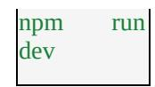

# **Testing the Chat Interface**:

- Open http://localhost:3000 in your browser.
- Enter a question in the input field and submit.
- The response should stream incrementally, displaying chunks of text as they arrive.

# <span id="page-476-0"></span>**17.16 Summary and Best Practices**

By following these steps, you've set up a full LangGraph-powered streaming backend using Next.js and the AI SDK. This configuration enables real-time, responsive interaction with AI agents, providing a solid foundation for advanced AI applications.

# **Best Practices**:

- **Streaming UI**: Ensure the frontend manages incremental updates smoothly, as shown with the completion field.
- **Error Handling**: Add error handling to manage network interruptions or backend errors gracefully.
- **Modular Components**: Keep the backend and frontend components modular to improve scalability and maintainability.

This chapter provides a comprehensive setup for using LangGraph with Next.js, LangChain, and the Next.js AI SDK, making it easier to build and deploy interactive, AI-powered applications.

# **Chapter 18**

# <span id="page-477-1"></span><span id="page-477-0"></span>**Building Agents with NVIDIA NeMo Inference Models (NIMs)**

In this chapter, we explore how to harness NVIDIA NeMo Inference Models (NIMs) for building powerful AI agents. We'll focus on**Build NVIDIA**'s platform, demonstrate how to perform inference via APIs or self-hosted containers, and bring this to life with a practical use case: creating AI agents for content creation and digital illustration.

# <span id="page-477-2"></span>**18.1. Introduction to NVIDIA NeMo Inference Models**

NVIDIA NeMo Inference Models (NIMs) are pre-trained, state-of-the-art models designed for seamless deployment in various environments. These models offer:

- **Multimodal capabilities** for tasks requiring text, image, and audio processing.
- **Flexible deployment**: Run models in the cloud, on-premises, or in hybrid setups.
- **API integration**: Easy access through RESTful APIs for scalable applications.
- **Customization**: Fine-tune or adapt models to specific business requirements.

# **What is Build NVIDIA?**

**Build NVIDIA** is a platform providing access to pre-trained AI models, APIs, and tools to accelerate development. It enables developers to:

- Browse the model catalog and access their documentation.
- Generate API keys for model usage.
- Deploy models locally or on preferred platforms using Docker containers.

# **Key Benefits of NIMs**

- 1. **Ease of Use**: Pre-trained models reduce the need for extensive expertise or training time.
- 2. **Flexibility**: Models can be deployed in the cloud, on-premises, or in hybrid environments.
- 3. **Scalability**: With robust APIs and containerized options, NIMs can scale to meet the demands of any application.
- 4. **State-of-the-Art Performance**: Backed by NVIDIA's cutting-edge research and hardware optimization.
- 5. **Broad Model Catalog**: Access to language models, vision models, and multimodal models for diverse use cases.

# **Types of NIMs**

NVIDIA provides a wide variety of NIMs tailored for specific domains. Here are some key categories:

# 1. **Language Models**

- **Examples**: Llama 3.1-405B Instruct
- **Use Cases**: Content creation, summarization, conversational AI.

# 2. **Vision Models**

- **Examples**: Stable Diffusion , DINOv2
- **Use Cases**: Image generation, object detection, scene understanding.

# 3. **Speech Models**

- **Examples**: Conformer-CTC , FastSpeech
- **Use Cases**: Speech-to-text transcription, voice cloning, real-time translation.

# 4. **Multimodal Models**

- **Examples**: Models combining Llama with Stable Diffusion .
- **Use Cases**: Applications requiring text, image, and speech understanding (e.g., AI assistants, interactive media).

Each model comes with documentation, examples, and flexible deployment options, enabling developers to choose the right tool for the job.

# **How to Access NIMs**

To start using NIMs, you'll need to:

- 1. **Sign Up on Build NVIDIA Platform**: Visit Build NVIDIA ([https://build.nvidia.com/\)](https://build.nvidia.com/) and create an account.
- 2. **Explore the Model Catalog**: Search for a model that fits your use case.
- 3. **Generate an API Key**: Click **"Get API Key"** for the desired model, which will allow you to make API calls.

**Tip**: Look for the **"Run Anywhere"** label, which indicates models that you can host yourself on your own GPU servers.

# **Performing Inference with NIMs**

You can perform inference with NIMs using:

- 1. **Direct API Calls**: Simple RESTful calls using Python's requests library.
- 2. **LangChain Integration**: A higher-level abstraction that simplifies working with NIMs for more complex workflows.

We'll now explore both methods in detail.

# <span id="page-479-0"></span>**18.2 Inference Using Direct API Calls**

Direct API calls are the simplest way to use NIMs. All you need is your **API Key**, the model's endpoint URL, and basic Python libraries.

# **Steps for API Inference**

# **1. Setting Up**

Install the required Python package:

```
terminal
pip install requests
```

Obtain your API Key. Navigate to the model page, in this case [https://build.nvidia.com/meta/llama-3\\_1-405b-instruct](https://build.nvidia.com/meta/llama-3_1-405b-instruct) and click Get API Key.

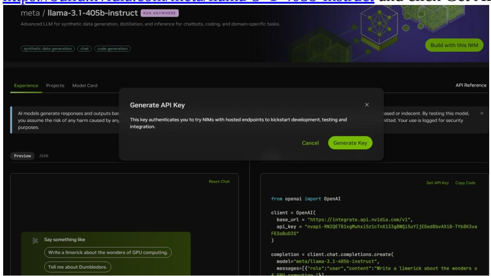

Set your NVIDIA API key as an environment variable:

```
terminal
export NVIDIA_API_KEY="your_api_key_here"
```

# **2. Making an API Request**

Here's how you can perform a streaming inference call using the requests library:

```
#lesson18a.py
import os
import requests
import json
# Retrieve the API key from the environment variable
API_KEY = os.getenv("NVIDIA_API_KEY")
url = "https://integrate.api.nvidia.com/v1/chat/completions"
# Define headers with Authorization, Accept, and Content-Type
headers = {
    "Authorization": f"Bearer {API_KEY}",
    "Accept": "application/json",
```

```
"Content-Type": "application/json"
}
def call_nvidia_api_stream(prompt):
    """Call NVIDIA API with streaming and format the output."""
    payload = {
         "messages": [
            {
                 "role": "user",
                 "content": prompt
            }
         ],
         "stream": True,
         "model": "meta/llama-3.1-405b-instruct",
         "max_tokens": 1024,
         "presence_penalty": 0,
         "frequency_penalty": 0,
         "top_p": 0.7,
         "temperature": 0.2
    }
        # Make the POST request with streaming enabled
    response = requests.post(url, headers=headers, json=payload, stream=True)
        if response.status_code == 200:
         output = ""
         print("Generating response:")
         for chunk in response.iter_lines():
            if chunk:
                 try:
                     # Parse the JSON chunk and extract content
                     data = json.loads(chunk[6:])  # Skip 'data: ' prefix
                     if 'choices' in data:
                         delta = data['choices'][0]['delta']
                         content = delta.get('content', "")  
                         if content: output += content
                         print(content, end='', flush=True)  
                 except json.JSONDecodeError:
                     continue
         print("\n\nFinal Output:")
         print(output)
         return output
```

```
else:
         raise Exception(f"API Error: {response.text}")
# Example usage
call_nvidia_api_stream("Write a promotional message for an eco-friendly gadget.")
```

# <span id="page-482-0"></span>**18.3: Inference Using LangChain**

LangChain provides a streamlined interface for working with NIMs, reducing boilerplate code and simplifying workflows.

# **Steps for LangChain Integration**

# **1. Setting Up**

Install the langchain\_nvidia\_ai\_endpoints package:

```
terminal
pip install langchain_nvidia_ai_endpoints
```

# **2. Using LangChain with NIMs**

LangChain simplifies the streaming process:

```
#langchain with Nvidia
from langchain_nvidia_ai_endpoints import ChatNVIDIA
import os
API_KEY = os.getenv("NVIDIA_API_KEY")
client = ChatNVIDIA(
  model="meta/llama-3.1-405b-instruct",
  api_key=API_KEY,
  temperature=0.2,
  top_p=0.7,
  max_tokens=1024,
)
prompt = "Write a promotional message for an eco-friendly gadget."
for chunk in client.stream([{"role":"user","content":prompt}]):
  print(chunk.content, end="")
```

# **Why Use LangChain?**

- 1. **Modularity**: Combines multiple AI models into a cohesive workflow.
- 2. **Ease of Use**: Built-in methods for common AI tasks.
- 3. **Scalability**: Seamlessly integrates with tools like LangGraph for more complex orchestrations.

# <span id="page-483-0"></span>**18.4 Self-Hosting NIMs**

While APIs provide a convenient way to access NVIDIA NeMo Inference Models, self-hosting offers greater control, privacy, and customization. In this section, we'll explore how to host NIMs on your infrastructure and the associated requirements, architecture, deployment options, costs, and limitations.

# **Why Self-Host NIMs?**

Self-hosting NIMs may be preferable in scenarios requiring:

- **Data Privacy**: Sensitive data that cannot be sent over the internet.
- **Customization**: Modify or fine-tune the model for specific use cases.
- **Reduced Latency**: On-premise hosting eliminates network delays.
- **Cost Optimization**: For large-scale use cases, self-hosting may be more cost-effective.

# **18.4.1. Requirements for Self-Hosting**

# **Hardware**

NVIDIA NeMo models are optimized for GPUs. Here's what you'll need:

- **GPU**: NVIDIA GPUs with CUDA support (preferably A100, H100, or similar high-performance cards).
- **Memory**: At least 16 GB of GPU memory for large models like Llama 405B.
- **CPU & RAM**: Modern multi-core processors and at least 32 GB of RAM for preprocessing tasks.

# **Software**

- **CUDA Toolkit**: Version 12.4 or later.
- **NVIDIA Container Runtime**: For running containerized models.
- **Docker**: To manage containers.
- **PyTorch**: Pre-installed in NVIDIA containers.
- **Networking**: Secure access to expose APIs or integrate with your infrastructure.

# **Model Files**

Obtain the container image for the model:

- Visit the [NVIDIA NGC Catalog \(https://catalog.ngc.nvidia.com\)](https://catalog.ngc.nvidia.com/).
- Download the appropriate model container (e.g., meta/llama-3.1-405binstruct ).

# **18.4.2. Architecture Pattern for Self-Hosting**

Self-hosting typically follows a **microservices architecture**. Below is a typical setup:

# **Components**

- 1. **Model Server**: Hosts the NIM and serves inference requests.
- 2. **API Gateway**: Exposes a unified API to users or applications.
- 3. **Load Balancer**: Distributes requests across multiple instances for scalability.
- 4. **Monitoring Tools**: Tracks GPU utilization, latency, and API throughput.
- 5. **Storage**: Manages model weights, configurations, and logs.

# **Deployment Options**

- **On-Premises**: Install and run the container in your local data center.
- **Cloud Providers**: Deploy using services like AWS, Azure, or GCP with GPU instances.
- **Hybrid Cloud**: Combine on-premise resources with cloud scalability for peak demand.

# **Diagram: Example Self-Hosting Architecture**

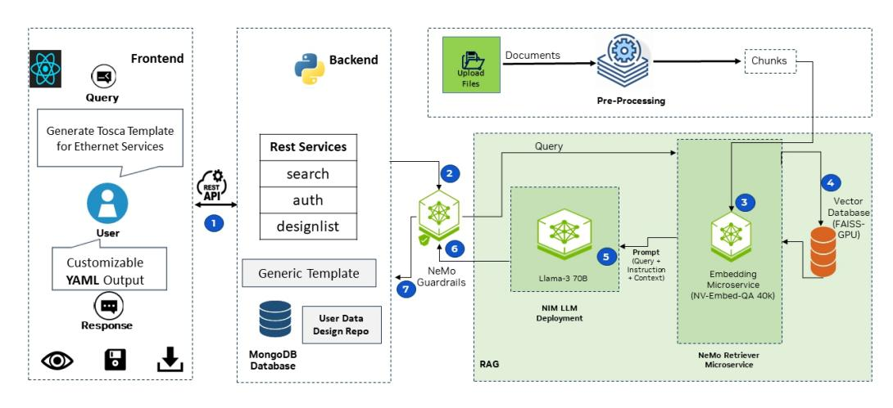

**Ref:** [https://developer.nvidia.com/blog/automating-telco-network-design-using](https://developer.nvidia.com/blog/automating-telco-network-design-using-nvidia-nim-and-nvidia-nemo/)nvidia-nim-and-nvidia-nemo/

# **18.4.3. Deployment Steps**

# **Step 1: Pull the Docker Container**

```
terminal
docker pull nvcr.io/nvidia/pytorch:24.10-py3
```

# **Step 2: Run the Container**

```
terminal
docker run --gpus all -it --rm --shm-size=16g --ulimit memlock=-1 --ulimit tack=67108864
nvcr.io/nvidia/pytorch:24.10-py3
```

This launches an environment optimized for running NIMs with all required dependencies pre-installed.

# **Step 3: Host the Model as an API**

Inside the container:

Clone the NIM repository:

```
terminal
git clone https://github.com/NVIDIA/NeMo.git
cd NeMo
```

# Start the model service:

```
terminal
python examples/nlp/language_modeling/serving.py \
   --model_name "meta/llama-3.1-405b-instruct" \
   --port 5000
```

# **Step 4: Access the Hosted Model**

Use tools like curl or Postman to send inference requests:

```
terminal
curl -X POST http://localhost:5000/inference \
    -H "Authorization: Bearer <API_KEY>" \
```

```
-H "Content-Type: application/json" \
-d '{"prompt": "Write a blog post on AI advancements."}'
```

# **18.4.4. Costs and Limitations**

# **Costs**

- 1. **Hardware Costs**: High-performance GPUs can be expensive. A high-performance GPU like an NVIDIA A100, designed for data centers, can cost upwards of **USD \$30,000** per unit, making them a significant investment for any organization looking to implement GPU-accelerated computing for tasks like machine learning or deep learning; this high price tag is due to their powerful processing capabilities and complex design needed to handle demanding workloads in data centers.
- 2. **Energy Costs**: GPUs consume significant power.
- 3. **Cloud Hosting Costs**: Varies by provider and instance type (e.g., AWS EC2 P4d).

| Provider           | GPU Options                        | Hourly Pricing            | Approx. Monthly<br>Pricing | Regions                        |
|--------------------|------------------------------------|---------------------------|----------------------------|--------------------------------|
| AWS                | NVIDIA T4, V100,<br>A100, H100     | V100: ~\$3.06             | V100: ~\$2,203             | Global                         |
| Google Cloud       | NVIDIA T4, P100,<br>V100, A100     | V100: ~\$2.48             | V100: ~\$1,805             | Global                         |
| Microsoft<br>Azure | NVIDIA V100, A100,<br>H100         | H100: ~\$6,98             | H100: ~\$5,081             | Global                         |
| Paperspace         | NVIDIA A100, A6000,<br>A5000, etc. | A100 40GB:<br>~\$2.39     | A100 40GB:<br>~\$1,720     | U.S., Europe                   |
| Lambda Labs        | NVIDIA RTX 6000,<br>A6000          | RTX 6000: ~\$1.25         | RTX 6000: ~\$900           | U.S.                           |
| CoreWeave          | NVIDIA RTX 4000,<br>A100, etc.     | A100 40GB:<br>~\$2.46     | A100 40GB:<br>~\$1,771     | U.S.                           |
| OVHcloud           | NVIDIA V100, A100                  | A100 80GB:<br>~\$3.07     | A100 80GB:<br>~\$2,213     | Europe, Global                 |
| Linode             | NVIDIA RTX 6000                    | Competitive rates*        | Competitive rates*         | North America,<br>Europe, Asia |
| Jarvis Labs        | NVIDIA RTX 5000, RTX<br>6000, A100 | RTX 5000: ~\$0.49         | RTX 5000: ~\$353           | U.S.                           |
| Hyperstack         | NVIDIA H100 SXM<br>80GB            | H100 SXM 80GB:<br>~\$2.25 | H100 SXM 80GB:<br>~\$1,620 | North America,<br>Europe       |

4. **Operational Costs**: Maintenance, monitoring, and scaling can consume time and resources.

# **Limitations**

- 1. **Setup Complexity**: Requires expertise in containerization and server management.
- 2. **Resource Usage**: High memory and compute demands.
- 3. **Scaling Challenges**: For large-scale applications, infrastructure must support distributed systems.

# **Benefits of Self-Hosting**

- **Full Control**: Customize deployment and optimize performance.
- **Privacy**: Data never leaves your controlled environment.
- **Flexibility**: Modify the model or integrate it into custom workflows.

# <span id="page-488-0"></span>**18.4 Building an AI-Powered Campaign Generator with LangGraph**

In this section, we will build a **LangGraph workflow** for orchestrating a campaign generation agent that combines content creation and digital illustration. We'll follow a structured, node-based approach with clear edges and state transitions.

# **Problem Statement**

Marketing campaigns are essential for promoting products, services, or events. As a social media manager or digital marketer, creating a cohesive campaign often involves:

- Crafting compelling promotional text that resonates with the target audience.
- Designing visually engaging graphics tailored for various social platforms.
- Coordinating these efforts to ensure consistency and efficiency across all content.

This process can be time-consuming, repetitive, and prone to creative bottlenecks, especially when deadlines are tight.

# **Proposed Solution**

Using **LangGraph**, we will orchestrate a powerful AI-powered campaign generator that leverages the capabilities of NVIDIA NIMs and Stable Diffusion models. This solution will automate and streamline campaign creation by:

- 1. **Generating Promotional Text:** Using NVIDIA's pre-trained language model (e.g., meta/llama-3.1-405b-instruct ), the system will craft tailored promotional messages, including catchy phrases, hashtags, and call-to-actions.
- 2. **Creating Digital Artwork:** NVIDIA's Stable Diffusion model will generate stunning visuals aligned with the campaign theme, such as product images, banners, and illustrations.
- 3. **Seamlessly Orchestrating Workflow:** LangGraph will connect these tools into a cohesive workflow, ensuring that the text and graphics are aligned and created efficiently.
- 4. **Providing a User-Friendly Interface:** A Gradio-powered interactive web application will allow users to input campaign details, preview results, and iterate as needed.

# **Key Features**

- 1. **Content Agent:** Automates the creation of marketing copy, including headlines, descriptions, and hashtags tailored to the input.
- 2. **Digital Artist Agent:** Generates professional visuals based on the campaign theme and product specifications.
- 3. **LangGraph Workflow:** Seamlessly integrates AI tools, manages data flow, and ensures step-by-step execution of tasks.
- 4. **Gradio Interface:** Provides a web-based application for interacting with the system, allowing users to enter campaign details, review outputs, and request modifications.

We use the following tools and technologies:

- **LangGraph**: To orchestrate the workflow.
- **Gradio**: To build a user-friendly interface.
- **Python Libraries**: Including requests for API calls, PIL for image processing, and logging for debugging.
- **LangChain NVIDIA AI Endpoints**: For interacting with NVIDIA's NIMs.

# **Step 1: Configuration and Logging**

```
#lesson18d.py
from dataclasses import dataclass
from datetime import datetime
import logging
# Configure logging with timestamps
logging.basicConfig(
    level=logging.DEBUG,
    format='%(asctime)s - %(levelname)s - %(message)s',
    handlers=[
        logging.StreamHandler(),
        logging.FileHandler(f'campaign_generator_{datetime.now().strftime("%Y%m%d")}.l
og')
    ]
)
@dataclass
class CampaignConfig:
    """Configuration settings for campaign generation."""
```

```
STABLE_DIFFUSION_API_URL: str =
"https://ai.api.nvidia.com/v1/genai/stabilityai/stable-diffusion-3-medium"
   IMAGE_CFG_SCALE: float = 7.0
   IMAGE_STEPS: int = 50
   ASPECT_RATIO: str = "16:9"
   SEED: int = 0
   LLM_MODEL: str = "meta/llama-3.1-405b-instruct"
   MODEL_TEMPERATURE: float = 0.7
```

# **Step 2: Content Generation**

We create a function to interact with NVIDIA's language model using LangChain NVIDIA AI Endpoints:

```
#lesson18d.py continued
from langchain_nvidia_ai_endpoints import ChatNVIDIA
class CampaignGenerator:
    def __init__(self, api_key: Optional[str] = None):
        self.api_key = api_key or os.getenv("NVIDIA_API_KEY")
        if not self.api_key:
           raise ValueError("NVIDIA API key not found in environment
variables")
        self.config = CampaignConfig()
        self.llm = ChatNVIDIA(
           model=self.config.LLM_MODEL,
           api_key=self.api_key,
           temperature=self.config.MODEL_TEMPERATURE
        )
    def generate_content(self, brief: str) -> str:
        """Generate marketing content."""
        content_prompt = f"""
        Create professional marketing content for this campaign:
        {brief}
        Provide:
        - Headline (10 words max)
        - Main copy (2-3 sentences)
        - Call-to-action
        - Three hashtags
        """
```

```
response = self.llm.invoke([{"role": "user", "content": content_prompt}])
return response.content
```

# **Step 3: Generating Visuals**

NVIDIA's Stable Diffusion API is used to create campaign images:

```
#lesson18c.py
import requests
from PIL import Image
from io import BytesIO
def generate_stable_diffusion_image(self, prompt: str) -> Image.Image:
    """Generate an image using NVIDIA's Stable Diffusion API."""
    payload = {
        "prompt": prompt,
        "cfg_scale": self.config.IMAGE_CFG_SCALE,
        "aspect_ratio": self.config.ASPECT_RATIO,
        "seed": self.config.SEED,
        "steps": self.config.IMAGE_STEPS,
        "negative_prompt": "",
    }
    response = requests.post(
        self.config.STABLE_DIFFUSION_API_URL,
        headers={"Authorization": f"Bearer {self.api_key}"},
        json=payload
    )
    response.raise_for_status()
    image_data = response.json().get("image")
    if not image_data:
        raise ValueError("No image data in response")
    return Image.open(BytesIO(base64.b64decode(image_data)))
```

# **Step 4: Workflow Orchestration**

We use a generator function to orchestrate the workflow step by step:

```
#lesson18c.py continued
def stream_campaign(self, brief: str) -> Generator[Tuple[str, str, Optional[Image.Image]],
None, None]:
    """Stream the campaign generation process."""
```

```
try:
    # Step 1: Generate content
    content = self.generate_content(brief)
    yield content, "Generating image prompt...", None
    # Step 2: Generate image prompt
    image_prompt = f"Create a visual prompt based on this content: {content}"
    yield content, image_prompt, None
    # Step 3: Generate image
    image = self.generate_stable_diffusion_image(image_prompt)
    yield content, image_prompt, image
except Exception as e:
    yield f"Error: {str(e)}", "", None
```

# **Step 5: Gradio Interface**

We create a user-friendly web interface:

```
#lesson18c.py continued
import gradio as gr
def create_gradio_interface():
    generator = CampaignGenerator()
    with gr.Blocks(title="AI Campaign Generator") as demo:
        gr.Markdown("# AI Campaign Generator")
        input_text = gr.Textbox(label="Campaign Brief", placeholder="Describe your
campaign goals...", lines=5)
        submit_btn = gr.Button("Generate Campaign")
        content_output = gr.Textbox(label="Generated Content", lines=8)
        prompt_output = gr.Textbox(label="Image Generation Prompt", lines=4)
        image_output = gr.Image(label="Generated Campaign Visual", type="pil")
        submit_btn.click(
             fn=generator.stream_campaign,
             inputs=input_text,
             outputs=[content_output, prompt_output, image_output]
        )
    return demo
if __name__ == "__main__":
    demo = create_gradio_interface()
    demo.queue()
    demo.launch()
```

# The complete code brings all these components together

```
#lesson18e.py complete code example
import os
import uuid
import requests
import base64
from PIL import Image
from io import BytesIO
import tempfile
from pathlib import Path
from typing import Generator, Optional, Tuple
from langchain_nvidia_ai_endpoints import ChatNVIDIA
import gradio as gr
import logging
from dataclasses import dataclass
from datetime import datetime
# Configure logging with timestamp
logging.basicConfig(
    level=logging.DEBUG,
    format='%(asctime)s - %(levelname)s - %(message)s',
    handlers=[
        logging.StreamHandler(),
        logging.FileHandler(f'campaign_generator_{datetime.now().strftime("%Y%m%d")}.l
og')
    ]
)
logger = logging.getLogger(__name__)
@dataclass
class CampaignConfig:
    """Configuration settings for campaign generation."""
    STABLE_DIFFUSION_API_URL: str =
"https://ai.api.nvidia.com/v1/genai/stabilityai/stable-diffusion-3-medium"
    IMAGE_CFG_SCALE: float = 7.0
    IMAGE_STEPS: int = 50
    ASPECT_RATIO: str = "16:9"
    SEED: int = 0
    MODEL_TEMPERATURE: float = 0.7
    LLM_MODEL: str = "meta/llama-3.1-405b-instruct"
class CampaignGenerator:
```

```
"""Main class for handling campaign generation."""
    def __init__(self, api_key: Optional[str] = None):
        self.api_key = api_key or os.getenv("NVIDIA_API_KEY")
        if not self.api_key:
             raise ValueError("NVIDIA API key not found in environment variables")
        self.config = CampaignConfig()
        self.headers = {
             "Authorization": f"Bearer {self.api_key}",
             "Accept": "application/json",
        }
        # Initialize LLM
        self.llm = ChatNVIDIA(
             model=self.config.LLM_MODEL,
             api_key=self.api_key,
             temperature=self.config.MODEL_TEMPERATURE
        )
        # Set up temp directory for image storage
        self.temp_dir = Path(tempfile.gettempdir()) / "campaign_generator"
        self.temp_dir.mkdir(exist_ok=True)
    def cleanup_temp_files(self):
        """Clean up temporary image files."""
        try:
             for file in self.temp_dir.glob("*.png"):
                  file.unlink()
        except Exception as e:
             logger.warning(f"Failed to clean up temp files: {e}")
    def generate_stable_diffusion_image(self, prompt: str) -> Image.Image:
        """Generate an image using NVIDIA's Stable Diffusion API."""
        try:
             payload = {
                  "prompt": prompt,
                  "cfg_scale": self.config.IMAGE_CFG_SCALE,
                  "aspect_ratio": self.config.ASPECT_RATIO,
                  "seed": self.config.SEED,
                  "steps": self.config.IMAGE_STEPS,
                  "negative_prompt": "",
             }
             logger.debug(f"Sending image generation request with prompt:
{prompt[:100]}...")
```

```
response = requests.post(
                   self.config.STABLE_DIFFUSION_API_URL,
                   headers=self.headers,
                   json=payload,
                   timeout=30
              )
              response.raise_for_status()
              image_data = response.json().get("image")
              if not image_data:
                   raise ValueError("No image data in response")
              image_bytes = base64.b64decode(image_data)
              return Image.open(BytesIO(image_bytes))
         except requests.RequestException as e:
              logger.error(f"API request failed: {e}")
              raise
         except Exception as e:
              logger.error(f"Image generation failed: {e}")
              raise
    def stream_campaign(self, brief: str) -> Generator[Tuple[str, str, Optional[Image.Image]],
None, None]:
         """Stream the campaign generation process step by step."""
         session_id = str(uuid.uuid4())
         logger.info(f"Starting campaign generation session {session_id}")
         try:
              # Step 1: Generate content
              logger.info("Generating marketing content...")
              yield "Generating marketing content...", "", None
              content_prompt = f"""
              Create professional marketing content for the following campaign brief:
              {brief}          
              Provide:
              1. Headline: Attention-grabbing, max 10 words
              2. Main copy: 2-3 compelling sentences
              3. Call to action: Clear and actionable
          4. Three relevant hashtags           
              Format the response with clear section headers and spacing.
              """
              content_response = self.llm.invoke([{"role": "user", "content": content_prompt}])
              content = content_response.content
              logger.debug(f"Generated content: {content[:100]}...")
```

```
yield content, "Generating image prompt...", None
             # Step 2: Generate image prompt
             logger.info("Generating image prompt...")
             image_prompt_template = f"""
             Create a detailed image generation prompt based on this marketing content:
             {content}           
             Focus on:
             - Visual style and mood
             - Key elements and composition
             - Color scheme
          - Artistic direction           
             Format: Create a clear, detailed prompt suitable for Stable Diffusion.
             Avoid any text, logos, or trademarked elements.
             Keep the prompt focused on visual elements only.
             """
             prompt_response = self.llm.invoke([{"role": "user", "content":
image_prompt_template}])
             image_prompt = prompt_response.content
             logger.debug(f"Generated image prompt: {image_prompt[:100]}...")
             yield content, image_prompt, None
             # Step 3: Generate image
             logger.info("Generating image...")
             yield content, image_prompt + "\n\nGenerating campaign visual...", None
             image = self.generate_stable_diffusion_image(image_prompt)
             # Save image temporarily
             temp_path = self.temp_dir / f"campaign_{session_id}.png"
             image.save(temp_path)
             logger.info(f"Saved generated image to {temp_path}")
             yield content, image_prompt, image
        except Exception as e:
             logger.error(f"Campaign generation failed: {e}")
             yield f"Error: {str(e)}", "", None
def create_gradio_interface() -> gr.Blocks:
    """Create and configure the Gradio interface."""
    generator = CampaignGenerator()
    with gr.Blocks(title="AI Campaign Generator") as demo:
        gr.Markdown("""
        # ?? AI Campaign Generator
        Generate professional marketing campaigns with AI-powered content and visuals.
        ### How to use:
```

```
1. Enter your campaign brief including:
            - Campaign goals
            - Target audience
            - Key messages
            - Brand voice/tone
         2. Click 'Generate Campaign' and watch as your campaign comes to life!
         """)
         with gr.Row():
              with gr.Column(scale=1):
                  input_text = gr.Textbox(
                       label="Campaign Brief",
                       placeholder="Describe your campaign goals, target audience, and key
messages...",
                       lines=5
                  )
                  submit_btn = gr.Button(" ?? Generate Campaign", variant="primary")
              with gr.Column(scale=1):
                  content_output = gr.Textbox(
                       label="Generated Content",
                       lines=8,
                       interactive=False
                  )
                  prompt_output = gr.Textbox(
                       label="Image Generation Prompt",
                       lines=4,
                       interactive=False
                  )
                  image_output = gr.Image(
                       label="Generated Campaign Visual",
                       type="pil"
             )               
         # Add examples
         gr.Examples(
              examples=[
                  ["Create a campaign for a new eco-friendly reusable water bottle that keeps
```

drinks cold for 24 hours. Target audience: environmentally conscious millennials who are active and health-focused."],

["Launch a mobile app that helps people learn meditation through short, guided sessions. Target audience: busy professionals aged 25-40 who are interested in mindfulness but struggle to find time."],

```
["Promote a subscription box service for organic, locally-sourced ingredients
with recipe cards. Target audience: home cooks who value quality ingredients and want to
support local farmers."]
              ],
              inputs=input_text
      )       
         submit_btn.click(
              fn=generator.stream_campaign,
              inputs=input_text,
              outputs=[content_output, prompt_output, image_output],
              api_name="generate"
      )       
         gr.Markdown("""
         ### Notes:
         - Content generation typically takes 10-15 seconds
         - Image generation may take up to 30 seconds
         - All generated content is temporary and will be deleted after the session
         """)
    return demo
if __name__ == "__main__":
    # Create and launch the interface
    demo = create_gradio_interface()
        # Launch with queue for better handling of multiple requests
    demo.queue()
    demo.launch(
         share=False,  # Set to True to create a public link
         debug=True,
         show_api=False
    )
```

The output looks like below, running on<http://127.0.0.1:7860/>


# <span id="page-499-0"></span>**18. 5 Explainer Section: Key Programming Concepts in the Campaign Generator**

This explainer section is designed to help beginners understand the foundational concepts used in the campaign generator, including **requests** , **Gradio**, **Pillow**, and the **yield** function. Each concept is explained incrementally, with simple examples building up to more complex scenarios.

# **1. Using the requests Library**

# **What is requests ?**

The requests library is a Python package that simplifies making HTTP requests. It allows you to communicate with APIs, retrieve web content, or send data to a server.

# **Basic Example: GET Request**

A **GET** request fetches data from a server.

```
#explainer.py
import requests
# Fetch data from a public API
url = "https://api.github.com"
response = requests.get(url)
# Print the response
print("Response Status Code:", response.status_code)
print("Response Data:", response.json()
```

# **POST Request with a Payload**

A **POST** request sends data to a server. For example, let's send a payload to an API.

```
#explainer.py
import requests
url = "https://httpbin.org/post"
payload = {"name": "John", "age": 30}
# Sending a POST request
response = requests.post(url, json=payload)
# Print the response
print("Response Status Code:", response.status_code)
print("Response Data:", response.json())
```

# **Advanced Example: Sending Headers and Handling Errors**

In the campaign generator, we use API keys in headers for authentication.

```
#explainer.py
import requests
```

```
url = "https://example.com/api"
headers = {
    "Authorization": "Bearer YOUR_API_KEY",
    "Content-Type": "application/json",
}
try:
    response = requests.get(url, headers=headers)
    response.raise_for_status()  # Raise an error for HTTP codes >= 400
    print("Response Data:", response.json())
except requests.RequestException as e:
    print("An error occurred:", e)
```

# **Key Takeaways**

- **GET** is used for retrieving data, while **POST** is for sending data.
- Always handle errors gracefully using try-except .
- Use headers to include authentication or other metadata.

# **2. Building User Interfaces with Gradio**

# **What is Gradio?**

Gradio is a Python library for building interactive user interfaces for machine learning models or scripts. It allows users to input data and see the results in real time.

# **Basic Example: A Simple Interface**

Let's build a UI to input text and display it back.

```
#explainer.py
import gradio as gr
def reverse_text(text):
    """Reverses the input text."""
    return text[::-1]
# Create a simple Gradio interface
interface = gr.Interface(
    fn=reverse_text,  # Function to run
    inputs="text",    # Input type
    outputs="text"    # Output type
)
```

```
interface.launch()  # Start the interface
```

# **Intermediate Example: Adding Multiple Inputs and Outputs**

Expand the functionality by taking a name and age, and outputting a greeting message.

```
#explainer.py
import gradio as gr
def greet(name, age):
    """Generates a greeting message."""
    return f"Hello, {name}! You are {age} years old."
# Create a Gradio interface with two inputs
interface = gr.Interface(
    fn=greet,
    inputs=["text", "number"],  # Name as text and age as number
    outputs="text"             # Output as text
)
interface.launch()
```

# **Advanced Example: Adding Images**

Let's create a UI that accepts an image and displays it with a simple transformation (e.g., converting to grayscale).

```
#explainer.py
import gradio as gr
from PIL import Image
def process_image(image):
    """Converts the image to grayscale."""
    return image.convert("L")  # Convert to grayscale
# Create an interface with image input and output
interface = gr.Interface(
    fn=process_image,
    inputs="image",
    outputs="image"
)
interface.launch()
```

# **Key Takeaways**

- **Gradio inputs/outputs** can handle various types like text, numbers, or images.
- You can chain functions together to create complex workflows.
- The library simplifies deploying machine learning models with minimal code.

# **3. Processing Images with Pillow**

# **What is Pillow?**

Pillow is a Python library for image manipulation. It can open, process, and save images.

# **Basic Example: Opening and Saving Images**

Let's open an image and save it in another format.

```
#explainer.py
from PIL import Image
# Open an image
image = Image.open("example.jpg")
image.show()  # Display the image
# Save the image in PNG format
image.save("example.png")
```

# **Transforming Images**

We can resize, rotate, or apply filters to images.

```
#explainer.py
from PIL import Image, ImageFilter
# Open an image
image = Image.open("example.jpg")
# Apply transformations
resized_image = image.resize((200, 200))  # Resize
rotated_image = image.rotate(45)         # Rotate
blurred_image = image.filter(ImageFilter.BLUR)  # Apply blur
# Save the transformed images
resized_image.save("resized.png")
rotated_image.save("rotated.png")
```

```
blurred_image.save("blurred.png")
Working with In-Memory Images
This is useful when working with APIs that return image data as Base64 strings.
from PIL import Image
from io import BytesIO
import base64
# Simulate an API response with Base64 image data
image_data_base64 = "..."  # Replace with actual Base64 string
image_data = base64.b64decode(image_data_base64)
# Load the image from memory
image = Image.open(BytesIO(image_data))
image.show()
```

# **Key Takeaways**

- Pillow simplifies handling image formats, transformations, and effects.
- Use BytesIO to work with in-memory image data.

# **4. Using the yield Function**

# **What is yield ?**

The yield function in Python is used to create a **generator**, which produces a sequence of values one at a time. It allows for more memory-efficient processing compared to returning a full list.

# **Basic Example: A Simple Generator**

A generator that produces numbers from 1 to 5.

```
#explainer.py
def number_generator():
    for i in range(1, 6):
         yield i
# Using the generator
for number in number_generator():
    print(number)
```

# **Yielding Steps in a Process**

Simulate a multi-step process with progress updates.

```
#explainer.py
def multi_step_process():
    yield "Step 1: Initializing..."
    yield "Step 2: Processing data..."
    yield "Step 3: Finalizing..."
    yield "Process complete!"
for step in multi_step_process():
    print(step)
```

# **Streaming API Results**

Integrate yield with an API to return results progressively.

```
#explainer.py
import requests
def stream_api_results():
    url = "https://api.example.com/stream"
    with requests.get(url, stream=True) as response:
         for chunk in response.iter_lines():
        yield chunk.decode("utf-8")
# Process the streamed results
for result in stream_api_results():
    print(result)
```

# **Key Takeaways**

- yield is ideal for handling large or incremental data.
- It enables real-time updates in applications, such as progress indicators or streaming results.

By progressively building up these concepts, you now have the tools to:

- Make API calls with requests .
- Design user interfaces with Gradio.
- Process images with Pillow.
- Implement workflows with yield .

This foundation enables you to build robust, AI-powered applications like the Campaign Generator.

# <span id="page-506-0"></span>**Chapter 18 Quiz: Building Agents with NVIDIA NeMo Inference Models (NIMs)**

# **Quiz Questions**

# **Section 1: Introduction to NIMs**

- 1. **What does NIM stand for, and what are its primary capabilities?**
- a) NVIDIA Interactive Models; conversational AI only
- b) NVIDIA Integrated Models; data analysis only
- c) NVIDIA NeMo Inference Models; multimodal processing
- d) NVIDIA Network Integration Models; image processing only

# 2. **Which of the following is NOT a key benefit of NIMs?**

- a) Pre-trained and easy to use
- b) Requires no hardware to run
- c) Offers scalable APIs
- d) Provides state-of-the-art performance

# 3. **What is the purpose of Build NVIDIA?**

- a) To teach programming basics
- b) To provide access to pre-trained AI models and tools
- c) To replace cloud services
- d) To design custom GPUs

# 4. **What label should you look for in Build NVIDIA to identify self-hosted models?**

- a) "API Enabled"
- b) "Run Anywhere"
- c) "GPU Required"
- d) "Open Source"

# **Section 2: Performing Inference with NVIDIA NI**MS

# 5. **Which Python library is commonly used for making API calls to NIMs?**

- a) Gradio
- b) requests
- c) Pillow
- d) LangChain

# **6. When making an API call, what is the purpose of the Authorization header?**

- a) To format the response
- b) To authenticate the request
- c) To specify the model type
- d) To set the response time

# 7. **How does LangChain simplify working with NIMs?**

- a) By adding GPU support
- b) By reducing code complexity for workflows
- c) By improving API authentication
- d) By automating model training

# **Section 3: Self-Hosting NIMs**

# 8. **Which of the following is NOT a requirement for selfhosting NIMs?**

- a) NVIDIA GPUs with CUDA support
- b) A fast internet connection
- c) Docker container runtime
- d) At least 32 GB of RAM

# 9. **What is one key advantage of self-hosting NIMs?**

- a) Eliminates all hardware costs
- b) Provides full control and data privacy
- c) Simplifies scaling for small applications
- d) Requires minimal technical expertise

# 10. **Which tool is used to pull the Docker container for hosting NIMs?**

- a) LangChain
- b) Gradio
- c) Docker CLI
- d) Pillow

# **Section 4: AI-Powered Campaign Generator**

- 11. **What role does LangGraph play in the campaign generator?**
- a) It creates the API calls
- b) It orchestrates the workflow using nodes and edges
- c) It trains the models
- d) It serves the Gradio interface
- 12. **What Python library is used for processing and manipulating images in the campaign generator?**
- a) requests
- b) Pillow
- c) LangChain
- d) NumPy
- **13. What does the yield function enable in the campaign generator?**
- a) Generating a list of results
- b) Real-time updates and memory-efficient processing
- c) Running API calls in parallel
- d) Converting images into Base64 format

# **Section 5: Practical Use Case**

- 14. **What does the Content Agent generate in the campaign generator?**
  - a) Digital illustrations

- b) Marketing text like headlines and hashtags
- c) APIs for stable diffusion
- d) User input fields

# 15. **What key feature does the Digital Artist Agent provide?**

- a) Writes text copy for campaigns
- b) Generates images based on campaign themes
- c) Connects the campaign to LangGraph
- d) Handles API authentication

# **Answers**

- 1. **c) NVIDIA NeMo Inference Models; multimodal processing**
- 2. **b) Requires no hardware to run**
- 3. **b) To provide access to pre-trained AI models and tools**
- 4. **b) "Run Anywhere"**
- 5. **b) requests**
- 6. **b) To authenticate the request**
- 7. **b) By reducing code complexity for workflows**
- 8. **b) A fast internet connection**
- 9. **b) Provides full control and data privacy**
- 10. **c) Docker CLI**
- 11. **b) It orchestrates the workflow using nodes and edges**
- 12. **b) Pillow**
- 13. **b) Real-time updates and memory-efficient processing**
- 14. **b) Marketing text like headlines and hashtags**
- 15. **b) Generates images based on campaign themes**

# **Tips for Learners:**

- Revisit the code snippets provided in the chapter for a hands-on understanding.
- Test API calls and LangChain workflows on your own to deepen your comprehension.

| tools. |  | Practice creating simple Gradio interfaces to build interactive AI |  |
|--------|--|--------------------------------------------------------------------|--|
|        |  |                                                                    |  |
|        |  |                                                                    |  |
|        |  |                                                                    |  |
|        |  |                                                                    |  |
|        |  |                                                                    |  |
|        |  |                                                                    |  |
|        |  |                                                                    |  |
|        |  |                                                                    |  |
|        |  |                                                                    |  |
|        |  |                                                                    |  |
|        |  |                                                                    |  |
|        |  |                                                                    |  |

Part 6: Testing, Deployment, and Performance Optimization

(Chapters 19-21)

# **Chapter 19**

# <span id="page-513-1"></span><span id="page-513-0"></span>**Testing AI Agents with Test-Driven Development (TDD)**

#### **Introduction**

Testing is the foundation of building reliable AI agents. Test-Driven Development (TDD) takes this a step further by emphasizing writing tests before developing actual functionality. This chapter introduces TDD concepts, guiding you step-by-step through its application in AI agents, particularly using LangGraph. By starting simple and progressing to complex workflows, you'll gain hands-on experience in designing robust, testable AI systems.

#### <span id="page-513-2"></span>**19.1 Understanding Test-Driven Development (TDD)**

TDD is a software development approach where tests are written before the code. The process follows a simple cycle:

- 1. **Write a Failing Test**: Start by defining a test case based on requirements.
- 2. **Write the Code**: Develop the functionality to make the test pass.
- 3. **Refactor**: Improve the code while ensuring all tests still pass.

This iterative cycle ensures that your code is always guided by clear requirements and is inherently testable.

## <span id="page-513-3"></span>**19.2 Project Setup**

Before we dive into TDD, let's set up a proper development environment.

#### **Environment Setup:**

1. First, create a new Python virtual environment:

terminal mkdir customer\_support cd customer\_support mkdir tests mkdir src

```
#windows
type nul > requirements.txt
type nul > setup.py
type nul > pytest.ini
type nul >.env
#mac/linux
touch requirements.txt
touch setup.py
touch pytest.ini
touch .env
#open project in VSCode or Cursor
code .
```

## 2. Add the following to requirements.txt:

```
#requirements.txt
pytest
pytest-asyncio
langchain
python-dotenv
langgraph
langchain_openai
setuptools
```

## 3. Install the requirements


# 4. Create a basic setup.py:

```
#setup.py
from setuptools import setup, find_packages
setup(
    name="customer_support",
    version="0.1",
    packages=find_packages(),
```

```
install_requires=[
         "pytest",
         "pytest-asyncio",
         "langchain",
         "openai",
         "python-dotenv",
         "langgraph"
    ],
)
```

# 5. Add configuration to pytest.ini

```
# pytest.ini
[pytest]
testpaths = tests
python_files = test_*.py
python_functions = test_*
asyncio_mode = auto
```

#### 6. Set up your .env file:

```
# .env
OPENAI_API_KEY=your_api_key_here
```

#### 7. Create a basic test file structure:

```
terminal
#windows
type nul > tests/__init__.py
type nul > tests/test_basic.py
type nul > src/__init__.py
type nul > src/basic.py
#mac linux
touch tests/__init__.py
touch tests/test_basic.py
touch src/__init__.py
touch src/basic.py
```


#### <span id="page-516-0"></span>**19.3 Understanding the TDD Cycle**

<span id="page-516-1"></span>Test-Driven Development follows a simple but powerful cycle:

- <span id="page-516-2"></span>**1.** Write a failing test
- <span id="page-516-3"></span>**2.** Write minimal code to pass the test
- <span id="page-516-4"></span>**3.** Refactor while keeping tests green

<span id="page-516-5"></span>Let's start with a simple example to illustrate this cycle.

# <span id="page-516-6"></span>**Example 1: Basic Message Processing Node**

1. Define tests/test\_basic.py as below

```
#tests/test_basic.py
# test_message_processor.py
def test_message_processor():
    # Step 1: Write the failing test
    state = {"input": "Hello world", "word_count": 0}
    result = process_message(state)
    assert result["word_count"] == 2
```

2. Run the test by running pytest on the command line or terminal.

```
terminal
pytest
output:
(venv) PS D:\customer_support> pytest
```

```
========================================================================== test
session starts
==========================================================================
platform win32 -- Python 3.13.0, pytest-7.4.3, pluggy-1.5.0
rootdir: D:\customer_support
configfile: pytest.ini
testpaths: tests
plugins: anyio-3.7.1, asyncio-0.21.1
asyncio: mode=Mode.AUTO
collected 1 item
tests\test_basic.py
F                                                                                                                                              [100%]
===============================================================================
FAILURES
================================================================================
________________________________________________________________________ test_message_processor
_________________________________________________________________________
    def
test_message_processor():                                                                                                                                         po
inte
       # Step 1: Write the failing
test                                                                                                                                  hemy,
         state = {"input": "Hello world", "word_count":
0}                                                                                                                 ain-co
>       result = process_message(state)
E       NameError: name 'process_message' is not
defined                                                                                                                  2.14 c
                                                                                 0 json
tests\test_basic.py:5:
NameError                                                                                                                                          tensio
========================================================================
short test summary info
======================================================================== 
FAILED tests/test_basic.py::test_message_processor - NameError: name 'process_message' is not defined
1 failed in 0.07s
===========================================================================
(venv) PS D:\customer_support>
```

3. This test will fail because we haven't implemented process\_message yet. Let's write the minimal code to make it pass in the project file src/basic.py file.

```
#src/basic.py
def process_message(state):
    # Step 2: Write minimal passing code
    state["word_count"] = len(state["input"].split())
    return state
```

4. Now let's amend the test to include this file.

```
#tests/test_basic.py
```

```
# tests/test_basic.py
from src.basic import process_message
def test_message_processor():
    # Step 1: Write the failing test
    state = {"input": "Hello world", "word_count": 0}
    result = process_message(state)
    assert result["word_count"] == 2
```

5. And run the test again

```
terminal
pytest
output:
(venv) PS D:\customer_support> pytest
session starts
platform win32 -- Python 3.13.0, pytest-7.4.3, pluggy-1.5.0
rootdir: D:\customer_support
configfile: pytest.ini
testpaths: tests
plugins: anyio-3.7.1, asyncio-0.21.1
asyncio: mode=Mode.AUTO
collected 1 item
tests\test_basic.py
                                                                                      [100%]
1 passed in 0.03s
(venv) PS D:\customer_support>
```

6. Lets add another test and check for empty input so that our test file now has two tests:

```
#tests/test_basic.py
# tests/test_basic.py
from src.basic import process_message
def test_message_processor():
    # Step 1: Write the failing test
    state = {"input": "Hello world", "word_count": 0}
    result = process_message(state)
    assert result["word_count"] == 2
def test_message_processor_empty():
    state = {"input": "", "word_count": 0}
    result = process_message(state)
    assert result["word_count"] == 0
```

7. Run the test

```
terminal pytest
```

```
output:
(venv) PS D:\customer_support> pytest
========================================================================== test
session starts
==========================================================================
platform win32 -- Python 3.13.0, pytest-7.4.3, pluggy-1.5.0
rootdir: D:\customer_support
configfile: pytest.ini
testpaths: tests
plugins: anyio-3.7.1, asyncio-0.21.1
asyncio: mode=Mode.AUTO
collected 2 items
tests\test_basic.py
..                                                                                                                                             [100%]
===========================================================================
2 passed in 0.03s
===========================================================================
```

#### <span id="page-519-0"></span>**19.4 Understanding State Management**

When testing AI agents, proper state management is crucial. Let's explore a more complex example:

1. Let's define a sample test for state variables

```
#tests/test_conversation_state.py
def test_conversation_memory():
    state = {
         "messages": [],
         "context": {},
         "turn_count": 0
    }
    # Add a message
    state = add_message(state, "user", "Hello")
    assert len(state["messages"]) == 1
    assert state["turn_count"] == 1
    # Add system response
    state = add_message(state, "system", "Hi there!")
    assert len(state["messages"]) == 2
    assert state["turn_count"] == 1
```

#### 2. Run the tests

```
terminal
pytest
output:
(venv) PS D:\customer_support> pytest
```

```
========================================================================== test
session starts
==========================================================================
platform win32 -- Python 3.13.0, pytest-7.4.3, pluggy-1.5.0
rootdir: D:\customer_support
configfile: pytest.ini
testpaths: tests
plugins: anyio-3.7.1, asyncio-0.21.1
asyncio: mode=Mode.AUTO
collected 3 items
tests\test_basic.py ..                                                                                                                                             [
66%]
tests\test_conversation_memory.py
F                                                                                                                                [100%]
===============================================================================
FAILURES
===============================================================================
=
_______________________________________________________________________
test_conversation_memory
________________________________________________________________________
    def test_conversation_memory():
        state = {
              "messages": [],
              "context": {},
              "turn_count": 0
        }
        # Add a message
>       state = add_message(state, "user", "Hello")
E       NameError: name 'add_message' is not defined
tests\test_conversation_memory.py:10: NameError
========================================================================
short test summary info
========================================================================
FAILED tests/test_conversation_memory.py::test_conversation_memory - NameError: name 'add_message' is
not defined
======================================================================
1 failed, 2 passed in 0.08s
======================================================================
```

#### 3. Let's now implement state management using add\_message

```
#src/conversation_state.py
def add_message(state, role, content):
    state["messages"].append({
         "role": role,
         "content": content
    })
    if role == "user":
         state["turn_count"] += 1
```

```
return state
```

#### 4. Update our test with the import

```
#tests/test_conversation_state.py
from src.conversation_memory import add_message
def test_conversation_memory():
    state = {
         "messages": [],
         "context": {},
         "turn_count": 0
    }
    # Add a message
    state = add_message(state, "user", "Hello")
    assert len(state["messages"]) == 1
    assert state["turn_count"] == 1
    # Add system response
    state = add_message(state, "system", "Hi there!")
    assert len(state["messages"]) == 2
    assert state["turn_count"] == 1
```

#### 5. Run the test.

```
terminal
pytest
output:
(venv) PS D:\customer_support> pytest
========================================================================== test
session starts
==========================================================================
platform win32 -- Python 3.13.0, pytest-7.4.3, pluggy-1.5.0
rootdir: D:\customer_support
configfile: pytest.ini
testpaths: tests
plugins: anyio-3.7.1, asyncio-0.21.1
asyncio: mode=Mode.AUTO
collected 3 items
tests\test_basic.py ..                                                                                                                                             [
66%]
tests\test_conversation_memory.py
.                                                                                                                                [100%]
=========================================================================== 3
passed in 0.04s
===========================================================================
```

# <span id="page-521-0"></span>**19.5 Testing LLM Interactions**

When testing AI components, we need to handle:

API calls to language models Response variations Rate limits and timeouts Cost considerations

Let's look at a practical example:

1. Let's start with a LangChain example of a simple invocation of an LLM

```
#tests/test_llm_classifier.py
# test_product_entities.py
import pytest
from src.llm_classifier import extract_entities, enrich_context
def test_basic_product_extraction():
    """Test basic product and color extraction"""
    state = {
         "input": "What's the price of the blue shirt?",
         "entities": {},
         "context": {}
    }
    result = extract_entities(state)
    assert result["entities"].product == "shirt"
    assert result["entities"].color == "blue"
def test_product_without_color():
    """Test extracting product without color mention"""
    state = {
         "input": "How much is the pants?",
         "entities": {},
         "context": {}
    }
    result = extract_entities(state)
    assert result["entities"].product == "pants"
    assert result["entities"].color is None
def test_color_without_product():
    """Test extracting color without valid product"""
    state = {
         "input": "Do you have anything in blue?",
         "entities": {},
         "context": {}
    }
    result = extract_entities(state)
    assert result["entities"].product is None
    assert result["entities"].color == "blue"
def test_invalid_product():
    """Test with product not in catalog"""
    state = {
         "input": "Looking for a green sofa",
```

```
"entities": {},
         "context": {}
    }
    result = extract_entities(state)
    assert result["entities"].product is None
    assert result["entities"].color == "green"
def test_context_enrichment():
    """Test context enrichment with product details"""
    # Test valid product
    state = {
         "input": "Price of blue shirt",
         "entities": {},
         "context": {}
    }
    state = extract_entities(state)
    state = enrich_context(state)
    assert "product_details" in state["context"]
    assert state["context"]["product_details"]["name"] == "Classic Shirt"
    assert "blue" in state["context"]["product_details"]["available_colors"]
    assert state["context"]["product_details"]["price"] == 29.99
def test_context_enrichment_invalid_product():
    """Test context enrichment with invalid product"""
    state = {
         "input": "Looking for a sofa",
         "entities": {},
         "context": {}
    }
    state = extract_entities(state)
    state = enrich_context(state)
    # Context should not have product details for invalid product
    assert "product_details" not in state["context"] or not state["context"]["product_details"]
def test_multiple_products():
    """Test handling multiple product mentions"""
    state = {
         "input": "Compare the blue shirt and black pants",
         "entities": {},
         "context": {}
    }
    result = extract_entities(state)
    # Should pick up first product mentioned
    assert result["entities"].product in ["shirt", "pants"]
    assert result["entities"].color in ["blue", "black"]
def test_edge_cases():
    """Test various edge cases"""
    # Empty input
    state = {
```

```
"input": "",
         "entities": {},
         "context": {}
    }
    result = extract_entities(state)
    assert result["entities"].product is None
    assert result["entities"].color is None
    # Very long input
    state = {
         "input": "I'm looking for a " + "very " * 50 + "blue shirt",
         "entities": {},
         "context": {}
    }
    result = extract_entities(state)
    assert result["entities"].product == "shirt"
    assert result["entities"].color == "blue"
    # Special characters
    state = {
         "input": "Looking for a blue shirt!!!???",
         "entities": {},
         "context": {}
    }
    result = extract_entities(state)
    assert result["entities"].product == "shirt"
    assert result["entities"].color == "blue"
if __name__ == "__main__":
    pytest.main([__file__, "-v"])
```

#### 2. Let's implement the LLM classifier

```
#src/llm_classifier.py
from langchain_openai import ChatOpenAI
from langchain_core.prompts import ChatPromptTemplate
from pydantic import BaseModel
from typing import Optional
class ProductEntity(BaseModel):
    product: Optional[str] = None
    color: Optional[str] = None
def lookup_product(product_name):
    """Look up product details from database"""
    catalog = {
         "shirt": {
              "name": "Classic Shirt",
              "available_colors": ["red", "blue", "white", "black"],
              "price": 29.99
         },
         "pants": {
              "name": "Casual Pants",
```

```
"available_colors": ["black", "navy", "khaki"],
               "price": 49.99
         },
         "jacket": {
               "name": "Winter Jacket",
               "available_colors": ["black", "green", "brown"],
               "price": 89.99
         }
    }
    return catalog.get(product_name.lower() if product_name else "", {})
def extract_entities(state):
    """Extract product and color entities using structured output"""
    llm = ChatOpenAI(temperature=0, model="gpt-4o-mini").with_structured_output(ProductEntity)
    prompt = ChatPromptTemplate.from_messages([
         ("system", """Extract the product and color from the query.        
         Only extract products from this list: shirt, pants, jacket"""),
         ("human", "{query}")  
    ])
    chain = prompt | llm
    state["entities"] = chain.invoke({"query": state["input"]})  
    return state
def enrich_context(state):
    """Enrich context with product details"""
    if not state["entities"] or not state["entities"].product:
         state["context"] = {}  # Initialize empty context if no product
         return state
    state["context"] = {
         "product_details": lookup_product(state["entities"].product)
    }
    return state
def process_query(query):
    """Process a single query through the pipeline"""
    state = {"input": query}
    state = extract_entities(state)
    state = enrich_context(state)
    return state
def main():
    test_queries = [
         "I want a blue shirt",
         "Do you have any red jackets?",
         "Show me black pants",
         "What colors do you have?",
    ]
    print("Processing queries...\n")
    for query in test_queries:
         print(f"Query: {query}")
```

```
try:
                result = process_query(query)
                print(f"Extracted Entities: {result['entities']}")
                if result['context']:
                     print(f"Product Details: {result['context']['product_details']}")
                print()
         except Exception as e:
                print(f"Error processing query: {str(e)}\n")
if __name__ == "__main__":
    main()
```

#### 3. Let's run the test

```
terminal
pytest
output:
PS D:\customer_support> pytest
============================================= test session starts
==============================================
platform win32 -- Python 3.13.0, pytest-7.4.3, pluggy-1.5.0
rootdir: D:\customer_support
configfile: pytest.ini
testpaths: tests
plugins: anyio-3.7.1, asyncio-0.21.1
asyncio: mode=Mode.AUTO
collected 11 items
tests\test_basic.py ..                                                                                    [ 18%]
tests\test_conversation_memory.py .                                                                       [ 27%]
tests\test_llm_classifier.py ........                                                                     [100%]
=============================================== warnings summary
===============================================
venv\Lib\site-packages\pydantic\v1\typing.py:68: 16 warnings
  D:\customer_support\venv\Lib\site-packages\pydantic\v1\typing.py:68: DeprecationWarning: Failing to pass
a value to the 'type_params' parameter of 'typing.ForwardRef._evaluate' is deprecated, as it leads to incorrect
behaviour when calling typing.ForwardRef._evaluate on a stringified annotation that references a PEP 695
type parameter. It will be disallowed in Python 3.15.
    return cast(Any, type_)._evaluate(globalns, localns, recursive_guard=set())
-- Docs: https://docs.pytest.org/en/stable/how-to/capture-warnings.html
======================================= 11 passed, 16 warnings in 11.84s
=======================================
```

# <span id="page-526-0"></span>**Building a Customer Support AI Agent with Test-Driven Development Introduction to TDD using LangGraph**

In this practical section, we will implement a fully functional **Customer Support AI Agent** using **LangGraph** and **LangChain**, following a structured **Test-Driven Development (TDD)** methodology. The agent will support common customer service tasks, including:

- **Order Status Inquiries**
- **Product Information Requests**
- **General Conversation Handling**
- **Error Handling for Missing or Invalid Inputs**

By the end of this section, you'll have a robust, thoroughly tested AI agent ready for deployment.

#### **Step 1: Project Setup**

Before diving into the TDD process, ensure your environment is properly configured.

#### **Directory Structure**

Here's the recommended directory structure for this project:

```
customer_support/
├── src/
│   ├── __pycache__/
│   ├── support_agent.py        # Implementation of the customer support AI agent
├── tests/
│   ├── __pycache__/
│   ├── test_support_agent.py   # TDD tests for all nodes and workflows
├── .env                        # Environment variables, e.g., OpenAI API key
├── pytest.ini                  # Pytest configuration
├── readme.md                   # Project documentation
├── requirements.txt            # Dependencies
├── setup.py                    # Package setup file
```

#### **Installation Steps**

Clone the repository:

```
terminal
git clone https://github.com/jkmaina/customer_support.git
cd customer_support
```

#### Install dependencies:

```
terminal
pip install -r requirements.txt
```

Set your OpenAI API key in a .env file:

```
.env
OPENAI_API_KEY=your-key-here
```

# **Step 2: Understanding the Workflow**

The agent consists of the following nodes:

- 1. **Intent Classification**: Determines the user's query intent.
- 2. **Order Status Node**: Responds to order-related queries.
- 3. **Product Inquiry Node**: Provides product details.
- 4. **General Chat Node**: Handles casual conversation and unknown intents.

The workflow is managed using a **StateGraph**, with conditional routing based on detected intent.

#### **Step 3: Test-Driven Development for Nodes**

TDD involves writing a failing test first, implementing the minimal code required to pass the test, and then refactoring. Below, we follow this process for each node.

#### **Node 1: Intent Classifier**

#### **Step 1: Write the Failing Test**

```
#test_support_agent.py
def test_intent_classifier():
    """Test the intent classifier node"""
    state = {
         "messages": [HumanMessage(content="Where is my order #12345?")],
         "intent": "",
         "status": ""
    }
    result = intent_classifier_node(state)
    assert result["intent"] == IntentEnum.CHECK_ORDER
```

● **Expected Outcome**: The test will fail because the intent\_classifier\_node function is not yet implemented.

#### **Step 2: Implement the Code**

```
#support_agent.py
class CustomerState(TypedDict):
    """State for customer support workflow"""
    messages: Annotated[Sequence[BaseMessage], operator.add]
    intent: str
    status: str
def intent_classifier_node(state: CustomerState):
    """Classify customer intent using LLM"""
    llm = ChatOpenAI(model="gpt-4o-mini")
    classifier_chain = intent_prompt | llm
    query = state["messages"][-1].content
    intent = classifier_chain.invoke({"query": query}).content.strip().lower()
    state["intent"] = intent
    return state
from enum import Enum
class IntentEnum(str, Enum):
    CHECK_ORDER = "check_order"
    PRODUCT_INQUIRY = "product_inquiry"
    ESCALATE = "escalate"
```

```
UNKNOWN = "unknown"
intent_prompt = ChatPromptTemplate.from_messages([
    ("system", """You are a customer support intent classifier.
    Classify the user query into one of these intents: check_order, product_inquiry,
    escalate, or unknown. Respond with just the intent."""),
    ("human", "{query}")
])
```

#### **Step 3: Refactor (if needed)**

For now, no refactoring is required. If additional intents are introduced, you might need to abstract the logic into reusable modules.

#### **Node 2: Order Status**

#### **Step 1: Write the Failing Test**

```
#test_support_agent.py continued
def test_order_status():
    """Test the order status node"""
    state = {
         "messages": [HumanMessage(content="Where is my order #12345?")],
         "intent": IntentEnum.CHECK_ORDER,
         "status": ""
    }
    result = order_status_node(state)
    response_text = result["messages"][-1].content.lower()
    assert "shipped" in response_text or "processing" in response_text
```

● **Expected Outcome**: The test will fail because order\_status\_node is not yet implemented.

#### **Step 2: Implement the Code**

```
#test_support_agent.py continued
def order_status_node(state: CustomerState):
    """Handle order status queries using LLM"""
    llm = ChatOpenAI(model="gpt-4o-mini")
    order_chain = order_prompt | llm
    query = state["messages"][-1].content
    response = order_chain.invoke({"query": query})
    state["messages"].append(AIMessage(content=response.content))
    return state
order_prompt = ChatPromptTemplate.from_messages([
    template="""You are a customer service agent checking order status.
    Available orders: #12345 (shipped), #67890 (processing).
    If the order number is not found, apologize and provide support options.""",
```

#### **Step 3: Refactor**

Introduce caching or logging mechanisms for efficiency and auditability.

#### **Node 3: Product Inquiry**

#### **Step 1: Write the Failing Test**

```
#test_support_agent.py continued
def test_product_inquiry():
    """Test the product inquiry node"""
    state = {
        "messages": [HumanMessage(content="Tell me about wireless headphones")],
        "intent": IntentEnum.PRODUCT_INQUIRY,
        "status": ""
    }
    result = product_inquiry_node(state)
    response_text = result["messages"][-1].content.lower()
    assert "wireless headphones" in response_text
```

#### **Step 2: Implement the Code**

```
#support_agent.py continued
def product_inquiry_node(state: CustomerState):
    """Handle product inquiries using LLM"""
    llm = ChatOpenAI(model="gpt-4o-mini")
    product_chain = product_prompt | llm
    query = state["messages"][-1].content
    response = product_chain.invoke({"query": query})
    state["messages"].append(AIMessage(content=response.content))
    return state
product_prompt = ChatPromptTemplate.from_messages([
    ("system", """You are a product information specialist.
    Products: wireless headphones (20-hour battery, noise cancellation),
    smartwatch (fitness tracking, heart rate monitoring).
    For unknown products, apologize and offer to connect with a specialist."""),])
```

#### **Node 4: General Chat**

#### **Step 1: Write the Failing Test**

```
#test_support_agent.py continued
def test_general_chat():
    """Test general conversation handling"""
    state = {
         "messages": [HumanMessage(content="Hello, I'm James")],
         "intent": IntentEnum.GENERAL_CHAT,
         "status": ""
    }
    result = general_chat_node(state)
    response_text = result["messages"][-1].content.lower()
    assert "nice to meet you" in response_text and "james" in response_tex
```

#### **Step 2: Implement the Code**

```
#support_agent.py continued
```

```
def general_chat_node(state: CustomerState):
    """Handle general conversation and queries"""
    llm = ChatOpenAI(model="gpt-4o-mini")
    chat_chain = general_chat_prompt | llm
    query = state["messages"][-1].content
    response = chat_chain.invoke({"query": query})
    state["messages"].append(AIMessage(content=response.content))
    return state
general_chat_prompt = ChatPromptTemplate.from_messages([
    ("system","You are a helpful assistant.")
])
```

# **Step 4: Integration Testing**

Once all nodes are implemented and tested individually, write integration tests to validate the complete workflow.

```
#test_support_agent.py continued
def test_complete_workflow():
    """Test the complete customer support workflow"""
    workflow = build_support_workflow()
    # Test order status
    state = {"messages": [HumanMessage(content="Where is my order #12345?")]}
    result = workflow.invoke(state)
    assert "shipped" in result["messages"][-1].content.lower()
    # Test product inquiry
    state = {"messages": [HumanMessage(content="Tell me about wireless headphones")]}
    result = workflow.invoke(state)
    assert "wireless headphones" in result["messages"][-1].content.lower()
    # Test general chat
    state = {"messages": [HumanMessage(content="My name is James")]}
    result = workflow.invoke(state)
    assert "nice to meet you" in result["messages"][-1].content.lower()
```

# **Summary of the Practical Section**

- 1. **TDD Workflow**: Write tests first, implement minimal code to pass tests, then refactor.
- 2. **Node Implementation**: Modularize functionality to simplify testing.
- 3. **Integration Testing**: Validate end-to-end workflows.
- 4. **Deployment**: Use the build\_support\_workflow() function to run the agent interactively.

By following these steps, you've built a robust, scalable, and testable customer support AI agent using TDD

# **Chapter 20**

# <span id="page-532-1"></span><span id="page-532-0"></span>**Deploying AI Agents into Production**

# **Introduction**

Deploying an AI agent is a critical step that transitions your system from development to a real-world environment. This process involves selecting the appropriate infrastructure, ensuring scalability, and incorporating security measures to protect sensitive data. In this chapter, we'll cover deployment strategies for AI agents built with LangGraph and LangChain, step-by-step instructions for setting up pipelines, and best practices for monitoring and maintaining your agent in production.

By the end of this chapter, you'll have a complete understanding of how to move your AI agent into production with confidence.

# <span id="page-532-2"></span>**20.1 Deployment Strategies**

Deploying an AI agent requires balancing performance, scalability, and cost-effectiveness. The three most common deployment strategies include **on-premises**, **cloud-based**, and **containerized** deployments.

# **1. On-Premises Deployment**

**What It Is**: Hosting the AI agent on your organization's servers.

# **Advantages**:

- Full control over infrastructure and data.
- Suitable for industries with strict compliance requirements (e.g., healthcare, finance).

# **Challenges**:

- High upfront cost for infrastructure setup.
- Requires in-house expertise for server maintenance.

# **Step-by-Step Setup**:

- 1. **Provision Hardware**: Set up servers with high-performance CPUs and GPUs for running large AI models.
- 2. **Install Dependencies**:
  - Install Python, LangChain, and LangGraph libraries.
  - Configure OpenAI or other LLM APIs.

# 3. **Set Up the Agent**:

- Deploy the support\_agent.py module on the server.
- Configure the .env file with API keys and other configurations.

# 4. **Expose via API**:

○ Use frameworks like Flask or FastAPI to expose the agent as a RESTful API.

# 5. **Secure the Environment**:

○ Use firewalls, VPNs, and encryption to protect sensitive data.

# **2. Cloud-Based Deployment**

**What It Is**: Hosting the agent on cloud platforms like AWS, Azure, or Google Cloud.

# **Advantages**:

- Elastic scaling: Handles spikes in user demand effortlessly.
- Minimal upfront cost: Pay-as-you-go pricing.

# **Challenges**:

- Ongoing costs can accumulate with heavy usage.
- Data residency issues if regulations restrict cloud storage.

# **Step-by-Step Setup on AWS**:

# 1. **Create an EC2 Instance**:

- Select a GPU-optimized instance for AI workloads (e.g., g4dn.xlarge ).
- Install Python and required libraries ( pip install langchainopenai langgraph ).

# 2. **Use S3 for Data Storage**:

○ Store logs or model artifacts in S3 for persistent storage.

# 3. **Deploy with API Gateway**:

○ Set up an API Gateway to expose the agent as a RESTful endpoint.

# 4. **Auto-Scaling**:

○ Use AWS Auto Scaling Groups to handle variable traffic.

# 5. **Secure with IAM**:

○ Restrict API access using Identity and Access Management (IAM) roles.

# **3. Containerized Deployment**

**What It Is**: Packaging the AI agent and its dependencies into a lightweight, portable container (e.g., using Docker).

# **Advantages**:

- Simplifies deployment across different environments.
- Ideal for microservices-based architectures.

# **Challenges**:

- Requires containerization knowledge.
- Might need orchestration for large-scale deployments (e.g., Kubernetes).

# **Step-by-Step Setup with Docker**:

# **Create a Dockerfile**:

#Dockerfile FROM python:3.9-slim WORKDIR /app COPY requirements.txt . RUN pip install -r requirements.txt COPY src/ . ENV OPENAI\_API\_KEY=<your-api-key> CMD ["python", "support\_agent.py"]

# **Build and Test the Image**:

Terminal docker build -t customer-support-agent . docker run -p 8080:8080 customer-support-agent

- 1. **Deploy with Docker Compose**: Use Docker Compose for managing multi-container setups.
- 2. **Orchestrate with Kubernetes**: Deploy at scale using Kubernetes (K8s), setting up Pods and Services.

# <span id="page-535-0"></span>**20.2 Continuous Integration and Continuous Deployment (CI/CD)**

CI/CD pipelines automate testing, integration, and deployment, reducing manual errors and accelerating delivery.

# **1. Setting Up a CI/CD Pipeline**

# **Tools Required**:

- **GitHub Actions**: Automates testing and deployment workflows.
- **Jenkins**: A robust CI/CD tool for more complex pipelines.

# **Step-by-Step Example with GitHub Actions**:

# **Create a .github/workflows/deploy.yml File**:

```
#deploy.yaml
name: Deploy AI Agent
on:
  push:
    branches:
      - main
jobs:
  test-and-deploy:
    runs-on: ubuntu-latest
    steps:
      - name: Checkout Code
        uses: actions/checkout@v2
      - name: Set up Python
        uses: actions/setup-python@v2
        with:
          python-version: 3.9
      - name: Install Dependencies
        run: |
          pip install -r requirements.txt
      - name: Run Tests
        run: pytest tests/
      - name: Deploy to AWS (example)
        env:
          AWS_ACCESS_KEY_ID: ${{ secrets.AWS_ACCESS_KEY_ID }}
          AWS_SECRET_ACCESS_KEY: ${{
secrets.AWS_SECRET_ACCESS_KEY }}
        run: |
```

aws deploy start-deployment --application-name MyApp --deploymentgroup-name MyGroup --s3-location bucket=deployment-artifacts,key=artifact.zip

# **Push Code to Trigger Deployment**: Every push to the main branch will:

- Run unit tests.
- Deploy the updated agent to AWS.

# **2. Automation Best Practices**

# A. **Test Coverage**:

- a. Ensure >80% of your code is covered by tests.
- b. Include unit, integration, and regression tests in the pipeline.

# B. **Rollback Mechanisms**:

a. Implement automated rollback in case of deployment failure.

# C. **Environment Variables**:

a. Use .env files to manage sensitive configurations.

# <span id="page-537-0"></span>**20.3 Scaling AI Agents**

As user demand grows, your AI agent must scale to handle increased traffic while maintaining low latency.

# **Horizontal Scaling**

- **What It Is**: Adding more instances of the AI agent to distribute load.
- **How to Implement**:
  - Use a load balancer (e.g., AWS Elastic Load Balancer) to route traffic across instances.
  - Deploy multiple instances using an orchestration tool like Kubernetes.

# **Vertical Scaling**

- **What It Is**: Increasing the resources (CPU, memory, GPUs) of a single instance.
- **When to Use**: For low traffic environments where adding instances is unnecessary.

● **Example**: Upgrading an AWS EC2 instance from t2.micro to t3.large .

# **Load Balancing Example with AWS**

- 1. Deploy multiple instances of the agent using AWS Auto Scaling Groups.
- 2. Configure an Application Load Balancer (ALB) to distribute traffic.
- 3. Set health checks to ensure instances are functioning properly.

# <span id="page-538-0"></span>**20.4 Security Considerations**

Securing an AI agent is critical, especially when handling sensitive customer data.

# **1. Authentication and Authorization**

- Use API keys, OAuth2, or JWT tokens to authenticate users.
- Restrict access to specific endpoints based on user roles.

# **2. Data Encryption**

- Use HTTPS to encrypt data in transit.
- Store sensitive data (e.g., customer details) in encrypted databases.

# **3. Compliance**

● Ensure compliance with regulations like GDPR or CCPA if dealing with user data.

# **Practical Exercises**

- 1. **Dockerize the Agent**: Write a Dockerfile for the agent and deploy it locally. Share your Docker image on DockerHub.
- 2. **Set Up CI/CD**: Configure a GitHub Actions pipeline for automated testing and deployment of the agent.
- 3. **Simulate Load**: Use a load testing tool like **Locust** to simulate 10,000 concurrent users and measure performance.
- 4. **Implement Security**: Add HTTPS encryption and API key authentication to your deployment.

# **Chapter 21**

# <span id="page-539-1"></span><span id="page-539-0"></span>**Performance Monitoring and Maintenance**

# **Introduction**

Deployment is just the beginning. To ensure your AI agent operates optimally in production, you must establish robust **monitoring** and **maintenance** strategies. This chapter will guide you through setting up tools and processes to monitor performance, troubleshoot issues, and maintain your agent over time. We'll cover real-time performance tracking, identifying bottlenecks, debugging common issues, and updating the agent to handle evolving requirements.

# <span id="page-539-2"></span>**21.1 Monitoring Tools and Techniques**

Monitoring AI agents ensures that their performance aligns with user expectations, even under changing conditions. It helps detect failures, latency spikes, and unexpected behaviors early, preventing downtime or degraded user experience.


*Image: Example of Grafana Stack visualization as an AI agent monitoring tool*

# **1. Setting Up Monitoring Systems**

Monitoring starts with integrating observability tools into your deployment. Observability covers metrics, logs, and traces.

# **Key Components**:

- 1. **Metrics**: Quantitative measures like response time, throughput, and error rates.
- 2. **Logs**: Detailed records of actions performed by the agent (e.g., API calls, workflow execution).
- 3. **Traces**: Contextual data about individual workflows or requests.

# **Example Monitoring Tools**:

- 1. **Prometheus**: For collecting and querying metrics.
- 2. **Grafana**: For visualizing metrics and setting up alerts.
- 3. **ELK Stack (Elasticsearch, Logstash, Kibana)**: For advanced logging and search.
- 4. **AWS CloudWatch**: Native cloud monitoring tool for AWSbased deployments.

# **Step-by-Step Example with Prometheus and Grafana**:

# 1. **Set Up Prometheus**:

○ Install Prometheus on your server.

Configure a scrape job in prometheus.yml to monitor the AI agent's metrics API:

```
#Prometheus.yaml
scrape_configs:
  - job_name: 'customer_support_agent'
    static_configs:
     - targets: ['localhost:8080/metrics']
```

# 2. **Expose Metrics in the Agent**:

Add an endpoint in your agent to expose metrics in Prometheus format:

```
#agent_endpoint
from prometheus_client import start_http_server, Counter
request_counter = Counter("total_requests", "Total number of requests received")
def expose_metrics():
    start_http_server(8080)
   request_counter.inc()
```

# 3. **Visualize with Grafana**:

- Connect Grafana to Prometheus.
- Create dashboards to monitor response times, error rates, and latency.

# **2. Real-Time Performance Tracking**

# **Essential Metrics**:

# 1. **Latency**:

○ Time taken for the agent to respond to a user query.

○ Tools: Prometheus, AWS CloudWatch.

# 2. **Error Rates**:

- Percentage of requests resulting in errors.
- Tools: Sentry, ELK Stack.

# 3. **Throughput**:

- Number of requests handled per second.
- Tools: Grafana, AWS CloudWatch.

# **Example: Monitoring Latency with Grafana**:

Add latency metrics to the agent:

```
#agent_endpoint_latency
from prometheus_client import Summary
request_latency = Summary("request_latency_seconds", "Time taken to handle a
request")
@request_latency.time()
def handle_request():
   # Handle user query
```

Visualize latency trends in Grafana with real-time dashboards.

# <span id="page-542-0"></span>**21.2 Performance Metrics for AI Agents**

Performance metrics help quantify the agent's efficiency, reliability, and user experience. Each metric provides actionable insights.

# **1. Key Metrics to Track**

# **1.1. Latency**

- Measures the time taken from user input to the agent's response.
- Threshold: For a customer support agent, aim for <300ms latency for common queries.

# **1.2. Error Rate**

● Tracks how often workflows fail due to missing data, API timeouts, or internal errors.

● Example: An error rate >2% indicates the need for immediate debugging.

# **1.3. Uptime**

- Percentage of time the agent is available and operational.
- Use tools like AWS CloudWatch to set up downtime alerts.

# **1.4. User Satisfaction**

- Use surveys or app feedback mechanisms to gauge satisfaction.
- Example: Ask users, "Was this response helpful?" and collect data on yes/no answers.

# **Example: Setting Alerts for Metrics**:

● Use Grafana to set up alerts for thresholds like latency >500ms or error rate >5%.

# **2. Measuring User Experience**

- **Chat Logs**: Analyze user-agent interactions to identify areas for improvement.
- **Heatmaps**: Track usage patterns to identify popular features or hightraffic times.

# <span id="page-543-0"></span>**21.3 Troubleshooting and Debugging**

Even with monitoring in place, issues will arise. Troubleshooting ensures you can quickly identify and resolve these problems.

# **1. Common Operational Issues**

# 1. **High Latency**:

- Cause: Overloaded server or slow external API.
- Solution: Add caching or scale horizontally.

# 2. **Frequent Errors**:

- Cause: Unhandled edge cases or API timeouts.
- Solution: Add retries and better exception handling.

# 3. **Memory Leaks**:

- Cause: Unreleased resources or large objects in memory.
- Solution: Use memory profiling tools (e.g., tracemalloc ).

# **2. Debugging Techniques**

# **Example: Debugging with Logging**:

Add detailed logs for key workflows:

```
#agent_endpoint_latency
import logging
logging.basicConfig(level=logging.INFO)
def intent_classifier_node(state):
   logging.info(f"Classifying intent for query: {state['messages'][-1].content}")
   # Intent classification logic
```

Analyze logs to identify the source of errors.

# **Example: Debugging Workflow Failures**:

- 1. Use LangGraph's built-in visualization tools to trace the flow of data through nodes.
- 2. Identify nodes where failures occur and inspect input/output states.

# **21.4 Updating and Maintaining AI Agents**

AI agents must evolve to handle new data, features, or changes in user behavior. Regular updates and maintenance ensure sustained performance.

# **1. Managing Model Drift**

**What It Is**: Over time, the agent's predictions may degrade as user behavior or data patterns shift.

# **Solution**:

- Retrain models periodically using recent interaction logs.
- Example: Fine-tune intent detection models every 3 months.

# **2. Scheduling Updates**

# **Best Practices**:

# 1. **Version Control**:

- Use Git to manage code and model updates.
- Maintain a changelog to track what has changed in each version.

# 2. **Canary Deployments**:

○ Test updates on a small subset of users before full deployment.

# 3. **Rollbacks**:

○ Maintain backups of previous versions to enable quick rollback in case of failure.

# **3. Documentation and Change Logs**

# **What to Include**:

- Updates to workflows or models.
- New features or intents added to the agent.
- Known issues and planned fixes.

# **Example**: Update the readme.md with new features:

## Version 1.1.0 (Date)

- Added support for order cancellation queries.
- Improved latency by adding API caching.
- Fixed bug in product inquiry responses.

# **Practical Exercises**

# 1. **Set Up Monitoring**:

- Configure Prometheus and Grafana to monitor your AI agent.
- Visualize metrics like latency, throughput, and error rates.

# 2. **Simulate and Debug Issues**:

○ Introduce an error (e.g., API timeout) and debug using logs and traces.

# 3. **Retrain a Model**:

○ Use interaction logs to retrain an intent classification model. Deploy the updated model and monitor changes in performance.

# 4. **Implement Rollbacks**:

○ Write a script to roll back to the previous version of the agent in case of deployment failure.


# (Chapters 22-23)

# **Chapter 22**

# <span id="page-549-1"></span><span id="page-549-0"></span>**Case Studies and Applications**

# **Introduction**

Artificial Intelligence (AI) agents are revolutionizing industries by automating tasks, enhancing efficiency, and improving user experiences. This chapter showcases real-world case studies where businesses have successfully implemented AI agents using LangGraph and LangChain. By examining these examples, you'll gain insights into applying the principles and techniques discussed throughout this book to address tangible business challenges.

We will explore three case studies:

- 1. **Customer Support Automation**: Streamlining customer service with AI agents.
- 2. **Sales and Marketing Personalization**: Enhancing customer engagement through tailored recommendations.
- 3. **Operational Efficiency**: Utilizing AI agents to optimize internal processes.

# Each case study will provide:

- An overview of the problem.
- A step-by-step implementation using AI agents.

● Measurable outcomes and lessons learned.

# <span id="page-550-0"></span>**22.1 Customer Support Automation: The AI Help Desk**

# **Problem Statement**

A rapidly growing e-commerce business faced challenges in managing customer support inquiries due to its expansion. Customers experienced delays in responses, especially during peak shopping periods. The company sought an AI-driven solution to:

- Automate responses to common queries.
- Reduce the workload on support staff.
- Maintain high levels of customer satisfaction.

# **AI Agent Solution**

The company implemented a **Customer Support AI Agent** capable of:

- 1. Handling frequently asked questions (FAQs) such as order status, shipping policies, and return processes.
- 2. Escalating unresolved queries to human agents.
- 3. Providing product recommendations based on user input.

# **Step-by-Step Implementation**

# 1. **Define the Agent Workflow**:

○ Utilize LangGraph to create a workflow with nodes for intent detection, FAQ handling, order status queries, and escalation.

# 2. **Integrate Knowledge Base**:

○ Train the agent with FAQs and integrate it with an order management API to fetch real-time order details.

# 3. **Deploy to a Cloud Environment**:

○ Use cloud services to deploy the agent with auto-scaling capabilities to handle peak traffic.

# 4. **Monitor and Optimize**:

○ Implement monitoring tools to track response times and error rates.

# **Results**

- **70% Automation**: The AI agent managed 70% of support inquiries without human intervention.
- **Reduced Response Times**: Average response time decreased from 2 minutes to 15 seconds.
- **Improved Customer Satisfaction**: Customer satisfaction scores (CSAT) increased by 15%.

# **Lessons Learned**

- 1. Start by automating high-frequency, low-complexity queries.
- 2. Continuously improve the agent by analyzing unresolved queries and retraining the model.
- 3. Monitor agent performance closely during peak periods to ensure scalability.

# **22.2 Sales and Marketing Personalization: Driving Engagement**

# **Problem Statement**

A subscription-based streaming service aimed to increase user engagement and retention by providing personalized recommendations for movies, TV shows, and music. The company faced challenges with:

- Limited personalization in recommendations.
- High churn rates among new users.
- Difficulty in effectively targeting marketing campaigns.

# **AI Agent Solution**

The company deployed a **Recommendation AI Agent** that:

- 1. Analyzed user preferences and behavior.
- 2. Suggested personalized content in real-time.
- 3. Supported targeted marketing campaigns by segmenting users based on their interests.

# **Step-by-Step Implementation**

# 1. **Build a User Profiling Node**:

○ Use LangChain to create a node that extracts preferences from user behavior (e.g., viewing history, search queries).

# 2. **Integrate with Content Database**:

○ Connect the agent to a database of movies, shows, and music using a retrieval-augmented generation (RAG) architecture.

# 3. **Deploy in a Multi-Modal Environment**:

○ Enable the agent to process inputs from various channels, including text, voice, and app interactions.

# 4. **A/B Test Recommendations**:

○ Conduct A/B testing to measure the impact of personalized recommendations on user engagement.

# **Results**

- **Increased Engagement**: Average user time spent on the platform increased by 20%.
- **Higher Conversion Rates**: Targeted marketing campaigns led to a 25% increase in subscriptions.
- **Reduced Churn**: Monthly churn rates decreased by 10%.

# **Lessons Learned**

- 1. Leverage user behavior data to improve recommendation accuracy.
- 2. Continuously update content databases to reflect current trends and preferences.
- 3. Test and refine the agent's algorithms using real-world user feedback.

# <span id="page-552-0"></span>**22.3 Operational Efficiency: Automating Internal Workflows**

# **Problem Statement**

A logistics company faced inefficiencies in tracking shipments, managing inventory, and scheduling deliveries. Manual processes led to delays, errors, and increased operational costs.

# **AI Agent Solution**

The company developed an **Operational AI Agent** to:

- 1. Automate shipment tracking and updates for customers and staff.
- 2. Predict inventory shortages and recommend restocking actions.
- 3. Optimize delivery schedules based on traffic and weather data.

# **Step-by-Step Implementation**

# 1. **Automate Shipment Tracking**:

○ Use LangGraph to build a workflow that integrates with tracking APIs and updates customers via email or SMS.

# 2. **Predict Inventory Needs**:

○ Train an AI model using historical inventory data to forecast shortages.

# 3. **Optimize Delivery Routes**:

- Integrate with external APIs for real-time traffic and weather data.
- Use the agent to recommend the fastest and most cost-effective delivery routes.

# 4. **Monitor Performance**:

○ Track key metrics such as on-time delivery rates, inventory accuracy, and shipment errors.

# **Results**

● **50% Time Savings**: Automated workflows reduced time spent on manual tasks

# <span id="page-554-0"></span>**22.4 Real World Lessons Learned**

In this section, we draw from real-world AI deployment experiences to highlight the key lessons learned. By understanding common pitfalls, adopting best practices, and tailoring solutions to organizational needs, businesses can maximize the success of AI agent deployments.

# **Common Pitfalls to Avoid**

# 1. **Lack of Clear Objectives**

- **Example**: A retail company implemented a chatbot without defining specific goals. As a result, the bot provided generic responses that failed to meet user needs, leading to poor adoption.
- **Lesson**: Define measurable objectives (e.g., reducing customer support response times by 50%) before deploying the agent.

# 2. **Insufficient Training Data**

- **Example**: An insurance firm launched an intent classification AI with a limited dataset. The agent struggled to understand uncommon customer queries, leading to a high error rate.
- **Lesson**: Use diverse, high-quality training data that represents real-world use cases. Continuously collect and annotate data to improve the agent over time.

# 3. **Neglecting Human Oversight**

- **Example**: A healthcare chatbot provided incorrect recommendations because it operated autonomously without human supervision.
- **Lesson**: Maintain human oversight for critical applications. Use mechanisms like human-in-the-loop to review and validate AI outputs.

# 4. **Overcomplicating Early Deployments**

- **Example**: A logistics company attempted to implement a multi-modal AI agent (handling text, voice, and image inputs) in the initial rollout. Complexity delayed deployment and increased costs.
- **Lesson**: Start simple. Begin with a single functionality (e.g., text-based interaction) and expand incrementally.

# 5. **Ignoring User Feedback**

- **Example**: A streaming platform ignored customer feedback on inaccurate recommendations, leading to declining user engagement.
- **Lesson**: Actively collect user feedback and iterate based on real-world usage patterns.

# **Best Practices for Deployment**

# 1. **Start Small, Scale Incrementally**

- **Example**: eBay initially deployed AI for automating responses to common customer queries before scaling to handle complex cases like fraud detection.
- **Best Practice**: Begin with high-impact, low-complexity use cases. Use the success of initial deployments to build momentum for broader adoption.

# 2. **Test Thoroughly Before Launch**

- **Example**: Microsoft's Tay chatbot failed publicly when it was launched without adequate testing in adversarial environments .
- **Best Practice**: Conduct rigorous testing for edge cases, security vulnerabilities, and real-world scenarios before launching.

# 3. **Ensure Cross-Functional Collaboration**

○ **Example**: Spotify's AI personalization team worked closely with product managers, marketers, and engineers to align AI recommendations with business goals .

○ **Best Practice:** Collaborate across departments to ensure the AI aligns with organizational priorities and delivers value.

# 4. **Monitor and Optimize Continuously**

- **Example**: Uber monitors driver and rider interactions in realtime to improve its dynamic pricing algorithms and optimize customer satisfaction .
- **Best Practice**: Use tools to track performance metrics (e.g., latency, error rates) and update models regularly.

# 5. **Focus on User Experience**

- **Example**: Google Duplex achieved user trust by incorporating natural conversational tones and fallback mechanisms to human operators when needed
- **Best Practice**: Design user-interfaces and ensure the agent handles ambiguous or difficult scenarios gracefully.

# **Adapting to Organizational Needs**

# 1. **Understand Business Context**

- **Example**: A financial services firm tailored its AI chatbot to prioritize secure handling of sensitive data, complying with strict regulatory requirements .
- **Best Practice**: Customize AI solutions specific business needs, regulatory constraints, and industry standards.

# 2. **Align AI Goals with Organizational Objectives**

○ **Example**: Amazon's AI in its warehouses is optimized to reduce delivery times while minimizing operational costs, directly supporting its customer-centric business model .

○ **Best Practice**: Ensure the AI system directly achieves organizational goals, such as cost reduction, revenue growth, or customer satisfaction.

# 3. **Plan for Change Management**

- **Example**: When implementing AI agents for fraud detection, Mastercard invested in training staff to adapt to AI-driven workflows .
- **Best Practice**: Educate employees about the benefits of AI in the deployment process to reduce resistance and ensure smooth adoption.

# 4. **Account for Scalability**

- **Example**: Netflix's recommendation engine was designed to scale as its subscriber base grew globally, processing billions of interactions daily .
- **Best Practice**: Build scalable AI architectures that accommodates future users, data, and complexity.

# 5. **Iterate Based on Organizational Feedback**

- **Example**: Slack iterated on its AI-driven search feature based on feedback from enterprise customers, improving relevance and efficiency .
- **Best Practice**: Treat AI deployment as a continuous process, regularly updating workflows based on user and organizational feedback.

# **Chapter 23**

# <span id="page-558-1"></span><span id="page-558-0"></span>**Final Thoughts and Next Steps**

# **Introduction**

The journey of building AI agents is transformative, but it doesn't end with deployment. This chapter provides an extensive exploration of the future of AI agents, resources to deepen your expertise, strategies to showcase your skills, and inspiration for innovation. Whether you're an AI developer, business leader, or technologist, this chapter empowers you to lead with confidence in a rapidly evolving field.

We will look at the following topics:

- The transformative trends shaping the future of AI.
- Practical guidance for lifelong learning and professional growth.
- Actionable steps to make an impact through AI innovation.
- A comprehensive recap of key concepts from this book.

Let's magnify your understanding and equip you for the road ahead.

# <span id="page-558-2"></span>**23.1 The Future of AI Agents**

# <span id="page-558-3"></span>**1. Trend 1: Multi-Modal AI Agents**

**Overview**: Multi-modal agents can process and generate multiple types of data—text, images, video, audio, and even sensor data. By combining these

modalities, agents offer richer, more interactive experiences.

# **Current Examples**:

- **OpenAI's GPT-4**: Handles text and image inputs seamlessly.
- **Google's DeepMind Gemini**: Designed to integrate text, vision, and decision-making capabilities for advanced use cases.

# **Future Applications**:

- 1. **E-Commerce**: Visual search agents that allow users to upload product images and receive personalized recommendations.
- 2. **Healthcare**: Diagnostic agents that analyze patient records, Xrays, and voice symptoms simultaneously.
- 3. **Education**: Multi-modal tutors that adapt to learning styles using video, text-based explanations, and spoken instructions.

# **How to Start**:

- Experiment with **Hugging Face Transformers** to build multi-modal models.
- Integrate LangChain's tools for combining textual and visual processing in workflows.

# <span id="page-559-0"></span>**2. Trend 2: Federated Learning for Privacy-Enhanced AI**

**Overview**: Federated learning trains AI models across decentralized devices (e.g., smartphones) while keeping user data local. This method protects privacy and complies with data regulations like GDPR.

**Real-World Example**: *Google's Gboard*: Predictive typing models are trained on-device using federated learning, safeguarding user privacy.

# **Emerging Applications**:

- 1. **Financial Services**: Training fraud detection models across multiple banks without sharing sensitive customer data.
- 2. **Healthcare**: Enabling collaboration across hospitals to develop AI models for rare diseases.

# **How to Start**:

- Study frameworks like **TensorFlow Federated** and **PySyft** to implement federated learning in your AI workflows.
- Use synthetic data to simulate federated scenarios for testing.

# <span id="page-560-0"></span>**3. Trend 3: Explainable AI (XAI)**

**Overview**: As AI becomes more pervasive, understanding how it arrives at decisions is essential. Explainable AI provides transparency and builds trust.

# **Current Examples**:

- **LIME (Local Interpretable Model-Agnostic Explanations)**: Explains predictions of any AI model.
- **SHAP (SHapley Additive exPlanations)**: Offers consistent and interpretable model explanations.

# **Key Industries**:

- 1. **Healthcare**: Explaining diagnoses to doctors to improve decision-making.
- 2. **Finance**: Justifying loan approval or denial decisions to regulators and customers.

# **How to Start**:

- Implement explainability frameworks like SHAP to analyze AI predictions in your workflows.
- Train interpretable models (e.g., decision trees) alongside complex models for cross-validation.

# <span id="page-560-1"></span>**4. Trend 4: Edge AI**

**Overview**: Edge AI brings computation to devices like smartphones, wearables, and IoT systems, enabling real-time decision-making without relying on cloud resources.

# **Examples**:

- **Tesla Autopilot**: Processes data locally for real-time navigation.
- **Smart Home Devices**: AI agents on smart thermostats and cameras reduce latency by processing locally.

# **Emerging Use Cases**:

- 1. **Manufacturing**: Real-time quality control using edge AI on production lines.
- 2. **Autonomous Vehicles**: Decentralized processing for safetycritical systems.

# **How to Start**:

- Learn **ONNX Runtime** for deploying models on edge devices.
- Optimize AI workflows for low-latency environments by reducing model size using techniques like quantization.

# <span id="page-561-0"></span>**5. Trend 5: AI Agents in the Metaverse**

**Overview**: The metaverse integrates virtual and augmented reality with AI agents that interact naturally within immersive environments.

# **Examples**:

- **Meta's Horizon Worlds**: AI-powered avatars interact with users in virtual spaces.
- **NVIDIA Omniverse**: AI agents simulate environments for industrial training and collaboration.

# **Future Opportunities**:

- **Retail**: Virtual shopping assistants in digital stores.
- **Education**: Immersive learning environments led by AI tutors.

# **How to Start**:

- Explore tools like **Unity** and **Unreal Engine** for building 3D environments.
- Integrate AI-driven conversational agents into virtual spaces using LangChain.

# <span id="page-561-1"></span>**23.2 Continuing Your Journey**

# **1. Deepen Your Knowledge**

To master AI development, focus on building a strong foundation while exploring advanced concepts. Here's a structured roadmap:

# **Step 1: Strengthen the Basics**

# ● **Learn Machine Learning**:

- *Machine Learning Yearning* by Andrew Ng: A beginnerfriendly guide to applied ML.
- *The Complete Hugging Face Blueprint* A beginners guide to machine learning, by James Karanja Maina

# ● **Master Python**:

○ Study essential libraries like **NumPy**, **Pandas**, and **Scikitlearn**.

# **Step 2: Expand Your Toolkit**

# ● **Learn LangChain and LangGraph**:

- Follow the official LangChain documentation.
- Experiment with LangGraph's graph-based workflows for AI agents.

# ● **Explore New AI Frameworks**:

○ Get hands-on with **PyTorch**, **Hugging Face**, and **ONNX**.

# **Step 3: Advance to Deep Learning**

- **Study Neural Networks**: Use *Deep Learning* by Ian Goodfellow as a reference.
- **Build End-to-End Models**: Practice training models using TensorFlow or PyTorch on real datasets.

# **Step 4: Specialize**

- Dive into niches like computer vision, NLP, or reinforcement learning.
- Explore domain-specific applications (e.g., healthcare, finance, logistics).

# **2. Showcase Your Skills**

# **Portfolio-Building Projects**:

- Build AI agents that solve real-world problems, such as:
  - A customer support chatbot for an e-commerce store.
    - A recommendation system for a streaming platform.
- Publish these projects on **GitHub** with detailed documentation.

# **Write Blogs or Tutorials**:

- Share your learnings with the community through blogs on platforms like **Medium** or **Dev.to**.
  - Examples:"How to Build an AI Agent with LangChain in 10 Steps."
  - "Improving Chatbot Responses Using Explainable AI."

# **Certifications**:

● Earn certifications like **AWS Certified Machine Learning Specialist** or **Google TensorFlow Developer** to boost credibility.

# **3. Experiment and Innovate**

To stay ahead in the dynamic AI landscape, foster a mindset of curiosity and experimentation:

- **Participate in AI Challenges**:
  - Compete in Kaggle competitions to refine your skills.
- **Collaborate in Hackathons**:
  - Build innovative solutions with peers in AI-focused hackathons.
- **Contribute to Open Source**:
  - Help improve AI libraries like LangChain or build your own tools.

# <span id="page-563-0"></span>**23.3 Conclusion & Final Words**

# **Recap of Key Concepts**

Over the course of this book, we've explored:

- 1. Foundational AI agent principles and LangGraph workflows.
- 2. Advanced topics like memory integration and custom architecture.
- 3. Rigorous testing strategies with test-driven development (TDD).
- 4. Deployment methods, performance monitoring, and real-world applications.

# **Inspiring Innovation**

As an AI practitioner, you have the tools to shape the future. Whether you're automating business processes, creating life-changing technologies, or exploring untapped opportunities, your work matters. Dream big, iterate relentlessly, and let your creativity shine.

# **Practical Exercises for Lifelong Learning**

# 1. **Analyze Trends**:

○ Research how AI is transforming industries like healthcare, education, or finance. Write a report summarizing your findings.

# 2. **Design a Multi-Modal Agent**:

○ Build an agent that processes text and image inputs, such as a visual search engine.

# 3. **Experiment with Explainability**:

○ Implement SHAP to analyze and explain predictions from your AI models.

# 4. **Deploy Edge AI**:

○ Optimize a LangGraph workflow for an IoT device, such as a smart home assistant.

# 5. **Join a Research Community**:

○ Collaborate with researchers on cutting-edge AI projects through platforms like **AIcrowd** or **OpenAI Scholars**.

# **Final Words**

Congratulations on completing this journey! AI agents are more than just tools; they are the bridge to a smarter, more efficient world. With LangGraph and LangChain, you've gained the knowledge to build systems that drive meaningful change. Keep learning, innovating, and sharing your

work. Now, take the next step. The world of AI is waiting for your brilliance. Go make an impact!

# <span id="page-565-0"></span>**Thank You for Your Support!**

# <span id="page-565-1"></span>**We'd Love Your Feedback!**

Thank you for taking the time to read **The Complete LangGraph Blueprint**. Your journey into the world of AI and machine learning is important to us, and we hope this book has inspired you to create, innovate, and explore new possibilities with Hugging Face.

If you'd like, we'd appreciate it if you could take a few moments to share your honest thoughts by leaving a review on Amazon.

# **Why Your Review Matters**

- ?? **Your feedback helps us improve** future editions and ensures we continue to provide valuable resources for readers like you.
- ?? **Your voice helps others discover** this book and embark on their own AI journey.
- ❤ **Your insights inspire us** to create more practical and engaging content for the AI and developer community.

# **How to Leave Your Review**

1. [Scan the QR code below or visit this link:](https://www.amazon.com/review/create-review?asin=B0DP69QV7K) ?? Amazon Review Page

[\(https://www.amazon.com/review/create-review?](https://www.amazon.com/review/create-review?asin=B0DP69QV7K) asin=B0DP69QV7K)

2. Share your honest feedback—what you loved, what could be better, and how the book has helped you.


*Your gateway to knowledge and culture. Accessible for everyone.* 


[z-library.sk](https://z-library.sk/) [z-lib.gs](https://z-lib.gs/) [z-lib.fm](https://z-lib.fm/) [go-to-library.sk](https://go-to-library.sk/)


Offi[cial Telegram channel](https://t.me/zlibrary_official)


[Z-Access](https://go-to-library.sk/)


<https://wikipedia.org/wiki/Z-Library>