# Le plan complet de LangGraph

Créez plus de 50 agents IA pour la réussite de votre entreprise

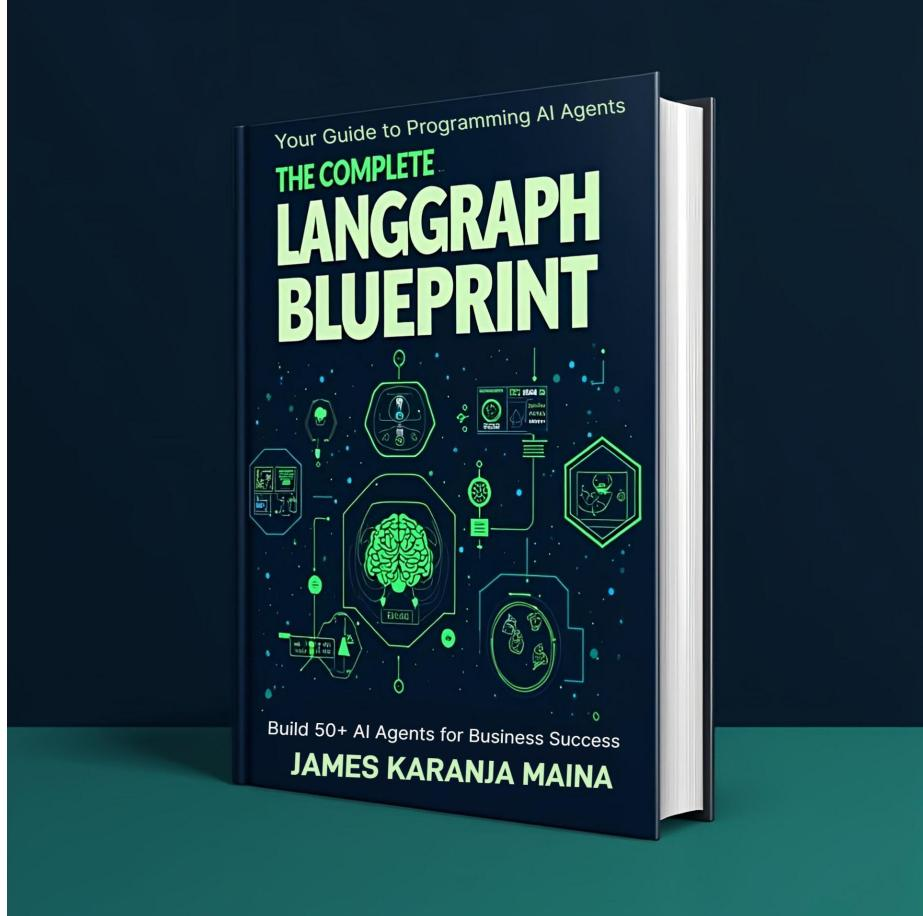

Par James Karanja Maina

## **Copyright © 2025 Tous droits réservés.**

Aucune partie de ce livre ne peut être reproduite, distribuée ou transmise sous quelque forme ou par quelque moyen que ce soit, y compris la photocopie, l'enregistrement ou d'autres méthodes électroniques ou mécaniques, sans l'autorisation écrite préalable de l'éditeur, sauf dans le cas de brèves citations incorporées dans des critiques et de certaines autres utilisations non commerciales autorisées par la loi sur le droit d'auteur.

Pour les demandes d’autorisation, veuillez contacter l’éditeur à l’adresse ci-dessous.

Informations sur l'éditeur :

Nom de l'éditeur: Zavora Technologies Ltd.

Auteur : James Karanja Maina

Adresse de l'éditeur : P.O. Boîte postale 60058, 00100, Nairobi, Kenya

Ville de l'éditeur : Nairobi

Pays de l'éditeur : Kenya

E-mail de l'éditeur : info@zavora.ai

Courriel de l'auteur : james.karanja@zavora.ai

Site Internet : www.zavora.ai

#### **Avertissement**

Les informations fournies dans ce livre sont uniquement destinées à des fins éducatives et ne doivent pas être considérées comme des conseils commerciaux, juridiques ou professionnels. L'auteur et l'éditeur déclinent toute responsabilité découlant de l'utilisation ou de l'application des informations contenues dans ce livre.

#### **Marques déposées**

Tous les noms de marques, noms de produits et noms de sociétés mentionnés dans ce livre sont des marques commerciales ou des marques déposées de leurs propriétaires respectifs. L'utilisation de ces noms n'implique aucune affiliation ou approbation de leur part.

#### **Première édition : janvier 2025**

Merci d'avoir lu et soutenu ce travail. Pour plus d'informations et de mises à jour, visitez : https://www.zavora.ai

# Table des matières

[Préface](#page-11-0)

[Code source](#page-12-0)

[Liste de diffusion](#page-13-0)

[Chapitre 1](#page-15-0)

[Introduction à LangGraph et aux agents IA](#page-15-1)

[1.1 Bienvenue dans le monde de LangGraph et des agents IA](#page-15-2)

[1.2 Programmation de grands modèles de langage](#page-16-0)

[1.3 Qu'est-ce que LangGraph ?](#page-19-0)

[1.4 Principes fondamentaux de LangGraph](#page-20-0)

[1.5 Pourquoi utiliser LangGraph pour les agents IA ?](#page-21-0)

[1.6 Comment les agents IA bénéficient de la structure de LangGraph](#page-21-1)

[1.7 Applications réelles des agents IA avec LangGraph](#page-22-0)

[Chapitre 2 :](#page-24-0)

[Configuration de votre environnement de développement](#page-24-1)

[Pourquoi un environnement virtuel ?](#page-24-2)

[2.1 : Installation de Python](#page-25-0)

[2.2 : Configuration d'un environnement virtuel](#page-25-1)

[2.3 : Installation de LangGraph et des bibliothèques requises](#page-27-0)

[2.4 : Configuration de Visual Studio Code \(VS Code\)](#page-29-0)

[Leçon 1 : Créer votre premier agent : "Hello World"](#page-33-0)

[2.5 Visualisez votre graphique](#page-36-0)

[2.6 Essayez d'ajouter un autre nœud au flux de travail graphique](#page-38-0)

[2.7 Code complet pour l'agent "Hello World"](#page-40-0)

[Récapitulatif final : ce que nous avons construit et appris](#page-41-0)

[Comment tout cela fonctionne ensemble :](#page-41-1)

[Chapitre 3](#page-42-0)

[Comprendre les concepts clés de la programmation](#page-42-1)

[Qu'est-ce qu'un langage de programmation ?](#page-42-2)

[3.5. Classes en Python : les fondements de la programmation orientée objet](#page-60-0)

- [3.5.7 Classe et méthodes statiques](#page-64-0)
- [3.5.8 Méthodes magiques](#page-64-1)
- [3.5.9 Propriétés :](#page-66-0)
- [3.5.10 Bonnes pratiques avec les classes](#page-67-0)
- [3.5.11. Modules externes courants utilisés dans LangGraph](#page-67-1)
- [3.5.12 Cartographier, filtrer et réduire](#page-84-0)
- [3.6 Gestion avancée des exceptions](#page-93-0)

[Chapitre 4](#page-97-0)

- [Éléments de base de LangGraph](#page-97-1)
	-[Concepts clés : nœuds, arêtes, états et graphiques](#page-97-2)
	- [4.1. État gardant une trace des données](#page-97-3)
	- [4.2. Nœuds La logique métier](#page-98-0)
	- [4.3. Arêtes reliant les nœuds](#page-99-0)
	- [4.4. Graphique](#page-104-0)
	- [4.5. Schémas d'entrée et de sortie d'un graphique : gestion flexible des états dans](#page-108-0) LangGraph
	- [4.6. Comment LangGraph rassemble tout cela](#page-112-0)
	- [4.7. Prise de décision avec des limites conditionnelles](#page-113-0)

[Chapitre 5](#page-126-0)

- [Créer votre premier agent IA](#page-126-1)
-[5.1 Introduction : La puissance des agents IA](#page-126-2)
- [5.2 Configuration de votre clé API et de votre environnement OpenAI](#page-127-0)
- [5.3 Les bases de la messagerie LangGraph](#page-129-0)
- [5.4 Traitement continu des entrées utilisateur] (#page-132-0)
- [5.5 Introduction aux outils des agents IA](#page-134-0)

[Chapitre 6](#page-148-0)

[Présentation de la mémoire dans les agents IA](#page-148-1)

- [6.1 Le problème : un agent sans mémoire](#page-148-2)
- [6.2 Amélioration de l'agent avec une mémoire à court terme](#page-150-0)
- [6.3 Comment fonctionne la mémoire à court terme](#page-151-0)

[6.5 Exemple de code complet : un agent IA avec mémoire à court terme](#page-152-0)

[6.6 Mémoire sur plusieurs sessions](#page-154-0)

[6.7 Section explicative : Détails techniques sur les points de contrôle et](#page-162-0) InMemoryStore

[6.7.2. InMemoryStore](#page-166-0)

[Chapitre 6 : Quiz](#page-169-0)

[Chapitre 7](#page-177-0)

- [Routage avancé et personnalisation des agents IA](#page-177-1)
	- [7.1 Introduction au routage dans les agents IA](#page-177-2)
	- 7.2 [outils\\_condition intégrés pour le routage conditionnel](#page-178-0)
	- [7.3 Exemple de routage conditionnel personnalisé : nœuds météo et calculateur](#page-180-0)
	- [7.4 Streaming dans LangGraph](#page-185-0)
	- [7.5 Intégrations d'API externes : présentation](#page-196-0)
	- [7.6 Intégration de l'API Météo : un exemple étape par étape](#page-196-1)
	- [7.7 Intégration d'API dynamique avec saisie utilisateur](#page-198-0)
	- [7.8 Intégration de l'API de la calculatrice](#page-200-0)
	- [7.9 Combinaison de plusieurs intégrations d'API](#page-201-0)
	- [Quiz Chapitre 7 : Intégrations d'API, routage et streaming](#page-204-0)

[Chapitre 8](#page-212-0)

[Architectures fondamentales des agents IA - ReAct](#page-212-1)

[Modèle ReAct \(Raison + Acte\)](#page-212-2)

[Agents ReAct dans LangGraph](#page-214-0)

[Options d'implémentation de l'agent ReAct interne et personnalisé LangGraph](#page-215-0)

[Meilleures pratiques pour créer des agents ReAct](#page-216-0)

[10 exemples d'agents ReAct dans LangGraph](#page-216-1)

[Chapitre 9](#page-249-0)

[Agents Human-in-the-Loop : intégrer le feedback humain pour une prise de décision plus intelligente](#page-249-1) Prise de décision

- [9.1 Qu'est-ce que Human-in-the-Loop ?](#page-250-0)
- [9.2 Concepts de base : points d'arrêt, points de contrôle et édition d'état](#page-251-0)
- [9.3 Exemple 1 : Implémentation de points d'arrêt simples](#page-251-1)

[9.4 Exemple d'agent ReAct avec cas d'utilisation d'achat d'actions financières](#page-259-0)

[9.5 Comprendre et utiliser « Interruption après » dans LangGraph](#page-263-0)

[9.6 Modification de l'état du graphique pendant l'exécution](#page-269-0)

[9.7 Cinq exemples de points d'arrêt simples](#page-271-0)

[9.8 Points d'arrêt dynamiques : concepts et utilisation](#page-278-0)

[9.9 En attente de la contribution de l'utilisateur : concepts et mise en œuvre](#page-280-0)

[Exemple pratique : agent ReAct avec contribution humaine](#page-284-0)

[Explication : Aspects techniques de Human-in-the-Loop \(HITL\) dans](#page-287-0) LangGraph

[Quiz du chapitre 9 : Agents humains dans la boucle] (#page-293-0)

[Chapitre 10](#page-302-0)

- [Agents de planification et d'exécution](#page-302-1)
	- [10.1 Introduction](#page-302-2)

[10.2 Pourquoi utiliser Planifier et Exécuter ?](#page-302-3)

[10.3 Concepts de planification et d'exécution](#page-303-0)

[10.4 Implémentation LangGraph d'un agent de planification et d'exécution d'IA] (#page-303-1)

[Exemple pratique 1.](#page-310-0)

[Agent de dépannage et de diagnostic informatique](#page-310-1)

[Exemple pratique 2. Agent d'automatisation du flux de travail métier](#page-315-0)

[Exemple pratique 3 : Chatbot de support client](#page-320-0)

[Explication : L'architecture de planification et d'exécution](#page-324-0)

[Quiz du chapitre 10 : Planifier et exécuter des agents](#page-327-0)

[Chapitre 11](#page-330-0)

[Génération augmentée par récupération agentique \(RAG\) dans LangGraph](#page-330-1)

[Qu'est-ce que RAG et les concepts de base](#page-330-2)

[Intégrations dans la recherche : articles et concepts clés] (#page-333-0)

[Intégration de modèles à partir de grands modèles de langage \(LLMs\)](#page-333-1)

[Magasins de vecteurs dans les systèmes RAG](#page-342-0)

[Magasins de vecteurs populaires](#page-343-0)

[Générer des réponses aux questions à l'aide de RAG à l'aide d'un LLM](#page-345-0)

[RAG Pratique - Remettre en question un long document PDF](#page-347-0)

[Comprendre le flux de travail RAG dans LangGraph : Agent AI de récupération](#page-353-0)

[Révision du chapitre : Flux de travail RAG dans LangGraph](#page-359-0)

[Introduction aux architectures RAG avancées](#page-360-0)

[Quiz sur le workflow RAG dans LangGraph](#page-361-0)

[Chapitre 12](#page-365-0)

RAG avancé [Architectures \(Self-RAG, RAG correctif et adaptatif](#page-365-1) RAG)

[12.1 Introduction au RAG auto-réflexif] (#page-365-2)

[12.2 Génération augmentée par récupération corrective \(CRAG\)](#page-372-0)

[12.3 RAG adaptatif](#page-379-0)

[Section explicative : Concepts du chapitre 12 - RAG avancé](#page-389-0) Architectures

[Quiz du chapitre 12 : Architectures RAG avancées \(Self-RAG, Corrective](#page-394-0) RAG, Adaptive RAG)

[Chapitre 13](#page-396-0)

[Architectures multiagents](#page-396-1)

[13.1 Superviseur d'agent](#page-396-2)

[Exemple pratique 1 : Un réseau d'assistants de recherche](#page-397-0)

[Exemple pratique 2 : Automatisation du service client](#page-401-0)

[Exemple pratique 3 : Analyse des stocks](#page-404-0)
[Exemple pratique 4 : Gestion de portefeuille](#page-408-0)

[Chapitre 14](#page-414-0)

[Équipes d'agents hiérarchiques](#page-414-1)

[Section 14.1 : Création d'équipes d'agents hiérarchiques](#page-415-0)

[Exemple d'architecture d'équipe d'agents hiérarchiques](#page-416-0)

[Étape 1 : Construire l'équipe de recherche](#page-417-0)

[Étape 2 : Construire l'équipe de rédaction de documents](#page-418-0)

[Étape 3 : Intégrer les équipes avec un superviseur global](#page-421-0)

[Chapitre 15](#page-423-0)

[Archites d'agents spécialisés](#page-423-1)

[15.1 Agents pilotés par événements](#page-423-2)

[15.2 Architectures cognitives](#page-424-0)

[15.3 Agents basés sur un modèle](#page-426-0)

[15.4 Agents de génération de code alimentés par l'IA](#page-427-0)

[15.5 Outils de programmation de paires améliorés par l'IA] (#page-429-0)

[Chapitre 16](#page-433-0)

[Test des agents IA](#page-433-1)

[16.1 L'importance des tests dans les systèmes d'IA] (#page-433-2)

[16.2 Tests unitaires pour les agents](#page-434-0)

[Chapitre 17](#page-447-0)

[Développement frontend pour les agents IA basés sur LangGraph](#page-447-1)

[17.1 Introduction à l'interaction entre le frontend et l'agent IA](#page-447-2)

[17.2 Exposer les agents LangGraph en tant qu'API](#page-448-0)

[17.3 Configuration de l'environnement de développement frontend](#page-450-0)

[17.4 Création de l'interface frontend](#page-451-0)

[17.5 Connexion du frontend à l'agent LangGraph](#page-453-0)

[17.6 Déploiement de l'application complète](#page-453-1)

[17.7 Résumé et meilleures pratiques](#page-454-0)

[17.8 Configuration du streaming asynchrone avec LangGraph et](#page-454-1) WebSockets

[17.9 Intégration du streaming dans le frontend](#page-457-0)

[17.10 Introduction aux réponses en continu](#page-457-1)

[17.11 Configuration du frontend avec React](#page-461-0)

[7.12 Résumé et meilleures pratiques pour les réponses en continu](#page-465-0)

[17.13 Configuration du backend avec Next.js et du frontend avec Next.js AI](#page-465-1) SDK

[17.14 Résumé et meilleures pratiques](#page-470-0)

[17.15 Configuration d'un backend LangGraph avec Next.js et AI SDK](#page-471-0)

[17.16 Résumé et meilleures pratiques](#page-476-0)

[Chapitre 18](#page-477-0)

[Création d'agents avec des modèles d'inférence NVIDIA NeMo \(NIMs\)](#page-477-1)

[18.1. Introduction aux modèles d'inférence NVIDIA NeMo](#page-477-2)

[18.2 Inférence à l'aide d'appels API directs](#page-479-0)

[18.3 : Inférence à l'aide de LangChain](#page-482-0)

[18.4 NIM auto-hébergés](#page-483-0)

[18.4 Création d'un générateur de campagne alimenté par l'IA avec LangGraph](#page-488-0)

[18. 5 Section explicative : Concepts clés de programmation dans la campagne](#page-499-0) Générateur

[Quiz du chapitre 18 : Création d'agents avec les modèles d'inférence NVIDIA NeMo](#page-506-0) (NIM)

[Chapitre 19](#page-513-0)

[Test des agents IA avec le développement piloté par les tests \(TDD\)](#page-513-1)

[19.1 Comprendre le développement piloté par les tests \(TDD\)](#page-513-2)

[19.2 Configuration du projet](#page-513-3)

[19.3 Comprendre le cycle TDD](#page-516-0)

[Le développement piloté par les tests suit un cycle simple mais puissant :](#page-516-1)

- 1. [Écrire un test échoué](#page-516-2)
- 2. [Écrire un code minimal pour réussir le test](#page-516-3)
- 3. [Refactoriser en gardant les tests verts](#page-516-4)

[Commençons par un exemple simple pour illustrer ce cycle.](#page-516-5)

[Exemple 1 : Nœud de traitement de message de base](#page-516-6)

[19.4 Comprendre la gestion des états](#page-519-0)

[19.5 Test des interactions LLM](#page-521-0)

[Création d'un agent IA de support client avec développement piloté par les tests](#page-526-0)

[Chapitre 20](#page-532-0)

[Déploiement d'agents IA en production](#page-532-1)

[20.1 Stratégies de déploiement](#page-532-2)

[20.2 Intégration continue et déploiement continu \(CI/CD\)](#page-535-0)

[20.3 Mise à l'échelle des agents IA](#page-537-0)

[20.4 Considérations de sécurité](#page-538-0)

[Chapitre 21](#page-539-0)

[Surveillance et maintenance des performances](#page-539-1)

[21.1 Outils et techniques de surveillance](#page-539-2)

[21.2 Mesures de performances pour les agents IA](#page-542-0)

[21.3 Dépannage et débogage](#page-543-0)

[Chapitre 22](#page-549-0)

[Études de cas et applications](#page-549-1)

[22.1 Automatisation du support client : le service d'assistance AI](#page-550-0)

[22.3 Efficacité opérationnelle : automatisation des flux de travail internes](#page-552-0)

[22.4 Leçons apprises du monde réel](#page-554-0)

[Chapitre 23](#page-558-0)

[Réflexions finales et prochaines étapes](#page-558-1)

[23.1 L'avenir des agents IA](#page-558-2)

[1. Tendance 1 : Agents d'IA multimodaux](#page-558-3)

[2. Tendance 2 : Apprentissage fédéré pour une IA renforcée en matière de confidentialité](#page-559-0)

[3. Tendance 3 : IA explicable \(XAI\)](#page-560-0)
[4. Tendance 4 : Edge AI](#page-560-1)

[5. Tendance 5 : agents IA dans le métaverse](#page-561-0)

[23.2 Poursuivre votre voyage](#page-561-1)

[23.3 Conclusion et derniers mots](#page-563-0)

[Merci pour votre soutien !](#page-565-0)

[Nous aimerions recevoir vos commentaires !](#page-565-1)

# **Préface**

<span id="page-11-0"></span>Nous sommes à l'aube de l'ère des agents IA. D’ici 2025, les systèmes d’IA autonomes transformeront fondamentalement le fonctionnement des entreprises et la manière dont nous résolvons des problèmes complexes. Pourtant, pour beaucoup, la création de solutions pratiques d’IA reste un passage difficile entre la théorie et la mise en œuvre.

Le plan complet LangGraph comble cette lacune. Utilisant les frameworks open source de LangChain et LangGraph, ce livre fournit un guide pratique pour créer plus de 50 agents d'IA prêts pour la production. Chaque chapitre passe du concept au code, en se concentrant sur des applications concrètes qui créent une valeur immédiate.

Ce n’est pas simplement un autre livre sur le potentiel de l’IA : c’est votre cadre pratique pour construire l’avenir.

Bienvenue dans le plan complet de LangGraph.

James Karanja Maina [www.zavora.ai](http://www.zavora.ai/)

# **Code source**

<span id="page-12-0"></span>Le code source complet de ce livre peut être obtenu sur GitHub à l'adresse ci-dessous :<https://github.com/jkmaina/LangGraphProjects>

# **Liste de diffusion**

<span id="page-13-0"></span>Pour obtenir la version la plus récente du livre, rejoignez la liste de diffusion en envoyant un e-mail à [james.karanja@zavora.ai](mailto:james.karanja@zavora.ai). Cela vous donnera droit à des éditions PDF exclusives (si disponibles) des livres de la série « The Complete AI Blueprint » qui intégreront les futures mises à jour sur les agents AI, LangGraph et LangChain, avec les mises à jour de code pertinentes et contenu. Abonnez-vous pour être sûr d'être toujours à jour.

Pour déployer vos agents AI sur le cloud, inscrivez-vous à la prochaine plateforme AI Agent sur [www.zavora.ai](http://www.zavora.ai/)

Partie 1 : Fondements de LangGraph et de la création d'agents IA (chapitres 1 à 3)

# **Chapitre 1**

# <span id="page-15-1"></span><span id="page-15-0"></span>**Présentation de LangGraph et des agents IA**

## <span id="page-15-2"></span>**1.1 Bienvenue dans le monde de LangGraph et des agents IA**

Bienvenue dans votre voyage dans le monde fascinant des agents IA avec LangGraph ! Ce livre vous guidera tout au long du processus de création de 50 agents d'IA de complexité croissante, en utilisant une approche structurée qui commence par les fondamentaux. Que vous soyez un débutant absolu ou un codeur cherchant à améliorer vos compétences, ce livre est conçu pour rendre les choses complexes simples et les défis réalisables.

Dans ce premier chapitre, nous vous présenterons les concepts de base de LangGraph et des agents IA. Vous découvrirez ce qu'est LangGraph, comment il permet la création de flux de travail dynamiques et pourquoi il est particulièrement adapté au développement d'agents IA. À la fin de ce chapitre, vous aurez une compréhension approfondie de l'architecture de LangGraph, des types de problèmes qu'elle peut résoudre et des secteurs dans lesquels les agents d'IA ont un impact significatif. Vous définirez également

améliorez votre environnement de développement et créez un simple agent "Hello World" pour acquérir une expérience pratique dès le début.

# <span id="page-16-0"></span>**1.2 Programmation de grands modèles de langage**

Les grands modèles linguistiques (LLM) comme GPT-4, Gemini et Claude sont incroyablement puissants. Ils peuvent comprendre et générer du texte de type humain, ce qui les rend adaptés à un large éventail d'applications, des chatbots à la génération de contenu. Cependant, pour que les entreprises exploitent tout leur potentiel, il est essentiel de structurer la manière dont ces modèles interagissent avec d'autres systèmes, tels que des bases de données, des API ou des systèmes de récupération.

#### **Approche traditionnelle : chaînes**

Traditionnellement, les flux de travail utilisant des LLM, comme ChatGPT, suivent un paradigme de « chaîne ». Cette approche a connu un grand succès, en particulier avec ChatGPT, qui a gagné en popularité grâce à sa capacité à effectuer des tâches complexes via une séquence d'étapes simple et linéaire. Voici comment cela fonctionne généralement :

- 1. **Entrée :** Le système reçoit la question d'un utilisateur.
- 2. **Récupérer :** Les documents ou données pertinents liés à la question sont trouvés.
- 3. **Générer :** Les données récupérées sont ensuite transmises au LLM (tel que ChatGPT) pour générer une réponse bien informée.

#### **Présentation de LangChain**
LangChain est un framework populaire qui facilite la création et la gestion de telles chaînes. Il fournit des outils pour définir des séquences d'appels LLM et les intégrer à des systèmes externes tels que des API et des bases de données. L'approche basée sur la chaîne de LangChain offre une fiabilité, car le même ensemble d'étapes s'exécute à chaque appel, garantissant des résultats cohérents.

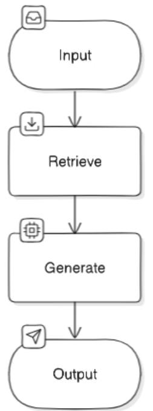

*Figure 1 : Un flux de travail en chaîne linéaire avec des nœuds représentant chaque étape (Entrée → Récupérer → Générer) connectés par des arêtes.*

#### **Cependant, les chaînes ont des limites**

Si les chaînes sont fiables, elles manquent de flexibilité. Ils ne peuvent pas adapter leur flux en fonction du contenu qu'ils traitent ou prendre des décisions autonomes sur les étapes à exécuter ensuite. Cette rigidité peut constituer une limitation importante dans les applications complexes ou dynamiques où l'adaptabilité est cruciale.

#### **Présentation des agents IA : flux de contrôle dynamique**

Les agents vont encore plus loin. Au lieu de suivre une chaîne fixe, les agents peuvent décider de leur propre séquence d'étapes en fonction des informations qu'ils reçoivent. Cela signifie :

- **Routage dynamique :** Un agent peut choisir entre plusieurs chemins en fonction de la situation.
- **Sélection d'outils :** Il peut décider quels outils ou API appeler en fonction de la tâche à accomplir.
- **Réponses adaptatives :** Il peut déterminer si la réponse générée est suffisante ou si un traitement supplémentaire est nécessaire.

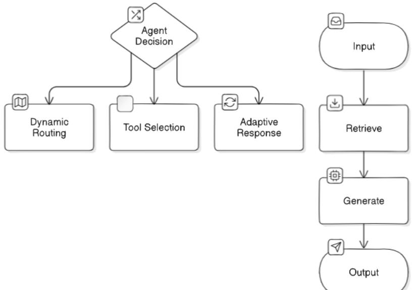

*Figure 2 : Agents d'introduction*

#### **Pourquoi les agents IA ?**

Les agents offrent un degré plus élevé de flexibilité et d’intelligence. Ils peuvent gérer des interactions plus complexes et plus variées, ce qui les rend adaptés aux applications qui nécessitent une adaptabilité et une prise de décision nuancée.

# <span id="page-19-0"></span>**1.3 Qu'est-ce que LangGraph ?**

LangGraph est un framework open source conçu pour simplifier le développement d'agents d'IA. Contrairement aux cadres de programmation traditionnels, où le contrôle s'effectue de manière linéaire d'une tâche à la suivante, LangGraph structure les flux de travail sous forme de graphiques. Dans un workflow LangGraph, les tâches sont représentées sous forme de **nœuds** et les connexions entre elles sous forme de **bords**. Cette approche basée sur des graphiques rend LangGraph particulièrement adapté aux agents d'IA qui doivent gérer des tâches complexes et dynamiques de prise de décision et de traitement de données.

#### **Pourquoi une approche basée sur des graphiques ?**

LangGraph s'inspire de *Pregel* (un framework de traitement de graphiques à grande échelle développé par Google) et *Apache Beam* (framework de traitement par lots et en temps réel open source). L'interface publique s'inspire de NetworkX. LangGraph est construit par LangChain Inc, les créateurs de LangChain, mais peut être utilisé sans LangChain ou en combinaison pour de meilleurs résultats.

Pour comprendre pourquoi LangGraph utilise une approche basée sur les graphiques, examinons rapidement ce que sont les graphiques et comment ils fonctionnent. En informatique, un **graphe** est une collection de **nœuds** (ou sommets) et de **arêtes** (ou liens) qui relient ces nœuds.

Les graphiques autorisent plusieurs chemins et connexions, ce qui les rend idéaux pour les flux de travail impliquant des tâches de branchement, de boucle ou simultanées.

Dans LangGraph :

- Les **nœuds** représentent des tâches ou des actions individuelles. Chaque nœud peut remplir une fonction spécifique, comme traiter des données ou prendre une décision.
- Les **Edges** définissent les relations entre les nœuds et contrôlent le flux de données. Ils peuvent être configurés avec des conditions, permettant au flux de travail de suivre différents chemins en fonction de critères spécifiques.

Cette flexibilité vous permet de créer des flux de travail qui ne sont pas strictement linéaires, mais qui peuvent au contraire se diversifier et s'adapter à différents scénarios.

**Illustration : Exemple de flux de travail basé sur un graphique avec des nœuds et des bords**

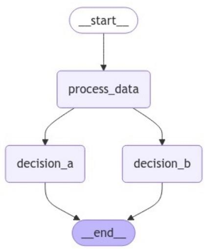

*Figure 3 :* Un diagramme simple avec trois nœuds reliés par des flèches. Le premier nœud est étiqueté « START », qui se connecte via un Edge aux « Process Data ». Ce nœud se divise ensuite en deux chemins (arêtes), l'un menant au nœud « Décision A » et l'autre à la « Décision B ». Les deux nœuds se connectent alors à la note END qui conclut l'exécution du graphe.

Le diagramme montre un flux de base dans LangGraph avec cinq étapes principales. Il commence par le nœud **START**, représentant le début du processus. À partir de là, il passe à **Process Data**, où s'effectue le traitement initial des données. Le processus se divise ensuite en deux décisions : **Décision A** et **Décision B**, qui représentent différents choix ou chemins en fonction des données. Les deux décisions mènent finalement au nœud **END**, qui signale la fin du processus. Ce flux montre comment LangGraph peut gérer le traitement des données et la prise de décision de manière simple et structurée.
# <span id="page-20-0"></span>**1.4 Principes fondamentaux de LangGraph**

LangGraph repose sur plusieurs principes fondamentaux qui le rendent idéal pour développer des agents fiables et dynamiques :

1. **Contrôle :** Définissez précisément le flux de votre application à l'aide de nœuds (tâches) et de bords (connexions). Cela permet des flux de travail à la fois déterministes et conditionnels.

- 2. **Persistance :** Maintenez l'état de votre application au cours de différentes sessions ou interactions à l'aide de diverses options de stockage telles que des bases de données.
- 3. **Human-in-the-Loop :** Intégrez une surveillance ou une intervention humaine dans le flux de travail, améliorant ainsi la fiabilité et la prise de décision.
- 4. **Streaming :** Fournit des mises à jour en temps réel et permet une interaction continue entre l'agent et les utilisateurs ou d'autres systèmes.

# <span id="page-21-0"></span>**1.5 Pourquoi utiliser LangGraph pour les agents IA ?**

Les agents d'IA sont des programmes capables d'effectuer des tâches de manière autonome ou semi-autonome, utilisant souvent des techniques d'intelligence artificielle telles que l'apprentissage automatique et le traitement du langage naturel (NLP) pour prendre des décisions et interagir avec les utilisateurs. LangGraph est particulièrement bien adapté à la création d'agents IA car il vous permet de créer des flux de travail flexibles, modulaires et évolutifs.

Les agents de construction qui ont un degré élevé de contrôle peuvent parfois entraîner des défis tels que :

- **Problèmes de fiabilité :** Un contrôle accru peut introduire de l'imprévisibilité, surtout si l'agent prend des décisions erronées.
- **Non-déterminisme :** Les LLM peuvent produire différentes sorties pour la même entrée, conduisant à des flux de travail incohérents.
- **Erreurs de sélection d'outils :** Un choix incorrect d'outils ou d'étapes peut perturber le flux de travail.

# <span id="page-21-1"></span>**1.6 Comment les agents IA bénéficient de la structure de LangGraph**

Les agents d'IA doivent souvent gérer des tâches telles que :

- 1. **Prise de décision** : évaluer les conditions et choisir entre plusieurs actions.
- 2. **Traitement des données** : Analyser les données d'entrée et les transformer en informations utiles.

3. **Interaction avec les systèmes externes** : récupération de données à partir d'API, journalisation d'informations ou réalisation d'autres opérations d'E/S.

Dans LangGraph, chacune de ces tâches peut être décomposée en nœuds individuels, reliés par des bords qui dictent le flux d'informations. Par exemple, imaginez créer un chatbot pour le service client. Ce bot devra peut-être :

- **Comprendre les requêtes des utilisateurs** : identifiez le type de question ou de demande qu'un utilisateur a soumis.
- **Acheminer la requête** : déterminez si la requête peut être traitée automatiquement ou si elle doit être transmise à un agent humain.
- **Enregistrer l'interaction** : enregistrez la conversation pour référence ou analyse future.

Chacune de ces tâches peut être représentée par un nœud distinct dans LangGraph, qui peut être facilement mis à jour ou modifié sans affecter les autres parties du flux de travail. Cette modularité facilite l'extension des capacités du bot au fil du temps. Besoin d'ajouter une fonctionnalité qui recommande des produits aux clients en fonction de leurs questions ? Ajoutez simplement un nouveau nœud, connectez-le au flux de travail existant et vous êtes prêt à partir !

# <span id="page-22-0"></span>**1.7 Applications réelles des agents d'IA avec LangGraph**

Les agents d'IA créés avec LangGraph peuvent être appliqués dans divers secteurs, notamment :

- **Service client** : chatbots qui traitent les demandes des clients, fournissent des réponses instantanées et font remonter les problèmes si nécessaire.
- **Soins de santé** : agents qui analysent les données des patients, assurent la surveillance de l'état de santé ou aident aux diagnostics préliminaires.
- **Finance** : agents qui surveillent les tendances du marché, détectent les transactions frauduleuses ou gèrent des portefeuilles.
- **Retail** : systèmes de recommandation intelligents qui suggèrent des produits en fonction du comportement des clients, gèrent les stocks ou optimisent les prix.

Chacune de ces applications repose sur la capacité d'un agent IA à traiter les informations, à prendre des décisions et à entreprendre les actions appropriées. Le framework LangGraph prend en charge cela en vous permettant de créer des flux de travail complexes qui

peut gérer plusieurs points de décision et flux de données, ce qui le rend idéal pour développer des agents d'IA sophistiqués.

## **Récapitulatif rapide**

À ce stade, vous devez avoir une compréhension de base de :

- Qu'est-ce que LangGraph et pourquoi il utilise une approche basée sur des graphiques.
- Comment les nœuds et les arêtes constituent la base de l'architecture de LangGraph.
- Pourquoi LangGraph est bien adapté à la création d'agents IA, en particulier pour les tâches impliquant la prise de décision, le traitement de données et les interactions avec des systèmes externes.

# **Chapitre 2 :**

# <span id="page-24-1"></span><span id="page-24-0"></span>**Configuration de votre environnement de développement**
Dans la section suivante, nous vous guiderons dans la configuration de votre environnement de développement afin que vous puissiez commencer à créer avec LangGraph. À la fin de ce chapitre, vous créerez un simple agent « Hello World » qui vous présentera la syntaxe et le flux de travail LangGraph.

Pour commencer à construire avec LangGraph, il est essentiel de mettre en place un environnement de développement qui rendra votre expérience de codage plus fluide et plus organisée. Dans cette section, nous passerons en revue les étapes pour installer Python, créer un environnement virtuel pour gérer les dépendances et configurer Visual Studio Code (VS Code) en tant qu'environnement de développement intégré (IDE).

## <span id="page-24-2"></span>**Pourquoi un environnement virtuel ?**

Un **environnement virtuel** est un répertoire autonome qui vous permet de gérer les dépendances spécifiques à un projet séparément de l'environnement Python global sur votre ordinateur. Cet isolement garantit que les modifications apportées aux dépendances d'un projet n'affecteront pas les autres. Pour les projets LangGraph, un environnement virtuel vous aidera à gérer et installer facilement les bibliothèques dont vous avez besoin.

# <span id="page-25-0"></span>**2.1 : Installation de Python**

LangGraph nécessite **Python 3.10 ou supérieur**. Si vous n'avez pas encore installé Python, procédez comme suit :

# 1. **Télécharger Python** :

Visitez python.org [\(https://www.python.org/downloads/\)](https://www.python.org/downloads/) et téléchargez la dernière version pour votre système d'exploitation. Des instructions sont fournies pour la plupart des systèmes d'exploitation que vous utilisez.

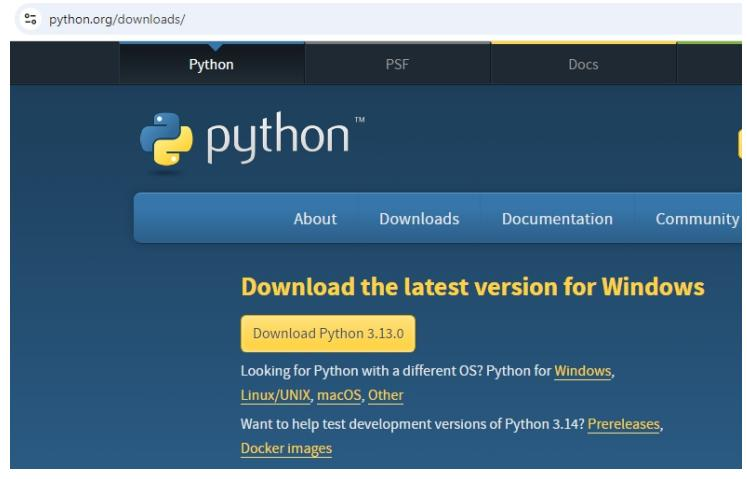

*Figure 4 : Installation de Python à partir du site Web Python.*

- 2. **Installer Python** : exécutez le programme d'installation et suivez les instructions à l'écran. Assurez-vous de cocher la case ou d'accepter la question qui dit **"Ajouter Python au PATH"** lors de l'installation. Cela facilitera l’exécution de Python à partir de la ligne de commande.
- 3. **Vérifiez l'installation** : Pour vérifier l'installation, ouvrez votre terminal (ou l'invite de commande sous Windows) et tapez :

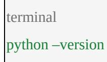

Vous devriez voir un numéro de version commençant par « 3.10 » ou supérieur. Si vous rencontrez des problèmes, consultez le guide d'installation de Python (https://docs.python.org/3/using/index.html) pour obtenir des conseils de dépannage.

# <span id="page-25-1"></span>**2.2 : Configuration d'un environnement virtuel**

Une fois Python installé, il est temps de créer un environnement virtuel spécifiquement pour vos projets LangGraph. Cela gardera toutes les bibliothèques nécessaires isolées et organisées dans le dossier du projet.

#### **Créer un dossier de projet** :

Commencez par créer un dossier pour vos projets LangGraph. Vous pouvez le nommer quelque chose comme *LangGraphProjects.*

terminal mkdir LangGraphProjects cd LangGraphProjects

### **Créer un environnement virtuel** :

Une fois votre dossier de projet créé, vous pouvez configurer un environnement virtuel en exécutant la commande suivante :

terminal python -m venv langgraph\_env

Cette commande crée un nouveau répertoire appelé langgraph\_env dans votre dossier de projet, qui contiendra une installation Python distincte et toutes les bibliothèques que vous installez.

## **Activer l'environnement virtuel** :

Sous **Windows**, utilisez la commande suivante :

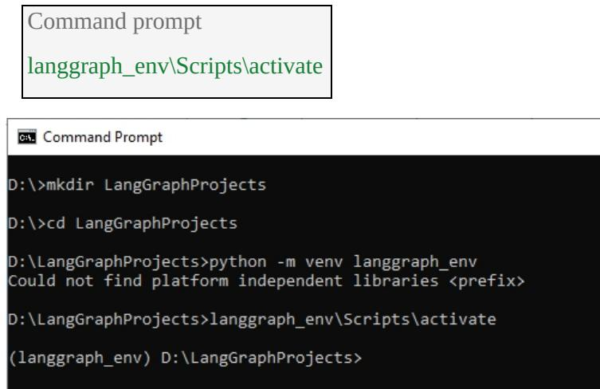

### Sous **macOS/Linux**, utilisez cette commande :

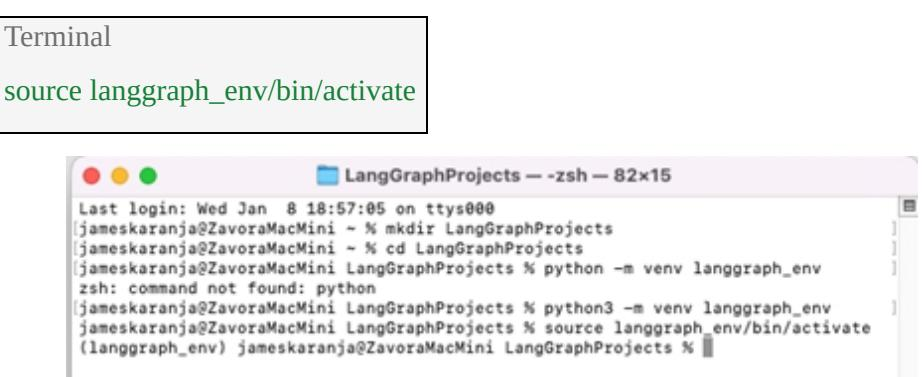

*Figure 5 : Comment activer l'environnement python du projet pour apprendre le langage dans ce cours. Tous les exemples doivent être réalisés dans ce dossier et dans l'environnement activé. Cela garantit que vous n'affectez pas les autres projets Python.*

Une fois activé, l'invite de votre terminal devrait afficher (langgraph\_env) au début, indiquant que vous travaillez maintenant dans l'environnement virtuel. Tous les packages Python que vous installez seront spécifiques à cet environnement, ce qui permettra de conserver votre configuration Python globale intacte.

*Conseil de dépannage* : Si vous rencontrez une erreur, revérifiez les commandes et assurez-vous que vous vous trouvez dans le bon répertoire de projet. Sous Windows, vous pouvez créer manuellement le dossier à l'aide de l'explorateur de fichiers comme alternative à l'invite de commande.

# <span id="page-27-0"></span>**2.3 : Installation de LangGraph et des bibliothèques requises**

Une fois l'environnement virtuel activé, vous êtes prêt à installer LangGraph. Cela peut être fait à l'aide du gestionnaire de packages de Python, **pip**, qui est préinstallé avec Python.

### **Installer LangGraph** :

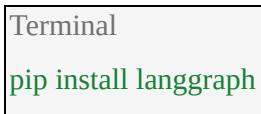

Cette commande téléchargera et installera LangGraph, ainsi que toutes les dépendances dont elle a besoin.

## **Installer des bibliothèques supplémentaires (facultatif)** :
En fonction des besoins de votre projet, vous souhaiterez peut-être également installer des bibliothèques pour travailler avec des API externes ou pour le traitement des données. Pour l'instant, installons request , une bibliothèque populaire pour faire des requêtes HTTP, qui sera utile dans les exercices ultérieurs.

| Borne |  |
|----------------------|--|
| demandes d'installation pip |  |

# <span id="page-29-0"></span>**2.4 : Configuration de Visual Studio Code (VS Code)**

VS Code est un IDE léger et puissant qui fournit des fonctionnalités essentielles telles que la coloration syntaxique, le débogage et le contrôle de version. C'est gratuit, open source et bien adapté au développement Python.

## 1. **Télécharger VS Code** :

Accédez au site Web de Visual Studio Code [\(https://code.visualstudio.com\)](https://code.visualstudio.com/) et téléchargez le programme d'installation de votre système d'exploitation. Exécutez le programme d'installation et suivez les instructions à l'écran pour terminer la configuration.

2. **Ouvrez le dossier** dans lequel nous avons créé le projet "LangGraphProjects". Votre vscode devrait ressembler à ci-dessous

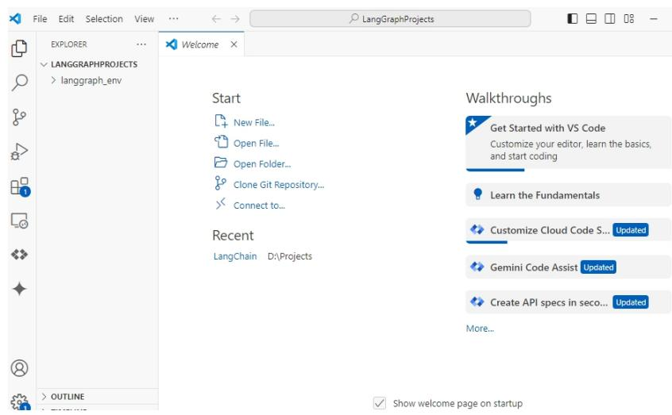

*Figure 6 : Visual Studio Code avec le dossier LangGraphProjects ouvert à l'aide d'un thème clair. Votre VS Code peut afficher un thème clair ou un thème en mode sombre, mais il s'agit du même contenu : les thèmes sont simplement une question de préférence personnelle quant à leur apparence.*

## 3. **Installez l'extension Python** :

Ouvrez VS Code et accédez à la vue Extensions en cliquant sur l'icône Extensions dans la barre latérale ou en appuyant sur Ctrl+Shift+X . Recherchez « Python » de Microsoft et cliquez sur **Installer**. Cette extension fournit

Fonctionnalités spécifiques à Python, telles qu'IntelliSense (complétion de code), le peluchage et le débogage.

*Figure 7 : Comment ouvrir l'icône des extensions dans la barre latérale, recherchez « Python » de Microsoft et cliquez sur Installer. Il s'agit d'une étape recommandée pour la programmation Python dans vscode.*

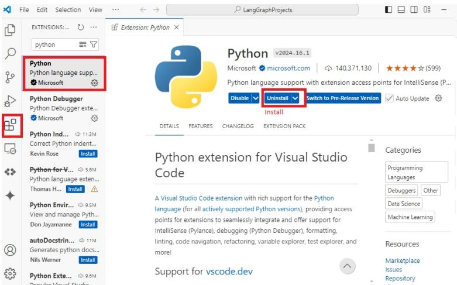

#### 4. **Configurez VS Code pour utiliser l'environnement virtuel** :

Une fois l'extension Python installée, vous pouvez configurer VS Code pour qu'il utilise votre environnement virtuel. Ouvrez la palette de commandes en appuyant sur Ctrl+Shift+P , puis tapez et sélectionnez "Python : Sélectionner un interprète". Choisissez l'interpréteur Python situé dans le dossier langgraph\_env. Cela garantit que VS Code exécute les commandes Python dans votre environnement virtuel.

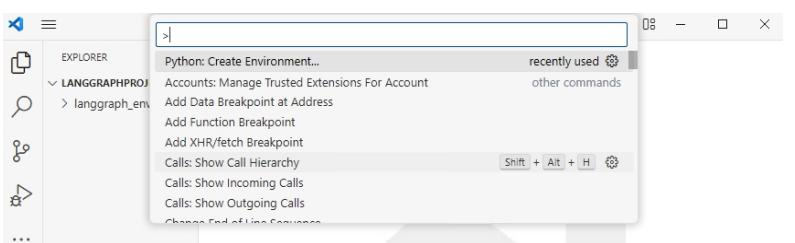

*Figure 8 : Création d'un environnement python dans VS Code pour le dossier* LangGraphProjects.

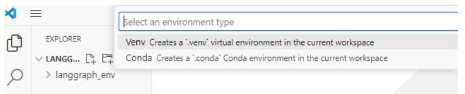

*Figure 9 : Sélection de l'environnement. Choisissez entre :*

- *Venv : Un environnement virtuel utilisant le module venv de Python. Ceci est utile pour créer des environnements isolés pour les dépendances spécifiques au projet.*
- *Conda : Un environnement Conda, idéal pour les utilisateurs qui préfèrent gérer des packages et des environnements avec AnaConda, en particulier pour les workflows de science des données et d'apprentissage automatique.*

Dans notre projet, nous vous recommandons d'utiliser *Venv* par souci de simplicité. Vous pouvez utiliser Conda si vous le préférez.

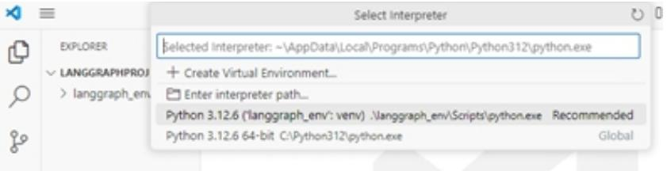

*Figure 10 : Choisissez l'interpréteur Python situé dans le dossier langgraph\_env. Cela garantit que VS Code exécute les commandes Python dans votre environnement virtuel.*

# **Récapitulatif rapide**

À présent, vous devriez avoir :

- Installé Python et créé un environnement virtuel pour isoler votre projet LangGraph.
- Installation de LangGraph et de bibliothèques supplémentaires nécessaires pour effectuer des requêtes API.
- Configurez VS Code avec l'extension Python et configurez-le pour utiliser votre environnement virtuel.

Une fois tout prêt, vous êtes maintenant équipé pour commencer à créer des agents LangGraph ! Dans la section suivante, nous aborderons la création de votre premier agent : un

programme simple "Hello World" qui vous présentera la syntaxe et le flux de travail de LangGraph.

# <span id="page-33-0"></span>**Leçon 1 : Créer votre premier agent : "Hello World"**

Une fois votre environnement de développement prêt, il est temps de commencer à créer votre premier agent LangGraph, un simple programme « Hello World ». Cet exercice vous présentera les composants principaux de LangGraph : nœuds, arêtes et états. Vous découvrirez comment ces éléments fonctionnent ensemble pour contrôler le flux de données via votre agent.

#### **Étape 1 : Comprendre les composants principaux de LangGraph**

Les agents LangGraph sont construits à l'aide de trois composants principaux :

- **Nœuds** : représentent des tâches ou des actions, comme le traitement des entrées ou la prise de décisions.
- **Edges** : définissez les connexions entre les nœuds, contrôlant la séquence d'actions.
- **États** : stockez et transmettez les données entre les nœuds, permettant à l'agent de maintenir le contexte tout au long du flux de travail.
Dans cet exemple, vous allez créer un nœud qui modifie un message de bienvenue dans l'état et le connecte pour former un flux de travail simple.

#### **Étape 2 : Définir l'État**

Tout d'abord, définissons un **état** pour contenir votre message de bienvenue. Nous utiliserons TypedDict de Python pour le structurer comme un dictionnaire avec une clé spécifique. Dans LangGraph, un état représente les données actuelles de l'application et est souvent défini avec TypedDict ou BaseModel de Pydantic pour garantir la cohérence et la validation des données.

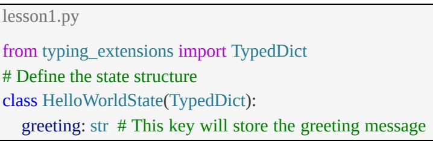

L'état HelloWorldState est désormais défini comme un objet de type dictionnaire dans lequel le champ de message d'accueil contiendra une chaîne. Vous initialiserez ce message et le modifierez dans le workflow.

*Figure 1.1 : Dans votre dossier VSCode, créez un fichier appelé lesson1.py, puis ajoutez le code ci-dessus comme indiqué ci-dessus. Vous pouvez copier ou coller pour accélérer*

*temps de frappe, même si je recommande personnellement de taper le code car il renforce l'apprentissage et vous permet de mieux le comprendre.*

| X | Sélection de modification de fichier | 0 0 0 0 0 0 0 0 0 0 0 0 0 0 0 0 0 0 0 0 0 0 0 0 0 0 0 0 0 0 0 0 0 0 0 0 0 0 0 0 0 0 0 0 0 0 0 0 0 0 0 0 0 0 0 0 0 0 0 0 0 0 0 0 0 0 0 0 0 0 0 0 0 0 0 0 0 0 0 0 0 0 0 0 0 0 0<br>LangGraphProjects<br>イ→ | X |
|--------|-----------------|----------------------------------------------------------------------------------------------------------------------------------------------------------------------------------------------------------------------------------|---|
|        | EXPLORATEUR<br> | @ leçon1.py ● |   |
|        | ✓ PROJETS LANGGRAPH | @ leçon1.py > |   |
|        | > langgraph_env | 1<br>à partir des extensions de saisie import TypedDict |   |
|        | @leçon1.py | 2 |   |
|        |                           | n<br># Définir la structure de l'état<br>4<br>class HelloWorldState(TypedDict):<br>5<br>greeting: str # Cette clé stockera le message de bienvenue<br>6 |   |
| 8 |                           |                                                                                                                                                                                                          |   |
| క్లిక్ | APERÇU |                                                                                                                                                                                                          |   |
|        | CHRONOLOGIE |                                                                                                                                                                                                          |   |
|        | (20 0 0 0 0 0 2 zavora-ai | Ln 6, Col 1 Espaces : 4 UTF-8 CRLF } Python 3.12.6 ('langgraph_env' : venv) | |

**Étape 3 : Création de la fonction de nœud « Hello World »**

Ensuite, nous définirons une fonction pour agir comme un **nœud** dans LangGraph. Ce nœud mettra à jour la clé de message d'accueil dans l'état en ajoutant « Hello World » au début du message existant.

```
lesson1.py continued..
# Define the node function
def hello_world_node(state: HelloWorldState):
    state["greeting"] = "Hello World, " + state["greeting"]
    return state
```
Cette fonction accepte l'état, ajoute "Hello World" au message d'accueil, puis renvoie l'état mis à jour. Chaque nœud de LangGraph a accès à l'état, ce qui lui permet de lire et de modifier les données selon les besoins.

*Figure 1.2 : Dans votre lesson1.py, nous continuerons à ajouter du code comme indiqué. Il est recommandé de suivre et de faire cela pratiquement au fur et à mesure.*

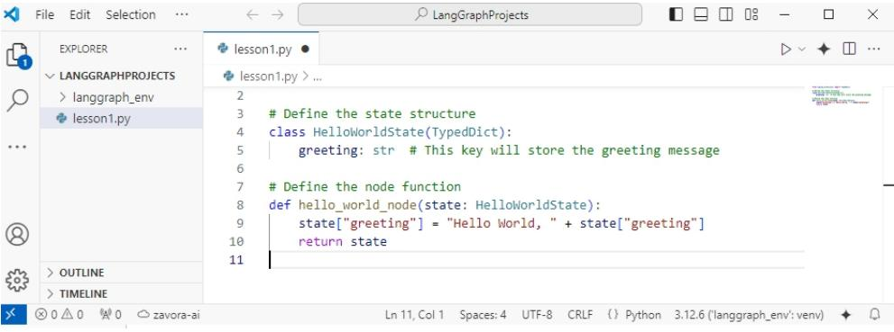
**Étape 4 : Configuration de la structure du graphique**

Une fois l'état et le nœud définis, il est temps de créer le workflow LangGraph. Vous allez créer un **graphique** qui relie les nœuds aux arêtes, établissant un chemin du début à la fin.

lesson1.py suite.. #Ajouter l'importation au début du fichier lesson1.py à partir de langgraph.graph import StateGraph, START, END # Initialiser le graphique et ajouter le générateur de nœuds = StateGraph(HelloWorldState) builder.add\_node("greet", hello\_world\_node) # Définir le flux d'exécution à l'aide des bords builder.add\_edge(START, "greet") # Connecter START au nœud "greet" builder.add\_edge("greet", END) # Connectez le nœud "greet" à END

Voici ce que fait chaque partie :

- StateGraph(HelloWorldState) : Initialise le graphe avec le schéma HelloWorldState, ce qui signifie qu'il attendra des données structurées selon cet état.
- add\_node("greet", hello\_world\_node) : Ajoute la fonction hello\_world\_node en tant que nœud dans le graphique, en l'étiquetant "greet".
- add\_edge(...) : définit le flux d'exécution de START à "greet" puis à END , créant un chemin simple.

*Figure 1.3 : Voici à quoi devrait ressembler votre code dans VS Code jusqu'à présent*

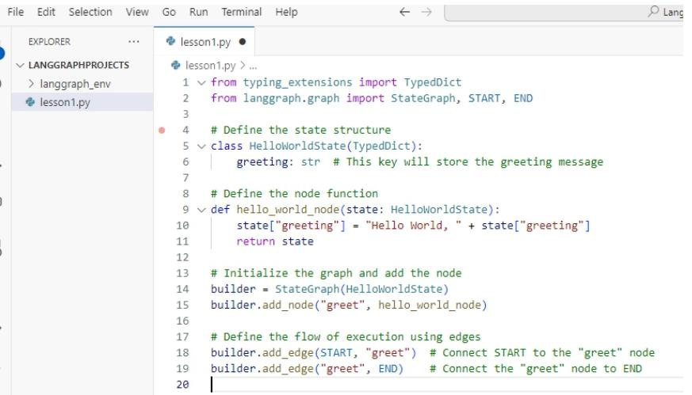

**Étape 5 : Compilation et exécution du graphique**

Une fois le graphique configuré, vous pouvez maintenant le **compiler** et exécuter le workflow en appelant le graphique avec un état initial. Cela déclenchera le nœud pour traiter les données et la sortie

le résultat.

leçon1.py suite.. # Compilez et exécutez le graphique graph = builder.compile() result = graph.invoke({"greeting": "from LangGraph!"}) print(result)

Le résultat attendu devrait ressembler à ceci :

{'greeting': 'Bonjour tout le monde, de LangGraph !'}

Cela montre comment l'état a été transmis via le nœud "greet" et modifié pour inclure "Hello World".

*Figure 1.4 : Appuyez sur le bouton « Exécuter le fichier Python » pour exécuter le programme et voir les résultats sur les fenêtres du terminal, comme indiqué ci-dessous.* 

#### <span id="page-36-0"></span>**2.5 Visualisez votre graphique**

Nous utilisons MermaidDrawMethod pour créer une visualisation PNG du graphique. Cela fournit une représentation graphique du flux de travail, vous aidant à voir visuellement les connexions des nœuds. Nous réutiliserons cette méthode pour visualiser les graphiques de ce livre.

```
lesson1.py continued..
#Code to visualize the graph, we will re-use this in all future lessons
from langchain_core.runnables.graph import MermaidDrawMethod
import random
import os
mermaid_png=graph.get_graph(xray=1).draw_mermaid_png(draw_method=MermaidDrawMethod.API)
# Create an output folder if it doesn't exist, for now we can save in the current folder represented by .
output_folder = "."
os.makedirs(output_folder, exist_ok=True)
filename = os.path.join(output_folder, f"graph_{random.randint(1, 100000)}.png")
with open(filename, 'wb') as f:
    f.write(mermaid_png)
if sys.platform.startswith('darwin'):
    subprocess.call(('open', filename))
elif sys.platform.startswith('linux'):
    subprocess.call(('xdg-open', filename))
elif sys.platform.startswith('win'):
    os.startfile(filename)
```
Le fichier complet est présenté ci-dessous et peut également être obtenu sur GitHub : <https://github.com/jkmaina/LangGraphProjects/blob/main/chapter2/lesson1.py>
leçon1.py : exemple complet. import random from typing\_extensions import TypedDict from langgraph.graph import StateGraph, START, END from langchain\_core.runnables.graph import MermaidDrawMethod import os import subprocess import sys # Définir la classe de structure d'état HelloWorldState(TypedDict): Greeting: str # Cette clé stockera le message de bienvenue # Définir la fonction de nœud def hello\_world\_node(state: HelloWorldState) : state["greeting"] = "Hello World, " + state["greeting"] return state # Initialiser le graphique et ajouter le nœud builder = StateGraph(HelloWorldState) builder.add\_node("greet", hello\_world\_node) # Définir le flux d'exécution à l'aide des bords builder.add\_edge(START, "greet") # Connecter START au nœud "greet" builder.add\_edge("greet", END) # Connectez le nœud "greet" à END # Compilez et exécutez le graphique graph = builder.compile() result = graph.invoke({"greeting": "from LangGraph!"}) print(result) #Code pour visualiser le graphique, nous le réutiliserons dans toutes les leçons futures mermaid\_png=graph.get\_graph(xray=1).draw\_mermaid\_png(draw\_method=MermaidDrawMethod.A PI) # Créez un dossier de sortie s'il n'existe pas, pour l'instant nous pouvons enregistrer dans le dossier actuel représenté par . sortie\_dossier = "." os.makedirs(output\_folder, exist\_ok=True) filename = os.path.join(output\_folder, f"graph\_{random.randint(1, 100000)}.png") avec open(filename, 'wb') comme f: f.write(mermaid\_png) if sys.platform.startswith('darwin'): subprocess.call(('open', nom de fichier)) elif sys.platform.startswith('linux'): subprocess.call(('xdg-open', nom de fichier))

```
elif sys.platform.startswith('win'):
     os.startfile(filename)
```
Exécutez le projet. Vous devriez obtenir le fichier graphique suivant créé automatiquement sur votre dossier de projet et affiché automatiquement sur votre écran.

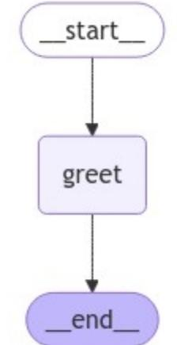

**Ce que vous voyez dans la visualisation :**

- Nœud **START** connecté au nœud **greet**, qui mène ensuite au nœud **END**.
- Ce flux reflète la séquence que vous avez définie, montrant comment les données se déplacent du début à la modification du message d'accueil, puis à la fin.

#### <span id="page-38-0"></span>**2.6 Essayez d'ajouter un autre nœud au flux de travail graphique**

Pour voir à quel point il est facile d'étendre un flux de travail, ajoutons un nouveau nœud qui ajoute un point d'exclamation au message d'accueil. Cela montrera comment vous pouvez développer vos projets LangGraph en enchaînant les nœuds ensemble.

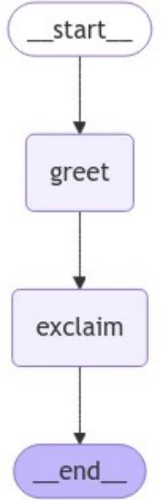

#### **Définir le nouveau nœud** :

Juste en dessous du nœud hello\_world\_node dans votre code lesson1.py, ajoutez le nouveau nœud ci-dessous. Cette nouvelle fonction ajoute un point d'exclamation au message d'accueil.

| leçon1.py suite |
|--------------------------------------------------|
| # Définir une fonction de nœud supplémentaire |
| def<br>exclamation_node(état : HelloWorldState) : |
| state["salutation"] +=<br>"!"                      |
| retour<br>état |

**Ajoutez le nœud au graphique et définissez de nouveaux bords** : Maintenant, ajoutez le nouveau nœud au graphique et connectez-le au flux. Modifiez le nœud greet pour vous connecter au nœud exclaim.

#### **Compilez et exécutez le graphique mis à jour** :

leçon1.py suite.. # Compilez et exécutez le graphique graph = builder.compile() result = graph.invoke({"greeting": "from LangGraph!"}) # Afficher le résultat

```
print(result)
# Output: {'greeting': 'Hello World, from LangGraph!!'}
```
Cette configuration illustre avec quelle facilité vous pouvez étendre les flux de travail LangGraph en enchaînant les nœuds pour effectuer plusieurs tâches.

#### <span id="page-40-0"></span>**2.7 Code complet pour l'agent "Hello World"**

Voici l'intégralité du code, regroupant chacune des étapes ci-dessus, y compris l'expérience facultative avec le nœud d'exclamation :

```
leçon1b.py exemple complet
#leçon1b.py
à partir de typing_extensions importer TypedDict
à partir de langgraph.graph importer StateGraph, START, END
à partir de langchain_core.runnables.graph importer MermaidDrawMethod
à partir de display_graph importer display_graph
# Définir la structure de l'état
classe HelloWorldState (TypedDict) :
    Greeting: str # Cette clé stockera le message d'accueil
# Définir une fonction de nœud supplémentaire
def exclamation_node (état : HelloWorldState) :
    state["salutation"] += "!"
    état de retour
# Définir la fonction du nœud
def hello_world_node (état : HelloWorldState) :
    state["greeting"] = "Bonjour tout le monde, " + state["greeting"]
    état de retour
# Initialisez le graphique et ajoutez le nœud
constructeur = StateGraph (HelloWorldState)
builder.add_node("salut", hello_world_node)
# Définir le flux d'exécution à l'aide des bords
builder.add_edge(START, "greet") # Connectez START au nœud "greet"
builder.add_node("exclaim", exclamation_node) # Ajouter un nouveau nœud
# Mettre à jour les bords
builder.add_edge("greet", "exclaim") # Connecter "greet" à "exclaim"
builder.add_edge("exclaim", END) # Mettre à jour le flux pour qu'il se termine après "exclaim"
# Compiler et exécuter le graphique
graphique = builder.compile()
résultat = graph.invoke({"salutation": "de LangGraph!"})
# Afficher le résultat
imprimer(résultat)
# Résultat : {'greeting' : 'Bonjour tout le monde, de LangGraph !!'}
```
#### <span id="page-41-0"></span>**Final Wrap-Up: What We Built and Learned**

- **Nodes, Edges, and States**: These are the building blocks of LangGraph. Think of nodes as tasks, edges as the paths that connect tasks, and states as containers for data that moves through the workflow.
- **Creating a Simple Node**: You made a function that added "Hello World" to a message. This function was our node, and it showed how nodes process and update data.
- **Building the Flow with a Graph**: By connecting nodes with edges, you defined how data moves from start to finish in your workflow.

#### <span id="page-41-1"></span>**How It All Works Together:**

- You saw how LangGraph uses a **state** (data) that gets updated as it moves through **nodes** (tasks), all linked by **edges** (paths). This lets you build agents that can handle tasks step-by-step.
- The final output, {'greeting': 'Hello World, from LangGraph!'} , shows how the data was modified as it passed through your simple workflow.

#### **Recap**

You've now built your first LangGraph agent and added complexity with multiple nodes:

- Defined a state for holding and updating data.
- Created and connected nodes to manipulate the state.
- Ran the workflow to see how LangGraph processes and modifies data through nodes and edges.

# **Chapter 3**

# <span id="page-42-1"></span><span id="page-42-0"></span>**Understanding Key Programming Concepts**

Before we dive deeper into building LangGraph agents, let's pause and explore some fundamental programming concepts. This explainer will cover the basics of Python programming, data structures, and the core elements of LangGraph. Whether you're new to coding or need a quick refresher, this page will help you feel more confident as we progress through the book.

## <span id="page-42-2"></span>**What is a Programming Language?**

A **programming language** is a set of instructions that we use to communicate with computers. **Python**, the language we're using in this book, is known for being readable and beginner-friendly. It allows you to write code that's easy to understand, which makes it a popular choice for building AI agents.

#### **Key Concepts in Python**

Here are some of the basic concepts in Python that you'll encounter frequently as you work with LangGraph:

**3.1. Variables**

A **variable** is a name that holds a value. Think of it as a container that stores information. You can create a variable by simply assigning a value to it, like so:

```
salutation = "Bonjour tout le monde"
```
In this example:

- greeting is the variable name.
- "Hello World" is the value.
- The = operator assigns the value to the variable.

Once a variable is assigned a value, you can reference or manipulate that value later in the program:

```
Leçon2.py
print(salutation) # Sortie : Hello World
```
print is a special function in python that shows the value of a variable in the output.

Python supports various data types including:

- **Integers**( int ): Whole numbers (e.g., 5 , -3 ).
- **Floating-point numbers**( float ): Numbers with decimals (e.g., 3.14 , -0.5 ).
- **Strings**( str ): Text enclosed in quotes (e.g., "Hello, World!" ).
- **Booleans**( bool ): True or False
- **NoneType** ( None ): Represents the absence of a value
- **Tuple**: ordered, immutable collection of elements enclosed in () e.g. (1, "hello", 3.14)
- **List**: list is a collection of variables, enclosed in [ ] and separated by commas e.g. colors = ['red', 'blue', 'green']
- **Set**:Unordered collections e.g. items = {"start", "end"}

One of Python's defining features is its **dynamic typing** system. This means that you don't have to declare the type of a variable when you create it. Python automatically determines the type based on the value assigned:

Lesson2.py continued

```
âge = 25 # Entier
prix = 19,99 # Flottant
nom = "Alice" # Chaîne
is_active = True # Booléen
inconnu = Aucun # AucunType
mon_tuple = (1, "bonjour", 3.14) #Tuple
print(age) #la sortie est de 25
print(price) #la sortie est de 19,99
print (nom) # le résultat est "Alice"
print(is_active) #output est vrai
print(my_tuple[0]) #la sortie est 1
print(my_tuple[1]) #output est Bonjour
```
This flexibility makes Python easy to use, but it also requires careful management to avoid type-related errors. You can change the type of a variable by assigning it a value of a different type:

```
Leçon2.py suite
données = "Bonjour"
print(type(data)) # Sortie : <class 'str'>
données = 100
print(type(data)) # Sortie : <class 'int'>
data = "Bonjour encore"
print(type(data)) # Sortie : <class 'str'>
```
## **3.1.1 Naming Variables - Best Practices:**

Here are the main rules and best practices for naming variables in Python:

● **Allowed Characters**: Variable names can include letters, numbers, and underscores ( \_ ). However, they cannot start with a number.

```
Leçon2.py suite
nom_utilisateur = "Alice" # Valide
utilisateur2 = "Bob" # Valide
2utilisateur = "Charlie" # Invalide
```
● **Case Sensitivity**: Python is case-sensitive, meaning UserName and username would be considered two different variables.

```
Leçon2.py suite
Nom d'utilisateur = "Alice"
nom d'utilisateur = "Bob"
print(UserName) # Sortie : Alice
print(nom d'utilisateur) # Sortie : Bob
```
● **Snake Case**: By convention, variable names in Python are typically written in snake\_case (lowercase letters with underscores between words).

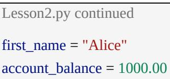

- **Meaningful Names**: Use descriptive variable names that reflect the value they hold or the purpose they serve. This makes your code easier to understand.
- **Avoid Using Python Keywords**: Keywords are reserved words in Python that have special meanings, such as if , else , for , etc. Avoid using these as variable names to prevent syntax errors.

```
Leçon2.py suite
#Noms de variables invalides
si = 5 # SyntaxError
classe = 10 # SyntaxError
```
### **3.1.2 Variable Scope: Global and Local Variables**

The **scope** of a variable determines where it can be accessed within a program. Python has two primary scopes for variables: **global** and **local.** A **global** variable is defined outside of any function and can be accessed from any part of the code. Global variables are available throughout the program.

```
Leçon2.py suite
salutation = "Bonjour tout le monde !" #Cette variable est accessible par de nombreuses fonctions
def say_hello() :
```

```
imprimer (salutation)
say_hello() # Sortie : Bonjour tout le monde !
```
A **local variable** is defined within a function and can only be accessed within that function. Once the function finishes executing, the local variable is discarded.

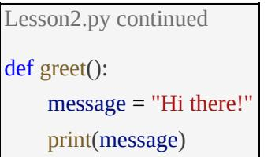

In the example above, message is a local variable and only exists within the greet() function.

**3.1.3 Memory management:** Python automatically handles memory allocation and deallocation for variables through **garbage collection**. This process removes unused objects from memory, freeing up resources.

**3.1.4 Constants:** By convention, constants are written in all uppercase letters with underscores between words, signaling to other programmers that these values should not be altered.

```
Leçon2.py suite
PI = 3,14159 #ALL CAPS indique que sa valeur ne doit pas être modifiée
MAX_USERS = 100
```
#### **3.1.5 Variable Unpacking:**

Python supports unpacking multiple values into multiple variables, which can simplify assignments and make your code cleaner.

```
Leçon2.py suite
#9. Décompresser un tuple
coordonnées = (10, 20)
x, y = coordonnées
print(x) # Sortie : 10
print(y) # Sortie : 20
#10. Décompresser une liste
noms = ["Alice", "Bob", "Charlie"]
premier, deuxième, troisième = noms
```

```
print(first) # Sortie : Alice
Vous pouvez également utiliser l'opérateur * pour capturer les éléments excédentaires lors du déballage :
nombres = [1, 2, 3, 4, 5]
premier, *milieu, dernier = nombres
print(milieu) # Sortie : [2, 3, 4]
```
#### **3.2. Functions**

A **function** is a block of code that performs a specific task. Functions allow you to reuse code, making it easier to manage and organize your programs. In Python, you define a function using the def keyword, followed by the function name and parentheses () :

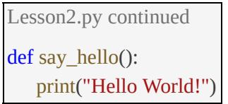

This function, say\_hello , prints the text "Hello World!" when called. The function body is indented below the definition, and the function ends when the indentation stops.

To execute the code within a function, you **call** the function by using its name followed by parentheses:

```
Leçon2.py suite
dire_bonjour()
```
**3.2.1 Paramètres** vous permettent de transmettre des données aux fonctions, les rendant plus flexibles. Lors de la définition d'une fonction, vous spécifiez des **paramètres** comme espaces réservés entre parenthèses.

| Lesson2.py suite |
|-------------------------------|
| def<br>saluer(nom): |
| print(f"Bonjour, {nom}!") |

Lorsque vous appelez la fonction, vous fournissez des **arguments**, qui sont les valeurs réelles attribuées à ces paramètres.

```
Lesson2.py continued
greet("Alice")  # Output: Hello, Alice!
```
**3.2.2 Les arguments positionnels** sont le moyen le plus courant de transmettre des données aux fonctions. L'ordre des arguments dans l'appel de fonction doit correspondre à l'ordre des paramètres dans la définition de la fonction.

L'ordre des arguments dans l'appel de fonction doit correspondre à l'ordre des paramètres dans la définition de la fonction.

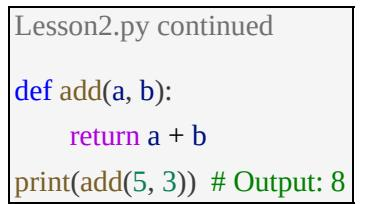

#### **3.2.3 Arguments de mots clés**

Vous pouvez également spécifier des arguments par nom, quel que soit leur ordre, en utilisant des **arguments de mots-clés**. Cela rend les appels de fonction plus clairs et vous permet de spécifier uniquement certains paramètres s'ils ont des **valeurs par défaut**.

```
Lesson2.py continued
def create_user(name, age=18):
    print(f"User: {name}, Age: {age}")
create_user(name="Bob", age=25)  # Output: User: Bob, Age: 25
create_user(name="Alice")        # Output: User: Alice, Age: 18
```
#### **3.2.4 Valeurs des paramètres par défaut**

Les valeurs de paramètre par défaut vous permettent de définir des paramètres facultatifs qui n'ont pas besoin d'être spécifiés dans chaque appel de fonction.

| Lesson2.py suite |
|-----------------------------------------|
| def<br>greet(name="Monde") : |
| print(f"Bonjour, {nom}!") |
| greet() # Sortie : Bonjour tout le monde ! |
| greet("Alice") # Résultat : Bonjour, Alice ! |

#### **3.2.5 Arguments de longueur variable**

Parfois, vous ne savez peut-être pas à l’avance combien d’arguments seront transmis à une fonction. Python fournit une syntaxe spéciale pour gérer les arguments de longueur variable, en utilisant \*args pour les arguments de position et \*\*kwargs pour les arguments de mots-clés.

#### **Utilisation de \*args pour les arguments positionnels de longueur variable**

La syntaxe \*args permet à une fonction d'accepter un nombre arbitraire d'arguments de position, qui sont accessibles sous forme de tuple au sein de la fonction.

```
Lesson2.py continued
def sum_all(*args):
   total = sum(args)
   print(f"Total: {total}")
sum_all(1, 2, 3, 4)  # Output: Total: 10
```
#### **Utilisation de \*\*kwargs pour les arguments de mots clés de longueur variable**

La syntaxe \*\*kwargs permet à une fonction d'accepter un nombre arbitraire d'arguments de mots-clés, qui sont accessibles sous forme de dictionnaire au sein de la fonction.

```
Lesson2.py continued
def print_info(**kwargs):
    for key, value in kwargs.items():
         print(f"{key}: {value}")
print_info(name="Alice", age=30, country="Wonderland")
# Output:
# name: Alice
# age: 30
# country: Wonderland
```
#### **3.2.4 Déclarations de retour**

Une fonction peut renvoyer une valeur à l'aide de l'instruction return. Si aucune instruction return n'est spécifiée, la fonction renvoie None par défaut.

```
Lesson2.py continued
def add(a, b):
    return a + b
result = add(5, 3)
print(result)  # Output: 8
```
Plusieurs valeurs peuvent être renvoyées par une fonction sous forme de tuple :

```
Lesson2.py continued
```

```
def get_user():
    return "Alice", 30
name, age = get_user()
print(name, age)  # Output: Alice 30
```
#### **3.2.5 Fonctions anonymes avec expressions Lambda**

Les fonctions **Lambda** sont des fonctions concises et anonymes définies avec le mot-clé lambda. Ils sont idéaux pour les fonctions courtes et ponctuelles passées en arguments.

```
Lesson2.py continued
add = lambda x, y: x + y   #Take two numbers, add them together and return the value
print(add(3, 5))  # Output: 8
# Using lambda in a higher-order function
numbers = [1, 2, 3, 4]
squared = list(map(lambda x: x ** 2, numbers))
print(squared)  # Output: [1, 4, 9, 16]
```
#### **3.2.6 Décorateurs :**

Un décorateur est une fonction d’ordre supérieur qui modifie le comportement d’une autre fonction. Les décorateurs sont utiles pour étendre des fonctionnalités, telles que la journalisation, la mise en cache ou le contrôle d'accès, sans modifier le code de la fonction d'origine.

```
Lesson2.py continued
def log_decorator(func):
    def wrapper(*args, **kwargs):
         print(f"Executing {func.__name__}")
         return func(*args, **kwargs)
    return wrapper
@log_decorator
def greet(name):
    print(f"Hello, {name}!")
greet("Alice") # Output: Executing greet
# Hello, Alice!
```
**Dans LangGraph, les décorateurs peuvent être utilisés pour envelopper les fonctions de nœud, en ajoutant des comportements de journalisation ou de gestion des erreurs.**
**3.2.7 Fonctions récursives :** Une fonction récursive est une fonction qui s'appelle elle-même. Les fonctions récursives sont utiles pour résoudre des problèmes qui peuvent être décomposés en sous-problèmes plus petits et similaires, tels que le calcul de factorielles ou le parcours d'arbres.

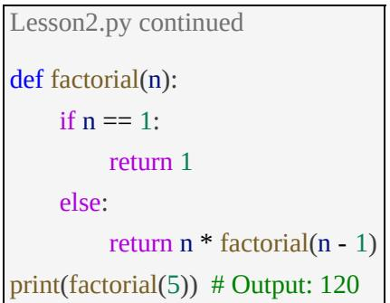

Lorsque vous utilisez la récursivité, assurez-vous qu'il existe un scénario de base pour éviter une récursivité infinie.

#### **3.2.8 Docstrings et documentation**

Une **docstring** est une chaîne qui décrit l'objectif et le comportement d'une fonction. L'inclusion de docstrings permet de rendre votre code auto-documenté, et il est accessible via la fonction help() intégrée de Python.

```
Lesson2.py continued
def greet(name):
    """Greets a person by name."""
    print(f"Hello, {name}!")
help(greet) # Output:
# Help on function greet in module __main__:
# greet(name)
#    Greets a person by name.
```
En incluant des docstrings, vous permettez aux autres (et à vous-même) de comprendre plus facilement vos fonctions et leur comportement attendu.

#### **3.3. Dictionnaires**

Un **dictionnaire** est une structure de données en Python qui stocke les données sous forme de paires clé-valeur. Chaque **clé** est associée à une **valeur**, ce qui facilite la recherche d'informations en fonction d'une clé spécifique. Voici un exemple :

```
Lesson2.py continued
```

```
person = {"name": "Alice", "age": 30, "is_active": True }
```
Dans ce dictionnaire, "name" , "age" et "is\_active" sont des clés. "Alice" , 30 et True sont des valeurs associées à ces clés.

```
person["name"] would return "Alice" , and person["age"] would return
30 .
```
Les dictionnaires sont très utiles pour stocker et accéder à des informations connexes. Par conséquent, un dictionnaire en Python est une **collection non ordonnée** d'éléments, où chaque élément est stocké sous forme de paire clé-valeur. Les clés doivent être uniques et immuables (par exemple, des chaînes, des nombres ou des tuples), tandis que les valeurs peuvent être de n'importe quel type de données, y compris des listes, d'autres dictionnaires ou même des fonctions.

Plusieurs façons de créer des dictionnaires :

```
Lesson2.py continued
#Using curly braces
user_info = { "name": "Alice", "age": 30 }
#Using the dict() constructor
user_info = dict([("name", "Alice"), ("age", 30)])
user_info = dict(name="Alice", age=30)
```
Vous pouvez accéder aux valeurs dans un dictionnaire en vous référant à leurs clés entre crochets [] .

```
Lesson2.py continued
user_info = {"name": "Alice", "age": 30}
print(user_info["name"])  # Output: Alice
```
Pour éviter les erreurs, vous pouvez utiliser la méthode get(), qui renvoie None (ou une valeur par défaut spécifiée) si la clé n'existe pas :

```
Lesson2.py continued
print(user_info.get("location", "Unknown"))  # Output: Unknown
```
Vous pouvez facilement ajouter, mettre à jour et supprimer des éléments dans un dictionnaire :

**3.3.1 Ajout d'éléments :** attribuez simplement une valeur à une clé. Si la clé existe, la valeur est mise à jour ; si la clé n'existe pas, une nouvelle paire clé-valeur est ajoutée.

```
Lesson2.py continued
```

```
user_info["location"] = "Wonderland"  # Adds a new key-value pair
user_info["age"] = 31 # Updates the value for the existing key
print(user_info)
```
**3.3.2 Suppression d'éléments** d'un dictionnaire : Python propose plusieurs méthodes pour supprimer des éléments d'un dictionnaire :

**pop(key)** : Supprime l'élément avec la clé spécifiée et renvoie sa valeur.

```
Lesson2.py continued
age = user_info.pop("age")
print(age)  # Output: 31
print(user_info)
# Output: {'name': 'Alice', 'location': 'Wonderland'}
del: Deletes an item or the entire dictionary.
del user_info["location"]
del user_info  # Deletes the entire dictionary
popitem(): Removes and returns the last inserted key-value pair.
last_item = user_info.popitem()
```
**clear()** : Vide le dictionnaire.

| Lesson2.py suite |
|----------------------|
| user_info.clear() |

**3.3.3 Méthodes de dictionnaire :** Les dictionnaires Python sont dotés de nombreuses méthodes intégrées qui facilitent leur utilisation efficace.

#### **keys() , valeurs() et éléments()**

Ces méthodes sont utilisées pour récupérer respectivement les clés, les valeurs et les paires clé-valeur à partir d'un dictionnaire :

```
Lesson2.py continued
user_info = {"name": "James", "age": 45}
keys = user_info.keys()      # Returns a view of the keys
print(keys)
values = user_info.values()  # Returns a view of the values
print(values)
items = user_info.items()    # Returns a view of the key-value pairs
```
imprimer (articles)

Vous pouvez parcourir les dictionnaires à l’aide d’une boucle for. Vous pouvez choisir de parcourir des clés, des valeurs ou les deux.

```
Lesson2.py continued
for key in user_info:
    print(key)
for value in user_info.values():
    print(value)
for key, value in user_info.items():
    print(key, value)
```
#### **mise à jour()**
La méthode update() vous permet d'ajouter des paires clé-valeur à partir d'un autre dictionnaire ou d'un itérable de paires clé-valeur. Si les clés se chevauchent, leurs valeurs sont mises à jour.

```
Lesson2.py continued
user_info.update({"location": "Nairobi", "age": 32})
```
### **setdefault()**

La méthode setdefault() renvoie la valeur d'une clé spécifiée. Si la clé n'existe pas, il insère la clé avec une valeur spécifiée.

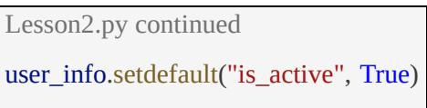

#### **3.3.4 Dictionnaires imbriqués**

Un dictionnaire peut contenir d’autres dictionnaires, formant une structure imbriquée. Les dictionnaires imbriqués sont utiles pour stocker des données complexes et sont couramment utilisés dans LangGraph pour gérer des états comportant plusieurs couches d'informations.

```
Lesson2.py continued
user_info = {
    "name": "Alice",
    "contact": {
```

```
"email": "alice@example.com",
        "phone": "123-456-7890"
    }
}
print(user_info["contact"]["email"])  # Output: alice@example.com
```
#### **3.3.5 Accès aux valeurs du dictionnaire imbriqué**

Vous pouvez accéder aux valeurs du dictionnaire imbriquées en chaînant les appels [] ou get().

```
Lesson2.py continued
email = user_info["contact"]["email"]
phone = user_info.get("contact", {}).get("phone", "Not available")
print(email, phone)
```
#### **3.3.6 Modification des valeurs du dictionnaire imbriqué**

Vous pouvez mettre à jour les valeurs imbriquées en y accédant avec leurs clés respectives.

```
Lesson2.py continued
user_info["contact"]["email"] = "new_email@example.com"
```
#### **3.3.7 Compréhension du dictionnaire**

Python prend en charge la compréhension de dictionnaires, vous permettant de créer des dictionnaires de manière concise et lisible. Ceci est particulièrement utile pour les transformations de données dans LangGraph. La compréhension de dictionnaire est une technique permettant de créer des dictionnaires Python sur une seule ligne. La méthode crée des dictionnaires à partir d'objets itérables, tels qu'une liste, un tuple ou un autre dictionnaire.

```
Lesson2.py continued
# Creating a dictionary with squares of numbers
squares = {x: x ** 2 for x in range(5)}
print(squares)
# Output: {0: 0, 1: 1, 2: 4, 3: 9, 4: 16}
```
#### **3.3.8 Copie de dictionnaires**

Lorsque vous attribuez un dictionnaire à une nouvelle variable, vous créez en réalité une référence au dictionnaire d'origine. Par conséquent, les modifications apportées au nouveau

La variable affectera également le dictionnaire original. Pour créer une copie distincte, utilisez la méthode copy().

```
Lesson2.py continued
user_info_copy = user_info.copy()
user_info_copy["name"] = "Bob"
print(user_info["name"])  # Output: Alice
print(user_info_copy["name"])  # Output: Bob
```
Pour la copie approfondie (dictionnaires imbriqués), utilisez le module de copie.

```
Lesson2.py continued
import copy
deep_copy = copy.deepcopy(user_info)
print(deep_copy)
```
**3.3.9 Fusion de dictionnaires :** Python 3.9 a introduit le | opérateur pour fusionner deux dictionnaires. L'opérateur |= met à jour un dictionnaire en place.

```
Lesson2.py continued
dict1 = {"a": 1, "b": 2}
dict2 = {"b": 3, "c": 4}
# Merging
merged = dict1 | dict2
# Output: {'a': 1, 'b': 3, 'c': 4}
# In-place merge
dict1 |= dict2
# Output: {'a': 1, 'b': 3, 'c': 4}
```
#### **3.4. Que sont les TypedDicts ?**

TypedDict est une fonctionnalité introduite dans le module de typage de Python (et plus tard, typing\_extensions pour une compatibilité ascendante) qui vous permet de définir des dictionnaires avec une structure spécifiée.

En Python, un **TypedDict** est un type spécial de dictionnaire dans lequel vous définissez les clés spécifiques et les types de valeurs que chaque clé peut contenir. Cela permet de garantir que votre structure de données est utilisée de manière cohérente, ce qui peut éviter les erreurs. Voici comment définir un TypedDict :

```
Lesson2.py continued
from typing_extensions import TypedDict
class Person(TypedDict):
    name: str
    age: int
```
Dans cet exemple, Person TypedDict spécifie que le dictionnaire doit avoir une clé de nom (contenant une **chaîne**) et une clé d'âge (contenant un **entier**). Si vous essayez de stocker d'autres types de données, Python générera une erreur, vous aidant ainsi à garder votre code propre et sans erreur.

```
Lesson2.py continued
person : Person = {"name": "Alice", "age": 30}
print(person["name"])  # Output: Alice
```
Vous pouvez également utiliser la fonction d'usine TypedDict, qui est utile lors de la création dynamique de types ou lorsque le nom du type ne peut pas être un nom de classe valide.

```
Lesson2.py continued
Person = TypedDict('Person', {'id': int, 'name': str, 'age': int})
```
#### **3.4.1 TypedDict avec dictionnaires imbriqués**

TypedDict est particulièrement utile lorsque vous devez définir des structures imbriquées complexes, courantes dans LangGraph pour représenter des états avec plusieurs couches d'informations.
Avec TypedDicts imbriqués, vous pouvez vous assurer que les structures de dictionnaire externe et interne adhèrent à leurs types spécifiés.

| Lesson2.py suite |
|----------------------------------|
| classe<br>Adresse(TypedDict) : |
| rue : rue |
| ville: rue |
| code_zip : int |
| classe<br>UserProfile(TypedDict): |
| nom d'utilisateur : str |
| email : str |
| adresse: Adresse |
|                                  |

```
profile: UserProfile = {
    "username": "johndoe",
    "email": "johndoe@example.com",
    "address": {
         "street": "123 Elm St",
         "city": "Metropolis",
         "zip_code": 12345
    }
}
```
#### **3.4.2 Utilisation de TypedDict dans les fonctions**

TypedDict est particulièrement utile dans les paramètres de fonction et les types de retour. Spécifier TypedDict comme indicateur de type vous permet de garantir que tous les dictionnaires transmis ou renvoyés par la fonction suivent la structure attendue.

#### **4.3 TypedDict comme paramètres de fonction**

```
Lesson2.py continued
class User(TypedDict):
    name: str
    age: int
    is_active: bool
def display_user_info(user: User) -> None:
    print(f"Name: {user['name']}, Age: {user['age']}, Active: {user['is_active']}")
user_data = {"name": "Alice", "age": 30, "is_active": True}
display_user_info(user_data)
3.4.3 TypedDict As Return Types
def create_user(name: str, age: int) -> User:
    return {"name": name, "age": age, "is_active": True}
new_user = create_user("Bob", 25)
print(new_user)
#Output {'name': 'Bob', 'age': 25, 'is_active': True}
```
En spécifiant User comme type de retour, vous imposez que le dictionnaire renvoyé par create\_user doit correspondre à la structure définie par User .

#### **3.4.4 Utilisation de TypedDict avec les valeurs par défaut**

Contrairement aux dictionnaires normaux, TypedDict ne prend pas en charge l'attribution directe de valeurs par défaut aux clés. Vous pouvez cependant utiliser setdefault() ou initialiser le dictionnaire avec une fonction d'assistance pour garantir les valeurs par défaut.

En utilisant une fonction d'assistance, vous pouvez initialiser TypedDict avec les valeurs par défaut selon vos besoins.

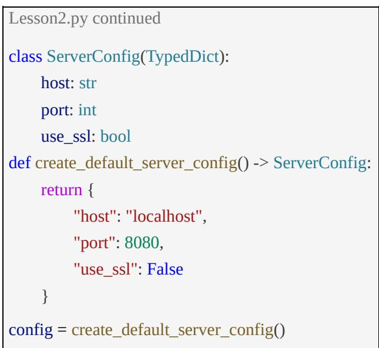

#### **3.4.5 Héritage avec TypedDict**

L'héritage TypedDict vous permet d'étendre un TypedDict existant avec des clés supplémentaires. Ceci est utile pour créer des dictionnaires spécialisés basés sur un type de dictionnaire de base.

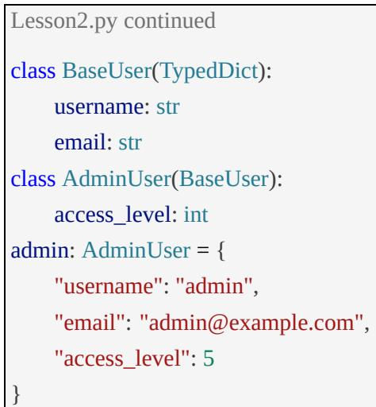

Ici, AdminUser hérite de la structure de BaseUser et ajoute une clé d'accès\_level supplémentaire.

# <span id="page-60-0"></span>**3.5. Classes en Python : les fondements de la programmation orientée objet**

Les classes sont l'épine dorsale de la programmation orientée objet (POO) en Python. Ils vous permettent de créer des structures de données personnalisées qui représentent des entités du monde réel, dans lesquelles sont encapsulées à la fois des données (attributs) et des fonctionnalités (méthodes). Cela rend les classes incroyablement puissantes pour gérer des comportements complexes et maintenir un code organisé. Dans LangGraph, les classes sont souvent utilisées pour représenter diverses entités, telles que les **nœuds**, les **états** et les **agents**. Cette section vous guidera à travers l'essentiel des classes Python, notamment les attributs, les méthodes, l'héritage, l'encapsulation et les concepts avancés tels que les classes et les méthodes statiques.

**3.5.1 Qu'est-ce qu'une classe ?**

Une **classe** est un modèle de création d'objets, qui sont des instances de cette classe. Il définit un ensemble d'attributs et de méthodes dont disposeront les objets créés. L’utilisation de classes vous permet de regrouper les données et fonctionnalités associées, offrant ainsi une manière structurée de modéliser des concepts du monde réel.

```
Lesson2.py continued
class Dog:
    def __init__(self, name, age):
         self.name = name
         self.age = age
# Creating an object of the Dog class
my_dog = Dog("Buddy", 3)
print(my_dog.name)  # Output: Buddy
print(my_dog.age)   # Output: 3
```
Dans cet exemple :

- Le chien est la classe.
- \_\_init\_\_() est une méthode spéciale (**initializer**) qui s'exécute lorsque vous créez une instance de la classe. Il initialise les attributs de l'objet.
- my\_dog est une instance (ou objet) de la classe Dog.

#### **3.5.2 Attributs et méthodes :**

Les attributs sont des variables qui appartiennent à une classe. Il existe deux types d'attributs :

- **Attributs d'instance** : définis dans les méthodes et spécifiques à chaque instance de la classe.
- **Attributs de classe** : définis directement au sein de la classe et partagés entre toutes les instances.

```
Leçon2.py suite
Classe Chien :
    espèce = "Canis lupus" # Attribut de classe
    def __init__(soi, nom, âge) :
self.name = nom # Attribut d'instance
         self.age = age # Attribut d'instance
# Accéder aux attributs
chien1 = Chien("Copain", 3)
chien2 = Chien("Lucy", 5)
print(dog1.species) # Sortie : Canis lupus
print(dog1.name) # Sortie : Copain
```
#### **3.5.2.1 Methods**

Methods are functions defined within a class that describe the behaviors of the objects created from the class.

```
Leçon2.py suite
Classe Chien :
    def __init__(soi, nom, âge) :
         soi.nom = nom
         self.age = âge
    def aboiement (soi):
         return f"{self.name} dit wouf !"
chien = Chien("Copain", 3)
print(dog.bark()) # Sortie : Buddy dit wouf !
```
#### **3.5.3 The \_\_init\_\_() Method**

The \_\_init\_\_() method is a special method in Python classes known as the **initializer** or **constructor**. It is automatically called when a new instance of the class is created, and it allows you to initialize the instance attributes.

```
Leçon2.py suite
Voiture de classe :
    def __init__(soi, marque, modèle, année) :
         self.make = faire
         self.model = modèle
         self.year = année
ma_voiture = Voiture("Toyota", "Corolla", 2021)
print(my_car.make) # Sortie : Toyota
```
#### **3.5.4 The self Keyword**

In Python, self refers to the instance of the class and is used to access instance attributes and methods from within the class. When you define methods in a class, self is the first parameter, representing the instance calling the method.

#### **3.5.5 Inheritance**

Inheritance allows you to create a new class based on an existing class, inheriting its attributes and methods. This promotes code reuse and establishes a relationship between classes.

```
Leçon2.py suite
classe Animal :
    def __init__(soi, nom) :
         soi.nom = nom
    def parler (soi):
         return "Un son générique"
class Dog(Animal): # Le chien hérite d'Animal
    def parler (soi):
         return f"{self.name} dit wouf !"
chien = Chien("Copain")
print(dog.speak()) # Sortie : Buddy dit wouf !
```
In this example:

- Animal is the **base class** or **parent class**.
- Dog is the **derived class** or **child class**, which inherits the properties of Animal and overrides the speak method.

#### **3.5.5.1 Multiple Inheritance**

Python supports multiple inheritance, where a class can inherit from more than one base class. This is useful in complex systems, though it can introduce ambiguity if not managed carefully.

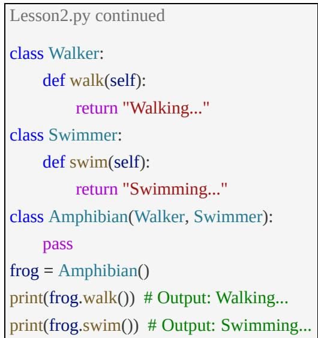

#### **3.5.6 Encapsulation and Access Modifiers**

Encapsulation is the practice of restricting access to certain attributes or methods to protect the integrity of the data. Python uses underscores to denote different access levels:

- **Public Attributes**: Accessible from anywhere (default in Python).
- **Protected Attributes**: Prefixed with a single underscore ( \_ ). This is a convention to indicate that these should not be accessed directly.
- **Private Attributes**: Prefixed with a double underscore ( \_\_ ). These are name-mangled and cannot be accessed directly outside the class.

```
Leçon2.py suite
classe CompteBancaire :
    def __init__ (soi, propriétaire, solde) :
         self.owner = propriétaire
         self._balance = solde # Protégé
    def __withdraw(self, montant): # Méthode privée
         si montant <= self._balance :
           self._balance -= montant
           retourner self._balance
         retourner "Fonds insuffisants"
```
account = BankAccount("Alice", 1000) print(account.\_balance) # Accessing a protected attribute (not recommended)

## <span id="page-64-0"></span>**3.5.7 Class and Static Methods**

#### **3.5.7.1 Class Methods**

Class methods are methods that are bound to the class rather than the instance. They have access to the class itself via the cls parameter and are defined with the @classmethod decorator.

```
Leçon2.py suite
Personne de classe :
   espèce = "Homo sapiens"
   @méthodeclasse
   def set_species(cls, new_species) :
      cls.species = nouvelle_espèce
Person.set_species("Homo sapiens sapiens")
print(Person.species) # Sortie : Homo sapiens sapiens
```
#### **3.5.7.2 Méthodes statiques**

Les méthodes statiques sont des fonctions utilitaires qui ne nécessitent pas d'accès aux attributs de classe ou d'instance. Ils sont définis avec le décorateur @staticmethod.

| Lesson2.py suite |
|--------------------------------------------------|
| cours<br>Maths : |
| @méthodestatique |
| def<br>ajouter(a, b): |
| retour<br>a<br>+<br>b |
| print(Math.add(3, 5)) # Sortie : 8 |

# <span id="page-64-1"></span>**3.5.8 Méthodes magiques**

Les méthodes magiques (également appelées méthodes dunder) sont des méthodes spéciales en Python qui commencent et se terminent par des traits de soulignement doubles ( \_\_ ). Ils vous permettent de

définissez le comportement de votre classe dans diverses opérations intégrées, comme + , - ou print() .

#### **3.5.8.1 \_\_str\__\_ :**

Définit le comportement de str() et print() pour renvoyer une représentation sous forme de chaîne conviviale. \_\_repr\_\_ : renvoie une représentation sous forme de chaîne sans ambiguïté qui peut être utilisée pour recréer l'objet.

```
Lesson2.py continued
class Car:
    def __init__(self, make, model):
         self.make = make
         self.model = model
    def __str__(self):
         return f"{self.make} {self.model}"
    def __repr__(self):
         return f"Car('{self.make}', '{self.model}')"
car = Car("Toyota", "Corolla")
print(car)  # Output: Toyota Corolla
print(repr(car))  # Output: Car('Toyota', 'Corolla')
```
#### **3.5.8.2 Surcharge de l'opérateur :**

**Les méthodes magiques vous permettent également de définir le comportement des opérateurs intégrés.**

```
Lesson2.py continued
class Vector:
    def __init__(self, x, y):
         self.x = x
         self.y = y
    def __add__(self, other):
         return Vector(self.x + other.x, self.y + other.y)
v1 = Vector(1, 2)
v2 = Vector(3, 4)
result = v1 + v2
print(result.x, result.y)  # Output: 4 6
```
## <span id="page-66-0"></span>**3.5.9 Propriétés :**

Les propriétés en Python vous permettent de contrôler l'accès aux attributs. Le décorateur @property vous permet de définir des méthodes accessibles comme des attributs, rendant votre code plus propre et plus sûr.

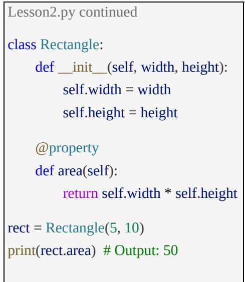

Vous pouvez également définir des **setters** pour les propriétés afin de contrôler la manière dont les attributs sont définis.

```
Lesson2.py continued
class Rectangle:
    def __init__(self, width, height):
         self._width = width
         self._height = height
    @property
    def width(self):
         return self._width
    @width.setter
    def width(self, value):
         if value > 0:
      self._width = value
         else:
```

```
raise ValueError("Width must be
positive")
```
# <span id="page-67-0"></span>**3.5.10 Meilleures pratiques avec les classes**

- **Utilisez des noms de classe descriptifs** : choisissez des noms qui décrivent clairement l'objectif de la classe.
- **Encapsuler les données** : utilisez des attributs privés et des méthodes publiques pour protéger les données et contrôler l'accès.
- **Préférez la composition à l'héritage** : utilisez l'héritage avec parcimonie et privilégiez la composition pour réduire la complexité et améliorer la flexibilité.
- **Utiliser les propriétés pour un accès contrôlé** : utilisez les propriétés pour gérer l'accès aux attributs d'instance en toute sécurité.
- **Documentez vos classes** : incluez des docstrings pour expliquer le but et l'utilisation de vos classes et méthodes.

# <span id="page-67-1"></span>**3.5.11. Modules externes courants utilisés dans LangGraph**

LangGraph exploite plusieurs modules Python externes pour améliorer ses fonctionnalités, rationaliser les processus et gérer des tâches complexes. Ces modules prennent en charge diverses fonctionnalités, notamment la saisie de données, la programmation asynchrone, les interactions API et la visualisation des données. Comprendre ces modules vous fournira les outils nécessaires pour créer de puissantes applications LangGraph. Ci-dessous, nous explorons certains des modules externes les plus couramment utilisés dans le développement LangGraph.

#### **a) saisie et saisie\_extensions**

LangGraph nécessite souvent des indications de type pour garantir la cohérence des données et maintenir la lisibilité du code. Les modules typing et typing\_extensions sont inestimables pour spécifier et appliquer des types, en particulier avec des structures de données complexes comme des dictionnaires et des fonctions.

- **TypedDict** : permet des dictionnaires avec des paires clé-valeur spécifiques et des astuces de type.
- **List , Dict , Tuple** : Tapez des astuces pour les structures de données de base.
- **Union** : permet à une variable d'être l'un des multiples types spécifiés.
- **Facultatif** : Utilisé lorsqu'une variable peut être None .

```
Lesson2.py continued
from typing import List, Dict, Optional
def process_data(data: Dict[str, Optional[List[int]]]) -> None:
    print(data)
```
**Où utiliser dans LangGraph :**

Ces modules sont essentiels lors de la définition de structures de données complexes pour les états ou les paramètres des nœuds, permettant une vérification de type robuste et une clarté du code.

**b) asyncio**

Les applications LangGraph impliquent souvent des tâches qui peuvent bénéficier d'une exécution asynchrone, telles que des requêtes réseau ou un traitement de données simultané. Le module asyncio est la bibliothèque intégrée de Python pour la programmation asynchrone, permettant des opérations non bloquantes et une gestion efficace des tâches liées aux E/S.
**Composants clés :**

- **async et wait** : Pour définir des fonctions asynchrones.
- **asyncio.run()** : Exécute la boucle d'événements asynchrone principale.
- **gather()** : Exécute plusieurs tâches asynchrones simultanément.

```
Lesson2.py continued
import asyncio
async def fetch_data():
    await asyncio.sleep(1)
    return "Data fetched!"
async def main():
    results = await asyncio.gather(fetch_data(), fetch_data())
    print(results)
asyncio.run(main())
```
**Où utiliser dans LangGraph :**

Utilisez asyncio lorsque vous devez effectuer plusieurs tâches simultanément, comme traiter des données en parallèle ou attendre plusieurs réponses API.

#### **c) demandes**

Bien que LangGraph lui-même n'ait pas toujours besoin d'appels d'API directs, il est courant d'interagir avec des API externes pour la récupération de données, la diffusion de modèles ou l'intégration avec d'autres services. Le module de requêtes est la bibliothèque incontournable pour gérer les requêtes HTTP en Python.

**Composants clés :**

- **get() , post() , put() , delete()** : Méthodes pour faire des requêtes HTTP.
- **json()** : analyse les réponses JSON directement dans les dictionnaires Python.
- **headers , params , data** : Pour personnaliser les requêtes.

```
Lesson2.py continued
import requests
try:
   response = requests.get("https://api.example.com/data")
   if response.status_code == 200:
       data = response.json()
       print(data)
except requests.exceptions.RequestException as e:
   print(f"Error: {e}")
```
#### **Où utiliser dans LangGraph :**

Utilisez des requêtes pour toutes les interactions HTTP requises par vos nœuds LangGraph, telles que la récupération de données à partir d'une API externe ou la publication de résultats sur un service Web.

#### **d) pydantique**

Pydantic est une bibliothèque de validation de données basée sur des astuces de type Python. C'est particulièrement utile dans LangGraph lorsque vous devez vous assurer que les données entrant ou sortant d'un nœud répondent à certains critères. Les modèles de Pydantic peuvent appliquer un typage strict, fournir des valeurs par défaut et valider les données par rapport aux schémas.

- BaseModel : Il s'agit de la classe fondamentale dont héritent tous les modèles Pydantic. Lorsque vous définissez une classe qui hérite de BaseModel, vous pouvez spécifier les types de données attendus pour chaque attribut. Pydantic appliquera ensuite ces types lorsque vous créerez des instances de la classe.
- Champ : Cette fonction vous permet d'ajouter des métadonnées aux champs du modèle, telles que des contraintes (par exemple, définir une valeur minimale) et des valeurs par défaut. Dans l'exemple ci-dessous, Field(..., gt=0) spécifie que le champ age doit être supérieur à zéro.
- ValidationError : Si les données transmises à un modèle Pydantic ne correspondent pas au schéma requis, une ValidationError est levée. Cette exception fournit des informations détaillées sur les champs qui ont échoué à la validation et pourquoi.

```
Lesson2.py continued
from pydantic import BaseModel, Field, ValidationError
class User(BaseModel):
    name: str
    age: int = Field(..., gt=0)
try:
    user = User(name="Alice", age=-1)
except ValidationError as e:
    print(e)
```
#### **Où utiliser dans LangGraph :**

Pydantic est idéal pour valider les entrées des nœuds, garantir que les données d'état sont conformes aux types attendus et sérialiser des structures de données complexes.

```
e) logging
```
La journalisation est essentielle dans les applications LangGraph, en particulier lors du déploiement dans des environnements de production, car elle fournit des informations sur le fonctionnement de l'application, aide à diagnostiquer les problèmes et aide à maintenir un système stable. Le module de journalisation de Python est un outil intégré qui permet une journalisation complète et personnalisable, facilitant ainsi le suivi et la gestion des journaux pour différents niveaux de gravité.

#### **Composants clés expliqués :**

- 1. **basicConfig()** : Cette fonction configure la configuration de base pour la journalisation, telle que le niveau de journalisation, le format et la destination de sortie. En définissant le niveau, vous contrôlez quels messages sont enregistrés, en filtrant les messages en dessous du niveau spécifié.
- 2. **Niveaux de journalisation** : Ces niveaux prédéfinis déterminent la gravité des messages à journaliser :
	- **DEBUG** : informations détaillées pour diagnostiquer les problèmes.
	- **INFO** : Informations générales sur l'exécution du programme.
	- **AVERTISSEMENT** : indique un problème potentiel ou quelque chose d'inattendu.
	- **ERREUR** : Un problème important qui a empêché une partie du programme de fonctionner.
	- **CRITIQUE** : une erreur grave, conduisant probablement à l'arrêt du programme.
- 3. **getLogger()** : Cette fonction renvoie une instance de logger associée à un module ou composant particulier. L'utilisation de loggers vous permet de créer différents flux de journaux pour différentes parties de votre application, vous offrant ainsi un contrôle précis sur votre journalisation.
Voici un exemple qui montre comment configurer et utiliser la journalisation :

```
Lesson2.py continued
import logging
# Configure basic logging settings
logging.basicConfig(level=logging.INFO)  # Sets logging to capture INFO and above
messages
# Create a logger instance
logger = logging.getLogger(__name__)
# Log an informational message
logger.info("This is an informational message.")
```
Dans cet exemple :

● basicConfig(level=logging.INFO) configure le système de journalisation pour capturer les messages INFO , AVERTISSEMENT , ERROR et CRITICAL , tandis que les messages DEBUG sont ignorés.

- getLogger(\_\_name\_\_) crée une instance de logger spécifique au module actuel, vous permettant d'organiser les logs par module si nécessaire.
- logger.info("Ceci est un message d'information.") génère un message d'information, qui serait affiché sur la console en raison de la configuration.

La journalisation est particulièrement utile pour :

- **Suivi du flux d'exécution** : vous pouvez ajouter des instructions de journal à des points critiques dans les nœuds LangGraph pour suivre la manière dont les données circulent dans le graphique et vérifier que les processus fonctionnent comme prévu.
- **Erreurs d'enregistrement** : enregistrez les messages d'erreur dans les sections de gestion des erreurs des nœuds pour capturer les détails de tous les problèmes qui surviennent, permettant ainsi un débogage plus facile.
- **Capture des événements système** : enregistrez les événements clés, tels que l'initialisation du nœud, l'achèvement de tâches importantes ou les interactions avec des services externes, pour surveiller le comportement de l'application au fil du temps.

Par exemple, dans les nœuds LangGraph, vous pouvez utiliser la journalisation pour :

- Enregistrez quand un nœud démarre et termine le traitement.
- Enregistrer les entrées et sorties des nœuds pour faciliter le débogage et la compréhension des transformations de données en cours.
- Suivez les erreurs et les exceptions générées dans les nœuds, en fournissant des traces de pile ou un contexte supplémentaire pour simplifier la résolution des problèmes.

En plaçant stratégiquement les instructions de journal, vous pouvez obtenir des informations précieuses sur le fonctionnement de votre application LangGraph, ce qui facilite la surveillance, le débogage et la maintenance.

#### **f) sous-processus**

Le module de sous-processus vous permet de générer de nouveaux processus, de vous connecter à leurs canaux d'entrée/sortie/erreur et d'obtenir leurs codes de retour. Ceci est utile dans LangGraph lorsque les nœuds doivent exécuter des commandes shell ou exécuter des scripts externes.

- **subprocess.run()** : Exécute une commande et attend qu'elle se termine.
- **subprocess.Popen()** : Contrôle plus avancé des processus, permettant une exécution asynchrone.

● **check\_output()** : Exécute une commande et renvoie sa sortie.

```
Lesson2.py continued
import sys
import subprocess
result = subprocess.run(["echo", "Hello, LangGraph!"], capture_output=True, text=True,
executable=sys.executable)
print(result.stdout)
```
#### **Où utiliser dans LangGraph :**

Utilisez des sous-processus pour des tâches telles que l'exécution de commandes shell, l'exécution de scripts auxiliaires ou l'intégration avec des outils de ligne de commande directement à partir des nœuds LangGraph.

#### **g)Module json**

Le module json est la bibliothèque intégrée de Python permettant de travailler avec des données JSON (JavaScript Object Notation). JSON est un format de données léger, facile à lire et à écrire, ce qui le rend idéal pour l'échange de données entre applications. Dans LangGraph, json est fréquemment utilisé pour sérialiser et désérialiser des données, en particulier lors de l'interaction avec des API ou de l'enregistrement de données structurées sur le disque.

- **json.load()** : Lit les données JSON d'un fichier et les désérialise dans un dictionnaire Python.
- **json.dump()** : sérialise les objets Python au format JSON et les écrit dans un fichier.
- **json.loads()** : Désérialise une chaîne codée en JSON dans un dictionnaire Python.
- **json.dumps()** : sérialise un objet Python en une chaîne au format JSON.

```
Lesson2.py continued
# Reading from a JSON file
with open("data.json", "r") as f:
    loaded_data = json.load(f)
print(loaded_data)  # Output: {'name': 'Alice', 'age': 30}
```
#### **Où utiliser json dans LangGraph :**

Utilisez le module json pour les tâches impliquant la lecture et l'écriture de données structurées. Les cas d'utilisation courants incluent :

- **Stockage et récupération des données sur l'état des nœuds, c'est-à-dire persistance** : les fichiers JSON peuvent conserver l'état des nœuds dans les applications LangGraph.
- **Interaction avec les API** : JSON est souvent le format de données standard pour la communication API, vous sérialiserez et désérialiserez donc fréquemment les données lors de l'envoi ou de la réception de requêtes API.
- **Gestion de la configuration** : les fichiers JSON sont utilisés pour gérer les configurations dans les projets LangGraph en raison de leur simplicité et de leur large prise en charge sur toutes les plateformes.

#### **h) Module yaml**
Le module yaml, disponible via la bibliothèque PyYAML, est un autre outil de sérialisation et de désérialisation des données. YAML (YAML Ain't Markup Language) est similaire à JSON mais est plus lisible par l'homme en raison de sa syntaxe et de la prise en charge des commentaires. Dans LangGraph, yaml est couramment utilisé pour les fichiers de configuration, car sa lisibilité le rend idéal pour les paramètres pouvant nécessiter un ajustement manuel. Pour utiliser yaml , vous devez installer la bibliothèque PyYAML :

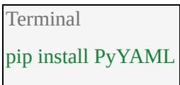

- **yaml.safe\_load()** : Lit les données YAML d'un fichier et les désérialise dans un dictionnaire Python. La méthode safe\_load est recommandée car elle évite les risques de sécurité potentiels associés à la méthode de chargement.
- **yaml.dump()** : sérialise les objets Python au format YAML et les écrit dans un fichier.
- **yaml.safe\_load\_all()** : Lit et désérialise plusieurs documents à partir d'un flux YAML.

```
Lesson2.py continued
import yaml
# Writing to a YAML file
```

```
config = {"name": "Alice", "roles": ["admin", "user"]}
try:
    with open("config.yaml", "w") as f:
         yaml.dump(config, f)
    # Reading from a YAML file
    with open("config.yaml", "r") as f:
         loaded_config = yaml.safe_load(f)
    print(loaded_config)  # Output: {'name': 'Alice', 'roles': ['admin', 'user']}
except Exception as e:
    print(f"Error: {e}")
```
**Où utiliser yaml dans LangGraph :**

Le module yaml est particulièrement adapté à la gestion de configuration en raison de sa lisibilité et de sa prise en charge de structures de données complexes. Les cas d'utilisation courants incluent :

- **Fichiers de configuration** : les fichiers YAML sont souvent utilisés pour stocker les configurations dans les projets LangGraph car ils sont plus lisibles que JSON et prennent en charge des fonctionnalités telles que les commentaires, qui sont utiles pour la documentation.
- **Paramètres pour les nœuds ou pipelines complexes** : pour les flux de travail LangGraph qui nécessitent des paramètres complexes, YAML peut fournir un moyen clair et lisible de gérer et de comprendre les configurations.
- **Structures imbriquées** : YAML gère les structures imbriquées et les types de données complexes avec plus d'élégance que JSON, ce qui le rend préférable lorsque les configurations sont hiérarchiques.

#### **i) pandas**

Pour les tâches de manipulation et d'analyse de données dans LangGraph, pandas est un outil inestimable. Il fournit des structures de données puissantes telles que les DataFrames et un large éventail de fonctions pour le traitement des données.

- **DataFrame** : La structure de données principale pour les données tabulaires.
- **read\_csv() / to\_csv()** : lit et écrit dans des fichiers CSV.

● **groupby() , merge() , pivot()** : Méthodes de transformation et d'agrégation des données.

```
Lesson2.py continued
import pandas as pd
df = pd.read_csv("data.csv")
print(df.head())
```
#### **Où utiliser dans LangGraph :**

Utilisez des pandas pour traiter et transformer de grands ensembles de données, comme l'agrégation de données provenant de plusieurs sources ou la préparation de données pour les entrées de modèle dans les nœuds LangGraph.

#### **j) matplotlib et seaborn**

LangGraph implique souvent la visualisation de données, soit pour le débogage, l'analyse ou la présentation des résultats. matplotlib et seaborn sont des bibliothèques populaires pour créer des visualisations statiques, animées et interactives.

- **matplotlib.pyplot** : Module pour créer des tracés de base comme des graphiques en courbes, en nuages ​​de points et en barres.
- **seaborn** : Construit sur matplotlib avec un traçage statistique avancé.

```
Lesson2.py continued
import matplotlib.pyplot as plt
plt.plot([1, 2, 3, 4], [10, 20, 25, 30])
plt.xlabel("X-axis")
plt.ylabel("Y-axis")
plt.show()
#Output
```
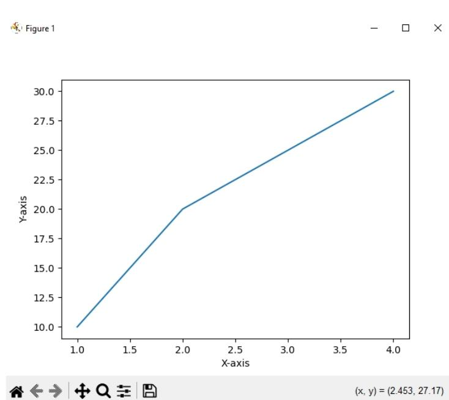

Utilisez matplotlib et seaborn pour créer des visualisations pouvant aider à interpréter les données traitées dans LangGraph, comme tracer les résultats d'un nœud ou visualiser les changements d'état au fil du temps.

**k) sqlalchemy et sqlite3**

Pour les applications nécessitant un stockage de données persistant, comme la journalisation des états ou la sauvegarde des résultats, LangGraph peut interagir avec les bases de données. sqlalchemy fournit une couche de mappage objet-relationnel (ORM) pour travailler avec des bases de données SQL, tandis que sqlite3 est une base de données légère incluse dans la bibliothèque standard de Python.

- **sqlalchemy.create\_engine()** : Se connecte à une base de données.
- **sessionmaker()** : Gère les sessions de base de données.
- **sqlite3.connect()** : Se connecte directement à une base de données SQLite.

```
Lesson2.py continued
from sqlalchemy import create_engine
from sqlalchemy.orm import sessionmaker
try:
    engine = create_engine("sqlite:///data.db")
    Session = sessionmaker(bind=engine)
```

```
session = Session()
except Exception as e:
    print(f"Error: {e}")
```
Utilisez ces bibliothèques pour stocker et récupérer des données dans des bases de données, gérer la persistance de l'état des applications ou suivre les métriques à long terme sur les sessions LangGraph.

#### **l) Module os : Opérations du système de fichiers**

Le module os fournit un moyen d'interagir avec le système d'exploitation. Il permet la manipulation de fichiers et de répertoires, l'accès aux variables d'environnement et les opérations au niveau du système. Ce module est fréquemment utilisé dans les projets LangGraph pour des tâches telles que la gestion de fichiers et de répertoires, la création de dossiers de sortie et la gestion des chemins.

**Fonctions clés :**

- **os.path.join()** : Rejoint plusieurs composants de chemin en un seul chemin.
- **os.makedirs()** : Crée un répertoire (et tous les répertoires parents nécessaires) s'il n'existe pas.
- **os.environ** : Accède aux variables d'environnement.
- **os.remove()** : Supprime un fichier.
- **os.rename()** : Renomme un fichier ou un répertoire.

```
Lesson2.py continued
import os
try:
    #Create a folder
    output_dir = "output"
    os.makedirs(output_dir, exist_ok=True)
    # Get an environment variable
    api_key = os.environ.get("API_KEY", "default_value")
except Exception as e:
    print(f"Error: {e}")
```
#### **Utilisations courantes dans LangGraph :**

- **Gestion des fichiers de sortie** : créez et organisez des répertoires de sortie pour les journaux, les graphiques ou les exportations de données.
- **Définition des variables d'environnement** : configurez les clés API ou les paramètres spécifiques à l'environnement pour les nœuds LangGraph.
- **Manipulation de fichiers** : supprimez ou renommez des fichiers dans le cadre des workflows de traitement des données.

#### **m) Module sys : paramètres et fonctions spécifiques au système**

Le module sys donne accès aux paramètres et fonctions spécifiques au système qui interagissent avec l'environnement d'exécution Python. Il est souvent utilisé pour gérer les arguments de ligne de commande, contrôler l'interpréteur et gérer les flux d'entrée/sortie.

**Fonctions clés :**

- **sys.argv** : Récupère une liste d'arguments de ligne de commande passés au script.
- **sys.exit()** : Quitte le programme, éventuellement avec un statut de sortie spécifié.
- **sys.path** : Accède à la liste des répertoires que Python recherche pour les modules, utile pour ajouter dynamiquement des chemins.
- **sys.platform** : Renvoie une chaîne identifiant la plateforme sur laquelle le script s'exécute.

```
Lesson2.py continued
import sys
# Check if enough arguments were passed
if len(sys.argv) < 2:
    print("Usage: python script.py <filename>")
    sys.exit("Please provide a file path as an argument.")
# Accessing command-line arguments
filename = sys.argv[1]
print(f"Processing file: {filename}")
#Exit management
def process_data(data):
    if not data:
         print("Error: No data provided.")
         sys.exit(1)  # Exit with an error status
    print("Data processed successfully.")
    sys.exit(0)  # Exit with a success status
```

```
# Simulating a scenario with empty data
data = None
process_data(data)
```
**Utilisations courantes dans LangGraph :**

- **Gestion des arguments de ligne de commande** : autorisez les scripts LangGraph à accepter les entrées de l'utilisateur directement à partir de la ligne de commande, ce qui est utile pour la personnalisation.
- **Gestion des sorties** : contrôlez l'arrêt du script, en particulier lorsque vous rencontrez des erreurs ou des conditions non valides.
- **Comportement spécifique à la plate-forme** : adapter le comportement du code en fonction du système d'exploitation (par exemple, gérer les chemins de fichiers différemment sous Windows et Linux).
	- **n) Module aléatoire : Génération de nombres aléatoires**

Le module aléatoire fournit des fonctions permettant de générer des nombres aléatoires et de sélectionner des éléments aléatoires. Cela peut être utile dans LangGraph pour créer des cas de tests randomisés, échantillonner des données ou implémenter des processus stochastiques dans un graphique.

**Fonctions clés :**

- **random.randint()** : Génère un entier aléatoire dans une plage spécifiée.
- **random.choice()** : Sélectionne un élément aléatoire dans une séquence non vide.
- **random.shuffle()** : Mélange aléatoirement une liste sur place.
- **random.uniform()** : Génère un nombre aléatoire à virgule flottante dans une plage spécifiée.

```
Lesson2.py continued
import random
# Generate a random integer between 1 and 100
random_number = random.randint(1, 100)
print(random_number)
# Choose a random item from a list
options = ["apple", "banana", "cherry"]
```

```
fruit = random.choice(options)
print(fruit)
# Shuffle a list
numbers = [1, 2, 3, 4, 5]
shuffle = random.shuffle(numbers)
print(shuffle)
#Uniform float numbers
random_float = random.uniform(0, 1)
print(random_float)
```
**Utilisations courantes dans LangGraph :**

- **Échantillonnage de données** : sélectionnez aléatoirement des sous-ensembles de données à des fins de traitement ou de test.
- **Séquences de mélange** : randomisez l'ordre des éléments dans une liste, comme la randomisation des cas de test ou la création de sorties variées.
- **Processus stochastiques** : introduisez le caractère aléatoire dans la prise de décision ou simulez des événements aléatoires au sein des nœuds.
	- **o) Module datetime : Travailler avec les dates et les heures**

Le module datetime fournit des classes pour manipuler les dates et les heures. Il est essentiel pour les tâches qui impliquent l’horodatage, la planification ou la mesure d’intervalles de temps. Dans LangGraph, datetime est utile pour la journalisation, la gestion d'événements temporels ou le traitement de données de séries chronologiques.

**Composants clés :**

- **datetime.datetime.now()** : Récupère la date et l'heure actuelles.
- **datetime.timedelta** : Représente une durée, qui peut être utilisée pour l'arithmétique des dates.
- **datetime.datetime.strptime()** : Convertit une chaîne en un objet datetime basé sur un format spécifié.
- **datetime.datetime.strftime()** : Formate un objet datetime sous forme de chaîne.

Lesson2.py suite de l'importation datetime datetime, timedelta # Obtenir la date et l'heure actuelles

```
now = datetime.now()
# Calculate a future date by adding a timedelta
future_date = now + timedelta(days=5)
print(future_date.strftime("%Y-%m-%d"))
```
**Utilisations courantes dans LangGraph :**

- **Événements d'horodatage** : enregistrez l'heure à laquelle des nœuds spécifiques sont exécutés ou lorsque des événements particuliers se produisent.
- **Planification basée sur le temps** : déclenchez ou retardez des nœuds en fonction d'intervalles de temps, par exemple l'exécution d'une tâche toutes les 15 minutes.
- **Analyse et formatage des dates** : traitez les chaînes de date en objets datetime pour les calculs, ou reconvertissez les objets datetime en chaînes pour les rapports.
	- **p) Module collections : Structures de données spécialisées**

Le module collections fournit des structures de données spécialisées qui étendent les types intégrés de Python, tels que deque , Counter , defaultdict et approvedtuple . Ces structures sont optimisées pour des tâches spécifiques et peuvent rendre le code plus efficace et plus lisible.

- **Counter** : Une sous-classe de dictionnaire pour compter les objets hachables.
- **defaultdict** : Une sous-classe de dictionnaire qui fournit des valeurs par défaut pour les clés inexistantes.
- **deque** : Une file d'attente à double extrémité optimisée pour les ajouts et pops rapides.
- **namedtuple** : Fonction d'usine pour créer des sous-classes de tuples avec des champs nommés.

```
Lesson2.py continued
from collections import Counter, defaultdict
# Counting occurrences of items in a list
words = ["apple", "banana", "apple", "cherry"]
word_count = Counter(words)
# Using defaultdict to handle missing keys
fruits = defaultdict(int)
fruits["apple"] += 1
```
print(fruits) # Sortie : defaultdict(<class 'int'>, {'apple': 1})

**Utilisations courantes dans LangGraph :**

- **Comptage et comptage des éléments** : utilisez Counter pour comptabiliser rapidement les éléments, tels que le comptage des types de données passant par les nœuds.
- **Gestion des valeurs par défaut** : utilisez defaultdict dans les scénarios où les clés manquantes sont courantes, par exemple lors de l'accumulation de résultats.
- **Gestion des données ordonnées** : utilisez deque pour le traitement des données basé sur une file d'attente dans un flux de travail graphique.

#### **q) Module itertools : Fonctions d'itérateur**

Le module itertools fournit une suite d'outils rapides et économes en mémoire pour créer et travailler avec des itérateurs. Ces fonctions peuvent aider à gérer les boucles et les itérations dans les flux de travail LangGraph complexes.

**Composants clés :**

- **itertools.chain()** : Combine plusieurs itérateurs en une seule séquence.
- **itertools.cycle()** : Répète un itérable indéfiniment.
- **itertools.groupby()** : Regroupe les éléments dans un itérable en fonction d'une fonction clé spécifiée.
- **itertools.permutations()** : Génère des permutations d'une séquence.

```
Lesson2.py continued
from itertools import cycle
# Cycling through a list indefinitely
colors = cycle(["red", "green", "blue"])
for _ in range(6):
    print(next(colors))
```
**Utilisations courantes dans LangGraph :**

- **Génération de séquences infinies** : utilisez le cycle pour répéter des séquences, ce qui est utile pour la planification à tour de rôle.
- **Bouclage efficace** : utilisez la chaîne pour parcourir plusieurs listes sans créer de structures de données supplémentaires.

● **Création de permutations et de combinaisons** : utilisez des permutations pour tester différentes configurations ou résoudre des problèmes combinatoires dans les nœuds LangGraph.

# <span id="page-84-0"></span>**3.5.12 Cartographier, filtrer et réduire**

Ces outils de programmation fonctionnelle sont idéaux pour traiter des listes et autres itérables dans LangGraph.

- **map()** : applique une fonction à tous les éléments d'un itérable.
- **filter()** : Filtre les éléments en fonction d'une fonction.
- **reduce()** : Accumule les éléments en un seul résultat.
La fonction map() applique une fonction donnée à chaque élément d'un itérable (comme une liste) et renvoie un objet map (qui peut être converti en liste, tuple, etc.). Il est utile pour transformer des données, telles que la mise au carré de nombres ou la conversion de chaînes en majuscules.

```
Lesson2.py continued
# List of numbers to square
numbers = [1, 2, 3, 4]
# Using map to square each number
squares = list(map(lambda x: x**2, numbers))
print(squares)  # Output: [1, 4, 9, 16]
# List of strings
words = ["hello", "world", "langgraph"]
# Using map to convert each string to uppercase
uppercase_words = list(map(lambda word: word.upper(), words))
print(uppercase_words)  # Output: ['HELLO', 'WORLD', 'LANGGRAPH']
# List of dictionaries with user data
users = [
    {"name": "Alice", "age": 25},
    {"name": "Bob", "age": 30},
    {"name": "Charlie", "age": 35}
]
# Using map to extract only the 'name' field from each dictionary
names = list(map(lambda user: user["name"], users))
print(names)  # Output: ['Alice', 'Bob', 'Charlie']
```
La fonction filter() crée un nouvel itérable avec des éléments de l'itérable d'origine qui renvoient True lorsqu'ils sont transmis à la fonction spécifiée. Il est couramment utilisé pour filtrer les éléments en fonction de conditions.

```
Lesson2.py continued
# List of numbers to filter
numbers = [1, 2, 3, 4, 5, 6]
# Using filter to keep only even numbers
evens = list(filter(lambda x: x % 2 == 0, numbers))
print(evens)  # Output: [2, 4, 6]
# List of names
names = ["Alice", "Bob", "Charlie", "Dave"]
# Using filter to keep names with more than 3 characters
long_names = list(filter(lambda name: len(name) > 3, names))
print(long_names)  # Output: ['Alice', 'Charlie', 'Dave']
# List of dictionaries with user data
users = [
    {"name": "Alice", "age": 25},
    {"name": "Bob", "age": 20},
    {"name": "Charlie", "age": 35}
]
# Using filter to keep only users who are 30 years or older
adult_users = list(filter(lambda user: user["age"] >= 30, users))
print(adult_users)  # Output: [{'name': 'Charlie', 'age': 35}]
```
Dans les flux de travail LangGraph plus complexes, vous trouverez peut-être utile de combiner map() , filter() et réduire() pour effectuer plusieurs opérations en séquence. Voici un exemple illustrant l'utilisation des trois fonctions ensemble.

```
Lesson2.py continued
from functools import reduce
# List of numbers
numbers = [1, 2, 3, 4, 5, 6]
# Filtering even numbers, mapping to squares, and reducing to sum
sum_of_squares_of_evens = reduce(
    lambda x, y: x + y,
    map(lambda x: x**2, filter(lambda x: x % 2 == 0, numbers))
)
print(sum_of_squares_of_evens)  # Output: 56 (2^2 + 4^2 + 6^2)
```
Dans cet exemple :

- 1. filter() sélectionne les nombres pairs : [2, 4, 6] .
- 2. map() met au carré chaque nombre pair : [4, 16, 36] .
- 3. réduire() additionne les carrés : 4 + 16 + 36 = 56 .

# **3.5.13 Bases de la programmation asynchrone pour LangGraph**

La programmation asynchrone est un concept clé pour optimiser les tâches qui impliquent une attente, telles que les requêtes réseau, les E/S de fichiers ou le traitement des données. Dans LangGraph, la programmation asynchrone permet une exécution parallèle efficace des tâches, améliorant ainsi les performances en évitant les opérations bloquantes. Python fournit des mots-clés async et wait pour activer la programmation asynchrone, permettant au code de s'exécuter sans attendre la fin des tâches de longue durée.

#### **3.5.13.1 Notions de base sur l'asynchronisation/l'attente**

Les mots-clés async et wait sont utilisés respectivement pour définir des fonctions asynchrones et gérer les opérations asynchrones. Une fonction asynchrone définie avec async def peut être suspendue et reprise, permettant à un autre code de s'exécuter pendant l'attente.

#### **Exemple 1 : Fonction asynchrone de base**

Dans cet exemple, nous créons une fonction asynchrone qui simule la récupération de données en attendant une seconde avant de renvoyer un message.

```
Lesson2.py continued
import asyncio
async def fetch_data():
    await asyncio.sleep(1)  # Simulates a non-blocking wait
    return "Data fetched!"
# Run the asynchronous function
result = asyncio.run(fetch_data())
print(result)  # Output: Data fetched!
```
Ici :

- async def fetch\_data() définit une fonction asynchrone.
- wait asyncio.sleep(1) suspend l'exécution pendant une seconde sans bloquer d'autres codes.
- asyncio.run() exécute la fonction asynchrone.

#### **Exemple 2 : exécution de plusieurs tâches asynchrones séquentielles :**

Vous pouvez enchaîner des fonctions asynchrones pour les exécuter les unes après les autres.

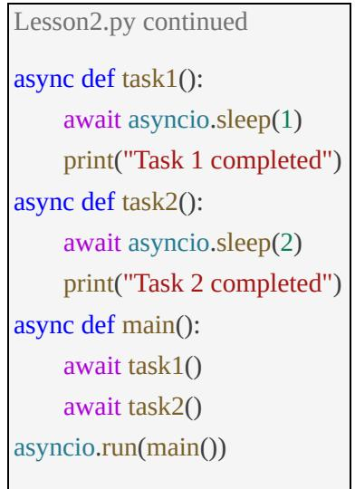
Dans cet exemple, task1 et task2 sont exécutées séquentiellement, la durée d'exécution totale est donc de 3 secondes. L'utilisation de wait garantit que chaque fonction se termine avant le début de la suivante.

#### **3.5.14 Programmation simultanée avec asyncio**

La simultanéité vous permet d'exécuter plusieurs tâches en même temps. Dans asyncio , la fonction rassemble() vous permet d'exécuter plusieurs fonctions asynchrones simultanément. Ceci est utile dans LangGraph pour effectuer un traitement parallèle, tel que la récupération simultanée de données provenant de plusieurs sources.

```
Lesson2.py continued
async def task(name):
    await asyncio.sleep(1)
    print(f"Task {name} completed")
async def main():
    await asyncio.gather(task("A"), task("B"), task("C"))
```

```
asyncio.run(main())
#Output:
# Task A completed
# Task B completed
# Task C completed
```
Toutes les tâches démarrent en même temps, elles se terminent donc ensemble au bout d'une seconde. C'est plus efficace que de les exécuter séquentiellement, ce qui prendrait 3 secondes.

#### **Exemple 3 : exécution d'opérations d'E/S asynchrones**

Imaginez que vous souhaitiez simuler la récupération de données à partir de trois sources différentes en parallèle :

```
Lesson2.py continued
async def fetch_source(source):
    print(f"Fetching from {source}...")
    await asyncio.sleep(2)
    print(f"Completed fetching from {source}")
async def main():
    sources = ["Source 1", "Source 2", "Source 3"]
    await asyncio.gather(*(fetch_source(source) for source in sources))
asyncio.run(main())
#Output
# Fetching from Source 1...
# Completed fetching from Source 1
# Fetching from Source 2...
# Completed fetching from Source 2
# Fetching from Source 3...
# Completed fetching from Source 3
```
Ici, les trois tâches fetch\_source s'exécutent en parallèle, se terminant en 2 secondes, contre 6 secondes si elles sont effectuées de manière séquentielle.

#### **3.5.15 Gestion des erreurs dans le code asynchrone**

La gestion des erreurs dans les fonctions asynchrones est gérée avec des blocs try / except, tout comme dans les fonctions synchrones. Cependant, il est essentiel de les placer dans la fonction asynchrone elle-même pour une gestion des erreurs non bloquante.

#### **Exemple 4 : Gestion des erreurs dans les tâches asynchrones**

```
Lesson2.py continued
async def faulty_task():
    try:
         raise ValueError("An error occurred")
    except ValueError as e:
         print(f"Error: {e}")
asyncio.run(faulty_task())
```
Dans cet exemple, toutes les erreurs générées dans defaulty\_task sont interceptées par le bloc except, empêchant le programme de planter.

#### **Exemple 5 : Gestion des erreurs dans les tâches simultanées avec recueillir()**

Lorsque vous utilisez recueillir() , vous pouvez choisir de gérer les erreurs individuellement ou de laisser la fonction les propager. Par défaut, si une tâche génère une erreur, rassemble() s'arrête et génère la première erreur rencontrée. Pour gérer les erreurs individuellement, utilisez return\_exceptions=True .

```
Lesson2.py continued
async def task1():
    raise ValueError("Error in Task 1")
async def task2():
    await asyncio.sleep(1)
    return "Task 2 completed successfully"
async def main():
    results = await asyncio.gather(task1(), task2(), return_exceptions=True)
    for result in results:
         if isinstance(result, Exception):
           print(f"Handled exception: {result}")
         else:
           print(result)
asyncio.run(main())
#Output
# Error: ValueError("Error in Task 1")
# Task 2 completed successfully
```
La programmation asynchrone dans LangGraph permet des opérations efficaces et non bloquantes qui rendent les flux de travail plus rapides et plus réactifs, en particulier dans les tâches impliquant des opérations d'E/S, des appels réseau ou toute opération où la latence peut être élevée. En utilisant asyncio , vous pouvez gérer plusieurs tâches simultanément, améliorant ainsi l'évolutivité et les performances de vos projets LangGraph.

#### **3.5.15 Exemple asynchrone pertinent pour LangGraph**

Dans LangGraph, les opérations asynchrones sont particulièrement utiles lorsqu'il s'agit de nœuds nécessitant des données provenant d'API externes. En exécutant plusieurs tâches de récupération de données simultanément, vous pouvez réduire le temps d'exécution global et améliorer l'efficacité.

#### **Exemple 6 : Récupération de données pour plusieurs nœuds simultanément dans LangGraph**

Supposons que vous disposiez d'un flux de travail LangGraph dans lequel trois nœuds différents récupèrent des données à partir de trois API différentes. En les récupérant de manière asynchrone, vous évitez d’attendre que chacun soit terminé avant de passer au suivant.

```
Leçon2.py suite
importer asyncio
async def fetch_data_for_node(node_id, api_url) :
    print(f"Node {node_id} : Récupération des données depuis {api_url}...")
    wait asyncio.sleep(2) # Simule un retard réseau
    print(f"Nœud {node_id} : récupération de données terminée depuis {api_url}")
return f "Données de {api_url}"
async def main() :
    # URL pour la récupération de données dans différents nœuds
    nœuds = {
         "Nœud 1": "https://api.example.com/data1",
         "Nœud 2": "https://api.example.com/data2",
         "Nœud 3" : "https://api.example.com/data3"
   }
    # Récupérer simultanément les données de tous les nœuds
    résultats = attendre asyncio.gather (
         *(fetch_data_for_node(node_id, url) pour node_id, url dans nodes.items())
   )
    print("Toutes les données récupérées :", résultats)
asyncio.run(main())
#Node Node 1 : Récupération de données à partir de https://api.example.com/data1...
```
#Node Node 2: Fetching data from https://api.example.com/data2... #Node Node 3: Fetching data from https://api.example.com/data3... #Node Node 1: Completed data fetch from https://api.example.com/data1 #Node Node 2: Completed data fetch from https://api.example.com/data2 #Node Node 3: Completed data fetch from https://api.example.com/data3 #All data fetched: ['Data from https://api.example.com/data1', 'Data from https://api.example.com/data2', 'Data from https://api.example.com/data3']

In this example:

- fetch\_data\_for\_node simulates fetching data from an API for a specific node.
- asyncio.gather runs all fetch\_data\_for\_node tasks concurrently, fetching data for all nodes in parallel.
- This setup is ideal for LangGraph workflows where nodes rely on external data and parallel data fetching is required to minimize waiting times.

#### **3.5.16 String Manipulation**

Strings are a fundamental data type in Python and are used extensively in almost every program. Understanding how to manipulate strings is crucial when building agents that interact with user inputs, generate text, or process data from APIs.

#### **3.5.16.1 Basic String Operations**

Let's start with some common string operations like concatenation, slicing, and basic formatting.

#### **Example 1: Concatenation and Repetition**

Concatenation and repetition are fundamental string operations used to join or repeat strings.

```
Leçon2.py suite
# Concaténation
salutation = "Bonjour" + " " + "Monde"
print(salutation) # Sorties : Hello World
# Répétition
echo = "Écho" * 3
print(echo) # Sorties : Echo Echo Echo
```
#### **Example 2: String Slicing**

You can extract parts of a string using slicing.

```
Leçon2.py suite
texte = "LangGraph"
# Extraire une sous-chaîne
print(text[0:4]) # Sorties : Lang
print(text[-5:]) # Sorties : Graphique
```
#### **Example 3: String Formatting**

String formatting is essential for creating dynamic strings. In modern Python, the f-string syntax is highly recommended.

```
Leçon2.py suite
nom = "Alice"
âge = 30
# Utiliser des f-strings pour le formatage
print(f"Je m'appelle {name} et j'ai {age} ans.") # Résultats : Je m'appelle Alice,
et j'ai 30 ans.
```
#### Use Case in LangGraph:

String concatenation, slicing, and formatting are useful for dynamically generating prompts or text outputs in LangGraph agents. For instance, when a chatbot responds to a user query, it might need to format and concatenate various strings based on input.

#### **3.5.16.2 Advanced String Operations**

Let's move into more advanced string operations like searching, splitting, joining, and manipulating cases.

#### **Example 4: Searching in Strings**

You can search for substrings within a string using methods like find() and in .

```
Leçon2.py suite
text = "LangGraph est un framework puissant."
# Recherche d'une sous-chaîne
print(text.find("puissant")) # Sorties : 13
```


**Example 5: Splitting and Joining Strings**

Splitting breaks a string into a list of substrings, while joining concatenates elements of a list into a single string.

> Lesson2.py continued # Splitting a string into a list words = text.split(" ") print(words) # Outputs: ['LangGraph', 'is', 'a', 'powerful', 'framework.'] # Joining a list into a string sentence = " ".join(words) print(sentence) # Outputs: LangGraph is a powerful framework.

#### **Example 6: Changing String Case**

Python provides methods to manipulate the case of strings.

```
Leçon2.py suite
texte = "LangGraph"
print(text.upper()) # Sorties : LANGGRAPH
print(text.lower()) # Sorties : langgraph
print(text.title()) # Sorties : Langgraph
```
#### **Cas d'utilisation dans LangGraph :**

Ces opérations sur les chaînes sont particulièrement utiles pour les tâches de traitement de texte dans LangGraph. Par exemple, lors de l'analyse des requêtes des utilisateurs, diviser le texte en mots, normaliser la casse et joindre des jetons sont des étapes courantes.
# <span id="page-93-0"></span>**3.6 Gestion avancée des exceptions**

Dans les systèmes complexes, la gestion des erreurs est essentielle pour la robustesse. Le mécanisme de gestion des exceptions de Python vous permet de détecter et de gérer les erreurs avec élégance.

#### **3.6.1 Génération d'exceptions personnalisées**

Vous pouvez déclencher vos propres exceptions à l’aide du mot-clé raise. Ceci est utile lorsque vous souhaitez appliquer des règles spécifiques dans votre programme.

```
Example 7: Raising Custom Exceptions
```

```
Lesson2.py continued
def check_age(age):
    if age < 0:
         raise ValueError("Age cannot be negative")
    elif age < 18:
         print("Not eligible to vote")
    else:
         print("Eligible to vote")
try:
    check_age(-5)
except ValueError as e:
    print(e)  # Outputs: Age cannot be negative
```
Les exceptions personnalisées sont utiles dans LangGraph lorsque vous devez gérer des cas spécifiques tels qu'une entrée non valide ou des appels d'API ayant échoué.

#### **3.6.2 essayer-sauf-autre-finalement**

La structure try-sauf complète peut inclure des blocs else et enfin pour ajouter plus de contrôle.

- **else** : S'exécute si aucune exception ne se produit.
- **finally** : S'exécute quoi qu'il arrive, souvent utilisé pour le nettoyage.

**Exemple 8 : Gestion complète des exceptions**

```
Lesson2.py continued
try:
    number = int(input("Enter a number: "))
    result = 10 / number
except ValueError:
    print("You must enter a valid integer.")
except ZeroDivisionError:
    print("You can't divide by zero.")
else:
    print(f"Result: {result}")
finally:
    print("Execution completed.")
```
Cette structure garantit que toute erreur est gérée et le bloc final garantit que les tâches de nettoyage importantes (comme la fermeture de fichiers ou de connexions) sont effectuées.

#### **3.6.3 Exceptions chaînées**

Python vous permet de déclencher une nouvelle exception tout en préservant l'exception d'origine. Ceci est utile pour le débogage.

**Exemple 9 : Exceptions chaînées**

```
Lesson2.py continued
try:
    number = int(input("Enter a number: "))
    result = 10 / number
except ZeroDivisionError as e:
    raise RuntimeError("Failed to divide") from e
```
Dans LangGraph, le chaînage des exceptions est utile lorsqu'un nœud échoue en raison d'une erreur dans un nœud précédent, préservant ainsi le contexte d'erreur pour le débogage.

#### **3.6.4 Gestion des exceptions dans les workflows LangGraph**

Dans un agent LangGraph, vous devrez peut-être gérer les exceptions générées pendant le flux de travail. Cela peut inclure la détection de problèmes de réseau, d'entrées non valides ou d'erreurs dans les API externes.

**Exemple 10 : Gestion des exceptions dans LangGraph**

```
Lesson2.py continued
from langgraph import Graph, Node
class APIRequestNode(Node):
    def run(self):
        try:
      data = self.make_request()
      self.send_output(data)
        except TimeoutError:
      self.send_output("The request
timed out.")
        except ValueError as e:
      self.send_output(f"Invalid data:
{e}")
```

```
finally:
      self.log("Request completed.")
graph = Graph()
node = APIRequestNode()
graph.add_node(node)
```
Dans cet exemple, un nœud LangGraph effectue une requête API et gère les délais d'attente potentiels ou les données non valides avec élégance, en enregistrant le résultat dans le bloc final.

# Partie 2 : Concepts intermédiaires LangGraph et conception d'agents (Chapitres 4 à 7)

# **Chapitre 4**

# <span id="page-97-1"></span><span id="page-97-0"></span>**Éléments de base de LangGraph**

Dans ce chapitre, nous plongerons dans les éléments fondamentaux de LangGraph. Comprendre ces éléments fondamentaux est essentiel car ils constituent la base de tout agent d'IA ou flux de travail que vous créez. Ne vous inquiétez pas si vous êtes nouveau dans ces concepts : nous allons tout détailler étape par étape et vous fournir des exemples de codage pratiques pour vous guider.

# <span id="page-97-2"></span>**Concepts clés : nœuds, bords, états et graphiques**

LangGraph, comme son nom l'indique, s'articule autour de graphiques, qui sont des réseaux de tâches connectées qui peuvent être utilisés pour créer des flux de travail pour les agents IA. Ces flux de travail reposent sur quatre composants principaux :

- 1. **État**
- 2. **Nœuds**
- 3. **Bords**
- 4. **Graphiques**

Explorons ces composants en détail.

# <span id="page-97-3"></span>**4.1. État - Garder une trace des données**

Le **état** est une structure de données partagée qui stocke les informations lorsqu'elles circulent à travers les nœuds d'un graphique. Il permet à différentes parties du flux de travail de

« mémorisez » et partagez des informations sur plusieurs nœuds. Considérez-le comme la mémoire de votre flux de travail. Dans LangGraph, les états sont généralement des dictionnaires Python, des objets TypedDict ou des modèles Pydantic. Ces structures contiennent des données qui peuvent être mises à jour ou modifiées par différents nœuds de votre flux de travail.

Voici un exemple simple d'état :
| Leçon3a.py |
|--------------------------------------------------|
| from<br>typing_extensions<br>import<br>TypedDict |
| # Définir une structure d'état simple |
| classe<br>HelloWorldState(TypedDict) : |
| message: str # Ceci stockera un message |

Dans cet exemple, HelloWorldState définit un état qui peut stocker un message sous forme de chaîne. Au fur et à mesure de la progression de votre flux de travail, différents nœuds peuvent lire, mettre à jour ou manipuler ce message.

**Exemple pratique** : Imaginez un flux de travail dans lequel un nœud commence par saluer l'utilisateur et un autre nœud ajoute plus d'informations à ce message d'accueil. L'état permet à ces données de persister et de passer d'une étape à l'autre.

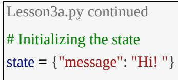

# <span id="page-98-0"></span>**4.2. Nœuds - La logique métier**

Un **nœud** dans LangGraph est responsable de l'exécution d'une tâche spécifique. Les nœuds sont les éléments de base qui représentent chaque action ou point de décision dans un flux de travail. Par exemple, un nœud peut récupérer une entrée utilisateur, tandis qu'un autre nœud traite l'entrée.

Les nœuds de LangGraph sont généralement implémentés sous forme de fonctions qui acceptent un état et renvoient une version modifiée de cet état. Voici un exemple de nœud qui ajoute du texte au message stocké dans l'état :

Lesson3a.py a continué def hello\_world\_node(state: HelloWorldState) :

```
state["message"] = "Hello World"
return state
```
Ici, hello\_world\_node est un nœud qui prend un état (un dictionnaire), ajoute une chaîne de texte au message dans l'état et renvoie l'état mis à jour. En divisant les flux de travail en étapes plus petites, comme celle-ci, vous pouvez créer des fonctionnalités plus complexes au fil du temps.

La sortie renvoyée ressemble à ceci

{"message": "Bonjour tout le monde"}

Cela signifie que vous pouvez réécrire le nœud ci-dessus comme ci-dessous :

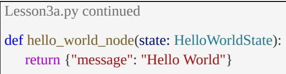

Les nœuds sont ajoutés à un graphique à l'aide de la fonction add\_node

Lesson3a.py suite graph\_builder.add\_node("greet\_user", greet\_user)

# <span id="page-99-0"></span>**4.3. Edges - connecter les nœuds**

Les **Edges** définissent les connexions entre les nœuds. Ils contrôlent la manière dont les données circulent d'un nœud au suivant et déterminent l'ordre dans lequel les tâches sont exécutées. En termes simples, les bords sont les flèches qui montrent le chemin d'un nœud à un autre dans un flux de travail.

Par exemple, si vous souhaitez que votre flux de travail commence par un nœud de salutation, puis passe à un autre nœud qui traite les entrées de l'utilisateur, les bords définiront cette transition.

Un exemple d'arête connectant deux nœuds, connectant le nœud raise\_invoice au recevoir\_payment .

```
Lesson3a.py continued
graph_builder = StateGraph(UserState)
graph_builder.add_edge("raise_invoice", "raise_invoice")
```


Concentrons-nous sur trois types importants de nœuds et d'arêtes dans LangGraph :

- 1. **Démarrer le nœud**
- 2. **Nœud final**
- 3. **Bord conditionnel**
- **4. Point d'entrée conditionnel**

# **4.3.1 Nœud de démarrage : le début du workflow**

Le **Start Node** marque le point d'entrée du graphique. C'est le premier nœud qui active l'exécution du workflow. Considérez-le comme un déclencheur qui déclenche le processus, connectant le nœud initial où commence le flux de travail.

Dans LangGraph, le début d'un flux de travail est souvent indiqué par la constante START . Le nœud de départ définit la connexion de ce point de départ au premier nœud de votre flux de travail. Voici un exemple :

```
Lesson3a.py continued
# Connect the start point to the first node
graph_builder.add_edge(START, "greet_user")  # Start edge
```
Dans cet exemple, le bord connecte le point de départ ( START ) au nœud "greet\_user". Lorsque le graphique est invoqué, ce front déclenche le processus de salutation, passant de START à la première tâche.

Alternativement, un point d'entrée peut être défini à l'aide de la fonction set\_entry\_poin t

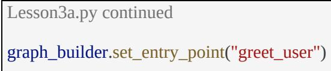

# **4.3.2 Nœud final : terminer le workflow**

Le **End Node** représente la conclusion du flux de travail. Cela indique que le flux de travail a atteint sa tâche finale et qu'aucune autre action ne doit être entreprise. Comme le bord de départ, le **End Node** est représenté par une constante END dans LangGraph.

Vous pouvez définir un nœud final en connectant le nœud final de votre workflow au marqueur END. Par exemple :

> Lesson3a.py suite # Connectez le dernier nœud au point final graph\_builder.add\_edge("say\_goodbye", END)

Dans ce cas, une fois que le nœud « say\_goodbye » a terminé sa tâche, le flux de travail atteint le END , signalant l'achèvement du processus.
Alternativement, le point d'arrivée d'un graphique peut être exprimé en utilisant le set\_finish\_point

```
Lesson3a.py continued
graph_builder.set_finish_point("say_goodbye")
```
# **4.3.3 Bords conditionnels : ajout de points de décision**

Les arêtes conditionnelles sont l’une des fonctionnalités les plus puissantes de LangGraph. Ils permettent au flux de travail de se diversifier en fonction de certaines conditions, permettant ainsi un comportement plus dynamique. Avec **Conditional Edges**, vous pouvez définir différents chemins que le flux de travail peut emprunter en fonction de l'état des données ou du résultat d'un nœud.

Par exemple, supposons que vous disposiez d'un nœud qui vérifie si un utilisateur est un abonné premium. Selon que l'utilisateur est premium ou non, vous souhaitez que le workflow emprunte des chemins différents. Voici comment implémenter des arêtes conditionnelles :

```
Lesson3a.py continued
# Define two nodes that handle different cases
def check_subscription(state: UserState):
    if state["is_premium"]:
         return "premium_greeting"
    else:
         return "regular_greeting"
…
graph_builder.add_conditional_edges("greet_user", check_subscription)
```
…

Dans ce cas, le graphique décidera quel chemin suivre en fonction de la condition définie dans le bord. Le nœud check\_subscription évaluera le statut d'abonnement de l'utilisateur et le graphique suivra le bord approprié.

# **4.3.4 Principes des arêtes dans LangGraph**

Les Edges sont bien plus que de simples connexions entre les tâches : ils définissent la logique et le flux de votre flux de travail. Voici les principes fondamentaux à comprendre lorsque vous travaillez avec des arêtes dans LangGraph :

- **Flux séquentiel** : Edge garantit que les tâches sont exécutées dans le bon ordre. Sans Edge, il n’y aurait aucun contrôle sur la manière dont les tâches sont déclenchées et exécutées.
- **Flux conditionnel** : les bords conditionnels activent une logique de branchement, dans laquelle le flux de travail peut suivre différents chemins en fonction de l'évaluation de certaines conditions ou données. Cela rend les flux de travail adaptables et intelligents.
- **Contrôle d'achèvement** : Le **End Edge** définit le moment où le flux de travail se termine. Sans arête de fin, le graphique continuerait indéfiniment ou ne parviendrait pas à signaler correctement sa conclusion.
- **Gestion des erreurs** : Edges peut être conçu pour gérer les erreurs ou les exceptions, guidant le flux de travail vers la récupération ou vers des chemins alternatifs lorsque des résultats inattendus se produisent.

# **4.3.5 Exemple pratique : utilisation des bords de début, de fin et conditionnels**

Voici un flux de travail simple qui utilise les bords de début, de fin et conditionnels pour accueillir les utilisateurs différemment selon qu'ils sont abonnés premium :

```
Lesson3a.py complete code example
from typing_extensions import TypedDict
from langgraph.graph import StateGraph, START, END
# Define the state for user data
class UserState(TypedDict):
    is_premium: bool
```

```
message: str
```
# Définir les nœuds

def greet\_user (état : UserState) :

state["message"] = "Bienvenue !"

état de retour

def premium\_greeting(état : UserState) :

state["message"] += " Merci d'être un utilisateur premium !"

état de retour

def regular\_greeting(état : UserState) :

```
state["message"] += " Enjoy your time here!"
```
état de retour

# Définissez un nœud de décision pour choisir le chemin en fonction du type d'utilisateur def check\_subscription(state: UserState) :

si état["is\_premium"] :

renvoyer "premium\_greeting"

sinon :

return "regular\_greeting" # Construire le graphique graph\_builder = StateGraph(UserState) graph\_builder.add\_node("greet\_user", greet\_user) graph\_builder.add\_node("check\_subscription", check\_subscription) graph\_builder.add\_node("premium\_greeting", premium\_greeting) graph\_builder.add\_node("regular\_greeting", regular\_greeting) # Ajouter des bords pour contrôler le flux graph\_builder.add\_edge(START, "greet\_user") # Début du bord graph\_builder.add\_conditional\_edges("greet\_user", check\_subscription) graph\_builder.add\_edge("premium\_greeting", END) # Fin du bord pour les utilisateurs premium graph\_builder.add\_edge("regular\_greeting", END) # Bord de fin pour les utilisateurs réguliers # Compilez et exécutez le graphique pour un utilisateur premium graph = graph\_builder.compile() result = graph.invoke({"is\_premium": True, "message": ""}) print(result) # Sortie : {'message': 'Bienvenue ! Merci d'être un utilisateur premium !'} # Compilez et exécutez le graphique pour un utilisateur régulier result = graph.invoke({"is\_premium": False, "message": ""}) print(result) # Sortie : {'message': 'Bienvenue ! Profitez de votre temps ici !'}
Dans cet exemple, nous utilisons un **Start Edge** pour commencer le workflow, un **Conditional Edge** pour choisir entre deux chemins et un **End Edge** pour conclure le workflow. Le résultat change en fonction du statut d'abonnement de l'utilisateur, montrant comment des flux de travail dynamiques peuvent être créés avec Edges.

# <span id="page-104-0"></span>**4.4. Graphique**

Un **Graph** dans LangGraph est la structure globale qui rassemble les nœuds, les bords et les états dans un flux de travail cohérent. Il sert de modèle pour les activités de l'agent, définissant la manière dont les tâches sont ordonnées, les chemins que l'agent peut emprunter et la manière dont les informations circulent tout au long du processus.

Les graphiques peuvent être simples ou complexes, selon le flux de travail souhaité. Ils peuvent être constitués de quelques nœuds connectés linéairement ou inclure plusieurs branches, chemins conditionnels et boucles qui permettent des comportements plus sophistiqués. Un graphe fournit le cadre dans lequel les nœuds opèrent, avec des bords guidant le flux de l'état à travers les tâches connectées.

## **4.4.1 Types courants de graphiques dans LangGraph :**

une. Graphique d'état

Vous commencez à créer un graphique avec un générateur de graphiques qui spécifie le type de graphique. La classe StateGraph est la principale classe graphique à utiliser. Ceci est paramétré par un objet State défini par l’utilisateur.

> Lesson3b.py graph\_builder = StateGraph(HelloWorldState)

b. MessageGraph

La classe MessageGraph est un type spécial de graphique spécialement conçu pour gérer une liste de messages, spécifiquement adapté à un cas d'utilisation de chat. L'état d'un MessageGraph est UNIQUEMENT une liste de messages. Cette classe est rarement utilisée sauf pour les chatbots, car la plupart des applications nécessitent que l'État soit plus complexe qu'une liste de messages.

Leçon3b.py suite

```
graph_builder = StateGraph(MessageGraph)
```
#### **4.4.2 Compilation du graphique**

Une fois que vous avez défini les nœuds et les arêtes du générateur de graphique, vous le compilez en un graphique.

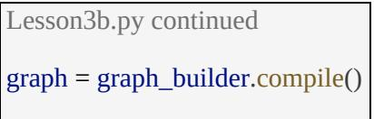

La compilation d'un graphique effectue les opérations suivantes :

- Vérifie et valide la structure du graphique pour s'assurer que tous les nœuds sont complètement utilisés dans les bords et que tous les bords définissent correctement un flux de travail complet.
- Spécifiez les arguments de mémoire comme les pointeurs de contrôle
- Définir des points d'arrêt pour les actions d'intervention humaine dans la boucle.

Dans LangGraph, un graphique simple et complet pourrait ressembler à ceci :

```
Lesson3b.py continued
from typing_extensions import TypedDict
from langgraph.graph import StateGraph, START, END
class HelloWorldState(TypedDict):
    """The state"""
    message: str  # This state key will store the message
def hello_world_node(state: HelloWorldState):
    """The node function"""
    state["message"] += "Hello World" #This node does this simple task.
    return state
#Define the graph
graph_builder = StateGraph(HelloWorldState)
graph_builder.add_node("hello_world", hello_world_node)
graph_builder.add_edge(START, "hello_world")
graph_builder.add_edge("hello_world", END)
# Compile and run the graph
```
graph = graph\_builder.compile() result = graph.invoke({"message": "Salut ! "}) # Afficher le résultat print(result) # Sortie : {'greeting': 'Salut ! Bonjour tout le monde'}

#### **4.4.3 Canaux d'état**

Les nœuds communiquent généralement avec un seul schéma. Par exemple, vous pourriez avoir des nœuds ci-dessous qui partagent tous deux le même HelloWorldState . L'état ["message"] devient un canal d'état qui active l'un ou l'autre des nœuds une fois les données reçues du Edge.

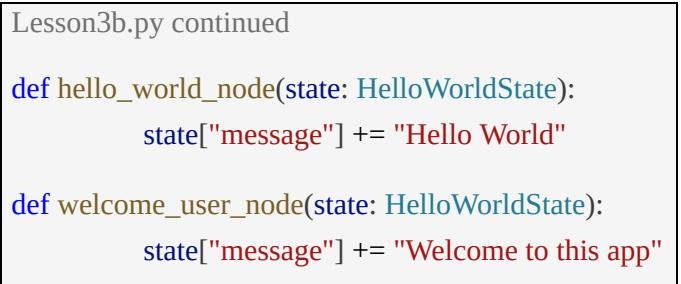

Lorsque vous avez des variables privées à l'intérieur d'un nœud qui ne sont pas requises dans la sortie d'un graphique, celles-ci deviennent des canaux privés pouvant référencer un schéma privé.

#### **4.4.4 Symboles de débogage d'un LangGraph**

Lorsque vous déboguez un workflow LangGraph, vous pouvez voir les valeurs réelles des variables de votre workflow, y compris les nœuds de début et de fin, les nœuds, les bords, les canaux utilisés dans le graphique, les schémas d'état et bien plus encore.

| D Aucune configuration :: ▷ : = = = = = = = = = lesson1a.py U > > + % |                                                                                  |  |
|-------------------------------------------------------------------------------------------------------------------------------------------------------------------------------------------------------------------------------------|----------------------------------------------------------------------------------|--|
| VARIABLES<br>பி | chapitre3 > @ lesson3d.py > [@] résultat |  |
| v Locals<br>ರಿ<br># Définir les nœuds |                                                                                  |  |
| 10<br>def greet_user(state: UserState):<br>> variables spéciales |                                                                                  |  |
| 11<br>> variables de fonction | state["message"] = "Bienvenue !"                                                    |  |
| 12<br>état de retour<br>> variables de classe |                                                                                  |  |
| 13<br>FIN = 'fin '<br>14 |                                                                                  |  |
| DÉBUT = 'début<br>15 | def premium_greeting (state : UserState)<br>state["message"] += " Merci pour | |
| (retour) StateGraph. init = Aucun<br>16<br>état de retour |                                                                                  |  |
| 17<br>> (retour) StateGraph.add bords conditionnels = <langgraph.graph.state.stategraph 0x00001ea1497c910="" at="" object=""></langgraph.graph.state.stategraph> |                                                                                  |  |
| 18<br>def regular_greeting (état : UserState)<br>> (retour) StateGraph.add edge = <langgraph.graph.state.stategraph.bbject 0x000001ea1497c910="" at=""></langgraph.graph.state.stategraph.bbject> |                                                                                  |  |
| 19<br>state["message"] += " Profitez de votre t<br>> (retour) StateGraph.add node = < langgraph.graph.state.stateGraph.object at 0x00000EA1497C910> |                                                                                  |  |
| 20<br>état de retour<br>> (retour) StateGraph.compile = <langgraph.graph.state.compiledstategraph.com ectclose<br="">21</langgraph.graph.state.compiledstategraph.com> |                                                                                  |  |
| > (retour) Point d'entrée StateGraph.set = <langgraph.graph.state.stategraph.com <br="" economys="">22<br/># Définir un nœud de décision pour choisir le</langgraph.graph.state.stategraph.com> |                                                                                  |  |
| > graph = <langgraph.graph.state.compiledstategraph 0x000001ea1496ceco="" at="" object=""><br/>23<br/>def check_subscription(state : UserStat</langgraph.graph.state.compiledstategraph> | | |
| 24<br>v graph builder = <langgraph.graph.state.stategraph 0x000001ea1497c910="" at="" object=""><br/>if state["is_premium"] :</langgraph.graph.state.stategraph> |                                                                                  |  |
| 25<br>retour "premium_greeting"<br>> variables spéciales |                                                                                  |  |
| 26<br>else :<br>> variables de fonction |                                                                                  |  |
| 27<br>retour "regular_greeting"<br>> variables de classe<br>28 |                                                                                  |  |
| > branches = defaultdict( <class 'dict'="">, { greet user : { 'check Subscription': Branch(patheck Subscription<br/>29<br/># Construire le graphique</class> | | |
| v canaux = {'is_premium' : <langels.last_value.lastvalue 0x00001ea149af700="" at="" object="">, 'message. = 30<br/>graph_builder = StateGraph(UserState)</langels.last_value.lastvalue> |                                                                                  |  |
| > variables spéciales<br>31 | graph_builder.set_entry_point("greet_u | |
| 32<br>> variables de fonction |                                                                                  |  |
| 33<br>> 'is_premium' = <langgraph.channels.last_value.lastvalue 0x000001ea149af700="" at="" object=""></langgraph.channels.last_value.lastvalue> |                                                                                  |  |
| 34<br>graph_builder = StateGraph(UserState)<br>> 'message' = <langgraph.channels.last 0x000001ea149ae680="" at="" object="" value.lastvalue=""><br/>35</langgraph.channels.last> |                                                                                  |  |
| len() = 2<br>36 | graph_builder.add_node("greet_user", g<br>graph_builder.add_node("check_subscrip | |
| compilé = Vrai<br>37 | graph_builder.add_node("premium_greeti | |
| schéma de configuration = Aucun<br>38<br>graph_builder.add_node("regular_greeti | | |
| 39<br>> bords = {('premium_greeting', ('__start_', 'greet_user'), ('regular_greeting', '__end_' }} | | |
| 49<br># Ajoutez des bords pour contrôler le flux<br>> géré = {} |                                                                                  |  |
| 41<br>graph_builder.add_edge(START, "greet_u<br>> nodes = { greet_user' : StateNodeSpec(runnable=greet_user(tags=None, recurse=True, func_accepts_config=Fals.<br>42 | | |
| graph_builder.add_conditional_edges("g<br>> schemas = { <class '="" main_.userstate'=""> : {'is_premium' : <langgraph.channels.last_value_last__<br>43<br/>graph_builder.add_edge("premium_greeti</langgraph.channels.last_value_last__<br></class> | | |
| support_multiple_edges = False<br>ਧੀ ਪੈ<br>graph_builder.add_edge("regular_greeti | | |
| > bords d'attente = {}<br>45 | # Compilez et exécutez le graphique pour un prem |  |
| 46<br>> add schema = <bound 0x00001.<="" <langgraph.state.stategraph="" add="" at="" method="" object="" of="" schema="" stategraph.="" td=""><td colspan="2">graph = graph_builder.compile( )</td></bound> | graph = graph_builder.compile( ) |  |
| REGARDER<br>D<br>47<br>result = graph.invoke({"is_premium": | | |
| 48<br>print(result) # Sortie : {'message' :<br>CALL STACK<br>11 |                                                                                  |  |

# <span id="page-108-0"></span>**4.5. Schémas d'entrée et de sortie d'un graphique : gestion flexible des états dans LangGraph**

Dans LangGraph, les états jouent un rôle crucial dans la façon dont les nœuds communiquent et partagent des données tout au long du flux de travail. LangGraph offre une flexibilité dans la façon dont les états sont gérés, permettant différents schémas d'entrée et de sortie. Cette flexibilité permet aux développeurs d'utiliser différents sous-ensembles de données pour différentes parties du graphique, améliorant ainsi à la fois la **modularité** et le **contrôle du flux de données**.

Dans cette section, nous découvrirons comment concevoir des flux de travail qui utilisent différents schémas pour les entrées, les sorties et la communication interne en introduisant des **canaux d'état internes** et des **schémas d'état multiples**. Cela permet un comportement plus complexe dans lequel les nœuds communiquent en utilisant à la fois les états **privé** (interne) et **externe** (sortie).

# **4.5.1 Le rôle des schémas d'entrée et de sortie**

Dans un workflow LangGraph, les schémas d'entrée et de sortie définissent la structure des nœuds d'entrée et de sortie des données. En spécifiant différents schémas d'entrée et de sortie, vous pouvez contrôler quelles données sont transmises entre les nœuds et comment les résultats finaux sont renvoyés.
- **Schéma d'entrée** : Spécifie les données qu'un nœud ou un graphique accepte en entrée.
- **Schéma de sortie** : définit la structure des données renvoyées par le nœud ou le graphique.

Cette séparation est utile lorsque vous devez :

- 1. **Masquer les détails internes** : par exemple, si un nœud doit traiter des données intermédiaires qui ne doivent pas être exposées au reste du graphique.
- 2. **Définir des flux de travail flexibles** : différentes parties du graphique peuvent fonctionner avec différents types de données sans interférer les unes avec les autres.

# **4.5.2 Définir des schémas à états multiples**

Regardons un exemple dans lequel nous définissons un schéma **OverallState**, qui contient tous les champs pertinents pour les opérations du graphique. De cet ensemble

état, nous pouvons extraire des sous-ensembles pour former les schémas d’entrée et de sortie des nœuds.

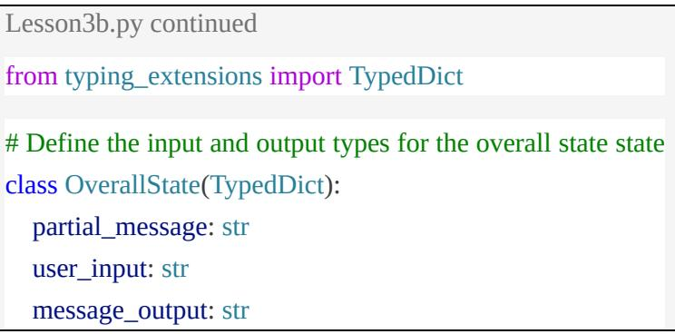

Dans ce cas :

-OverallState contient toutes les données pertinentes pour le graphique.
- InputState est une version simplifiée de OverallState qui inclut uniquement la saisie de l'utilisateur.
- OutputState est un autre sous-ensemble qui contient uniquement la sortie du message final.
- PrivateState est un état interne utilisé pour la communication entre les nœuds sans exposer ces informations dans l'entrée ou la sortie.

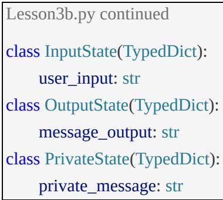

# **4.5.3 Exemple : Créer un graphique avec plusieurs schémas d'état**

Pour comprendre comment les entrées, les sorties et les états privés interagissent, créons un flux de travail qui traite une entrée utilisateur en y ajoutant des mots, en utilisant des transformations internes et en renvoyant un message final.

# *Définir les nœuds*

Nous commençons par définir les nœuds, chacun opérant sur différentes parties de l’État.

- 1. **add\_world** : ce nœud prend le InputState , ajoute le mot "World" à l'entrée utilisateur et renvoie le OverallState modifié.
- 2. **add\_exclamation** : Ce nœud fonctionne sur l'OverallState , ajoute un point d'exclamation ( ! ) et stocke le résultat dans le PrivateState interne.
- 3. **finalize\_message** : ce nœud récupère le message de l'état privé et le prépare pour la sortie, renvoyant un OutputState .

```
Lesson3b.py continued
# Define nodes (functions) that operate on the states
def add_world(state: InputState) -> OverallState:
    partial_message = state["user_input"] + " World"
    print(f"Node 1 - add_world: Transformed '{state['user_input']}' to
'{partial_message}'")
    return {"partial_message": partial_message, "user_input": state["user_input"],
"message_output": ""}
def add_exclamation(state: OverallState) -> PrivateState:
    private_message = state["partial_message"] + "!"
    print(f"Node 2 - add_exclamation: Transformed '{state['partial_message']}' to
'{private_message}'")
    return {"private_message": private_message}
def finalize_message(state: PrivateState) -> OutputState:
    message_output = state["private_message"]
    print(f"Node 3 - finalize_message: Finalized message to '{message_output}'")
    return {"message_output": message_output}
```
### **Créer le graphique**

Ensuite, nous utilisons **StateGraph** pour définir l'ensemble du flux de travail, en spécifiant les états d'entrée, de sortie et globaux.

Lesson3b.py suite # Créer le générateur de graphiques avec des nœuds et des arêtes builder = StateGraph(OverallState, input=InputState, output=OutputState) builder.add\_node("add\_world", add\_world) builder.add\_node("add\_exclamation", add\_exclamation) builder.add\_node("finalize\_message", finalize\_message) # Définir les bords entre les nœuds builder.add\_edge(START, "add\_world") builder.add\_edge("add\_world", "add\_exclamation") builder.add\_edge("add\_exclamation", "finalize\_message") builder.add\_edge("finalize\_message", END) # Compilez et exécutez le graphique graph = builder.compile() result = graph.invoke({"user\_input": "Bonjour"}) print(result) # Sortie : {'message\_output' : 'Bonjour tout le monde !'}

Dans cet exemple, nous avons démontré comment les nœuds peuvent fonctionner avec différents sous-ensembles de données :

- **InputState** est transmis au premier nœud ( add\_world ) pour traiter les entrées de l'utilisateur.
- **OverallState** est utilisé en interne par add\_world et add\_exclamation pour gérer et manipuler les données intermédiaires.
- **PrivateState** est utilisé comme canal de communication interne entre add\_exclamation et finalize\_message , permettant au nœud final d'accéder aux données transformées sans les exposer au reste du graphique.
- **OutputState** est renvoyé par le nœud finalize\_message, contenant le résultat du workflow.

# **Points importants :**
- 1. **Flexibilité d'état** : *Un nœud peut écrire sur n'importe quel canal d'état du graphique*, même si ce canal n'était pas inclus dans son schéma d'entrée. Par exemple, add\_world écrit dans partial\_message dans l'OverallState , même s'il n'a reçu que l'InputState .
- 2. **Communication interne** : L'utilisation de **PrivateState** permet aux nœuds de communiquer en interne sans exposer ces informations en dehors du graphique. Ceci est utile pour séparer les transformations privées de la sortie publique.

3. **State Union** : L'état du *graphe est l'union de tous les canaux d'état définis lors de l'initialisation*. Même si nous définissons différents schémas d'entrée et de sortie, les nœuds peuvent toujours accéder à l'état global et en manipuler différentes parties.

# **Points clés à retenir**

- Les **Schémas d'entrée et de sortie** vous permettent de contrôler les données qui entrent et sortent de chaque nœud, offrant ainsi une flexibilité dans la manière dont les nœuds interagissent avec l'état.
- Les **Canaux d'état internes** permettent aux nœuds d'effectuer un traitement intermédiaire qui n'affecte pas l'entrée ou la sortie globale. Cela rend les flux de travail plus propres et plus modulaires.
- Le système de gestion d'état de LangGraph permet aux nœuds de partager des données tout en gardant certains détails cachés si nécessaire, facilitant ainsi les flux de travail complexes.

En maîtrisant les schémas d'entrée et de sortie dans LangGraph, vous pouvez créer des agents d'IA flexibles, évolutifs et puissants qui gèrent des flux de données complexes avec précision.

# <span id="page-112-0"></span>**4.6. Comment LangGraph rassemble tout cela**

LangGraph est conçu pour créer des flux de travail à l'aide de ces composants. Lorsque vous définissez un agent LangGraph, vous créez des nœuds (fonctions) qui exécutent des tâches, des bords qui déterminent le flux et un état qui contient les données. LangGraph combine ces éléments dans une structure **graphique**, permettant à l'agent de gérer des flux de travail complexes qui peuvent créer des branches, des boucles ou s'adapter en fonction des données.

Voici une représentation visuelle de la façon dont ces éléments fonctionnent ensemble dans un flux de travail LangGraph simple :

1. **Démarrer** → 2. **Nœud 1** (modifie l'état) → 3. **Nœud 2** (utilise l'état modifié) → 4. **Fin**

Chaque nœud a accès à l’état et les bords définissent le chemin par lequel circule l’état. En structurant les flux de travail de cette façon, LangGraph

facilite la création d'agents d'IA capables de gérer des tâches complexes et de prendre des décisions basées sur des données changeantes.

# **4.6.1 Activation d'un nœud**

Lorsque le graphique démarre, tous les nœuds sont *inactifs*. Ils ne commencent à fonctionner (deviennent *actifs*) que lorsqu'ils reçoivent de nouvelles informations ou un message d'un autre nœud. Considérez-le comme un signal pour commencer à travailler.

# **4.6.2 Super Steps - plusieurs nœuds exécutés en même temps**

Un ou plusieurs nœuds peuvent devenir actifs en même temps. Une super-étape est comme un tour ou une phase où certains nœuds (tâches) du graphique s'exécutent ensemble. Si les nœuds peuvent s’exécuter simultanément, ils appartiennent à la même super-étape. S’ils doivent s’attendre l’un l’autre, ils suivent des super-étapes distinctes.

Lors d'une super-étape, tous les nœuds ayant reçu des messages fonctionnent en même temps. Chacun d'eux exécute sa fonction et envoie des mises à jour ou des résultats. Par exemple, un nœud peut effectuer un calcul et un autre peut traiter un morceau de texte.

À la fin d'une super-étape, le graphique vérifie s'il existe des nœuds qui n'ont pas reçu de nouveaux messages. Ces nœuds « votent ensuite pour l’arrêt », ce qui signifie qu’ils redeviennent inactifs.

# **4.6.3 Quand le graphique s'arrête-t-il ?**

L'ensemble du processus s'arrête lorsqu'il ne reste plus de nœuds actifs et qu'aucun message n'est en transit. Cela signifie que toutes les tâches sont terminées et qu’aucune nouvelle information ne circule dans le graphique.

# <span id="page-113-0"></span>**4.7. Prise de décision avec des limites conditionnelles**

Dans LangGraph, les **bords conditionnels** permettent à votre agent de choisir entre plusieurs chemins en fonction de conditions spécifiques. Cela rend les flux de travail plus dynamiques, permettant à l'agent de s'adapter à différents scénarios et de gérer intelligemment diverses entrées. Dans cette section, vous allez étendre l'agent « Hello World » pour inclure une logique conditionnelle, qui déterminera le chemin emprunté par le flux de travail en fonction du contenu de l'état.

# **4.7.1 Comprendre les contours conditionnels**

Un **bord conditionnel** est comme un point de embranchement dans votre flux de travail. Au lieu de toujours se déplacer dans une seule direction, une arête conditionnelle évalue une condition et décide quel chemin suivre en fonction du résultat. Cette flexibilité est essentielle pour créer des agents d’IA qui doivent gérer différents types de données ou répondre à diverses entrées utilisateur.
Par exemple, un chatbot de service client peut suivre un chemin si la question d'un utilisateur est liée à la facturation et un autre chemin s'il s'agit de support technique. Dans LangGraph, les bords conditionnels vous permettent de configurer ces types de points de décision, permettant ainsi de créer des flux de travail qui *répondent dynamiquement* aux données de l'état.

#### **Configuration d'un agent d'accueil conditionnel**

Dans cet exemple, nous allons créer un graphique qui :

- Normalise le message d'accueil pour garantir qu'il soit en minuscules, ce qui facilite son traitement.
- Évalue si le message d'accueil normalisé contient le mot « salut ».
- Branchements vers différents nœuds de salutation en fonction de cette évaluation.

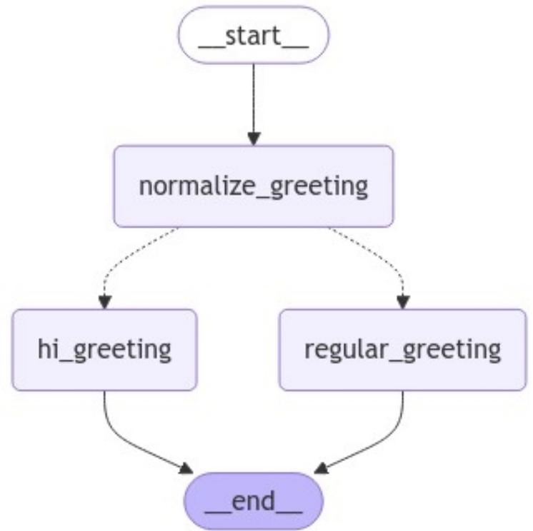

#### **1. Définir la structure de l'État**

Tout d’abord, nous devons définir la structure de l’état que l’agent utilisera pour suivre le message d’accueil. Dans cet exemple, notre état contiendra simplement une chaîne de salutation.

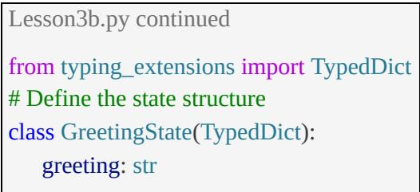

#### **2. Créer des fonctions de nœud pour chaque type de message d'accueil**

Ensuite, nous définirons trois fonctions de nœud distinctes :

- normalize\_greeting\_node : Ce nœud transforme le texte de salutation en minuscules pour assurer la cohérence.
- hi\_greeting\_node : ce nœud ajoute un message spécial si le message d'accueil contient "salut".
- regular\_greeting\_node : ce nœud ajoute un message standard pour les salutations sans "salut".

| Lesson3b.py suite |
|------------------------------------------------|
| # Définir un nœud de prétraitement pour normaliser le message d'accueil |
| def<br>normalize_greeting_node(state): |
| # Transforme le message d'accueil en minuscule |
| state["salutation"] =<br>state["salutation"].lower() |
| return<br>state # Renvoie le dictionnaire d'état mis à jour |
| # Définir un nœud pour le message d'accueil "Salut" |
| def<br>hi_greeting_node(état): |
| state["greeting"] =<br>"Bonjour, "<br>+<br>state["greeting"] |
| return<br>state # Renvoie le dictionnaire d'état mis à jour |
| # Définir un nœud pour un message d'accueil standard |
| def<br>regular_greeting_node(state): |
| state["greeting"] =<br>"Bonjour, "<br>+<br>state["greeting"] |
| return<br>state # Renvoie le dictionnaire d'état mis à jour |

**3. Configurer la fonction logique conditionnelle**

La fonction conditionnelle, Choose\_greeting\_node , examinera le message d'accueil normalisé et décidera s'il faut passer au hi\_greeting\_node ou au Regular\_greeting\_node .

> Lesson3b.py suite # Définissez la fonction conditionnelle pour choisir le message d'accueil approprié def Choose\_greeting\_node(state): # Choisissez le nœud en fonction du fait que "hi" est dans le message d'accueil normalisé return "hi\_greeting" if "hi" in state["greeting"] else "regular\_greeting"

#### **4. Construire le graphique avec un branchement conditionnel**

Nous allons maintenant configurer LangGraph, en commençant par une étape de prétraitement ( normalize\_greeting\_node ), puis utiliser add\_conditional\_edges pour évaluer le chemin à suivre.

```
Lesson3b.py continued
from langgraph.graph import StateGraph, START, END
# Initialize the StateGraph
builder = StateGraph(GreetingState)
builder.add_node("normalize_greeting", normalize_greeting_node)
builder.add_node("hi_greeting", hi_greeting_node)
builder.add_node("regular_greeting", regular_greeting_node)
# Add the START to normalization node, then conditionally branch based on the
transformed greeting
builder.add_edge(START, "normalize_greeting")
builder.add_conditional_edges(
    "normalize_greeting", choose_greeting_node, ["hi_greeting", "regular_greeting"]
)
builder.add_edge("hi_greeting", END)
builder.add_edge("regular_greeting", END)
```
Dans cette configuration :

- Le flux de travail commence par normalize\_greeting\_node , ce qui garantit que le message d'accueil est en minuscules.
- Après normalisation, Choose\_greeting\_node détermine l'étape suivante en fonction de la présence de "salut" dans le message d'accueil.

● L'agent passe ensuite à hi\_greeting\_node ou à regular\_greeting\_node , en fonction de l'évaluation.

#### **5. Compiler et tester l'agent**

Enfin, nous compilons et testons le graphique avec différentes salutations pour voir comment il se comporte en fonction de l'entrée.
> Lesson3b.py suite # Compilez et exécutez le graphique graph = builder.compile() # Test avec un message d'accueil contenant "Salut" sous diverses formes (par exemple, majuscules, casse mixte) result = graph.invoke({"greeting": "HI THERe!"}) print(result) # Résultat attendu : {'greeting': 'Bonjour, salut là !'} # Test avec un message d'accueil ne contenant pas "Hi" result = graph.invoke({"greeting": "Bonjour !"}) print(result) # Résultat attendu : {'greeting' : 'Bonjour, bonjour !'}

#### **Résumé des concepts clés**

- Bords conditionnels : nous avons utilisé add\_conditional\_edges pour ajouter une logique de branchement après l'étape de normalisation du message d'accueil.
- Transformation d'état : normalize\_greeting\_node assure la cohérence en convertissant le message d'accueil en minuscules avant toute vérification conditionnelle.
- Sélection dynamique du chemin : la fonction Choose\_greeting\_node permet au flux de travail de s'adapter en fonction du contenu du message d'accueil, en le dirigeant vers le nœud approprié.

En utilisant des bords conditionnels et une étape de prétraitement, cet agent IA peut désormais gérer diverses entrées de message d'accueil de manière plus robuste. Cette approche garantit que même si un utilisateur saisit « Salut » en majuscules ou en casse mixte, l'agent le reconnaîtra et répondra en conséquence.

# **Code complet pour l'exemple de logique conditionnelle étendue**

Voici le code complet, prêt à être testé et expérimenté avec des conditions supplémentaires comme bon vous semble :

```
Lesson3b.py full example code
```

```
from langgraph.graph import StateGraph, START, END
from typing_extensions import TypedDict
# Define the state structure
class GreetingState(TypedDict):
    greeting: str
# Define a preprocessing node to normalize the greeting
def normalize_greeting_node(state):
    # Transform the greeting to lowercase
    state["greeting"] = state["greeting"].lower()
    return state  # Return the updated state dictionary
# Define a node for the "Hi" greeting
def hi_greeting_node(state):
    state["greeting"] = "Hi there, " + state["greeting"]
    return state  # Return the updated state dictionary
# Define a node for a standard greeting
def regular_greeting_node(state):
    state["greeting"] = "Hello, " + state["greeting"]
    return state  # Return the updated state dictionary
# Define the conditional function to choose the appropriate greeting
def choose_greeting_node(state):
    # Choose the node based on whether "hi" is in the normalized greeting
    return "hi_greeting" if "hi" in state["greeting"] else "regular_greeting"
# Initialize the StateGraph
builder = StateGraph(GreetingState)
builder.add_node("normalize_greeting", normalize_greeting_node)
builder.add_node("hi_greeting", hi_greeting_node)
builder.add_node("regular_greeting", regular_greeting_node)
# Add the START to normalization node, then conditionally branch based on the
transformed greeting
builder.add_edge(START, "normalize_greeting")
builder.add_conditional_edges(
    "normalize_greeting", choose_greeting_node, ["hi_greeting", "regular_greeting"]
)
builder.add_edge("hi_greeting", END)
builder.add_edge("regular_greeting", END)
# Compile and run the graph
graph = builder.compile()
```
# Test avec un message d'accueil contenant "Salut" sous diverses formes (par exemple, majuscules, casse mixte) result = graph.invoke({"greeting": "HI THERe!"}) print(result) # Résultat attendu : {'greeting': 'Bonjour, salut là !'} # Test avec un message d'accueil ne contenant pas de "Salut" result = graph.invoke({"greeting": "Bonjour!"}) print(result) # Résultat attendu: {'greeting': 'Bonjour, bonjour !'}

### Sortie :

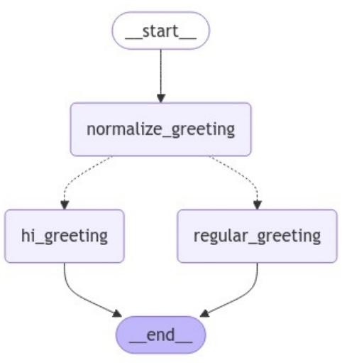

#### **Résumé et prochaines étapes**

Dans cet exemple développé, vous avez appris à :

- Créez plusieurs chemins de branchement en fonction de différentes conditions.
- Utilisez des bords conditionnels pour mapper des conditions spécifiques aux nœuds correspondants.
- Testez et vérifiez le flux de votre agent LangGraph avec différentes entrées.

Nous verrons ensuite comment introduire les **modifications d'état** et la **gestion des erreurs** dans les workflows, ce qui permettra à votre agent de gérer les données et de répondre avec élégance aux situations inattendues. Cela contribuera à rendre vos agents LangGraph plus robustes et polyvalents.

# **Quiz : concepts de base de LangGraph**

**Section 1 : Concepts et structure de base de LangGraph**

#### 1. **Laquelle des affirmations suivantes concernant les nœuds dans LangGraph est FAUX ?**

A) Les nœuds peuvent modifier les données d'état.

B) Les nœuds définissent les points de décision qui déterminent le chemin du flux de travail.

- C) Les nœuds peuvent se connecter directement au nœud END.
- D) Les nœuds peuvent être conditionnels ou inconditionnels.
#### 2. **Dans LangGraph, quel élément provoquerait le plus probablement une boucle infinie s'il était mal configuré ?**

- A) Nœud START
- B) Bord conditionnel
- C) Dictionnaire d'État
- D) Visualisation
- 3. **Vrai ou Faux** : Dans un workflow LangGraph, tous les nœuds doivent être directement connectés soit au nœud START, soit au nœud END.

#### **Section 2 : Logique conditionnelle et branchement**

4. Si la fonction conditionnelle suivante est utilisée dans un flux de travail LangGraph, quel message d'accueil sera utilisé si state["greeting"] contient à la fois « salut » et « bonjour » ?

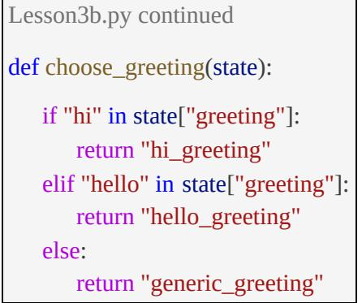

- A) salut\_salutation
- B) bonjour\_salutation
- C) générique\_salutation
- D) Cela entraînera une erreur due à une ambiguïté.

#### 4. **Lequel des énoncés suivants décrit le mieux le comportement de l'arête conditionnelle dans LangGraph ?**

A) Cela permet uniquement au flux de travail de se poursuivre si une condition spécifique est vraie.

B) Il permet le branchement en évaluant l'état et en déterminant le nœud suivant en fonction de conditions prédéfinies.

C) Il définit les points de début et de fin d'un flux de travail.

D) Il modifie l'état en fonction d'une logique conditionnelle.

5. Étant donné le code ci-dessous, que se passerait-il si "personalized\_hi\_greeting" est sélectionné comme nœud suivant, mais qu'il n'y a pas de bord direct de ce nœud vers END ?

```
Quiz
builder.add_conditional_edges(
          "normalize_greeting_node", choose_greeting,
          ["personalized_hi_greeting",
"personalized_hello_greeting", END]
```
A) Le flux de travail passera automatiquement au prochain nœud disponible.

B) Le flux de travail tentera de s'exécuter, mais une erreur GraphRecursionError se produira probablement.

C) Le flux de travail se terminera immédiatement.

D) Le flux de travail reviendra au nœud START.

**Section 3 : Gestion de l'état et exécution du workflow**

7. **Laquelle de ces pratiques n'est PAS une bonne pratique lors de la définition de l'état dans les flux de travail LangGraph ?**

A) Garder les variables d'état aussi spécifiques que possible pour garantir la clarté.

B) Stocker toutes les données potentielles dans le dictionnaire d'état au départ, même si elles ne sont pas utilisées immédiatement.

C) Mise à jour de l'état au sein de chaque nœud qui le traite.

D) Utiliser des définitions de type comme TypedDict pour structurer l'état.

#### 8. **Si un agent IA doit mémoriser les préférences de l'utilisateur lors de plusieurs interactions, où ces informations doivent-elles être stockées ?**

A) Dans une variable locale à l'intérieur de chaque nœud

B) Dans le dictionnaire d'état, transmis tout au long du flux de travail

C) Dans un fichier séparé auquel chaque nœud peut accéder

D) Dans les paramètres de visualisation

9. **Vrai ou Faux** : si un nœud modifie l'état d'une manière inattendue par les nœuds suivants, cela peut conduire à une InvalidUpdateError .

#### **Section 4 : Visualisation et compréhension du flux de travail**

10. **Pourquoi pourriez-vous utiliser un outil comme Graphviz pour visualiser votre flux de travail LangGraph ?**

A) Pour déboguer automatiquement les erreurs dans le code

B) Pour garantir que la logique du flux de travail est visuellement correcte et se déroule comme prévu

C) Pour accélérer le temps d'exécution du workflow

D) Rendre le flux de travail plus accessible aux utilisateurs sans connaissances techniques

#### **11. Dans la visualisation ci-dessous, si la flèche allant du message d'accueil personnalisé au message d'accueil personnalisé est manquante, laquelle des affirmations suivantes est la plus probable ?**

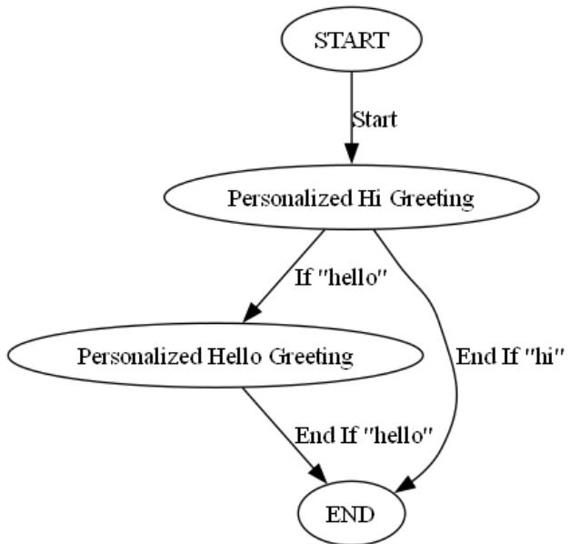

A) Le flux de travail n'a pas de chemin pour exécuter le message d'accueil personnalisé.

B) Le message d'accueil personnalisé sera exécuté comme nœud suivant indépendamment.

C) Le flux de travail connectera automatiquement le message d'accueil personnalisé à END .

D) La visualisation fonctionnera toujours mais produira un résultat inexact.

12. **Vrai ou Faux** : Dans LangGraph, la visualisation affecte directement la façon dont le flux de travail s'exécute.

**Section 5 : Questions avancées sur les applications et les scénarios**

13. **Considérez un scénario dans lequel vous disposez de la fonction conditionnelle suivante :**

Quiz def Choose\_path(state) : if state["greeting"].startswith("hello") : renvoie "hello\_path" si "goodbye" dans state["greeting"] : return "goodbye\_path" return END

Si le message d'accueil d'entrée est « Bonjour et au revoir », quel chemin sera sélectionné ?

- A) bonjour\_chemin
- B) au revoir\_chemin
-C) FIN
- D) Bonjour\_chemin et au revoir\_chemin
-**14. Que se passerait-il si vous supprimiez accidentellement le bord entre Message d'accueil personnalisé et FIN ?**
- A) Le flux de travail atteindrait toujours la FIN via des chemins conditionnels.
- B) Le flux de travail se terminerait prématurément.

C) Une GraphRecursionError pourrait se produire si Normalize Greeting est revisité.

D) Le flux de travail suivrait un chemin par défaut vers le END .
#### 15. **Laquelle des actions suivantes améliorerait probablement les performances si le flux de travail implique plusieurs conditions et chemins de branchement ?**

- A) Réduire le nombre de nœuds en fusionnant les tâches en moins de nœuds
- B) Stockage des données d'état en tant que variables globales
- C) Utiliser des conditions plus complexes au sein de chaque nœud

D) Augmentation du nombre d'arêtes conditionnelles pour un routage plus précis

#### **Corrigé**

- 1. B) Les nœuds définissent les points de décision qui déterminent le chemin du flux de travail.
- 2. B) Bord conditionnel
- 3. Faux
- 4. A) salut\_salutation
- 5. B) Il permet le branchement en évaluant l'état et en déterminant le nœud suivant en fonction de conditions prédéfinies.
- 6. B) Le flux de travail tentera de s'exécuter, mais une erreur GraphRecursionError se produira probablement.
- 7. B) Stocker toutes les données potentielles dans le dictionnaire d'état au départ, même si elles ne sont pas utilisées immédiatement.
- 8. B) Dans le dictionnaire d'état, transmis tout au long du workflow
- 9. Vrai
- 10. B) Pour garantir que la logique du flux de travail est visuellement correcte et se déroule comme prévu
- 11. A) Le flux de travail n'a pas de chemin pour exécuter le message d'accueil personnalisé.
- 12. Faux
- 13. A) bonjour\_chemin
- 14. C) Une erreur GraphRecursionError pourrait se produire si le message d'accueil HI personnalisé est revisité.
- 15. A) Réduire le nombre de nœuds en fusionnant les tâches en moins de nœuds

# **Chapitre 5**

# <span id="page-126-1"></span><span id="page-126-0"></span>**Créer votre premier agent IA**

#### **Objectif :**

Dans ce chapitre, vous créerez votre premier agent IA entièrement fonctionnel à l'aide de LangGraph. L'agent sera alimenté par un **Large Language Model (LLM)**, qui fournira l'intelligence nécessaire pour interpréter les entrées de l'utilisateur et générer des réponses. Le LLM sera également capable d'utiliser des outils, tels que des API externes, pour effectuer des tâches spécifiques.

À la fin de ce chapitre, vous :

- Intégrer un LLM dans LangGraph.
- Gérer les flux de messagerie (messages humains, invites système et réponses de l'IA).
- Mettre en place un traitement continu des entrées des utilisateurs.
- Gérez en toute sécurité les clés API et les configurations d'environnement.

# <span id="page-126-2"></span>**5.1 Introduction : la puissance des agents IA**

Dans le monde d'aujourd'hui, les agents IA font désormais partie intégrante de nos vies, du service client à l'interaction avec les utilisateurs en passant par l'automatisation des tâches dans les opérations commerciales. Ces agents sont conçus pour effectuer des tâches de manière autonome, interagir avec les humains et parfois même prendre des décisions en fonction des informations qu'ils reçoivent. Ce qui les rend intelligents, c'est la combinaison du langage naturel

traitement, la logique de prise de décision et la capacité d’agir en s’interfaçant avec des outils et des systèmes externes.

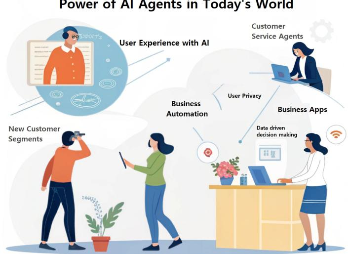

Dans ce chapitre, vous ferez vos premiers pas dans la création d'un tel agent d'IA en utilisant **LangGraph** comme cadre et un **LLM** comme moteur d'intelligence principal. Votre agent :

- 1. Interagissez avec les utilisateurs en comprenant leurs requêtes.
- 2. Utilisez le LLM pour traiter le langage naturel, transformant un texte de type humain en données exploitables.
- 3. Déclenchez des nœuds d'outils pour effectuer des tâches spécifiques, telles que la récupération d'informations à partir d'API externes, la planification d'événements ou l'exécution de calculs.

Cet agent IA sera simple dans son concept mais puissant dans son exécution. En combinant les capacités du LLM et des nœuds d'outils dans LangGraph, vous libérerez tout le potentiel des agents d'IA autonomes.

# <span id="page-127-0"></span>**5.2 Configuration de votre clé API et de votre environnement OpenAI**

Avant de commencer le codage, vous aurez besoin d'une clé API OpenAI pour appeler le LLM. Voici comment vous pouvez le configurer en toute sécurité.

1. **Obtenez une clé API OpenAI** :

○ Inscrivez-vous ou connectez-vous à [OpenAI Platform](https://platform.openai.com/) et accédez à la section Clés API pour générer votre clé API.

#### 2. **Stockez la clé API en toute sécurité** :

- Les clés API ne doivent jamais être stockées dans le cadre de votre code principal. Il est préférable de les stocker sous forme de secrets dans votre environnement en tant que variables d'environnement ou de secrets auprès de votre fournisseur de cloud, comme les secrets AWS ou Google.
- Dans ce cas, nous stockons la clé API dans un fichier .env pour la sécuriser. Cela empêchera le codage en dur et la fuite d’informations sensibles dans votre code.

Créez un fichier .env dans le répertoire de votre projet :


Ajoutez votre clé API au fichier .env :

borne

OPENAI\_API\_KEY="votre-clé-api-ici"

Ensuite, chargez la clé API du fichier .env dans votre code :

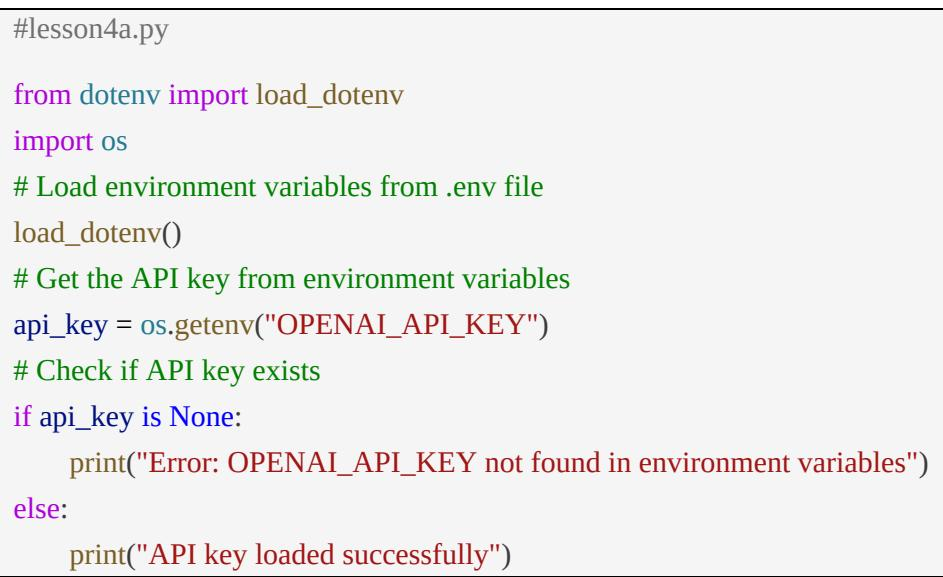

Avec cette configuration, vous pouvez charger en toute sécurité votre clé API OpenAI lors de l'exécution du script.

# <span id="page-129-0"></span>**5.3 Les bases de la messagerie LangGraph**
Dans LangGraph, l'interaction entre un utilisateur et un agent IA est gérée via une séquence de messages. Ceux-ci incluent :

- **Messages humains** : entrées de l'utilisateur, telles que des questions ou des commandes.
- **Messages AI** : réponses générées par le LLM.
- **Messages système** : messages envoyés par l'agent pour fournir un contexte ou des instructions supplémentaires au LLM (par exemple, définir un comportement ou une personnalité).
- **Modèles d'invite** : utilisés pour formater et structurer les entrées du LLM, l'aidant à générer des réponses plus précises.

Pour l’instant, concentrons-nous sur le message humain et le message de l’IA pour établir une simple interaction de va-et-vient.

# **5.3.1 La simplicité d'utilisation de LangGraph pour créer des agents IA**

LangGraph est un framework robuste pour créer des agents d'IA qui exploitent des **workflows basés sur des graphiques**. Le cadre est centré sur le concept de **nœuds** et de **bords**, qui représentent respectivement les actions et le flux de données. Dans ce chapitre, vous vous concentrerez sur l'utilisation de trois types clés de nœuds :

- 1. **Nœud LLM** : ce nœud utilise un LLM (par exemple, GPT-4o) pour traiter les saisies de texte et générer des réponses.
- 2. **Tool Node** : Ce nœud est chargé de déclencher des actions externes, telles que l'appel d'une API ou l'exécution d'une fonction.
- 3. **Nœud de décision** : ce nœud aide l'agent à décider de l'étape suivante en fonction du résultat du LLM ou du nœud d'outil.

Ces composants fonctionneront ensemble pour créer un système dynamique et intelligent capable de comprendre les entrées des utilisateurs et de prendre des mesures significatives.

# **5.3.2 Cas d'utilisation de l'agent AI : questions et réponses Agent AI**

Pour rendre cet exemple concret, nous allons créer un **agent Q&A** pratique qui peut :

- 1. Acceptez la question d'un utilisateur.
- 2. Utilisez un LLM pour traiter la question et formuler une réponse.
- 3. Déclenchez des nœuds d'outils en cas de besoin (par exemple, récupération d'informations météorologiques ou d'articles de presse).
- 4. Répondez à l'utilisateur avec une réponse détaillée.

## *Définir le problème de l'agent IA de questions et réponses (Q&A)*

Ce cas d'utilisation est très pratique et jette les bases d'agents plus complexes dans les prochains chapitres. Cela démontre également à quel point un agent d’IA peut être puissant lorsqu’il combine la compréhension du langage naturel avec des tâches exploitables.

Avant de plonger dans la création de l’agent, définissons ce qu’il fera. Notre objectif est de créer un **agent Q&A** capable :

- 1. **Comprendre les questions** d'un utilisateur, telles que "Quel temps fait-il aujourd'hui ?" ou "Raconte-moi une blague".
- 2. **Générer des réponses intelligentes** en utilisant un LLM comme fournisseur de renseignements.
- 3. **Déclenchez des nœuds d'outils** si nécessaire pour récupérer des informations en temps réel (par exemple, en appelant une API météo externe ou les cours des actions).

Dans cet exemple, le LLM sera chargé de comprendre l'intention de l'utilisateur et les nœuds d'outils seront utilisés pour effectuer des tâches spécifiques.

## *Configurer le graphique*

Maintenant que nous avons un objectif clair, nous pouvons commencer à configurer notre LangGraph. Un graphique dans LangGraph se compose de nœuds et d’arêtes qui définissent la manière dont les données se déplacent dans le système. Pour cet agent, vous allez créer un graphique composé des nœuds suivants :

- 1. **Nœud d'entrée** : ce nœud acceptera les entrées de l'utilisateur (la question). Il transmettra cette entrée au LLM pour traitement.
- 2. **Nœud LLM** : Le LLM prendra en compte les entrées de l'utilisateur, les traitera et générera une réponse. Le nœud LLM peut soit générer un message direct

des nœuds d’outils de réponse ou de déclenchement en fonction de la question.

- 3. **Nœuds d'outils** : ces nœuds seront déclenchés en fonction de la sortie du LLM. Par exemple, si le LLM détecte que l'utilisateur demande la météo, il déclenchera un nœud d'outil qui récupère les données météorologiques.
- 4. **Nœud de sortie** : Une fois la réponse générée, elle sera renvoyée à l'utilisateur.

#### *Créer l'agent IA de base*

Nous commencerons par configurer le workflow LangGraph pour interagir avec un LLM. Dans ce cas, nous nous concentrons uniquement sur l’appel du LLM pour répondre aux requêtes des utilisateurs.

```
#leçon5a.py
depuis langchain_openai importer ChatOpenAI
à partir de langgraph.graph importer StateGraph, MessagesState, START, END
# Initialiser le modèle LLM (en utilisant OpenAI dans cet exemple)
modèle = ChatOpenAI(model="gpt-4o-mini", api_key="VOTRE_API_KEY")
# Fonction de nœud pour gérer la requête de l'utilisateur et appeler le LLM
def call_llm (état : MessagesState) :
    messages = état["messages"]
    réponse = model.invoke(messages[-1].content)
    return {"messages": [réponse]}
# Définir le graphique
flux de travail = StateGraph (MessagesState)
# Ajouter le nœud pour appeler le LLM
workflow.add_node("call_llm", call_llm)
# Définir les arêtes (début -> LLM -> fin)
workflow.add_edge(START, "call_llm")
workflow.add_edge("call_llm", FIN)
# Compiler le workflow
app = workflow.compile()
# Exemple de message d'entrée de l'utilisateur
message_entrée = {    
    "messages": [("humain", "Quelle est la capitale du Kenya ?)]
}
# Exécuter le workflow
pour le morceau dans app.stream(input_message, stream_mode="values") :
```
chunk["messages"][-1].pretty\_print()

Here's a breakdown of what's happening:

- We use ChatOpenAI , an LLM, to handle language-based interactions.
- The call\_llm function sends the user's input to the model and returns the generated response.
- We define a simple graph with one node ( call\_llm ) and connect it to the start and end points.
- We ask the LLM a question as an input\_message and capture the response as a stream of results.

The expected output of running this code is as below:

==================================

Human Message

==================================

What is the capital of Kenya?

==================================

AI Message

==================================

The capital of Kenya is Nairobi.

# <span id="page-132-0"></span>**5.4 Continuous User Input Processing**

One essential feature of a robust AI agent is its ability to handle continuous user input, where the user can ask multiple questions in a single session. We will extend our agent to support this interaction loop, processing user inputs until the conversation is terminated.

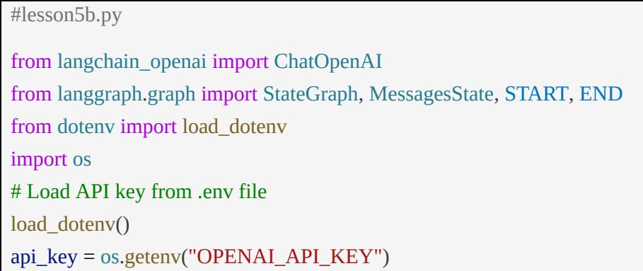

```
# Initialiser le LLM (en utilisant le GPT-4o d'OpenAI)
modèle = ChatOpenAI(model="gpt-4o-mini", api_key=api_key)
# Fonction de nœud pour gérer la requête de l'utilisateur et appeler le LLM
def call_llm (état : MessagesState) :
    messages = état["messages"]
    réponse = model.invoke(messages[-1].content)
    return {"messages": [réponse]}
# Définir le graphique
flux de travail = StateGraph (MessagesState)
# Ajouter le nœud pour appeler le LLM
workflow.add_node("call_llm", call_llm)
# Définir les arêtes (début -> LLM -> fin)
workflow.add_edge(START, "call_llm")
workflow.add_edge("call_llm", FIN)
# Compiler le workflow
app = workflow.compile()
# Fonction pour prendre en permanence les entrées de l'utilisateur
def interactive_with_agent() :
    tandis que Vrai :
         user_input = input("Vous : ")
         si user_input.lower() dans ["exit", "quit"] :
          print("Terminer la conversation.")
          pause
         message_entrée = {
          "messages": [("humain", user_input)]
         }
         pour le morceau dans app.stream(input_message, stream_mode="values") :
          chunk["messages"][-1].pretty_print()
# Commencez à interagir avec l'agent
interagir_avec_agent()
```
### **Explication :**

- **Étape 1 : Configuration sécurisée** : Nous chargeons la clé API OpenAI à partir du fichier .env pour la sécuriser.
- **Étape 2 : Nœud LLM** : La fonction call\_llm traite l'entrée de l'utilisateur via le LLM et renvoie la réponse de l'IA.
- **Étape 3 : Configuration du graphique** : Nous créons un StateGraph et ajoutons un nœud pour appeler le LLM. Le graphique est connecté du début à la fin, traitant les entrées de l'utilisateur et renvoyant la réponse.
- **Étape 4 : Saisie continue** : La fonction d'interaction\_with\_agent prend en compte la saisie continue de l'utilisateur, permettant à l'utilisateur de poser plusieurs questions en une seule session. La conversation se termine lorsque l'utilisateur tape « quitter » ou « quitter ».

# **5.4.1 Exécution de l'agent**

Maintenant que l'agent AI est configuré, vous pouvez exécuter le script et commencer à interagir avec l'agent. Par exemple :

Vous : Quelle est la capitale du Kenya ?

================================== Message AI ================================== La capitale du Kenya est Nairobi. ================================ Message humain ================================ Racontez-moi une blague ================================== Message Ai

==================================

Pourquoi l'épouvantail a-t-il remporté un prix ? Parce qu'il était exceptionnel dans son domaine !

Vous pouvez continuer à poser des questions et l'agent continuera à répondre jusqu'à ce que vous tapiez « quitter » ou « quitter ».

# **Résumé de la section**

Dans cette première section, nous avons réussi à créer un agent IA de base qui :

- Prend une entrée continue de l'utilisateur.
- Appelle le LLM pour générer des réponses intelligentes.
- Gère la gestion sécurisée des clés API via .env.

# <span id="page-134-0"></span>**5.5 Introduction aux outils des agents IA**

Bien qu'un LLM (Large Language Model) soit excellent pour générer des réponses basées sur la compréhension du langage, il présente des limites. Par exemple, il ne dispose pas d'informations en temps réel et ne peut pas effectuer de tâches spécifiques comme appeler une API ou exécuter des calculs. C'est là que les **outils** entrent en jeu.

**Les outils** permettent à un agent IA de :

- Récupérez des données en temps réel (par exemple, informations météorologiques, cours des actions).
- Effectuer des tâches spécifiques (par exemple, envoyer des e-mails, planifier des événements).
- Récupérer des informations à partir de bases de données ou d'API externes.

Dans cette partie, nous présenterons **ToolNode**, un nœud LangGraph conçu spécifiquement pour appeler des outils externes, et l'intégrerons dans notre agent existant.

# **5.5.1 Définir l'outil**

Pour démontrer l'intégration de l'outil, définissons un outil simple qui récupère des informations météorologiques pour une ville donnée. Cet outil simulera un service météo en renvoyant une réponse prédéfinie pour certaines villes.

# **Définissez l'outil à l'aide de @tool Decorator**

LangGraph fournit un moyen pratique de définir des outils à l'aide du décorateur @tool, ce qui facilite la transformation des fonctions Python en outils appelables.

```
#lesson5c.py
from langchain_core.tools import tool
# Define a tool to get the weather for a city
@tool
def get_weather(location: str):
    """Fetch the current weather for a specific location."""
    weather_data = {
         "San Francisco": "It's 60 degrees and foggy.",
         "New York": "It's 90 degrees and sunny.",
         "London": "It's 70 degrees and cloudy."
    }
    return weather_data.get(location, "Weather information is unavailable for this
location.")
```
## **Explication :**

- **@tool Decorator** : Ce décorateur marque la fonction comme un outil pouvant être utilisé dans LangGraph. Vous pouvez y penser comme si vous balisiez la fonction afin que LangGraph sache qu'il pourra l'appeler plus tard.
- **Fonction Logique** : La fonction get\_weather prend un emplacement en entrée et renvoie la météo pour cet emplacement. Si l'emplacement n'est pas trouvé dans le dictionnaire, il renvoie un message par défaut.

# **5.5.2 Intégration d'outils avec ToolNode**

Maintenant que nous disposons d’un outil pour récupérer la météo, nous devons l’intégrer dans notre agent. LangGraph fournit un type de nœud appelé **ToolNode** , qui est chargé d'appeler des outils externes comme celui que nous venons de définir.

## **Étape 2 : configurer le ToolNode**

#lesson5d.py from langgraph.prebuilt import ToolNode # Créez un ToolNode avec l'outil météo tool\_node = ToolNode([get\_weather])

## **Explication :**

● **ToolNode** : Ce nœud est spécifiquement conçu pour appeler des outils externes. Il faut une liste d’outils en entrée. Dans ce cas, nous transmettons l'outil get\_weather au ToolNode .

Maintenant que nous avons configuré ToolNode, nous pouvons l'intégrer dans notre flux de travail LangGraph.

# **5.5.3 Mise à jour du LLM pour utiliser les outils**

Dans la première section, notre agent a utilisé uniquement le LLM pour répondre aux requêtes des utilisateurs. Nous allons maintenant mettre à jour le graphique afin que l'agent puisse également appeler l'outil météo si l'utilisateur demande des informations météorologiques.

```
#lesson5d.py continued
model=ChatOpenAI(model="gpt-4o-mini",api_key=api_key).bind_tools([get_weather])
# Step 4: Function to handle user queries and process LLM + tool results
def call_llm(state: MessagesState):
    messages = state["messages"]
```

```
# The LLM will decide if it should invoke a tool based on the user input
    response = model.invoke(messages[-1].content)
    # If the LLM generates a tool call, handle it
    if response.tool_calls:
         tool_result = tool_node.invoke({"messages": [response]})
         # Append the tool's output to the response message
         tool_message = tool_result["messages"][-1].content
         response.content += f"\nTool Result: {tool_message}"
    return {"messages": [response]}
# Step 5: Create the LangGraph workflow
workflow = StateGraph(MessagesState)
# Step 6: Add the LLM node to the workflow
workflow.add_node("call_llm", call_llm)
# Step 7: Define edges to control the flow (LLM -> End)
workflow.add_edge(START, "call_llm")
workflow.add_edge("call_llm", END)
# Step 8: Compile the workflow
app = workflow.compile()
```
## **Explication :**

- **Méthode Bind\_tools :** La méthode bind\_tools pour lier l'outil get\_weather au LLM. Ce faisant, le LLM prend conscience de l'outil et peut choisir quand l'invoquer en fonction de la saisie de l'utilisateur. Si la requête de l'utilisateur concerne la météo, le LLM appellera automatiquement l'outil get\_weather et inclura le résultat dans sa réponse.
- **Mise à jour du graphique** : Nous ajoutons un nouveau nœud au graphique, call\_llm , qui est responsable de l'interaction avec l'outil. Cela signifie qu'une fois que le LLM aura traité l'entrée de l'utilisateur, il décidera s'il doit appeler l'outil.
- **Flow Control** : Si le LLM détecte que l'utilisateur pose des questions sur la météo, il appellera l'outil météo. Une fois l'exécution de l'outil terminée, la conversation se terminera.

# **5.5.4 Gestion de la saisie continue avec des outils**
Étendons notre fonction de saisie continue pour gérer à la fois les requêtes générales (traitées par le LLM) et les requêtes spécifiques (traitées par l'outil).

#lesson5d.py suite

# Fonction pour prendre en continu les entrées de l'utilisateur et décider entre les appels LLM et d'outil def interactive\_with\_agent(): while True: user\_input = input("You: ") if user\_input.lower() in ["exit", "quit"]: print("Fin de la conversation.") break input\_message = { "messages": [("human", user\_input)] } for chunk in app.stream(input\_message, stream\_mode="values") : chunk["messages"][-1].pretty\_print() # Commencez à interagir avec l'agent interactive\_with\_agent()

## **Explication :**

● **Boucle d'entrée continue** : l'agent écoute en permanence les entrées de l'utilisateur, les traite via le graphique et détermine s'il doit appeler le LLM ou l'outil en fonction de la demande de l'utilisateur.

# **5.5.5 Exécution de l'agent avec des outils**

Maintenant que tout est configuré, exécutons l'agent et posons-lui une question relative à la météo.

Le code complet :

#lesson5d.py exemple de code complet # Importer les bibliothèques nécessaires depuis langchain\_openai importer ChatOpenAI depuis langgraph.graph importer StateGraph, MessagesState, START, END depuis langchain\_core.tools outil d'importation depuis langgraph.prebuilt importer ToolNode depuis dotenv importer charger\_dotenv importer os # Étape 1 : Charger la clé API depuis .env load\_dotenv()

```
api_key = os.getenv("OPENAI_API_KEY")
# Step 2: Define the tool to get weather information
@tool
def get_weather(location: str):
    """Fetch the current weather for a specific location."""
    weather_data = {
         "San Francisco": "It's 60 degrees and foggy.",
         "New York": "It's 90 degrees and sunny.",
         "London": "It's 70 degrees and cloudy."
    }
    return weather_data.get(location, "Weather information is unavailable for this
location.")
# Step 3: Initialize the LLM (OpenAI's GPT-4o-mini model) and bind the tool
tool_node = ToolNode([get_weather], handle_tool_errors=False)
model = ChatOpenAI(model="gpt-4o-mini",
api_key=api_key).bind_tools([get_weather])
# Step 4: Function to handle user queries and process LLM + tool results
def call_llm(state: MessagesState):
    messages = state["messages"]
    # The LLM will decide if it should invoke a tool based on the user input
    response = model.invoke(messages[-1].content)
    # If the LLM generates a tool call, handle it
    if response.tool_calls:
         tool_result = tool_node.invoke({"messages": [response]})
         # Append the tool's output to the response message
         tool_message = tool_result["messages"][-1].content
         response.content += f"\nTool Result: {tool_message}"
    return {"messages": [response]}
# Step 5: Create the LangGraph workflow
workflow = StateGraph(MessagesState)
# Step 6: Add the LLM node to the workflow
workflow.add_node("call_llm", call_llm)
# Step 7: Define edges to control the flow (LLM -> End)
workflow.add_edge(START, "call_llm")
workflow.add_edge("call_llm", END)
```
# Étape 8 : Compiler le workflow

app = workflow.compile()

```
# Step 9: Function to interact with the agent continuously
def interact_with_agent():
    while True:
         user_input = input("You: ")
         if user_input.lower() in ["exit", "quit"]:
             print("Ending the conversation.")
             break
         # Prepare the user input for processing
         input_message = {
             "messages": [("human", user_input)]
         }
         # Process the input through the workflow and return the response
         for chunk in app.stream(input_message, stream_mode="values"):
             chunk["messages"][-1].pretty_print()
# Step 10: Start interacting with the AI agent
interact_with_agent()
```
## **Résultat attendu :**

================================== Message humain ================================== Quel temps fait-il à Nairobi ? ================================== Message IA ==================================

La météo à San Francisco est la suivante : Il fait 27 degrés et il fait beau.

# **5.5.6 Comment le système décide d'utiliser un outil**

Vous vous demandez peut-être : « Comment le système sait-il quand appeler un outil et quand simplement générer une réponse ? » Ce processus de prise de décision est basé sur les résultats du LLM. Voici comment cela fonctionne :

- 1. L'utilisateur pose une question et le **nœud LLM** traite l'entrée.
- 2. Le LLM génère une réponse. Si la réponse contient un **appel d'outil** (par exemple, "Vérifier la météo pour San Francisco"), le graphique déclenche le **ToolNode**.
3. Le **ToolNode** appelle l'outil spécifié (dans ce cas, get\_weather ) et renvoie le résultat.

Cette interaction entre le LLM et les outils donne à votre agent la capacité de comprendre les entrées des utilisateurs et de prendre des mesures concrètes sur la base de cette compréhension.

# **5.5.7 Gestion des erreurs dans les outils**

LangGraph fournit une gestion intégrée des erreurs pour les outils. Si quelque chose ne va pas pendant l'exécution de l'outil (par exemple, l'API est inaccessible), LangGraph gérera l'erreur et renverra un message significatif à l'utilisateur. Vous pouvez personnaliser la gestion des erreurs en configurant ToolNode pour gérer ou propager les erreurs.

```
#lesson5d.py continued
# ToolNode with error handling disabled (propagating errors to the user)
tool_node = ToolNode([get_weather], handle_tool_errors=False)
```
Dans ce cas, si l'outil météo rencontre une erreur, l'agent informera l'utilisateur que quelque chose s'est mal passé plutôt que de gérer l'erreur en silence.

# **5.5.9 Explication : Bases de l'appel d'outils dans LangGraph : un aperçu simple**

Dans **LangGraph**, les outils sont des fonctions d'assistance qu'un agent d'IA peut appeler pour effectuer des tâches spécifiques, telles que la récupération de données ou le traitement des entrées utilisateur. Voici un guide simplifié pour comprendre le fonctionnement de l'appel d'outils, étape par étape.

# **Qu'est-ce que l'appel d'outils dans LangGraph ?**

Dans LangGraph, les **outils** sont des fonctions d'assistance qu'un agent IA peut appeler pour effectuer des tâches spécifiques. Ces outils permettent à l'agent d'accéder à des données externes, d'effectuer des calculs spécifiques ou d'entreprendre des actions que l'agent ne peut pas gérer seul. Par exemple, vous pouvez créer un outil qui recherche une entrée dans une base de données, vérifie les dates disponibles dans un calendrier ou récupère des données financières.

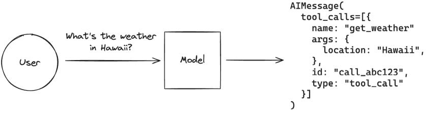

# **Exigences clés**

Avant de vous lancer dans le processus, il est important de comprendre que pour que **ToolNode** fonctionne, l'**graph state** doit contenir une clé de messages. Cette clé contient une liste d'interactions, qui comprend les appels d'outils, les entrées de l'utilisateur et les résultats.

- **Outil** : fonction qui effectue une tâche, telle que récupérer des entrées de base de données ou effectuer un calcul.
- **ToolNode** : Un nœud chargé d'exécuter les outils lorsque l'agent IA les demande.
- **StateGraph** : l'état du flux de travail de l'IA, qui comprend une clé de messages pour stocker les appels et les réponses des outils.

# **Exemple : Récupération du profil d'un utilisateur à partir d'une base de données**

Prenons un exemple plus pratique : récupérer le profil d'un utilisateur à partir d'une base de données. Dans cet exemple, l'agent IA appellera un outil qui recherche les informations utilisateur en fonction d'un ID utilisateur.

# *Définissez votre outil*

Nous définissons un outil à l'aide du décorateur @tool, qui le marque comme appelable par le **ToolNode**. Dans ce cas, l'outil recherchera un profil utilisateur dans une base de données prédéfinie (simulée ici avec un dictionnaire).

```
#lesson5e.py
from langchain_core.tools import tool
# Define a tool to get user profile by user ID
@tool
def get_user_profile(user_id: str):
    user_data = {
         "101": {"name": "Alice", "age": 30, "location": "New York"},
         "102": {"name": "Bob", "age": 25, "location": "San Francisco"}
```

```
}
return user_data.get(user_id, "User profile not found.")
```
Ici, l'outil get\_user\_profile prend un **ID utilisateur** en entrée et renvoie les informations de profil de l'utilisateur. Si l'ID utilisateur n'est pas trouvé, il renvoie un message « Profil utilisateur introuvable ».

# *Configurer le ToolNode*

Maintenant que nous avons défini notre outil, l'étape suivante consiste à configurer le **ToolNode**. Le **ToolNode** est chargé d'appeler l'outil get\_user\_profile lorsque l'agent IA le demande.

```
#lesson5e.py continued
from langgraph.prebuilt import ToolNode
# Set up the ToolNode with the get_user_profile tool
tools = [get_user_profile]
tool_node = ToolNode(tools)
```
Ici, nous transmettons notre outil get\_user\_profile au **ToolNode**. Ce nœud traitera l'appel de l'outil et renverra le résultat.

# *Créer un message AIM pour l'appel d'outils*

Ensuite, nous devons créer un **AIMessage** qui indique à l'agent IA quel outil appeler et fournit les informations nécessaires (dans ce cas, l'ID utilisateur). Ce **AIMessage** fera partie de l'**état du graphique** sous la clé des messages.

```
#lesson5e.py continued
from langchain_core.messages import AIMessage
# Create a message with a tool call for retrieving user profile
message_with_tool_call = AIMessage(
    content="",
    tool_calls=[{
         "name": "get_user_profile",
         "args": {"user_id": "101"},
         "id": "tool_call_id",
         "type": "tool_call"
    }]
```
)
Ce **AIMessage** demande à l'agent IA d'appeler l'outil get\_user\_profile avec l'ID utilisateur **101**.

# *Configurer le StateGraph*

Avant de pouvoir appeler l'outil, nous devons configurer **StateGraph**. Ce graphique contient l'état du flux de travail IA, y compris la liste des messages (qui inclut l'appel de l'outil).

```
#lesson5e.py continued
# Initialize the state with a messages key
state = {
    "messages": [message_with_tool_call]
}
```
Le **StateGraph** doit avoir une clé de messages, qui contient la liste des interactions (comme l'appel d'outil que nous venons de créer).

# *Invoquer l'outil à l'aide de ToolNode*

Maintenant, nous pouvons utiliser le **ToolNode** pour traiter l'état et appeler l'outil. Le **ToolNode** examinera le dernier message de l'état, trouvera l'appel de l'outil et exécutera l'outil correspondant ( get\_user\_profile ).

```
#lesson5e.py continued
# Use ToolNode to invoke the tool and update the state
result = tool_node.invoke(state)
print(result)
```
Cela appellera l'outil get\_user\_profile avec l'ID utilisateur **101** et renverra le profil utilisateur d'Alice.

# **Exemple de sortie**

Le code complet :

#lesson5e.py exemple de code complet de langchain\_core.tools outil d'importation de langgraph.prebuilt import ToolNode de langchain\_core.messages import AIMessage

```
# Step 1: Define the tool
@tool
def get_user_profile(user_id: str):
    """Fetch the profile of a user by user ID."""
    user_data = {
         "101": {"name": "Alice", "age": 30, "location": "New York"},
         "102": {"name": "Bob", "age": 25, "location": "San Francisco"}
    }
    return user_data.get(user_id, "User profile not found.")
# Step 2: Set up the ToolNode with the get_user_profile tool
tools = [get_user_profile]
tool_node = ToolNode(tools)
# Step 3: Create an AIMessage for the tool call
message_with_tool_call = AIMessage(
    content="",
    tool_calls=[{
         "name": "get_user_profile",
         "args": {"user_id": "101"},
         "id": "tool_call_id",
         "type": "tool_call"
    }]
)
# Step 4: Set up the state with the messages key
state = {
    "messages": [message_with_tool_call]
}
# Step 5: Invoke the ToolNode with the state and get the result
result = tool_node.invoke(state)
# Output the result
print(result)
{'messages': [ToolMessage(content="{'name': 'Alice', 'age': 30, 'location': 'New York'}",
    name='get_user_profile', tool_call_id='tool_call_id')]}
```
Après avoir exécuté le code, le résultat ressemblerait à ceci :

Sortie #lesson5e.py

```
{'messages': [ToolMessage(content="{'name': 'Alice', 'age': 30, 'location': 'New
York'}",name='get_user_profile', tool_call_id='tool_call_id')]}
```
Cela montre que **ToolNode** a appelé avec succès l'outil get\_user\_profile et a renvoyé le profil d'Alice.

# **Résumé de l'appel d'outil**

- 1. Les **outils** dans LangGraph sont des fonctions qui peuvent être appelées par l'agent IA pour effectuer des tâches spécifiques.
- 2. Le **ToolNode** est responsable de l'appel des outils sur demande.
- 3. **StateGraph** doit avoir une clé de messages, où les appels d'outils et les résultats sont stockés.
- 4. Le **AIMessage** indique à l'agent IA quel outil appeler et quelle entrée transmettre.
- 5. Le **ToolNode** met à jour l'état avec le résultat de l'appel de l'outil.

En vous assurant que votre **StateGraph** dispose de la clé de messages nécessaire, vous pouvez facilement utiliser des outils tels que get\_user\_profile ou toute autre fonctionnalité personnalisée dans votre flux de travail LangGraph. Ce guide révisé fournit une compréhension claire de la manière dont **ToolNode** interagit avec l'état pour traiter et renvoyer les résultats des appels d'outil.

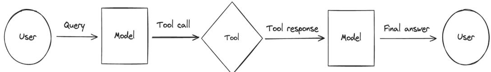

# **Résumé du chapitre 5**

Dans cette deuxième partie, nous avons étendu les capacités de notre agent IA en :

- Définition d'un outil pour récupérer des informations météo en temps réel.
- Intégration de l'outil dans notre workflow LangGraph à l'aide de ToolNode .

● Mettre à jour l'agent pour décider quand appeler le LLM et quand utiliser l'outil.

En ajoutant des outils à votre agent IA, vous lui permettez d'effectuer des tâches plus complexes et plus utiles, telles que récupérer des données en temps réel, effectuer des calculs ou interagir avec des systèmes externes. Cela jette les bases de la création d’agents encore plus sophistiqués dans les prochains chapitres.

# **Quelle est la prochaine étape ?**

Maintenant que vous avez une solide compréhension de la façon d'intégrer des LLM et des outils dans vos flux de travail LangGraph, nous explorerons la **gestion de l'état et la persistance** dans le chapitre suivant. Cela permettra à vos agents de mémoriser les informations entre les interactions et les sessions, améliorant ainsi leurs fonctionnalités et leur expérience utilisateur.

# **Chapitre 6**
# <span id="page-148-1"></span><span id="page-148-0"></span>**Présentation de la mémoire dans les agents IA**

Dans ce chapitre, nous nous concentrerons sur la **mémoire à court terme** des agents IA, une fonctionnalité clé qui permet à un agent de se souvenir des interactions au sein d'une session mais pas entre plusieurs sessions. La mémoire à court terme aide un agent à maintenir le contexte pendant une conversation, la rendant plus cohérente et plus réactive aux entrées de l'utilisateur.

Nous commencerons par démontrer un agent IA sans aucune mémoire et montrerons comment l'ajout de mémoire à court terme améliore l'interaction. Nous utiliserons les outils de mémoire intégrés de LangGraph pour y parvenir.

## <span id="page-148-2"></span>**6.1 Le problème : un agent sans mémoire**

Créons d'abord un agent IA de base qui manque de mémoire. Cet agent traite chaque requête utilisateur individuellement, sans aucune connaissance des interactions antérieures.

### **Exemple : un agent IA de base sans mémoire**

```
#lesson6a.py
from langchain_openai import ChatOpenAI
from langgraph.graph import StateGraph, MessagesState, START, END
from dotenv import load_dotenv
import os
```

```
# Load API key from .env file
load_dotenv()
api_key = os.getenv("OPENAI_API_KEY")
# Initialize the LLM (using OpenAI's GPT-4o-mini)
model = ChatOpenAI(model="gpt-4o-mini", api_key=api_key)
# Node function to handle the user query and call the LLM
def call_llm(state: MessagesState):
    messages = state["messages"]
    response = model.invoke(messages[-1].content)
    return {"messages": [response]}
# Define the graph
workflow = StateGraph(MessagesState)
# Add the node to call the LLM
workflow.add_node("call_llm", call_llm)
# Define the edges (start -> LLM -> end)
workflow.add_edge(START, "call_llm")
workflow.add_edge("call_llm", END)
# Compile the workflow
app = workflow.compile()
# Function to continuously take user input
def interact_with_agent():
    while True:
         user_input = input("You: ")
         if user_input.lower() in ["exit", "quit"]:
          print("Ending the conversation.")
          break
         input_message = {
          "messages": [("human", user_input)]
         }
         for chunk in app.stream(input_message, stream_mode="values"):
          chunk["messages"][-1].pretty_print()
# Start interacting with the agent
interact_with_agent()
```
Dans ce cas :

● L'agent prend en compte les entrées de l'utilisateur, les envoie au modèle de langage et répond.

● **Pas de mémoire :** L'agent oublie tout après chaque interaction, traitant chaque entrée comme une nouvelle requête isolée.

#### **Exemple d'interaction sans mémoire :**

Vous : Comment je m'appelle ? Agent : Je suis désolé, je ne connais pas votre nom.

Vous : Je m'appelle John. Agent : Enchanté de vous rencontrer, John.

Vous : Comment je m'appelle ? Agent : Je suis désolé, je ne connais pas votre nom.

Notez que l'agent ne se souvient pas que l'utilisateur vient de mentionner son nom il y a quelques instants.

# <span id="page-150-0"></span>**6.2 Amélioration de l'agent avec une mémoire à court terme**

Maintenant, ajoutons de la **mémoire à court terme** à l'aide de MemorySaver de LangGraph. Avec la mémoire à court terme, l’agent peut se souvenir de la conversation pendant la session mais oubliera tout une fois la session terminée.

## **Exemple : Ajout de mémoire à court terme avec MemorySaver**

```
#lesson6b.py
from langgraph.checkpoint.memory import MemorySaver
# Update node function to invoke all messages to give the LLM context
def call_llm(state: MessagesState):
    messages = state["messages"]
    response = model.invoke(messages)
    return {"messages": [response]}
# Initialize the checkpointer for short-term memory
checkpointer = MemorySaver()
# Compile the workflow with short-term memory
app_with_memory = workflow.compile(checkpointer=checkpointer)
def interact_with_agent_with_memory():
    # Use a thread ID to simulate a continuous session
    thread_id = "session_1"
    while True:
         user_input = input("You: ")
         if user_input.lower() in ["exit", "quit"]:
            print("Ending the conversation.")
```

```
break
        input_message = {
            "messages": [("human", user_input)]
        }
        # Invoke the graph with short-term memory enabled
        config = {"configurable": {"thread_id": thread_id}}
        for chunk in app_with_memory.stream(input_message, config=config,
stream_mode="values"):
            chunk["messages"][-1].pretty_print()
# Start interacting with the memory-enabled agent
interact_with_agent_with_memory()
```
## **Exemple d'interaction avec la mémoire à court terme :**

Vous : Comment je m'appelle ? Agent : Je suis désolé, je ne connais pas votre nom.

Vous : Je m'appelle John. Agent : Enchanté de vous rencontrer, John.
Vous : Comment je m'appelle ? Agent : Votre nom est John.

Ici, l'agent **se souvient** désormais que votre nom est « John » pendant la session, démontrant l'avantage de la mémoire à court terme. Le contexte de session persiste tant que la session est active.

# <span id="page-151-0"></span>**6.3 Comment fonctionne la mémoire à court terme**

En ajoutant MemorySaver , nous pouvons stocker l'état de la conversation au sein de la session. En arrière-plan, LangGraph enregistre des **points de contrôle** (des instantanés de l'état de la conversation) à chaque étape. Ces points de contrôle sont liés à un **thread ID**, qui simule une session. Tant que l’ID du thread reste le même, l’agent se souviendra des interactions passées.

- **Points de contrôle :** Stockez l'état de la conversation.
- **Thread ID :** Simule une session, permettant à l'agent de conserver le contexte.
- **Mémoire à court terme :** Une fois la session terminée, la mémoire est supprimée.

# **6.4 Démontrer la mémoire à court terme à travers plusieurs questions**

Voyons comment l'agent se comporte lorsqu'il répond à plusieurs questions.

## **Exemple d'interaction :**

Vous : Quelle est la capitale de la France ? Agent : La capitale de la France est Paris.

Vous : Et quel est mon nom ? Agent : Je suis désolé, je ne connais pas votre nom.

Vous : Je m'appelle Sarah James. Agent : Enchanté de vous rencontrer, Sarah.

Vous : Quel est mon prénom ? Agent : Votre prénom est Sarah.

Vous : Quel est mon deuxième prénom ? Agent : Votre deuxième nom est James.

Dans cette séance :

- L'agent mémorise correctement le nom de l'utilisateur (« Sarah ») une fois celui-ci fourni.
- L'agent gère également d'autres requêtes (par exemple, les capitales des pays) sans perdre la mémoire du nom de l'utilisateur pendant la session.

# <span id="page-152-0"></span>**6.5 Exemple de code complet : un agent IA avec mémoire à court terme**

Voici le code complet pour créer un agent IA avec mémoire à court terme à l'aide de MemorySaver de LangGraph :

```
#lesson6c.py
from langchain_openai import ChatOpenAI
from langgraph.graph import StateGraph, MessagesState, START, END
from langgraph.checkpoint.memory import MemorySaver
from dotenv import load_dotenv
import os
# Load API key from .env file
load_dotenv()
api_key = os.getenv("OPENAI_API_KEY")
# Initialize the LLM (using OpenAI's GPT-4o-mini)
```

```
model = ChatOpenAI(model="gpt-4o-mini", api_key=api_key)
# Node function to handle the user query and call the LLM
def call_llm(state: MessagesState):
    messages = state["messages"]
    response = model.invoke(messages)
    return {"messages": [response]}
# Define the graph
workflow = StateGraph(MessagesState)
# Add the node to call the LLM
workflow.add_node("call_llm", call_llm)
# Define the edges (start -> LLM -> end)
workflow.add_edge(START, "call_llm")
workflow.add_edge("call_llm", END)
# Initialize the checkpointer for short-term memory
checkpointer = MemorySaver()
# Compile the workflow with short-term memory
app_with_memory = workflow.compile(checkpointer=checkpointer)
# Function to interact with the agent using short-term memory
def interact_with_agent_with_memory():
    # Use a thread ID to simulate a continuous session
    thread_id = "session_2"
    while True:
        user_input = input("You: ")
        if user_input.lower() in ["exit", "quit"]:
            print("Ending the conversation.")
            break
        input_message = {
            "messages": [("human", user_input)]
        }
        # Invoke the graph with short-term memory enabled
        config = {"configurable": {"thread_id": thread_id}}
        for chunk in app_with_memory.stream(input_message, config=config,
stream_mode="values"):
            chunk["messages"][-1].pretty_print()
# Start interacting with the memory-enabled agent
interact_with_agent_with_memory()
```
# <span id="page-154-0"></span>**6.6 Mémoire sur plusieurs sessions**

Dans la section précédente, nous avons exploré la mémoire à court terme, où l'agent se souvient des interactions au cours d'une seule session. Cependant, dans de nombreux cas, il est utile pour un agent de conserver la mémoire sur plusieurs sessions. Cela permet à l'agent de mémoriser les détails de l'utilisateur ou l'historique des conversations même si l'utilisateur se reconnecte ou démarre une nouvelle session. Dans cette section, nous explorerons comment LangGraph permet la persistance de la mémoire entre les sessions à l'aide de sa mémoire.

# **6.6.1 Mémoire et points de contrôle entre les sessions**
LangGraph utilise des **points de contrôle** et des **ID de thread** pour stocker l'état de la conversation à chaque interaction (appelée **super-étape**). Chaque interaction ou session peut être liée à un fil de discussion spécifique, permettant à l'agent de rappeler l'état exact de la conversation lorsque l'ID du fil de discussion est réutilisé. Ceci est utile lorsque vous avez besoin de mémoire pour conserver différentes sessions, ce qui est souvent le cas dans les applications de service client ou les assistants personnels.

## **Comment ça marche :**

- 1. Les **points de contrôle** stockent l'état de la conversation (par exemple, les entrées de l'utilisateur, les réponses de l'agent) à chaque interaction.
- 2. Les **ID de thread** identifient de manière unique une session ou une conversation, permettant à l'agent de restaurer la conversation à partir d'un point de contrôle précédent lorsque le même ID de thread est fourni.

Montrons comment l'agent enregistre et restaure la mémoire au cours de différentes sessions à l'aide de l'ID de thread.

# **6.6.2 Exemple : Persistance en mémoire entre les sessions**

Nous modifierons notre agent existant pour conserver la mémoire entre les différentes sessions en utilisant des ID de thread pour lier les conversations. N'oubliez pas qu'à la fin du programme, les données seront perdues de la mémoire, car toutes les sessions sont en mémoire, c'est-à-dire situées dans la RAM et non enregistrées sur le disque.

### **Exemple de code : utilisation de points de contrôle pour la mémoire inter-sessions**

```
#lesson6d.py
from langchain_openai import ChatOpenAI
```

```
from langgraph.graph import StateGraph, MessagesState, START, END
from langgraph.checkpoint.memory import MemorySaver
from dotenv import load_dotenv
import os
# Load API key from .env file
load_dotenv()
api_key = os.getenv("OPENAI_API_KEY")
# Initialize the LLM (using OpenAI's GPT-4o-mini)
model = ChatOpenAI(model="gpt-4o-mini", api_key=api_key)
# Node function to handle the user query and call the LLM
def call_llm(state: MessagesState):
    messages = state["messages"]
    response = model.invoke(messages)
    return {"messages": [response]}
# Define the graph
workflow = StateGraph(MessagesState)
# Add the node to call the LLM
workflow.add_node("call_llm", call_llm)
# Define the edges (start -> LLM -> end)
workflow.add_edge(START, "call_llm")
workflow.add_edge("call_llm", END)
# Initialize the MemorySaver checkpointer
checkpointer = MemorySaver()
# Compile the workflow with short-term memory
app_with_memory = workflow.compile(checkpointer=checkpointer)
# Function to simulate interacting with the agent across sessions
def interact_with_agent_across_sessions():
    while True:
        # Simulate a new session by allowing the user to input a thread ID
        thread_id = input("Enter thread ID (or 'new' for a new session): ")
        if thread_id.lower() in ["exit", "quit"]:
            print("Ending the conversation.")
            break
        if thread_id.lower() == "new":
            thread_id = f"session_{os.urandom(4).hex()}"  # Generate a unique session
ID
        while True:
```

```
user_input = input("You: ")
             if user_input.lower() in ["exit", "quit", "end session"]:
                 print(f"Ending session {thread_id}.")
                 break
             input_message = {
                 "messages": [("human", user_input)]
             }
             # Invoke the graph with the correct thread ID to maintain memory across
sessions
             config = {"configurable": {"thread_id": thread_id}}
             for chunk in app_with_memory.stream(input_message, config=config,
stream_mode="values"):
                 chunk["messages"][-1].pretty_print()
# Start interacting with the memory-persistent agent
interact_with_agent_across_sessions()
```
#### **Principales fonctionnalités :**

- 1. **Mémoire basée sur la session :** Les utilisateurs peuvent se reconnecter à l'agent à l'aide d'un ID de thread (par exemple, session\_1 ), et l'agent rappellera le contexte de conversation de la dernière interaction associée à cet ID.
- 2. **Nouvelles sessions :** Les utilisateurs peuvent créer une nouvelle session en générant un nouvel ID de thread, permettant à l'agent de redémarrer sans aucune mémoire préalable.

#### **Exemple d'interaction avec la persistance en mémoire :**

Vous : Je m'appelle Sarah. Agent : Enchanté de vous rencontrer, Sarah ! Comment puis-je vous aider aujourd'hui ? Vous : Terminez la session. Fin de la session session\_1. Entrez l'ID du fil de discussion (ou « nouveau » pour une nouvelle session) : session\_1 Vous : Quel est mon nom ? Agent : Votre nom est Sarah. Entrez l'ID du fil de discussion (ou « nouveau » pour une nouvelle session) : session\_2 Vous : Quel est mon nom ?

Agent : Je suis désolé, mais je n'ai pas accès aux informations personnelles...
Dans cet exemple, même si la session s'est terminée et a repris plus tard, l'agent a mémorisé le nom de l'utilisateur, grâce à la mémoire associée au thread\_id . La mémoire de chaque session est indépendante et la mémoire stockée dans la session\_1 n'est pas disponible dans la session\_2.

# **6.6.3 Comment fonctionne la persistance en mémoire dans LangGraph**

### **Points de contrôle et fils de discussion**

- **Points de contrôle :** LangGraph enregistre l'état de la conversation à chaque interaction en tant que point de contrôle. Chaque point de contrôle contient le contexte de la conversation, y compris les entrées utilisateur et les réponses de l'agent.
- **IDs de thread :** Chaque session est associée à un ID de thread. Lorsque le même ID de thread est réutilisé, LangGraph restaure le contexte de conversation à partir du dernier point de contrôle associé à ce thread.

Par exemple :

- Si vous démarrez une session avec thread\_id = "session\_1" , LangGraph stockera toutes les interactions au sein de cette session.
- Si vous revenez plus tard et démarrez une nouvelle session en utilisant le même thread\_id , l'agent restaurera la mémoire de la dernière interaction dans session\_1 .

## **Résolution de la mémoire entre les sessions**

La mémoire peut être sauvegardée sur différentes sessions, ce qui permet de reprendre les conversations après la fin d'une session. Ceci est particulièrement utile pour les workflows de longue durée, les applications de service client ou les scénarios dans lesquels les utilisateurs interagissent avec l'agent au fil du temps.

# **6.6.4 Stockage en mémoire pour les informations persistantes**

Parfois, il est nécessaire que l'agent mémorise certaines informations utilisateur (par exemple, préférences, données personnelles) **dans toutes les sessions**, même lorsqu'un nouveau fil de discussion est démarré. Pour ce faire, LangGraph fournit le **Memory Store**.

Le magasin de mémoire permet à l'agent de stocker des informations qui peuvent être partagées entre différentes sessions (threads) pour le même utilisateur. Par exemple, l'agent

pourrait stocker les préférences alimentaires ou les activités préférées d'un utilisateur, qui persisteraient dans toutes les conversations futures, quel que soit l'ID de session.

#### **Exemple : Stockage d'informations sur plusieurs sessions à l'aide de la mémoire de stockage**

```
#lesson6e.py
from langgraph.store.memory import InMemoryStore
import uuid
# Initialize an in-memory store to store user information across sessions
in_memory_store = InMemoryStore()
# Function to store user information across sessions
def store_user_info(state: MessagesState, config, *, store=in_memory_store):
    user_id = config["configurable"]["user_id"]
    namespace = (user_id, "memories")
    # Create a memory based on the conversation
    memory_id = str(uuid.uuid4())
    memory = {"user_name": state["user_name"]}
    # Save the memory to the in-memory store
    store.put(namespace, memory_id, memory)
    return {"messages": ["User information saved."]}
# Function to retrieve stored user information
def retrieve_user_info(state: MessagesState, config, *, store=in_memory_store):
    user_id = config["configurable"]["user_id"]
    namespace = (user_id, "memories")
    # Retrieve the stored memories
    memories = store.search(namespace)
    if memories:
         info = f"Hello {memories[-1].value['user_name']}, welcome back!"
    else:
         info = "I don't have any information about you yet."
   return {"messages": [info]}
```
Cet exemple montre comment stocker des informations spécifiques à l'utilisateur dans une mémoire, permettant à l'agent de conserver les informations critiques entre les sessions et les threads. Les informations stockées sont accessibles ultérieurement, quel que soit l'ID de session, en utilisant le même ID utilisateur.

#### Le code complet :
#lesson6e.py exemple de code complet de langgraph.store.memory importer InMemoryStore depuis langgraph.checkpoint.memory importer MemorySaver depuis langgraph.graph importer StateGraph, MessagesState, START, END depuis langchain\_openai importer ChatOpenAI importer uuid depuis dotenv importer charger\_dotenv importer os # Charger la clé API à partir du fichier .env charger\_dotenv() api\_key = os.getenv("OPENAI\_API\_KEY") # Initialiser le modèle LLM (en utilisant le modèle GPT-4o-mini d'OpenAI) = ChatOpenAI(model="gpt-4o-mini", api\_key=api\_key) # Initialiser un magasin en mémoire pour stocker les informations utilisateur entre les sessions dans\_memory\_store = InMemoryStore() # Fonction pour stocker les informations utilisateur entre les sessions def store\_user\_info(state: MessagesState, config, \*, store=in\_memory\_store): user\_id = config["configurable"]["user\_id"] namespace = (user\_id, "memories") # Stocker le nom de l'utilisateur en mémoire memory\_id = str(uuid.uuid4()) user\_name = state["user\_name"] memory = {"user\_name": user\_name} # Enregistrer la mémoire dans le magasin en mémoire store.put(namespace, memory\_id, memory) return {"messages": ["Informations utilisateur enregistrées."]} # Fonction pour récupérer les informations utilisateur stockées def retrieve\_user\_info(state: MessagesState, config, \*, store=in\_memory\_store): user\_id = config["configurable"]["user\_id"] namespace = (user\_id, "memories") # Récupérer les informations stockées informations utilisateur souvenirs = store.search(namespace) if souvenirs : info = f"Bonjour {memories[-1].value['user\_name']}, bon retour !" sinon :

```
info = "I don't have any information about you yet."
    return {"messages": [info]}
# Function to handle storing or retrieving user info based on input
def call_model(state: MessagesState, config):
    last_message = state["messages"][-1].content.lower()
    if "remember my name" in last_message:
        # Store user's name in state and in memory
        user_name = last_message.split("remember my name is")[-1].strip()
        state["user_name"] = user_name
        return store_user_info(state, config)
    if "what's my name" in last_message or "what is my name" in last_message:
        # Retrieve the user's name from memory
        return retrieve_user_info(state, config)
    # Default LLM response for other inputs
    return {"messages": ["I didn't understand your request."]}
# Build the LangGraph workflow
workflow = StateGraph(MessagesState)
workflow.add_node("call_model", call_model)
workflow.add_edge(START, "call_model")
workflow.add_edge("call_model", END)
# Compile the graph with memory management
app_with_memory = workflow.compile(checkpointer=MemorySaver(),
store=in_memory_store)
# Simulate sessions
def simulate_sessions():
    # First session: store user's name
    config = {"configurable": {"thread_id": "session_1", "user_id": "user_123"}}
    input_message = {"messages": [{"type": "user", "content": "Remember my name is
Alice"}]}
    for chunk in app_with_memory.stream(input_message, config=config,
stream_mode="values"):
        chunk["messages"][-1].pretty_print()
    # Second session: retrieve user's name
    config = {"configurable": {"thread_id": "session_2", "user_id": "user_123"}}
    input_message = {"messages": [{"type": "user", "content": "What's my name?"}]}
    for chunk in app_with_memory.stream(input_message, config=config,
stream_mode="values"):
```
chunk["messages"][-1].pretty\_print() # Exécuter les simulations de sessionsimul\_sessions()

# **6.6.5 Explication du Code**

#### **a) magasin\_user\_info :**

- i) Cette fonction est chargée de stocker le nom de l'utilisateur dans la mémoire. Il génère un ID mémoire unique et enregistre le nom de l'utilisateur dans l'espace de noms pour l'utilisateur\_id.
- ii) L'espace de noms est construit en utilisant l'user\_id, garantissant que les informations sont stockées et récupérées pour des utilisateurs spécifiques.

#### **b) récupérer\_user\_info :**

- i) Cette fonction récupère le nom de l'utilisateur de la mémoire. Il recherche dans le magasin toutes les informations enregistrées sous l'espace de noms user\_id spécifique.
- ii) Si le nom est trouvé, il renvoie le nom stocké ; dans le cas contraire, il informe l'utilisateur qu'aucune information n'est disponible.

### **c) appeler\_model :**

- i) Cette fonction est le point central qui décide de stocker ou de récupérer les informations utilisateur en fonction de la saisie de l'utilisateur.
- ii) Si l'utilisateur dit "Souvenez-vous que mon nom est...", l'agent stocke le nom.
- iii) Si l'utilisateur demande "Quel est mon nom ?", l'agent récupère le nom stocké.

### **d) Stockage en mémoire :**
- i) InMemoryStore est utilisé pour gérer la persistance de la mémoire, et l'agent enregistre et récupère le nom de l'utilisateur au fil des sessions utilisant le magasin.
- ii) Le point de contrôle MemorySaver est responsable de la gestion de la mémoire à court terme au sein de la session, tandis que le magasin de mémoire gère les informations sur différentes sessions.

Dans cette section, nous avons montré comment conserver la mémoire entre les sessions à l'aide des ID de thread et du système de points de contrôle de LangGraph. Nous avons également exploré l'utilisation d'une mémoire pour conserver les informations spécifiques à l'utilisateur sur différents threads et sessions. En combinant des points de contrôle et des magasins de mémoire, vous pouvez créer des agents IA qui non seulement se souviennent des conversations

au sein d'une session, mais également rappeler des informations critiques sur les utilisateurs lors de plusieurs interactions, améliorant ainsi l'expérience utilisateur globale.

# <span id="page-162-0"></span>**6.7 Section explicative : détails techniques sur les points de contrôle et InMemoryStore**

Dans cette section explicative, nous approfondissons deux composants techniques importants qui alimentent la mémoire dans LangGraph : **Checkpointers** et **InMemoryStore**. Comprendre ces composants vous aidera à créer des agents IA capables de gérer efficacement la mémoire entre les sessions et les flux de travail.

# **6.7.1. Points de contrôle**

Un **Checkpointer** est chargé de sauvegarder l'état d'un graphique à chaque **super-étape** du flux de travail. Chaque point de contrôle est un instantané de l'état actuel du graphique et contient des informations cruciales telles que la configuration, les métadonnées et les valeurs d'état. Les points de contrôle permettent à LangGraph de conserver une mémoire à court terme en stockant les états du graphique et en les rappelant si nécessaire.

## **Propriétés clés d'un point de contrôle**

Un point de contrôle est représenté par un objet **StateSnapshot** et contient les propriétés importantes suivantes :

- **Config** : configuration associée à ce point de contrôle, y compris le thread\_id et le checkpoint\_id facultatif.
- **Métadonnées** : les métadonnées fournissent des détails sur la source du point de contrôle et la progression du graphique à ce stade.
- **Valeurs** : les valeurs représentent l'état actuel des canaux dans le graphique au moment où le point de contrôle a été pris.
- **Suivant** : Un tuple des noms de nœuds à exécuter ensuite dans le graphique.
- **Tâches** : Un tuple d'objets PregelTask ​​qui contiennent des informations sur les prochaines tâches à exécuter dans le graphique. Il contient également des données d'erreur si une exécution a échoué ou a été interrompue.

Chaque point de contrôle représente l'état du graphique à une **super-étape** spécifique et peut être relu ou mis à jour.

# **Concepts Python utilisés :**

- **TypedDict** : Une fonctionnalité du module de typage de Python utilisée pour définir une structure spécifique pour les dictionnaires. Dans LangGraph, ceci est utilisé pour définir la structure des états du graphe.
- **Réducteurs** : fonctions qui combinent ou réduisent les valeurs d'état. Par exemple, un réducteur de liste peut fusionner des éléments de liste anciens et nouveaux.

#### **Structure du point de contrôle (StateSnapshot)**

```
#lesson6f.py
StateSnapshot()
    values={'foo': 'b', 'bar': ['a', 'b']},  # Current state values
    next=(),  # Nodes to execute next (empty means graph execution is complete)
    config={'configurable': {'thread_id': '1', 'checkpoint_ns': '', 'checkpoint_id':
'12345'}},  # Config details
    metadata={'source': 'loop', 'writes': {'node_b': {'foo': 'b', 'bar': ['b']}}, 'step': 2},  #
Metadata info
    created_at='2024-10-02T18:22:31.590602+00:00',  # Creation timestamp
    parent_config={'configurable': {'thread_id': '1', 'checkpoint_ns': '', 'checkpoint_id':
'12344'}},  # Parent checkpoint
    tasks=()  # Tasks to be executed next
)
```
#### **Exemple : Capturer des points de contrôle**

Créons un graphique simple et observons comment les points de contrôle sont enregistrés à différentes étapes d'exécution. Nous allons illustrer un graphique avec deux nœuds et utiliser le point de contrôle **MemorySaver** pour capturer et afficher les points de contrôle.

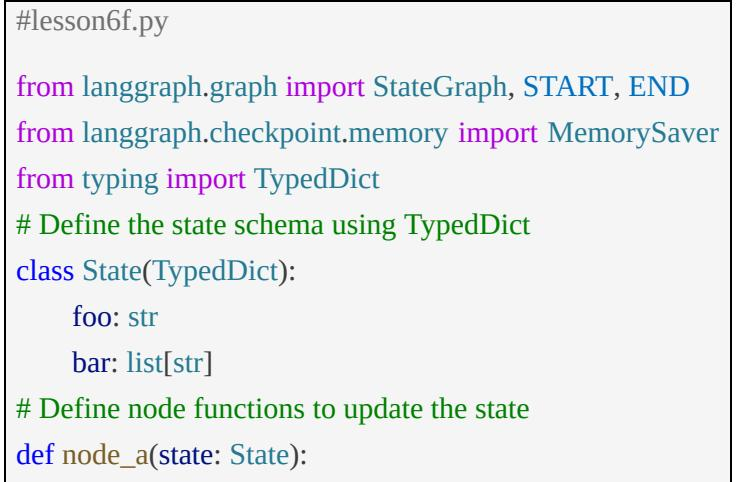

```
return {"foo": "a", "bar": ["a"]}
def node_b(state: State):
    return {"foo": "b", "bar": ["b"]}
# Build the workflow graph
workflow = StateGraph(State)
workflow.add_node(node_a)
workflow.add_node(node_b)
workflow.add_edge(START, "node_a")
workflow.add_edge("node_a", "node_b")
workflow.add_edge("node_b", END)
# Initialize the checkpointer
checkpointer = MemorySaver()
graph = workflow.compile(checkpointer=checkpointer)
# Run the graph with thread_id and capture checkpoints
config = {"configurable": {"thread_id": "1"}}
graph.invoke({"foo": "", "bar": []}, config)
```
#### **Sortie : points de contrôle générés**

1. **État initial** : avant l'exécution de node\_a.

```
#leçon6f.py
ÉtatSnapshot(
valeurs={'foo' : '', 'bar' : []},
    suivant=('noeud_a',),
    métadonnées={'étape' : 0},
    tâches=(PregelTask(name='node_a'),)
)
```
2. **After node\_a Executes**: State is updated by node\_a .

```
#leçon6f.py
ÉtatSnapshot(
    valeurs={'foo' : 'a', 'bar' : ['a']},
    suivant=('node_b',),
    métadonnées={'étape': 1},
    tâches=(PregelTask(name='node_b'),)
)
```
3. **After node\_b Executes**: Final state of the graph.

```
#leçon6f.py
ÉtatSnapshot(
     valeurs={'foo' : 'b', 'bar' : ['a', 'b']},
     suivant=(),
     métadonnées={'étape': 2},
     tâches =()
)
```
Each **StateSnapshot** shows the state ( foo and bar ), the next node to execute ( next ), and metadata ( step , tasks ).

#### **Get Current State:**

You can retrieve the latest state of the graph by calling graph.get\_state() .

```
#leçon6f.py
config = {"configurable": {"thread_id": "1"}}
last_state = graph.get_state(config)
print(latest_state.values) # {'foo' : 'b', 'bar' : ['a', 'b']}
```
### **Get State History:**

You can retrieve the entire state history using graph.get\_state\_history() :

```
#leçon6f.py
config = {"configurable": {"thread_id": "1"}}
state_history = graph.get_state_history(config)
pour l'instantané dans state_history :
    imprimer (instantané.valeurs)
```

```
Sortie :
[
    {'foo' : 'b', 'bar' : ['a', 'b']},
    {'foo' : 'a', 'bar' : ['a']},
    {'foo' : '', 'bar' : []}
]
```
This shows how the state evolved during execution.

# <span id="page-166-0"></span>**6.7.2. InMemoryStore**

**InMemoryStore** allows you to persist information across different threads and sessions. While checkpointers are tied to a specific session (thread), the memory store can retain user information, preferences, and history between different sessions.

#### **Key Concepts:**

- **Namespace**: In **InMemoryStore**, memories are saved using a **namespace** that typically includes a user\_id to uniquely identify the memory.
- **Put and Search**: These are the primary operations. put() stores a memory, and search() retrieves it.

## **Python Concepts Used:**

- **UUID**: A Python module to generate unique memory IDs for each memory.
- **Dict**: Memory objects are stored as dictionaries to allow flexible storage of key-value pairs.

## **Example: Using InMemoryStore to Save and Retrieve Memories**

```
#leçon6f.py
à partir de langgraph.store.memory importer InMemoryStore
importer l'uuid
# Initialiser la mémoire
in_memory_store = InMemoryStore()
# Définir un espace de noms utilisateur (user_id + "memories")
identifiant_utilisateur = "1"
namespace_for_memory = (user_id, "mémoires")
# Stocker un souvenir (préférence alimentaire)
id_mémoire = str(uuid.uuid4())
memory = {"food_preference": "J'aime la pizza"}
in_memory_store.put(namespace_for_memory, memory_id, mémoire)
# Récupérer les souvenirs stockés
souvenirs = in_memory_store.search(namespace_for_memory)
```

```
print(memories[-1].dict()) # {'value': {'food_preference': 'J'aime la pizza'}, ...}
Sortie :
{
  'value' : {'food_preference' : 'J'aime la pizza'},
  'clé' : '07e0caf4-1631-47b7-b15f-65515d4c1843',
  'espace de noms' : ['1', 'mémoires'],
  'created_at' : '2024-10-02T17:22:31.590602+00:00',
  'mis à jour_à' : '2024-10-02T17:22:31.590605+00:00'
}
```
Here, **put()** adds the memory to the store, and **search()** retrieves it.

# **6.7.3. Using Checkpointers and InMemoryStore Together**

In real-world applications, you often combine **checkpointers** for sessionbased memory and **InMemoryStore** for persistent memory across sessions.

## **Full Example: Graph with Checkpointer and Memory Store**

```
#leçon6f.py
à partir de langgraph.checkpoint.memory importer MemorySaver
à partir de langgraph.store.memory importer InMemoryStore
# Initialiser le point de contrôle et la mémoire
point de contrôle = MemorySaver()
in_memory_store = InMemoryStore()
# Compilez le graphique avec les deux
graph = workflow.compile (checkpointer=checkpointer, store=in_memory_store)
# Invoquez le graphique avec thread_id et user_id
config = {"configurable": {"thread_id": "session_1", "user_id": "1"}}
graph.invoke({"foo": ""}, config)
```
In this setup:

- **Checkpointer** handles state persistence within the session.
- **InMemoryStore** manages long-term memory across sessions using user\_id .

#### **Accessing Memory in a Node**

#lesson6f.py

def update\_memory(state: MessagesState, config: RunnableConfig, \*, store: BaseStore):

```
user_id = config["configurable"]["user_id"]
    espace de noms = (user_id, "mémoires")
    # Stocker une mémoire
    id_mémoire = str(uuid.uuid4())
    store.put(espace de noms, memory_id, {"favorite_food": "pizza"})
    # Récupérer les souvenirs stockés
souvenirs = store.search (espace de noms)
    return {"messages": [f"Je me souviens que tu aimes
{souvenirs[-1].value['favorite_food']}"]}
```
## **Sortie : lorsqu'il est invoqué dans deux threads distincts**

Sujet 1 : Vous : Quel est mon plat préféré ? Agent : Je me souviens que vous aimiez la pizza.

Sujet 2 : Vous : Quel est mon plat préféré ? Agent : Je me souviens que vous aimiez la pizza.

Même si l'utilisateur démarre une nouvelle session avec un thread différent, l'agent rappelle la mémoire car elle est stockée sous le même user\_id .

#**6.7.4. Bibliothèques et interfaces clés de point de contrôle**

LangGraph fournit plusieurs bibliothèques de points de contrôle, chacune optimisée pour différents cas d'utilisation :

- **MemorySaver** : point de contrôle en mémoire pour les tests et l'expérimentation.
- **SQLiteSaver** : enregistre les points de contrôle dans SQLite, idéal pour la production à petite échelle.
- **PostgresSaver** : un point de contrôle basé sur Postgres utilisé dans les environnements de production à grande échelle.

Tous les points de contrôle implémentent les méthodes clés suivantes :

- **put()** : Enregistrez un point de contrôle avec la configuration et les métadonnées.
- **get\_state()** : Récupère le dernier point de contrôle pour un thread\_id donné.
- **get\_state\_history()** : Récupère tous les points de contrôle pour un thread\_id donné.

Ces méthodes permettent une gestion flexible des états et prennent en charge la **relecture** ou la **mise à jour** des états à tout moment de l'exécution d'un graphique.

# <span id="page-169-0"></span>**Chapitre 6 : Quiz**

Testez vos connaissances du chapitre 6 et assurez-vous de bien comprendre les concepts clés concernant la mémoire dans les agents IA, les points de contrôle et les magasins de mémoire. Chaque question explore une partie fondamentale des concepts que vous venez d'apprendre.

#### **Questions à choix multiples :**

- 1. **À quoi fait référence la mémoire à court terme d'un agent IA ?**
	- a) La capacité de mémoriser des informations sur plusieurs sessions
	- b) La capacité de mémoriser des informations uniquement au cours d'une seule session
	- c) La possibilité de rappeler des données de la mémoire sans intervention de l'utilisateur
	- d) La possibilité de stocker toutes les données utilisateur en permanence

**Réponse** : b) La capacité de mémoriser des informations uniquement au cours d'une seule session

#### 2. **Lequel des outils suivants est utilisé pour implémenter la mémoire à court terme dans LangGraph ?**

- a) InMemoryStore
- b) SQLiteSaver
- c) Économiseur de mémoire
- d) MémoireCache

**Réponse** : c) MemorySaver

### 3. **Qu'est-ce qu'un point de contrôle dans le contexte de LangGraph ?**

- a) Un point fixe où la saisie de l'utilisateur est stockée
- b) Un instantané de l'état du graphique enregistré à chaque étape du flux de travail
- c) Une méthode de récupération des sessions passées
- d) Une méthode de stockage des préférences utilisateur à long terme

**Réponse** : b) Un instantané de l'état du graphique enregistré à chaque étape du flux de travail

### **4. À quoi sert le thread\_id dans les flux de travail LangGraph ?**

- a) Création de nouveaux nœuds dans un graphe
- b) Stockage des données sur plusieurs sessions
- c) Rejouer la mémoire d'une session spécifique
- d) Identifier de manière unique une session et l'associer à la mémoire

**Réponse** : d) Identifier de manière unique une session et l'associer à la mémoire

#### 5. **Quelle méthode est utilisée pour récupérer tous les points de contrôle précédents lors de l'exécution d'une session ?**

- a) graph.get\_all\_states()
- b) graph.invoke(config)
- c) graph.get\_state\_history(config)
- d) graph.search(config)

**Réponse** : c) graph.get\_state\_history(config)

### 6. **Quelle fonctionnalité Python est utilisée pour structurer l'état dans les graphiques LangGraph ?**

- a) NomméTuple
- b) Liste
- c) TypedDict
- d) Dictionnaire

**Réponse** : c) TypedDict

### 7. **Quel est le but d'un InMemoryStore dans LangGraph ?**

- a) Pour stocker l'état au cours d'une seule session
- b) Pour assurer la persistance de la mémoire sur plusieurs sessions et threads
- c) Accélérer le temps de réponse du LLM
- d) Pour stocker des fichiers temporaires pendant l'exécution du graphique

**Réponse** : b) Pour assurer la persistance de la mémoire sur plusieurs sessions et threads

# **Tâche pratique : Créer un agent IA entièrement fonctionnel**

Dans ce devoir pratique, vous créerez un agent IA à l'aide de **LangGraph** qui intègre toutes les fonctionnalités que vous avez apprises des chapitres 1 à 6, notamment :

- Gestion de l'État
- Mémoire à court terme
- Mémoire à long terme au fil des sessions

## **Objectifs :**

### 1. **Comportement de base de l'agent** :

- Créez un agent IA capable de gérer les requêtes des utilisateurs et de répondre avec des réponses.
- Utilisez un modèle de langage (LLM) tel que les modèles GPT d'OpenAI.

## 2. **Gestion de l'État** :

○ Concevez un workflow avec des nœuds qui gèrent et mettent à jour l'état de la conversation.

### 3. **Mémoire à court terme** :

- Implémentez la mémoire à court terme à l'aide de **MemorySaver** pour conserver le contexte de la conversation au sein d'une session.
- L'agent doit se souvenir des entrées et du contexte de l'utilisateur pendant la session.
## 4. **Mémoire à long terme** :

- Utilisez **InMemoryStore** pour stocker des informations utilisateur persistantes (par exemple, préférences utilisateur, nom) au fil des sessions.
- Autoriser l'agent à rappeler les détails des sessions précédentes à l'aide du user\_id et du thread\_id .

#### 5. **Comportement du nœud personnalisé** :

○ Créez des nœuds personnalisés pour gérer des actions spécifiques telles que le stockage des informations utilisateur et leur rappel si nécessaire.

#### 6. **Points de contrôle et rediffusions** :

○ Assurez-vous que l'agent peut relire les sessions à l'aide de points de contrôle et d'identifiants de thread.

## **Étapes pour terminer le devoir :**

#### **1. Configurez votre environnement :**

Assurez-vous que LangGraph, LangChain et les modèles LLM nécessaires (comme le GPT-4o-mini d'OpenAI) sont prêts. Installez les dépendances si nécessaire :

terminal pip installer langgraph langchain\_openai python-dotenv

#### **Étape 2 : implémenter la mémoire à court terme**

La mémoire à court terme utilisera **MemorySaver** pour rappeler les interactions au cours d'une seule session. Vous devrez utiliser **thread\_id** pour identifier la session et capturer l'état de la conversation.

```
#lesson6f.py
from langgraph.graph import StateGraph, MessagesState, START, END
from langgraph.checkpoint.memory import MemorySaver
from langchain_openai import ChatOpenAI
from dotenv import load_dotenv
import os
# Load environment variables
load_dotenv()
# Initialize API key
api_key = os.getenv("OPENAI_API_KEY")
# Initialize OpenAI model
model = ChatOpenAI(model="gpt-4o-mini", api_key=api_key)
# Define the graph workflow
workflow = StateGraph(MessagesState)
```

```
# Node to process user query and return the LLM response
def call_llm(state: MessagesState):
    messages = state["messages"]
    response = model.invoke(messages)
    return {"messages": [response]}
# Add nodes and define edges in the graph
workflow.add_node("call_llm", call_llm)
workflow.add_edge(START, "call_llm")
workflow.add_edge("call_llm", END)
# Initialize the MemorySaver for short-term memory
checkpointer = MemorySaver()
app_with_memory = workflow.compile(checkpointer=checkpointer)
# Simulate conversation with short-term memory
def interact_with_agent():
    thread_id = "session_1"
    while True:
        user_input = input("You: ")
        if user_input.lower() in ["exit", "quit"]:
            break
        input_message = {
            "messages": [("human", user_input)]
        }
        config = {"configurable": {"thread_id": thread_id}}
        for chunk in app_with_memory.stream(input_message, config=config,
stream_mode="values"):
            chunk["messages"][-1].pretty_print()
interact_with_agent()
```
Dans ce code :

- Le nœud **call\_llm** envoie les requêtes des utilisateurs au modèle OpenAI et reçoit une réponse.
- **MemorySaver** stocke l'état de la conversation, permettant à l'agent de rappeler l'interaction au sein de la session.

## **Étape 3 : implémenter la mémoire à long terme**

Pour conserver les informations d'une session à l'autre, nous utiliserons **InMemoryStore**. Cela permet à l'agent de rappeler les informations utilisateur lors de sessions futures.


Dans ce code :

● **InMemoryStore** est utilisé pour stocker et récupérer des informations spécifiques à l'utilisateur au fil des sessions à l'aide de user\_id .

### **Étape 4 : Combinez la mémoire à court terme et à long terme**

Nous allons maintenant combiner les deux approches de mémoire pour créer un agent entièrement fonctionnel capable de mémoire à court et à long terme.

```
terminal
from langgraph.graph import StateGraph, MessagesState, START, END
```

```
à partir de langgraph.store.memory importer InMemoryStore
à partir de langgraph.checkpoint.memory importer MemorySaver
importer l'uuid
# Initialiser le magasin en mémoire
in_memory_store = InMemoryStore()
# Fonction pour stocker les informations utilisateur
def store_user_info (état : MessagesState, config, *, store=in_memory_store) :
    user_id = config["configurable"]["user_id"]
    espace de noms = (user_id, "mémoires")
    id_mémoire = str(uuid.uuid4())
    mémoire = {"nom_utilisateur": état["nom_utilisateur"]}
    store.put (espace de noms, memory_id, mémoire)
    return {"messages": ["Informations utilisateur enregistrées."]}
# Fonction pour récupérer les informations utilisateur stockées
def retrieve_user_info (état : MessagesState, config, *, store=in_memory_store) :
    user_id = config["configurable"]["user_id"]
    espace de noms = (user_id, "mémoires")
    souvenirs = store.search (espace de noms)
    si souvenirs :
         info = f"Bonjour {memories[-1].value['user_name']}, bon retour !"
    sinon :
         info = "Je n'ai pas encore d'informations sur vous."
    return {"messages": [info]}
# Fonction pour gérer les entrées utilisateur et le stockage/récupération de la mémoire
def call_model (état : MessagesState, configuration) :
last_message = state["messages"][-1].content.lower()
    # Stocker le nom de l'utilisateur
    si "souviens-toi de mon nom" dans last_message :
         user_name = last_message.split("rappelez-vous que je m'appelle")[-1].strip()
         state["nom_utilisateur"] = nom_utilisateur
         retourner store_user_info (état, configuration)
    # Récupérer le nom de l'utilisateur
    si "quel est mon nom" dans last_message ou "quel est mon nom" dans last_message :
         return retrieve_user_info (état, configuration)
    # Réponse LLM par défaut pour les autres entrées
    return {"messages": ["Je n'ai pas compris votre demande."]}
# Définir le workflow graphique
```

```
flux de travail = StateGraph (MessagesState)
workflow.add_node("call_model", call_model)
workflow.add_edge(START, "call_model")
workflow.add_edge("call_model", FIN)
# Compilez le graphique avec le point de contrôle et la mémoire
app_with_memory = workflow.compile(checkpointer=MemorySaver(),
store=in_memory_store)
def simulation_sessions() :
    # Première session : stocker le nom de l'utilisateur
    config = {"configurable": {"thread_id": "session_1", "user_id": "user_123"}}
    input_message = {"messages": [("humain", "Rappelez-vous que je m'appelle Alice")]}
    pour le morceau dans app_with_memory.stream(input_message, config=config,
stream_mode="valeurs") :
        chunk["messages"][-1].pretty_print()
    # Deuxième session : récupérer le nom de l'utilisateur
    config = {"configurable": {"thread_id": "session_2", "user_id": "user_123"}}
    input_message = {"messages": [("humain", "Comment je m'appelle ?")]}
    pour le morceau dans app_with_memory.stream(input_message, config=config,
stream_mode="valeurs") :
        chunk["messages"][-1].pretty_print()
simuler_sessions()
```
# **Résultat attendu :**

**Session 1 :** Vous : N'oubliez pas que je m'appelle Alice Agent : Vos informations ont été enregistrées !

#### **Séance 2 :**

Vous : Comment je m'appelle ? Agent : Bonjour Alice, bon retour !

Ce devoir montre comment implémenter à la fois la **mémoire à court terme** (au sein d'une session) et la **mémoire à long terme** (sur plusieurs sessions) à l'aide de **MemorySaver** et **InMemoryStore** de LangGraph.

# **Chapitre 7**

# <span id="page-177-1"></span><span id="page-177-0"></span>**Routage avancé et personnalisation des agents IA**

Dans ce chapitre, nous développerons les concepts fondamentaux introduits dans les chapitres précédents, en nous concentrant sur le **routage avancé**, les **workflows personnalisés**, les **sorties structurées** et l'**intégration avec des API communes**. Ces concepts vous permettront de créer des agents d'IA plus dynamiques, adaptables et personnalisés à l'aide de **LangGraph**. Nous aborderons également la **logique conditionnelle**, qui vous permet de contrôler la façon dont votre agent traite les requêtes des utilisateurs et les réponses de l'API externe. À la fin de ce chapitre, vous serez en mesure de développer des agents d'IA qui acheminent intelligemment les entrées de l'utilisateur vers les flux de travail appropriés, gèrent les interactions complexes et même diffusent des données en temps réel à l'utilisateur.

# <span id="page-177-2"></span>**7.1 Introduction au routage dans les agents IA**

Le **routage** dans les agents IA fait référence à la capacité de diriger les entrées des utilisateurs via différents chemins, flux de travail ou tâches en fonction de critères spécifiques. Il s'agit d'un composant crucial pour gérer des conversations complexes, permettant aux agents de :

- Décidez quelle tâche ou quel service appeler en fonction des entrées de l'utilisateur.
- Gérez plusieurs types de requêtes en une seule session.
- Intégrez des services externes (par exemple, météo, recherche) et indiquez l'itinéraire de manière appropriée.

## **Pourquoi le routage est-il important ?**

Les agents d'IA doivent souvent traiter diverses demandes des utilisateurs, depuis la simple récupération d'informations jusqu'à des opérations plus complexes telles que la réalisation de calculs ou l'interrogation d'API externes. Sans routage, l’agent aurait du mal à gérer différents types de tâches et fournirait souvent des réponses incorrectes ou incomplètes. Le **routage** garantit que l'agent traite chaque requête via le flux de travail ou la tâche appropriée.

# **Exemple de cas d'utilisation**

Envisagez un assistant virtuel capable de gérer à la fois les requêtes **météo** et les **recommandations de restaurants**. Chacune de ces tâches nécessite une API différente, une logique différente et éventuellement des sorties différentes. L'agent doit décider, en fonction des commentaires de l'utilisateur, quel flux de travail suivre.

## **Scénario 1 :**

- **Requête de l'utilisateur** : "Quel temps fait-il à New York ?"
	- **Workflow** : l'agent achemine cela vers l'API météo.

## **Scénario 2 :**

- **Requête de l'utilisateur** : "Recommander un bon restaurant à New York."
	- **Workflow** : l'agent achemine cela vers une API de recommandation de restaurant.

Sans routage, l'agent ne pourrait pas différencier intelligemment ces flux de travail et traiterait toutes les entrées de la même manière, conduisant à des réponses inappropriées ou incorrectes.
# <span id="page-178-0"></span>**7.2 Outils intégrés\_condition pour le routage conditionnel**

tools\_condition est un outil LangGraph prédéfini pour gérer le routage conditionnel, particulièrement utile lorsque votre agent IA dispose d'outils (comme des API ou des fonctions utilitaires) et que vous souhaitez décider de manière conditionnelle si vous devez appeler un outil ou répondre directement.

## **Exemple : Routage conditionnel entre un outil et une réponse directe**

Voici un exemple simple où nous utilisons la tools\_condition pour effectuer un itinéraire entre l'appel d'un **tool** (dans ce cas, une fonction de multiplication de base) ou

#### répondant directement à l'utilisateur.

#leçon7a.py

```
from langchain_openai import ChatOpenAI
from langgraph.graph import StateGraph, MessagesState, START, END
from langgraph.prebuilt import ToolNode, tools_condition
# Initialize the LLM and define a basic multiplication tool
llm = ChatOpenAI(model="gpt-4o-mini")
# Define a multiplication tool
def multiply(a: int, b: int) -> int:
    """
    Multiplies two numbers.
    """
    return a * b
# Bind the LLM with the tool
llm_with_tools = llm.bind_tools([multiply])
# Node that calls the LLM with tools bound
def tool_calling_llm(state: MessagesState):
    """
    Node that calls the LLM with tools bound.
    """
    return {"messages": [llm_with_tools.invoke(state["messages"])]}
# Build the workflow
builder = StateGraph(MessagesState)
builder.add_node("tool_calling_llm", tool_calling_llm)
builder.add_node("tools", ToolNode([multiply]))  # Tool node for handling tool
invocation
# Define edges to connect the nodes
builder.add_edge(START, "tool_calling_llm")
# Add the conditional edge based on tool usage
builder.add_conditional_edges(
    "tool_calling_llm",
    tools_condition,  # Condition to decide if the assistant should call the tool
)
builder.add_edge("tools", END)  # If tool is called, terminate after tool execution
# Compile the graph
```

```
graph = builder.compile()
# Simulate invoking the graph
def simulate():
    user_input = {"messages": [("human", "Can you multiply 3 by 5?")]}
    result = graph.invoke(user_input)
    return result["messages"][-1].pretty_print()
print(simulate())
```
## **Points clés :**

- **tools\_condition** : Cette condition d'outil intégrée évalue si le message le plus récent de l'assistant implique l'appel d'un outil. Si c'est le cas, il est acheminé vers le **nœud outil** ; sinon, la conversation peut se terminer ou être acheminée ailleurs.
- **ToolNode** : Un nœud prédéfini conçu pour invoquer un outil spécifique, comme la fonction de multiplication dans ce cas.

# <span id="page-180-0"></span>**7.3 Exemple de routage conditionnel personnalisé : nœuds météo et calculateur**

Dans cet exemple, nous allons construire un agent IA de base qui :

- Achemine les **requêtes liées à la météo** vers un nœud qui simule la récupération d'informations météorologiques.
- Achemine les **requêtes de calcul** vers un nœud de calculatrice qui gère des opérations arithmétiques simples.
- Gère les requêtes non reconnues avec une réponse par défaut.

## *Étape 1 : Définir les nœuds*

Nous allons commencer par définir trois nœuds :

- 1. **weather\_node** : Gère les requêtes liées à la météo.
- 2. **calculator\_node** : Gère les opérations arithmétiques de base comme l'addition.
- 3. **default\_node** : Fournit une solution de repli pour toute entrée utilisateur non reconnue.

```
#lesson7b.py
```
from langgraph.graph import StateGraph, MessagesState, START, END # Définir un nœud pour simuler une réponse météo


## *Étape 2 : Créer une fonction de routage*

Ensuite, nous devons créer une fonction de routage qui décide à quel nœud envoyer la requête utilisateur en fonction du contenu de la requête. Cette fonction sera chargée de vérifier si la requête concerne la météo, l'arithmétique ou ni l'un ni l'autre, puis de l'acheminer en conséquence.

| #leçon7b.py |
|---------------------------------------------------------------------------------|
| # Fonction de routage personnalisée pour décider vers quel nœud acheminer |
| def<br>routing_function(state: MessagesState): |
| last_message<br>=<br>state["messages"][-1].content.lower() |
| if<br>"météo"<br>dans<br>last_message : |
| return<br>"weather_node" # Route vers le nœud météo |
| elif<br>"ajouter"<br>dans<br>last_message<br>ou<br>"calculer"<br>dans<br>last_message : |
| return<br>"calculator_node" # Route vers le nœud de la calculatrice |
| return<br>"default_node" # Route vers le nœud par défaut pour les entrées non reconnues |

La fonction_routage inspecte le dernier message utilisateur et :

- Routes vers le **nœud météo** si le message contient le mot "météo".
- Route vers le **nœud de calcul** si le message contient des mots liés à l'arithmétique comme "ajouter" ou "calculer".

● Achemine vers le **nœud par défaut** si l'entrée ne correspond à aucune condition attendue.

## *Étape 3 : Créer le graphique de flux de travail*

Nous allons maintenant créer le workflow LangGraph en utilisant les nœuds que nous avons créés. Nous utiliserons des **bords conditionnels** pour acheminer dynamiquement en fonction du résultat de la fonction de routage\_function .

```
#lesson7b.py continued
# Build the workflow graph
builder = StateGraph(MessagesState)
builder.add_node("weather_node", weather_node)
builder.add_node("calculator_node", calculator_node)
builder.add_node("default_node", default_node)
builder.add_node("routing_function", routing_function)
# Set up the edges for routing
builder.add_conditional_edges(START, routing_function)  # Route based on the routing
function
builder.add_edge("weather_node", END)  # Route to end after weather node
builder.add_edge("calculator_node", END)  # Route to end after calculator node
builder.add_edge("default_node", END)  # Route to end after default node
# Compile the graph
app = builder.compile()
```
Dans ce flux de travail :

- Nous commençons par le nœud **START**, qui route vers la fonction router\_function .
- Les **bords conditionnels** déterminent vers quel nœud acheminer le prochain en fonction de la sortie de router\_function .
- Chaque nœud ( Weather\_node , calculator\_node , default\_node ) est connecté au nœud **END** ​​après exécution.

### *Étape 4 : Simuler l'interaction avec l'agent*

Nous allons maintenant créer une fonction simple pour simuler l'interaction avec l'agent. Cette fonction nous permet de saisir une entrée et de voir comment l'agent achemine le

requêtes.

#lesson7b.py suite # Simuler l'interaction avec l'agent def simulation\_interaction(): while True: user\_input = input("You: ") if user\_input.lower() in ["exit", "quit"]: print("Exiting...") break input\_message = {"messages": [("human", user\_input)]} pour le résultat dans app.stream(input\_message, stream\_mode="values"): result["messages"][-1].pretty\_print() # Commencez à interagir avec l'agent simulation\_interaction()

Cette fonction interactive :

- Accepte les entrées de l'utilisateur.
- Envoie l'entrée au graphique pour traitement.
- Affiche la réponse du nœud approprié.

Le code complet est le suivant :

```
#lesson7b.py complete code example
from langgraph.graph import StateGraph, MessagesState, START, END
# Define a node to simulate a weather response
def weather_node(state: MessagesState):
    return {"messages": ["It's sunny with a temperature of 25°C."]}
# Define a node to handle basic arithmetic calculations
def calculator_node(state: MessagesState):
    user_query = state["messages"][-1].content.lower()
    if "add" in user_query:
         numbers = [int(s) for s in user_query.split() if s.isdigit()]
         result = sum(numbers)
         return {"messages": [f"The result of addition is {result}."]}
    return {"messages": ["I can only perform addition for now."]}
# Define a default node to handle unrecognized inputs
def default_node(state: MessagesState):
```
return {"messages": ["Désolé, je ne comprends pas cette demande."]} # Fonction de routage personnalisée pour décider quel nœud acheminer vers def router\_function(state: MessagesState): last\_message = state["messages"][-1].content.lower() if "weather" dans last\_message: return "weather\_node" # Route vers le nœud météo elif "add" dans last\_message ou "calculate" dans last\_message : return "calculator\_node" # Route vers le nœud de la calculatrice return "default\_node" # Route vers le nœud par défaut pour les entrées non reconnues # Construire le graphique de workflow builder = StateGraph(MessagesState) builder.add\_node("weather\_node", météo\_node) builder.add\_node("calculator\_node", calculator\_node) builder.add\_node("default\_node", default\_node) builder.add\_node("routing\_function", routage\_function) # Configurer les bords pour le routage builder.add\_conditional\_edges(START, routage\_function) builder.add\_edge("weather\_node", END) builder.add\_edge("calculator\_node", END) builder.add\_edge("default\_node", END) # Bord pour terminer après le nœud par défaut # Compiler le graphique app = builder.compile() # Simuler l'interaction avec l'agent def simulation\_interaction(): while True: user\_input = input("You: ") if user\_input.lower() in ["exit", "quit"]: print("Exiting...") break input\_message = {"messages": [("human", user\_input)]} pour le résultat dans app.stream(input\_message, stream\_mode="values") : result["messages"][-1].pretty\_print() # Commencez à interagir avec l'agent simulation\_interaction()

## **Exemples d'interactions**

Exécutons le code et explorons quelques interactions possibles avec l'agent.

**1. Requête météo** Vous : Quel temps fait-il aujourd'hui ? Agent : Il fait beau avec une température de 25°C.

**2. Requête de calcul** Vous : Pouvez-vous additionner 10 et 20 ? Agent : Le résultat de la dépendance est de 30.

**3. Entrée non reconnue** Vous : Bonjour, comment vas-tu ? Agent : Désolé, je ne comprends pas cette demande.

# **Points clés à retenir**

Dans cette section, nous avons démontré :

- 1. **Routage conditionnel** : comment effectuer un acheminement dynamique entre les nœuds en fonction du contenu de l'entrée utilisateur à l'aide de fonctions de routage personnalisées.
- 2. **Nœuds personnalisés** : comment créer des nœuds qui gèrent des tâches spécifiques, telles que le renvoi d'informations météorologiques ou l'exécution d'opérations arithmétiques.
- 3. **Réponses par défaut** : comment garantir que votre agent IA gère correctement les entrées non reconnues en les acheminant vers un nœud de secours.

Le **routage conditionnel** permet à votre agent IA de gérer facilement plusieurs types de requêtes et garantit que le comportement de l'agent reste flexible et réactif.

# <span id="page-185-0"></span>**7.4 Streaming dans LangGraph**

Le streaming dans LangGraph est une fonctionnalité qui permet des mises à jour en temps réel de l'état du graphique ou des sorties des nœuds pendant l'exécution du flux de travail. Ceci est particulièrement utile lorsqu'il s'agit de grands ensembles de données, de processus de longue durée ou lorsqu'un retour d'information continu est nécessaire, comme dans les chatbots, le traitement de données en direct ou les systèmes de surveillance en temps réel.

Dans LangGraph, vous pouvez diffuser les éléments suivants :

- 1. **Full State Streaming** : diffuse l'intégralité de l'état du graphique après l'exécution de chaque nœud.
- 2. **Diffusion des mises à jour** : diffuse uniquement les mises à jour de l'état après l'exécution de chaque nœud.

3. **LLM Token Streaming** : diffuse les jetons produits par le modèle d'apprentissage des langues (LLM) au cours de son processus de génération.

Dans cette section, nous aborderons chacun de ces modes de streaming en détail, en fournissant des exemples pour montrer comment les implémenter dans votre agent IA.

# **7.4.1 Streaming d'état complet**

En streaming d'état complet, l'état complet du graphique est renvoyé après chaque exécution de nœud. Ceci est utile lorsque vous souhaitez surveiller toutes les modifications qui se produisent dans le graphique après chaque exécution de nœud.

## **Exemple : Streaming d'état complet**

Passons en revue un exemple de base qui montre comment diffuser l'état complet d'un graphique. Nous définirons un graphique avec un outil météorologique simple et diffuserons l'intégralité de l'état après l'exécution de chaque nœud.


```
workflow.add_edge(START, "weather_node")
workflow.add_edge("weather_node", "calculator_node")
workflow.add_edge("calculator_node", END)
# Compile the workflow
app = workflow.compile()
# Simulate interaction and stream the full state
def simulate_interaction():
    input_message = {"messages": [("human", "Tell me the weather")]}
    # Stream the full state of the graph
    for result in app.stream(input_message, stream_mode="values"):
         print(result)  # Print the full state after each node
simulate_interaction()
```
Dans cet exemple, après l'exécution de chaque nœud ( Weather\_node et calculator\_node ), l'état complet du graphique est renvoyé. L'état complet inclut tous les messages générés jusqu'à présent.

### **Sortie :**

```
{'messages': [('human', 'Tell me the weather')]}
{'messages': [('human', 'Tell me the weather'), 'The weather is sunny and 25°C.']}
{'messages': [('human', 'Tell me the weather'), 'The weather is sunny and 25°C.', 'The result of
2 + 2 is 4.']}
```
# **7.4.2 Streaming des mises à jour**

Contrairement au streaming d'état complet, le streaming de mises à jour renvoie uniquement les modifications apportées au graphique après l'exécution de chaque nœud. Ceci est efficace lorsque vous avez uniquement besoin de voir ce qui a changé, plutôt que l’état dans son ensemble.

### **Exemple : diffusion de mises à jour**

```
# Define the same nodes as before
def weather_node(state: State):
    return {"messages": ["It's 25°C and sunny."]}
def calculator_node(state: State):
    return {"messages": ["2 + 2 equals 4."]}
# Define the graph
workflow = StateGraph(State)
workflow.add_node("weather_node", weather_node)
workflow.add_node("calculator_node", calculator_node)
workflow.add_edge(START, "weather_node")
workflow.add_edge("weather_node", "calculator_node")
workflow.add_edge("calculator_node", END)
app = workflow.compile()
def simulate_interaction():
    input_message = {"messages": [("human", "Tell me the weather")]}
    # Stream updates after each node
    for result in app.stream(input_message, stream_mode="updates"):
         print(result)
simulate_interaction()
```
Ici, seules les mises à jour après chaque nœud seront renvoyées, ce qui le rend plus efficace dans les scénarios où vous n'avez pas besoin de l'état complet.

### **Sortie :**

```
{'weather_node': {'messages': ["It's 25°C and sunny."]}}
{'calculator_node': {'messages': ['2 + 2 equals 4.']}}
```
# **7.4.3 Diffusion de jetons LLM**

Le streaming de jetons LLM est particulièrement utile lors de l'utilisation d'un modèle de langage pour générer des réponses longues. Plutôt que d'attendre que la réponse complète soit générée, vous pouvez diffuser les jetons au fur et à mesure de leur production.

## **Exemple : diffusion de jetons LLM**

Dans cet exemple, nous utiliserons un modèle OpenAI GPT-4 pour démontrer le streaming de jetons lorsqu'il génère une réponse.

#leçon7e.py

```
import operator
from langgraph.graph import StateGraph, MessagesState, START, END
from langchain_openai import ChatOpenAI
from typing import Annotated
from typing_extensions import TypedDict
import asyncio
from langgraph.graph.message import add_messages
from langchain_core.messages import AIMessageChunk, HumanMessage
# Define the state schema
class State(TypedDict):
    messages: Annotated[list, add_messages]
# Initialize the LLM
model = ChatOpenAI(model="gpt-4o-mini")
# Define a node to handle LLM queries
async def call_llm(state: State):
    messages = state["messages"]
    response = await model.ainvoke(messages)
    return {"messages": [response]}
# Define the graph
workflow = StateGraph(State)
workflow.add_node("call_llm", call_llm)
workflow.add_edge(START, "call_llm")
workflow.add_edge("call_llm", END)
app = workflow.compile()
# Simulate interaction and stream tokens
async def simulate_interaction():
    input_message = {"messages": [("human", "Tell me a very long joke")]}
    first = True
    # Stream LLM tokens
    async for msg, metadata in app.astream(input_message,
stream_mode="messages"):
        if msg.content and not isinstance(msg, HumanMessage):
            print(msg.content, end="|", flush=True)
        if isinstance(msg, AIMessageChunk):
            if first:
                gathered = msg
                first = False
```
sinon : rassemblés = rassemblés + msg si msg.tool\_call\_chunks : print(gathered.tool\_calls) asyncio.run(simulate\_interaction())

## **Sortie (Streaming de jetons) :**

Bien sûr|!| Voici| un| longue|,| léger|au cœur| blague| pour| vous| :

|Une fois| sur| un| temps| dans| un| petit| village|,| là| vécu| un| homme| nommé| Bob|.| Bob| était| connu| partout | le| village| pour| son| incroyable| capacité| à| dire| blagues|.| Il | pourrait| faire| même| le| gr|ump|le plus| personne| rire|.| Un| jour|,| le| village| décidé | à| tenir| un| fête| et| ils| recherché| Bob| à| être| le| principal| artiste|.|

|Excité|,| Bob| commencé| planification| un| série| de| blagues| que| serait| faire| le| fête| inoubliable|.| Il | décidé | à| dire| un| histoire| à la place| de| juste | un|-l|iners|.| Il | pensée|,| "|Si| je| peux| tisser| un| conte| avec| mes| blagues|,| ce sera| un| hit|!"
Dans cet exemple, vous pouvez observer les jetons diffusés depuis le LLM, ce qui permet à l'utilisateur de voir la réponse au fur et à mesure de sa génération.

## **7.4.4 Combinaison des modes de diffusion**

Vous pouvez combiner différents modes de streaming en fonction de votre cas d'utilisation. Par exemple, vous souhaiterez peut-être diffuser les mises à jour ainsi que les jetons LLM lorsque vous utilisez un modèle de langage.

#### **Exemple : combinaison de mises à jour et de streaming de jetons**

| #leçon7f.py |
|----------------------------------------------------------------------------|
| opérateur d'importation |
| à partir de<br>langgraph.graph<br>import<br>StateGraph, MessagesState, START, END |
| depuis<br>langchain_openai<br>importation<br>ChatOpenAI |
| à partir de<br>saisie<br>importation<br>Annoté |
| from<br>typing_extensions<br>import<br>TypedDict |
| importer<br>asyncio |
| à partir de<br>langgraph.graph.message<br>import<br>add_messages |
| à partir de<br>langchain_core.messages<br>importation<br>AIMessageChunk, HumanMessage |
| # Définir le schéma d'état |
| classe<br>État (TypedDict) : |
| messages : Annoté[list, add_messages] |

```
# Initialize the LLM with the correct model name and streaming enabled
model = ChatOpenAI(
    model="gpt-4",
    streaming=True
)
# Define a node to handle LLM queries
async def call_llm(state: State):
    messages = state["messages"]
    response = await model.ainvoke(messages)
    return {"messages": [response]}
# Define the graph
workflow = StateGraph(State)
workflow.add_node("call_llm", call_llm)
workflow.add_edge(START, "call_llm")
workflow.add_edge("call_llm", END)
app = workflow.compile()
# Simulate interaction and stream tokens
async def simulate_interaction():
    input_message = {"messages": [HumanMessage(content="Tell me a very long
joke")]}
    # Stream LLM tokens
    async for msg, metadata in app.astream(input_message, stream_mode=
["messages","updates"]):
         # Check if we have metadata for call_llm
         if isinstance(metadata, dict) and 'call_llm' in metadata:
            # Extract the message from call_llm metadata
            ai_message = metadata['call_llm']['messages'][0]
            if ai_message.content:
                 print(ai_message.content, end="|", flush=True)
if __name__ == "__main__":
    asyncio.run(simulate_interaction())
```
# **Résumé des modes de diffusion :**

● **Full State Streaming** : diffuse l'intégralité de l'état après l'exécution de chaque nœud ( stream\_mode="values" ).

- **Updates Streaming** : diffuse uniquement les mises à jour après chaque exécution de nœud ( stream\_mode="updates" ).
- **LLM Token Streaming** : diffuse les jetons générés par le modèle de langage ( stream\_mode="messages" avec un modèle qui prend en charge le streaming de jetons).
- Vous pouvez combiner les modes de streaming en utilisant stream\_mode= ["messages","updates"]

En utilisant ces modes de streaming, vous pouvez créer des applications en temps réel plus réactives qui fournissent un retour continu à mesure que le flux de travail progresse.

# **7.4.6 Diffusion de données personnalisées**

LangGraph prend également en charge le streaming de données personnalisées. En plus de diffuser l'état du graphique ou les jetons, vous pouvez également configurer vos nœuds pour diffuser toutes les données personnalisées dont votre application pourrait avoir besoin.

## **Exemple : diffusion de données personnalisées**

Dans cet exemple, nous diffuserons des mises à jour de progression personnalisées pour un nœud qui simule une tâche de longue durée.

```
#lesson7g.py
from langgraph.graph import StateGraph, MessagesState, START, END
from time import sleep
from langgraph.types import StreamWriter
# Define a custom node to simulate a long-running task
def long_running_node(state: MessagesState,  writer: StreamWriter):
    for i in range(1, 6):
        sleep(1)  # Simulate a delay
        writer({"progress": f"Processing step {i}/5"})
    return {"messages": ["Task completed!"]}
# Define the graph
workflow = StateGraph(MessagesState)
workflow.add_node("long_running_node", long_running_node)
workflow.add_edge(START, "long_running_node")
workflow.add_edge("long_running_node", END)
# Compile the graph
app = workflow.compile()
# Simulate interaction and stream custom progress updates
```

```
def simulation_interaction() :
    input_message = {"messages": [("humain", "Démarrer la tâche de longue durée")]}
pour le résultat dans app.stream(input_message, stream_mode=["custom","updates"]) :
         si "progrès" dans le résultat[-1] :
            print(result[-1]) # Diffusez des mises à jour de progression personnalisées
         sinon :
            print(result[-1]) # Diffusez le message final
simuler_interaction()
```
## **Explanation:**

- The **long\_running\_node** yields progress updates at each step of the task ( Processing step 1/5 , Processing step 2/5 , etc.).
- These custom progress updates are streamed back to the user in realtime, giving the user feedback on how the task is progressing.
- Once the task completes, the final message is streamed: "Task completed!" .

## **Output:**

Processing step 1/5 Processing step 2/5 Processing step 3/5 Processing step 4/5 Processing step 5/5 Task completed!

This example demonstrates how you can stream custom data, such as progress indicators, in addition to standard state or token streams.

# **7.4.7 Disabling Streaming for Models That Don't Support It**

Not all models or workflows may support streaming. For example, some models may need to return their outputs in one go. In these cases, you might need to disable streaming for specific nodes or models that don't support it.

# **Example: Disabling Streaming for a Specific Node**

In this example, we'll disable streaming for a specific node while keeping it enabled for the rest of the graph.

```
#leçon7g.py
à partir de langgraph.graph importer StateGraph, MessagesState, START, END
```

```
depuis langchain_openai importer ChatOpenAI
à partir de langchain.callbacks.streaming_stdout importer StreamingStdOutCallbackHandler
# Premier exemple avec le streaming activé
llm_streaming = ChatOpenAI (
    modèle="gpt-4o-mini",
    température = 1,
    streaming=Vrai,
    callbacks=[StreamingStdOutCallbackHandler()]
)
# Deuxième exemple avec le streaming désactivé
llm_no_streaming = ChatOpenAI (
    modèle="gpt-4o-mini",
    température = 1,
    streaming=Faux
)
def create_graph(llm):
    graph_builder = StateGraph (MessagesState)
    chatbot def (état : MessagesState) :
         messages = état["messages"]
         sinon isinstance (messages, liste):
            messages = [messages]
         return {"messages": llm.invoke(messages)}
    graph_builder.add_node("chatbot", chatbot)
    graph_builder.add_edge(START, "chatbot")
    graph_builder.add_edge("chatbot", FIN)
    retourner graph_builder.compile()
entrée = {
    "messages": [
         {
            "rôle": "utilisateur",
            "content": "combien y a-t-il de r dans la fraise ? Expliquez en trois
paragraphes."
         }
    ]
}
print("Avec le streaming activé :")
graph_streaming = créer_graph(llm_streaming)
```

```
pour la sortie dans graph_streaming.stream(input) :
    si isinstance(output, dict) et 'chatbot' en sortie :
         # Nous n'avons pas besoin d'imprimer ici car StreamingStdOutCallbackHandler le gère
         passer
print("\n\nAvec streaming désactivé :")
graph_no_streaming = create_graph(llm_no_streaming)
pour la sortie dans graph_no_streaming.stream(input) :
    si isinstance(output, dict) et 'chatbot' en sortie :
         message = sortie['chatbot']['messages']
         print(message.content, end="", flush=True)
```
## **Explication :**

● L'attribut streaming=False désactive explicitement le streaming à partir du modèle. Lorsque le graphique atteint ce nœud, il affichera l'intégralité du message en une seule fois plutôt que de diffuser des jetons ou des mises à jour.

Cette configuration vous permet de contrôler quels nœuds diffusent et lesquels ne le font pas, en fonction des capacités du modèle ou de l'outil que vous utilisez.

# **7.4.8 Considérations pratiques pour le streaming**

Lors de l'implémentation du streaming dans LangGraph, tenez compte des éléments suivants :

- 1. **Latence** : pour les tâches de longue durée ou les données en temps réel, le streaming fournit un retour continu, réduisant ainsi la latence perçue par l'utilisateur.
- 2. **Efficacité** : les mises à jour en streaming plutôt que l'état complet peuvent réduire la surcharge et la bande passante lors du traitement de grands graphiques ou de flux de travail complexes.
- 3. **Données personnalisées** : le streaming de données personnalisées permet des mécanismes de retour d'information flexibles, tels que l'affichage de barres de progression, de résultats intermédiaires ou de mises à jour en direct pendant l'exécution.
- 4. **Désactivation du streaming** : Tous les modèles ne prennent pas en charge le streaming, il est donc important de gérer les cas où le streaming doit être désactivé pour éviter les problèmes.

# **Intégrations API avancées dans LangGraph**
Dans cette section, nous examinerons les **intégrations d'API en temps réel** à l'aide de LangGraph. La connexion d'API externes est un moyen puissant d'étendre les fonctionnalités de votre agent IA, en lui permettant de récupérer des données en direct, d'interagir avec des services tiers et de fournir des réponses dynamiques basées sur des informations du monde réel. Nous allons explorer comment :

- Connectez-vous à une API externe.
- Utilisez les données de réponse dans le flux de travail.
- Combinez les réponses API avec la logique graphique existante.

# <span id="page-196-0"></span>**7.5 Intégrations d'API externes : présentation**

L'intégration de l'API permet à votre agent IA de :

- **Récupérer des données en direct** : par exemple, obtenez des informations météorologiques en temps réel à partir d'une API météo ou des taux de conversion de devises à partir d'un service financier.
- **Publier des données** : par exemple, envoyer des informations ou des actions utilisateur à un service Web pour un traitement ultérieur.
- **Interagissez avec des outils tiers** : comme la connexion à des bases de données externes ou à des comptes d'utilisateurs pour récupérer des données personnalisées.

Dans LangGraph, les appels d'API sont généralement effectués dans des nœuds personnalisés, qui traitent ensuite la réponse de l'API et acheminent l'état en fonction des données renvoyées. La combinaison des appels API avec le routage conditionnel et le streaming permet à votre agent d'être plus dynamique et réactif.

# <span id="page-196-1"></span>**7.6 Intégration de l'API météo : un exemple étape par étape**

Dans cet exemple, nous intégrerons une **API météo en direct** pour fournir des informations météorologiques en temps réel en réponse aux requêtes des utilisateurs. Nous utiliserons th[e](https://openweathermap.org/) [OpenWeatherMap API](https://openweathermap.org/) comme exemple.

## *Étape 1 : Configurer l'API Météo*

Tout d’abord, vous avez besoin d’une clé API d’OpenWeatherMap. Vous pouvez vous inscrire et obtenir une clé API gratuite sur [https://home.openweathermap.org/api\\_keys](https://home.openweathermap.org/api_keys).

| C<br>←<br>→ |                                                                                             | 2% home.openweathermap.org/api_keys |          |               |                    |                   |              |            |            |              |            |                                              |                | ☆ | 57 |  |
|------------------------------------------------------------------------------------------|---------------------------------------------------------------------------------------------|-----------------------------------------------------------------------------------------|---------------|--------------------|-------------------|--------------|----------------------|------------|------------------------|----------------------|----------------------------------------------|----------------|---------------------------------------------------|----------|--|
| OpenWeather |                                                                                             | Q Météo dans votre ville Guide API Tableau de bord Marketplace Tarifs Cartes Nos initiatives |          |               |                    |                   |              |            |            |              |            | Partenaires | Blogue | Pour les entreprises | zavora v |  |
|                                                                                                                   | Nouveaux produits<br>Services |                                                                                     | Clés API | Plans de facturation |                    | Paiements |              | Bloquer les journaux |            | Mes commandes | Mon profil |                                              | Poser une question |                                                  |          |  |
| Vous pouvez générer autant de clés API que nécessaire pour votre abonnement. Nous accumulons la charge totale de chacun d'eux. |                                                                                             |                                                                                     |          |               |                    |                   |              |            |            |              |            |                                              |                |                                                  |          |  |
|                                                                                                                   | Clé |                                                                                     |          | Nom |                    | Statut<br>Actions |              |            | Créer une clé |              |            |                                              |                |                                                  |          |  |
|                                                                                                                   | 88719e9154fa8d9927 |                                                                                     |          | Par défaut |                    | Actif | 0<br>16<br>× |            |            | Nom de la clé API |            |                                              |                |                                                  |          |  |
|                                                                                                                   | e40ad876d85a321864 |                                                                                     |          | météo zavor |                    | Actif | o c |            | × |              | Générer |                                              |                |                                                  |          |  |
|                                                                                                                   |                                                                                             |                                                                                     |          |               |                    |                   |              |            |            |              |            |                                              |                |                                                  |          |  |
|                                                                                                                   |                                                                                             |                                                                                     |          |               |                    |                   |              |            |            |              |            |                                              |                |                                                  |          |  |
|                                                                                                                   | Collections de produits |                                                                                     |          | Abonnement |                    |                   |              |            |            | Entreprise |            |                                              |                |                                                  |          |  |
|                                                                                                                   | API actuelles et prévisionnelles |                                                                                     |          |               | Comment commencer |                   |              |            |            |              |            | OpenWeather est une équipe d'experts en informatique et en données |                |                                                  |          |  |
|                                                                                                                   | Données météorologiques historiques<br>Tarifs<br>scientifiques qui ont pratiqué les données météorologiques profondes |                                                                                     |          |               |                    |                   |              |            |            |              |            |                                              |                |                                                  |          |  |
| Cartes météorologiques |                                                                                             |                                                                                     |          |               | Abonnez-vous gratuitement |                   |              |            |            |              |            |                                              |                | science depuis 2014. Pour chaque point du globe, |          |  |
|                                                                                                                   | Tableau de bord météo<br>FAQ |                                                                                     |          |               |                    |                   |              |            |            |              |            | OpenWeather fournit des informations historiques, actuelles et |                |                                                  |          |  |

*Étape 2 : Définir le nœud pour appeler l'API Météo*

Ensuite, nous définirons un nœud qui :

- Envoie une requête à l'API OpenWeatherMap.
- Analyse la réponse.
- Renvoie un message avec les données météorologiques.

```
#lesson7i.py
import requests
from dotenv import load_dotenv
import os
# Load environment variables
load_dotenv()
weather_api_key = os.getenv("OPENWEATHER_API_KEY")
# Define the node to fetch live weather data
def live_weather_node(state):
    city = "London"  # You can replace this with dynamic input from the user
    url = f"http://api.openweathermap.org/data/2.5/weather?q={city}&appid=
{weather_api_key}&units=metric"
    # Make the API call
    response = requests.get(url)
    if response.status_code == 200:
        data = response.json()
        temperature = data['main']['temp']
```

```
description = data['weather'][0]['description']
         return {"messages": [f"The weather in {city} is {temperature}°C with
{description}."]}
    else:
         return {"messages": ["Sorry, I couldn't fetch the weather information."]}
```
#### *Étape 3 : Ajouter le nœud au graphique*

Ensuite, nous ajouterons ce nœud météo à notre flux de travail LangGraph, en veillant à ce que le graphique puisse acheminer la requête vers le nœud météo et renvoyer les données météorologiques en réponse.

```
#lesson7i.py continued
from langgraph.graph import StateGraph, MessagesState, START, END
# Define the graph workflow
builder = StateGraph(MessagesState)
# Add the weather node
builder.add_node("live_weather_node", live_weather_node)
# Set up the edges
builder.add_edge(START, "live_weather_node")
builder.add_edge("live_weather_node", END)
# Compile the graph
app = builder.compile()
# Simulate interaction with the weather API
def simulate_interaction():
    input_message = {"messages": [("human", "Tell me the weather in London")]}
    # Process the input and stream the result
    for result in app.stream(input_message, stream_mode="values"):
        result["messages"][-1].pretty_print()
simulate_interaction()
```
#### **Sortie :**

Le temps à Londres est de 18°C avec des nuages épars.

# <span id="page-198-0"></span>**7.7 Intégration dynamique de l'API avec saisie utilisateur**
Dans l'exemple ci-dessus, nous avons codé en dur le nom de la ville sur « Londres ». Cependant, dans la plupart des scénarios réels, vous souhaiterez que la ville soit dynamique.

fournie par l'utilisateur. Mettons à jour le nœud pour extraire le nom de la ville de l'entrée de l'utilisateur et récupérer la météo pour cet emplacement.

## **Étape 1 : Extraire la ville de la saisie de l'utilisateur**

Nous allons modifier le live\_weather\_node pour récupérer dynamiquement la ville à partir de la requête de l'utilisateur et ajuster l'appel API en conséquence.

```
#lesson7i.py continued
def live_weather_node(state):
    last_message = state["messages"][-1].content.lower()
    # Extract city name from user query
    if "in" in last_message:
         city = last_message.split("in")[-1].strip()
    else:
         city = "London"  # Default city
    # API call
    url = f"http://api.openweathermap.org/data/2.5/weather?q={city}&appid=
{weather_api_key}&units=metric"
    # Make the API call
    response = requests.get(url)
    if response.status_code == 200:
         data = response.json()
         temperature = data['main']['temp']
         description = data['weather'][0]['description']
         return {"messages": [f"The weather in {city} is {temperature}°C with
{description}."]}
    else:
         return {"messages": ["Sorry, I couldn't fetch the weather information."]}
```
### *Étape 2 : Mettre à jour le workflow*

Nous n'avons pas besoin de changer grand-chose dans la configuration du flux de travail, mais l'utilisateur peut désormais spécifier dynamiquement une ville et le nœud récupérera la météo pour cet emplacement.

### **Exemple d'interaction :**

Vous : Quel temps fait-il à Paris ? Agent : Il fait 20°C à Paris avec un ciel dégagé.

# <span id="page-200-0"></span>**7.8 Intégration de l'API de la calculatrice**

Pour cette section, nous intégrerons une **API de calculatrice** de base capable de gérer des opérations arithmétiques telles que l'addition, la soustraction, la multiplication et la division. Nous utiliserons une API externe telle que **Math.js** pour effectuer les calculs.

#### *Étape 1 : Définir le nœud de la calculatrice*

```
#lesson7i.py continued
# Define the node to fetch live calculator results
def calculator_node(state):
    last_message = state["messages"][-1].content.lower()
    # Extract the arithmetic expression from the user query
    expression = last_message.split("calculate")[-1].strip()
    # URL-encode the expression to ensure it's safe for use in the query string
    encoded_expression = urllib.parse.quote(expression)
    # Make the API call to the math.js API with the URL-encoded expression
    url = f"http://api.mathjs.org/v4/?expr={encoded_expression}"
    response = requests.get(url)
    if response.status_code == 200:
         result = response.text
         return {"messages": [f"The result of {expression} is {result}."]}
    else:
         return {"messages": ["Sorry, I couldn't calculate that."]}
```
### *Étape 2 : Ajouter le nœud au workflow*

```
#lesson7i.py continued
# Define the graph workflow
builder = StateGraph(MessagesState)
# Add the calculator node
builder.add_node("calculator_node", calculator_node)
# Set up the edges
builder.add_edge(START, "calculator_node")
builder.add_edge("calculator_node", END)
# Compile the graph
app = builder.compile()
# Simulate interaction with the calculator API
```

```
def simulate_interaction():
    input_message = {"messages": [("human", "Calculate 5 + 3 * 2")]}
    # Process the input and stream the result
    for result in app.stream(input_message, stream_mode="values"):
         result["messages"][-1].pretty_print()
simulate_interaction()
Output:
The result of 5 + 3 * 2 is 11.
```
# <span id="page-201-0"></span>**7.9 Combinaison de plusieurs intégrations d'API**

Maintenant que nous avons expliqué comment intégrer à la fois l'**API météo** et l'**API calculatrice**, combinons-les en un seul flux de travail. Cela permettra à l'agent de gérer les deux types de requêtes et d'acheminer dynamiquement l'entrée vers l'API appropriée en fonction de l'entrée de l'utilisateur.

### **Étape 1 : Créer la fonction de routage**

Nous allons créer une fonction de routage qui :

- Achemine les requêtes liées à la météo vers le nœud météo.
- Achemine les requêtes liées au calcul vers le nœud du calculateur.
- Achemine les entrées non reconnues vers un nœud par défaut.


# **Étape 2 : Créez le flux de travail complet**

#lesson7i.py suite

# Définir le workflow graphique
builder = StateGraph(MessagesState) # Ajouter les nœuds builder.add\_node("live\_weather\_node", live\_weather\_node) builder.add\_node("calculator\_node", calculator\_node) builder.add\_node("default\_node", lambda state: {"messages": ["Désolé, je ne comprends pas ça request."]}) # Ajouter des bords conditionnels pour le routage builder.add\_conditional\_edges(START, router\_function) # Configurer les bords builder.add\_edge("live\_weather\_node", END) builder.add\_edge("calculator\_node", END) builder.add\_edge("default\_node", END) # Compiler le graphique app = builder.compile() # Simuler interaction avec les deux API def simulation\_interaction(): while True: user\_input = input("You: ") if user\_input.lower() in ["exit", "quit"]: print("Exiting...") break input\_message = {"messages": [("human", user\_input)]} # Diffusez le résultat pour le résultat dans app.stream(input\_message, stream\_mode="values") : result["messages"][-1].pretty\_print() simulation\_interaction()

#### **Exemple d'interaction :**

Vous : Quel temps fait-il à New York ? Agent : Le temps à New York est de 22°C avec des nuages ​​épars.

Vous : Calculez 10/2 Agent : Le résultat de 10/2 est 5.

### **Résumé**

Dans cette section, nous avons exploré comment intégrer des **API externes** dans les workflows LangGraph. Nous avons démontré :

- **Intégration de l'API Météo** à l'aide d'OpenWeatherMap.
- **Intégration de l'API de la calculatrice** à l'aide de Math.js.
- **Routage dynamique** entre différents nœuds en fonction des entrées de l'utilisateur.

Cette combinaison d'intégrations d'API permet à votre agent de traiter un plus large éventail de requêtes et de fournir des informations dynamiques en temps réel.

Dans la section suivante, nous aborderons la **gestion des erreurs** et les **mécanismes de nouvelle tentative** pour rendre vos flux de travail plus robustes et plus tolérants aux pannes.

# <span id="page-204-0"></span>**Quiz du chapitre 7 : intégrations d'API, routage et streaming**

## **Question 1 :**

Quel est l’objectif principal de l’intégration d’API externes dans un workflow LangGraph ?

- A. Pour réduire la quantité de code requise
- B. Pour permettre une interaction en temps réel avec des services externes, comme la récupération de données en direct ou l'exécution de calculs
- C. Pour accélérer l'exécution des workflows
- D. Pour activer le débogage des workflows

## **Réponse :**

B. Pour permettre une interaction en temps réel avec des services externes, comme la récupération de données en direct ou l'exécution de calculs.

### **Question 2 :**

Quel est le rôle d'un bord conditionnel dans un workflow LangGraph ?

- A. Pour spécifier l'ordre d'exécution des nœuds
- B. Pour acheminer le flux de travail vers différents nœuds en fonction de l'état du graphique ou de la logique personnalisée
- C. Pour définir des messages personnalisés pour les nœuds
- D. Pour gérer les exceptions dans le workflow

## **Réponse :**

B. Pour acheminer le flux de travail vers différents nœuds en fonction de l'état du graphique ou de la logique personnalisée.

## **Question 3 :**

Quel module Python est couramment utilisé pour garantir que les paramètres, tels que les entrées utilisateur, sont correctement codés en URL dans un appel d'API ?

-A.json
-B.urllib.parse
-C.os
-D.re

## **Réponse :**

B. urllib.parse

## **Question 4 :**

Que fait la méthode add\_conditional\_edges() dans un workflow LangGraph ?

- A. Il ajoute des arêtes entre les nœuds qui s'exécutent de manière conditionnelle en fonction des résultats d'une fonction de routage.
- B. Il fusionne deux flux de travail différents.
- C. Il déclenche un appel API lorsqu'il est invoqué.
- D. Il désactive le streaming pour les nœuds qui ne le prennent pas en charge.

## **Réponse :**

A. Il ajoute des arêtes entre les nœuds qui s'exécutent de manière conditionnelle en fonction des résultats d'une fonction de routage.

## **Question 5 :**

Comment pouvez-vous désactiver le streaming pour un nœud spécifique dans LangGraph qui ne prend pas en charge le streaming ?

- A. En supprimant l'argument stream\_mode de la définition du nœud
- B. En définissant le stream\_mode sur "disable" dans la configuration du graphique
- C. En excluant le nœud du workflow
- D. En définissant le nœud dans le cadre d'un graphe distinct sans streaming

## **Réponse :**

B. En définissant le stream\_mode sur "désactiver" dans la configuration graphique.

## **Question 6 :**

Lequel des énoncés suivants décrit le mieux l’objectif de la fonction request.get() dans le contexte de l’intégration des API ?

- A. Il est utilisé pour effectuer des requêtes GET vers une API externe pour récupérer des données.
- B. Il est utilisé pour stocker les résultats du workflow dans un dictionnaire.
- C. Il est utilisé pour acheminer les données entre les nœuds dans LangGraph.
- D. Il est utilisé pour effectuer des invocations LLM dans LangGraph.

## **Réponse :**

A. Il est utilisé pour effectuer des requêtes GET vers une API externe pour récupérer des données.

## **Question 7 :**

Dans le contexte du streaming dans LangGraph, que fait le paramètre stream\_mode="values" ?
- A. Il diffuse l'intégralité de l'état du graphique après l'exécution de chaque nœud.
- B. Il diffuse uniquement les données tokenisées des LLM.
- C. Il diffuse les données personnalisées générées dans le nœud.
- D. Il désactive le streaming et renvoie le résultat final en fin d'exécution.

### **Réponse :**

A. Il diffuse l'intégralité de l'état du graphique après l'exécution de chaque nœud.

## **Question 8 :**

Quelle fonction Python utiliseriez-vous pour extraire l'expression arithmétique « 5 + 3 » de l'entrée utilisateur « Calculer 5 + 3 » ?

- A. input.split()
- B. re.match()
- C. input.split("calculate")[-1].strip()
- D. re.split()

### **Réponse :**

```
C. input.split("calculate")[-1].strip()
```
### **Question 9 :**

Lequel des modes suivants n'est **PAS** un mode de flux valide dans LangGraph ?

- A. "valeurs"
- B. "mises à jour"
- C. "jetons"
- D. "complet"

### **Réponse :**

D. « complète »

### **Question 10 :**

Que fait urllib.parse.quote() en Python ?

- A. Il convertit les objets Python en chaînes codées JSON.
- B. Il envoie des requêtes HTTP à une API externe.
- C. Il encode les chaînes en URL, garantissant que les caractères spéciaux sont correctement formatés dans une URL.
- D. Il convertit le texte en caractères minuscules.

## **Réponse :**

C. Il encode les chaînes en URL, garantissant que les caractères spéciaux sont correctement formatés dans une URL.

# **Tâche pratique : Intégration d'API et routage conditionnel**

## **Aperçu de la mission :**

Pour cette mission, vous construirez un agent IA qui :

- S'intègre à deux API externes : une **API météo** et une **API de calculatrice**.
- Achemine dynamiquement les requêtes de l'utilisateur vers la bonne API en fonction de l'entrée.
- Implémente le **streaming** pour les mises à jour de progression et les **réponses personnalisées** basées sur les entrées de l'utilisateur.

## **Exigences :**

- 1. Utilisez l'**API OpenWeatherMap** pour récupérer des informations météorologiques en direct en fonction de la ville fournie par l'utilisateur.
- 2. Utilisez l'**API Math.js** pour effectuer des opérations arithmétiques telles que l'addition, la soustraction, la multiplication et la division.
- 3. Acheminez les requêtes de l'utilisateur vers l'API appropriée (météo ou calculatrice) à l'aide du **routage conditionnel**.
- 4. Mettre en œuvre le streaming pour :
	- Diffusez le résultat de l'**API météo** dès qu'il est disponible.
	- Diffusez des **mises à jour de progression** lors du traitement des requêtes de calculatrice en plusieurs étapes.
- 5. Assurez-vous d'un **codage URL** approprié pour les requêtes API.

### **Exemple d'interaction utilisateur :**

Vous : Quel temps fait-il à Londres ?

Agent : Le temps à Londres est de 18°C ​​avec des nuages ​​épars.

Vous : Calculez 5 + 3 \* 2 Agent : Le résultat de 5 + 3 \* 2 est 11.

#### **Code de solution :**

```
#lesson7l.py full solution code
import requests
import urllib.parse
from langgraph.graph import StateGraph, MessagesState, START,
END
from dotenv import load_dotenv
import os
# Load API keys from environment variables
load_dotenv()
weather_api_key = os.getenv("OPENWEATHER_API_KEY")
# Define the node for fetching live weather data
def live_weather_node(state):
   last_message = state["messages"][-1].content.lower()
   # Extract city name from user query
   if "in" in last_message:
      city = last_message.split("in")[-1].strip().replace("?", "")
   else:
      city = "London"  # Default city
   # URL-encode the city name for the API request
   city_encoded = urllib.parse.quote(city)
   # Fetch the weather data from OpenWeatherMap API
   url = f"http://api.openweathermap.org/data/2.5/weather?q=
{city_encoded}&appid={weather_api_key}&units=metric"
   response = requests.get(url)
   if response.status_code == 200:
      data = response.json()
      temperature = data['main']['temp']
      description = data['weather'][0]['description']
      return {"messages": [f"The weather in {city} is
{temperature}°C with {description}."]}
   else:
```
return {"messages": ["Désolé, je n'ai pas pu récupérer les informations météo."]}

# Définissez le nœud pour les opérations de la calculatrice à l'aide de l'API Math.js def calculator\_node(state) :

last\_message = state["messages"][-1].content.lower() # Extraire l'expression arithmétique de la requête utilisateur expression = last\_message.split("calculate")[-1].strip() # URL-encode l'expression pour la requête API encoded\_expression = urllib.parse.quote(expression)

# Récupérer le résultat depuis l'API Math.js

url = f"http://api.mathjs.org/v4/?expr={encoded\_expression}" réponse = requêtes.get(url)

si réponse.status\_code == 200 :

résultat = réponse.texte

return {"messages": [f"Le résultat de {expression} est {result}."]}

sinon :

return {"messages": ["Désolé, je n'ai pas pu calculer ça."]} # Définir un nœud par défaut pour les entrées non reconnues def default\_node(state) :
return {"messages": ["Désolé, je ne comprends pas cette demande."]} # Définir la fonction de routage pour acheminer la requête de l'utilisateur vers le nœud approprié

def routage\_fonction(état) :

dernier\_message = état["messages"][-1].content.lower()

si "météo" dans le dernier\_message :

renvoie "live\_weather\_node"

elif "calculer" dans le dernier\_message :

renvoie "calculatrice\_node"

renvoie "default\_node"

# Construire le workflow LangGraph

constructeur = StateGraph (MessagesState)

builder.add\_node("live\_weather\_node", live\_weather\_node)

builder.add\_node("calculatrice\_node", calculatrice\_node)

builder.add\_node("par défaut\_node", par défaut\_node)

# Ajouter des bords conditionnels pour acheminer les requêtes

builder.add\_conditional\_edges(START, routage\_function)

```
builder.add_edge("live_weather_node", END)
builder.add_edge("calculator_node", END)
builder.add_edge("default_node", END)
# Compile the graph
app = builder.compile()
# Simulate interaction with the user
def simulate_interaction():
   while True:
      user_input = input("You: ")
      if user_input.lower() in ["exit", "quit"]:
         print("Exiting...")
         break
      input_message = {"messages": [("human", user_input)]}
      # Stream the result
      for result in app.stream(input_message,
stream_mode="values"):
         result["messages"][-1].pretty_print()
simulate_interaction()
```
#### **Explication de la solution :**

- 1. **Nœud API Météo** : ce nœud récupère la météo actuelle de la ville fournie par l'utilisateur à l'aide de l'**API OpenWeatherMap**. Le nom de la ville est extrait dynamiquement de la requête de l'utilisateur.
- 2. **Nœud API de calculatrice** : ce nœud gère les calculs arithmétiques via l'**API Math.js**. Il extrait l'expression mathématique de la requête de l'utilisateur et effectue le codage d'URL pour garantir que les caractères spéciaux (tels que + , \* , / ) sont correctement formatés dans la requête API.
- 3. **Fonction de routage** : la fonction de routage inspecte la requête de l'utilisateur et l'achemine vers le nœud approprié. Si la requête contient le mot « météo », elle est acheminée vers le nœud météo. Si la requête contient « calculer », elle est acheminée vers le nœud de calculatrice. Pour les requêtes non reconnues, il est acheminé vers le nœud par défaut.
- 4. **Streaming** : le graphique diffuse les résultats des appels d'API vers l'utilisateur en temps réel. Cela permet un feedback plus rapide et des expériences plus interactives.

# Partie 3 : Modèles de conception d'agent LangGraph

et architectures

(Chapitres 8 à 11)

# **Chapitre 8**

# <span id="page-212-1"></span><span id="page-212-0"></span>**Architectures fondamentales des agents d'IA - ReAct**

#### **Présentation**

Dans ce chapitre, nous explorerons les architectures d'agents de base qui constituent la base des systèmes d'IA dynamiques et flexibles utilisant LangGraph. Ces architectures sont conçues pour aider les agents d'IA à effectuer des tâches de manière autonome ou semi-autonome, à s'adapter à des environnements changeants et à prendre des décisions basées sur des données en temps réel. En comprenant ces architectures fondamentales, vous serez bien équipé pour développer vos propres agents d'IA sophistiqués, capables de gérer divers scénarios commerciaux.

Nous couvrirons cinq architectures principales, chacune adaptée à différents types de flux de travail et d'applications :

- 1. **Modèle ReAct (Reason + Act)** Un cadre décisionnel simple et transparent.
- 2. **Agents de planification et d'exécution** Agents qui planifient des flux de travail en plusieurs étapes et les exécutent.
- 3. **Équipes d'agents hiérarchiques** Un modèle superviseur-travailleur pour la gestion de tâches complexes.
- 4. **Agentic Retrieval-Augmented Generation (RAG)** Un framework qui combine la récupération et la génération d'informations.
- 5. **Génération augmentée par récupération corrective (CRAG) avec auto-réflexion** Une version raffinée de RAG, intégrant l'auto-évaluation.

Allons-y.

#### <span id="page-212-2"></span>**Modèle ReAct (Raison + Acte)**

#### **Aperçu**

L'architecture ReAct combine le raisonnement et les actions, permettant à un agent de « penser à voix haute » en générant des pensées et en exécutant des actions basées sur ces pensées. Cette transparence dans la prise de décision permet à l'agent d'être plus responsable, car il enregistre son processus de raisonnement à chaque étape.

Cette architecture est la mieux adaptée aux tâches dans lesquelles un agent doit évaluer plusieurs options, puis choisir la meilleure action. Par exemple, il peut être utilisé dans les applications de service client où un agent doit évaluer les requêtes des clients et décider comment y répondre.

#### **Contexte historique**
Les agents ReAct représentent une percée dans l'intégration du **raisonnement** et de l'**action** dans les systèmes d'IA, conçus pour prendre des décisions et entreprendre des actions en temps réel sur la base d'entrées dynamiques et de données externes. Cette architecture a été introduite dans l'article ReAct de Shunyu Yao et al. (2023) de l’Université de Princeton et Google Research. Le framework ReAct rassemble le raisonnement verbal et les actions spécifiques à une tâche de manière entrelacée, permettant une synergie entre les traces de raisonnement et les actions. Cela se traduit par des capacités de résolution de tâches plus robustes, en particulier dans les tâches dynamiques ou à forte intensité de connaissances.

Historiquement, les systèmes d’IA étaient soit axés sur le raisonnement (par exemple, la chaîne de pensée ou l’incitation CoT) ou sur l’exécution d’actions (par exemple, l’apprentissage par renforcement). Ces approches, bien qu’efficaces isolément, échouent souvent lorsque les tâches nécessitent une combinaison de raisonnement et d’action. Par exemple, les modèles purement fondés sur le raisonnement généraient souvent des hallucinations, tandis que les modèles basés sur l’action manquaient de contexte et de planification. ReAct comble ces lacunes en créant une boucle de rétroaction entre le **raisonnement** (pensées) et les **actions** (exécution de tâches et collecte d'informations supplémentaires). Cette architecture s'est avérée efficace dans des environnements interactifs tels que **ALFWorld** et des tâches à forte intensité de connaissances telles que **HotPotQA**.

#### **Concepts clés de ReAct**

- **Synergie de raisonnement et d'action** : l'agent raisonne à l'aide des données ou des options disponibles, puis sélectionne une action en fonction de ce raisonnement.
- **Prise de décision transparente** : l'agent enregistre ses pensées et ses actions, fournissant un enregistrement clair de la manière dont les décisions ont été prises.
- **Processus itératif** : Le cycle de raisonnement et d'action peut être répété, permettant à l'agent d'affiner son approche si l'action initiale ne conduit pas au résultat souhaité.


#### **Étapes de mise en œuvre**

- 1. **Définir l'environnement et l'objectif de l'agent** : Tout d'abord, fournissez une description de l'environnement dans lequel l'agent opère. Définissez l'objectif que l'agent doit atteindre.
- 2. **Liste des actions disponibles** : Énumérez toutes les actions possibles que l'agent peut entreprendre. Celles-ci peuvent inclure l'interrogation d'une base de données, l'appel d'une API ou la réponse à une requête utilisateur.
- 3. **Enregistrer les observations** : enregistrer les actions entreprises et les observations qui en résultent (par exemple, l'action a-t-elle réussi ou échoué ? Quelles nouvelles données sont disponibles ?).
- 4. **Générer un raisonnement** : sur la base des observations, invitez l'agent à générer des réflexions ou à raisonner sur l'action suivante. Ce processus se poursuit jusqu'à ce que l'objectif soit atteint.
- 5. **Exécuter des actions** : Une fois que l'agent a terminé le processus de raisonnement, il choisit une action et l'exécute.

#### <span id="page-214-0"></span>**Agents ReAct dans LangGraph**

LangGraph implémente l'architecture ReAct de manière très flexible, permettant aux utilisateurs de créer des **agents dynamiques** capables de raisonner, d'appeler des outils et de prendre des décisions. L'**agent LangGraph ReAct** utilise une structure modulaire dans laquelle un **grand modèle de langage (LLM)** raisonne à travers les étapes et décide dynamiquement s'il doit appeler des outils, récupérer des données ou mettre fin au processus.


#### **Composants clés de ReAct dans LangGraph :**

- 1. **Raisonnement** : L'agent génère des pensées basées sur les informations reçues et décide des actions potentielles.
- 2. **Appel d'outils** : sur la base du raisonnement, l'agent décide d'appeler des outils spécifiques, tels que des API ou des bases de connaissances, et réintègre la sortie de l'outil dans la boucle de raisonnement.
- 3. **Observations** : Les résultats des outils sont renvoyés à la phase de raisonnement, permettant à l'agent d'affiner sa réflexion et de poursuivre ses actions ou de finaliser sa réponse.
- 4. **Mémoire** : l'agent peut conserver des informations sur plusieurs interactions, lui permettant de prendre des décisions éclairées basées sur les étapes précédentes.

#### <span id="page-215-0"></span>**Options de mise en œuvre de l'agent ReAct interne et personnalisé LangGraph**

LangGraph fournit des agents ReAct prédéfinis qui s'intègrent à des outils et des API externes, permettant une exécution transparente des tâches. Un agent LangGraph ReAct peut décider de manière autonome s'il doit appeler des outils en fonction des entrées de l'utilisateur, puis procéder en fonction des sorties des outils.

Vous pouvez également créer votre propre agent ReAct dans LangGraph en utilisant les fonctionnalités suivantes :

- **Invite système** : définit les objectifs ou le comportement de haut niveau de l'agent.
- **Outils** : fonctions prédéfinies, API ou autres ressources auxquelles l'agent peut faire appel.
● **Structure du graphique** : un graphique est défini dans lequel chaque étape (nœud) peut raisonner, agir ou appeler un outil. L’agent continue de parcourir ces étapes jusqu’à ce qu’aucun autre appel d’outil ne soit requis.

#### <span id="page-216-0"></span>**Bonnes pratiques pour la création d'agents ReAct**

- 1. **Cycles de pensée et d'action structurés** : Assurez-vous que les étapes de raisonnement de l'agent sont séparées des étapes d'action. Cela permet d’identifier clairement ce que pense l’agent et les actions qu’il entreprend.
- 2. **Intégration efficace des outils** : les agents ReAct doivent avoir accès à un riche ensemble d'outils à appeler, leur permettant de récupérer des données externes en cas de besoin. Dans LangGraph, les outils peuvent aller des simples fonctions Python aux API complexes.
- 3. **Utilisation de la mémoire** : pour des conversations ou des tâches plus longues, il est crucial de conserver la mémoire, permettant à l'agent de « se souvenir » des étapes et interactions passées. LangGraph fournit des modules de mémoire pour la conservation à court et à long terme.
- 4. **Boucles itératives pensée-action** : concevez vos agents ReAct pour qu'ils parcourent le raisonnement et l'action plusieurs fois si nécessaire, leur permettant d'affiner leur compréhension de la tâche à chaque boucle.
- 5. **Gestion des erreurs et réflexion** : mettez en œuvre des mécanismes de retour d'information permettant à l'agent d'identifier et de récupérer des erreurs, ou de demander des éclaircissements s'il n'est pas sûr de l'étape suivante.

#### <span id="page-216-1"></span>**10 Exemples d'agents ReAct dans LangGraph**

#### **Exemple 1 : Agent ReAct de base avec outils intégrés**

#### **Aperçu :**

Dans cet exemple, nous allons créer un agent ReAct simple qui effectue des opérations arithmétiques de base à l'aide d'outils intégrés. L'agent raisonnera sur la requête de l'utilisateur et appellera l'outil approprié pour exécuter le calcul.

#### **Concepts clés :**

- Utilisation de l'agent ReAct intégré dans LangGraph.
- Appel d'outils de base (addition, multiplication, division).

#### #leçon8a.py

```
from langchain_openai import ChatOpenAI
from langgraph.prebuilt import create_react_agent
# Define tools
def add(a: int, b: int) -> int:
    """Add two numbers together."""
    return a + b
def multiply(a: int, b: int) -> int:
    """Multiply two numbers together."""
    return a * b
```

| tools = [ajouter, multiplier] |
|--------------------------------------------------------------------------------------------|
| # Initialiser le LLM |
| llm = ChatOpenAI(model="gpt-4o-mini") |
| # Créer l'agent ReAct |
| graph = create_react_agent(model=llm, tools=tools) |
| # Entrée utilisateur |
| inputs = {"messages": [("user", "Ajoutez 3 et 4. Multipliez le résultat par 2.")]} |
| # Exécutez l'agent ReAct |
| messages = graph.invoke(entrées) |
| pour le message dans les messages["messages"] : |
| print(message.content) |

#### Sortie

================================

Message humain =================================

Ajoutez 3 et 4. Multipliez le résultat par 2.

================================== Message Ai ================================= Appels d'outil : ajouter (call\_y8FfIKxbYsM6dysTSh5YykDE) ID d'appel : call\_y8FfIKxbYsM6dysTSh5YykDE Args : a : 3 b : 4 ===================================

Message de l'outil =================================

Nom : ajouter

7

==================================

Message d'IA

==================================

Appels d'outil : multiplier (call\_KzbjH61WxKq2t4aksEOh2wwc) ID d'appel : call\_KzbjH61WxKq2t4aksEOh2wwc

Args : a : 7

b: 2 =================================

Message de l'outil

================================= Nom : multiplier

14 ================================== Message Ai ==================================

Le résultat de l’addition de 3 et 4 est 7. Lorsque vous multipliez ce résultat par 2, vous obtenez 14.

Dans cet exemple, nous créons un agent ReAct de base qui effectue des calculs simples à l'aide d'outils intégrés (addition et multiplication). Les étapes clés sont :

- 1. **Saisie utilisateur** : l'utilisateur saisit une requête en langage naturel, telle que *"Ajoutez 3 et 4. Multipliez le résultat par 2."*
- 2. **Raisonnement (Agent Node)** : L'agent ReAct traite d'abord l'entrée avec le modèle de langage (dans ce cas, GPT-4o-mini) pour déterminer s'il peut répondre directement ou s'il doit appeler un outil.
- 3. **Appel d'outil (nœud Outils)** : Si le modèle identifie un besoin pour un outil (comme effectuer un calcul), il déclenche l'outil correspondant (par exemple, ajouter ou multiplier).
- 4. **Intégration des résultats** : une fois l'exécution de l'outil terminée, le résultat est renvoyé à l'agent pour un raisonnement plus approfondi.
- 5. **Sortie finale** : une fois tous les appels d'outils nécessaires terminés, l'agent fournit une réponse finale à l'utilisateur.

Ce cycle simple de **raisonnement**, d'**appel d'outil** et de **réponse** constitue le cœur du framework ReAct. L'agent continue de faire une boucle entre le raisonnement et l'action (appel d'outils) jusqu'à ce qu'aucune autre action ne soit requise.

#### **Fonctionnement de l'outil interne de l'agent ReAct**

La fonction **create\_react\_agent** définit la logique interne de l'agent ReAct. Voici une ventilation des composants clés :

La signature de fonction fournit des paramètres pour configurer l'agent ReAct :

- **model** : Le modèle de langage (par exemple, GPT-4) utilisé pour le raisonnement.
- **tools** : Une liste d'outils (par exemple, add , multiplier ) sur lesquels l'agent peut faire appel pour agir.
- **state\_schema** : Paramètre facultatif qui définit la structure de l'état du graphique, qui inclut les messages de suivi et autres métadonnées.
- **messages\_modifier** : obsolète. Auparavant utilisé pour modifier les messages avant de les transmettre au modèle de langage.
- **state\_modifier** : Facultatif. Permet de modifier l'état du graphe avant qu'il ne soit envoyé au modèle de langage.
- **checkpointer, store** : Gérer l'état de sauvegarde et de récupération pour la persistance entre les sessions.
- **interrupt\_before , interrompu\_after** : Points du flux où des interruptions externes (par exemple, confirmation de l'utilisateur) peuvent être injectées.
- **debug** : Indicateur pour activer le mode débogage.

#### **La conception de l'agent ReAct :**

Une visualisation du graphique d'agent est la suivante :


L'agent ReAct est conçu pour effectuer une boucle continue entre le raisonnement (le nœud **agent**) et l'action (le nœud **outils**). Le flux de travail principal de l'agent est décrit comme suit :

- **Agent Node** : l'agent appelle le modèle de langage avec la liste actuelle des messages (entrée utilisateur + réponses précédentes) et indique s'il doit appeler un outil ou répondre directement.
- **Nœud Outils** : si le modèle de langage détermine qu'un outil doit être appelé (par exemple, pour effectuer une opération arithmétique), le nœud **tools** est déclenché, qui exécute l'outil (par exemple, add ) et renvoie le résultat à l'agent.
- **Routage conditionnel** : l'agent continue d'appeler des outils et de raisonner en fonction des sorties des outils jusqu'à ce qu'aucun appel d'outil ne soit plus nécessaire. Une fois que l'agent détermine que toutes les actions nécessaires sont terminées, il passe au nœud **end** et renvoie le résultat final.
- **StateGraph** : Un **StateGraph** est créé pour définir les nœuds et les bords du graphique. Ce graphique représente le flux de raisonnement et d'actions dans l'agent ReAct.
	- **Nœuds** : deux nœuds principaux sont définis : le nœud **agent** (qui invoque le modèle de langage) et le nœud **tools** (qui gère les appels d'outils).
	- **Bords** : les bords conditionnels déterminent la manière dont l'agent se déplace entre les phases de raisonnement et d'action. Plus précisément, si l'agent décide d'appeler un outil, le flux passe du nœud **agent** au nœud **tools**. Une fois l'outil exécuté, le flux retourne au nœud **agent** pour poursuivre le raisonnement ou finaliser la réponse.

#### **Exemple de bord conditionnel** :

```
#lesson8a.py continued
workflow.add_conditional_edges(
   "agent",  # Start from the agent node
```


**Mécanisme de boucle** : l'agent ReAct effectue une boucle en continu entre les nœuds **agent** et **tools** tant que l'agent décide d'appeler des outils. Cette boucle permet à l'agent de gérer des demandes complexes qui nécessitent plusieurs actions avant de se terminer.

#### **Création automatique de graphiques**

Dans cet exemple, la fonction LangGraph **create\_react\_agent** crée automatiquement un **graphique** pour l'agent ReAct en fonction des outils et du modèle de langage fournis. Ce graphique suit une structure spécifique :

● **Nœud d'agent** → **Nœud d'outils** → **Nœud d'agent** → **Nœud de fin**

Le graphique de l'agent gère la logique permettant de déterminer quand appeler les outils et quand terminer. Chaque fois que le **nœud d'agent** traite l'entrée (requête utilisateur ou sortie de l'outil), il détermine si d'autres actions (appels d'outil) sont nécessaires. Si aucune autre action n'est nécessaire, le graphique passe au **nœud final**, complétant ainsi le flux.

#### **Visualisation graphique**

```
stateDiagram-v2
   [*] --> Démarrer
   Démarrer --> Agent
Agent --> Outils : continuer
   Outils -> Agent
   Agent --> Fin : fin
   Fin --> [*]
```
- **Agent Node**: Invokes the LLM with the input and determines whether a tool call is needed.
- **Tools Node**: Executes the tools as needed and passes the results back to the agent.
- **Looping Behavior**: The agent continues calling tools and reasoning over the results until no further tool calls are required. The process then terminates.

#### **Output Example Breakdown**

Let's break down an example where the user asks the ReAct agent to "Add 3 and 4. Multiply the result by 2."

#### 1. **Initial Input**:

- User input: *"Add 3 and 4. Multiply the result by 2."*
- The agent processes this input and identifies two operations: addition and multiplication.

#### 2. **Tool Call 1 (Addition)**:

- Tool called: add(3, 4) .
- Output: 7.

#### 3. **Tool Call 2 (Multiplication)**:

- Tool called: multiply(7, 2) .
- Output: 14.

#### 4. **Final Output**:

○ The agent returns: *"The result of adding 3 and 4 and then multiplying the result by 2 is 14."*

Throughout this process, the **agent node** handles reasoning over the input and output, and the **tools node** executes the specific operations (addition and multiplication).

#### **Example 2: ReAct Agent for Product Inquiry with Single-Thread Memory**

#### **Overview:**

In this example, we will revise the product inquiry agent to use **single-thread memory** via the MemorySaver for storing and recalling user queries. The agent will be able to remember the user's previous inquiries in a single thread (conversation), retrieve product information, and provide a more personalized response based on memory.

#### **Key Concepts:**

- Using **single-thread memory** to persist user information across a session.
- Reasoning about product inquiries based on user input and calling tools for retrieving product details.
- Integrating **LangGraph's MemorySaver** to manage memory within a single conversation session.

#### **Implementation:**

```
#lesson8a.py suite
depuis langchain_openai importer ChatOpenAI
à partir de langgraph.prebuilt import create_react_agent
à partir de langgraph.checkpoint.memory importer MemorySaver
# Définir les outils
def product_info (nom_produit : str) -> str :
    """Récupérer des informations sur le produit."""
    catalogue_produit = {
        "iPhone 20": "Le dernier iPhone est doté d'une puce A15 et d'un appareil photo amélioré.",
        "MacBook": "Le nouveau MacBook est doté d'une puce M2 et d'un écran Retina de 14 pouces.",
    }
    return product_catalog.get(product_name, "Désolé, produit introuvable.")
# Initialiser l'économiseur de mémoire pour la mémoire monothread
point de contrôle = MemorySaver()
# Initialiser le modèle de langage
llm = ChatOpenAI(model="gpt-4o-mini")
# Créez l'agent ReAct avec l'économiseur de mémoire
```
graph = create\_react\_agent(model=llm, tools=[product\_info], checkpointer=checkpointer) # Configurer la configuration du thread pour simuler la configuration de la mémoire monothread = {"configurable": {"thread\_id": "thread-1"}} # Entrée utilisateur : entrées d'enquête initiales = {"messages": [("user", "Salut, je m'appelle James. Parlez-moi du nouvel iPhone 20.")]} messages = graph.invoke(inputs, config=config) pour le message dans messages["messages"] : message.pretty\_print() # Entrée utilisateur : demande répétée (rappel de mémoire) inputs2 = {"messages": [("utilisateur", "Parlez-moi en plus sur l'iPhone 20.")]} messages2 = graph.invoke(inputs2, config=config) pour le message dans messages2["messages"] : message.pretty\_print()

#### **Explication des étapes clés :**

#### 1. **Mémoire monothread avec MemorySaver** :

- Le MemorySaver est utilisé pour gérer la mémoire au sein d'une seule session de conversation. Il stocke les interactions des utilisateurs sous un ID de thread unique (dans ce cas, "thread-1" ), permettant à l'agent de rappeler des informations au sein de la même conversation.
- **Configuration du thread** : nous configurons l'agent ReAct pour utiliser un ID de thread spécifique ( "thread-1" ) pour simuler une conversation à un seul thread.

#### 2. **Raisonnement et appel d'outils** :

- L'agent ReAct réfléchit d'abord à la requête de l'utilisateur (par exemple, "Parlez-moi du nouvel iPhone") et décide d'appeler l'outil product\_info avec le nom du produit "iPhone".
- L'outil récupère les informations produit pertinentes, que l'agent fournit ensuite à l'utilisateur.

#### 3. **Stockage mémoire** :

○ Après avoir répondu à la requête initiale de l'utilisateur, l'agent stocke la requête et sa réponse en mémoire. Cette mémoire est enregistrée sous le thread "thread-1" .

#### 4. **Rappel de mémoire** :
- Lorsque l'utilisateur pose une question complémentaire (par exemple, "Parlez-moi en plus sur l'iPhone"), l'agent vérifie la mémoire stockée dans le même thread ("thread-1" ). Il rappelle que l'utilisateur a déjà posé des questions sur l'iPhone et utilise ces informations pour fournir une réponse personnalisée.
- L'agent a toujours la possibilité d'appeler à nouveau l'outil product\_info si des détails supplémentaires sont nécessaires.

#### **Détail de l'exemple de sortie :**

- 1. **Enquête initiale** :
	- **Entrée utilisateur** : *"Parlez-moi du nouvel iPhone."*
	- **Réponse de l'agent** : *"Le dernier iPhone est doté d'une puce A15 et d'un appareil photo amélioré."*
	- L'agent stocke cette requête et cette réponse en mémoire pour référence future.

================================= Message humain ================================ Parlez-moi du nouvel iPhone 20. ================================= Message Ai

=================================== Le dernier iPhone 20 est doté d'une puce A15 et d'un appareil photo amélioré.

#### 2. **Enquête de suivi (avec rappel de mémoire)** :

- **Entrée utilisateur** : *"Parlez-moi en plus sur l'iPhone."*
- **Réponse de l'agent** : *"Vous avez déjà posé une question sur l'iPhone. Voici plus d'informations : le dernier iPhone est doté d'une puce A15 et d'un appareil photo amélioré."*
- L'agent rappelle la requête précédente et apporte une réponse personnalisée.

================================= Message humain

=================================

Parlez-m'en plus sur l'iPhone 20. ==================================

Message d'IA

===================================

Vous avez déjà posé des questions sur l'iPhone 20. Voici plus d'informations : le dernier iPhone est doté d'une puce A15 et d'un appareil photo amélioré.

#### **Fonctionnement de la mémoire monothread :**

- 1. **Intégration MemorySaver** : le point de contrôle **MemorySaver** garantit que la mémoire est stockée et conservée au sein d'une seule session de conversation, identifiée par l'ID du thread ( "thread-1" ). Cela permet à l'agent de se souvenir des interactions précédentes au sein de cette session spécifique, mais de les oublier une fois la session (thread) terminée.
- 2. **Comportement de la mémoire monothread** :
	- **ID de thread** : chaque session est liée à un ID de thread unique, garantissant que la mémoire de l'agent est limitée à cette conversation particulière. Dans cet exemple, l'agent se souvient de la requête initiale de l'utilisateur concernant l'iPhone au cours de la session « thread-1 ».
	- **Rappel de mémoire** : lorsque l'utilisateur pose une question de suivi dans le même fil de discussion, l'agent récupère et utilise les informations stockées pour fournir une réponse plus contextuelle et personnalisée.

#### 3. **Utilisation de la mémoire dans ReAct Design** :

- **Raisonnement (nœud d'agent)** : l'agent raisonne sur la saisie de l'utilisateur et détermine s'il doit rappeler la mémoire ou appeler un outil. Dans ce cas, il vérifie si la requête est liée à une précédente stockée en mémoire.
- **Appel d'outil (nœud Outils)** : si la requête nécessite la récupération d'informations sur le produit, l'agent appelle l'outil product\_info pour récupérer les détails du produit. Il stocke ensuite la requête de l'utilisateur et la réponse en mémoire.
- **Vérification de la mémoire** : lors des requêtes futures au sein du même thread, l'agent vérifie la mémoire pour les requêtes précédemment stockées. Le cas échéant, l'agent rappelle la mémoire et fournit une réponse personnalisée.

#### **Visualisation graphique avec intégration de mémoire :**

stateDiagram-v2 [\*] --> Démarrer Début --> Agent Agent --> Outils : continuer Outils --> Mémoire : stocker ou rappeler la requête Mémoire --> Agent : rappeler la mémoire Agent --> Fin : fin Fin --> [\*]

- **Nœud d'agent** : l'agent traite les entrées de l'utilisateur et décide s'il doit :
	- Appeler un outil (comme la récupération d'informations sur le produit).
	- Rappeler la mémoire si cela est pertinent pour la conversation en cours.
- **Nœud Outils** : ce nœud exécute l'outil (dans ce cas, product\_info ), qui récupère les détails du produit en fonction de la demande de l'utilisateur.
- **Nœud mémoire** : si la mémoire est pertinente, l'agent vérifie la mémoire monothread stockée par MemorySaver et rappelle toutes les requêtes précédentes. La mémoire est limitée au thread spécifique, garantissant que l'agent ne se souvient que des interactions au sein de la même session.
- **End Node** : Une fois le raisonnement, les appels d'outils et la récupération de mémoire terminés, l'agent fournit la réponse finale et termine la conversation.

#### **Exemple 3 : Agent ReAct complexe pour les demandes de renseignements sur les produits et la disponibilité des stocks avec mémoire et prise de décision dynamique**

#### **Aperçu :**
Dans cet exemple, nous allons créer un agent ReAct plus complexe qui gère les demandes de produits tout en vérifiant également la disponibilité des stocks à l'aide d'un processus de prise de décision dynamique. L'agent utilisera la **mémoire monothread** pour rappeler les requêtes des utilisateurs, récupérer les informations sur le produit et décider de manière dynamique s'il convient de vérifier la disponibilité du stock du produit en fonction des demandes des utilisateurs. Cette configuration montre comment intégrer plusieurs outils, raisonner sur les actions et appeler dynamiquement les outils appropriés en fonction de la question de suivi de l'utilisateur.

#### **Concepts clés :**

● **Prise de décision dynamique** : l'agent raisonnera en fonction des entrées de l'utilisateur et décidera s'il doit appeler des outils supplémentaires (par exemple, vérifier la disponibilité des stocks).

- **Mémoire avec MemorySaver** : L'agent rappellera les requêtes précédentes des utilisateurs au cours d'une seule session et fournira des réponses personnalisées.
- **Intégration d'outils** : plusieurs outils seront utilisés, dont un pour récupérer des informations sur les produits et un autre pour vérifier la disponibilité des stocks.

#### **Mise en œuvre :**

```
#lesson8c.py
from langchain_openai import ChatOpenAI
from langgraph.prebuilt import create_react_agent
from langgraph.checkpoint.memory import MemorySaver
# Define tools
def product_info(product_name: str) -> str:
    """Fetch product information."""
    product_catalog = {
         "iPhone": "The latest iPhone features an A15 chip and improved camera.",
         "MacBook": "The new MacBook has an M2 chip and a 14-inch Retina display.",
    }
    return product_catalog.get(product_name, "Sorry, product not found.")
def check_stock(product_name: str) -> str:
    """Check product stock availability."""
    stock_data = {
         "iPhone": "In stock.",
         "MacBook": "Out of stock.",
    }
    return stock_data.get(product_name, "Stock information unavailable.")
# Initialize the memory saver for single-thread memory
checkpointer = MemorySaver()
# Initialize the language model
llm = ChatOpenAI(model="gpt-4o-mini")
# Create the ReAct agent with tools and memory
tools = [product_info, check_stock]
graph = create_react_agent(model=llm, tools=tools, checkpointer=checkpointer)
# Set up thread configuration for single-thread memory
config = {"configurable": {"thread_id": "thread-3"}}
# User input: initial inquiry about product information
inputs = {"messages": [("user", "Tell me about the new iPhone.")]}
messages = graph.invoke(inputs, config=config)
for message in messages["messages"]:
    print(message.content)
# User input: follow-up inquiry about stock availability (memory recall and dynamic decision-making)
inputs2 = {"messages": [("user", "Is the iPhone in stock?")]}
messages2 = graph.invoke(inputs2, config=config)
for message in messages2["messages"]:
    print(message.content)
```
#### **Explication des étapes clés :**

#### 1. **Entrée de l'utilisateur (demande initiale sur les informations sur le produit)** :

- L'utilisateur demande d'abord des détails sur le produit : *"Parlez-moi du nouvel iPhone."*
- L'agent ReAct considère qu'il s'agit d'une demande de produit et appelle l'outil product\_info avec le nom de produit « iPhone » .
- L'outil récupère les informations sur le produit : *"Le dernier iPhone est doté d'une puce A15 et d'un appareil photo amélioré."*
- L'agent stocke la requête et la réponse en mémoire sous l'ID de session monothread ( "thread-3" ).

#### 2. **Appel à outils pour obtenir des informations sur le produit** :

○ L'agent déclenche l'outil product\_info pour récupérer les détails du produit du catalogue et renvoie le résultat à l'utilisateur.

#### 3. **Stockage mémoire** :

○ L'agent utilise MemorySaver pour stocker la requête *"Parlez-moi du nouvel iPhone."* et la réponse correspondante dans la mémoire monothread associée au "thread-3" . Cela permet à l'agent de rappeler la requête précédente de l'utilisateur et de fournir un contexte lors des interactions futures.

#### 4. **Entrée de l'utilisateur (enquête de suivi sur le stock)** :

- L'utilisateur pose ensuite une question complémentaire : *"L'iPhone est-il en stock ?"*
- L'agent rappelle la requête précédente de la mémoire et décide dynamiquement d'appeler l'outil check\_stock pour récupérer les informations de disponibilité des stocks pour l'iPhone.
- L'outil renvoie l'état du stock : *"En stock."*
- L'agent répond avec la disponibilité du stock et intègre de la mémoire pour référencer la conversation précédente.

#### **Détail de l'exemple de sortie :**

#### 1. **Enquête initiale (informations sur le produit)** :

- **Entrée utilisateur** : *"Parlez-moi du nouvel iPhone."*
- **Réponse de l'agent** : *"Le dernier iPhone est doté d'une puce A15 et d'un appareil photo amélioré."*
- L'agent stocke cette requête et cette réponse en mémoire.

=================================
Message humain =================================

Parlez-moi du nouvel iPhone.

==================================

Message Ai =================================== Le dernier iPhone est doté d'une puce A15 et d'un appareil photo amélioré.

#### 2. **Enquête de suivi (vérification de la disponibilité des stocks)** :

- **Entrée de l'utilisateur** : *"L'iPhone est-il en stock ?"*
- **Réponse de l'agent** : *"Vous avez déjà posé une question sur l'iPhone. Il est actuellement en stock."*
- L'agent rappelle en mémoire la requête précédente, vérifie la disponibilité du stock à l'aide de l'outil check\_stock et fournit la réponse personnalisée.

| =================================<br>L'iPhone est-il en stock ?                            | =================================<br>Message Humain |  |
|----------------------------------------------------------------|-----------------------------------------------------------------|--|
|                                                                                         |                                                    |  |
| ==================================<br>Message Ai<br>=================================== |                                                    |  |

Vous avez déjà posé une question sur l'iPhone. Il est actuellement en stock.

#### **Fonctionnement de la prise de décision dynamique :**

#### 1. **Raisonner et agir avec des appels d'outils dynamiques** :

- Après la première demande, l'agent explique que l'utilisateur demande des détails sur le produit et appelle l'outil product\_info.
- Lorsque l'utilisateur pose une question sur la disponibilité des stocks, l'agent décide dynamiquement d'appeler l'outil check\_stock pour obtenir les informations de stock en fonction du contexte de la requête précédente.
- Cette capacité de prise de décision dynamique permet à l'agent ReAct de répondre de manière flexible à différents types de requêtes et d'appeler les outils appropriés en fonction des besoins des utilisateurs.

#### 2. **Intégration de la mémoire** :

- L'agent ReAct utilise MemorySaver pour rappeler la requête précédente de l'utilisateur à partir du même fil de conversation ( "thread-3" ), lui permettant de fournir des réponses contextuelles.
- En rappelant la demande de produit précédente, l'agent propose une conversation plus fluide et personnalisée, faisant référence à l'iPhone et à sa disponibilité en fonction de l'interaction précédente.

#### **Flux de travail graphique avec appels d'outils dynamiques :**

Dans cet exemple, l'agent ReAct crée un graphique avec prise de décision dynamique où il peut raisonner sur les entrées de l'utilisateur et décider s'il doit appeler un outil ou rappeler la mémoire :

```
stateDiagram-v2
   [*] --> Start
   Start --> Agent
   Agent --> Tools : retrieve product info
   Tools --> Memory : store query
```

```
Memory --> Agent : recall memory
Agent --> Tools : check stock availability
Tools --> Agent : respond with stock info
Agent --> End : end
End --> [*]
```
- **Agent Node** : traite les entrées de l'utilisateur et détermine s'il faut appeler un outil ou rappeler la mémoire.
- **Nœud Outils** : exécute les outils ( product\_info et check\_stock ) en fonction de l'étape de raisonnement, récupère les détails du produit et vérifie la disponibilité des stocks.
- **Nœud mémoire** : stocke la requête et la réponse de l'utilisateur en mémoire et les récupère en cas de besoin pour des interactions futures.
- **End Node** : l'agent fournit la réponse finale à l'utilisateur et termine la conversation.

#### **Comment la conception de l'agent ReAct gère les requêtes dynamiques :**

- **Logique conditionnelle pour les appels d'outils** : l'agent ReAct utilise une prise de décision dynamique pour décider quel outil appeler en fonction de la saisie de l'utilisateur et du contexte de la conversation. Si l'utilisateur demande des détails sur le produit, l'agent appelle product\_info . Si l'utilisateur répond à une requête sur le stock, l'agent appelle check\_stock .
- **Mémoire à thread unique** : la mémoire est limitée à la conversation en cours (thread), permettant à l'agent de se souvenir des interactions passées et de fournir des réponses personnalisées basées sur les requêtes précédentes. Cela rend l’interaction plus engageante et conviviale.

#### **Exemple 4 : Agent ReAct avec raisonnement en plusieurs étapes et sous-graphiques d'action dynamique**

**Objectif :**

- Nous allons créer un agent capable de raisonner sur des entrées complexes et d'effectuer des actions dynamiques basées sur la demande de l'utilisateur.
- L'agent prendra plusieurs décisions au cours de la phase de raisonnement (par exemple, décider s'il doit récupérer des informations à partir de plusieurs outils).
- Les sous-graphiques géreront des tâches spécifiques telles que la récupération d'informations à partir d'outils ou l'exécution de plusieurs actions basées sur différentes invites.

#### **Plan :**

- 1. **Parent Graph** : Responsable du raisonnement de haut niveau et de l'orchestration de plusieurs sous-graphiques.
- 2. **Phase de raisonnement** : décidez dynamiquement quels sous-graphiques appeler en fonction de la saisie de l'utilisateur.
- 3. **Sous-graphiques** : gérez des actions spécifiques, y compris les appels d'outils ou l'action sur la requête de l'utilisateur.
- 4. **Mémoire** : Stocker et rappeler les données dans les sous-graphiques (extension facultative).

#### **Mise en œuvre :**

#lesson8a.py suite

from langchain\_openai import ChatOpenAI from langgraph.graph import StateGraph, MessagesState, START, END from typing import TypedDict # Définir l'état partagé pour la classe agent et sous-graphes ReActAgentState(TypedDict) : message : str # Clé partagée entre le graphe parent et l'action des sous-graphes : str # Clé spécifique au sous-graphe (quelle action effectuer) sub\_action : str # Sous-action supplémentaire à effectuer dans un scénario plus complexe # Nœud de raisonnement 1 : Détermine l'action que l'agent doit entreprendre en fonction de la requête de l'utilisateur. "sub\_action": "book"} else: return {"action": "unknown"} # Sous-graphique pour récupérer des informations météorologiques (phase d'action) def Weather\_subgraph\_node(state: ReActAgentState): # Simulation d'un retour d'appel d'un outil météo {"message": "Le temps est ensoleillé aujourd'hui."} # Sous-graphique pour récupérer des informations d'actualité (phase d'action) def news\_subgraph\_node(state: ReActAgentState): # Simulation a news tool call return {"message": "Voici les derniers titres de l'actualité."} # Sous-graphique pour fournir une recommandation de livre (phase d'acteur) def recommendation\_subgraph\_node(state: ReActAgentState): if state.get("sub\_action") == "book": return {"message": "Je recommande de lire 'The Pragmatic Programmer'."} else: return {"message": "Je n'ai pas d'autres recommandations pour le moment."} # Construire un sous-graphique pour récupérer des informations météorologiques Weather\_subgraph\_builder = StateGraph(ReActAgentState) Weather\_subgraph\_builder.add\_node("weather\_action", Weather\_subgraph\_node) Weather\_subgraph\_builder.set\_entry\_point("weather\_action") Weather\_subgraph = Weather\_subgraph\_builder.compile() # Construire un sous-graphique pour récupérer des informations d'actualité news\_subgraph\_builder = StateGraph(ReActAgentState) news\_subgraph\_builder.add\_node("news\_action", news\_subgraph\_node) news\_subgraph\_builder.set\_entry\_point("news\_action") news\_subgraph = news\_subgraph\_builder.compile() # Créer un sous-graphique pour les recommandations (par exemple, recommandation de livre)

```
recommendation_subgraph_builder = StateGraph(ReActAgentState)
recommendation_subgraph_builder.add_node("recommendation_action", recommendation_subgraph_node)
recommendation_subgraph_builder.set_entry_point("recommendation_action")
recommendation_subgraph = recommendation_subgraph_builder.compile()
# Define dynamic reasoning node in the parent graph to route to the correct sub-graph
def reasoning_state_manager(state: ReActAgentState):
    if state["action"] == "fetch_weather":
        return weather_subgraph
    elif state["action"] == "fetch_news":
        return news_subgraph
    elif state["action"] == "recommendation":
        return recommendation_subgraph
    else:
        return None
# Create the parent graph
parent_builder = StateGraph(ReActAgentState)
parent_builder.add_node("reasoning", reasoning_node)
parent_builder.add_node("action_dispatch", reasoning_state_manager)
# Define edges in the parent graph
parent_builder.add_edge(START, "reasoning")
parent_builder.add_edge("reasoning", "action_dispatch")
# Compile the parent graph
react_agent_graph = parent_builder.compile()
# Test the agent with a weather-related query
inputs_weather = {"message": "What is the weather today?"}
result_weather = react_agent_graph.invoke(inputs_weather)
print(result_weather["message"])
# Test the agent with a news-related query
inputs_news = {"message": "Give me the latest news."}
result_news = react_agent_graph.invoke(inputs_news)
print(result_news["message"])
# Test the agent with a recommendation-related query
inputs_recommendation = {"message": "Can you recommend a good book?"}
result_recommendation = react_agent_graph.invoke(inputs_recommendation)
print(result_recommendation["message"])
```
#### **Explication des concepts clés :**

#### 1. **Clés d'état partagées ( ReActAgentState )** :

- La clé du message est partagée entre le graphe parent et les sous-graphes. Il contient l'entrée de l'utilisateur et la réponse de l'agent.
- Les clés action et sub\_action sont utilisées par le nœud de raisonnement pour décider quel sous-graphe spécifique doit être invoqué.
- 2. **Graphique parent** :
- Le graphique parent commence par un **nœud de raisonnement** qui analyse les entrées de l'utilisateur et détermine l'action à effectuer.
- Le Reasoning\_state\_manager achemine ensuite dynamiquement le flux de travail vers le sous-graphique approprié en fonction de la décision du nœud de raisonnement (par exemple, récupérer la météo ou les actualités).

#### 3. **Sous-graphiques pour agir** :

- Chaque sous-graphique gère une action spécifique basée sur le résultat de la phase de raisonnement. Par exemple, le **sous-graphique météo** simule la récupération d'informations météorologiques, tandis que le **sous-graphique actualités** simule la récupération des titres d'actualité.
- Le **sous-graphique de recommandation** est conçu pour fournir des recommandations spécifiques (par exemple, des livres) et peut être étendu pour gérer des scénarios de raisonnement plus complexes.

#### 4. **Routage dynamique** :

○ Le graphique parent achemine dynamiquement le contrôle vers le sous-graphe approprié à l'aide de la touche d'action. Cette approche rend l'agent flexible, car il peut facilement être étendu pour prendre en charge des actions supplémentaires en ajoutant davantage de sous-graphiques.

#### **Exemple de sortie :**

#### **Requête météo** :

Saisie de l'utilisateur : Quel temps fait-il aujourd'hui ? Réponse de l'assistant : Le temps est ensoleillé aujourd'hui.

#### **Requête d'actualités** :

Entrée de l'utilisateur : Donnez-moi les dernières nouvelles. Réponse de l'assistant : Voici les derniers titres de l'actualité.

#### **Requête de recommandation** :

Entrée de l'utilisateur : Pouvez-vous recommander un bon livre ? Réponse de l'assistant : Je recommande de lire « Le programmeur pragmatique ».

#### **Fonctionnalités de l'agent ReAct dynamique :**

#### 1. **Sous-graphiques modulaires** :

○ Chaque sous-graphique est modulaire et peut être facilement étendu ou remplacé par des fonctionnalités plus complexes (par exemple, de véritables appels API pour la météo ou les actualités).

#### 2. **Raisonnement dynamique** :

○ Le graphique parent peut décider dynamiquement quelle action effectuer en fonction de la saisie de l'utilisateur, rendant l'agent flexible et adaptatif à une grande variété de requêtes.

#### 3. **Extensible** :

○ Cette structure est hautement extensible. Par exemple, vous pouvez ajouter davantage de sous-graphiques pour d'autres tâches telles que la récupération d'événements du calendrier, la définition de rappels ou même la fourniture de recommandations personnalisées basées sur l'historique de l'utilisateur.

#### 4. **Mémoire** :

○ Vous pouvez intégrer de la mémoire (comme MemorySaver ) pour stocker les interactions utilisateur précédentes et fournir des réponses personnalisées basées sur les préférences de l'utilisateur ou ses requêtes passées.

#### **Exemple 5 : Agent ReAct avancé avec plusieurs sous-graphiques et mémoire contextuelle**

#### **Objectif :**

- Dans cet exemple, nous allons créer un **agent ReAct** avancé qui non seulement raisonne et agit de manière dynamique, mais intègre également une **mémoire contextuelle**.
- L'agent utilisera la mémoire pour **se souvenir des interactions passées**, lui permettant ainsi de fournir des réponses personnalisées basées sur des requêtes antérieures.
- Le processus de raisonnement sera plus complexe, compte tenu à la fois de la saisie actuelle de l'utilisateur et de son historique.
- Plusieurs sous-graphiques géreront différents aspects, tels que l'interrogation d'outils externes (par exemple, météo, actualités) et la gestion des préférences de l'utilisateur ou des interactions passées.

#### **Plan :**

- 1. **Parent Graph** : Responsable de la gestion des interactions des utilisateurs et de l'appel des sous-graphiques.
- 2. **Mémoire contextuelle** : La mémoire stockera les interactions passées et le raisonnement sera adapté en fonction des conversations précédentes.
- 3. **Sous-graphiques** : gérez des actions spécifiques, telles que la récupération de données à partir d'outils (par exemple, des API) ou la prise de décisions en fonction du contexte.
- 4. **Raisonnement complexe** : l'agent raisonnera non seulement sur les entrées actuelles, mais également sur les **interactions utilisateur passées**.

#### **Mise en œuvre :**

```
# Nœud de raisonnement qui s'adapte en fonction des entrées de l'utilisateur et des interactions passées
def Reasoning_node (état : ReActAgentState) :
   requête = état["message"]
   # Vérifiez s'il y a un contexte passé stocké en mémoire
   past_interactions = state.get("mémoire", {})
   # Prise de décision personnalisée basée sur les interactions passées
   si "météo" dans la requête :
      return {"action": "fetch_weather"}
   elif "actualités" dans la requête :
      return {"action": "fetch_news"}
   elif "recommande" dans la requête :
      if past_interactions.get("favorite_genre") == "science":
           return {"action": "recommandation", "sub_action": "science_book"}
      sinon :
           return {"action": "recommandation", "sub_action": "general_book"}
   sinon :
      return {"action": "inconnu"}
# Sous-graphique pour récupérer des informations météorologiques
def Weather_subgraph_node (état : ReActAgentState) :
   return {"message": "Le temps est ensoleillé aujourd'hui."}
# Sous-graphique pour récupérer des informations d'actualité
def news_subgraph_node (état : ReActAgentState) :
   return {"message": "Voici les derniers titres de l'actualité."}
# Sous-graphique pour fournir une recommandation générale de livre
def general_recommendation_node (état : ReActAgentState) :
   return {"message": "Je recommande de lire 'The Pragmatic Programmer'."}
# Sous-graphique pour fournir une recommandation de livre scientifique basée sur l'utilisateur
préférences
def science_recommendation_node (état : ReActAgentState) :
   return {"message": "Puisque vous aimez la science, je vous recommande 'Une brève histoire de
Le temps' de Stephen Hawking."}
# Sous-graphique pour la mise à jour de la mémoire (par exemple, mises à jour des préférences utilisateur)
def update_memory_node (état : ReActAgentState) :
   si "recommander" dans l'état["message"] :
      # Exemple de mise à jour du genre préféré de l'utilisateur en mémoire
      state["memory"]["favorite_genre"] = "science"
   état de retour
# Créez des sous-graphiques pour les actions et la mémoire
Weather_subgraph_builder = StateGraph (ReActAgentState)
Weather_subgraph_builder.add_node("weather_action", Weather_subgraph_node)
Weather_subgraph_builder.set_entry_point("weather_action")
Weather_subgraph = Weather_subgraph_builder.compile()
news_subgraph_builder = StateGraph (ReActAgentState)
news_subgraph_builder.add_node("news_action", news_subgraph_node)
news_subgraph_builder.set_entry_point("news_action")
```

```
news_subgraph = news_subgraph_builder.compile()
general_recommendation_builder = StateGraph (ReActAgentState)
general_recommendation_builder.add_node("general_recommendation_action",
general_recommendation_node)
general_recommendation_builder.set_entry_point("general_recommendation_actio
n")
general_recommendation_subgraph = general_recommendation_builder.compile()
science_recommendation_builder = StateGraph (ReActAgentState)
science_recommendation_builder.add_node("science_recommendation_action",
science_recommendation_node)
science_recommendation_builder.set_entry_point("science_recommendation_actio
n")
science_recommendation_subgraph = science_recommendation_builder.compile()
# Sous-graphique de mise à jour de la mémoire
memory_update_builder = StateGraph (ReActAgentState)
memory_update_builder.add_node("update_memory_action",
update_memory_node)
memory_update_builder.set_entry_point("update_memory_action")
memory_update_subgraph = memory_update_builder.compile()
# Définir un nœud de raisonnement dynamique dans le graphe parent pour acheminer vers le sous-
graphique
def Reasoning_state_manager (état : ReActAgentState) :
   if state["action"] == "fetch_weather":
      retourner Weather_subgraph
   état elif["action"] == "fetch_news":
      retourner news_subgraph
   elif state["action"] == "recommandation":
      if state["sub_action"] == "science_book":
           retourner science_recommendation_subgraph
      sinon :
           retourner general_recommendation_subgraph
   sinon :
      retourner Aucun
# Créer le graphe parent
parent_builder = StateGraph (ReActAgentState)
parent_builder.add_node("raisonnement", raisonnement_node)
parent_builder.add_node("action_dispatch", raisoning_state_manager)
parent_builder.add_node("update_memory", memory_update_subgraph)
# Définir les arêtes dans le graphe parent
parent_builder.add_edge(START, "raisonnement")
parent_builder.add_edge("raisonnement", "action_dispatch")
parent_builder.add_edge("action_dispatch", "update_memory")
# Compiler le graphe parent
réagir_agent_graph = parent_builder.compile()
# Initialiser la mémoire
```
checkpointer = MemorySaver() # Testez l'agent avec une requête liée à la météo (la mémoire n'affectera pas cela) inputs\_weather = {"message": "Quel temps fait-il aujourd'hui ?", "memory": {}} result\_weather = réagir\_agent\_graph.invoke(inputs\_weather) print(result\_weather["message"]) # Testez l'agent avec une requête de recommandation (première fois, pas de mémoire) inputs\_recommendation\_first = {"message": "Pouvez-vous recommander un bon livre ?", "memory": {}} result\_recommendation\_first = réagir\_agent\_graph.invoke(inputs\_recommendation\_first) print(result\_recommendation\_first["message"]) # Simuler la mise à jour de la mémoire après la recommandation (l'utilisateur préfère les livres scientifiques) inputs\_recommendation\_second = {"message": "Pouvez-vous recommander un autre livre ?", "memory": {"favorite\_genre": "science"}} result\_recommendation\_second = réagir\_agent\_graph.invoke(inputs\_recommendation\_second) print(result\_recommendation\_second["message"])

#### **Sortie du test :**

#### **Requête météo** :

Saisie de l'utilisateur : Quel temps fait-il aujourd'hui ? Réponse de l'assistant : Le temps est ensoleillé aujourd'hui.

#### **Première requête de recommandation (sans mémoire)** :
Entrée de l'utilisateur : Pouvez-vous recommander un bon livre ? Réponse de l'assistant : Je recommande de lire « Le programmeur pragmatique ».

#### **Deuxième requête de recommandation (avec mémoire)** :

Entrée de l'utilisateur : Pouvez-vous recommander un autre livre ?

Réponse de l'assistant : Puisque vous aimez la science, je vous recommande « Une brève histoire du temps » de Stephen Hawking.

#### **Concepts clés :**

#### 1. **Intégration de la mémoire ( MemorySaver )** :

- Nous intégrons la mémoire en utilisant MemorySaver pour rappeler les préférences passées de l'utilisateur (telles que les genres de livres préférés) et les mettre à jour de manière dynamique pendant la conversation.
- Par exemple, l'agent met à jour la mémoire de l'utilisateur en fonction de ses interactions et fournit des recommandations personnalisées lors des conversations futures.

#### 2. **Raisonnement et actions** :

○ Le nœud de raisonnement ( Reasoning\_node ) choisit dynamiquement les actions en fonction des entrées de l'utilisateur et de la mémoire précédente. Si l'utilisateur a préalablement indiqué un

préférence pour les livres scientifiques, l'agent recommande des livres de ce genre.

○ Les sous-graphiques gèrent des actions spécifiques, telles que la fourniture de recommandations générales de livres ou de mises à jour météorologiques, et mettent à jour la mémoire après avoir effectué ces actions.

#### 3. **Sous-graphiques pour les actions** :

- L'agent comprend plusieurs sous-graphiques pour des actions telles que la récupération d'informations météorologiques, la fourniture d'actualités et la formulation de recommandations de livres personnalisées.
- Chaque sous-graphique est modulaire, ce qui nous permet d'étendre ou de remplacer facilement des fonctionnalités.

#### 4. **Mise à jour de la mémoire** :

○ Après les phases de raisonnement et d'action, l'agent utilise le **sous-graphe de mise à jour de la mémoire** pour modifier la mémoire de l'utilisateur en fonction de la conversation en cours. Cela garantit que les interactions futures sont influencées par les préférences passées des utilisateurs.

#### **Exemple 6 : Agent de tarification dynamique avec raisonnement LLM et appels d'outils externes**

#### **Aperçu :**

Dans cet exemple, nous créons un **Agent de tarification dynamique** qui utilise un **LLM** (Large Language Model) pour le raisonnement et s'intègre à une **API de tarification concurrente** fictive pour récupérer les données de tarification des concurrents en temps réel. L'agent ajuste ses prix de manière dynamique en fonction de la demande du marché et des prix des concurrents. Cet agent suit le framework **ReAct**, ce qui signifie qu'il :

- 1. **Raison** : Le LLM raisonnera sur la stratégie tarifaire en fonction de la demande et des prix des concurrents.
- 2. **Act** : si nécessaire, l'agent appellera un outil externe (API simulée) pour récupérer les prix des concurrents.
- 3. **Observer** : Le LLM observera ensuite les résultats de l'appel de l'outil et raisonnera à nouveau ou finalisera le prix du produit.

Il s'agit d'un exemple de la façon dont un agent piloté par LLM peut s'intégrer à des outils du monde réel pour une prise de décision dynamique.

#### **Technologies clés :**

- 1. **LLM for Reasoning** : L'agent utilise le LLM pour décider de la stratégie de tarification.
- 2. **Outil externe (API simulée)** : une API simulée simule la récupération des données de tarification des concurrents.
- 3. **StateGraph** : le flux de travail de l'agent est géré à l'aide d'un graphe d'état qui circule entre le raisonnement, l'action et l'observation.

#### **Mise en œuvre :**

#### **1. Définir l'environnement de l'agent de tarification**

Nous devons définir l'environnement et les outils que l'agent utilisera. Pour cela, nous utiliserons un modèle LangChain (comme GPT-4) et des API simulées.


#### **2. Créer l'agent ReAct avec l'intégration d'outils**

À l'aide du modèle ReAct de LangGraph, nous créons un agent qui interagit avec les outils pour récupérer les données du marché et décider des prix.

```
#lesson8e.py continued
# Define the agent using the ReAct pattern
model = ChatOpenAI(model="gpt-4")
# Create the ReAct agent with tools for demand and competitor pricing
graph = create_react_agent(model, tools=tools)
# Define the initial state of the agent
initial_messages = [
   ("system", "You are an AI agent that dynamically adjusts product prices
based on market demand and competitor prices."),
   ("user", "What should be the price for product ID '12345'?")
]
# Stream agent responses and decisions
inputs = {"messages": initial_messages}
# Simulate the agent reasoning, acting (calling tools), and observing
for state in graph.stream(inputs, stream_mode="values"):
   message = state["messages"][-1]  # Get the latest message in the interaction
   if isinstance(message, tuple):
      print(message)
   else:
      message.pretty_print()  # Print the response from the agent
```
Le graphique résultant ressemble à ceci :


#### **3. Logique de raisonnement en LLM**
L'agent appellera les API de demande et de tarification des concurrents comme outils, puis raisonnera en fonction des résultats. Par exemple, si les prix des concurrents sont plus bas et que la demande est élevée, cela pourrait suggérer de baisser le prix.

Le LLM générera les types de raisonnements suivants :

- 1. **Récupérer les données des concurrents** : l'agent utilise un outil (API de tarification des concurrents) pour obtenir les prix des concurrents.
- 2. **Évaluer la demande du marché** : l'agent appelle l'API de demande pour évaluer les niveaux de demande actuels.
- 3. **Ajuster les prix** : en fonction de la demande et des données des concurrents, le LLM décide d'augmenter ou de diminuer le prix.

Exemple de raisonnement généré par le LLM :

● "Les prix des concurrents sont plus bas et la demande est élevée, je vais donc diminuer légèrement nos prix pour rester compétitif."

#### **4. Observer et réévaluer**

L'agent observera les résultats et affinera sa prise de décision. Si le prix du concurrent change après un appel API, l'agent réévaluera et ajustera à nouveau sa stratégie de tarification.

#### **Exemple 7 : Agent d'analyse des sentiments utilisant LLM et des outils d'analyse des sentiments personnalisés**

#### **Aperçu :**

Dans cet exemple, nous créons un **agent d'analyse des sentiments** qui utilise un **LLM (Large Language Model)** pour traiter les commentaires des clients et intègre des outils d'**analyse des sentiments** personnalisés pour classer les commentaires comme positifs, neutres ou négatifs. En fonction du sentiment, l'agent génère une réponse appropriée à l'aide du cadre **ReAct** (Reason, Act, Observe). L'agent raisonne à partir des commentaires des clients, invoque l'outil d'analyse des sentiments et fournit une réponse.

#### **Technologies clés :**

- 1. **LLM for Reasoning** : Le LLM traite les commentaires des clients et décide s'il doit invoquer l'outil d'analyse des sentiments ou répondre directement.
- 2. **Outil d'analyse des sentiments** : logique d'analyse des sentiments personnalisée (à l'aide de TextBlob) pour déterminer si le sentiment est positif, neutre ou négatif.
- 3. **StateGraph** : le flux de travail de l'agent est géré à l'aide d'un graphe d'état qui intègre le raisonnement, l'action (analyse des sentiments) et la réponse.

#### **Mise en œuvre :**

#### **1. Définir l'état de l'agent :**

L'État suit les commentaires des clients et la séquence de messages du LLM.

#lesson8e.py suite de la saisie import Annotated, Sequence, TypedDict from langchain\_core.messages import BaseMessage from langgraph.graph.message import add\_messages # Définissez l'état de la classe d'agent AgentState(TypedDict) : """L'état de l'agent.""" # `add\_messages` est un réducteur qui gère la séquence de messages. messages : Annoté[Séquence[BaseMessage], ajouter\_messages]

#### **2. Définir l'outil d'analyse des sentiments :**

Nous mettons en œuvre un outil personnalisé utilisant **TextBlob** pour analyser les commentaires des clients.


```
elif analysis.sentiment.polarity == 0.5:
    return "neutral"
else:
    return "negative"
```
#### **3. Définir l'outil de génération de réponse :**

Une fois le sentiment analysé, nous utilisons un deuxième outil pour générer la réponse basée sur le sentiment.

```
#lesson8e.py continued
@tool
def respond_based_on_sentiment(sentiment: str) -> str:
   """Respond to the customer based on the analyzed sentiment."""
   if sentiment == "positive":
      return "Thank you for your positive feedback!"
   elif sentiment == "neutral":
      return "We appreciate your feedback."
   else:
      return "We're sorry to hear that you're not satisfied. How can we help?"
```
#### **4. Liez les outils au LLM :**

Nous lions les outils d'analyse des sentiments et de réponse au LLM, afin qu'il puisse invoquer ces outils en cas de besoin.

```
#lesson8e.py continued
from langchain_openai import ChatOpenAI
from langchain_core.messages import ToolMessage, SystemMessage
tools = [analyze_sentiment, respond_based_on_sentiment]
# Initialize the LLM
llm = ChatOpenAI(model="gpt-4o-mini")
llm = llm.bind_tools(tools)
# Create a dictionary of tools by their names for easy lookup
tools_by_name = {tool.name: tool for tool in tools}
```
#### **5. Définir le nœud d'exécution de l'outil :**

Nous définissons un nœud pour exécuter les outils lorsque le LLM détermine qu'un outil doit être appelé.

```
#lesson8e.py continued
import json
from langchain_core.messages import ToolMessage
# Tool node to handle sentiment analysis and response generation
def tool_node(state: AgentState):
   outputs = []
   for tool_call in state["messages"][-1].tool_calls:
       tool_result = tools_by_name[tool_call["name"]].invoke(tool_call["args"])
```

```
sorties.append(
        Message d'outil (
            content=json.dumps(tool_result),
            nom=tool_call["nom"],
tool_call_id=tool_call["id"],
        )
   )
return {"messages": sorties}
```
#### **6. Define the LLM Reasoning Node:**

This node uses the LLM to reason about customer feedback and either responds directly or invokes a tool.

```
#lesson8e.py suite
à partir de langchain_core.runnables importer RunnableConfig
# Nœud de raisonnement LLM pour traiter les retours et appeler les outils si nécessaire
def call_model (état : AgentState, configuration : RunnableConfig) :
    system_prompt = Message système (
        content="Vous êtes un assistant utile chargé de répondre aux commentaires des clients."
    )
    réponse = llm.invoke([system_prompt] + state["messages"], config)
    return {"messages": [réponse]}
```
#### **7. Define State Transitions:**

We define a condition that determines whether the LLM should continue invoking tools or provide a final response.


#### **8. Build the StateGraph:**

We build the state graph to orchestrate the reasoning, tool calling, and observation phases.

```
#lesson8e.py suite
à partir de langgraph.graph importer StateGraph, END, START
flux de travail = StateGraph (AgentState)
workflow.add_node("agent", call_model)
workflow.add_node("outils", tool_node)
```

```
workflow.set_entry_point("agent")
workflow.add_conditional_edges(
    "agent",
    devrait_continuer,
    {
         "continue": "outils",
         "fin": FIN,
    },
)
workflow.add_edge("outils", "agent")
# Compiler le graphique
graphique = workflow.compile()
```
#### **9. Visualize the Graph (Optional):**

You can visualize the workflow graph for better understanding of the flow.

```
#lesson8e.py suite
importer le système d'exploitation
à partir de display_graph importer display_graph
display_graph(graph, file_name=os.path.basename(__file__))
```
#### **10. Initialize the Agent and Run:**

We initialize the agent with customer feedback and run the agent to analyze the sentiment and generate a response.

```
#lesson8e.py suite
# Initialiser l'état de l'agent avec les retours de l'utilisateur
initial_state = {"messages": [("user", "Le produit était super mais la livraison
était pauvre.")]}
# Fonction d'assistance pour imprimer la conversation
def print_stream(flux):
   pour les s dans le flux :
       message = s["messages"][-1]
       si isinstance (message, tuple):
            imprimer(message)
       sinon :
            message.pretty_print()
# Exécuter l'agent
print_stream(graph.stream(initial_state, stream_mode="values"))
```
#### **Explication :**

1. **État de sentiment** :

○ L'état suit les messages échangés entre l'utilisateur et l'agent, y compris les commentaires, l'analyse des sentiments et les réponses.

#### 2. **Raisonnement basé sur le LLM** :

○ Le LLM traite les commentaires des clients et détermine si un outil doit être invoqué pour l'analyse des sentiments ou s'il peut générer une réponse directement.

#### 3. **Analyse des sentiments et génération de réponses** :

- L'outil d'analyse des sentiments ( analyse\_sentiment ) classe les commentaires comme positifs, neutres ou négatifs.
- En fonction du résultat, l'outil de réponse ( respons\_based\_on\_sentiment ) génère une réponse adaptée au sentiment du client.

#### 4. **StateGraph** :

○ Le graphique gère les transitions entre le raisonnement LLM, l'analyse des sentiments et la génération de réponses, garantissant ainsi un processus structuré à suivre par l'agent.

#### **Exemple de résultat :**

Compte tenu du retour ** « Le produit était excellent mais la livraison était médiocre »**, l'agent analysera le sentiment et générera le résultat suivant :

================================ Message humain ================================== Le produit était super mais la livraison était médiocre. ================================== Message Ai ================================= Appels d'outils : analyser\_sentiment (call\_ztXfoVKMspW1uekBhP9KWwAJ) ID d'appel : call\_ztXfoVKMspW1uekBhP9KWwAJ Args : feedback : Le produit était excellent mais la livraison était médiocre. répondre\_based\_on\_sentiment (call\_FEVrtQYE6bXLjpxftMLBhC59) ID d'appel : call\_FEVrtQYE6bXLjpxftMLBhC59 Args : sentiment : mixte ================================== Message de l'outil ================================== Nom : répondre\_based\_on\_sentiment "Nous sommes désolés d'apprendre que vous n'êtes pas satisfait. Comment pouvons-nous vous aider ?" ================================== Message Ai

==================================

Nous sommes désolés d'apprendre que vous n'êtes pas satisfait. Comment pouvons-nous vous aider ?

#### **Exemple 8 : Agent de recommandation de produits personnalisé utilisant LLM et la mémoire**

#### **Aperçu :**
Cet exemple présente un **agent de recommandation de produits personnalisé** qui utilise un **LLM (Large Language Model)** pour le raisonnement et intègre un **système de mémoire** pour suivre les préférences des utilisateurs au fil du temps. L'agent fournit des recommandations de produits basées sur l'historique des interactions de l'utilisateur et ses préférences actuelles. Cet agent suit le cadre **ReAct** (Reason, Act, Observe), dans lequel le LLM raisonne sur les préférences de l'utilisateur, appelle des outils (par exemple, des moteurs de recherche de produits ou de recommandation) et met à jour la mémoire de l'utilisateur pour personnaliser les interactions futures.

#### **Technologies clés :**

- 1. **LLM for Reasoning** : Le LLM traite les entrées de l'utilisateur et décide s'il doit recommander un produit directement ou interroger un moteur de recommandation.
- 2. **Intégration mémoire** : L'agent utilise un système de mémoire pour stocker les préférences de l'utilisateur et adapter ses recommandations en fonction des interactions passées.
- 3. **StateGraph** : le flux de travail de l'agent est géré à l'aide d'un graphe d'état pour gérer le raisonnement, l'action (génération de recommandations) et les mises à jour de la mémoire.

#### **Mise en œuvre :**

#### **1. Définir l'état de la recommandation :**

Nous définissons le schéma d'état qui suit les préférences actuelles de l'utilisateur, le processus de raisonnement et le produit recommandé.


#### **2. Définir les outils de recommandation :**

Nous créons un outil pour générer des recommandations de produits en fonction des préférences de l'utilisateur.

```
#lesson8e.py continued
from langchain_core.tools import tool
# Tool function: Recommend a product based on the user's preference
@tool
def recommend_product(preference: str) -> str:
    """Recommend a product based on the user's preferences."""
```

```
product_db = {
    "science": "I recommend 'A Brief History of Time' by Stephen Hawking.",
    "technology": "I recommend 'The Innovators' by Walter Isaacson.",
    "fiction": "I recommend 'The Alchemist' by Paulo Coelho."
}
return product_db.get(preference, "I recommend exploring our latest products!")
```
#### **3. Liez les outils au LLM :**

Nous lions l'outil de recommandation de produits au LLM, afin qu'il puisse l'invoquer en cas de besoin.

```
#lesson8e.py continued
from langchain_openai import ChatOpenAI
from langchain_core.messages import ToolMessage, SystemMessage
# Initialize the LLM
llm = ChatOpenAI(model="gpt-4o-mini")
llm = llm.bind_tools([recommend_product])
```
#### **4. Définir la fonction de mise à jour de la mémoire :**

Nous implémentons une fonction pour mettre à jour la mémoire de l'utilisateur avec ses préférences actuelles, afin que les interactions futures soient personnalisées en fonction des choix précédents.

```
#lesson8e.py continued
# Tool function: Update the user's memory with the latest preference
def update_memory(state: RecommendationState):
    # Store the user's preference in the memory
    state["memory"][state["user_id"]] = state["preference"]
    return state
```
#### **5. Définir le nœud d'exécution de l'outil :**

Nous définissons un nœud qui exécute l'outil de recommandation lorsque le LLM détermine qu'une recommandation de produit est nécessaire.

```
#lesson8e.py continued
import json
from langchain_core.messages import ToolMessage
# Tool node to handle product recommendation
def tool_node(state: RecommendationState):
    tool_result = recommend_product.invoke({"preference": state["preference"]})
    return {
        "messages": [
           ToolMessage(
               content=json.dumps(tool_result),
               name="recommend_product",
```

```
tool_call_id="recommendation_call"
       )
    ]
}
```
#### **6. Définir le nœud de raisonnement LLM :**

Ce nœud utilise le LLM pour raisonner sur les entrées de l'utilisateur, décider si une recommandation est nécessaire et appeler l'outil de recommandation si nécessaire.

| #lesson8e.py suite |
|-----------------------------------------------------------------------------------------------|
|                                                                                               |
|                                                                                               |
| à partir de langchain_core.runnables importer RunnableConfig |
| # Nœud de raisonnement LLM pour traiter les entrées des utilisateurs et générer des recommandations de produits |
| def call_model (état : RecommendationState, config : RunnableConfig) : |
| system_prompt = MessageSystème( |
| content=f"Vous êtes un assistant utile. Recommandez un produit en fonction des préférences de l'utilisateur pour |
| {état['préférence']}." |
| ) |
| réponse = llm.invoke([system_prompt], config) |
| état["raisonnement"] = réponse["message"] |
| return {"messages": [réponse]} |

#### **7. Définir les transitions d'état :**

Nous définissons une condition qui détermine si le LLM doit invoquer l'outil de recommandation de produits ou répondre directement.


#### **8. Construisez le StateGraph :**

Nous construisons le graphe d'état qui orchestre les phases de raisonnement, de génération de recommandations et de mise à jour de la mémoire.

```
#lesson8e.py continued
from langgraph.graph import StateGraph, END, START
workflow = StateGraph(RecommendationState)
workflow.add_node("agent", call_model)
workflow.add_node("tools", tool_node)
```

```
workflow.add_node("memory", update_memory)
workflow.set_entry_point("agent")
workflow.add_conditional_edges(
    "agent",
    should_continue,
    {
        "continue": "tools",
        "end": END,
    },
)
workflow.add_edge("tools", "memory")
workflow.add_edge("memory", "agent")
# Compile the graph
graph = workflow.compile()
```
#### **9. Initialisez l'agent et exécutez :**

Nous initialisons l'agent avec les préférences et la mémoire de l'utilisateur, puis exécutons l'agent pour fournir une recommandation de produit personnalisée.

```
#lesson8e.py continued
# Initialize the agent's state with the user's preference and memory
initial_state = {
    "user_id": "user123",
    "preference": "science",
    "reasoning": "",
    "recommendation": "",
    "memory": {}
}
# Run the agent
result = graph.invoke(initial_state)
# Display the final result
print(f"Reasoning: {result['reasoning']}")
print(f"Product Recommendation: {result['messages'][-1].content}")
print(f"Updated Memory: {result['memory']}")
```
#### **Explication :**

#### 1. **État de la recommandation** :

○ L'état suit les préférences de l'utilisateur, le processus de raisonnement, la recommandation finale du produit et les mises à jour de la mémoire.

#### 2. **Raisonnement basé sur le LLM** :

○ Le LLM traite les préférences de l'utilisateur et détermine s'il doit appeler l'outil de recommandation ou générer une réponse directe.

#### 3. **Intégration de la mémoire** :

○ L'agent met à jour la mémoire de l'utilisateur avec ses préférences, afin que les futures recommandations soient personnalisées en fonction de son historique.

#### 4. **Recommandation de produit** :

○ L'outil de recommandation suggère des produits en fonction des préférences de l'utilisateur (par exemple, science, technologie, fiction).

#### 5. **StateGraph** :

○ Le graphe d'état gère les transitions entre le raisonnement, la génération de recommandations et les mises à jour de la mémoire, garantissant ainsi un flux de travail structuré.

#### **Exemple de résultat :**

Compte tenu de la préférence de l'utilisateur **"science"**, l'agent analysera les entrées et fournira la recommandation suivante :

Raisonnement : En fonction de votre préférence pour la science, je recommande « Une brève histoire du temps » de Stephen Hawking. Recommandation de produit : je recommande « Une brève histoire du temps » de Stephen Hawking. Mémoire mise à jour : {'user123' : 'science'}

# **Chapitre 9**

# <span id="page-249-1"></span><span id="page-249-0"></span>**Agents Human-in-the-Loop : intégrer les commentaires humains pour une prise de décision plus intelligente**

#### **Présentation**

À mesure que les agents d’IA sont de plus en plus intégrés aux processus métier, le besoin de feedback humain reste crucial, en particulier pour les tâches sensibles ou complexes. Une architecture « Human-in-the-Loop » (HITL) permet aux systèmes d'IA de faire une pause, de rechercher l'approbation ou les commentaires humains et de procéder en fonction de la contribution humaine. Ce chapitre se concentre sur l'intégration des interactions humaines avec des agents d'IA créés à l'aide de LangGraph, ajoutant une couche de flexibilité et de sécurité aux flux de travail automatisés.

Dans ce chapitre, nous aborderons :

- 1. **Qu'est-ce que Human-in-the-Loop ?**
- 2. **Concepts de base : points d'arrêt, points de contrôle et édition d'état**
- 3. **Étape par étape : implémentation de points d'arrêt simples**
- 4. **Points d'arrêt dynamiques et interruptions conditionnelles**
- 5. **Révision et modification des appels d'outils**
- 6. **En attente de la saisie de l'utilisateur**
- 7. **Exemples de projets avec une complexité croissante**

## 8. **Exercices et quiz**

# <span id="page-250-0"></span>**9.1 Qu'est-ce que Human-in-the-Loop ?**
**Human-in-the-Loop (HITL)** implique une surveillance humaine dans les flux de travail de l'IA, permettant aux agents de faire une pause à des points clés, de demander des commentaires et d'ajuster leur comportement en conséquence. Ceci est particulièrement utile dans les scénarios où des erreurs, des actions sensibles ou des résultats incertains sont possibles. Par exemple, les agents peuvent avoir besoin de l’approbation humaine avant d’exécuter des transactions financières, de finaliser des rapports ou d’interagir avec des données sensibles.

Ce processus améliore la fiabilité, garantit la responsabilité et permet aux humains d'intervenir si nécessaire.

HITL est particulièrement bénéfique dans :

● **Transactions financières** : l'automatisation des flux de travail financiers peut présenter des risques si elle n'est pas gérée correctement. HITL peut être appliqué dans les systèmes qui traitent les paiements, où l'agent s'arrête pour demander l'approbation humaine pour des transactions importantes ou inhabituelles. Cela évite la fraude ou la mauvaise gestion des fonds.

*Exemple* : un agent IA qui automatise le traitement de la paie peut signaler et suspendre toute transaction dépassant un certain montant pour approbation manuelle.

● **Modération du contenu** : les agents d'IA chargés de générer du contenu (par exemple, des rapports, des articles ou des publications sur les réseaux sociaux) peuvent faire une pause pour un examen humain afin de vérifier la pertinence ou l'exactitude du contenu avant sa publication.

*Exemple* : un agent de génération de contenu qui examine du matériel marketing peut exiger une vérification humaine pour le contenu qui inclut des références politiques sensibles, afin de s'assurer qu'il est conforme aux directives de l'entreprise avant sa publication.

● **Documentation juridique** : HITL est crucial dans les flux de travail juridiques, où les contrats ou les documents juridiques générés par l'IA doivent être examinés par un humain avant d'être finalisés.

*Exemple* : un agent d'IA qui rédige des contrats peut créer une première ébauche puis s'arrêter, permettant à un expert juridique de réviser, de modifier et d'approuver le document.

HITL améliore la **fiabilité** et la **responsabilité** des agents d'IA, garantissant que les humains conservent le contrôle des décisions critiques.

# <span id="page-251-0"></span>**9.2 Concepts de base : points d'arrêt, points de contrôle et édition d'état**

Dans LangGraph, les agents HITL peuvent être structurés autour de plusieurs concepts clés qui permettent aux humains d'intervenir de manière dynamique dans les flux de travail de l'IA. Les concepts les plus importants comprennent :

- 1. **Points d'arrêt** : Il s'agit de points de pause intentionnels dans l'exécution du graphique où l'agent arrête son fonctionnement jusqu'à ce qu'un retour humain soit reçu. Les points d'arrêt permettent aux humains d'intervenir, d'examiner l'état actuel et d'approuver ou d'ajuster le plan d'action de l'agent avant de continuer.
- 2. **Points de contrôle** : ce sont des « points de sauvegarde » dans le flux de travail de l'agent, qui capturent l'état actuel du système. Si l'agent rencontre une panne ou nécessite l'intervention d'un humain, il peut reprendre l'exécution depuis le dernier point de contrôle, évitant ainsi d'avoir à recommencer depuis le début.
- 3. **Édition d'état** : cela permet aux utilisateurs de modifier dynamiquement l'état du flux de travail pendant qu'il est en pause. Pendant une pause HITL, les utilisateurs peuvent ajuster les données d'entrée, modifier les paramètres ou changer le plan d'action de l'agent. Ceci est particulièrement utile dans les scénarios où le jugement humain est nécessaire pour modifier le comportement de l'agent en temps réel.

Explorons chacun avec des exemples pratiques.

# <span id="page-251-1"></span>**9.3 Exemple 1 : Implémentation de points d'arrêt simples**

Un point d'arrêt permet à un graphique de s'arrêter et d'attendre l'approbation humaine avant de continuer. Construisons un exemple simple dans lequel l'agent fait une pause avant d'exécuter une action finale.

```
#lesson9a.py
import os
from typing_extensions import TypedDict
from langgraph.graph import StateGraph, START, END
```

```
from langgraph.checkpoint.memory import MemorySaver
from display_graph import display_graph
# Define the state structure
class State(TypedDict):
   input: str
# Define node functions
def step_1(state: State):
   print("--- Step 1 ---")
   return state
def step_2(state: State):
   print("--- Step 2 ---")
   return state
# Build the graph
builder = StateGraph(State)
builder.add_node("step_1", step_1)
builder.add_node("step_2", step_2)
# Define flow
builder.add_edge(START, "step_1")
builder.add_edge("step_1", "step_2")
builder.add_edge("step_2", END)
# Set up memory and breakpoints
memory = MemorySaver()
graph = builder.compile(checkpointer=memory, interrupt_before=
["step_2"])
# Display the graph
display_graph(graph, file_name=os.path.basename(__file__))
```
Dans cet exemple :

- **L'étape 1** s'exécute.
- Le graphique fait une pause avant d'exécuter l'**Étape 2**, en attendant la saisie de l'utilisateur.


#### **Exécution du graphique :**

```
#lesson9a.py suite
config = {"configurable": {"thread_id": "thread-1"}}
initial_input = {"input": "Bonjour, LangGraph !"}
fil = {"configurable": {"thread_id": "1"}}
pour l'événement dans graph.stream(initial_input, thread, stream_mode="values") :
    imprimer(événement)
user_approval = input("Autorisez-vous de passer à l'étape 2 ? (oui/non) : ")
si user_approval.lower() == "oui":
    pour l'événement dans graph.stream (Aucun, thread, stream_mode="values") :
         imprimer(événement)
sinon :
    print("Exécution interrompue par l'utilisateur.")
```
#### **9.3.1 Example 2: Practical Example of Content Moderation**

Consider a content moderation workflow where an agent creates draft content for a blog post. Before publishing, the workflow pauses, allowing a human editor to review the draft. If the editor finds errors or needs adjustments, they can modify the draft directly in the paused state and approve the changes before proceeding.

In this example, we will create a content moderation workflow using **LangGraph** where an AI agent generates a blog post draft. The workflow includes the following stages:

- 1. The agent generates a draft based on the input topic using a language model (OpenAI).
- 2. The system pauses at a **breakpoint**, allowing a human editor to review the draft and make necessary changes.
- 3. Once the editor approves the content, the agent proceeds to publish it.

This is a perfect example of **Human-in-the-Loop (HITL)**, where human oversight is essential in ensuring the quality and appropriateness of content before publication. Such a workflow could be used in content management systems, news article generation, or any scenario where generated content must align with specific guidelines or sensitivities.

```
#lesson9c.py suite
importer le système d'exploitation
à partir de typing_extensions importer TypedDict
à partir de langgraph.graph importer StateGraph, END, START
à partir de langgraph.checkpoint.memory importer MemorySaver
depuis langchain_openai importer ChatOpenAI
à partir de display_graph importer display_graph
# Configurez votre clé API OpenAI
openai_api_key = os.getenv("OPENAI_API_KEY")
# Initialiser le modèle OpenAI
llm = ChatOpenAI (
    api_key=openai_api_key,
    model="gpt-4o-mini", # Spécifiez le modèle
    température = 0,7, # Ajuster pour la créativité en sortie
```

```
max_tokens=50 # Définir la longueur maximale du jeton pour les réponses
)
# Définir la structure de l'état
État de classe (TypedDict) :
    entrée : str
    draft_content : str
# Définir les fonctions du nœud
def create_draft (état : état) :
    print("--- Générer un brouillon avec ChatOpenAI ---")
    # Préparez l'invite pour générer le contenu du blog
    prompt = f"Écrivez un article de blog sur le sujet : {state['input']}"
    # Appelez l'instance LangChain ChatOpenAI pour générer le brouillon
    réponse = llm.invoke([{"role": "user", "content": prompt}])
    # Extraire le contenu généré
    state["draft_content"] = réponse.content
    print(f"Brouillon généré :\n{state['draft_content']}")
    état de retour
def review_draft (état : État) :
    print("--- Révision du brouillon ---")
    print(f"Brouillon pour révision :\n{state['draft_content']}")
    état de retour
def publier_content(état : État) :
    print("--- Contenu de publication ---")
    print(f"Contenu publié :\n{state['draft_content']}")
    état de retour
# Construire le graphique
constructeur = StateGraph (État)
builder.add_node("create_draft", create_draft)
builder.add_node("review_draft", review_draft)
builder.add_node("publish_content", publi_content)
# Définir le flux
builder.add_edge(START, "create_draft")
builder.add_edge("create_draft", "review_draft")
builder.add_edge("review_draft", "publish_content")
builder.add_edge("publish_content", FIN)
# Configurer la mémoire et les points d'arrêt
mémoire = MemorySaver()
```

```
graph = builder.compile(checkpointer=memory, interrompu_before=["publish_content"])
# Afficher le graphique
display_graph(graph, file_name=os.path.basename(__file__))
# Exécutez le graphique
config = {"configurable": {"thread_id": "thread-1"}}
initial_input = {"input": "L'importance de l'IA dans la création de contenu moderne"}
# Exécutez la première partie jusqu'à l'étape de révision
fil = {"configurable": {"thread_id": "1"}}
pour l'événement dans graph.stream(initial_input, thread, stream_mode="values") :
    imprimer(événement)
# Pause pour examen humain
user_approval = input("Approuvez-vous le brouillon pour publication ? (oui/non/modification) :
")
si user_approval.lower() == "oui":
    # Procéder à la publication du contenu
    pour l'événement dans graph.stream (Aucun, thread, stream_mode="values") :
         imprimer(événement)
elif user_approval.lower() == "modification":
    # Autoriser la modification du brouillon
update_draft = input("Veuillez modifier le contenu du brouillon :\n")
    memory.update({"draft_content": update_draft}) # Mettre à jour la mémoire avec le nouveau
contenu
    print("Brouillon mis à jour par l'éditeur.")
    # Continuer la publication avec le brouillon modifié
    pour l'événement dans graph.stream (Aucun, thread, stream_mode="values") :
         imprimer(événement)
sinon :
    print("Exécution interrompue par l'utilisateur.")
Sortie :
{'input': 'L'importance de l'IA dans la création de contenu moderne'}
--- Générer un brouillon avec ChatOpenAI ---
Brouillon généré :
# L'importance de l'IA dans la création de contenu moderne     
Dans le paysage numérique actuel, en évolution rapide, la demande de contenu de haute qualité n'a jamais été aussi grande.
été plus grande. Des publications sur les réseaux sociaux aux articles approfondis et supports marketing,
les entreprises et les particuliers sont constamment à la recherche de moyens innovants
{'input': 'L'importance de l'IA dans la création de contenu moderne', 'draft_content': '# Le
Importance de l'IA dans la création de contenu moderne\n\nDans le paysage numérique actuel, en évolution rapide,
```
la demande de contenu de haute qualité n’a jamais été aussi grande. Des publications sur les réseaux sociaux aux articles approfondis et supports marketing, les entreprises et les particuliers sont constamment à la recherche de moyens innovants.'}

--- Révision du brouillon ---

Projet pour examen :

# L'importance de l'IA dans la création de contenu moderne

Dans le paysage numérique actuel, en évolution rapide, la demande de contenu de haute qualité n'a jamais été aussi grande.

été plus grande. Des publications sur les réseaux sociaux aux articles approfondis et supports marketing,

les entreprises et les particuliers sont constamment à la recherche de moyens innovants

{'input': 'L'importance de l'IA dans la création de contenu moderne', 'draft\_content': '# L'importance de l'IA dans la création de contenu moderne\n\nDans le paysage numérique actuel en évolution rapide, la demande de contenu de haute qualité n'a jamais été aussi grande. Des publications sur les réseaux sociaux aux articles approfondis et supports marketing, les entreprises et les particuliers sont constamment à la recherche de moyens innovants.'}

Approuvez-vous le projet pour publication ? (oui/non/modification) : oui

{'input': 'L'importance de l'IA dans la création de contenu moderne', 'draft\_content': '# L'importance de l'IA dans la création de contenu moderne\n\nDans le paysage numérique actuel en évolution rapide, la demande de contenu de haute qualité n'a jamais été aussi grande. Des publications sur les réseaux sociaux aux articles approfondis et supports marketing, les entreprises et les particuliers sont constamment à la recherche de moyens innovants.'}

--- Publication de contenu ---

Contenu publié :

# L'importance de l'IA dans la création de contenu moderne

Dans le paysage numérique actuel, en évolution rapide, la demande de contenu de haute qualité n’a jamais été aussi grande. Des publications sur les réseaux sociaux aux articles approfondis et supports marketing, les entreprises et les particuliers sont constamment à la recherche de moyens innovants.

{'input': 'L'importance de l'IA dans la création de contenu moderne', 'draft\_content': '# L'importance de l'IA dans la création de contenu moderne\n\nDans le paysage numérique actuel en évolution rapide, la demande de contenu de haute qualité n'a jamais été aussi grande. Des publications sur les réseaux sociaux aux articles approfondis et supports marketing, les entreprises et les particuliers sont constamment à la recherche de moyens innovants.'}


### **Explication du flux de travail :**

- 1. **create\_draft** : L'IA génère le contenu en fonction du sujet d'entrée.
- 2. **review\_draft** : le brouillon de contenu est présenté à l'éditeur humain pour examen. L'humain peut décider d'approuver ou de modifier le projet.
- 3. **publish\_content** : Une fois le brouillon approuvé (ou modifié), le contenu est publié.

Le **point d'arrêt** est défini avant le nœud **publish\_content**, garantissant que le flux de travail s'arrête et attend l'approbation humaine avant la publication du contenu. Ce flux de travail offre les avantages suivants :

- **Contrôle humain** : le flux de travail garantit que les éditeurs humains conservent le contrôle sur le contenu final, leur permettant d'intervenir aux points critiques.
- **Flexibilité** : les éditeurs humains peuvent approuver le brouillon généré, apporter des modifications ou arrêter complètement le processus. Cela empêche

qu'un contenu inapproprié soit publié sans examen.

● **Évolutivité** : le flux de travail peut être étendu pour gérer des tâches de modération plus complexes, telles que la vérification de l'exactitude des faits ou le signalement de contenus sensibles sur la base de commentaires humains.

# <span id="page-259-0"></span>**9.4 Exemple d'agent ReAct avec cas d'utilisation d'achat d'actions financières**
Dans cette section, nous explorerons comment implémenter un **agent React** à l'aide de l'architecture Human-in-the-Loop (HITL) pour un workflow décisionnel d'**achat d'actions**. L'agent interrogera les cours des actions en direct à l'aide de l'**API Finnhub**, déterminera s'il doit effectuer un achat d'actions et fera une pause pour demander l'approbation humaine avant de continuer. Cet exemple est particulièrement utile dans les flux de travail financiers où la surveillance humaine est essentielle pour la prise de décision à enjeux élevés, comme la négociation d'actions.

# **Scénario :**

L'agent est chargé de déterminer s'il convient d'acheter une action sur la base des données de prix en direct. Il s'agira :

- 1. Interrogez les cours des actions en temps réel à partir de l'API Finnhub.
- 2. Déterminez si le cours de l'action est favorable à l'achat.
- 3. Pause pour intervention humaine pour approuver l'achat avant d'exécuter la transaction.

# **Mise en œuvre étape par étape**

Passons en revue la création de l'agent à l'aide de l'architecture HITL de LangGraph. L'API Finnhub sera utilisée pour récupérer les cours des actions en temps réel, et l'agent ReAct raisonnera pour effectuer un achat en fonction des conditions de prix.


## **Points clés de cet exemple :**

- 1. **Étape de raisonnement** : L'agent « raisonne » d'abord à l'aide du modèle d'IA (OpenAI) pour savoir s'il doit vérifier le cours de l'action d'une entreprise (dans ce cas, AAPL). L'agent évalue la demande initiale de l'utilisateur et se prépare à effectuer un appel d'outil pour le cours de l'action.
- 2. **Point d'arrêt humain** : avant que l'agent ne procède à la récupération du cours de l'action à partir de l'**API Finnhub**, il fait une pause et demande l'approbation humaine. Il s'agit du moment critique **Human-in-the-Loop** où un opérateur humain décide de poursuivre ou d'arrêter le processus.
- 3. **Invocation d'outil** : s'il est approuvé, l'agent appelle l'**API Finnhub** pour obtenir le dernier cours de l'action. L'agent récupère les données de prix en temps réel et les présente à l'utilisateur.
- 4. **Flux dynamique** : L'agent bascule dynamiquement entre le raisonnement et l'action en fonction d'une logique conditionnelle. Si l'opérateur humain n'approuve pas la récupération du prix, l'agent s'arrête, s'assurant qu'aucune action indésirable n'est entreprise.

```
#lesson9d.py
# Import necessary modules
import os
```

```
from langchain_core.tools import tool
from langgraph.graph import MessagesState, START, END, StateGraph
from langgraph.checkpoint.memory import MemorySaver
from langgraph.prebuilt import ToolNode
from langchain_openai import ChatOpenAI
import finnhub
from  display_graph import display_graph
# Initialize Finnhub API client
finnhub_client = finnhub.Client(api_key=os.getenv("FINNHUB_API_KEY"))
# Define the tool: querying stock prices using the Finnhub API
@tool
def get_stock_price(symbol: str):
    """Retrieve the latest stock price for the given symbol."""
    quote = finnhub_client.quote(symbol)
    return f"The current price for {symbol} is ${quote['c']}."
# Register the tool in the tool node
tools = [get_stock_price]
tool_node = ToolNode(tools)
# Set up the AI model (simulated with ChatAnthropic)
model = ChatOpenAI(model="gpt-4o-mini")
model = model.bind_tools(tools)
# Define the function that simulates reasoning and invokes the model
def agent_reasoning(state):
    messages = state["messages"]
    response = model.invoke(messages)
    return {"messages": [response]}
# Define conditional logic to determine whether to continue or stop
def should_continue(state):
    messages = state["messages"]
    last_message = messages[-1]
    # If there are no tool calls, finish the process
    if not last_message.tool_calls:
         return "end"
    return "continue"  # Otherwise, continue to the next step
# Build the React agent using LangGraph
workflow = StateGraph(MessagesState)
# Add nodes: agent reasoning and tool invocation (stock price retrieval)
```

```
workflow.add_node("agent_reasoning", agent_reasoning)
workflow.add_node("call_tool", outil_node)
# Définir le flux
workflow.add_edge(START, "agent_reasoning") # Commencez par le raisonnement
# Arêtes conditionnelles : continuer l'appel de l'outil ou terminer le processus
workflow.add_conditional_edges(
    "agent_reasoning", Should_continue, {
         "continue": "call_tool", # Procédez pour obtenir le cours de l'action
         "end": END # Terminer le workflow
    }
)
# Bord normal : après avoir invoqué l'outil, retour au raisonnement de l'agent
workflow.add_edge("call_tool", "agent_reasoning")
# Configurez la mémoire pour les points d'arrêt et ajoutez un point d'arrêt avant d'appeler l'outil
mémoire = MemorySaver()
app = workflow.compile(checkpointer=memory, interrompu_before=["call_tool"])
# Afficher le graphique (étape de visualisation facultative)
display_graph(application, __file__)
# Simuler la saisie de l'utilisateur pour le symbole boursier
initial_input = {"messages": [{"role": "user", "content": "Dois-je acheter des actions AAPL
aujourd'hui ?"}]}
fil = {"configurable": {"thread_id": "1"}}
# Exécutez d'abord l'étape de raisonnement de l'agent
pour l'événement dans app.stream(initial_input, thread, stream_mode="values") :
    imprimer(événement)
# Faire une pause pour l'approbation humaine avant de récupérer le cours de l'action
user_approval = input("Approuvez-vous l'interrogation du cours de l'action pour AAPL ? (oui/non) : ")
si user_approval.lower() == "oui":
    # Continuez avec l'invocation de l'outil pour obtenir le cours de l'action
    pour l'événement dans app.stream(Aucun, thread, stream_mode="values") :
         imprimer(événement)
sinon :
    print("Exécution interrompue par l'utilisateur.")
```
### **Détails étendus :**

- **Raisonnement de l'agent** : l'agent traite la demande initiale d'achat d'actions et explique les actions à entreprendre ensuite. Ce processus de « réflexion à voix haute » améliore la transparence, en montrant aux utilisateurs le processus de réflexion de l'agent.
- **Approbation humaine** : l'agent fait une pause avant de récupérer des données financières sensibles ou en temps réel, permettant à l'opérateur humain d'approuver ou de refuser l'action. Cela garantit que les achats d’actions ou les décisions financières ne sont pas pris de manière autonome et sans surveillance.
- **Données en direct de l'API Finnhub** : l'agent récupère des informations sur le cours des actions en temps réel à l'aide de l'API Finnhub, fournissant des données précises et à jour que l'opérateur humain peut utiliser pour prendre une décision.

# **Exemple de sortie :**

{'messages' : [{'role' : 'user', 'content' : "Dois-je acheter des actions AAPL aujourd'hui ?"}]} --- Raisonnement du problème --- Raisonnement de l'agent : "Vérifions le prix actuel de l'AAPL à l'aide de l'API du cours des actions." {'messages' : [{'role' : 'user', 'content' : "Dois-je acheter des actions AAPL aujourd'hui ?"}, {'role' : 'assistant', 'content' : "Vérifions le prix actuel de l'AAPL à l'aide de l'API du cours de l'action."}]} Approuvez-vous l'interrogation du cours de l'action pour l'AAPL ? (oui/non) : oui --- Appel de l'API du cours des actions --- {"role": "system", "tool\_call": "get\_stock\_price", "result": "Le prix actuel de l'AAPL est de 150,78 $."} {'messages' : [{'role' : 'user', 'content' : "Dois-je acheter des actions AAPL aujourd'hui ?"}, {'role' : 'assistant', 'content' : "Allons-y vérifiez le prix actuel de l'AAPL à l'aide de l'API du cours de l'action.

# **Cas d'utilisation réels :**

- **Stock Trading** : l'agent peut aider les traders en récupérant les cours des actions en temps réel et en s'arrêtant pour demander l'approbation avant d'exécuter des achats ou des transactions.
- **Gestion des risques financiers** : un agent ReAct pourrait être utilisé dans les institutions financières pour analyser les conditions du marché, récupérer des données boursières et demander une surveillance humaine avant de prendre des décisions à enjeux élevés comme l'achat ou la vente d'actions.

# <span id="page-263-0"></span>**9.5 Comprendre et utiliser « Interruption après » dans LangGraph**

Dans les flux de travail qui nécessitent une prise de décision **Human-in-the-Loop (HITL)**, la flexibilité permettant d'interrompre le flux à différentes étapes est cruciale. Dans LangGraph, nous pouvons introduire des **interruptions** à la fois **avant** et **après** un

nœud particulier. Auparavant, nous avons exploré **interrupt\_before**, qui permet au flux de travail de s'arrêter avant d'exécuter un nœud, en attendant l'approbation humaine avant de continuer. Passons maintenant au concept de **interrupt\_after**.

## **Qu'est-ce qu'une interruption\_après ?**

La directive **interrupt\_after** dans LangGraph provoque la pause du flux de travail après l'exécution d'un nœud particulier, permettant une intervention humaine avant de passer à l'étape suivante. Ceci est utile dans les scénarios où une action est terminée mais nécessite une vérification humaine, une inspection ou des étapes de suivi avant de continuer.

# **Pourquoi utiliser l'interruption\_after ?**

L'utilisation de **interrupt\_after** dans les systèmes Human-in-the-Loop est bénéfique lorsque :

- **Une validation post-action** est requise : après avoir exécuté une tâche, vous souhaiterez peut-être qu'un humain vérifie que l'action s'est terminée comme prévu.
- **Ajustements manuels** : à la suite d'une action, les utilisateurs humains peuvent avoir besoin de modifier les résultats ou la sortie avant de passer à l'étape suivante.
- **Sécurité ou conformité** : dans les flux de travail impliquant la conformité (par exemple, transactions financières, publication de contenu), même après l'exécution d'une action, une approbation peut toujours être requise pour garantir que tout est conforme aux réglementations ou aux politiques de l'entreprise.

# **Exemple : Décision d'achat d'actions financières avec approbation post-achat**
Prenons notre précédent exemple d'achat d'actions et améliorons-le en introduisant **interrupt\_after** . Dans cette version, l'agent va :

- 1. Récupérez le cours de l'action à l'aide de l'**API Finnhub**.
- 2. Décider de procéder à un achat d'actions en fonction d'un seuil prédéfini.
- 3. **Après** avoir effectué l'achat, l'agent s'arrête pour obtenir l'approbation humaine afin de finaliser l'action et de mettre à jour l'enregistrement de la transaction.

Voici comment ce scénario fonctionnerait en pratique :

```
#lesson9e.py
# Import necessary modules
```

```
import os
from langchain_core.tools import tool
from langgraph.graph import MessagesState, START, END, StateGraph
from langgraph.checkpoint.memory import MemorySaver
from langgraph.prebuilt import ToolNode
from langchain_openai import ChatOpenAI
from display_graph import display_graph
import finnhub
# Initialize Finnhub API client
finnhub_client = finnhub.Client(api_key=os.getenv("FINNHUB_API_KEY"))
# Define the tool: querying stock prices using the Finnhub API
@tool
def get_stock_price(symbol: str):
    """Retrieve the latest stock price for the given symbol."""
    quote = finnhub_client.quote(symbol)
    return f"The current price for {symbol} is ${quote['c']}."
# Define the tool for purchasing stock (simulated)
@tool
def purchase_stock(symbol: str, quantity: int):
    """Simulate stock purchase and return a confirmation message."""
    return f"Purchased {quantity} shares of {symbol} at the current market price."
# Register the tools in the tool node
tools = [get_stock_price, purchase_stock]
tool_node = ToolNode(tools)
# Set up the AI model (ChatAnthropic) for reasoning
model = ChatOpenAI(model="gpt-4o-mini")
model = model.bind_tools(tools)
# Define the function that simulates reasoning and invokes the model
def agent_reasoning(state):
    messages = state["messages"]
    response = model.invoke(messages)
    return {"messages": [response]}
# Define conditional logic to determine whether to continue or stop
def should_continue(state):
    messages = state["messages"]
    last_message = messages[-1]
    # If there are no tool calls, finish the process
```

```
if not last_message.tool_calls:
         return "end"
    return "continue"  # Otherwise, continue to the next step
# Build the React agent using LangGraph
workflow = StateGraph(MessagesState)
# Add nodes: agent reasoning and tool invocation (stock price retrieval and purchase)
workflow.add_node("agent_reasoning", agent_reasoning)
workflow.add_node("call_tool", tool_node)
# Define the flow
workflow.add_edge(START, "agent_reasoning")  # Start with reasoning
# Conditional edges: proceed to tool call or end the process
workflow.add_conditional_edges(
    "agent_reasoning", should_continue, {
         "continue": "call_tool",  # Proceed to call tool (get stock price or purchase)
         "end": END  # End the workflow
    }
)
# Normal edge: after invoking the tool, return to agent reasoning
workflow.add_edge("call_tool", "agent_reasoning")
# Set up memory for breakpoints and add `interrupt_after` to pause after the stock
purchase
memory = MemorySaver()
app = workflow.compile(checkpointer=memory, interrupt_after=["call_tool"])
# Display the graph (optional visualization step)
display_graph(app, file_name="react_agent_stock_purchase_interrupt_after.png")
# Simulate user input for stock symbol
initial_input = {"messages": [{"role": "user", "content": "Should I buy AAPL stock
today?"}]}
thread = {"configurable": {"thread_id": "1"}}
# Run the agent reasoning step first
for event in app.stream(initial_input, thread, stream_mode="values"):
    print(event)
# Pausing for human approval after the purchase is made
user_approval = input("Do you approve the stock purchase action? (yes/no): ")
if user_approval.lower() == "yes":
    # Confirm and finalize the transaction
    for event in app.stream(None, thread, stream_mode="values"):
```

```
print(event)
else:
    print("Execution halted by user.")
```
# **Points clés de cet exemple :**

- 1. **Raisonnement de l'agent** : l'agent réfléchit d'abord à l'opportunité de procéder à l'achat du stock en fonction du prix actuel extrait de l'**API Finnhub**.
- 2. **Invocation de l'outil et approbation post-achat** : Après avoir récupéré le cours de l'action et décidé d'effectuer un achat, l'agent invoque l'outil pour acheter l'action. **Interrupt\_after** garantit qu'une fois l'achat effectué, le système s'arrête pour obtenir l'approbation humaine avant de finaliser la transaction.
- 3. **Examen humain après achat** : Même si l'achat est simulé, le flux de travail s'arrête pour permettre une intervention humaine pour approuver ou refuser la transaction. Cela ajoute une couche de sécurité aux flux de travail où des erreurs pourraient entraîner des conséquences financières importantes.
- 4. **Flux de contrôle flexible** : ce flux permet un raisonnement et une action dynamiques, où l'agent évalue sa prise de décision à plusieurs étapes, garantissant que l'opérateur humain a le contrôle sur les points clés du processus.

# **Détails étendus :**

- **Interruption après les actions** : en suspendant le flux de travail après l'appel de l'outil, le système permet à l'opérateur humain de revoir le résultat de l'action (dans ce cas, l'achat de stock) avant de continuer. Cela pourrait être utile dans les situations où :
	- Vous devez enregistrer les résultats.
	- Il existe des contrôles de conformité supplémentaires.
	- L'opérateur humain doit ajuster les paramètres avant que le flux de travail ne continue.
- **Ajustements manuels** : si l'opérateur humain remarque un problème (tel que des quantités ou des prix incorrects), le flux de travail peut être modifié pour permettre les modifications avant de finaliser l'achat.

# **Exemple de sortie :**

{'messages' : [{'role' : 'user', 'content' : "Dois-je acheter des actions AAPL aujourd'hui ?"}]} --- Raisonnement du problème --- Raisonnement de l'agent : "Vérifions le prix actuel de l'AAPL à l'aide de l'API du cours des actions." {'messages': [{'role': 'user', 'content': "Dois-je acheter des actions AAPL aujourd'hui?"}, {'role': 'assistant', 'content': "Vérifions le prix actuel de l'AAPL à l'aide de l'API du cours de l'action."}]} --- Appel de l'API du cours de l'action --- {"role": "system", "tool\_call": "get\_stock\_price", "result": "Le prix actuel de l'AAPL est \$150,78."} --- Décider d'acheter des actions --- Raisonnement de l'agent : "Le prix est favorable. Achetons 10 actions d'AAPL." {'messages' : [{'role' : 'user', 'content' : "Dois-je acheter des actions AAPL aujourd'hui ?"}, {'role' : 'assistant', 'content' : "Le prix est favorable. Achetez 10 actions d'AAPL."}]} --- Appel de l'outil d'achat d'actions --- {"role": "system", "tool\_call": "purchase\_stock", "result": "Acheté 10 actions d'AAPL au prix actuel du marché."} Approuvez-vous l'action d'achat d'actions ? (oui/non) : oui --- Finalisation de l'achat d'actions --- {'messages' : [{'role' : 'user', 'content' : "Dois-je acheter des actions AAPL aujourd'hui ?"}, {'role' : 'assistant', 'content' : "Le prix est favorable. Achetez 10 actions d'AAPL."}, {'role' : 'system', 'tool\_call' : 'purchase\_stock', 'result' : "Acheté 10 actions d'AAPL au prix actuel du marché."}]}

# **9.5.1 Cas d'utilisation réels pour l'interruption\_après**

L'utilisation de **interrupt\_after** est cruciale dans les scénarios réels où une vérification humaine est nécessaire après l'exécution d'une action. Certaines applications pratiques incluent :

- 1. **Transactions financières** : une fois l'achat d'actions ou une transaction financière terminé, le flux de travail s'arrête pour permettre aux opérateurs humains de vérifier et d'approuver la transaction avant de mettre à jour les enregistrements financiers.
- 2. **Soins de santé** : une fois qu'un test médical a été ordonné par un assistant IA, le flux de travail peut s'arrêter pour que les médecins humains examinent la commande de test avant de la finaliser, garantissant ainsi que les bonnes procédures sont suivies.
- 3. **Processus juridiques** : après avoir généré ou modifié des contrats juridiques, le flux de travail s'arrête pour qu'un expert juridique examine les modifications avant de soumettre le document pour signature.
- 4. **Publication de contenu** : une fois qu'un brouillon est rédigé ou qu'une modification est effectuée, le flux de travail peut s'arrêter pour que l'éditeur approuve les modifications avant de publier la version finale.

# <span id="page-269-0"></span>**9.6 Modification de l'état du graphique pendant l'exécution**

## **Aperçu du concept**

**La modification de l'état du graphique** pendant l'exécution permet à l'agent d'ajuster son comportement de manière dynamique en fonction de l'entrée humaine. Ceci est particulièrement utile lorsque les agents doivent modifier l’état ou les paramètres qui guident leurs décisions. Par exemple, un agent peut changer son plan d'action après qu'un humain ait modifié les données d'entrée ou ajusté un appel d'outil. Ce concept s'appuie sur les points d'arrêt et permet aux utilisateurs de **modifier directement l'état interne du graphique** avant de continuer.

## **Cas d'utilisation pratiques**

- **Correction des appels d'outils** : avant d'exécuter un outil critique (tel que l'envoi d'une requête de base de données ou d'un appel API), le graphique s'arrête et permet aux utilisateurs de modifier les paramètres.
- **Modification des données** : l'état peut être mis à jour manuellement pour refléter un ensemble de données corrigé ou une entrée fournie par l'utilisateur, garantissant ainsi des résultats précis.

#### **Exemple 3 : Modification de l'état du graphique avant de continuer**
Dans cet exemple, l'agent suspend l'exécution et permet à l'utilisateur de modifier l'état du graphique avant de continuer.


```
def step_3(state: State):
    print(f"Modified input: {state['modified_input']}")
    return state
# Build the graph
builder = StateGraph(State)
builder.add_node("step_1", step_1)
builder.add_node("modify_state", modify_state)
builder.add_node("step_3", step_3)
# Define the flow
builder.add_edge(START, "step_1")
builder.add_edge("step_1", "modify_state")
builder.add_edge("modify_state", "step_3")
builder.add_edge("step_3", END)
# Set up memory and breakpoints
memory = MemorySaver()
graph = builder.compile(checkpointer=memory, interrupt_before=["modify_state"])
# Run the graph
initial_input = {"input": "Initial Input"}
config = {"configurable": {"thread_id": "thread-1"}}
for event in graph.stream(initial_input, config):
    print(event)
# Ask user to modify the state
modified_value = input("Enter the modified input: ")
graph.update_state(config, {"modified_input": modified_value})
# Continue the graph execution
for event in graph.stream(None, config):
    print(event)
```
#### **Concepts clés**

- **Édition d'état** : le nœud modifier\_state permet à l'humain de mettre à jour manuellement l'état du graphique.
- **Mises à jour d'état** : graph.update\_state() est utilisé pour appliquer des modifications à l'état du graphique en fonction de l'entrée humaine.

#### **Sortie**

Entrée d'origine : entrée initiale {'step\_1' : {'input' : 'Entrée initiale'}} {'\_\_interrupt\_\_' : ()} Entrez l'entrée modifiée : nouvelle entrée {'modify\_state' : {'input' : 'Entrée initiale', 'modified\_input' : 'nouvelle entrée'}} Entrée modifiée : nouvelle entrée {'step\_3' : {'input' : 'Initial Entrée', 'modifié\_input' : 'nouvelle entrée'}}

#### **Explication du concept**

La modification de l'état pendant l'exécution du graphique permet une plus grande flexibilité. L'utilisateur peut modifier dynamiquement les valeurs des clés, garantissant ainsi que l'agent fonctionne avec les informations correctes ou mises à jour. Cette méthode est particulièrement utile pour corriger les entrées, mettre à jour les paramètres avant les appels d'outils ou gérer les erreurs.

# <span id="page-271-0"></span>**9.7 Cinq exemples de points d'arrêt simples**

Avant de plonger dans les points d'arrêt dynamiques, consolidons le concept de points d'arrêt de base à travers une série d'exemples. Ces exemples présentent les différentes façons dont les points d'arrêt peuvent être utilisés pour gérer l'exécution du flux de travail.

## *Exemple 1 : Approbation de base pour une transaction financière*

```
#lesson9g.py continued
from typing_extensions import TypedDict
from langgraph.graph import StateGraph, START, END
from langgraph.checkpoint.memory import MemorySaver
class State(TypedDict):
    amount: float
builder = StateGraph(State)
def define__transaction(state: State):
    print("Defining transaction...")
    return state
def verify_transaction(state: State):
    print(f"Verifying transaction amount: {state['amount']}")
    return state
builder.add_node("define_transaction", define__transaction)
builder.add_node("verify_transaction", verify_transaction)
builder.add_edge(START, "define_transaction")
builder.add_edge("define_transaction", "verify_transaction")
builder.add_edge("verify_transaction", END)
graph = builder.compile(interrupt_before=
["verify_transaction"],checkpointer=MemorySaver())
```

```
initial_input = {"amount": 1000.0}
config = {"configurable": {"thread_id": "thread-1"}}
for event in graph.stream(initial_input, config):
    print(event)
approval = input("Approve this transaction? (yes/no): ")
if approval.lower() == "yes":
    for event in graph.stream(None, config):
         print(event)
else:
    print("Transaction canceled.")
```
Cet exemple est particulièrement utile pour garantir que les actions sensibles telles que les transactions financières sont approuvées par l'homme.

#### *9.7.1 Exemple 2 : Approbation avant suppression des données*

```
#lesson9h.py suite
à partir de typing_extensions importer TypedDict
à partir de langgraph.graph importer StateGraph, START, END
à partir de langgraph.checkpoint.memory importer MemorySaver
État de classe (TypedDict) :
    données : str
def delete_data(état : État) :
    print(f"Données à supprimer : {state['data']}")
    état de retour
constructeur = StateGraph (État)
builder.add_node("delete_data", delete_data)
builder.add_edge(START, "delete_data")
builder.add_edge("delete_data", FIN)
graph = builder.compile(interrupt_before=["delete_data"],
checkpointer=MemorySaver())
initial_input = {"data": "Informations sensibles"}
config = {"configurable": {"thread_id": "thread-1"}}
pour l'événement dans graph.stream(initial_input, config) :
    imprimer(événement)
approbation = input("Approuver la suppression des données ? (oui/non) : ")
si approbation.lower() == "oui":
```

```
pour l'événement dans graph.stream (Aucun, config) :
         imprimer(événement)
sinon :
    print("Suppression des données annulée.")
```
This workflow halts before executing data deletion, allowing human intervention to prevent accidental deletions.

```
#leçon9i.py
à partir de typing_extensions importer TypedDict
à partir de langgraph.graph importer StateGraph, START, END
à partir de langgraph.checkpoint.memory importer MemorySaver
à partir de l'outil d'importation langchain_core.tools
État de classe (TypedDict) :
    requête : str
@outil
def perform_query(requête : str) :
    """:param query : La requête SQL à exécuter."""
    print(f"Exécution de la requête : {query}")
    return {"requête" :{requête}}
def review_query (état : État) :
    print(f"Requête de révision : {state['query']}")
    état de retour
constructeur = StateGraph (État)
builder.add_node("perform_query", perform_query)
builder.add_node("review_query", review_query)
builder.add_edge("review_query", "perform_query")
builder.add_edge(START, "review_query")
builder.add_edge("perform_query", FIN)
graph = builder.compile(interrupt_before=["perform_query"],
checkpointer=MemorySaver())
initial_input = {"query": "SELECT * FROM utilisateurs"}
config = {"configurable": {"thread_id": "thread-1"}}
pour l'événement dans graph.stream(initial_input, config) :
    imprimer(événement)
```
#### *9.7.2 Example 3: Approving a Tool Call*

```
approbation = input("Approuver l'exécution de la requête ? (oui/non) : ")
si approbation.lower() == "oui":
    pour l'événement dans graph.stream (Aucun, config) :
         imprimer(événement)
sinon :
    print("Exécution de la requête annulée.")
```


This demonstrates how to approve or modify a tool call before execution. The user reviews the query from the review\_query node and is asked to approve execution.

The SQL statement is run only after the user approves, then the perform\_quer y node is executed allowing the SQL statement to run.

*9.7.3 Example 4: Human Input for Report Generation*

```
#leçon9j.py
importer le système d'exploitation
```

```
à partir de typing_extensions importer TypedDict
à partir de langgraph.graph importer StateGraph, START, END
à partir de langgraph.checkpoint.memory importer MemorySaver
à partir de display_graph importer display_graph
État de classe (TypedDict) :
    titre : str
def generate_report (état : état) :
    """
    Générez un rapport financier basé sur le titre fourni.
    """
    print(f"Génération d'un rapport avec le titre : {state['title']}")
    état de retour
constructeur = StateGraph (État)
builder.add_node("generate_report", generate_report)
builder.add_edge(START, "generate_report")
builder.add_edge("generate_report", FIN)
graph = builder.compile(interrupt_before=["generate_report"],
checkpointer=MemorySaver())
# Afficher le graphique
display_graph(graph, file_name=os.path.basename(__file__))
initial_input = {"title": "Rapport financier annuel"}
config = {"configurable": {"thread_id": "thread-1"}}
pour l'événement dans graph.stream(initial_input, config) :
    imprimer(événement)
approbation = input("Approuver la génération du rapport ? (oui/non) : ")
si approbation.lower() == "oui":
    pour l'événement dans graph.stream (Aucun, config) :
         si événement :
             imprimer(événement)
sinon :
    print("Génération du rapport annulée.")
```


This example allows a human to approve report generation, ensuring the title and content are correct.

*9.7.4 Example 5: Human Approval in Multi-step Workflow*

| #lesson9k.py                                                 |
|--------------------------------------------------------------|
| import<br>os                                                 |
| from<br>typing_extensions<br>import<br>TypedDict             |
| from<br>langgraph.graph<br>import<br>StateGraph, START, END  |
| from<br>langgraph.checkpoint.memory<br>import<br>MemorySaver |
| from<br>display_graph<br>import<br>display_graph             |
| class<br>State(TypedDict):                                   |
| input: str                                                   |
| def<br>step_a(state: State):                                 |
| print("Executing Step A")                                    |
| return<br>state                                              |
| def<br>step_b(state: State):                                 |
| print("Executing Step B")                                    |
|                                                              |

```
état de retour
constructeur = StateGraph (État)
builder.add_node("étape_a", étape_a)
builder.add_node("étape_b", étape_b)
builder.add_edge(START, "step_a")
builder.add_edge("étape_a", "étape_b")
builder.add_edge("étape_b", FIN)
graph = builder.compile(interrupt_before=["step_b"], checkpointer=MemorySaver())
# Afficher le graphique
display_graph(graph, file_name=os.path.basename(__file__))
initial_input = {"input": "Démarrage du workflow"}
config = {"configurable": {"thread_id": "thread-1"}}
pour l'événement dans graph.stream(initial_input, config) :
    imprimer(événement)
approbation = input("Passer à l'étape B ? (oui/non) : ")
si approbation.lower() == "oui":
    pour l'événement dans graph.stream (Aucun, config) :
         imprimer(événement)
sinon :
    print("Le workflow s'est arrêté avant l'étape B.")
```


This example shows a two-step process where human approval is required before moving to the next step.

Output:

Executing Step A {'step\_a': {'input': 'Starting workflow'}} {'\_\_interrupt\_\_': ()} Proceed to Step B? (yes/no): yes Executing Step B {'step\_b': {'input': 'Starting workflow'}}

# <span id="page-278-0"></span>**9.8 Dynamic Breakpoints: Concepts and Usage**

Dynamic breakpoints add flexibility by allowing agents to **pause conditionally** based on runtime data or external triggers. Instead of predefining where the graph pauses, dynamic breakpoints introduce the ability to trigger pauses based on specific conditions.

### **Explanation of Dynamic Breakpoints**

In dynamic breakpoints, the graph pauses based on conditions met during the execution of a node. For example, if an input exceeds a predefined

threshold, the agent may pause for human intervention.

#### *9.8.1 Example: Conditional Pauses Based on Data Threshold*

```
#lesson9l.py suite
à partir de langgraph.errors importer NodeInterrupt
importer le système d'exploitation
à partir de typing_extensions importer TypedDict
à partir de langgraph.graph importer StateGraph, START, END
à partir de display_graph importer display_graph
État de classe (TypedDict) :
    entrée : str
constructeur = StateGraph (État)
def step_with_dynamic_interrupt (état : État) :
    longueur_entrée = len(état["entrée"])
    si input_length > 10 :
         raise NodeInterrupt("La longueur d'entrée {input_length} dépasse le seuil de 10.")
    état de retour
builder.add_node("step_with_dynamic_interrupt", step_with_dynamic_interrupt)
builder.add_edge(START, "step_with_dynamic_interrupt")
builder.add_edge("step_with_dynamic_interrupt", FIN)
graphique = builder.compile()
# Afficher le graphique
display_graph(graph, file_name=os.path.basename(__file__))
initial_input = {"input": "Ceci est une entrée longue"}
pour l'événement dans graph.stream (initial_input) :
    imprimer(événement)
```
Dans ce cas, le flux de travail s'interrompt automatiquement lorsque la longueur de saisie dépasse 10 caractères.


# <span id="page-280-0"></span>**9.9 En attente de la contribution de l'utilisateur : concepts et mise en œuvre**

### **Présentation**

Dans certains flux de travail, les agents IA nécessitent un **retour humain** avant de pouvoir continuer. Ceci est particulièrement important dans les contextes où les décisions doivent être prises sur la base d’une contribution humaine en temps réel, comme dans les processus de service client, de soins de santé ou d’approbation commerciale. Dans LangGraph, **l'attente de la saisie de l'utilisateur** peut être implémentée à l'aide de **points d'arrêt**, qui suspendent l'exécution du graphique à des points spécifiques jusqu'à ce que l'utilisateur fournisse les commentaires nécessaires.

Cette section explorera en détail le concept d'attente de la contribution de l'utilisateur, y compris des implémentations étape par étape et des exemples pratiques. Nous couvrirons :

- 1. **Qu'est-ce qui attend la saisie de l'utilisateur ?**
- 2. **Comment implémenter l'attente d'entrée dans LangGraph**
- 3. **Exemples pratiques d'attente de la contribution de l'utilisateur**
- 4. **Gestion des erreurs et délais d'attente**
- 5. **Cas d'utilisation avancés**

### **9.9.1 Qu'est-ce qui attend la saisie de l'utilisateur ?**

**En attente de la saisie de l'utilisateur** fait référence à une interaction au cours de laquelle l'agent IA fait une pause pendant son flux de travail, demande des éclaircissements humains ou des informations supplémentaires, et ne reprend qu'après les avoir reçues. Il s'agit d'une fonctionnalité cruciale pour les flux de travail **Human-inthe-Loop (HITL)**, où les décisions ne peuvent pas être entièrement automatisées et nécessitent une intervention humaine.

### **Applications pratiques** :

- **Service client** : un chatbot peut demander à l'utilisateur de clarifier sa question avant de fournir une réponse.
- **Flux de travail d'approbation** : un processus métier peut nécessiter l'approbation d'un responsable pour procéder à une transaction financière ou générer un rapport sensible.
- **Prise de décision interactive** : les agents de santé peuvent avoir besoin de demander des détails spécifiques aux médecins ou aux patients avant de générer des suggestions de diagnostic.

## **9.9.2 Comment implémenter l'attente d'entrée dans LangGraph**
Dans LangGraph, l'attente de la saisie de l'utilisateur est obtenue à l'aide de **points d'arrêt**. À un point d'arrêt, le graphique suspend l'exécution et attend les commentaires de l'utilisateur, qui sont ensuite réinjectés dans l'état du graphique. Le flux de travail reprend à partir de ce point en utilisant l'entrée fournie.

**Étapes clés à mettre en œuvre :**

- 1. **Définir des points d'arrêt** : configurez le graphique pour interrompre l'exécution avant un nœud qui collecte les commentaires humains.
- 2. **Gestion de l'état** : utilisez la méthode update\_state() de LangGraph pour mettre à jour l'état du graphique avec la saisie de l'utilisateur.
- 3. **Reprendre le flux de travail** : après avoir reçu la saisie de l'utilisateur, le graphique continue de s'exécuter à partir du point où il s'est arrêté.

#### **Exemple 1 : flux de travail simple de feedback humain**

Dans cet exemple, nous allons mettre en place un workflow de base qui suspend l'exécution pour attendre les commentaires des utilisateurs avant de continuer.

> #lesson9m.py suite de la saisie\_extensions import TypedDict depuis langgraph.graph import StateGraph, START, END from langgraph.checkpoint.memory import MemorySaver # Définir la classe de structure d'état State(TypedDict) : input : str user\_feedback : str # Définir les fonctions de nœud def step\_1(state : State) :

print(f"Étape 1 : {state['input']}") return state def human\_feedback(state: State): print("--- En attente de commentaires humains ---") feedback = input("Veuillez fournir vos commentaires : ") state['user\_feedback'] = feedback return state def step\_3(state: State): print(f"Étape 3 : Commentaires de l'utilisateur reçus : {state['user\_feedback']}") return state # Construire le graphique builder = StateGraph(State) builder.add\_node("step\_1", step\_1) builder.add\_node("human\_feedback", human\_feedback) builder.add\_node("step\_3", step\_3) # Définir le flux builder.add\_edge(START, "step\_1") builder.add\_edge("step\_1", "human\_feedback") builder.add\_edge("human\_feedback", "step\_3") builder.add\_edge("step\_3", END) # Configurer la mémoire et les points d'arrêt memory = MemorySaver() graph = builder.compile(checkpointer=memory, interrompu\_before= ["human\_feedback"]) # Exécuter le graphique initial\_input = {"input": "Poursuivre le workflow ?"} thread = {"configurable": {"thread\_id": "1"}} # Diffusez le graphique jusqu'à la première interruption pour l'événement dans graph.stream(initial\_input, thread, stream\_mode="values"): print(event) # Obtenez les entrées de l'utilisateur et mettez à jour l'état user\_feedback = input("User feedback: ") graph.update\_state(thread, {"user\_feedback": user\_feedback}, as\_node='human\_feedback') # Reprendre l'exécution

**Concepts clés :**

- **Interrupt Before Node** : L'argument interruption\_before= ["human\_feedback"] met le graphique en pause avant que le nœud **human\_feedback** ne soit exécuté, en attendant une entrée.
- **State Update** : La méthode update\_state() met à jour l'état du graphique avec les commentaires humains, permettant au flux de travail de continuer avec les nouvelles données.

# **9.9.3 Gestion des erreurs et délais d'attente**

Dans certaines situations, les utilisateurs peuvent ne pas répondre rapidement ou leurs commentaires peuvent être invalides. Pour gérer ces scénarios, LangGraph autorise des **timeouts** et une **gestion des erreurs** pendant les pauses pour la saisie de l'utilisateur.

```
Example: Handling Timeout for User Input
```

```
#lesson9l.py continued
import time
def human_feedback_with_timeout(state: State):
   print("Waiting for human feedback (timeout in 10 seconds)...")
   start_time = time.time()
   while True:
       if time.time() - start_time > 10:
          state['user_feedback'] = "Timeout"
          print("No feedback received. Proceeding with default
action.")
          break
       feedback = input("Please provide feedback: ")
       if feedback:
          state['user_feedback'] = feedback
          break
   return state
```
**Considérations clés :**

● **Timeouts** : la mise en œuvre de délais d'attente garantit que le flux de travail ne reste pas suspendu indéfiniment, permettant ainsi un repli automatique.

actions.

● **Gestion des erreurs** : assurez-vous que la saisie de l'utilisateur est validée. Par exemple, les commentaires peuvent devoir se conformer à un format ou à des critères spécifiques (par exemple « oui » ou « non »).

## **9.9.4 Cas d'utilisation avancés**

**Commentaires en plusieurs étapes** : dans les flux de travail complexes, plusieurs pauses peuvent être nécessaires à différentes étapes. Par exemple, un agent IA peut avoir besoin des commentaires de plusieurs parties prenantes d'une entreprise, s'arrêtant à chaque étape pour recueillir des approbations ou des éclaircissements.

**Demandes de commentaires adaptatifs** : en fonction de l'état actuel du flux de travail ou des commentaires antérieurs, l'agent peut adapter ses demandes ultérieures. Par exemple, si un utilisateur refuse une demande, l'agent peut poser des questions de suivi pour mieux comprendre la décision.

**Exemple : demande de commentaires adaptatifs**

```
#lesson9l.py suite
def adaptive_feedback (état : état) :
décision = état['user_feedback']
    si décision.lower() == "refusé":
         print("La demande a été refusée. Demande de précisions supplémentaires.")
         clarification = input("Pourquoi la demande a-t-elle été refusée ? : ")
         state['user_feedback'] = clarification
    état de retour
```
This allows for more nuanced interaction, where the agent can dynamically adjust its behavior based on user responses.

# <span id="page-284-0"></span>**Practical Example: ReAct Agent with Human Input**

In this example, we will build a **ReAct-style agent** that uses LangGraph. The agent can reason through actions and ask for human feedback before taking critical steps, such as deciding which tools to call.

## **Step-by-Step Workflow:**

1. The agent starts by reasoning through the task.

- 2. It pauses at a point where human feedback is needed (e.g., asking a clarifying question).
- 3. After receiving feedback, the agent uses that input to decide on the next action (e.g., calling a tool or generating a response).

#### **Example Workflow:**

| #lesson9n.py continued                                           |
|------------------------------------------------------------------|
| import<br>os                                                     |
| from<br>typing_extensions<br>import<br>TypedDict                 |
| from<br>langgraph.graph<br>import<br>StateGraph, START, END      |
| from<br>langgraph.checkpoint.memory<br>import<br>MemorySaver     |
| from<br>langchain_core.tools<br>import<br>tool                   |
| from<br>display_graph<br>import<br>display_graph                 |
| # Define the state structure                                     |
| class<br>State(TypedDict):                                       |
| input: str                                                       |
| user_feedback: str                                               |
| # Define a reasoning step for the agent                          |
| def<br>agent_reasoning(state: State):                            |
| print(f"Agent is reasoning: {state['input']}")                   |
| # Agent decides whether to ask human based on input length       |
| if<br>len(state["input"]) ><br>10:                               |
| print("Agent needs clarification.")                              |
| return<br>state                                                  |
| else:                                                            |
| state["user_feedback"] =<br>"No clarification needed"            |
| return<br>state                                                  |
| # Define a human feedback step                                   |
| def<br>ask_human(state: State):                                  |
| print("--- Asking for human feedback ---")                       |
| feedback<br>=<br>input("Please provide feedback on the input: ") |
| state['user_feedback'] =<br>feedback                             |
| return<br>state                                                  |
| # Define a tool action after human feedback                      |
| @tool                                                            |
| def<br>perform_action(user_feedback: str):                       |
| """                                                              |

```
Effectuez une action basée sur les commentaires fournis par l'utilisateur.
    """
    print(f"Action prise en fonction des commentaires : {user_feedback}")
    return {"user_feedback": f"Commentaires traités : {user_feedback}"}
# Construire le graphique
constructeur = StateGraph (État)
builder.add_node("agent_reasoning", agent_reasoning)
builder.add_node("ask_human", request_human)
builder.add_node("perform_action", perform_action)
# Définir le flux avec des conditions
builder.add_edge(START, "agent_reasoning")
builder.add_conditional_edges(
    "agent_raisonnement",
    état lambda : "ask_human" si len(state["input"]) > 10 sinon "perform_action",
    {"ask_human": "ask_human", "perform_action": "perform_action"}
)
builder.add_edge("ask_human", "perform_action")
builder.add_edge("perform_action", FIN)
# Configurer la mémoire et les points d'arrêt
mémoire = MemorySaver()
graph = builder.compile(checkpointer=memory, interrompu_before=["ask_human"])
# Afficher le graphique
display_graph(graph, file_name=os.path.basename(__file__))
# Exécutez le graphique
initial_input = {"input": "Poursuivre le raisonnement ?"}
fil = {"configurable": {"thread_id": "1"}}
# Diffusez le graphique jusqu'à la première interruption
pour l'événement dans graph.stream(initial_input, thread, stream_mode="values") :
    imprimer(événement)
# Obtenez les commentaires de l'utilisateur et mettez à jour l'état
user_feedback = input("Commentaires de l'utilisateur : ")
graph.update_state(thread, {"user_feedback": user_feedback}, as_node="ask_human")
# Reprendre l'exécution après feedback
pour l'événement dans graph.stream (Aucun, thread, stream_mode="values") :
    imprimer(événement)
```
#### **Breakdown of This ReAct Agent:**


## 1. **Agent Reasoning**:

○ The agent examines the input and decides whether to proceed directly or ask for human clarification based on the length of the input.

### 2. **Ask Human**:

○ If the agent decides that clarification is needed (e.g., when the input length is more than 10 characters), it asks the user for feedback and pauses execution.

### 3. **Action Execution**:

○ Based on the feedback from the user, the agent performs the final action (e.g., calls a tool).

This example demonstrates how to incorporate both automated reasoning and human interaction using LangGraph, making it adaptable to complex workflows where human input is critical.

# <span id="page-287-0"></span>**Explainer: Technical Aspects of Human-in-the-Loop (HITL) in LangGraph**

In Human-in-the-Loop (HITL) systems, agents often require human input at key stages in their workflow to make decisions or validate actions. **LangGraph** allows developers to integrate HITL functionality through **breakpoints**, **checkpoints**, and **state updates**, enabling dynamic control of an AI agent's behavior during execution. This explainer will focus on key aspects such as viewing, updating past graph states, and replaying or branching from previous states in LangGraph.

## **Key Concepts in HITL**

## 1. **Breakpoints**:

○ **Breakpoints** allow a graph to pause at specific nodes, awaiting human feedback or approval before continuing. This provides flexibility and control over critical actions.

### 2. **Checkpoints**:

○ Checkpoints are points in the execution where the current state of the graph is saved. This allows developers or users to revisit and alter the agent's state at any moment in the past.

## 3. **State Updates**:

○ **State Updates** allow you to modify the agent's internal state dynamically. By updating the state, developers can change the behavior of the agent or correct inputs during its execution. This is crucial in HITL workflows for fine-tuning responses or actions after human intervention.

### **Viewing and Updating Past Graph States**

One of the key features in LangGraph is the ability to **view and update the agent's state** at any point during its execution. This is particularly useful for debugging, reproducing issues, or even embedding your AI agent into a larger system. By checkpointing a graph, you can save its state, review it, and apply changes based on human feedback or new data.

#### **How to View and Update the State of the Agent:**

LangGraph provides two essential methods for interacting with the graph state:

- **get\_state()**: This method fetches the values stored in the current state of the graph.
- **update\_state()**: This method allows you to apply changes to the graph's state based on new inputs or feedback from a human user.

**Note**: For both methods to work, a **checkpointer** must be passed when the graph is compiled.

#### **Practical Example: Viewing and Updating State**

Here's a simple example that demonstrates how to pause a workflow, view the state at a breakpoint, update it based on human feedback, and resume execution.

```
#lesson9n.py suite
# Récupérer l'état à un point spécifique du graphique
état_actuel = app.get_state(config)
print(current_state.values) # Afficher les valeurs d'état
# Mise à jour de l'état en fonction de nouveaux commentaires
new_state = {"user_feedback": "Procéder à l'action après examen"}
app.update_state(config, new_state)
```
### **Example: Building a ReAct Agent with State Updates**

We can now build a simple **ReAct-style agent** that calls tools and uses human feedback to make decisions. Additionally, we will leverage state updates and view past states during execution.

```
#lesson9n.py suite
# Importer les bibliothèques nécessaires
depuis langchain_openai importer ChatOpenAI
à partir de l'outil d'importation langchain_core.tools
à partir de langgraph.graph importer MessagesState, START, END, StateGraph
à partir de langgraph.checkpoint.memory importer MemorySaver
# Définir les outils
@outil
```

```
def play_song_on_spotify(chanson : str) :
    return f « {chanson} jouée avec succès sur Spotify ! »
@outil
def play_song_on_apple(chanson : str) :
    return f « {chanson} jouée avec succès sur Apple Music ! »
# Liste des outils
outils = [play_song_on_apple, play_song_on_spotify]
tool_node = ToolNode (outils)
# Configurer le modèle
modèle = ChatOpenAI(model="gpt-4o-mini").bind_tools(outils)
# Définir la fonction d'appel de modèle
def call_model (état):
    réponse = model.invoke(state["messages"])
    return {"messages": [réponse]}
# Définir la logique de continuation
def devrait_continue (état):
    last_message = état["messages"][-1]
    si last_message.tool_calls :
        retourner "continuer"
    retourner "fin"
# Construire le graphique
flux de travail = StateGraph (MessagesState)
workflow.add_node("agent", call_model)
workflow.add_node("action", tool_node)
# Définir le flux du graphique
workflow.add_edge(START, "agent")
workflow.add_conditional_edges("agent", Should_continue, {"continue": "action",
"fin": FIN})
workflow.add_edge("action", "agent")
# Configurer la mémoire pour les points de contrôle
mémoire = MemorySaver()
app = workflow.compile (checkpointer = mémoire)
```
### **Interacting with the Agent**

After setting up the agent, you can interact with it by passing a message and viewing the responses. Here's an example where the agent is asked to play a

#lesson9n.py continued from langchain\_core.messages import HumanMessage config = {"configurable": {"thread\_id": "1"}} input\_message = HumanMessage(content="Can you play Taylor Swift's most popular song?") for event in app.stream({"messages": [input\_message]}, config, stream\_mode="values"): print(event["messages"][-1].pretty\_print())

#### Output:

```
==================================
Message humain : Pouvez-vous jouer la chanson la plus populaire de Taylor Swift ?
==================================
Appels d'outils : play_song_on_apple (arguments : {'song' : 'Anti-Hero'})
...
==================================
Anti-Hero joué avec succès par Taylor Swift sur Apple Music !
```
### **Viewing and Replaying State**

Once checkpointing is enabled, we can view the state history and replay from any previous state.

```
#lesson9n.py suite
# Afficher l'historique de l'état
state_history = app.get_state_history(config)
pour l'état dans state_history :
    imprimer (état)
# Relecture d'un état précédent
replay_state = state_history[-2] # Replay juste avant l'exécution de l'outil
pour l'événement dans app.stream (Aucun, replay_state.config) :
    imprimer(événement)
```
This allows you to replay a past state, essentially "rewinding" the agent's workflow to correct or debug actions.

#### **Branching off Past States**

LangGraph also supports **branching** from a previous state, enabling you to explore alternate outcomes. For example, if the agent called the wrong tool, you can modify the tool call and resume from that point.

```
#lesson9n.py suite
# Récupérez le dernier message avec l'appel de l'outil
last_message = replay_state.values["messages"][-1]
# Mettre à jour l'appel de l'outil d'Apple Music vers Spotify
last_message.tool_calls[0]["name"] = "play_song_on_spotify"
# Mettre à jour l'état et reprendre l'exécution
branch_config = app.update_state(replay_state.config, {"messages": [last_message]})
pour l'événement dans app.stream (Aucun, branch_config) :
    imprimer(événement)
```
Dans ce scénario, nous avons modifié l'état pour changer l'appel de l'outil, ce qui a amené l'agent à lire désormais la chanson sur Spotify au lieu d'Apple Music.

## **Récapitulatif**

La capacité de LangGraph à **afficher**, **mettre à jour** et **brancher à partir d'états passés** offre des fonctionnalités puissantes pour le débogage, le réglage fin et l'intégration de flux de travail d'IA dans des systèmes complexes. Grâce aux **points de contrôle** et à la **gestion de l'état**, les développeurs peuvent introduire des commentaires humains à tout moment, ajuster dynamiquement les flux de travail et maintenir un contrôle strict sur le comportement d'un agent.

Méthodes clés :

- **get\_state()** : Récupère l'état actuel ou passé de l'agent.
- **update\_state()** : modifiez l'état à tout moment pour changer la trajectoire de l'agent.
- **get\_state\_history()** : examinez les états passés pour comprendre le comportement de l'agent au fil du temps.
- **Branching** : explorez des résultats alternatifs en modifiant un état passé spécifique et en poursuivant l'exécution à partir de là.

En intégrant ces méthodes, LangGraph permet des flux de travail HITL robustes et flexibles, garantissant que les décisions humaines peuvent guider et influencer les actions des agents d'IA en temps réel.

# <span id="page-293-0"></span>**Quiz du chapitre 9 : Agents humains dans la boucle**

Testez votre compréhension des **agents Human-in-the-Loop (HITL)** et des concepts abordés au chapitre 9 avec les questions suivantes. Les réponses sont fournies ci-dessous.

## **Questions à choix multiples :**

- 1. **Quel est l'objectif principal de la fonctionnalité Human-in-the-Loop (HITL) dans les flux de travail d'IA ?**
	- A) Automatiser complètement la prise de décision.
- B) Permettre à un agent IA de fonctionner sans aucun retour humain.
	- C) Pour suspendre un flux de travail d'IA et permettre la contribution humaine aux décisions critiques.
	- D) Pour améliorer la vitesse des flux de travail de l'IA.

## 2. **Quelle fonctionnalité LangGraph vous permet de suspendre l'exécution du graphique et d'attendre la saisie de l'utilisateur ?**

- A) Points de contrôle
- B) Points d'arrêt
- C) Nœuds d'état
- D) Bords conditionnels

## **3. Comment la fonction update\_state() dans LangGraph aide-t-elle dans les flux de travail HITL ?**

- A) Il met à jour le graphique avec un nouveau modèle.
- B) Il met le flux de travail en pause et redémarre l'ensemble du processus.
- C) Il permet de modifier l'état du graphe avec de nouvelles entrées, souvent issues de retours humains.
- D) Il supprime les étapes inutiles du flux de travail.

# **4. Que fait la méthode get\_state() dans LangGraph ?**

○ A) Il arrête le flux de travail indéfiniment.

- B) Il récupère l'état actuel ou passé du graphique pour inspection.
- C) Il déplace le graphique vers le nœud suivant sans exécuter aucune logique.
- D) Il réinitialise l'état du graphe à la configuration initiale.

## 5. **Quel est le but du branchement dans un workflow LangGraph ?**

- A) Pour introduire un nouvel outil dans le flux de travail.
- B) Pour rejouer l'intégralité du workflow depuis le début.
- C) Modifier l'état de l'agent à un certain point et explorer des résultats alternatifs.
- D) Pour supprimer un nœud du chemin d'exécution du graphe.

## 6. **Quel rôle jouent les points de contrôle dans les flux de travail HITL ?**

- A) Ils servent à sauter des nœuds.
- B) Ils permettent de sauvegarder et de récupérer l'état du graphe à différents instants.
- C) Ils suspendent le flux de travail indéfiniment.
- D) Ils redémarrent automatiquement le graphique.

## 7. **Dans un agent ReAct, pourquoi une intervention humaine pourrait-elle être nécessaire à un moment donné au cours de l'exécution ?**

- A) Pour aider l'agent à éviter les appels API redondants.
- B) Permettre à l'agent de préciser sa compréhension avant d'appeler un outil ou de prendre une décision.
- C) Pour empêcher l'agent de terminer le workflow.
- D) Pour forcer l'agent à appeler plus d'outils.

# **Questions Vrai/Faux :**

- 8. **Vrai ou Faux** : Un point d'arrêt dans LangGraph met toujours le graphique en pause après l'exécution du nœud.
- 9. **Vrai ou Faux** : Les points de contrôle peuvent être utilisés pour enregistrer l'état d'un graphique et y revenir plus tard pour le débogage ou des modifications.
- 10. **Vrai ou Faux** : La méthode update\_state() est utilisée uniquement lorsqu'une erreur se produit dans le graphique.

## **Questions à réponse courte :**

- 11. Expliquez en quoi les points d'arrêt dynamiques diffèrent des points d'arrêt simples dans les flux de travail HITL.
- 12. Quel est l'avantage de pouvoir rejouer un état passé dans les workflows LangGraph ?
- 13. Donnez un exemple de situation dans laquelle un agent d'IA pourrait avoir besoin de faire une pause pour une intervention humaine pendant un flux de travail.

# **Réponses :**

- 1. **C)** Pour suspendre un flux de travail d'IA et permettre la contribution humaine aux décisions critiques.
- 2. **B)** Points d'arrêt
- 3. **C)** Il permet de modifier l'état du graphique avec de nouvelles entrées, souvent issues de retours humains.
- 4. **B)** Il récupère l'état actuel ou passé du graphique pour inspection.
- 5. **C)** Pour modifier l'état de l'agent à un certain point et explorer des résultats alternatifs.
- 6. **B)** Ils permettent de sauvegarder et de récupérer l'état du graphique à différents moments.
- 7. **B)** Pour permettre à l'agent de clarifier sa compréhension avant d'appeler un outil ou de prendre une décision.
- 8. **False** : Un point d'arrêt met le graphique en pause **avant** que le nœud soit exécuté.
- 9. **Vrai**
- 10. **False** : update\_state() peut être utilisé à tout moment pour modifier l'état du graphique, pas seulement lorsqu'une erreur se produit.
- 11. Les **points d'arrêt dynamiques** sont déclenchés conditionnellement en fonction des données d'exécution (par exemple, la longueur d'entrée ou les conditions externes), tandis que les **points d'arrêt simples** suspendent l'exécution sur un nœud prédéfini, quel que soit l'état actuel.
- 12. **Rejouer un état passé** permet aux développeurs de déboguer ou d'explorer des décisions alternatives à des points clés du flux de travail, sans avoir à réexécuter l'intégralité du graphique depuis le début.
- 13. **Exemple** : Un agent de support informatique peut avoir besoin de faire une pause et de demander des éclaircissements à un utilisateur lors du diagnostic d'un problème complexe avant de recommander une solution ou d'exécuter un outil pour résoudre le problème.

# **Tâche pratique : Créer un agent IA de support informatique avec des fonctionnalités Human In The Loop**

## **Objectif :**

Créez un agent IA de support informatique à l'aide de LangGraph qui peut interagir avec les utilisateurs, effectuer des tâches de dépannage et demander une contribution humaine pour les décisions critiques. L'agent doit être capable de :

- Diagnostiquer les problèmes informatiques en interagissant avec divers outils (par exemple, vérifications du système, diagnostics réseau).
- Suspendre l'exécution et demander l'entrée de l'utilisateur si nécessaire (par exemple, demander à l'utilisateur de confirmer des actions comme le redémarrage d'un serveur).
- Utilisez update\_state() pour modifier l'état de l'agent en fonction des commentaires de l'utilisateur.
- Implémenter des points de contrôle pour permettre la relecture ou le branchement à partir d'états passés au cas où le problème devrait être réexaminé.

# **Étapes à suivre :**

## 1. **Définissez le workflow de l'agent** :

- L'agent vérifiera l'état du système (par exemple, utilisation du processeur, espace disque, connectivité réseau) à l'aide de plusieurs nœuds d'action.
- Les résultats de chaque action sont renvoyés à l'agent.
- L'agent proposera ensuite des actions en fonction des résultats (par exemple, libérer de l'espace disque, redémarrer le serveur).
- Un point d'arrêt sera utilisé pour faire une pause avant d'exécuter des actions critiques, demandant l'approbation humaine.


- 2. **Définir les outils** : créez des outils simples qui simulent les vérifications du système :
	- check\_cpu\_usage() : Simule la vérification de l'utilisation du CPU.
	- check\_disk\_space() : Simule la vérification de l'espace disque.
	- restart\_server() : Simule le redémarrage d'un serveur.
- 3. Utilisez tool() pour encapsuler ces actions.
- 4. **Mise en œuvre des fonctionnalités HITL** :
	- Ajoutez un **point d'arrêt** avant que l'agent ne tente de redémarrer le serveur, en demandant l'approbation humaine.
	- Utilisez update\_state() pour modifier l'état du graphique en fonction des commentaires de l'utilisateur (par exemple, s'il approuve le redémarrage).
	- Implémentez le **checkpointing** pour permettre à l'agent de sauvegarder l'état et de le rejouer si un problème doit être réexaminé.
- 5. **Ajouter une gestion d'état** : implémentez la gestion d'état pour stocker et mettre à jour les valeurs des vérifications du système et les commentaires des utilisateurs.
- 6. **Test** : testez l'agent en exécutant divers scénarios, tels que :
	- Approuver et refuser une action de redémarrage.
	- Relecture du graphique à partir d'un état passé pour examiner les résultats de la vérification précédente du système.

○ Sortir d'un état dans lequel le redémarrage a été refusé et effectuer une autre action (par exemple, libérer de l'espace disque).

#### **Exemple de structure de code :**

#lesson9n.py suite # Importer les composants nécessaires importer l'os depuis langgraph.graph importer MessagesState, START, END, StateGraph depuis langgraph.checkpoint.memory importer MemorySaver depuis langchain\_core.tools importer l'outil depuis langgraph.prebuilt importer ToolNode depuis langchain\_openai importer ChatOpenAI depuis pydantic importer BaseModel depuis display\_graph importer display\_graph # Définir les outils de diagnostic pour l'agent de support informatique @tool def check\_cpu\_usage(tool\_input: int): """Simule la vérification de l'utilisation du processeur du serveur.""" return "L'utilisation du processeur est de 90 %" @tool def check\_disk\_space(tool\_input: int): """Simule la vérification de l'espace disque disponible sur le serveur.""" return "L'espace disque est inférieur à 15 %" @tool def restart\_server(tool\_input: bool) : """Simule le redémarrage du serveur.""" return "Le serveur a redémarré avec succès" # Définir la classe de l'outil de feedback humain (pour confirmer le redémarrage du serveur) AskHuman(BaseModel): """Demander à l'humain s'il doit redémarrer le serveur.""" question: str # Configurer les outils et le nœud d'outil tools = [check\_cpu\_usage, check\_disk\_space, restart\_server] tool\_node = ToolNode(tools) # Configurer le modèle d'IA model = ChatOpenAI(model="gpt-4o") # Lier le modèle aux outils (y compris l'outil Ask\_human)

```
modèle = model.bind_tools(outils + [AskHuman])
# Définir les fonctions de workflow pour l'agent
# Fonction pour décider de la prochaine étape en fonction du dernier message
def devrait_continue (état):
    messages = état["messages"]
    dernier_message = messages[-1]
    # Si aucun appel d'outil, terminez le processus
    sinon last_message.tool_calls :
         retourner "fin"
    # Si l'appel de l'outil est AskHuman, renvoie ce nœud
    elif last_message.tool_calls[0]["name"] == "AskHuman":
         renvoie "ask_human"
    # Sinon, continuez le workflow
    sinon :
         retourner "continuer"
# Fonction pour appeler le modèle et renvoyer la réponse
def call_model (état):
    messages = état["messages"]
    réponse = modèle.invoke (messages)
    return {"messages": [réponse]}
# Définir le nœud d'interaction humaine
def request_human (état) :
    pass # Pas de traitement réel ici, géré via un point d'arrêt
# Créer le graphe d'état
flux de travail = StateGraph (MessagesState)
# Définir les nœuds pour le workflow
workflow.add_node("agent", call_model)
workflow.add_node("action", tool_node)
workflow.add_node("ask_human", request_human)
# Définir le nœud de départ
workflow.add_edge(START, "agent")
# Définir des bords conditionnels en fonction de la sortie de l'agent
workflow.add_conditional_edges(
    "agent",
    devrait_continuer,
    {
         "continue": "action", # Passer à l'action de l'outil
```

```
"ask_human": "ask_human", # Demander l'avis d'un humain
        "end": END, # Terminer le processus
    }
)
# Ajoutez l'avantage de l'action à l'agent pour un flux de travail continu
workflow.add_edge("action", "agent")
# Ajoutez l'avantage de Ask_human à l'agent après les commentaires humains
workflow.add_edge("ask_human", "agent")
# Configurer la mémoire pour les points de contrôle
mémoire = MemorySaver()
# Compilez le graphique avec un point d'arrêt avant Ask_human
app = workflow.compile(checkpointer=memory, interrompu_before=["ask_human"])
# Visualisez le flux de travail
display_graph(app, file_name=os.path.basename(__file__))
à partir de langchain_core.messages importer HumanMessage
# Configuration initiale et message utilisateur
config = {"configurable": {"thread_id": "3"}}
input_message = Message Humain (
    content="Vérifiez l'utilisation du processeur et l'espace disque du serveur, et redémarrez-le si
nécessaire."
)
# Démarrer l'interaction avec l'agent
pour l'événement dans app.stream({"messages": [input_message]}, config,
stream_mode="valeurs") :
    event["messages"][-1].pretty_print()
# Récupère l'ID du dernier appel d'outil (appel d'outil AskHuman)
tool_call_id = app.get_state(config).values["messages"][-1].tool_calls[0]["id"]
# Demander à l'utilisateur s'il souhaite approuver le redémarrage du serveur
user_input = input("Voulez-vous redémarrer le serveur ? (oui/non) : ")
# Créez le message de réponse de l'outil en fonction de la saisie réelle de l'utilisateur
message_outil = [
    {"tool_call_id": tool_call_id, "type": "tool", "content": user_input} # Utiliser un utilisateur réel
entrée
]
# Mettre à jour l'état comme si la réponse provenait de l'utilisateur
app.update_state(config, {"messages": tool_message}, as_node="ask_human")
pour l'événement dans app.stream(Aucun, config, stream_mode="values") :
```
event["messages"][-1].pretty\_print()

Cet agent simule un flux de travail de support informatique de base qui vérifie les performances du système, recherche les commentaires des utilisateurs et prend des mesures en fonction de la contribution humaine. Vous pouvez étendre davantage cette mission pour intégrer de vrais appels d'API et ajouter des actions de diagnostic plus complexes.

# **Chapitre 10**

# <span id="page-302-1"></span><span id="page-302-0"></span>**Agents de planification et d'exécution**

## <span id="page-302-2"></span>**10.1 Introduction**

L'architecture **Plan-and-Execute** améliore les tâches de raisonnement en les divisant en deux phases principales : **Planification** et **Exécution**. Cette approche est dérivée de la méthodologie *Plan-and-Solve*, qui contraste avec les agents traditionnels en une seule étape (ReAct). L'architecture Planifier et résoudre est particulièrement utile lorsqu'il s'agit de tâches de raisonnement complexes en plusieurs étapes qui nécessitent une planification explicite pour des objectifs à long terme.

Dans ce chapitre, nous explorons le fonctionnement des agents de planification et d'exécution en concevant un plan en plusieurs étapes et en l'exécutant par phases. L'agent s'adapte si nécessaire, permettant une replanification en cas d'échec de certaines étapes ou nécessitant plus de contexte.

## <span id="page-302-3"></span>**10.2 Pourquoi utiliser Plan-and-Execute ?**

L’un des problèmes clés des tâches de raisonnement en plusieurs étapes est que même les modèles sophistiqués comme GPT-4 ont souvent du mal à planifier explicitement à long terme. Plan-and-Execute résout ce problème en :

- **Décomposer les tâches complexes** en étapes plus petites et gérables.
- **Adaptation dynamique** en fonction des résultats intermédiaires.
- **Revoir le plan** si nécessaire pour ajuster ou corriger les étapes.

Cette architecture est supérieure aux modèles ReAct (React-then-Act) traditionnels car elle met l'accent sur la réflexion prospective (planification) avant d'agir.

# <span id="page-303-0"></span>**10.3 Concepts de planification et d'exécution**

Tiré de l'article *Plan-and-Solve Prompting: Improving Zero-Shot Chain-of-Thought Reasoning*, l'approche Plan-and-Solve aborde les limites du Zero-shot-CoT (Chain-of-Thought), qui échoue généralement en raison de :

- 1. **Erreurs de calcul** : Erreurs dans les calculs intermédiaires.
- 2. **Erreurs d'étape manquante** : saut d'étapes intermédiaires importantes.
- 3. **Malentendus sémantiques** : Mauvaise interprétation du contexte du problème.

Pour résoudre ces problèmes, Plan-and-Solve introduit deux étapes clés :

- 1. **Planification** : Concevoir un plan clair pour diviser la tâche globale en sous-tâches, en veillant à ce qu'aucune étape ne soit sautée.
- 2. **Exécution** : Exécuter chaque sous-tâche et affiner le plan si nécessaire.

Dans l'architecture Plan-and-Solve, l'agent adopte une approche en plusieurs étapes :

- Tout d'abord, il prévoit une séquence d'étapes.
- Ensuite, il exécute les étapes une à une.
- Si une partie du processus échoue ou si des informations supplémentaires sont nécessaires, il replanifie la séquence, garantissant robustesse et flexibilité.

# <span id="page-303-1"></span>**10.4 LangGraph Implémentation d'un agent IA de planification et d'exécution**
LangGraph prend en charge l'architecture Plan-and-Execute en intégrant la planification et l'exécution dans un flux de travail asynchrone. Cela permet aux agents d'ajuster dynamiquement leurs plans en fonction des données et des interactions en temps réel.

Nous allons maintenant examiner l'implémentation complète dans LangGraph, suivie d'une explication détaillée de chaque section.

```
#lesson10a.py
# Import necessary components
import operator
```

```
import os
from langgraph.graph import StateGraph, START, END
from langchain_community.tools.tavily_search import TavilySearchResults
from langchain import hub
from langchain_openai import ChatOpenAI
from langgraph.prebuilt import create_react_agent
from pydantic import BaseModel, Field
from typing import Annotated, List, Tuple, Union
from typing_extensions import TypedDict
from langchain_core.prompts import ChatPromptTemplate
from display_graph import display_graph
# Define diagnostic and action tools
tools = [TavilySearchResults(max_results=3)]  # Search tool used for subtask execution
# Set up the model and agent executor
prompt = ChatPromptTemplate.from_messages(
    [
         ("system", """You are a helpful assistant."""),
         ("placeholder", "{messages}")
    ]
)
prompt.pretty_print()
llm = ChatOpenAI(model="gpt-4o-mini")
agent_executor = create_react_agent(llm, tools, state_modifier=prompt)
# Define the Plan and Execution structure
class PlanExecute(TypedDict):
    input: str
    plan: List[str]
    past_steps: Annotated[List[Tuple], operator.add]
    response: str
class Plan(BaseModel):
    steps: List[str] = Field(description="Numbered unique steps to follow, in order")
class Response(BaseModel):
    response: str = Field(description="Response to user.")
class Act(BaseModel):
    action: Union[Response, Plan] = Field(description="Action to perform. If you want
to respond to user, use Response. "
         "If you need to further use tools to get the answer, use Plan.")
```

```
# Planning step
planner_prompt = ChatPromptTemplate.from_messages(
    [
        (
            "system",
            """For the given objective, come up with a simple step-by-step plan. \
                This plan should involve individual numbered tasks, that if executed
correctly will yield the correct answer. Do not add any superfluous steps. \
                The result of the final step should be the final answer. Make sure that
each step has all the information needed - do not skip steps.""",
        ),
        ("placeholder", "{messages}"),
    ]
)
planner = planner_prompt | ChatOpenAI(model="gpt-4o-mini",
temperature=0).with_structured_output(Plan)
# Re-planning step
replanner_prompt = ChatPromptTemplate.from_template(
    """For the given objective, come up with a simple step by step numbered plan. \
This plan should involve individual tasks, that if executed correctly will yield the correct
answer. Do not add any superfluous steps. \
The result of the final step should be the final answer. Make sure that each step has all
the information needed - do not skip steps.
Your objective was this:
{input}
Your original plan was this:
{plan}
You have currently done the follow steps:
{past_steps}
Update your plan accordingly. If no more steps are needed and you can return to the
user, then respond with that. Otherwise, fill out the plan. Only add steps to the plan that
still NEED to be done. Do not return previously done steps as part of the plan."""
)
replanner = replanner_prompt | ChatOpenAI(model="gpt-4o",
temperature=0).with_structured_output(Act)
# Execution step function
async def execute_step(state: PlanExecute):
```

```
plan = état["plan"]
    plan_str = "\n".join(f"{i+1}. {step}" pour i, étape dans enumerate(plan))
    tâche = plan[0]
    task_formatted = f"Pour le plan suivant :\n{plan_str}\n\nVous êtes chargé de
exécution de l'étape 1, {tâche}."
    agent_response = attendre agent_executor.ainvoke({"messages": [("utilisateur",
tâche_formattée)]})
    retourner {
         "past_steps": [(tâche, agent_response["messages"][-1].content)],
    }
# Fonction d'étape de planification
async def plan_step (état : PlanExecute) :
    plan = wait planificateur.ainvoke({"messages": [("user", state["input"])]})
    return {"plan": plan.steps}
# Fonction d'étape de re-planification
async def replan_step (état : PlanExecute) :
    sortie = attendre replanner.ainvoke (état)
    # Si le re-planificateur décide de renvoyer une réponse, nous l'utilisons comme réponse finale
    if isinstance(output.action, Response) : # Réponse finale fournie
return {"response": output.action.response} # Renvoie la réponse à l'utilisateur
    sinon :
         # Sinon, nous continuons avec le nouveau plan (si la re-planification suggère plus
étapes)
         return {"plan": sortie.action.steps}
# Vérification conditionnelle pour la fin
def devrait_end (état : PlanExecute) :
    si "réponse" dans l'état et état["réponse"] :
         retour FIN
    sinon :
         renvoyer "agent"
# Construire le workflow
flux de travail = StateGraph (PlanExecute)
# Ajouter des nœuds au workflow
workflow.add_node("planificateur", plan_step)
workflow.add_node("agent", exécuter_step)
workflow.add_node("replan", replan_step)
# Ajouter des bords pour faire la transition entre les nœuds
```

```
workflow.add_edge(START, "planificateur")
workflow.add_edge("planificateur", "agent")
workflow.add_edge("agent", "replanifier")
workflow.add_conditional_edges("replan", Should_end, ["agent", END])
# Compilez le workflow dans une application exécutable
app = workflow.compile()
# Visualisation du workflow
# Afficher le graphique
display_graph(app, file_name=os.path.basename(__file__))
# Exemple d'exécution de l'agent
config = {"recursion_limit": 50}
importer asyncio
# Fonction pour exécuter l'agent Plan-and-Execute
async def run_plan_and_execute() :
    # Entrée de l'utilisateur
    inputs = {"input": "Grace pèse 125 livres. Alex pèse 2 livres de moins que 4
fois ce que pèse Grace. Quel est leur poids combiné en livres ?"}
    # Configuration pour la limite de récursion
    config = {"recursion_limit": 50}
    # Exécutez l'agent Plan-and-Execute de manière asynchrone
    async pour l'événement dans app.astream(inputs, config=config) :
         pour k, v dans event.items() :
            si k != "__end__":
                 imprimer(v)
# Exécutez la fonction asynchrone
si __name__ == "__main__":
    asyncio.run(run_plan_and_execute())
```
#### **Explication des sections du code**

**1. Configuration des outils et des modèles :**

L'outil TavilySearchResults permet de simuler l'action de collecte d'informations (outil de recherche). Nous avons ensuite mis en place un modèle ChatOpenAI qui pilote la logique de l'agent Plan-and-Execute. Ce LLM sera utilisé à la fois dans les phases de planification et d'exécution.

**2. État de planification et d'exécution :**

La classe PlanExecute est un dictionnaire typé qui suit le plan actuel, les étapes passées et la réponse finale. L'utilisation de TypedDict permet une gestion structurée des états, ce qui est crucial pour la nature récursive de l'agent.

#### **3. Planificateur et replanificateur**

- Le **planificateur** crée la séquence initiale de tâches à partir de la saisie de l'utilisateur.
- Le **replanner** entre en action lorsqu'un résultat inattendu ou des informations manquantes se produisent, mettant à jour le plan.

#### **4. Fonction d'exécution :**

Cette fonction gère l'exécution des tâches en fonction des étapes conçues par le planificateur. Il effectue la première étape du plan et utilise l'agent\_executor pour gérer la tâche, en mettant à jour l'état avec les résultats.

#### **4. Flux de travail conditionnel et conditions de fin :**

Le graphique définit un processus de prise de décision selon que la tâche est terminée (une réponse existe) ou que d'autres étapes sont nécessaires (bouclage pour replanifier). La fonction Should\_end garantit que l'agent se ferme lorsque la réponse finale est prête.

#### **Visualisation :**

LangGraph fournit une fonctionnalité essentielle : la visualisation graphique. Le diagramme de flux permet de suivre la logique de l'agent depuis la planification jusqu'à l'exécution et la replanification :


- **Nœud Planificateur** : conçoit le plan.
- **Agent Node** : exécute les tâches.
- **Replan Node** : Ajuste le plan si nécessaire.
- **Nœud Outils** : exécute des actions à l'aide d'outils externes.

Le diagramme illustre clairement la boucle entre l'agent et replan, garantissant flexibilité et mises à jour dynamiques pendant l'exécution.

# <span id="page-310-0"></span>**Exemple pratique 1.**

# <span id="page-310-1"></span>**Agent de dépannage et de diagnostic informatique**

**Cas d'utilisation : diagnostiquer les problèmes de serveur et automatiser le processus de résolution pour le support informatique.**

**Objectif** : Diagnostiquer les problèmes avec un serveur et tenter de les résoudre.

## **Plan** :

- 1. Vérifiez l'utilisation du processeur.
- 2. Vérifiez l'espace disque disponible.
- 3. Vérifiez la connectivité réseau.
- 4. Essayez de redémarrer le serveur si nécessaire.

## **Exécution** :

- L'agent vérifie l'utilisation du processeur et l'espace disque.
- Si les ressources sont faibles, il tente de redémarrer le serveur.
- Si le redémarrage échoue, l'agent demande une intervention humaine ou replanifie des actions alternatives comme libérer de l'espace disque ou arrêter des processus gourmands en CPU.

# **Replanification** :

● Si le redémarrage du serveur échoue, l'agent met à jour le plan pour avertir l'administrateur et tenter une intervention manuelle.
## **Mise en œuvre**

| #leçon10b.py |
|----------------------------------------------------------------|
| opérateur d'importation |
| importer<br>os |
| à partir de<br>langgraph.graph<br>import<br>StateGraph, START, END |
| depuis<br>langchain_openai<br>importation<br>ChatOpenAI |
| à partir de<br>langgraph.prebuilt<br>import<br>create_react_agent |
| depuis<br>pydantic<br>import<br>BaseModel, Field |
| à partir de<br>saisie<br>importation<br>Annoté, Liste, Tuple, Union |
| from<br>typing_extensions<br>import<br>TypedDict |
| à partir de<br>langchain_core.prompts<br>importation<br>ChatPromptTemplate |
| from<br>langchain_core.tools<br>import<br>outil |
|                                                                |

```
# Define diagnostic and action tools
@tool
def check_cpu_usage():
    """Simulates checking the CPU usage."""
    return "CPU Usage is 85%."
@tool
def check_disk_space():
    """Simulates checking the disk space."""
    return "Disk space is 10% free."
@tool
def check_network():
    """Simulates checking network connectivity."""
    return "Network connectivity is stable."
@tool
def restart_server():
    """Simulates restarting the server."""
    return "Server restarted successfully."
# Setup Tools
tools = [check_cpu_usage, check_disk_space, check_network, restart_server]
# Set up the model and agent executor
prompt = ChatPromptTemplate.from_messages(
    [
         ("system", "You are an IT diagnostics agent."),
         ("placeholder", "{messages}")
    ]
)
llm = ChatOpenAI(model="gpt-4o-mini")
agent_executor = create_react_agent(llm, tools, state_modifier=prompt)
# Define the Plan and Execution structure
class PlanExecute(TypedDict):
    input: str
    plan: List[str]
    past_steps: Annotated[List[Tuple], operator.add]
    response: str
class Plan(BaseModel):
    steps: List[str] = Field(description="Tasks to check and resolve server issues")
class Response(BaseModel):
```

```
response: str
class Act(BaseModel):
    action: Union[Response, Plan] = Field(description="Action to perform. If you want
to respond to user, use Response. "
        "If you need to further use tools to get the answer, use Plan.")
# Planning step
planner_prompt = ChatPromptTemplate.from_messages(
    [
        ("system", """For the given server issue, create a step-by-step diagnostic plan
including CPU, disk, and network checks, followed by a server restart if necessary."""),
        ("placeholder", "{messages}"),
    ]
)
planner = planner_prompt | ChatOpenAI(model="gpt-4o-mini",
temperature=0).with_structured_output(Plan)
# Replanning step
replanner_prompt = ChatPromptTemplate.from_template(
    """For the given task, update the plan based on the current results:
Your original task was:
{input}
You have completed the following steps:
{past_steps}
Update the plan accordingly. Only include the remaining tasks. If the server needs to be
restarted, include that in the plan."""
)
replanner = replanner_prompt | ChatOpenAI(model="gpt-4o-mini",
temperature=0).with_structured_output(Act)
# Execution step function
async def execute_step(state: PlanExecute):
    plan = state["plan"]
    task = plan[0]
    task_formatted = f"Executing step: {task}."
    agent_response = await agent_executor.ainvoke({"messages": [("user",
task_formatted)]})
    return {
        "past_steps": [(task, agent_response["messages"][-1].content)],
    }
```
# Fonction d'étape de planification

async def plan\_step(état : PlanExecute) :

plan = wait planificateur.ainvoke({"messages": [("user", state["input"])]})

return {"plan": plan.steps}

# Fonction d'étape de re-planification (au cas où l'exécution nécessiterait un ajustement)

async def replan\_step(état : PlanExecute) :

sortie = attendre replanner.ainvoke (état)

# Si le replanner décide de renvoyer une réponse, nous l'utilisons comme réponse finale

if isinstance(output.action, Response) : # Réponse finale fournie

return {"response": output.action.response} # Renvoie la réponse à l'autre utilisateur :

# Sinon, nous continuons avec le nouveau plan (si la replanification suggère plus d'étapes) return {"plan": output.action.steps}

# Vérification conditionnelle pour la fin

def devrait\_end(état : PlanExecute) :

```
if "response" in state and state["response"]:
```
retour FIN

sinon :

renvoyer "agent"

# Construire le workflow

flux de travail = StateGraph (PlanExecute)

workflow.add\_node("planificateur", plan\_step)
workflow.add\_node("agent", exécuter\_step)

workflow.add\_node("replan", replan\_step)

# Ajouter des bords pour faire la transition entre les nœuds

workflow.add\_edge(START, "planificateur")

workflow.add\_edge("planificateur", "agent")

workflow.add\_edge("agent", "replanifier")

workflow.add\_conditional\_edges("replan", Should\_end, ["agent", END])

# Compilez le workflow dans une application exécutable

app = workflow.compile()

# Exemple d'exécution de l'agent

config = {"récursion\_limit": 50}

importer asyncio

# Fonction pour exécuter l'agent Plan-and-Execute

async def run\_plan\_and\_execute() :

# Entrée de l'utilisateur

```
inputs = {"input": "Diagnose the server issue and restart if necessary."}
    # Run the Plan-and-Execute agent asynchronously
    async for event in app.astream(inputs, config=config):
         print(event)
# Run the async function
if __name__ == "__main__":
    asyncio.run(run_plan_and_execute())
```
#### **Exemple de flux de travail :**

- 1. **Planification** : L'agent reçoit l'entrée "Diagnostiquer le problème du serveur et redémarrer si nécessaire." Il génère le plan suivant :
	- Étape 1 : Vérifiez l'utilisation du processeur (mappée sur l'outil check\_cpu\_usage).
	- Étape 2 : Vérifiez l'espace disque (mappé sur l'outil check\_disk\_space).
	- Étape 3 : Vérifiez la connectivité réseau (mappée sur l'outil check\_network).
	- Étape 4 : Redémarrez le serveur (mappé sur l'outil restart\_server si nécessaire).
- 2. **Exécution** : L'agent exécute chaque tâche en appelant directement l'outil correspondant. Par exemple :
	- Lors de la vérification de l'utilisation du processeur, il appelle check\_cpu\_usage() et renvoie "L'utilisation du processeur est de 85 %."
- Lors de la vérification de l'espace disque, il appelle check\_disk\_space() et renvoie "L'espace disque est libre à 10 %."
- 3. **Replanification** : Sur la base des résultats de la phase d'exécution, l'agent peut décider de replanifier si nécessaire. Par exemple, si l'utilisation du processeur est encore élevée, il peut suggérer d'arrêter les processus ou de redémarrer le serveur, mais il continuera à utiliser uniquement les outils fournis.


# <span id="page-315-0"></span>**Exemple pratique 2. Agent d'automatisation du flux de travail métier**

### **Objectif : Automatiser le processus d'approbation des notes de frais.**

Nous inclurons des outils pour valider les rapports, vérifier les politiques, les acheminer vers les responsables et envoyer des notifications d'approbation/rejet.

### **Code complet :**

```
from typing import Annotated, List, Tuple, Union, Optional
from langchain_core.prompts import ChatPromptTemplate
from langgraph.checkpoint.memory import MemorySaver
# Enhanced tools with error handling and input validation
@tool
def validate_expense_report(report_id: str) -> str:
    """Validates an employee's expense report."""
    if not report_id or not isinstance(report_id, str):
         return "Error: Invalid report ID provided"
    try:
         return f"Expense report {report_id} is valid."
    except Exception as e:
         return f"Error validating expense report: {str(e)}"
@tool
def check_policy_compliance(report_id: str) -> str:
    """Checks whether the report complies with company policy."""
    if not report_id or not isinstance(report_id, str):
         return "Error: Invalid report ID provided"
    try:
         return f"Report {report_id} complies with company policy."
    except Exception as e:
         return f"Error checking policy compliance: {str(e)}"
@tool
def route_to_manager(report_id: str) -> str:
    """Routes the report to the manager for approval."""
    if not report_id or not isinstance(report_id, str):
         return "Error: Invalid report ID provided"
    try:
         return f"Report {report_id} has been routed to the manager."
    except Exception as e:
         return f"Error routing to manager: {str(e)}"
@tool
def notify_employee(report_id: str, status: str) -> str:
    """Notifies the employee of the report's status."""
    if not report_id or not status:
         return "Error: Invalid report ID or status provided"
    try:
```

```
return f "L'employé est informé que le rapport {report_id} est {status}."
    sauf exception comme e :
         return f"Erreur lors de la notification à l'employé : {str(e)}"
outils = [validate_expense_report, check_policy_compliance, route_to_manager,
notifier_employé]
# Gestion améliorée de l'état
classe PlanExecute (TypedDict) :
    entrée : str
    plan : Liste[str]
    past_steps : Annoté[Liste[Tuple], opérateur.add]
    réponse : Facultatif[str]
    erreur : facultatif[str]
Plan de classe (BaseModel):
    étapes : List[str] = Field(description="Étapes uniques numérotées à suivre, dans l'ordre")
Réponse de classe (BaseModel) :
    réponse : str = Field(description="Réponse à l'utilisateur.")
classe Acte (BaseModel):
    action : Union[Réponse, Plan] = Champ(description="Action à effectuer")
# Invites système améliorées
SYSTEM_PROMPT = """Vous êtes assistant de traitement des notes de frais. Votre tâche est de
valider et traiter les notes de frais
en utilisant les outils disponibles. Extrayez toujours l’ID du rapport de l’entrée et utilisez-le
de manière cohérente à toutes les étapes.
Outils disponibles :
1. validate_expense_report - Valide le rapport
2. check_policy_compliance - Vérifie la conformité à la politique
3. route_to_manager - Routes vers le gestionnaire
4. notify_employee - Informe l'employé
Assurez-vous que chaque étape est terminée avant de passer à la suivante."""
# Configuration améliorée des agents
prompt = ChatPromptTemplate.from_messages([
    ("système", SYSTEM_PROMPT),
    ("espace réservé", "{messages}")
])
llm = ChatOpenAI(model="gpt-4o-mini", température=0)
agent_executor = create_react_agent(llm, outils, state_modifier=prompt)
# Étape de planification améliorée
```

```
async def plan_step (état : PlanExecute) -> dict :
    essaye :
         planificateur_prompt = ChatPromptTemplate.from_messages([
             ("système", SYSTEM_PROMPT),
             ("espace réservé", "{messages}")
         ])
         planificateur = planificateur_prompt | llm.with_structured_output(Plan)
         plan = wait planificateur.ainvoke({"messages": [("user", state["input"])]})
         return {"plan": plan.steps}
    sauf exception comme e :
         return {"error": f"Erreur de planification : {str(e)}"}
# Étape d'exécution améliorée avec gestion des erreurs
async def execute_step (état : PlanExecute) -> dict :
    essaye :
         si "erreur" dans l'état :
             return {"response": f"Échec du workflow : {state['error']}"}
         plan = état["plan"]
         sinon prévoir :
             return {"response": "Aucune étape du plan disponible à exécuter"}
         tâche = plan[0]
         agent_response = attendre agent_executor.ainvoke({"messages": [("utilisateur", tâche)]})
         return {"past_steps": [(task, agent_response["messages"][-1].content)]}
    sauf exception comme e :
         return {"error": f"Erreur d'exécution : {str(e)}"}
# Replanification améliorée avec une meilleure gestion des erreurs
async def replan_step (état : PlanExecute) -> dict :
    essaye :
         si "erreur" dans l'état :
             return {"response": f"Échec du workflow : {state['error']}"}
         replanner_prompt = ChatPromptTemplate.from_template("""
             Compte tenu de l'objectif : {input}
             Plan d'origine : {plan}
             Étapes terminées : {past_steps}
             S'il vous plaît soit :
             1. Fournissez les prochaines étapes si des travaux supplémentaires sont nécessaires
             2. Fournissez une réponse finale si le flux de travail est terminé
             N'incluez que les étapes qui doivent encore être effectuées.
```

```
""")
         replanner = replanner_prompt | llm.with_structured_output(Act)
         sortie = attendre replanner.ainvoke (état)
         si isinstance (output.action, réponse):
             return {"response": sortie.action.response}
         return {"plan": sortie.action.steps}
    sauf exception comme e :
         return {"error": f"Erreur de replanification : {str(e)}"}
# Flux de travail de configuration
def create_workflow() :
    flux de travail = StateGraph (PlanExecute)
    # Ajouter des nœuds
    workflow.add_node("planificateur", plan_step)
    workflow.add_node("agent", exécuter_step)
    workflow.add_node("replan", replan_step)
    # Ajouter des bords
    workflow.add_edge(START, "planificateur")
    workflow.add_edge("planificateur", "agent")
    workflow.add_edge("agent", "replanifier")
    workflow.add_conditional_edges(
         "replanifier",
         lambda s : END if ("réponse" dans s ou "erreur" dans s) else "agent",
         [FIN]
    )
    retourner workflow.compile(checkpointer=MemorySaver())
async def run_workflow (report_id : str) :
    application = create_workflow()
    configuration = {
         "configurable": {"thread_id": "1"},
         "récursion_limite": 50
    }
    inputs = {"input": f"Valider et traiter la note de frais avec l'ID du rapport
{report_id}"}
    essaye :
         async pour l'événement dans app.astream(inputs, config=config, stream_mode="values") :
             si "erreur" dans l'événement :
                 print(f"Erreur : {événement['erreur']}")
```
pause

imprimer(événement)

sauf exception comme e :

print(f"Échec de l'exécution du workflow : {str(e)}")

si \_\_name\_\_ == "\_\_main\_\_":

asyncio.run(run\_workflow("12345"))

Sortie :
{'input': 'Valider et traiter la note de frais avec l'ID de rapport 12345', 'past\_steps': []} {'input': 'Valider et traiter la note de frais avec l'ID de rapport 12345', 'plan': ['valider\_expense\_report avec l'ID de rapport 12345', 'vérifier\_politique\_conformité avec l'ID de rapport 12345', 'route\_to\_manager avec l'ID de rapport 12345', 'notify\_employee avec l'ID de rapport 12345'], 'past\_steps' : []}

{'input' : 'Valider et traiter la note de frais avec l'ID de rapport 12345', 'plan' : ['valider\_expense\_report avec l'ID de rapport 12345', 'vérifier\_politique\_conformité avec l'ID de rapport 12345', 'route\_to\_manager avec l'ID de rapport 12345', 'notifier\_employé avec l'ID de rapport 12345'], 'past\_steps' : [('validate\_expense\_report with report ID 12345', 'La note de frais portant l'ID \*\*12345\*\* a été traitée avec succès. Voici les détails :\n\n-Le rapport est valide.\n- Il est conforme à la politique de l'entreprise.\n- Il a été acheminé au manager pour approbation.\n- L'employé a été informé du statut.\n\nSi vous avez besoin d'aide supplémentaire, n'hésitez pas à demander !')]}

{'input' : 'Valider et traiter la note de frais avec l'ID de rapport 12345', 'plan' : ['valider\_expense\_report avec l'ID de rapport 12345', 'vérifier\_politique\_conformité avec l'ID de rapport 12345', 'route\_to\_manager avec l'ID de rapport 12345', 'notifier\_employé avec l'ID de rapport 12345'], 'past\_steps' : [('validate\_expense\_report with report ID 12345', 'La note de frais portant l'ID \*\*12345\*\* a été traitée avec succès. Voici les détails :\n\n-Le rapport est valide.\n- Il est conforme à la politique de l'entreprise.\n- Il a été acheminé au manager pour approbation.\n- L'employé a été informé du status.\n\nSi vous avez besoin d'aide supplémentaire, n'hésitez pas à demander !')], 'response': 'Le workflow de traitement de la note de frais portant l'ID 12345 est terminé. Toutes les étapes nécessaires ont été exécutées avec succès :\n\n- La note de frais a été validée.\n- Elle est conforme à la politique de l'entreprise.\n- Elle a été transmise au responsable pour approbation.\n- L'employé a été informé du statut.\n\nSi vous avez d'autres questions ou avez besoin d'aide pour autre chose, faites-le moi savoir !'}

# <span id="page-320-0"></span>**Exemple pratique 3 : Chatbot de support client**

**Objectif : aider les clients à résoudre les problèmes liés aux produits.**

Nous utiliserons des outils pour identifier les produits, rechercher dans le manuel du produit, fournir des solutions et transmettre le problème à une assistance humaine.

#### **Code complet :**

| #leçon10d.py |
|---------------------------------------------------------------------------------------------------------------|
| importer<br>asyncio |
| from<br>langchain_core.tools<br>import<br>outil |
| opérateur d'importation |
| from<br>typing_extensions<br>import<br>TypedDict |
| à partir de<br>langgraph.graph<br>import<br>StateGraph, START, END |
| depuis<br>langchain_openai<br>importation<br>ChatOpenAI |
| à partir de<br>langgraph.prebuilt<br>import<br>create_react_agent |
| depuis<br>pydantic<br>import<br>BaseModel, Field |
| à partir de<br>saisie<br>importation<br>Annoté, Liste, Tuple, Union, Facultatif |
| à partir de<br>langchain_core.prompts<br>importation<br>ChatPromptTemplate |
| à partir de<br>langgraph.checkpoint.memory<br>importation<br>MemorySaver |
| @outil |
| def<br>identify_product(issue: str)->str: |
| """Identifie le produit en fonction de la description du problème.""" |
| if<br>pas<br>problème<br>ou<br>pas<br>isinstance(problème, str) : |
| return<br>"Erreur : aucun problème fourni" |
| return<br>f"Produit identifié lié à {problème}."                                                                      |
| @outil |
| def<br>search_manual(produit : str, problème : str) -> str : |
| """Recherche dans le manuel du produit les étapes de dépannage.""" |
| if<br>pas<br>produit<br>ou<br>pas<br>problème<br>ou<br>pas<br>isinstance(product, str) ou<br>pas<br>isinstance(issue, str) : |
| return<br>"Erreur : produit ou problème fourni non valide" |
| return<br>f"Recherche dans le manuel pour le problème de {produit} : {problème}. Étapes suggérées : " |
| @outil |
| def<br>escalate_to_support(produit : str, problème : str) ->str : |
| """Transmet le problème à une équipe d'assistance humaine.""" |
| if<br>pas<br>produit<br>ou<br>pas<br>problème<br>ou<br>pas<br>isinstance(product, str) ou<br>pas<br>isinstance(issue, str) : |
| return<br>"Erreur : produit ou problème fourni non valide" |
| return<br>f"Problème de {produit} signalé : {problème} au support."                                                              |
| outils<br>= [identify_product, search_manual, escalate_to_support] |
| # Invites système améliorées |
|                                                                                                                          |

```
SYSTEM_PROMPT = """You are an customer support assistant. Your task is to help
customers troubleshoot product issues
using the available tools. Always identify the issue and product from the input and use it
consistently across all steps.
Available tools:
1. identify_product - Identifies the product based on the input.
2. search_manual - Searches the product manual for troubleshooting steps
3. escalate_to_support - Escalates the issue to a human support team
Ensure each step is completed before moving to the next one."""
prompt = ChatPromptTemplate.from_messages([
    ("system", SYSTEM_PROMPT),
    ("placeholder", "{messages}")
])
llm = ChatOpenAI(model="gpt-4o-mini")
agent_executor = create_react_agent(llm, tools, state_modifier=prompt)
class PlanExecute(TypedDict):
    input: str
    plan: List[str]
    past_steps: Annotated[List[Tuple], operator.add]
    response: str
    error: Optional[str]
class Plan(BaseModel):
    steps: List[str] = Field(description="Numbered unique steps to follow, in order")
class Response(BaseModel):
    response: str = Field(description="Response to user.")
class Act(BaseModel):
    action: Union[Response, Plan] = Field(description="Action to perform")
# Planning step
async def plan_step(state: PlanExecute) -> dict:
    try:
         planner_prompt = ChatPromptTemplate.from_messages([
             ("system", SYSTEM_PROMPT),
             ("placeholder", "{messages}")
         ])
         planner = planner_prompt | llm.with_structured_output(Plan)
         plan = await planner.ainvoke({"messages": [("user", state["input"])]})
         return {"plan": plan.steps}
```

```
sauf exception comme e :
         return {"error": f"Erreur de planification : {str(e)}"}
async def execute_step (état : PlanExecute) :
    essaye :
         si "erreur" dans l'état :
             return {"response": f"Échec du workflow : {state['error']}"}
         plan = état["plan"]
         sinon prévoir :
             return {"response": "Aucune étape du plan disponible à exécuter"}
         tâche = plan[0]
         agent_response = wait agent_executor.ainvoke({"messages": [("utilisateur", tâche + "
" + état["entrée"])]})
         return {"past_steps": [(task, agent_response["messages"][-1].content)]}
    sauf exception comme e :
return {"error": f"Erreur d'exécution : {str(e)}"}
# Replanification améliorée avec une meilleure gestion des erreurs
async def replan_step (état : PlanExecute) -> dict :
    essaye :
         si "erreur" dans l'état :
             return {"response": f"Échec du workflow : {state['error']}"}
         replanner_prompt = ChatPromptTemplate.from_template("""
             Compte tenu de l'objectif : {input}
             Plan d'origine : {plan}
             Étapes terminées : {past_steps}
             S'il vous plaît soit :
             1. Fournissez les prochaines étapes si des travaux supplémentaires sont nécessaires
             2. Fournissez une réponse finale si le flux de travail est terminé
             N'incluez que les étapes qui doivent encore être effectuées.
             """)
         replanner = replanner_prompt | llm.with_structured_output(Act)
         sortie = attendre replanner.ainvoke (état)
         si isinstance (output.action, réponse):
             return {"response": sortie.action.response}
         return {"plan": sortie.action.steps}
    sauf exception comme e :
         return {"error": f"Erreur de replanification : {str(e)}"}
flux de travail = StateGraph (PlanExecute)
```

```
# Ajouter des nœuds
workflow.add_node("planificateur", plan_step)
workflow.add_node("agent", exécuter_step)
workflow.add_node("replan", replan_step)
# Ajouter des bords
workflow.add_edge(START, "planificateur")
workflow.add_edge("planificateur", "agent")
workflow.add_edge("agent", "replanifier")
workflow.add_conditional_edges(
    "replanifier",
    lambda s : END if ("réponse" dans s ou "erreur" dans s) else "agent",
    [FIN]
)
app = workflow.compile(checkpointer=MemorySaver())
config = {"configurable": {"thread_id": "1"}, "recursion_limit": 50}
async def run_plan_and_execute() :
    inputs = {"input": "Aidez-vous à résoudre mon problème de smartphone."}
    async pour l'événement dans app.astream(inputs, config=config) :
        imprimer(événement)
si __name__ == "__main__":
    asyncio.run(run_plan_and_execute())
```
# <span id="page-324-0"></span>**Explication : L'architecture de planification et d'exécution**

L'architecture **Plan-and-Execute** offre une approche plus organisée pour résoudre des tâches complexes par rapport aux agents en une seule étape ou ReAct (React-then-Act). Cela implique deux étapes principales :

- **Planification** : l'agent décompose une tâche complexe en étapes plus petites et gérables, créant ainsi une feuille de route détaillée à suivre.
- **Exécution** : Chaque étape du plan est exécutée en séquence. Si un problème survient ou si de nouvelles informations sont nécessaires, l'agent a la possibilité de **replanifier**, en ajustant les étapes restantes si nécessaire.

Cette méthode de **raisonnement en plusieurs étapes** est particulièrement avantageuse pour les tâches nécessitant une planification à long terme, car elle permet à l'agent de s'adapter dynamiquement à tout changement ou erreur en temps réel. Les agents Plan-and-Execute sont conçus pour être robustes et flexibles, garantissant qu'ils peuvent gérer les problèmes inattendus en revenant à la phase de planification chaque fois que nécessaire.

## **Concepts et avantages clés**

- 1. **Adaptation dynamique** : contrairement aux agents ReAct traditionnels, qui réagissent en une seule étape, les agents Planifier et exécuter ajustent leurs stratégies en fonction du résultat de chaque étape, ce qui facilite la gestion de tâches de raisonnement complexes en plusieurs étapes.
- 2. **Gestion des erreurs et replanification** : les problèmes courants tels que les erreurs de calcul ou les malentendus sont traités plus efficacement. Si une erreur est détectée, l'agent peut créer un nouveau plan qui résout le problème, augmentant ainsi la précision et la fiabilité de la tâche globale.
- 3. **Implémentation LangGraph** : L'implémentation dans LangGraph intègre la planification, l'exécution et la gestion des erreurs dans un flux de travail cohérent, en utilisant des transitions d'état basées sur des graphiques pour contrôler le flux entre ces phases. Cela permet des flux de travail asynchrones capables de répondre aux données en temps réel et de reconfigurer dynamiquement le plan.

# **Applications pratiques**

Les agents Planifier et Exécuter peuvent être appliqués dans divers domaines, notamment :

- **Dépannage informatique** : un agent peut vérifier l'utilisation du processeur, l'espace disque et la connectivité réseau et tenter un redémarrage du serveur si nécessaire. Si une étape échoue, elle peut replanifier ou avertir un administrateur.
- **Business Workflow Automation** : un agent peut gérer le traitement des notes de frais en validant le rapport, en vérifiant la conformité aux politiques, en l'acheminant vers un responsable et en informant l'employé, en mettant à jour les étapes en fonction du statut du rapport.
- **Support client** : un agent peut identifier le produit en fonction de la description du problème, rechercher dans le manuel du produit, proposer des étapes suggérées et transmettre à l'assistance humaine si le problème persiste.
Cette approche de planification, d'exécution et de replanification dynamique crée un outil puissant pour les applications du monde réel, en particulier dans les environnements complexes de résolution de problèmes en plusieurs étapes.

# <span id="page-327-0"></span>**Quiz du chapitre 10 : Planifier et exécuter les agents**

#### 1. **Quel est le principal avantage de l'architecture Planifier et Exécuter par rapport aux agents traditionnels en une seule étape ?**

- a) Il exécute les tâches en une seule étape rationalisée.
- b) Il permet une replanification dynamique basée sur des résultats intermédiaires.
- c) Il nécessite moins de ressources informatiques.
- d) Cela évite les tâches en plusieurs étapes.

#### 2. **Dans le contexte des agents Planifier et Exécuter, quel est l'objectif de la phase de Planification ?**

- a) Exécuter les tâches sur la base d'instructions prédéfinies.
- b) Gérer les erreurs inattendues et adapter le comportement de l'agent.
- c) Élaborer une feuille de route détaillée, décomposant les tâches complexes en étapes plus petites.
- d) Augmenter la vitesse de traitement en limitant les tâches.

### 3. **Pourquoi la phase d'exécution est-elle critique dans un agent Planifier et Exécuter ?**

- a) Il répond immédiatement aux requêtes des utilisateurs sans planification.
- b) Il applique chaque étape dans l'ordre et détecte quand une replanification est nécessaire.
- c) Cela limite le nombre de mesures qu'un agent peut effectuer.
- d) Il saute toutes les étapes inutiles pour terminer la tâche plus rapidement.

#### 4. **Que se passe-t-il si un agent de planification et d'exécution rencontre une erreur pendant la phase d'exécution ?**

- a) Il arrête complètement la tâche.
- b) On revient à la phase de Planification pour mettre à jour les étapes.
- c) Il essaie plusieurs fois la même étape.
- d) Il ignore l'erreur et passe à l'étape suivante.

## 5. **Lequel des éléments suivants n'est PAS un avantage de l'utilisation d'une architecture Planifier et Exécuter ?**

- a) Flexibilité pour gérer des tâches complexes en plusieurs étapes.
- b) Gestion des erreurs et replanification en temps réel.
- c) Précision garantie dès la première tentative.
- d) Capacité à revoir et à ajuster la séquence de tâches si nécessaire.

#### 6. **Dans LangGraph, comment l'architecture Plan-and-Execute gère-t-elle les flux de travail ?**

- a) En utilisant un traitement séquentiel sans aucune mise à jour dynamique.
- b) En permettant un flux asynchrone où la planification, l'exécution et la replanification peuvent interagir de manière dynamique.
- c) En prédéfinissant toutes les erreurs possibles dans un modèle statique.
- d) En limitant l'agent à une seule séquence d'étapes.

### 7. **Quelles applications pratiques peuvent être servies par un agent de planification et d'exécution ?**

- a) Réponse simple aux questions en une seule étape
- b) Processus en plusieurs étapes, comme le dépannage informatique, l'automatisation des flux de travail et le support client
- c) Tâches de récupération de données statiques
- d) Optimisation du traitement vidéo en temps réel

### **Réponses :**

### **b) Il permet une replanification dynamique basée sur des résultats intermédiaires.**

● L'architecture Planifier et Exécuter est conçue pour ajuster dynamiquement le plan en fonction du résultat de chaque étape, le rendant ainsi plus robuste pour les tâches complexes.

### **c) Élaborer une feuille de route détaillée, décomposant les tâches complexes en étapes plus petites.**

● Lors de la phase de planification, l'agent crée un plan étape par étape qui organise les tâches complexes en sous-tâches gérables.

## **b) Il applique chaque étape dans l'ordre et détecte quand une replanification est nécessaire.**

● La phase d'exécution est critique car elle exécute les étapes planifiées dans l'ordre et permet à l'agent de replanifier si des problèmes sont rencontrés.

#### **b) Il revient à la phase de planification pour mettre à jour les étapes.**

● Si une erreur survient lors de l'exécution, l'agent peut revenir à la phase de planification pour ajuster le plan en fonction des nouvelles informations.

#### **c) Précision garantie dès la première tentative.**

● Même si l'approche Planifier et Exécuter améliore la flexibilité et l'adaptabilité, elle ne garantit pas l'exactitude du premier coup. Il est conçu pour s’adapter et se corriger selon les besoins.

#### **b) En permettant un flux asynchrone où la planification, l'exécution et la replanification peuvent interagir de manière dynamique.**

● Dans LangGraph, l'architecture prend en charge un flux de travail asynchrone et dynamique qui permet une interaction continue entre la planification, l'exécution et la replanification.

#### **b) Processus en plusieurs étapes, comme le dépannage informatique, l'automatisation des flux de travail et le support client**

● Les agents de planification et d'exécution sont particulièrement adaptés aux processus complexes et à plusieurs étapes dans lesquels les tâches peuvent devoir être ajustées de manière dynamique.

# **Chapitre 11**

# <span id="page-330-1"></span><span id="page-330-0"></span>**Génération augmentée par récupération d'agent (RAG) dans LangGraph**

### <span id="page-330-2"></span>**Qu'est-ce que RAG et les concepts de base**

#### **Introduction à la génération augmentée par récupération (RAG)**
La génération augmentée par récupération (RAG) est une architecture spécialisée en IA conçue pour améliorer les capacités des grands modèles linguistiques (LLM) en leur fournissant des données pertinentes, à jour ou privées. RAG étend les connaissances fondamentales du LLM en intégrant des sources de données externes, créant ainsi des agents capables de répondre à des requêtes spécifiques avec une pertinence contextuelle. Cette approche est essentielle pour les applications telles que les chatbots de questions-réponses, les systèmes de support client et les informations spécifiques aux données.

Les LLM, bien que puissants, sont intrinsèquement limités par leur date limite et leur base de connaissances pré-formées. RAG résout ce problème en mettant en œuvre un mécanisme de récupération permettant d'extraire des informations pertinentes d'un ensemble de données pré-indexé, qui est ensuite utilisé pour générer une réponse adaptée à la requête de l'utilisateur.

#### **Composants clés de RAG :**

- 1. **Indexation :** Un pipeline qui ingère et organise les données pour une récupération efficace.
- 2. **Récupération et génération :** Le processus réel par lequel les données pertinentes sont récupérées en réponse à une requête de l'utilisateur, puis combinées avec

capacités génératives du LLM.

La configuration RAG nécessite deux processus principaux :

- **Indexation des données :** Organiser les données en morceaux et les stocker dans un format consultable.
- **Traitement des requêtes :** Récupération des morceaux pertinents pour une requête et génération d'une réponse basée sur ce contexte.

## **Comprendre les intégrations**

**Que sont les intégrations ?** Les intégrations sont un moyen de convertir des données complexes de grande dimension, comme des mots ou des phrases, en vecteurs de nombres denses et de taille fixe. Ces vecteurs capturent l’essence des données, représentant leur signification ou leurs caractéristiques d’une manière que les modèles peuvent facilement interpréter. Pour quelqu'un de nouveau, imaginez l'intégration comme un moyen de « mapper » des mots, des phrases ou des documents sous une forme numérique que les machines peuvent gérer, tout en conservant autant de signification contextuelle que possible.

Par exemple, dans le traitement du langage naturel (NLP), une intégration de mots prend un mot comme « chat » et le transforme en un vecteur qui le place à proximité de mots similaires comme « chaton » ou « chien » en fonction de sa signification plutôt que de son orthographe.

**À quoi ressemblent les intégrations ?** L'intégration d'un mot ou d'une expression peut ressembler à ceci :

```
#embeddings
[0.32, -0.45, 1.67, 0.25, -0.09, ... , -0.65]
```
Chaque nombre de ce vecteur représente une dimension capturant un aspect unique de la signification du mot, basé sur les données d'entraînement de l'intégration. Bien qu'il ne s'agisse pour nous que d'une séquence de nombres, pour une machine, cela fournit une représentation compacte et significative des données.

## **Intégrations populaires de LangChain : types et exemples**

LangChain propose plusieurs intégrations prédéfinies adaptées à la PNL, chacune avec des atouts et des limites uniques. Vous trouverez ci-dessous quelques intégrations couramment utilisées dans LangChain et les types de cas d'utilisation qui leur conviennent le mieux :

#### 1. **Intégrations OpenAI**

- **Exemple** : intégrations basées sur GPT, qui sont puissantes pour capturer des connaissances générales et étendues.
- **Atouts** : Excellent pour les tâches générales de PNL en raison de leur formation sur des ensembles de données vastes et diversifiés.
- **Limitations** : calculs intensifs et moins adaptés aux données hautement spécialisées.

#### 2. **Phrase-BERT (SBERT)**

- **Exemple** : les intégrations SBERT sont souvent utilisées pour la comparaison de similarité entre des phrases ou des paragraphes.
- **Atouts** : optimisé pour les comparaisons au niveau des phrases, ce qui le rend idéal pour les réponses aux questions et la récupération de documents.
- **Limitations** : les performances peuvent varier avec des textes complexes et nuancés non alignés sur ses données d'entraînement.

#### 3. **Doc2Vec**

- **Exemple** : intégrations pour des textes plus volumineux, tels que des documents ou des chapitres.
- **Atouts** : Conçu pour gérer des documents entiers, ce qui le rend bien adapté aux applications telles que le regroupement et la classification de documents.
- **Limitations** : Pas aussi efficace pour une comparaison fine des similarités au niveau des mots ou des phrases.

#### 4. **Texte rapide**

- **Exemple** : modèle d'intégration par Facebook AI qui capture les informations de sous-mots, utile pour gérer des mots ou des noms rares.
- **Atouts** : Particulièrement efficace dans les langues à morphologie complexe ou lorsque l'on travaille avec des termes hors vocabulaire.
- **Limitations** : Peut manquer de compréhension nuancée par rapport aux modèles plus grands.

#### 5. **Intégrations TF-IDF**

- **Exemple** : Technique classique utilisant le terme fréquence-inverse du document fréquence ; plus simple mais efficace pour certaines applications.
- **Atouts** : Rapide et peu coûteux en termes de calcul ; bon pour une récupération simple basée sur des mots clés.

○ **Limitations** : manque de compréhension contextuelle approfondie, car il repose uniquement sur la fréquence des mots.
## <span id="page-333-0"></span>**Intégration dans la recherche : articles et concepts clés**

Plusieurs articles de recherche clés ont motivé le développement des intégrations. Voici quelques articles fondamentaux :

- 1. **Word2Vec (Mikolov et al., 2013)** : Cette méthode a introduit le concept d'utilisation de réseaux de neurones pour produire des vecteurs de mots denses. Word2Vec positionne les mots qui apparaissent fréquemment dans des contextes similaires proches les uns des autres dans l'espace vectoriel.
- 2. **GloVe (Global Vectors for Word Representation, Pennington et al., 2014)** : GloVe utilise une approche statistique pour intégrer et apprendre les relations entre les mots en analysant les cooccurrences de mots dans un corpus.
- 3. **BERT (Devlin et al., 2018)** : BERT, et des modèles ultérieurs comme RoBERTa et DistilBERT, ont introduit des intégrations capables de capturer les relations de mots dans le contexte, ce qui donne lieu à des intégrations plus puissantes et sensibles au contexte pour les tâches de PNL.

Chacun de ces articles a introduit des méthodes permettant des intégrations plus efficaces et plus nuancées, ce qui a un impact direct sur la manière dont nous abordons les tâches linguistiques dans les modèles d'aujourd'hui.

### <span id="page-333-1"></span>**Intégration de modèles à partir de grands modèles linguistiques (LLM)**

L'intégration de modèles dérivés de Large Language Models (LLM) comme le GPT d'OpenAI, le BERT de Google ou le LLaMA de Meta ont redéfini la façon dont nous capturons les informations sémantiques à partir du texte. Ces modèles créent des intégrations qui capturent des détails complexes dans le langage (contexte, nuances, syntaxe et sémantique) bien au-delà des techniques d'intégration traditionnelles.

#### **Pourquoi utiliser les intégrations basées sur LLM ?**

Les intégrations basées sur LLM, comme celles de BERT ou GPT, sont conçues pour :

- Capturez le **sens contextuel** dans les expressions et les phrases, en l'adaptant en fonction des mots environnants.
- Fournissez une **représentation dynamique et spécifique à une tâche**, utile dans les applications complexes telles que la réponse aux questions ou la synthèse.

● Permettre l'**apprentissage par transfert**, car ils sont pré-formés sur de vastes ensembles de données et peuvent bien se généraliser à de nombreuses tâches et secteurs différents.

## **Exemple de code : Générer des intégrations avec des LLM**

Dans cet exemple, nous allons montrer comment générer des intégrations pour une liste de phrases à l'aide du modèle « text-embedding-3-large » d'OpenAI via le package langchain\_openai. Ces intégrations font partie intégrante des configurations RAG (Retrieval-Augmented Generation), où elles sont utilisées pour encoder des requêtes et des documents, permettant une récupération basée sur la similarité.

#### **Prérequis**

Pour exécuter ce code, assurez-vous d'avoir accès à l'API d'OpenAI et d'avoir installé le package langchain\_openai. Vous pouvez l'installer en exécutant :


#### **Étape 1 : configuration et génération d'intégrations**

Le code Python suivant montre comment utiliser OpenAIEmbeddings pour générer une intégration dense pour un exemple de phrase. Le modèle « text-embedding-3 large » est configuré ici pour renvoyer un vecteur d'intégration de 1024 dimensions.

| #intégrations |  |  |
|-----------------------------------------|--|--|
| depuis<br>langchain_openai<br>importation<br>OpenAIEmbeddings |  |  |
| intégrations<br>=<br>OpenAIEmbeddings( | | |
| model="text-embedding-3-large", |  |  |
| # Avec la classe `text-embedding-3` |  |  |
| # de modèles, vous pouvez spécifier la taille |  |  |
| Nombre d'intégrations que vous souhaitez renvoyer.                 |  |  |
| dimensions=1024 |  |  |
| ) |  |  |
| text<br>=<br>"Ceci est un document de test."                |  |  |
| query_result<br>=<br>embeddings.embed_query(text) |  |  |
| imprimer(query_result) |  |  |
|                                                        |  |  |

#### **Explication de la sortie**

La sortie, query\_result , est un vecteur dense qui représente le contenu sémantique du texte d'entrée. Chaque nombre de ce vecteur à 1 024 dimensions capture un aspect unique de la signification du texte, permettant des comparaisons de similarité avec d'autres intégrations. Par exemple, l'intégration pourrait ressembler à :

[0,0235, -0,0152, 0,0987, -0,0043, ..., 0,0521]

Chaque dimension de ce vecteur est conçue pour contenir des informations sémantiques spécifiques, ce qui aide à mesurer la similarité de ce texte avec d'autres dans les applications RAG. Bien que seules les 5 premières dimensions soient affichées ici pour des raisons de lisibilité, en pratique, le vecteur complet est utilisé dans les tâches de récupération basées sur la similarité.

## **Intégration de textes uniques et multiples avec embed\_query et embed\_documents**
Avec OpenAIEmbeddings, vous avez la possibilité d'intégrer à la fois des textes uniques et plusieurs textes, ce qui facilite la gestion de différentes structures de documents dans vos configurations RAG. Vous trouverez ci-dessous des exemples d'intégration d'un seul texte ainsi que de plusieurs textes.

#### **Intégrer un seul texte**

Vous pouvez utiliser la méthode embed\_query pour intégrer un seul texte ou document. Ceci est particulièrement utile lorsque vous souhaitez intégrer des textes courts, tels que des requêtes utilisateur ou des phrases simples, pour une récupération rapide basée sur les similarités.

```
#embeddings
# Embed a single text
from langchain_openai import OpenAIEmbeddings
embeddings = OpenAIEmbeddings(
    model="text-embedding-3-large",
    # With the `text-embedding-3` class
    # of models, you can specify the size
    # of the embeddings you want returned.
     dimensions=1024
)
text = "LangChain is the framework for building context-aware reasoning applications"
single_vector = embeddings.embed_query(text)
# Display the first 100 characters of the embedding vector for readability
print("Embedding for single text (first 100 characters):")
print(str(single_vector)[:100])
Output:
```

```
Embedding for single text (first 100 characters):
[-0.02610638178884983, 0.005122559145092964, -0.04468365013599396,
0.00509954197332263, 0.0110174659
```
#### **Intégration de plusieurs textes**

Pour intégrer plusieurs textes ou documents à la fois, vous pouvez utiliser la méthode embed\_documents. Cette méthode est utile pour traiter et indexer plusieurs documents simultanément, permettant une récupération efficace de textes similaires lorsqu'elle est utilisée dans les systèmes RAG.

```
#embeddings
from langchain_openai import OpenAIEmbeddings
embeddings = OpenAIEmbeddings(
    model="text-embedding-3-large",
    # With the `text-embedding-3` class
    # of models, you can specify the size
    # of the embeddings you want returned.
     dimensions=1024
)
text = "LangChain is the framework for building context-aware reasoning applications"
# Define an additional text to embed
text2 = "LangGraph is a library for building stateful, multi-actor applications with LLMs"
# Embed both texts
two_vectors = embeddings.embed_documents([text, text2])
# Display the first 100 characters of each embedding vector
print("Embeddings for multiple texts (first 100 characters of each):")
for i, vector in enumerate(two_vectors, start=1):
    print(f"Embedding {i}:", str(vector)[:100])
Output
Embeddings for multiple texts (first 100 characters of each):
Embedding 1: [-0.02610638178884983, 0.005122559145092964, -0.04468365013599396,
0.00509954197332263, 0.0110174659
Embedding 2: [-0.013918550685048103, 0.03208278864622116, -0.05786428600549698,
-0.002065209439024329, -0.0321980
```
### **Explication du résultat**

Les plongements générés pour chaque texte seront un vecteur dense de nombres, capturant les nuances sémantiques. En imprimant les 100 premiers caractères, nous obtenons un bref

vue de la structure de chaque vecteur. Les vecteurs complets peuvent ensuite être utilisés dans des tâches de récupération pour comparer et récupérer des documents en fonction de leur similarité.

L'utilisation de embed\_query et embed\_documents offre un moyen transparent de gérer différents types de texte dans les configurations RAG, permettant une gestion efficace des requêtes uniques et des documents groupés.

# **Utilisation des intégrations dans la génération augmentée par récupération (RAG)**

Dans la génération de récupération augmentée (RAG), les intégrations sont essentielles pour récupérer des informations contextuellement pertinentes en représentant les requêtes et les documents dans un format vectorisé. Ces vecteurs peuvent ensuite être stockés et indexés dans une base de données de vecteurs, telle que InMemoryVectorStore de LangChain, pour permettre une récupération rapide et précise basée sur la similarité.

### **Concepts d'indexation et de récupération**

#### 1. **Indexation** :

- **Objectif** : L'indexation convertit les données brutes (telles que des documents ou des phrases) en représentations vectorielles, qui sont stockées pour un accès rapide.
- **Processus** : lors de l'indexation, des intégrations sont créées pour chaque document et stockées dans un magasin vectoriel. Cette configuration permet une interrogation efficace puisque les textes similaires sont représentés par des vecteurs étroitement alignés dans l'espace vectoriel.

#### 2. **Récupération** :

- **Objectif** : La récupération est le processus de recherche et de renvoi de documents pertinents sur la base d'une recherche de similarité.
- **Process** : Une requête est embarquée de la même manière que les données indexées. Le système calcule ensuite la similarité entre cette intégration de requêtes et les intégrations de documents stockés, en récupérant les plus pertinentes.

Vous trouverez ci-dessous un exemple complet d'utilisation de InMemoryVectorStore dans LangChain pour démontrer à la fois l'indexation et la récupération.
### **Étape 1 : Création du magasin de vecteurs et indexation d'un document**

Pour commencer, nous allons créer un InMemoryVectorStore et indexer un exemple de document à l'aide du modèle d'intégration initialisé dans les exemples précédents.

#intégrations

```
from langchain_openai import OpenAIEmbeddings
from langchain_core.vectorstores import InMemoryVectorStore
# Initialize embeddings model
embeddings = OpenAIEmbeddings(
    model="text-embedding-3-large",
    dimensions=1024
)
# Sample document to index
text = "LangChain is the framework for building context-aware reasoning applications."
# Index the document in the InMemoryVectorStore
vectorstore = InMemoryVectorStore.from_texts(
    [text],
    embedding=embeddings,
)
print("Document indexed successfully.")
```
#### **Étape 2 : Utiliser le Vector Store comme Retriever**

Maintenant que nous avons indexé notre document, nous pouvons utiliser le magasin vectoriel pour récupérer des documents similaires à une requête donnée. Ce processus de récupération calcule la similarité entre la requête et les documents stockés, renvoyant la correspondance la plus pertinente.

| #intégrations |
|------------------------------------------------------------------------------------------------------------------|
| # Convertir le magasin de vecteurs en un retriever |
| retriever<br>=<br>vectorstore.as_retriever() |
| # Définir un exemple de requête |
| query<br>=<br>"Qu'est-ce que LangChain ?"                                                                           |
| # Récupérer le(s) document(s) le plus similaire(s) |
| retrieved_documents<br>=<br>retriever.invoke(query) |
| # Afficher le contenu du document récupéré |
| print("Contenu du document récupéré :") |
| print(retrieved_documents[0].page_content) |
| Sortie : |
| Contenu du document récupéré :<br>LangChain est le cadre permettant de créer des applications de raisonnement contextuelles. |

### **Explication du processus de récupération**

Lorsque la requête « Qu'est-ce que LangChain ? » est transmis via le récupérateur :

- 1. La requête est intégrée en utilisant le même modèle OpenAIEmbeddings.
- 2. Le récupérateur calcule le score de similarité entre l'intégration de la requête et les intégrations de tous les documents indexés.
- 3. Le document ayant le score de similarité le plus élevé est renvoyé comme résultat le plus pertinent.

Le contenu affiché dans retrieved\_documents[0].page\_content doit s'aligner étroitement sur la requête, montrant comment les configurations RAG peuvent récupérer des informations contextuellement pertinentes.

Sous le capot, les implémentations de vectorstore et retriever appellent embeddings.embed\_documents(...) et embeddings.embed\_query(...) pour créer des intégrations pour le(s) texte(s) utilisé(s) dans from\_texts et les opérations d'appel de récupération, respectivement.

## **Mesure de la similarité dans les intégrations avec similarité cosinus**

Les intégrations traduisent le texte en vecteurs de grande dimension où les textes similaires sont rapprochés les uns des autres. Cela permet une comparaison rapide et efficace du sens entre les textes en mesurant la « distance » ou « l'angle » entre leurs intégrations. Ici, nous allons nous baser sur notre exemple initial en utilisant OpenAIEmbeddings et calculer la similarité à l'aide de la similarité cosinus, une métrique courante pour les incorporations de texte.

### **Récapitulatif des métriques de similarité courantes**

- 1. **Similarité cosinus** : Mesure le cosinus de l'angle entre deux vecteurs (plage de -1 à 1). Il est préférable pour les incorporations de texte, car il capture la similarité basée sur la direction plutôt que sur l'ampleur.
- 2. **Distance euclidienne** : Distance en ligne droite entre les points (distance inférieure = similarité plus élevée).
- 3. **Dot Product** : Mesure la projection d'un vecteur sur un autre (valeur plus élevée = similarité plus élevée).

Pour cet exemple, nous nous concentrerons sur la similarité cosinus, qui est recommandée pour les intégrations OpenAI.

## **Similarité cosinus : exemple pratique utilisant OpenAIEmbeddings**
Dans cet exemple, nous allons réutiliser les intégrations générées pour nos textes précédents et calculer la similarité cosinus entre elles. Cet exemple inclura l'intégration d'un

texte unique, intégrant plusieurs textes et calculant leurs scores de similarité.

#### **Étape 1 : Intégrer des textes**

Tout d'abord, initialisons les intégrations de nos textes en utilisant OpenAIEmbeddings .

```
#embeddings
from langchain_openai import OpenAIEmbeddings
import numpy as np
# Initialize embeddings model
embeddings = OpenAIEmbeddings(
    model="text-embedding-3-large",
    dimensions=1024
)
# Define texts to embed
text1 = "LangGraph is a library for building stateful, multi-actor applications with LLMs."
text2 = "LangChain is a framework for building context-aware reasoning applications."
text3 = "The quick brown fox jumps over the lazy dog."
# Embed single and multiple texts
embedding1 = embeddings.embed_query(text1)
embedding2, embedding3 = embeddings.embed_documents([text2, text3])
# Display first 10 values of each embedding for readability
print("Embedding for text1 (first 10 values):", embedding1[:10])
print("Embedding for text2 (first 10 values):", embedding2[:10])
print("Embedding for text3 (first 10 values):", embedding3[:10])
```
#### **Résultat attendu pour les intégrations**

Chaque vecteur d'intégration sera un tableau de 1024 dimensions. Voici un exemple de résultat (tronqué pour plus de lisibilité) :

| #intégrations |                                                                                      |                                             |  |  |
|-----------------------------------------------|--------------------------------------------------------------------------------------|---------------------------------------------|--|--|
|                                               | Incorporation pour text1 (10 premières valeurs) : [-0.020099086686968803, 0.030566569417715073, |                                             |  |  |
| -0.05171050503849983, | -0.004713691771030426, | -0.0341760478913784, |  |  |
| -0.022986669093370438, | -0.01602417789399624, | 0,024943385273218155, |  |  |
| -0,02194182015955448, -0,0016278265975415707] |                                                                                      |                                             |  |  |
|                                               | Incorporation pour text2 (10 premières valeurs) : [-0.036500561982393265, 0.004984983243048191, |                                             |  |  |
| -0,04653669148683548, | 0,006315839011222124, | 0,0017685367492958903, |  |  |
| -0.022209767252206802, | -0.008509333245456219, | 0,03749806806445122, |  |  |
| -0,021354762837290764, 0,000759580172598362] |                                                                                      |                                             |  |  |
| Incorporation pour text3 (10 premières valeurs) : |                                                                                      | [-0,01729467138648033, 0,01311655342578888, |  |  |
| -0.015627989545464516, | 0,02812810055911541, | 0,0017836913466453552, |  |  |
|                                               |                                                                                      |                                             |  |  |

| -0.029269661754369736, | 0,0137672433629632, | 0,08548019826412201, |
|----------------------------------------------|--------------------------|----------------------|
| -0,023744499310851097, 0,009286610409617424] |                     |                      |

#### **Étape 2 : Calculer la similarité du cosinus**

Ensuite, nous calculerons la similarité cosinus entre les intégrations text1 , text2 et text3 . Cela nous aidera à comprendre à quel point ils sont étroitement liés.

#### **Résultat attendu pour les scores de similarité cosinus**
Puisque text1 et text2 concernent les mêmes sujets, nous nous attendrions à un score de similarité plus élevé car ils ont une signification sémantique plus proche. Voici un exemple de scores de similarité attendus :

#embeddings Cosinus Similarité entre text1 et text2 : 0,5348841944232716 Cosinus Similarité entre text1 et text3 : 0,1824835672123656 Cosinus Similarité entre text2 et text3 : 0,18567230491463937

- **Interprétation** :
	- **Scores plus élevés (plus proches de 1)** : indiquent une plus grande similarité. Par exemple, un score de 0,53 entre text1 et text2 suggère une similarité modérée.
	- **Scores inférieurs (plus proches de 0)** : indiquent une moindre similarité. Par exemple, un score de 0,18 entre text1 et text3 indique une similarité minime.

Dans cet exemple, nous avons démontré :

- 1. **Intégration de textes simples et multiples** avec OpenAIEmbeddings.
- 2. **Calcul de la similarité cosinus** pour mesurer le degré d'alignement de deux textes dans l'espace d'intégration.

Ces mesures de similarité sont cruciales pour les systèmes RAG, permettant une récupération efficace et précise de documents contextuellement pertinents. En intégrant à la fois des requêtes et des documents, nous pouvons mesurer efficacement la similarité et améliorer les performances de récupération dans les applications LangGraph.

## <span id="page-342-0"></span>**Magasins de vecteurs dans les systèmes RAG**

Les magasins de vecteurs sont des bases de données spécialisées permettant de stocker et de récupérer des vecteurs de grande dimension. Ils sont essentiels dans les systèmes de génération augmentée de récupération (RAG), permettant des recherches rapides de similarité entre les intégrations pour récupérer des informations contextuellement pertinentes. Avec les magasins vectoriels, les données sont indexées sous forme vectorielle, permettant aux applications RAG de récupérer des documents en fonction de leur similarité avec une intégration de requête.

### **Recherche fondamentale sur les magasins de vecteurs**

Le document de recherche fondamental sur les magasins de vecteurs, *« FAISS : A library for efficient similarity search and clustering of dense vectors »* de Facebook AI, a introduit FAISS (Facebook AI Similarity Search). FAISS exploite des algorithmes d'indexation optimisés et la recherche du voisin le plus proche (ANN) pour fournir des recherches rapides de similarité sur de grands ensembles de données. L'approche innovante de FAISS a établi la norme en matière de magasins de vecteurs en rendant la recherche de similarité efficace pour les intégrations utilisées dans les applications d'IA.

## **Concepts clés des magasins de vecteurs**

- 1. **Indexation** : lors de l'indexation, les données (telles que les documents) sont intégrées dans des vecteurs et stockées. Le magasin de vecteurs organise ces intégrations de manière à permettre une recherche et une récupération efficaces.
- 2. **Récupération** : une intégration de requête est générée de la même manière et le magasin effectue une recherche de similarité parmi les intégrations indexées pour trouver les documents pertinents.
- 3. **Évolutivité** : les magasins Vector sont optimisés pour gérer de grands volumes d'intégrations, prenant en charge les applications avec des ensembles de données volumineux et des exigences de vitesse de récupération élevées.

## <span id="page-343-0"></span>**Magasins de vecteurs populaires**

Voici les 10 meilleurs magasins vectoriels, classés par disponibilité et plateforme :

#### **Magasins de vecteurs gratuits :**

- 1. FAISS Bibliothèque open source haute performance par Facebook AI, adaptée au déploiement local.
- 2. Chroma Lightweight, s'exécute localement en tant que bibliothèque et s'intègre bien à Python.
- 3. Lance Magasin de vecteurs open source optimisé pour un stockage et une récupération efficaces.

#### **Magasins de vecteurs sur l'appareil :**

- 4. Milvus Open-source et peut être déployé localement ou sur le cloud ; prend en charge l'indexation dynamique.
- 5. Weaviate s'exécute localement et dans le cloud, avec un langage de requête puissant et une prise en charge des graphiques de connaissances.
- 6. Moteur open source Vespa pour la recherche et la recommandation, adapté au déploiement sur site.

#### **Magasins de vecteurs basés sur le cloud :**

- 7. Basé sur Pinecone Cloud, offrant un stockage vectoriel évolutif et géré.
- 8. Google Vertex Matching Engine Service géré par Google pour une recherche de similarité rapide et évolutive.
- 9. AWS Kendra Service de recherche entièrement géré intégré à AWS.
- 10. Redis Vector Search Module Redis prenant en charge la recherche de similarité vectorielle, optimisé pour le cloud.

### **Démonstration : Utiliser Chroma comme magasin de vecteurs local et gratuit**

Chroma est un magasin de vecteurs local gratuit qui offre des capacités de stockage et de récupération efficaces sans avoir besoin de ressources cloud. Voici une procédure pas à pas sur la configuration de Chroma, l'indexation de documents et l'exécution de recherches de similarité. Installez Chroma et langchain\_chroma pour commencer :

| #intégrations |
|---------------------------------------------|
| pip installer langchain_chroma |
*Remarque : en cas de problèmes lors de l'installation de Chroma sous Windows, veuillez essayer de suivre cette solution de débordement de pile : <https://stackoverflow.com/a/76245995>. Ignorez ceci si Chroma s'installe avec succès.*

Dans cet exemple, nous allons créer des intégrations pour des exemples de documents, les stocker dans Chroma et effectuer une recherche de similarité.

En utilisant la méthode similarity\_search, nous pouvons rechercher des documents similaires à une requête spécifique.

#embeddings # Définissez une requête pour rechercher query = "Qu'est-ce que LangChain ?" # Effectuer une recherche de similarité dans Chroma docs = db.similarity\_search(query) # Afficher le contenu du document récupéré print("Document le plus similaire à la requête :") print(docs[0].page\_content)

Résultat attendu : la sortie doit afficher le contenu du document le plus similaire à la requête, tel que :

#intégrations

Document le plus similaire à la requête :

"LangChain est un framework permettant de créer des applications de raisonnement contextuelles."

#### **Effectuer une recherche de similarité par vecteur**

Si vous disposez déjà d'une intégration de requête, vous pouvez utiliser similarity\_search\_by\_vector pour rechercher des documents similaires directement par vecteur.

#intégrations

# Générer l'intégration pour la requête query\_embedding = embeddings.embed\_query(query) # Effectuer une recherche de similarité en incorporant le vecteur docs\_by\_vector = db.similarity\_search\_by\_vector(query\_embedding) # Afficher le contenu du document récupéré print("Document le plus similaire à la requête (recherche vectorielle) :") print(docs\_by\_vector[0].page\_content)


Les magasins de vecteurs comme Chroma, FAISS et Pinecone sont essentiels dans les systèmes RAG, permettant des recherches de similarité rapides et efficaces. Chroma, en tant qu'option locale gratuite, est particulièrement adaptée au développement et aux tests. Grâce aux opérations d'indexation et de récupération, les magasins vectoriels rationalisent l'accès aux informations, alimentant les applications qui s'appuient sur la récupération de données contextuellement pertinentes.

## <span id="page-345-0"></span>**Générer des réponses aux questions à l'aide de RAG à l'aide d'un LLM**

Une fois que nous avons récupéré le(s) document(s) le plus pertinent(s) à l'aide de la recherche de similarité dans le magasin de vecteurs, nous pouvons utiliser un modèle d'apprentissage des langues (LLM) pour générer une réponse en fournissant le document récupéré comme contexte. Cette approche est essentielle dans les configurations de génération augmentée par récupération (RAG), où le LLM combine ses capacités génératives avec des connaissances externes extraites du magasin de vecteurs.


Voyons comment utiliser un LLM pour générer une réponse en utilisant le document récupéré comme contexte.

#### **Étapes pour générer une réponse avec un LLM**

- 1. Récupérer le document pertinent : effectuez une recherche de similarité pour trouver le document le plus pertinent pour la question de l'utilisateur.
- 2. Combinez contexte et requête : formatez le document récupéré et la question de l'utilisateur en une invite pour le LLM.
- 3. Générer une réponse : utilisez le LLM pour générer une réponse basée sur l'invite combinée.

Cet exemple suppose que nous avons déjà indexé des documents dans un magasin de vecteurs (par exemple, Chroma) et récupéré le document le plus similaire en fonction de la requête de l'utilisateur.

```
#leçon11d.py
à partir de langchain_openai importer OpenAIEmbeddings
à partir du document d'importation langchain.schema
à partir de langchain_chroma importer Chroma
à partir de langchain_core.prompts, importez ChatPromptTemplate
depuis langchain_openai importer ChatOpenAI
à partir de langchain_core.runnables importer RunnablePassthrough
à partir de langchain_core.output_parsers importer StrOutputParser
# Initialiser le modèle d'intégration
intégrations = OpenAIEmbeddings (
    model="text-embedding-3-large"
)
# Définir des exemples de documents en tant qu'objets Document
documents = [
    Document(page_content="LangChain est un framework permettant de créer des
applications de raisonnement."),
    Document(page_content="FAISS est une bibliothèque pour une recherche de similarité et un clustering efficaces
de vecteurs denses."),
    Document(page_content="Le rapide renard brun saute par-dessus le chien paresseux.")
]
# Indexer les documents dans le magasin de vecteurs Chroma
db = Chroma.from_documents(documents, embedding=embeddings)
print("Documents indexés avec succès dans Chroma.")
# Définir un récupérateur pour récupérer les documents pertinents
retriever = db.as_retriever(search_type="similarité", search_kwargs={"k": 6})
# Définir un modèle d'invite pour le LLM
invite = ChatPromptTemplate.from_template(
"""
Vous êtes assistant pour les tâches de réponses aux questions. Utilisez les éléments de contexte récupérés suivants
pour répondre à la question. Si vous ne connaissez pas la réponse, dites simplement que vous ne la savez pas. Utilisez trois
phrases maximum et gardez la réponse concise.
Question : {question}
Contexte : {contexte}
Réponse :
"""
)
# Initialiser le modèle de chat (variante GPT-4 ou mini modèle pour démonstration)
modèle = ChatOpenAI(model="gpt-4o-mini", température=0)
# Mettre en place le pipeline de la chaîne RAG
```

```
rag_chain = (
    {"context": récupérateur, "question": RunnablePassthrough()}
    | invite
    | modèle
    | StrOutputParser()
)
# Utilisez le pipeline RAG pour répondre à une question utilisateur
question = "Qu'a fait le renard ?"
pour un morceau dans rag_chain.stream(question) :
    print(morceau, end="", flush=True)
```
## <span id="page-347-0"></span>**RAG pratique - Remettre en question un long document PDF**

Dans cet exemple, nous chargeons un document PDF, le divisons en morceaux plus petits, intégrons chaque morceau et le stockons dans un magasin de vecteurs. Nous calculons également le nombre de jetons dans chaque bloc, ce qui est utile pour gérer les limitations de longueur de contexte dans les LLM.

#### **Étapes**

- 1. **Charger le document** : utilisez PyPDFLoader pour charger un document PDF.
- 2. **Diviser le document** : divisez le document en morceaux plus petits à l'aide de CharacterTextSplitter .
- 3. **Incorporer chaque morceau** : Générez des intégrations pour chaque morceau.
- 4. **Store in Chroma** : Indexez les morceaux dans un magasin de vecteurs Chroma.
- 5. **Calculer les jetons** : utilisez tiktoken pour calculer le nombre de jetons pour chaque morceau

Cette approche montre comment :

- 1. **Gérez les documents volumineux** en les divisant en morceaux gérables.
- 2. **Intégrez et indexez chaque morceau** dans un magasin de vecteurs, permettant une récupération efficace.
- 3. **Calculez le nombre de jetons** pour chaque morceau afin de gérer efficacement les longueurs de contexte.

Une fois indexé, vous pouvez utiliser la recherche de similarité sur la base de données pour récupérer les morceaux pertinents en fonction d'une requête et les introduire dans un LLM en tant que contexte. Ceci est essentiel pour les applications à grande échelle qui nécessitent des réponses précises et contextuelles à partir de documents volumineux.

Voici le code complet qui montre le chargement d'un document volumineux, sa division en morceaux, l'intégration et l'indexation des morceaux, la récupération du contexte pertinent et

#### générer une réponse.

| #intégrations |
|----------------------------------------------------------------------------------------------------------------------------------------------------------------------------------------------------------------------------------------------------|
| importer<br>os |
| depuis<br>langchain_openai<br>importation<br>OpenAIEmbeddings |
| de<br>langchain_chroma<br>importation<br>Chroma |
| depuis<br>langchain_community.document_loaders<br>importation<br>PyPDFLoader |
| depuis<br>langchain_text_splitters<br>import<br>CharacterTextSplitter |
| à partir de<br>langchain_core.prompts<br>importation<br>ChatPromptTemplate |
| depuis<br>langchain_openai<br>importation<br>ChatOpenAI |
| depuis<br>langchain_core.runnables<br>importation<br>RunnablePassthrough |
| depuis<br>langchain_core.output_parsers<br>import<br>StrOutputParser |
| importer<br>tiktoken |
| # Étape 1 : Charger le document |
| file_path<br>=<br>os.path.join(os.getcwd(), "chapter11", "Faiss by FacebookAI.pdf") |
| raw_documents<br>=<br>PyPDFLoader(file_path=file_path).load() |
| # Étape 2 : Divisez le document en morceaux |
| text_splitter<br>=<br>CharacterTextSplitter(chunk_size=1000, chunk_overlap=0) |
| documents<br>=<br>text_splitter.split_documents(raw_documents)<br># Étape 3 : Initialiser le modèle d'intégration |
| embeddings<br>=<br>OpenAIEmbeddings(model="text-embedding-3-large")<br># Étape 4 : Indexer les morceaux de document dans le magasin de vecteurs Chroma |
| db<br>=<br>Chroma.from_documents(documents=documents, embedding=embeddings) |
| print("Documents indexés dans Chroma avec succès.")<br># Étape 5 : Définir un récupérateur pour la recherche de similarité |
| retriever<br>=<br>db.as_retriever(search_type="similarity", search_kwargs={"k": 3}) # Récupérer le top 3 |
| morceaux pertinents<br># Étape 6 : Définir le modèle d'invite pour le LLM |
| prompt<br>=<br>ChatPromptTemplate.from_template(<br>""" |
| Vous êtes assistant pour les tâches de réponses aux questions. Utilisez les éléments de contexte récupérés suivants<br>pour répondre à la question. Si vous ne connaissez pas la réponse, dites simplement que vous ne la savez pas. Utilisez trois<br>phrases maximum et gardez la réponse concise. |
| Question : {question} |
| Contexte : {context}<br>Réponse :<br>""" |
| )<br># Étape 7 : initialisez le modèle ChatOpenAI (par exemple, gpt-4 ou un autre modèle préféré)<br>model<br>=<br>ChatOpenAI(model="gpt-4o-mini", temperature=0)<br># Étape 8 : configurez la chaîne de génération de récupération augmentée (RAG)<br>rag_chain<br>= ( |
| {"context": retriever, "question": RunnablePassthrough()} |
|                                                                                                                                                                                                                                                     |


## **Explication de chaque étape**

- 1. **Chargement et fractionnement du document** : le document volumineux est chargé et divisé en morceaux de 1 000 caractères, permettant au LLM de traiter des parties de texte gérables.
- 2. **Intégration et indexation** : Chaque morceau est converti en intégration et stocké dans Chroma, un magasin de vecteurs local, ce qui permet une récupération efficace basée sur la similarité.
- 3. **Récupération des morceaux pertinents** : Le récupérateur trouve les 3 premiers morceaux les plus similaires à la requête de l'utilisateur : "Pouvez-vous expliquer à quoi sert FAISS ?". Cela garantit que le LLM dispose d'un contexte pertinent pour répondre à la question avec précision.
- 4. **Construction d'invite** : Un modèle d'invite est utilisé pour formater la question et le contexte de manière à ce que le LLM puisse les interpréter efficacement. Cette invite demande au LLM de fournir une réponse concise basée sur le contexte récupéré.
- 5. **Génération de réponse** : le LLM (par exemple, gpt-4o-mini ) traite l'invite et génère une réponse. Le streaming est activé, la réponse est donc imprimée au fur et à mesure de sa génération.

## **Résultat attendu**

Pour une question telle que « Pouvez-vous expliquer à quoi sert FAISS ? », le résultat attendu pourrait être :

```
#embeddings
Documents indexed in Chroma successfully.
FAISS, developed by Facebook AI Research, is a library designed for efficient similarity
search, particularly for high-dimensional vectors generated by AI tools. It allows for quick
searching of multimedia documents that are similar to each other, making it suitable for large-
```
des ensembles de données à grande échelle, comprenant des milliards de vecteurs. La bibliothèque optimise l'utilisation et la vitesse de la mémoire, offrant à la fois des implémentations CPU et GPU pour diverses méthodes d'indexation.

Pour effectuer une génération de récupération augmentée (RAG) à l'aide de plusieurs sources, y compris le Web, nous pouvons suivre un pipeline similaire mais étendre les sources de notre récupération de contexte. Cela nous permet de récupérer des informations pertinentes à partir de divers emplacements, tels que des documents locaux, des pages Web et des bases de données, donnant au modèle linguistique une base de connaissances plus large sur laquelle s'appuyer pour générer des réponses.

#### **Étapes pour configurer RAG à partir de plusieurs sources**

Dans cet exemple, nous allons :

- 1. **Récupérer le contexte à partir de sources locales et Web** : combinez le contenu d'un PDF local et de sources Web externes.
- 2. **Utilisez un magasin vectoriel** : indexez et stockez les intégrations à partir de sources locales et Web.
- 3. **Effectuer une recherche de similarité** : récupérez les morceaux pertinents de chaque source.
- 4. **Générer une réponse** : utilisez un LLM pour générer une réponse concise en utilisant le contexte combiné.

## **Exemple de code complet**

Pour démontrer, disons que nous avons un fichier PDF local et que nous souhaitons également récupérer le contenu de plusieurs pages Web liées au sujet.


```
file_path = os.path.join(os.getcwd(), "chapter11", "Faiss par FacebookAI.pdf")
pdf_loader = PyPDFLoader (chemin_fichier)
pdf_documents = pdf_loader.load()
# Diviser le PDF en morceaux
text_splitter = CharacterTextSplitter (chunk_size=1000, chunk_overlap=0)
split_pdf_documents = text_splitter.split_documents(pdf_documents)
### Étape 2 : Charger et traiter le contenu Web
# Définir des URL pour récupérer du contenu Web
URL = [
    "https://github.com/facebookresearch/faiss",
    "https://github.com/facebookresearch/faiss/wiki"
]
# Charger du contenu Web
web_loader = WebBaseLoader (web_paths = urls)
web_documents = web_loader.load()
# Diviser les documents Web en morceaux
split_web_documents = text_splitter.split_documents(web_documents)
### Étape 3 : Combinez des documents locaux et Web
# Combinez des documents provenant de sources locales et Web
all_documents = split_pdf_documents + split_web_documents
### Étape 4 : Indexer les documents dans Chroma Vector Store
# Indexer tous les documents dans Chroma
db = Chroma.from_documents(documents=all_documents, embedding=embeddings)
print("Tous les documents indexés dans Chroma avec succès.")
### Étape 5 : Définir un Retriever
# Définir un récupérateur pour récupérer les documents pertinents à partir des sources combinées
retriever = db.as_retriever(search_type="similarity", search_kwargs={"k": 5}) # Récupérer le top 5
morceaux pertinents
### Étape 6 : Définir le modèle d'invite pour le LLM
invite = ChatPromptTemplate.from_template(
"""
Vous êtes assistant pour les tâches de réponses aux questions. Utilisez les éléments de contexte récupérés suivants
pour répondre à la question. Si vous ne connaissez pas la réponse, dites simplement que vous ne la savez pas. Utilisez trois
phrases maximum et gardez la réponse concise.
Question : {question}
Contexte : {contexte}
Réponse :
"""
)
### Étape 7 : initialiser le modèle ChatOpenAI
```

```
modèle = ChatOpenAI(model="gpt-4o-mini", température=0)
### Étape 8 : Configurer la chaîne de génération augmentée par récupération (RAG)
rag_chain = (
    {"context": récupérateur, "question": RunnablePassthrough()}
    | invite
    | modèle
    | StrOutputParser()
)
### Étape 9 : Posez une question et générez une réponse
question = "Qui sont les principaux auteurs de Faiss ?"
pour un morceau dans rag_chain.stream(question) :
    print(morceau, end="", flush=True)
```
## **Explication de chaque étape**

#### 1. **Chargement et fractionnement de documents locaux** :

○ Nous utilisons PyPDFLoader pour charger un document PDF (dans cet exemple, "Faiss by FacebookAI.pdf") et le diviser en morceaux gérables.

#### 2. **Chargement et fractionnement du contenu Web** :

○ WebLoader récupère le contenu d'URL spécifiques (par exemple, des articles Wikipédia sur Facebook AI Research et FAISS). Celui-ci est également divisé en morceaux pour le garder gérable pour l'intégration et la récupération.

#### 3. **Combiner des documents** :

○ Les morceaux des sources PDF et Web locales sont combinés en une seule liste pour créer une base de connaissances unifiée pour le magasin de vecteurs.

#### 4. **Intégration et indexation** :

○ Tous les morceaux sont intégrés et indexés dans Chroma, permettant une récupération efficace basée sur la similarité dans le contenu local et Web.

#### 5. **Configuration du Retriever** :

○ Le récupérateur est configuré pour récupérer les 5 morceaux les plus similaires, fournissant une variété de contexte à partir de sources locales et Web.

#### 6. **Construction rapide** :

○ Un modèle d'invite concis est créé pour guider le LLM dans la génération de réponses courtes et précises.

#### 7. **Initialisation LLM** :

○ Le modèle ChatOpenAI est initialisé pour traiter l'invite et le contexte combinés.

#### 8. **Exécution de la chaîne RAG** :

○ La chaîne RAG est exécutée avec le streaming activé, de sorte que la réponse est générée et imprimée en temps réel.

### **Résultat attendu**

Pour une question du type « Qui sont les principaux auteurs de Faiss ? », le résultat attendu pourrait être :

#### #intégrations

Les principaux auteurs de Faiss sont Matthijs Douze, Alexandr Guzhva, Chengqi Deng, Jeff Johnson, Gergely Szilvasy, Pierre-Emmanuel Mazaré, Maria Lomeli, Lucas Hosseini et Hervé Jégou. Hervé Jégou a initié le projet et en a rédigé la première mise en œuvre. Chaque auteur a contribué de manière significative à divers aspects du développement de la bibliothèque.

Notez que les noms des auteurs sont explicitement cités dans les documents en ligne et non sur le document PDF.

## <span id="page-353-0"></span>**Comprendre le flux de travail RAG dans LangGraph : Retrieval AI Agent**

Dans une configuration LangGraph RAG typique, le flux de travail comprend les étapes suivantes :

#### **1. Indexation**

- **Chargement des données :** Les données sont chargées à partir de diverses sources à l'aide des chargeurs de documents dans LangChain. Cela peut inclure des pages Web, des documents, des bases de données, etc.
- **Fractionnement du texte :** Les documents volumineux sont décomposés en morceaux gérables, souvent avec chevauchement, pour améliorer la précision de la récupération.
- **Stockage et indexation :** Chaque morceau est stocké dans une base de données vectorielle, où il est transformé en intégrations. Cela permet une récupération efficace basée sur la similarité en utilisant la similarité cosinus.

#### **2. Récupération et génération**

- **Traitement des requêtes :** Lorsqu'une requête est saisie, le système récupère les morceaux les plus pertinents en comparant l'intégration de la requête avec les intégrations de documents stockées.
- **Génération de réponse :** Un LLM, tel que GPT ou Claude, prend la requête et le contexte récupéré pour générer une réponse.

Voici le code complet pour implémenter un workflow RAG dans LangGraph avec une approche machine à états.

#### **Mise en œuvre du code**

| #leçon11i.py |
|--------------------------------------------------------------------------------------------|
| importer<br>asyncio |
| from<br>saisie<br>import<br>Liste, TypedDict |
| from<br>langchain.text_splitter<br>import<br>RecursiveCharacterTextSplitter |
| depuis<br>langchain_community.document_loaders<br>import<br>WebBaseLoader |
| depuis<br>langchain_community.vectorstores<br>importation<br>Chroma |
| depuis<br>langchain_openai<br>importation<br>OpenAIEmbeddings |
| à partir de<br>langchain_core.prompts<br>importation<br>ChatPromptTemplate |
| depuis<br>langchain_openai<br>importation<br>ChatOpenAI |
| depuis<br>langchain_core.output_parsers<br>import<br>StrOutputParser |
| à partir de<br>langgraph.graph<br>import<br>StateGraph, START, END |
| à partir de<br>langgraph.checkpoint.memory<br>importation<br>MemorySaver |
| #1. Indexez 3 sites Web en les ajoutant à une base de données vectorielle |
| URL<br>= [ |
| "https://github.com/facebookresearch/faiss", |
| "https://github.com/facebookresearch/faiss/wiki", |
| "https://github.com/facebookresearch/faiss/wiki/Faiss-indexes" |
| ] |
| docs<br>= [WebBaseLoader(url).load() pour<br>url<br>dans<br>urls] |
| docs_list<br>= [élément<br>pour<br>sous-liste<br>dans<br>docs<br>pour<br>élément<br>dans<br>sous-liste] |
| text_splitter<br>=<br>RecursiveCharacterTextSplitter.from_tiktoken_encoder( |
| chunk_size=250, chunk_overlap=0 |
| ) |
| doc_splits<br>=<br>text_splitter.split_documents(docs_list) |
| vectorstore<br>=<br>Chroma.from_documents( |
| documents=doc_splits, |
| collection_name="rag-chroma", |

```
embedding=OpenAIEmbeddings(),
)
retriever = vectorstore.as_retriever()
#2. Prepare the RAG chain
prompt = ChatPromptTemplate.from_template(
"""
You are an assistant for question-answering tasks. Use the following pieces of retrieved context
to answer the question. If you don't know the answer, just say that you don't know. Use three
sentences maximum and keep the answer concise.
Question: {question}
Context: {context}
Answer:
"""
)
model = ChatOpenAI(model="gpt-4o-mini", temperature=0)
rag_chain = (
    prompt    | model    | StrOutputParser()
)
#3. define the graph
class GraphState(TypedDict):
    """
   Represents the state of our graph.
   Attributes:
      question: question
      generation: LLM generation       
      documents: list of documents
   """
    question: str
    generation: str
    web_search: str
    documents: List[str]
#4. Retrieve node
def retrieve(state):
    """
   Retrieve documents
   Args:
      state (dict): The current graph state
   Returns:
      state (dict): New key added to state, documents, that contains retrieved documents
   """
    print("---RETRIEVE---")
    question = state["question"]
    # Retrieval
    documents = retriever.invoke(question)
```

```
return {"documents": documents, "question": question}
#5. Générer un nœud
def générer (état):
    """
   Générer une réponse
   Args :
      state (dict) : l'état actuel du graphique
   Retours :
      state (dict) : nouvelle clé ajoutée à l'état, à la génération, qui contient la génération LLM
   """
    print("---GÉNÉRER---")
    question = état["question"]
    documents = état["documents"]
    # Génération RAG
    génération = rag_chain.invoke({"context": documents, "question": question})
    return {"documents": documents, "question": question, "génération": génération}
#6. Définir le flux de travail
def create_workflow() :
    flux de travail = StateGraph (GraphState)
    # Ajouter des nœuds
    workflow.add_node("récupérer", récupérer)
    workflow.add_node("générer", générer)
    # Ajouter des bords
    workflow.add_edge(START, "récupérer")
    workflow.add_edge("récupérer", "générer")
    workflow.add_edge("générer", FIN)   
    retourner workflow.compile(checkpointer=MemorySaver())
#7. Exécuter le flux de travail
async def run_workflow() :
    application = create_workflow()
    configuration = {
         "configurable": {"thread_id": "1"},
         "récursion_limite": 50
   }  
    inputs = {"question": f"Que sont les index plats ?"}
    essaye :
         async pour l'événement dans app.astream(inputs, config=config, stream_mode="values") :
si "erreur" dans l'événement :
                  print(f"Erreur : {événement['erreur']}")
                  pause
```

```
imprimer(événement)
    sauf exception comme e :
         print(f"Échec de l'exécution du workflow : {str(e)}")
si __name__ == "__main__":
    asyncio.run(run_workflow())
```
## **Explanation of the Workflow**

#### 1. **Loading and Indexing**:

- Web data is loaded using WebBaseLoader and then split into chunks with RecursiveCharacterTextSplitter .
- Chunks are embedded and stored in a Chroma vector store, enabling fast similarity-based retrieval.

#### 2. **Graph State and Nodes**:

- GraphState defines the data structure for holding the state of the workflow.
- The retrieve node handles document retrieval based on the query, using cosine similarity to fetch the most relevant document chunks.
- The generate node generates an answer by invoking the LLM on the retrieved context.

#### 3. **Creating and Running the Workflow**:

- create\_workflow sets up the nodes and edges in the LangGraph state machine.
- run\_workflow asynchronously executes the workflow, streaming the final generated response.

#### **Example Output:**

Given a question such as "What are flat indexes in FAISS?", the output might look like this:

```
#intégrations
---RÉCUPÉRER---
---GÉNÉRER---
{'question': 'Que sont les index plats dans FAISS ?', 'generation': 'Les index plats dans FAISS sont un type de
structure d'index utilisée pour une recherche de similarité efficace. Ils stockent les vecteurs dans un format de tableau simple
et permettent des recherches rapides et exhaustives. Ceci est particulièrement utile en IA pour les applications
exigeant des résultats de recherche de similarité précis et complets.'}
```
## **Résumé : Ce workflow RAG dans LangGraph :**

- **Charge et indexe** des données Web dans un magasin de vecteurs, créant ainsi une base de connaissances consultable.
- **Récupère le contenu pertinent** en fonction d'une requête de l'utilisateur.
- **Génère des réponses** à partir d'un LLM en utilisant le contexte récupéré, fournissant des informations concises et précises.

En structurant le processus RAG comme une machine à états LangGraph, cette configuration est modulaire, efficace et évolutive, permettant des flux de travail plus complexes pouvant impliquer des types de documents supplémentaires, des réponses aux questions plus avancées ou des stratégies de secours lorsque les informations pertinentes sont rares.

## <span id="page-359-0"></span>**Révision du chapitre : Workflow RAG dans LangGraph**

Dans ce chapitre, nous avons exploré l'architecture fondamentale de la **Génération augmentée par récupération (RAG)** dans LangGraph. Nous avons implémenté un flux de travail modulaire piloté par l'état pour RAG, démontrant comment charger des données à partir de plusieurs sources, les indexer dans un magasin de vecteurs et récupérer des informations pertinentes pour la génération de réponses à l'aide d'un LLM. Le flux de travail consistait en :

- **Indexation** : chargement de documents à partir de sources Web, les diviser en morceaux gérables, les intégrer et stocker les intégrations dans une base de données vectorielle.
- **Récupération et génération** : traitement des requêtes des utilisateurs en récupérant les morceaux de document les plus pertinents et en générant des réponses à l'aide d'un LLM avec le contexte récupéré en entrée.

Cette architecture est bien adaptée aux applications dans lesquelles les informations pertinentes sont réparties sur de grands ensembles de données statiques, permettant au LLM de répondre avec des réponses enrichies contextuellement en fonction des documents récupérés.

## **Limitations de l'architecture RAG**

Bien qu'efficace, l'architecture RAG présentée présente certaines limites :

#### 1. **Dépendance à l'égard des magasins de documents statiques** :

○ Cette configuration repose sur un magasin de vecteurs statiques où les informations sont préindexées. Si de nouvelles informations deviennent disponibles ou s'il y a des mises à jour du contenu indexé, le magasin de vecteurs doit être reconstruit et réindexé. Cela peut constituer une limitation dans les environnements dynamiques où les informations changent fréquemment.

### 2. **Manque d'adaptation contextuelle** :

- L'architecture ne s'adapte pas dynamiquement aux différentes complexités des requêtes ou à la disponibilité des informations. Par exemple, certaines requêtes peuvent nécessiter plus de contexte que d’autres, ou différentes sources de documents pour être plus pertinentes. La configuration actuelle de RAG traite toutes les requêtes de la même manière, quelle que soit leur nature.
- 3. **Recours à une récupération unique** :

○ Le système effectue une seule passe de récupération pour chaque requête, récupérant les morceaux pertinents en fonction de la similarité cosinus. Cette approche peut échouer si les morceaux récupérés ne sont pas suffisamment pertinents. Dans les cas où les extractions initiales ne fournissent pas suffisamment d'informations, le système manque de mécanismes pour ajuster ou réinterroger de manière plus ciblée.

#### 4. **Aucun mécanisme correctif** :
○ L'architecture n'inclut aucun mécanisme de retour d'information ou de correction pour évaluer si la réponse générée répond correctement à la requête. Si la récupération initiale ne répond pas aux exigences de la requête, le système n'a aucun moyen de s'auto-corriger ou de demander des récupérations supplémentaires.

#### 5. **Évolutivité et longueur de contexte limitées** :

○ Dans les cas où la requête nécessite un contexte volumineux ou plusieurs documents, le système est limité par les contraintes de jetons du LLM, qui limitent la quantité de contexte pouvant être incluse dans un seul cycle requête-réponse.

### <span id="page-360-0"></span>**Introduction aux architectures RAG avancées**

Pour remédier à ces limitations, le chapitre suivant présentera les approches RAG avancées :

#### 1. **Auto-RAG** :

○ Self-RAG implique un processus de récupération plus autonome dans lequel le système récupère et évalue les informations de manière itérative. Si les récupérations initiales sont insuffisantes, le système peut effectuer des passes de récupération supplémentaires ou affiner la requête avant de générer une réponse. Cela permet au modèle de rassembler suffisamment de contexte pour les requêtes complexes ou ambiguës.

#### 2. **RAG adaptatif** :

○ Adaptive RAG est conçu pour ajuster dynamiquement ses stratégies de récupération et de génération en fonction de la nature de la requête. Par exemple, si la requête est large, le système peut donner la priorité aux informations générales ; pour des requêtes spécifiques, il peut restreindre son champ d'action. Utilisations adaptatives du RAG

des indices contextuels pour déterminer la quantité de contexte à récupérer et les sources à prioriser, ce qui le rend très réactif à diverses requêtes.

#### 3. **RAG correctif (CRAG)** :

○ Correctif RAG ajoute un mécanisme de retour d'information au flux de travail RAG. Après avoir généré une réponse initiale, CRAG évalue si la réponse répond aux exigences de la requête. Si la réponse est incomplète ou inexacte, elle déclenche des actions correctives, telles que la réexécution de la récupération avec des requêtes affinées ou l'augmentation de la portée de la récupération. CRAG est particulièrement utile dans les scénarios où la précision est essentielle, car il se corrige automatiquement en fonction de l'évaluation interne ou des commentaires des utilisateurs.

Le prochain chapitre explorera l'implémentation technique de **Self-RAG, Adaptive RAG et Corrective RAG (CRAG)** dans LangGraph. Ces architectures représentent des approches avancées et réactives de la génération augmentée par récupération, permettant aux LLM de générer des réponses plus précises et plus sensibles au contexte. Nous explorerons leurs principes sous-jacents, démontrerons leurs flux de travail et discuterons des scénarios dans lesquels chacun est le plus efficace.

Cette exploration des **mécanismes adaptatifs et correctifs dans RAG** ​​fournira aux lecteurs les outils nécessaires pour créer des systèmes RAG intelligents, autonomes et réactifs, rendant les flux de travail LangGraph robustes pour les applications du monde réel nécessitant une grande précision et adaptabilité.

# <span id="page-361-0"></span>**Quiz sur le workflow RAG dans LangGraph**

### **Questions à choix multiples**

- 1. **Quels sont les principaux composants du workflow RAG dans LangGraph ?**
	- A) Chargement de données, analyse de requêtes, génération de réponses
	- B) Indexation, récupération et génération
	- C) Incorporation, vectorisation, correspondance de réponses
	- D) Fractionnement, clustering, récapitulation **Réponse** : B) Indexation, récupération et génération

### 2. **À quoi sert le fractionnement de documents dans un flux de travail RAG ?**

- A) Il améliore la représentation visuelle des données.
- B) Cela réduit le nombre de requêtes nécessaires.
- C) Il décompose les documents volumineux pour une meilleure précision de récupération.
- D) Cela élimine le besoin d'intégrations. **Réponse** : C) Il décompose les documents volumineux pour une meilleure précision de récupération.
- 3. **Quel composant est responsable du stockage des intégrations de documents sous une forme vectorisée pour une récupération rapide ?**
	- A) Séparateur de texte
	- B) Magasin de vecteurs
	- C) Modèle d'invite
	- D) Générateur de réponses **Réponse** : B) Magasin de vecteurs
- 4. **Quelle méthode de récupération est couramment utilisée pour faire correspondre les intégrations de requêtes avec les intégrations de documents, comme recommandé par OpenAI ?**
	- A) Distance euclidienne
	- B) Similarité cosinus
	- C) Distance de Manhattan
	- D) Similarité Jaccard **Réponse** : B) Similarité cosinus
- 5. **Lequel des éléments suivants constitue une limitation de l'architecture RAG de base ?**
	- A) Nécessite des modèles de langage complexes pour indexer les documents.
	- B) Impossible d'adapter ou d'effectuer des actions correctives en fonction des exigences de la requête.
	- C) Nécessite une intervention continue d'un opérateur humain.
	- D) Utilise plusieurs intégrations pour chaque morceau de document. **Réponse** : B) Impossible d'adapter ou d'effectuer des actions correctives en fonction des exigences de la requête.

#### **Vrai ou Faux**
- 6. **Vrai ou Faux** : Dans un workflow RAG, les documents récupérés sont directement transmis au modèle de génération de réponse sans aucun traitement intermédiaire. **Réponse** : Faux. Les documents récupérés peuvent subir un traitement ultérieur, par exemple en étant combinés avec la requête de l'utilisateur dans une invite.
- 7. **Vrai ou Faux** : Adaptive RAG peut modifier les stratégies de récupération et de génération en fonction de la complexité ou de la spécificité de la requête de l'utilisateur.

**Réponse** : Vrai

- 8. **Vrai ou Faux** : Les workflows RAG correctifs impliquent un mécanisme de feedback pour vérifier la pertinence et l'exactitude de la réponse générée avant de la finaliser. **Réponse** : Vrai
- 9. **Vrai ou Faux** : les workflows Self-RAG peuvent affiner de manière autonome leur processus de récupération si les résultats initiaux sont insuffisants. **Réponse** : Vrai

#### **Questions à réponse courte**

- 10. Expliquer le but de l'intégration de documents dans un flux de travail RAG.
- 11. À quelles limites un flux de travail RAG de base est-il confronté en termes d'adaptabilité et de mesures correctives ?
- 12. Nommez et décrivez brièvement les trois architectures RAG avancées présentées comme alternatives à l'approche RAG de base.
- 13. Pourquoi un magasin de vecteurs est-il essentiel dans un flux de travail RAG et comment améliore-t-il l'efficacité de la récupération ?

#### **Réponses aux questions à réponse courte**

- 10. L'intégration de documents transforme le texte en représentations vectorielles de grande dimension qui capturent la signification sémantique. Cela permet une récupération basée sur la similarité pour faire correspondre les requêtes des utilisateurs avec des morceaux de documents pertinents en fonction de leur contenu, même si les mots exacts diffèrent.
- 11. Les flux de travail RAG de base se heurtent à la fiabilité des informations statiques, au manque de récupération adaptative et à l'incapacité de s'auto-corriger lorsque la récupération ne fournit pas suffisamment de contexte. Ils ne s'adaptent pas de manière dynamique aux spécificités des requêtes et ne réévaluent pas les réponses, ce qui peut conduire à des réponses incomplètes.
- 12. **Self-RAG** ​​affine de manière autonome la récupération si les résultats initiaux manquent de contexte. **Adaptive RAG** ​​ajuste les stratégies de récupération et de génération en fonction des spécificités de la requête, en donnant la priorité aux sources générales ou spécifiques selon les besoins. **Corrective RAG** ​​inclut une boucle de rétroaction pour évaluer si la réponse générée répond aux exigences de la requête et lance des actions correctives si ce n'est pas le cas.
- 13. Un magasin de vecteurs permet un stockage et une récupération efficaces des intégrations de documents, permettant des recherches rapides de similarité pour faire correspondre les documents pertinents avec les intégrations de requêtes. Cette structure optimise la récupération des grands ensembles de données, rendant les flux de travail RAG évolutifs et réactifs.

Partie 4 : Architectures avancées et conceptions d'agents spécialisés (chapitres 12 à 15)

# **Chapitre 12**

# <span id="page-365-1"></span><span id="page-365-0"></span>**Architectures RAG avancées (Self-RAG, RAG correctif et RAG adaptatif)**

# <span id="page-365-2"></span>**12.1 Introduction au RAG auto-réflexif**

Dans la génération de récupération augmentée (RAG), un flux de travail typique comprend l'interrogation d'un magasin de vecteurs pour récupérer les documents pertinents en fonction des entrées de l'utilisateur, suivi de la génération de réponses à l'aide d'un modèle de langage. Self-RAG, tel qu'introduit dans le dernier article, s'appuie sur ce cadre en incorporant des étapes de « réflexion » dans RAG. Cette méthode permet à un LLM de contrôler des aspects tels que le moment de récupérer, d'évaluer la pertinence, de critiquer sa réponse et d'adapter son comportement pour améliorer l'exactitude et la factualité de la réponse.

### **Motivation pour l'auto-RAG**

Les pipelines RAG traditionnels récupèrent un nombre défini de documents, quelle que soit leur pertinence ou la nécessité de les récupérer dans un contexte donné. Self-RAG améliore cela en permettant au modèle de décider si la récupération est nécessaire, quels passages inclure et quand critiquer ou affiner les réponses. Cette approche réflexive permet des flux de travail dynamiques et adaptatifs dans LangGraph.

Self-RAG utilise des **jetons de réflexion** pour marquer diverses décisions lors de la récupération et de la génération :

- 1. **Récupérer le jeton** Détermine si la récupération doit avoir lieu.
- 2. **ISREL Token** Évalue si un document récupéré est pertinent pour la question.
- 3. **Jeton ISSUP** Garantit que la réponse générée est fondée sur les documents récupérés.
- 4. **ISUSE Token** Mesure l'utilité globale de la réponse générée.

Ces jetons rendent le modèle adaptatif et capable d'affiner son comportement à la volée pour maximiser la pertinence, la factualité et l'exactitude contextuelle des réponses.

### **Flux de travail auto-RAG dans LangGraph**
Dans Self-RAG, LangGraph prend en charge les flux de travail d'autoréflexion qui intègrent des points de décision et des boucles de rétroaction, obtenus via les machines à états de LangGraph. Ci-dessous, nous illustrons comment construire une solution RAG auto-réfléchissante à l'aide du graphe et des nœuds d'état de LangGraph.

## **1. Configuration de l'environnement**

Installez les packages nécessaires et initialisez les intégrations pour la récupération de documents :


**2. Indexation de documents** Chargez plusieurs sources pour créer une base de données riche et préparez-les pour la récupération dans le magasin de vecteurs Chroma.

```
#lesson12a.py continued
# List of URLs to retrieve documents from
urls = [
```

```
"https://lilianweng.github.io/posts/2023-06-23-agent/",
    "https://lilianweng.github.io/posts/2023-03-15-prompt-engineering/",
    "https://lilianweng.github.io/posts/2023-10-25-adv-attack-llm/"
]
# Load documents and split into manageable chunks
docs = [WebBaseLoader(url).load() for url in urls]
docs_list = [item for sublist in docs for item in sublist]
# Split documents for improved retrieval
text_splitter = RecursiveCharacterTextSplitter.from_tiktoken_encoder(chunk_size=250,
chunk_overlap=0)
doc_splits = text_splitter.split_documents(docs_list)
# Store documents in Chroma vector store
vectorstore = Chroma.from_documents(documents=doc_splits, collection_name="rag-
chroma", embedding=OpenAIEmbeddings())
retriever = vectorstore.as_retriever()
# Set up prompt and model
prompt = ChatPromptTemplate.from_template("""
Use the following context to answer the question concisely:
Question: {question}
Context: {context}
Answer:
""")
model = ChatOpenAI(model="gpt-4o-mini", temperature=0)
rag_chain = (prompt | model | StrOutputParser())
```
**3. Implémentation d'étapes de flux de travail auto-réflexives** Définissez des nœuds pour la récupération, la génération, la notation et la transformation des requêtes.

```
#lesson12a.py continued
class GraphState(TypedDict):
    question: str
    generation: str
    documents: List[str]
# Retrieval Grader setup
class GradeDocuments(BaseModel):
    binary_score: str = Field(description="Documents are relevant to the question, 'yes'
or 'no'")
```

```
retrieval_prompt = ChatPromptTemplate.from_template("""
You are a grader assessing if a document is relevant to a user's question.
Document: {document}
Question: {question}
Is the document relevant? Answer 'yes' or 'no'.
""")
retrieval_grader = retrieval_prompt | ChatOpenAI(model="gpt-4o-mini",
temperature=0).with_structured_output(GradeDocuments)
# Hallucination Grader setup
class GradeHallucinations(BaseModel):
    binary_score: str = Field(description="Answer is grounded in the documents, 'yes'
or 'no'")
hallucination_prompt = ChatPromptTemplate.from_template("""
You are a grader assessing if an answer is grounded in retrieved documents.
Documents: {documents}
Answer: {generation}
Is the answer grounded in the documents? Answer 'yes' or 'no'.
""")
hallucination_grader = hallucination_prompt | ChatOpenAI(model="gpt-4o-mini",
temperature=0).with_structured_output(GradeHallucinations)
# Answer Grader setup
class GradeAnswer(BaseModel):
    binary_score: str = Field(description="Answer addresses the question, 'yes' or 'no'")
answer_prompt = ChatPromptTemplate.from_template("""
You are a grader assessing if an answer addresses the user's question.
Question: {question}
Answer: {generation}
Does the answer address the question? Answer 'yes' or 'no'.
""")
answer_grader = answer_prompt | ChatOpenAI(model="gpt-4o-mini",
temperature=0).with_structured_output(GradeAnswer)
# Define LangGraph functions
def retrieve(state):
    question = state["question"]
    documents = retriever.invoke(question)
    return {"documents": documents, "question": question}
```

```
def générer (état):
    question = état["question"]
    documents = état["documents"]
    génération = rag_chain.invoke({"context": documents, "question": question})
    return {"documents": documents, "question": question, "génération": génération}
def grade_documents (état) :
    """
   Note les documents en fonction de leur pertinence par rapport à la question.
   Seuls les documents pertinents sont conservés dans « relevant_docs ».
   """
    question = état["question"]
    documents = état["documents"]
    documents_pertinents = []
    pour doc dans les documents :
         réponse = retrieval_grader.invoke({"question": question, "document":
doc.page_content})
         si réponse.binary_score == "oui":
             pertinent_docs.append(doc)
    return {"documents": pertinent_docs, "question": question}
def décider_to_generate(état):
    """
Décide s’il faut poursuivre la génération ou transformer la requête.
   """
    sinon indiquez["documents"] :
         return "transform_query" # Aucune documentation pertinente trouvée ; reformuler la requête
    return "generate" # Documents pertinents trouvés ; procéder à la génération
def grade_génération_v_documents_and_question(état) :
    """
   Vérifie si la génération est fondée sur les documents récupérés et répond aux
question.
   """
    question = état["question"]
    documents = état["documents"]
    génération = état["génération"]
    # Étape 1 : Vérifier si la génération est ancrée dans les documents
```

```
hallucination_check = hallucination_grader.invoke({"documents": documents,
"génération": génération})
    si hallucination_check.binary_score == "non":
        return "non pris en charge" # Régénérer si la génération n'est pas basée sur les documents
    # Étape 2 : Vérifiez si la génération répond à la question
    réponse_check = réponse_grader.invoke({"question": question, "génération":
génération})
    renvoie "utile" sianswer_check.binary_score == "oui" sinon "pas utile"
def transform_query(état) :
    """
   Reformule la requête pour une récupération améliorée si les tentatives initiales ne donnent pas de résultat pertinent
documents.
   """
    transform_prompt = ChatPromptTemplate.from_template("""
   Vous êtes un rédacteur de questions qui convertit une question d'entrée en une meilleure version
optimisé pour récupérer les documents pertinents.
    Question initiale : {question}
   Veuillez reformuler votre question.
    """)
    question_rewriter = transform_prompt | ChatOpenAI(model="gpt-4o-mini",
température=0) | StrOutputParser()
    question = état["question"]
    # Reformulez la question en utilisant LLM
    transformé_question = question_rewriter.invoke({"question": question})
    return {"question": transformé_question, "documents": state["documents"]}
```
#### **Implementing Self-RAG in LangGraph: Complex Example**

To illustrate the adaptive nature of Self-RAG, let's create a LangGraph state machine for handling documents and evaluating generated content.

**Workflow Setup** In LangGraph, we define the graph states, edges, and conditional nodes to establish an adaptive feedback loop:

```
#lesson12a.py suite
# Configurer le graphique de workflow
flux de travail = StateGraph (GraphState)
```

```
workflow.add_node("récupérer", récupérer)
workflow.add_node("générer", générer)
workflow.add_node("grade_documents", grade_documents)
workflow.add_node("transform_query", transform_query)
workflow.add_edge(START, "récupérer")
workflow.add_edge("récupérer", "grade_documents")
workflow.add_conditional_edges("grade_documents", decide_to_generate,
{"transform_query": "transform_query", "generate": "générer"})
workflow.add_edge("transform_query", "récupérer")
workflow.add_conditional_edges("générer",
grade_generation_v_documents_and_question, {"non pris en charge": "générer", "utile":
FIN, "pas utile": "transform_query"})
# Compilez l'application et exécutez
app = workflow.compile()
# Afficher le graphique
display_graph(app, file_name=os.path.basename(__file__))
# Exemple d'entrée
inputs = {"question": "Expliquez comment fonctionnent les différents types de mémoire d'agent ?"}
pour la sortie dans app.stream(inputs) :
    imprimer (sortie)
```
Les nœuds auto-réflexifs permettent à Self-RAG d'évaluer et d'améliorer en permanence les processus de récupération et de génération en réinterrogeant si les résultats ne sont pas pertinents ou insuffisants. Cette configuration est particulièrement utile pour traiter des questions ambiguës ou complexes.

## **Limites et prochaines étapes**

Bien que Self-RAG améliore l'adaptabilité des flux de travail RAG, il introduit une certaine complexité :

- **Latence** : augmentation du temps de traitement en raison des cycles de réflexion.
- **Utilisation des ressources** : des ressources informatiques supplémentaires sont nécessaires pour la réflexion itérative.
- **Complexité de mise en œuvre** : La conception de flux de travail adaptatifs avec des boucles de rétroaction nécessite un réglage minutieux.

### **Présentation des techniques RAG correctives et adaptatives**

Le prochain chapitre étendra ce cadre en explorant Adaptive RAG, où le modèle ajuste sa profondeur de récupération et son comportement de génération en fonction des caractéristiques de la requête. Nous présenterons également Corrective RAG, qui utilise un système de vérification externe pour affiner davantage la précision de la réponse. Ensemble, ceux-ci formeront un système RAG plus dynamique et polyvalent.

# <span id="page-372-0"></span>**12.2 Génération augmentée par récupération corrective (CRAG)**
La génération corrective de récupération augmentée (CRAG) est une approche innovante conçue pour améliorer la robustesse des systèmes standard de récupération augmentée (RAG) en abordant une limitation cruciale : que se passe-t-il lorsque la récupération renvoie des résultats non pertinents ou incorrects. CRAG introduit des mécanismes correcteurs qui évaluent et affinent la qualité des documents récupérés, ce qui est particulièrement utile pour atténuer le risque d'hallucinations dans les grands modèles de langage (LLM).

Dans cette section, nous explorerons :

- 1. **Concepts CRAG et informations sur le papier**
- 2. **Conditions pour le RAG correctif**
- 3. **Implémentation de CRAG dans LangGraph**
- 4. **Conformité à la méthodologie du document**

# **1. Concepts CRAG et informations sur le papier**

La principale motivation derrière CRAG est d'améliorer la fiabilité des systèmes RAG en ajoutant des couches d'évaluation de la qualité et de correction pendant la phase de récupération. Les LLM, lorsqu'ils s'appuient uniquement sur leurs paramètres internes, sont sujets aux hallucinations et fabriquent des informations avec une confiance mal placée. Bien que RAG puisse atténuer ce problème en récupérant les documents pertinents pour guider la génération, son efficacité est limitée par l'exactitude du contenu récupéré. CRAG introduit des mécanismes pour résoudre ce problème en :

- **Mise en œuvre d'un évaluateur de récupération léger** : ce composant évalue la pertinence globale des documents récupérés par rapport à la requête, en attribuant un score de confiance.
- **Introduire des actions correctives** : sur la base de l'évaluation de la pertinence, le CRAG peut déclencher trois actions : *Corriger*, *Incorrect* ou *Ambigüe*. Ce branchement permet à CRAG de décider s'il convient d'utiliser le fichier récupéré.

documents, jetez-les au profit d’une recherche sur le Web ou combinez les deux sources si la pertinence est incertaine.

- **Augmentation avec la récupération basée sur le Web** : dans les cas où les documents récupérés ne sont pas pertinents, CRAG complète la base de connaissances avec des résultats de recherche sur le Web.
- **Affinage des connaissances documentaires** : CRAG peut segmenter davantage les documents en « bandes de connaissances » pour utiliser de manière sélective les parties pertinentes des documents récupérés, en filtrant les détails non pertinents.

Ces éléments créent un système qui non seulement récupère les documents, mais les évalue et les corrige de manière sélective, en s'adaptant dynamiquement en fonction de la qualité des informations disponibles.

# **2. Conditions pour un RAG correctif**

Dans CRAG, différentes actions sont déclenchées en fonction de l'évaluation de la pertinence :

- **Action correcte** : si le score de confiance en matière de pertinence est élevé, CRAG suppose que les documents récupérés sont pertinents et procède à la génération après avoir affiné les connaissances récupérées en bandes de connaissances essentielles. Ceci est utile dans les cas où les documents contiennent des informations utiles, mais pas entièrement ciblées, qui méritent d'être affinées.
- **Action incorrecte** : si le score de confiance est faible sur tous les documents, CRAG effectue une action corrective en supprimant les documents récupérés et en lançant à la place une recherche sur le Web pour trouver des données plus pertinentes.
- **Action ambiguë** : si l'évaluation de la pertinence donne un score intermédiaire, le CRAG applique une approche combinée, intégrant à la fois les connaissances raffinées récupérées et les résultats de la recherche sur le Web. Cet équilibre est particulièrement utile dans les cas ambigus où ni les données récupérées ni une simple recherche sur le Web ne suffisent entièrement.

Ces actions garantissent que CRAG reste flexible et adaptable à différents niveaux de qualité de récupération, améliorant ainsi la fiabilité.

## **3. Implémentation de CRAG dans LangGraph**

Le code Python suivant dans LangGraph illustre CRAG en configurant des nœuds qui correspondent aux étapes décrites ci-dessus :

#lesson12a.py suite

#### importer le système d'exploitation

depuis langchain\_openai importer OpenAIEmbeddings, ChatOpenAI depuis langchain\_community.document\_loaders importer WebBaseLoader depuis langchain\_community.vectorstores importer Chroma depuis langchain.text\_splitter importer RecursiveCharacterTextSplitter depuis langchain\_core.output\_parsers importer StrOutputParser depuis langgraph.graph importer StateGraph, START, END depuis pydantic import BaseModel, champ de saisie import List, TypedDict depuis langchain.schema import Document depuis langchain\_community.tools.tavily\_search import TavilySearchResults depuis display\_graph import display\_graph depuis langchain\_core.prompts import ChatPromptTemplate depuis pprint import pprint # Étape 1 : Charger et préparer les documents urls = [ "https://lilianweng.github.io/posts/2023-06-23-agent/", "https://lilianweng.github.io/posts/2023-03-15-prompt-engineering/", "https://lilianweng.github.io/posts/2023-10-25-adv-attack-llm/" ]
#### # Charger et diviser des documents

```
docs = [WebBaseLoader(url).load() for url in urls]
docs_list = [item for sublist in docs for item in sublist]
text_splitter = RecursiveCharacterTextSplitter.from_tiktoken_encoder(chunk_size=250,
chunk_overlap=0)
doc_splits = text_splitter.split_documents(docs_list)
# Add to vectorstore
vectorstore = Chroma.from_documents(doc_splits, collection_name="crag-chroma",
embedding=OpenAIEmbeddings())
retriever = vectorstore.as_retriever()
# Step 2: Define Graders and Relevance Model
class GradeDocuments(BaseModel):
    binary_score: str = Field(description="Documents are relevant to the question, 'yes'
or 'no'")
retrieval_prompt = ChatPromptTemplate.from_template("""
```
Vous êtes un évaluateur qui évalue si un document est pertinent par rapport à la question d'un utilisateur.

```
Document: {document}
Question: {question}
Is the document relevant? Answer 'yes' or 'no'.
""")
retrieval_grader = retrieval_prompt | ChatOpenAI(model="gpt-4o-mini",
temperature=0).with_structured_output(GradeDocuments)
# Step 3: Query Re-writer
class ImproveQuestion(BaseModel):
    improved_question: str = Field(description="Formulate an improved question.")
re_write_prompt = ChatPromptTemplate.from_template(
   "Here is the initial question: \n\n {question} \n Formulate an improved question.",
)
query_rewriter = re_write_prompt | ChatOpenAI(model="gpt-4o-mini",
temperature=0).with_structured_output(ImproveQuestion)
# Define prompt template
prompt = ChatPromptTemplate.from_template("""
Use the following context to answer the question:
Question: {question}
Context: {context}
Answer:
""")
rag_chain = prompt | ChatOpenAI(model="gpt-4o-mini", temperature=0) |
StrOutputParser()
# Define CRAG State
class GraphState(TypedDict):
    question: str
    generation: str
    web_search: str
    documents: List[str]
# Step 4: Define Workflow Nodes
def retrieve(state):
    question = state["question"]
    documents = retriever.invoke(question)
    return {"documents": documents, "question": question}
def grade_documents(state):
    question = state["question"]
    documents = state["documents"]
    filtered_docs = []
    web_search_needed = "No"
```

```
for doc in documents:
        grade = retrieval_grader.invoke({"question": question, "document":
doc.page_content}).binary_score
        if grade == "yes":
            print("---GRADE: DOCUMENT RELEVANT---")
            filtered_docs.append(doc)
        else:
            print("---GRADE: DOCUMENT NOT RELEVANT---")
            web_search_needed = "Yes"
    return {"documents": filtered_docs, "question": question, "web_search":
web_search_needed}
def transform_query(state):
    question = state["question"]
    rewritten_question = query_rewriter.invoke({"question": question})
    return {"question": rewritten_question.improved_question, "documents":
state["documents"]}
def web_search(state):
    """
   Web search based on the re-phrased question.
   Args:
      state (dict): The current graph state
   Returns:
      state (dict): Updates documents key with appended web results
   """
    print("---WEB SEARCH---")
    question = state["question"]
    documents = state["documents"]
    pprint(question+"\n")
    # Perform web search using TavilySearchResults and extract only the 'content' field
for Document
    search_results = TavilySearchResults(k=3).invoke({"query": question})
    # Process results to create Document objects only with page_content
    web_documents = [
        Document(page_content=result["content"]) for result in search_results if
"content" in result
   ]
```

```
# Ajouter les résultats de la recherche Web aux documents existants
    documents.extend(web_documents)
    return {"documents": documents, "question": question}
def générer (état):
    génération = rag_chain.invoke({"context": state["documents"], "question":
état["question"]})
    return {"génération": génération}
# Étape 5 : Définir la logique de prise de décision
def décider_to_generate(état):
    """
   Détermine s’il faut générer une réponse ou régénérer une question.
   Args :
      state (dict) : l'état actuel du graphique
   Retours :
      str : décision binaire pour le prochain nœud à appeler
   """
    print("---ÉVALUER LES DOCUMENTS NOTÉS---")
    état["question"]
    web_search = état["web_search"]
    état["documents"]
    si web_search == "Oui":
        # Tous les documents ont été filtrés check_relevance
        # Nous allons regénérer une nouvelle requête
        imprimer(
            "---DÉCISION : TOUS LES DOCUMENTS NE SONT PAS PERTINENTS POUR
QUESTION, TRANSFORMER LA REQUÊTE ---"
      )
renvoyer "transform_query"
# Étape 6 : Construire et compiler le graphique
flux de travail = StateGraph (GraphState)
workflow.add_node("récupérer", récupérer)
workflow.add_node("grade_documents", grade_documents)
workflow.add_node("transform_query", transform_query)
workflow.add_node("web_searcher", web_search)
workflow.add_node("générer", générer)
# Définir les bords
workflow.add_edge(START, "récupérer")
```
workflow.add\_edge("récupérer", "grade\_documents") workflow.add\_conditional\_edges("grade\_documents", décider\_to\_generate, {"transform\_query": "transform\_query", "generate": "générer"}) workflow.add\_edge("transform\_query", "web\_searcher") workflow.add\_edge("web\_searcher", "generate") workflow.add\_edge("generate", END) app = workflow.compile() # Afficher l'affichage du graphique\_graph(app, file\_name=os.path.basename(\_\_file\_\_)) # Exemple d'entrées d'entrée = {"question": "Expliquez comment fonctionnent les différents types de mémoire d'agent ?"} pour la sortie dans app.stream(inputs) : pour la clé, la valeur dans output.items() : # Noeud pprint(f"Node '{key}':") # Facultatif : imprimer l'état complet à chaque nœud # pprint.pprint(value["keys"], indent=2, width=80, profondeur=Aucun) pprint("\n---\n") pprint(value["génération"]) **Sortie :** "Nœud 'récupérer':" '\n---\n' ---GRADE: DOCUMENT NON PERTINENT--- ---GRADE: DOCUMENT PERTINENT--- ---GRADE : DOCUMENT NON PERTINENT--- ---GRADE : DOCUMENT PERTINENT--- ---ÉVALUER LES DOCUMENTS NOTÉS--- ---DÉCISION : TOUS LES DOCUMENTS NE SONT PAS PERTINENTS POUR LA QUESTION, TRANSFORMER LA REQUÊTE--- "Nœud 'grade\_documents' :" '\n---\n' "Nœud 'transform\_query' :" '\n---\n' ---RECHERCHE WEB--- Quels sont les différents types de mémoire d'agent et comment chaque type fonctionne-t-il dans le contexte de l'intelligence artificielle ? 'mémoire : mémoire à court terme et mémoire à long terme.

## **4. Conformité à la méthodologie du papier CRAG**

L'implémentation de LangGraph s'aligne étroitement sur la méthodologie décrite dans l'article du CRAG :

- **Évaluation de récupération** : l'évaluateur du flux de travail LangGraph agit comme un évaluateur de récupération léger qui évalue la pertinence de chaque document, faisant écho à l'approche de l'article.
- **Actions correctives** : en fonction du score de pertinence, le workflow LangGraph déclenche les actions appropriées (correctes, incorrectes ou ambiguës), reflétant directement les conditions de branchement dans la méthodologie CRAG.
- **Supplémentation basée sur le Web** : dans les cas où les documents récupérés sont inadéquats, le flux de travail utilise Tavily Search pour une augmentation basée sur le Web, incarnant le principe CRAG consistant à compléter des corpus limités avec des sources plus larges.

En implémentant ces composants, le flux de travail LangGraph obtient un cadre CRAG robuste, améliorant l'évaluation de la qualité des documents et l'affinement du contexte, répondant ainsi aux limitations originales du RAG et réduisant les hallucinations dans les réponses générées.

# <span id="page-379-0"></span>**12.3 RAG adaptatif**

# **Section 12.3 : Adaptive RAG - Théorie et implémentation dans LangGraph**

## **Présentation du RAG adaptatif**

Adaptive Retrieval-Augmented Generation (Adaptive-RAG) est un cadre conçu pour optimiser les modèles de récupération augmentée (comme les LLM) en fonction de la complexité des requêtes des utilisateurs. Les approches RAG standard ne parviennent souvent pas à prendre en compte la complexité variable des requêtes, ce qui entraîne soit une surcharge de calcul excessive pour les requêtes simples, soit un traitement insuffisant pour les requêtes complexes à plusieurs étapes. Adaptive-RAG ajuste dynamiquement la stratégie de récupération en catégorisant les requêtes en trois niveaux de complexité et en appliquant la stratégie de traitement correspondante.

L'article Adaptive-RAG présente un classificateur qui évalue la complexité des requêtes entrantes, déterminant la récupération la plus appropriée.

stratégie. Cette classification vise à équilibrer l'efficacité du calcul et la précision des réponses, en adaptant la stratégie RAG comme suit :

- **Non-récupération** pour les requêtes simples auxquelles le LLM peut répondre seul.
- **Récupération en une seule étape** pour les requêtes moyennement complexes nécessitant un contexte supplémentaire.
- **Récupération en plusieurs étapes** pour les requêtes complexes qui impliquent la synthèse d'informations sur plusieurs documents et un raisonnement sur celles-ci.

# **Concepts de l'article Adaptive-RAG**
Adaptive-RAG propose une solution pour les LLM augmentés par récupération afin de répondre à la variabilité de la complexité des requêtes, allant au-delà des approches universelles qui sont soit trop simplistes, soit excessivement complexes pour certaines requêtes. Les principaux aspects d'Adaptive-RAG comprennent :

- 1. **Sélection de stratégie basée sur la complexité** : en déterminant la complexité de la requête, Adaptive-RAG applique une stratégie de récupération efficace, en choisissant entre :
	- **Non-récupération** : Les requêtes simples sont traitées directement par le LLM sans récupération.
	- **Récupération en une seule étape** : les requêtes qui nécessitent des informations supplémentaires à partir d'un document sont traitées en une seule étape de récupération.
	- **Récupération en plusieurs étapes** : les requêtes complexes à plusieurs sauts impliquent une récupération itérative, intégrant plusieurs documents et employant des chaînes de raisonnement.
- 2. **Classificateur de complexité des requêtes** : Adaptive-RAG introduit un classificateur pour évaluer les niveaux de complexité des requêtes : "A" pour simple (géré par le LLM), "B" pour modérément complexe (nécessite une récupération en une seule étape) et "C" pour complexe (nécessite une récupération en plusieurs étapes). Ce classificateur utilise des données de formation créées en analysant les taux de réussite de chaque méthode de récupération et en exploitant les biais inductifs des ensembles de données existants.
- 3. **Équilibre d'efficacité et de précision** : le cadre est structuré pour optimiser à la fois l'efficacité de calcul et la précision des réponses, en sélectionnant des approches plus simples pour des résultats directs.

questions pour économiser les ressources informatiques. Cet équilibre est crucial dans les applications du monde réel, car toutes les requêtes ne nécessitent pas une récupération et un raisonnement approfondis.

# **Conditions d'implémentation d'Adaptive-RAG dans LangGraph**

Le framework Adaptive-RAG dans LangGraph nécessite les composants suivants :

- 1. **Modèle de classificateur** : ce modèle plus petit détermine la complexité de la requête d'entrée et l'attribue à l'une des trois classes de complexité (A, B ou C).
- 2. **Récupération multi-chemins et logique de traitement** : le système choisit dynamiquement parmi les trois chemins de traitement (non-récupération, récupération en une seule étape et récupération en plusieurs étapes) en fonction de la sortie du classificateur.
- 3. **Gestion des requêtes en plusieurs étapes pour les requêtes complexes** : les requêtes complexes utilisent des étapes itératives de récupération et de raisonnement, affinant progressivement la requête jusqu'à ce que toutes les informations pertinentes soient collectées.

# **Implémentation dans LangGraph**

L'implémentation d'Adaptive-RAG dans LangGraph implique la configuration d'un classificateur de complexité de requête, suivi de la conception d'un graphe d'état qui se divise en différents chemins en fonction de la sortie du classificateur. Vous trouverez ci-dessous une ventilation de la mise en œuvre, qui correspond étroitement à la méthodologie du document.

- 1. **Définir le classificateur de complexité des requêtes** :
	- Former un classificateur à l'aide d'un modèle de langage plus petit (tel que T5-Large) qui catégorise les requêtes en trois niveaux de complexité (A, B ou C).
	- Le modèle de classificateur peut être intégré dans LangGraph en tant que nœud distinct pour évaluer chaque requête entrante avant de choisir une stratégie de récupération.
- 2. **Construire des nœuds et des chemins de récupération** :
- Définissez trois nœuds de récupération distincts pour la non-récupération, la récupération en une seule étape et la récupération en plusieurs étapes.
- Implémentez une fonction retrieve() qui choisit conditionnellement la stratégie de récupération en fonction de la sortie du classificateur.

# 3. **Récupération en plusieurs étapes pour les requêtes complexes** :

- Pour les requêtes classées comme complexes (C), activez un processus de récupération itératif dans lequel les documents sont récupérés et évalués en plusieurs tours jusqu'à ce qu'une réponse satisfaisante soit obtenue.
- Ce processus itératif intègre des chaînes de raisonnement et des réponses intermédiaires, comme l'exigent les requêtes complexes.

# 4. **Logique de prise de décision dans LangGraph** :

- Ajoutez des nœuds de décision qui exploitent la sortie du classificateur pour acheminer la requête via la stratégie de récupération appropriée.
- Implémenter un bord conditionnel du classificateur à chaque nœud de récupération (sans récupération, en une seule étape, en plusieurs étapes).

# **Une implémentation réelle dans LangGraph**

## **Introduction à la génération augmentée par récupération adaptative (Adaptive-RAG)**

Adaptive RAG (Adaptive Retrieval-Augmented Generation) est une approche flexible conçue pour optimiser les réponses en sélectionnant la stratégie de récupération la mieux adaptée à chaque requête. Adaptive-RAG combine l'**analyse de requête** avec **active RAG**, déterminant la nature de la requête et sélectionnant la stratégie de récupération en conséquence. Cette approche est utile pour traiter diverses requêtes dont certaines peuvent être traitées par une simple récupération d'informations, tandis que d'autres nécessitent un raisonnement complexe en plusieurs étapes.

Dans une configuration Adaptive-RAG typique :
- **No Retrieval** est utilisé pour les questions auxquelles le modèle de langage peut répondre directement sans données supplémentaires.
- La **récupération en un seul coup** est appliquée aux questions moyennement complexes qui nécessitent une récupération en une seule étape.

● **La récupération itérative** est réservée aux requêtes complexes à plusieurs sauts nécessitant plusieurs cycles de récupération et de traitement.

# **Concepts clés d'Adaptive-RAG**

Adaptive-RAG introduit plusieurs concepts importants, comme indiqué dans le document :

## 1. **Analyse et routage des requêtes** :

- Le framework évalue d'abord la complexité de chaque requête, en la dirigeant vers le chemin de récupération approprié.
- Cette analyse initiale est cruciale pour déterminer si une requête ne nécessite aucune récupération, une récupération en une seule étape ou une récupération itérative.

# 2. **Mécanismes d'autocorrection** :

- En tirant parti de la capacité d'un LLM à évaluer les résultats intermédiaires, Adaptive-RAG permet au système de récupération de s'autocorriger.
- Cela inclut l'évaluation de la pertinence des documents récupérés et, si nécessaire, le réacheminement de la requête ou sa reformulation pour des résultats plus précis.

# 3. **Prise de décision multi-chemins** :

- Adaptive-RAG achemine les requêtes via différents chemins en fonction de leur complexité.
- Par exemple, des questions factuelles simples (comme « Qui a inventé le téléphone ? ») pourraient contourner la récupération et aller directement au LLM, tandis que des questions analytiques complexes (comme « Quel a été l'impact de l'invention du téléphone sur la communication mondiale ? ») pourraient déclencher un flux de récupération en plusieurs étapes.

# **Implémentation d'Adaptive-RAG dans LangGraph**

Dans cette section, nous développerons une implémentation réelle d'Adaptive-RAG à l'aide de LangGraph. Notre configuration impliquera :

- 1. Recherche sur le Web d'événements récents ou de questions nécessitant des informations à jour.
- 2. RAG autocorrectif pour les questions nécessitant des informations provenant d'un index de documents prédéfini.

# **Configuration de l'environnement**

```
terminal
# Install required packages and set API keys
! pip install -U langchain_community tiktoken langchain-openai langchainhub chromadb
langgraph tavily-python
#lesson12b.py
import getpass, os
def _set_env(var: str):
    if not os.environ.get(var):
         os.environ[var] = getpass.getpass(f"{var}: ")
```

```
_set_env("OPENAI_API_KEY")
_set_env("TAVILY_API_KEY")
```
# **Étape 1 : Créer l'index**

Nous commencerons par créer un index des documents liés à l'IA et aux modèles de langage. Cet index sera utilisé pour la récupération au cas où la requête serait acheminée vers le magasin de vecteurs.

```
#lesson12b.py continued
from langchain.text_splitter import RecursiveCharacterTextSplitter
from langchain_community.document_loaders import WebBaseLoader
from langchain_community.vectorstores import Chroma
from langchain_openai import OpenAIEmbeddings
# Define documents for indexing
urls = [
    "https://lilianweng.github.io/posts/2023-06-23-agent/",
    "https://lilianweng.github.io/posts/2023-03-15-prompt-engineering/",
    "https://lilianweng.github.io/posts/2023-10-25-adv-attack-llm/"
]
```

```
# Load and split documents
docs = [WebBaseLoader(url).load() for url in urls]
docs_list = [item for sublist in docs for item in sublist]
text_splitter = RecursiveCharacterTextSplitter(chunk_size=500)
doc_splits = text_splitter.split_documents(docs_list)
# Store documents in a vector database (Chroma)
vectorstore = Chroma.from_documents(doc_splits, collection_name="adaptive-rag",
embedding=OpenAIEmbeddings())
retriever = vectorstore.as_retriever()
```
# **Étape 2 : Routage des requêtes**

Notre routeur de requêtes utilisera un modèle léger pour déterminer si une question doit recevoir la réponse suivante :

- **Vector Store Retrieval** : requêtes liées aux sujets indexés.
- **Recherche Web** : requêtes sur des événements ou des sujets récents en dehors de la portée de l'index.

```
#lesson12b.py continued
from typing import Literal
from langchain_core.prompts import ChatPromptTemplate
from langchain_openai import ChatOpenAI
from pydantic import BaseModel, Field
# Define routing model
class RouteQuery(BaseModel):
    datasource: Literal["vectorstore", "web_search"]
route_prompt = ChatPromptTemplate.from_messages([
    ("system", "You are an expert at routing a user question to vectorstore or web
search."),
    ("human", "{question}")
])
question_router = route_prompt | ChatOpenAI(model="gpt-3.5-turbo",
temperature=0).with_structured_output(RouteQuery)
```
# **Étape 3 : Classeur de récupération et auto-correction**

Ce nœud évaluera si les documents récupérés sont pertinents pour la requête. Si les documents sont jugés non pertinents, la requête peut être reformulée ou complétée par une récupération supplémentaire.


# **Étape 4 : Recherche sur le Web et génération RAG**

Nous utiliserons l'API de recherche Web de Tavily pour récupérer des informations si la requête est acheminée vers la recherche Web.

```
#lesson12b.py continued
from langchain_community.tools.tavily_search import TavilySearchResults
from langchain.schema import Document
web_search_tool = TavilySearchResults(k=3)
def web_search(state):
    search_results = web_search_tool.invoke({"query": state["question"]})
    web_documents = [Document(page_content=result["content"]) for result in
search_results if "content" in result]
    return {"documents": web_documents, "question": state["question"]}
```
# **Étape 5 : Logique de prise de décision et graphique de flux de travail**

Nous construisons maintenant un graphe d'état dans LangGraph pour gérer les processus de routage, de récupération et de notation des requêtes.

#lesson12b.py suite

```
def generate(state):
    prompt_template = """
   Use the following context to answer the question concisely and accurately:
    Question: {question}
    Context: {context}
   Answer:
   """
    # Define ChatPromptTemplate using the above template
    rag_prompt = ChatPromptTemplate.from_template(prompt_template)
    # Create the RAG generation chain with LLM and output parsing
    rag_chain = (
        rag_prompt |
        ChatOpenAI(model="gpt-4o-mini", temperature=0) |
        StrOutputParser()
   )
    generation = rag_chain.invoke({"context": state["documents"], "question":
state["question"]})
    return {"generation": generation}
# Route question based on source
def route_question(state):
    source = question_router.invoke({"question": state["question"]}).datasource
    return "web_search" if source == "web_search" else "retrieve"
# Compile and Run the Graph
workflow = StateGraph(GraphState)
workflow.add_node("web_search", web_search)
workflow.add_node("retrieve", retrieve)
workflow.add_node("grade_documents", grade_documents)
workflow.add_node("generate", generate)
workflow.add_conditional_edges(START, route_question, {"web_search":
"web_search", "retrieve": "retrieve"})
workflow.add_edge("web_search", "generate")
workflow.add_edge("retrieve", "grade_documents")
workflow.add_edge("grade_documents", "generate")
workflow.add_edge("generate", END)
app = workflow.compile()
# Run with example inputs
inputs = {"question": "What are the types of agent memory?"}
for output in app.stream(inputs):
    print(output)
```
# **Résultats attendus**

Étant donné une question d'entrée, cette configuration produirait les résultats suivants :

- **Recherche Web** pour les requêtes sur les événements récents, produisant des informations provenant des dernières sources.
- **RAG autocorrectif** pour les questions qui exploitent le magasin de vecteurs, filtrant les documents par pertinence et affinant la réponse en fonction de la qualité du document.

# <span id="page-389-0"></span>**Section explicative : concepts du chapitre 12 - Architectures RAG avancées**

Cette section explicative couvre les concepts fondamentaux centraux des architectures Self-RAG, Corrective RAG et Adaptive RAG présentées au chapitre 12. En comprenant ces concepts fondamentaux, les lecteurs peuvent appréhender plus efficacement les structures et les méthodologies abordées tout au long du chapitre.

# **Concepts clés**

## **1. Magasin de vecteurs**

Un **magasin de vecteurs** est une base de données spécialisée optimisée pour stocker des vecteurs de grande dimension, généralement dérivés de modèles d'intégration. Dans RAG, les vecteurs représentent des intégrations de documents et de requêtes, générées à l'aide de modèles de langage ou d'autres algorithmes d'intégration. Le stockage des intégrations de documents dans un magasin de vecteurs permet une recherche de similarité efficace en comparant les intégrations de requêtes avec les intégrations de documents stockées. Cela permet une récupération rapide et évolutive, en particulier pour les ensembles de données textuelles complexes ou à grande échelle.

Dans LangChain, **Chroma** sert de magasin de vecteurs spécifiquement intégré aux outils d'intégration de documents et de texte de LangChain. Chroma est flexible, permettant des intégrations à partir de modèles tels que les modèles d'intégration d'OpenAI ou les intégrations de Cohere, pour prendre en charge diverses fonctions de recherche de similarité.

#### **Utilisation de Python dans LangChain :**


```
retriever = vectorstore.as_retriever()
```
# **2. LangChaîne**
**LangChain** est un framework Python avancé permettant de créer des applications qui s'intègrent aux modèles de langage. Il rationalise les processus de chargement de documents, de fractionnement de texte, de génération d'intégration et de chaînage des sorties de plusieurs tâches pilotées par LLM. La modularité de LangChain prend en charge la création de flux de travail complexes, y compris les architectures RAG, en facilitant l'intégration avec divers magasins de vecteurs, modèles d'invite et machines à états comme LangGraph.

L'écosystème de LangChain comprend des composants pour :

- **Chargement de documents** : chargement de documents à partir de diverses sources.
- **Partage de texte** : décomposer des documents volumineux pour une récupération efficace.
- **Embeddings** : génération d'intégrations de documents pour les magasins de vecteurs.
- **Chaînes** : tâches structurantes telles que les workflows RAG ou QA, où les résultats d'une étape peuvent passer à la suivante.

#**3. LangGraph et machines à états**

**LangGraph** est une extension de LangChain qui introduit des machines à états pour gérer les flux de travail. Les machines à états permettent de contrôler les étapes conditionnelles, les boucles et les mécanismes de rétroaction. Ils sont particulièrement utiles dans les architectures RAG comme Self-RAG, où les décisions (telles que l'opportunité d'effectuer une récupération, de transformer une requête ou de poursuivre la génération de réponses) sont influencées de manière dynamique par le contexte.

Dans LangGraph, une **machine à états** est implémentée avec des nœuds et des arêtes :

- **Nœuds** : représentent les étapes individuelles du flux de travail (par exemple, récupération de documents, génération de réponses, reformulation des requêtes).
- **Edges** : définissez les transitions entre les nœuds en fonction de conditions spécifiques.

La classe **StateGraph** de LangGraph permet une création flexible de flux de travail avec des nœuds et une logique de prise de décision.

# **4. Ingénierie d'invite et ChatPromptTemplate**

Dans LangChain, l'**ingénierie des invites** implique la conception d'invites qui guident un LLM pour produire les résultats souhaités. **ChatPromptTemplate** est un outil de LangChain qui formate ces invites, organisant les messages système, les instructions et les variables dynamiques telles que {question} ou {context} . Des invites bien conçues sont essentielles dans les flux de travail RAG pour inciter les LLM à se concentrer sur un contenu spécifique, à noter les réponses ou à évaluer la pertinence.

| #explication |
|----------------------------------------------------------------|
| à partir de<br>langchain_core.prompts<br>importation<br>ChatPromptTemplate |
| # Exemple de modèle d'invite pour la génération RAG |
| prompt_template<br>=<br>ChatPromptTemplate.from_template(""" |
| Utilisez le contexte suivant pour répondre à la question : |
| Question : {question} |
| Contexte : {contexte} |
| Réponse : |
| """) |
|                                                                |

#**5. Classement de documents : classeurs de récupération et d'hallucinations**

Dans les flux de travail Self-RAG et Corrective RAG, la notation des documents évalue la pertinence des documents récupérés. En utilisant des évaluateurs, les flux de travail LangChain peuvent déterminer si les documents récupérés sont pertinents ou si les réponses générées sont fondées sur ces documents. Les types courants de niveleuses comprennent :

- **Retrieval Grader** : évalue la pertinence de chaque document récupéré par rapport à la requête.
- **Hallucination Grader** : Détermine si la réponse générée est factuellement étayée par les documents récupérés.
- **Answer Grader** : garantit que la réponse répond à la question de l'utilisateur.

La notation est mise en œuvre à l'aide de LLM qui répondent par des scores binaires (par exemple, « oui » ou « non ») en fonction d'instructions rapides.

```
#explainer
from pydantic import BaseModel, Field
```


## **6. Routage conditionnel et réécriture de requêtes**

**Routage conditionnel** permet au flux de travail LangGraph d'ajuster dynamiquement les chemins en fonction des conditions. Par exemple, dans Adaptive RAG, un nœud de routeur détermine si une question doit être envoyée dans un magasin de vecteurs pour être récupérée ou effectuer une recherche sur le Web pour obtenir des informations récentes. Les bords conditionnels facilitent le routage vers différents nœuds en fonction du contexte ou de la pertinence des documents récupérés.

La **réécriture de requêtes** est utilisée pour reformuler une requête afin d'améliorer la récupération lorsque les premières tentatives renvoient des documents non pertinents ou insuffisants. En reformulant la question, le flux de travail augmente les chances de récupérer des documents pertinents et de haute qualité. La réécriture de requêtes implique un réécrivain basé sur LLM qui ajuste la requête tout en conservant sa signification sémantique.

```
#explication
def transform_query(état) :
   question = état["question"]
   rephrased_question = question_rewriter.invoke({"question": question})
   return {"question": rephrased_question, "documents": state["documents"]}
```
### **7. Outil de recherche sur le Web**

Dans certaines architectures RAG, lorsque la récupération interne à partir du magasin de vecteurs est insuffisante ou non pertinente, une **recherche Web** externe est utilisée. **L'API Tavily Search**, intégrée à LangChain, fournit des résultats en temps réel à partir du Web pour compléter la base de connaissances. La recherche sur le Web peut être essentielle dans Corrective RAG, où les documents récupérés non pertinents sont remplacés ou complétés par de nouvelles données provenant d'Internet.

## **8. Mécanismes d'autocorrection**

L'autocorrection est la pierre angulaire du Self-RAG et du Adaptive RAG. En employant des processus itératifs d’évaluation et de prise de décision, ces flux de travail améliorent la qualité des résultats. Par exemple, dans Self-RAG, les évaluateurs évaluent la réponse pour confirmer qu'elle est fondée sur les documents récupérés, tandis que Adaptive RAG ajuste dynamiquement la stratégie de récupération en fonction de la complexité de la requête. Cette approche améliore la précision, réduit les hallucinations et garantit la pertinence, créant ainsi un flux de travail flexible et réactif.

# **Résumé**

Ces concepts sous-tendent les architectures RAG avancées de LangGraph, améliorant l'adaptabilité, la précision et la pertinence de chaque flux de travail. En utilisant des composants modulaires tels que les magasins de vecteurs, les machines à états, la notation, le routage conditionnel et la recherche sur le Web, Self-RAG, Corrective RAG et Adaptive RAG peuvent répondre à des questions de plus en plus complexes avec des réponses précises et contextuelles.

# <span id="page-394-0"></span>**Quiz du chapitre 12 : Architectures RAG avancées (Self-RAG, RAG correctif, RAG adaptatif)**

#### **Questions à choix multiples**

- 1. **Quelle est la fonction principale du magasin de vecteurs dans un flux de travail RAG ?**
	- A) Pour générer des intégrations de la requête utilisateur
	- B) Pour stocker et récupérer efficacement des intégrations de documents de grande dimension
	- C) Noter la pertinence des documents récupérés
	- D) Pour gérer les appels API pour les recherches Web externes

#### 2. **Quel jeton dans Self-RAG décide si la réponse générée est fondée sur les documents récupérés ?**

- A) Récupérer le jeton
- B) Jeton ISREL
- C) Jeton ISSUP
- D) Jeton ISUSE

#### 3. **Dans Corrective RAG, quel est le but de segmenter les documents récupérés en « bandes de connaissances » ?**

- A) Créer des parties distinctes d'une question pour un traitement itératif
- B) Améliorer la pertinence des informations récupérées en se concentrant sur un contenu spécifique
- C) Pour étendre la limite de taille du contexte pour une meilleure récupération
- D) Pour transformer la requête en recherche web

#### 4. **Quelle méthode RAG achemine les requêtes vers une stratégie de récupération spécifique en fonction de la complexité de la question ?**

- A) RAG correctif
- B) Auto-RAG
- C) RAG adaptatif
- D) Knowledge-Graph RAG

### 5. **Dans Adaptive RAG, quelle méthode de récupération est choisie pour les questions simples auxquelles le LLM doit répondre directement ?**

- A) Aucune récupération
- B) Récupération en une seule étape
- C) Récupération en plusieurs étapes
- D) Récupération sur le Web

#### **Questions Vrai/Faux**

- 6. **Vrai/Faux :** Self-RAG utilise un nombre prédéfini de documents pour la récupération, quelle que soit leur pertinence.
- 7. **Vrai/Faux :** Dans Corrective RAG, si tous les documents sont jugés non pertinents, une recherche sur le Web peut être lancée pour compléter ou remplacer les documents existants.
- 8. **Vrai/Faux :** Adaptive RAG utilise un classificateur de requêtes pour déterminer si une question doit faire l'objet d'une non-récupération, d'une récupération en une seule étape ou d'une récupération en plusieurs étapes.

#### **Questions à réponse courte**

- 9. Décrivez l'un des principaux avantages de l'utilisation des machines à états de LangGraph dans la mise en œuvre des flux de travail Self-RAG.
- 10. Dans Corrective RAG, quelle action est entreprise si les documents récupérés renvoient un score de pertinence ambigu ?
- 11. Expliquer le concept d'« autocorrection » dans le contexte d'Adaptive RAG. Comment améliore-t-il la qualité de réponse d’un flux de travail RAG ?

# **Chapitre 13**

# <span id="page-396-1"></span><span id="page-396-0"></span>**Architectures multiagents**

## <span id="page-396-2"></span>**13.1 Superviseur d'agent**
Les systèmes multi-agents dans les applications basées sur LLM (Large Language Model) impliquent plusieurs agents autonomes travaillant ensemble pour atteindre des objectifs complexes. Un *Superviseur d'agent* est crucial pour gérer efficacement ces agents en coordonnant les tâches, en attribuant les responsabilités et en surveillant les résultats afin de maintenir la cohérence et la qualité à travers le réseau multi-agents. Dans une architecture multi-agents, le superviseur effectue à la fois des tâches de coordination et d'évaluation, fonctionnant comme un nœud central qui garantit que les agents travaillent en collaboration sans objectifs conflictuels ni chevauchements d'efforts.

#### **Concepts de base du superviseur d'agent**

- 1. **Délégation et orchestration des tâches** : Le superviseur d'agent attribue des tâches aux agents en fonction du type de demande et des capacités de chaque agent. Cela évite les efforts redondants, maintient les agents concentrés et optimise le flux de travail en garantissant que les compétences spécifiques de chaque agent sont utilisées.
- 2. **Surveillance et correction des erreurs** : en observant les performances et les résultats de chaque agent, le superviseur peut détecter quand un agent a besoin d'aide, fournir des corrections ou déclencher

des actions supplémentaires si les résultats d'un agent manquent d'exactitude ou d'exhaustivité.

3. **Gestion des communications** : les architectures multi-agents efficaces nécessitent une communication rationalisée. Le superviseur aide à gérer les échanges de messages, en prenant des décisions quant au prochain agent qui doit répondre, en particulier dans les conversations à plusieurs tours où les réponses des agents influencent le flux de travail.

Comme indiqué dans le document cadre *AutoGen*, une caractéristique importante des systèmes multi-agents modernes est l'intégration de la « programmation de conversation », dans laquelle les agents s'engagent dans des conversations structurées pour coordonner et diviser efficacement les tâches. AutoGen propose des outils de « calcul centré sur la conversation », permettant aux interactions multi-agents de progresser grâce à des échanges de messages qui façonnent dynamiquement le flux en fonction du rôle spécialisé de chaque agent.

# <span id="page-397-0"></span>**Exemple pratique 1 : Un réseau d'assistants de recherche**

Dans un environnement de recherche, plusieurs agents peuvent gérer différents aspects de la collecte, de l'analyse et du reporting des informations. Par exemple :

- **Agent de recherche** : Effectue une revue de la littérature et rassemble des données à partir de bases de données scientifiques.
- **Agent d'analyse de données** : Traite les données quantitatives à l'aide d'outils statistiques.
- **Agent déclarant** : compile les résultats dans un document structuré.

Le superviseur d'agent coordonne les agents en lançant des tâches avec l'agent de recherche, en attribuant l'analyse à l'agent d'analyse de données et en concluant avec l'agent de reporting pour terminer la tâche. Le superviseur intervient si, par exemple, une analyse de données supplémentaire est nécessaire, en demandant à l'agent d'analyse de données de retraiter les données avec des paramètres spécifiques.

```
#lesson13a.py
from typing import Annotated
from langchain_community.tools.tavily_search import TavilySearchResults
from langchain_experimental.tools import PythonREPLTool
from langchain_core.prompts import ChatPromptTemplate, MessagesPlaceholder
from langchain_openai import ChatOpenAI
from pydantic import BaseModel
```
**en tapant import Literal**

```
tavily_tool = TavilySearchResults(max_results=5)
# Ceci exécute le code localement, ce qui peut être dangereux
python_repl_tool = PythonREPLTool()
à partir de langchain_core.messages importer HumanMessage
def agent_node (état, agent, nom) :
   résultat = agent.invoke (état)
   retourner {
      "messages": [HumanMessage(content=result["messages"][-1].content,
nom=nom)]
   }
membres = ["Chercheur", "Codeur"]
invite_système = (
   "Vous êtes un superviseur chargé de gérer une conversation entre les"
   " travailleurs suivants : {membres}. Compte tenu de la demande d'utilisateur suivante : "
   " Répondez avec le travailleur pour qu'il agisse ensuite. Chaque travailleur effectuera un "
   " tâche et répondez avec leurs résultats et leur statut. Une fois terminé, »
   " répondez par FINISH. "
)
# Notre superviseur d'équipe est un nœud LLM. Il choisit simplement le prochain agent à traiter
# et décide quand les travaux seront terminés
options = ["TERMINER"] + membres
classe routeResponse (BaseModel) :
   suivant : Littéral[*options]
prompt = ChatPromptTemplate.from_messages(
   [
      ("système", system_prompt),
      MessagesPlaceholder(variable_name="messages"),
      (
          "système",
          « Compte tenu de la conversation ci-dessus, qui devrait agir ensuite ? »
          " Ou devrions-nous TERMINER ? Sélectionnez l'une des : {options}",
      ),
   ]
).partial(options=str(options), membres=", ".join(membres))
llm = ChatOpenAI(model="gpt-4o-mini")
def superviseur_agent (état) :
superviseur_chain = invite | llm.with_structured_output(routeResponse)
   retourner superviseur_chain.invoke (état)
importer des outils fonctionnels
```

```
opérateur d'importation
à partir de la saisie de la séquence d'importation
à partir de typing_extensions importer TypedDict
à partir de langchain_core.messages importer BaseMessage
à partir de l'importation de langgraph.graph FIN, StateGraph, START
à partir de langgraph.prebuilt import create_react_agent
# L'état de l'agent est l'entrée de chaque nœud du graphique
classe AgentState (TypedDict) :
   # L'annotation indique au graphique que les nouveaux messages seront toujours
   # être ajouté aux états actuels
   messages : Annoté[Sequence[BaseMessage], Operator.add]
   # Le champ 'suivant' indique où se diriger vers le prochain
   suivant: str
search_agent = create_react_agent(llm, tools=[tavily_tool])
search_node = functools.partial(agent_node, agent=research_agent,
nom="Chercheur")
# REMARQUE : CECI EFFECTUE UNE EXÉCUTION DE CODE ARBITRAIRE. PROCÉDER
AVEC ATTENTION
code_agent = create_react_agent(llm, tools=[python_repl_tool])
code_node = functools.partial(agent_node, agent=code_agent, name="Coder")
flux de travail = StateGraph (AgentState)
workflow.add_node("Chercheur", search_node)
workflow.add_node("Codeur", code_node)
workflow.add_node("superviseur", superviseur_agent)
pour membre dans membres :
   # Nous voulons que nos travailleurs "rapportent" TOUJOURS au superviseur une fois terminé
   workflow.add_edge(membre, "superviseur")
# Le superviseur remplit le champ "suivant" dans l'état du graphique
# qui route vers un nœud ou se termine
conditional_map = {k : k pour k dans les membres}
conditional_map["FINISH"] = FIN
workflow.add_conditional_edges("superviseur", lambda x: x["next"],
carte_conditionnelle)
# Enfin, ajoutez un point d'entrée
workflow.add_edge(START, "superviseur")
graphique = workflow.compile()
pour s dans graph.stream(
   {
      "messages": [
         HumanMessage(content="Rechercher les avancées récentes en matière d'IA et
résumer.")
      ]
   }
```

```
) :
   si "__end__" n'est pas dans s :
      impression(s)
      imprimer("----")
pour s dans graph.stream(
   {"messages": [HumanMessage(content="Rédigez un bref rapport de recherche PDF sur
pikas.")]},
   {"recursion_limit": 100},
) :
   si "__end__" n'est pas dans s :
      impression(s)
      imprimer("----")
Sortie :
{'superviseur' : {'suivant' : 'Chercheur'}}
```
---- {'Researcher': {'messages': [HumanMessage(content='Les progrès récents de l'IA tout au long de l'année 2023 ont été marqués par des développements significatifs dans divers domaines :\n\n1. \*\*Boom de l'IA générative\*\* : L'IA générative est devenue une force de transformation au sein des secteurs. Les organisations qui sont les premières à adopter les technologies de l'IA, appelées « IA hautement performantes », exploitent de plus en plus l'IA générative pour créer de nouveaux revenus. Une enquête a révélé que près de 25 % des cadres supérieurs utilisent des outils d'IA générative, ce qui indique son importance croissante dans les stratégies organisationnelles. [Source : Microsoft Research]\n\n3. \*\*Cadres éthiques et collaboration\*\* : Google Research et DeepMind ont signalé des avancées dans le domaine de l'IA générative, soulignant l'importance des principes éthiques et des partenariats dans leurs progrès. Cela reflète une tendance plus large à répondre aux préoccupations éthiques tout en innovant dans la technologie de l'IA.\n\n4. les États-Unis et la Chine investissent massivement dans la recherche et le développement de l'IA. Le Royaume-Uni et la France font progresser les réglementations pour garantir un développement éthique de l'IA, soulignant le besoin de transparence et de responsabilité dans un contexte d'intégration rapide de l'IA dans divers secteurs. de telles technologies. [Source : ZDNet]\n\n6. \*\*Hype Cycle of AI Technologies\*\* : selon le Hype Cycle 2023 de Gartner, les technologies de simulation d'IA qui combinent l'IA avec des environnements de simulation gagnent du terrain, ouvrant la voie à de nouvelles innovations en matière d'IA générative. investissements dans la recherche et le développement de l'IA.', additionnel\_kwargs={}, réponse\_metadata={}, name='Researcher')]}}

{'superviseur' : {'suivant' : 'Codeur'}}

----

----

{'Coder': {'messages': [HumanMessage(content="En 2023, les avancées notables en matière d'IA incluent :\n\n1. \*\*Expansion de l'IA générative\*\* : L'IA générative devient un acteur clé dans divers secteurs, avec environ 25 % des cadres supérieurs utilisant activement ces outils pour améliorer les offres et créer de nouvelles sources de revenus (McKinsey).\n\n2. \*\*Scientifique Innovations\*\* : Microsoft utilise l'IA pour des avancées scientifiques, en particulier dans des domaines tels que les prévisions météorologiques, la conception de protéines et la science des matériaux, parallèlement au développement de nouveaux modèles et cadres d'IA (Microsoft Research).\n\n3. \*\*Développement éthique de l'IA\*\* : Google Research et DeepMind soulignent l'importance des principes éthiques dans leurs progrès, mettant en évidence une tendance vers l'innovation responsable dans la technologie de l'IA (Google Research).\n\n4. Des pays comme les États-Unis et la Chine investissent massivement dans l'IA, tandis que le Royaume-Uni et la France se concentrent sur les réglementations pour le développement éthique de l'IA, soulignant le besoin de transparence et de responsabilité (ZDNet).\n\n5 \*\*Initiatives d'IA open source\*\* : il existe un mouvement croissant vers l'IA open source, qui favorise le développement de modèles d'IA génératifs puissants et suscite des discussions sur leurs implications (ZDNet).\n\n6. Le Hype Cycle 2023 de Gartner met en évidence l'intérêt croissant pour les technologies de simulation d'IA, indiquant une nouvelle vague d'innovations dans l'IA générative (Gartner).\n\nDans l'ensemble, 2023 reflète une augmentation des applications d'IA générative, un engagement envers des pratiques éthiques et des investissements mondiaux substantiels dans la recherche et le développement de l'IA. {'suivant' : 'TERMINER'}} ---- {'superviseur' : {'suivant' : 'Chercheur'}} ----
Cet exemple de réseau d'assistants de recherche comprend un système multi-agents géré par un superviseur d'agent. Le superviseur attribue des tâches à un agent de recherche, un agent d'analyse de données et un agent de reporting, offrant une approche structurée pour gérer les tâches de recherche, d'analyse et de reporting.

# <span id="page-401-0"></span>**Exemple pratique 2 : automatisation du service client**

Pour l'automatisation du service client, une organisation peut déployer un système multi-agents dans lequel chaque agent se spécialise dans différents besoins des clients, tels que :

- **Query Agent** : gère les demandes initiales des clients.
- **Agent de résolution** : Résout les problèmes techniques ou logistiques.
- **Agent d'escalade** : traite les requêtes complexes ou transmet les cas aux représentants humains.

Le superviseur attribue des tâches en fonction de la complexité des requêtes des clients, en dirigeant les demandes simples vers l'agent de requête et les problèmes complexes vers l'agent de résolution. Si une résolution nécessite une intervention humaine, le superviseur la délègue à l'agent d'escalade, garantissant des transitions fluides et une gestion efficace des divers besoins des clients.

```
#lesson13b.py complete code example
from functools import partial
import operator
from typing import Annotated, Sequence, TypedDict, Literal
from langchain_community.tools.tavily_search import TavilySearchResults
from langchain_experimental.tools import PythonREPLTool
from langchain_core.prompts import ChatPromptTemplate, MessagesPlaceholder
from langchain_openai import ChatOpenAI
from langchain_core.messages import HumanMessage, BaseMessage
from pydantic import BaseModel
from langgraph.graph import END, StateGraph, START
from langgraph.prebuilt import create_react_agent
# Define RouteResponse for Customer Service Supervisor
class RouteResponseCS(BaseModel):
    next: Literal["Query_Agent", "Resolution_Agent", "Escalation_Agent", "FINISH"]
# Setup for Customer Service Supervisor
members_cs = ["Query_Agent", "Resolution_Agent", "Escalation_Agent"]
system_prompt_cs = f"You are a Customer Service Supervisor managing agents: {',
'.join(members_cs)}."
# Create prompt template for the supervisor with correctly formatted options
prompt_cs = ChatPromptTemplate.from_messages([
    ("system", system_prompt_cs),
    MessagesPlaceholder(variable_name="messages"),
    ("system", "Choose the next agent to act from {options}."),
]).partial(options=str(members_cs))
# Define LLM and Supervisor function
llm = ChatOpenAI(model="gpt-4o-mini")
def supervisor_agent_cs(state):
    supervisor_chain_cs = prompt_cs | llm.with_structured_output(RouteResponseCS)
```

```
return supervisor_chain_cs.invoke(state)
# Agent node function to handle message flow to each agent
def agent_node(state, agent, name):
    result = agent.invoke(state)
    return {
        "messages": [HumanMessage(content=result["messages"][-1].content,
name=name)]
   }
# Define agents for Customer Service tasks with realistic tools
query_agent = create_react_agent(llm, tools=[TavilySearchResults(max_results=5)])
resolution_agent = create_react_agent(llm, tools=[PythonREPLTool()])
escalation_agent = create_react_agent(llm, tools=[PythonREPLTool()])
# Create nodes for each agent with valid names
query_node = partial(agent_node, agent=query_agent, name="Query_Agent")
resolution_node = partial(agent_node, agent=resolution_agent,
name="Resolution_Agent")
escalation_node = partial(agent_node, agent=escalation_agent,
name="Escalation_Agent")
# Define Customer Service graph state and workflow
class AgentState(TypedDict):
    messages: Annotated[Sequence[BaseMessage], operator.add]
    next: str
# Initialize StateGraph and add nodes
workflow_cs = StateGraph(AgentState)
workflow_cs.add_node("Query_Agent", query_node)
workflow_cs.add_node("Resolution_Agent", resolution_node)
workflow_cs.add_node("Escalation_Agent", escalation_node)
workflow_cs.add_node("supervisor", supervisor_agent_cs)
# Define edges for agents to return to the supervisor
for member in members_cs:
    workflow_cs.add_edge(member, "supervisor")
# Define conditional map for routing
conditional_map_cs = {k: k for k in members_cs}
conditional_map_cs["FINISH"] = END
workflow_cs.add_conditional_edges("supervisor", lambda x: x["next"],
conditional_map_cs)
```

```
workflow_cs.add_edge(START, "superviseur")
# Compiler et tester le graphique
graph_cs = workflow_cs.compile()
# Exemple d'entrée pour les tests
inputs_cs = {"messages": [HumanMessage(content="Aidez-moi à réinitialiser mon mot de passe.")]}
# Exécutez le graphique
pour la sortie dans graph_cs.stream(inputs_cs) :
    si "__end__" n'est pas dans la sortie :
imprimer (sortie)
```
# <span id="page-404-0"></span>**Practical Example 3: Stock Analysis**

In this financial advisory example system, multiple agents collaborate to gather and analyze market data, perform financial analysis, and retrieve news updates based on user queries. The **Market Data Agent** focuses on retrieving real-time stock prices and relevant financial metrics using the yfinance library. This agent provides clients with direct insights into the current market conditions for specified stocks or assets. The **Financial Analysis Agent** is responsible for processing financial data to compute metrics such as return on investment (ROI) and growth rates, making it useful for clients seeking evaluative insights about potential or existing investments. Finally, the **Financial News Agent** pulls relevant financial news articles and updates, offering summarized insights on market trends, company announcements, and economic developments.

The **Supervisor Agent** acts as an orchestrator, delegating the client's query first to the Market Data Agent if the request is related to stock prices or basic market information. If deeper analysis is required, such as calculating financial performance or finding relevant market news, the supervisor routes the query to the Analysis Agent or the News Agent accordingly. This approach provides a streamlined, cohesive workflow where each agent addresses a distinct aspect of the financial query, ultimately creating a comprehensive and structured response that can cater to varied client needs.

```
#leçon13c.py
importer le système d'exploitation
à partir de functools, importation partielle
à partir de la saisie import Annotated, Sequence, TypedDict, Literal
```
import yfinance as yf from langchain\_community.tools.tavily\_search import TavilySearchResults from langchain\_openai import ChatOpenAI from langchain\_core.prompts import ChatPromptTemplate, MessagesPlaceholder from langchain\_core.messages import HumanMessage, BaseMessage from pydantic import BaseModel from langgraph.graph import END, START, StateGraph from langgraph.prebuilt import create\_react\_agent import functools import operator # LLM definition llm = ChatOpenAI(model="gpt-4o-mini") # Route Response structure for supervisor's decision class RouteResponseFin(BaseModel): next: Literal["Market\_Data\_Agent", "Analysis\_Agent", "News\_Agent", "FINISH"] # Define agent members members\_fin = ["Market\_Data\_Agent", "Analysis\_Agent", "News\_Agent"] # Supervisor prompt setup system\_prompt\_fin = ( "You are a Financial Services Supervisor managing the following agents: " f"{', '.join(members\_fin)}. Select the next agent to handle the current query." ) prompt\_fin = ChatPromptTemplate.from\_messages([ ("system", system\_prompt\_fin), MessagesPlaceholder(variable\_name="messages"), ("system", "Choose the next agent from: {options}."), ]).partial(options=str(members\_fin)) # Supervisor Agent def supervisor\_agent\_fin(state): supervisor\_chain\_fin = prompt\_fin | llm.with\_structured\_output(RouteResponseFin) return supervisor\_chain\_fin.invoke(state) # Define Tools and Agent Prompts # 1. Market Data Tool and Agent Prompt def fetch\_stock\_price(query):

```
"""Récupérer le cours actuel de l'action d'un symbole boursier donné."""
    stock_symbol = requête.split()[-1]
    stock = yf.Ticker(stock_symbol)
    essaye :
        prix_actuel = stock.info.get("prixactuel")
        return f"Le cours actuel de l'action {stock_symbol} est de ${current_price}."
    sauf exception comme e :
        return f"Erreur lors de la récupération des données boursières pour {stock_symbol} : {str(e)}"
def agent_node (état, agent, nom) :
    résultat = agent.invoke (état)
    print(f"{name} Sortie : {result['messages'][-1].content}")
    retourner {
        "messages": [HumanMessage(content=result["messages"][-1].content,
nom=nom)]
   }
market_data_prompt = (
    "Vous êtes l'Agent de Données de Marché. Votre rôle est de récupérer les derniers cours boursiers ou "
    "informations sur le marché basées sur les requêtes des utilisateurs. Assurez-vous que votre réponse inclut le
prix actuel "
    "et tous les détails pertinents du marché, si disponibles."
)
market_data_agent = create_react_agent(llm, tools=[fetch_stock_price],
state_modifier=market_data_prompt)
market_data_node = functools.partial(agent_node, agent=market_data_agent,
nom="Market_Data_Agent")
# 2. Outil d'analyse financière et invite de l'agent
def perform_financial_analysis (requête) :
    """Effectuer une analyse financière basée sur la requête de l'utilisateur."""
    si "ROI" dans la requête :
        investissement_initial = 1000
        valeur_finale = 1200
roi = ((final_value - initial_investment) / initial_investment) * 100
        return f"Pour un investissement initial de ${initial_investment} rapportant
${final_value}, le retour sur investissement est de {roi} %. »
    return "Aucune analyse financière pertinente trouvée."
analyse_prompt = (
```

```
"Vous êtes l'Agent d'Analyse Financière. Analysez les données financières fournies dans le
requête. "
```

```
"Effectuez des calculs tels que le retour sur investissement, les taux de croissance ou d'autres mesures financières, selon les besoins.
"
```
"Provide a clear and concise response."

"Only use the following tools:"

"perform\_financial\_analysis"

)

analysis\_agent = create\_react\_agent(llm, tools=[perform\_financial\_analysis], state\_modifier=analysis\_prompt) analysis\_node = functools.partial(agent\_node, agent=analysis\_agent,

name="Analysis\_Agent")

```
# 3. Outil d'actualités financières et invite d'agent
Financial_news_tool = TavilySearchResults (max_results = 5)
```
news\_prompt = (

"You are the Financial News Agent. Retrieve the latest financial news articles relevant to the user's query. "

"Use search tools to gather up-to-date news information and summarize key points."

```
"Ne citez pas les sources, donnez simplement un résumé."
```

```
)
```

```
Financial_news_agent = create_react_agent(llm, tools=[financial_news_tool],
state_modifier=news_prompt)
```

```
Financial_news_node = functools.partial(agent_node, agent=financial_news_agent,
nom="News_Agent")
```
# Define Workflow State

class AgentState(TypedDict):

```
messages : Annoté[Sequence[BaseMessage], Operator.add]
suivant: str
```
# Define the workflow with the supervisor and agent nodes

workflow\_fin = StateGraph(AgentState)

workflow\_fin.add\_node("Market\_Data\_Agent", market\_data\_node)

workflow\_fin.add\_node("Analysis\_Agent", analysis\_node)

workflow\_fin.add\_node("News\_Agent", financial\_news\_node)

workflow\_fin.add\_node("supervisor", supervisor\_agent\_fin)

# Define edges for agents to return to the supervisor

```
pour le membre dans Members_fin :
    workflow_fin.add_edge(membre, "superviseur")
# Carte conditionnelle pour le routage basée sur la décision du superviseur
conditionnel_map_fin = {
    "Market_Data_Agent": "Market_Data_Agent",
    "Analyse_Agent": "Analyse_Agent",
    "Actualités_Agent": "Actualités_Agent",
    "FINISH": END # Cela mettra fin au flux de travail lorsque le superviseur le décidera
}
workflow_fin.add_conditional_edges("superviseur", lambda x: x["next"],
conditionnel_map_fin)
workflow_fin.add_edge(START, "superviseur")
# Compiler le workflow
graph_fin = workflow_fin.compile()
# Tester le workflow avec un exemple d'entrée
inputs_fin = {"messages": [HumanMessage(content="Quel est le cours de l'action de
AAPL?")]}
pour la sortie dans graph_fin.stream(inputs_fin) :
    si "__end__" n'est pas dans la sortie :
      imprimer (sortie)
```
# <span id="page-408-0"></span>**Exemple pratique 4 : Gestion de portefeuille**

Dans cette configuration de conseil financier, différents agents gèrent différents aspects du portefeuille financier du client :

- **Agent d'analyse de portefeuille** : examine et évalue le portefeuille d'investissement actuel du client.
- **Agent d'études de marché** : analyse les tendances du marché et les opportunités d'investissement.
- **Agent d'évaluation des risques** : évalue les risques potentiels associés aux différentes options d'investissement.

L'agent superviseur lance l'analyse en attribuant des tâches à l'agent d'analyse de portefeuille. Sur la base des résultats, il peut demander à l'agent d'études de marché de rechercher des opportunités d'investissement appropriées alignées sur les objectifs du client. Si nécessaire, l'agent d'évaluation des risques évalue les options avant que le système présente les conclusions au client.
#lesson13d.py importer os importer finnhub à partir de functools importer partielle à partir de la saisie importer Annotated, Sequence, TypedDict, Literal depuis langchain\_core.messages importer HumanMessage, BaseMessage depuis langchain\_openai importer ChatOpenAI depuis langgraph.graph importer StateGraph, END, START depuis pydantic importer BaseModel depuis langchain\_core.prompts importer ChatPromptTemplate, MessagesPlaceholder de langgraph.prebuilt import create\_react\_agent import Operator # Initialisez le client Finnhub avec votre clé API finnhub\_client = finnhub.Client(api\_key=os.getenv("FINNHUB\_API\_KEY")) # Configurez LLM llm = ChatOpenAI(model="gpt-4o-mini") # Définir la structure de réponse de route pour la classe de décision du superviseur RouteResponseFin(BaseModel): next: Literal["Portfolio\_Analysis\_Agent", "Market\_Research\_Agent", "Risk\_Assessment\_Agent", "FINISH"] # Système d'invite du superviseur\_prompt\_fin = ( "Vous êtes un superviseur financier gérant les agents suivants : analyse de portefeuille, étude de marché et évaluation des risques." " Sélectionnez l'agent suivant en fonction de la requête de l'utilisateur. " ) prompt\_fin = ChatPromptTemplate.from\_messages([ ("système", système\_prompt\_fin), MessagesPlaceholder(variable\_name="messages"), ("système", "Choisissez l'agent suivant parmi : {options}.") ]).partial(options="['Portfolio\_Analysis\_Agent', 'Market\_Research\_Agent', 'Risk\_Assessment\_Agent', 'FINISH']") # Fonction de l'agent superviseur def superviseur\_agent\_fin(state) :

```
supervisor_chain_fin = prompt_fin |
llm.with_structured_output(RouteResponseFin)
    return supervisor_chain_fin.invoke(state)
# Define Agent Node Function
def agent_node(state, agent, name):
    result = agent.invoke(state)
    return {"messages": [HumanMessage(content=result["messages"][-1].content,
name=name)]}
# Portfolio Analysis Agent
def portfolio_analysis(query):
    """Fetch basic financial metrics using Finnhub API"""
    try:
        stock_symbol = query.split()[-1]
        financials = finnhub_client.company_basic_financials(stock_symbol, 'all')
        metrics = financials.get('metric', {})
        response = (
            f"Portfolio Analysis for {stock_symbol}: P/E Ratio:
{metrics.get('peRatio')}, "
            f"Revenue Growth: {metrics.get('revenueGrowth')}, "
            f"52-Week High: {metrics.get('52WeekHigh')}, 52-Week Low:
{metrics.get('52WeekLow')}"
      )
        return response
    except Exception as e:
        return f"Error in fetching portfolio data: {str(e)}"
portfolio_agent = create_react_agent(llm, tools=[portfolio_analysis],
state_modifier="Portfolio Analysis Agent")
portfolio_analysis_node = partial(agent_node, agent=portfolio_agent,
name="Portfolio_Analysis_Agent")
# Market Research Agent
def market_research(query):
    """ Get latest market news and sentiment """
    news = finnhub_client.general_news("general")
    top_news = news[:3]  # Retrieve top 3 news items for brevity
    response = "Latest Market News:\n" + "\n".join(
        f"{item['headline']} - {item['source']} ({item['url']})" for item in top_news
```
#### renvoie la réponse

)

```
market_research_agent = create_react_agent(llm, tools=[market_research],
state_modifier="Agent d'études de marché")
market_research_node = partial(agent_node, agent=market_research_agent,
nom="Market_Research_Agent")
# Agent d'évaluation des risques
def Risk_Assessment (requête) :
    """ Effectuer une évaluation de base des risques à l'aide de mesures de volatilité (exemple) """
    essaye :
        stock_symbol = requête.split()[-1]
        quote = finnhub_client.quote(stock_symbol)
        price_change = quote.get("dp", 0)
        Risk_level = "Risque élevé" si abs(price_change) > 5 sinon "Risque modéré" si
abs(price_change) > 2 else "Faible risque"
        return f"Évaluation des risques pour {stock_symbol} : changement de prix :
{price_change} %, niveau de risque : {risk_level}"
    sauf exception comme e :
        return f"Erreur dans l'évaluation du risque : {str(e)}"
Risk_assessment_agent = create_react_agent(llm, tools=[risk_assessment],
state_modifier="Agent d'évaluation des risques")
Risk_assessment_node = partial(agent_node, agent=risk_assessment_agent,
nom="Risk_Assessment_Agent")
# Définir l'état du flux de travail
classe AgentState (TypedDict) :
    messages : Annoté[Sequence[BaseMessage], Operator.add]
    suivant: str
# Configurer le workflow
workflow_fin = StateGraph (AgentState)
workflow_fin.add_node("Portfolio_Analysis_Agent", portfolio_analysis_node)
workflow_fin.add_node("Market_Research_Agent", market_research_node)
workflow_fin.add_node("Risk_Assessment_Agent", Risk_assessment_node)
workflow_fin.add_node("superviseur", superviseur_agent_fin)
# Définir l'itinéraire pour que les agents reviennent au superviseur
```

```
pour le membre dans ["Portfolio_Analysis_Agent", "Market_Research_Agent",
"Risk_Assessment_Agent"] :
    workflow_fin.add_edge(membre, "superviseur")
# Définir les décisions de routage du superviseur
conditionnel_map_fin = {
    "Portfolio_Analysis_Agent": "Portfolio_Analysis_Agent",
    "Market_Research_Agent": "Market_Research_Agent",
    "Risk_Assessment_Agent": "Risk_Assessment_Agent",
    "TERMINER": FIN
}
workflow_fin.add_conditional_edges("superviseur", lambda x: x["next"],
conditionnel_map_fin)
workflow_fin.add_edge(START, "superviseur")
# Compiler le workflow
graph_fin = workflow_fin.compile()
# Test avec un exemple de requête
inputs_fin = {"messages": [HumanMessage(content="Analyser le portefeuille pour
AAPL.")]}
pour la sortie dans graph_fin.stream(inputs_fin, stream_mode="values") :
    imprimer (sortie)
```
La configuration de conseil financier décrite ici est bien adaptée à un système multi-agents, car elle couvre plusieurs tâches financières complexes mais complémentaires. Chaque agent a un objectif distinct : le **agent d'analyse de portefeuille** évalue le portefeuille du client, le **agent d'études de marché** explore les tendances du marché et le **agent d'évaluation des risques** évalue les risques potentiels associés aux décisions d'investissement. Avec un agent superviseur bien coordonné, ce système peut s'adapter de manière dynamique aux changements de stratégie financière en fonction des besoins spécifiques des clients. En utilisant une approche modulaire, les agents peuvent collaborer selon une séquence pilotée par l'agent superviseur, ce qui permet de répondre efficacement aux exigences des clients en temps réel.

La mise en œuvre de ce système multi-agents à l'aide de l'API Finnhub apportera une grande valeur à un système prêt pour la production. L'API de Finnhub fournit des données sur les cours des actions, les fondamentaux des entreprises et des informations économiques, ce qui la rend idéale pour ces agents. Par exemple, l'agent d'analyse de portefeuille peut

exploitez le point de terminaison de Finnhub pour les données financières ou les mesures de base, telles que le ratio P/E et la croissance des revenus, afin d'analyser les performances d'un portefeuille et d'identifier les lacunes. De même, l'agent d'études de marché peut accéder aux actualités du marché et à l'analyse des sentiments de Finnhub pour identifier les domaines de croissance, tandis que l'agent d'évaluation des risques peut utiliser les données de volatilité et les mesures économiques pour évaluer les facteurs de risque.

# **Chapitre 14**

# <span id="page-414-1"></span><span id="page-414-0"></span>**Équipes d'agents hiérarchiques**

# <span id="page-415-0"></span>**Section 14.1 : Création d'équipes d'agents hiérarchiques**

Dans cette section, nous examinerons de plus près comment concevoir et implémenter des **équipes d'agents hiérarchiques** dans LangGraph. Cette approche introduit un agent superviseur qui supervise plusieurs agents de travail spécialisés, répartissant efficacement les tâches complexes au sein d'une équipe. Cette configuration hiérarchique augmente non seulement la flexibilité, mais fournit également une structure organisée pour gérer diverses sous-tâches pouvant nécessiter des compétences ou des outils uniques.

## **Objectifs de cette section :**

- Comprendre le rôle des agents Superviseur et Ouvrier dans une équipe hiérarchique.
- Apprenez à implémenter une structure d'agent multi-niveaux à l'aide de LangGraph.
- Explorez des applications concrètes pour les équipes d'agents hiérarchiques dans des contextes commerciaux.

# **Présentation des équipes d'agents hiérarchiques**

Dans notre exemple précédent de **Modèle à superviseur unique**, nous avons introduit l'idée d'un agent superviseur acheminant les tâches vers différents agents travailleurs. Cependant, à mesure que la complexité des tâches augmente, un seul superviseur peut devenir un goulot d'étranglement. L'architecture de l'équipe hiérarchique d'agents aide à gérer la complexité en répartissant les responsabilités entre plusieurs niveaux d'agents, chacun avec un domaine d'intervention spécifique.

### **Pourquoi utiliser une structure hiérarchique ?**

Pour certaines applications, une structure plate avec un seul superviseur déléguant toutes les tâches peut s'avérer inefficace, notamment lorsque les tâches nécessitent des connaissances ou des outils spécialisés. Dans une structure hiérarchique :

- Les **agents superviseurs** gèrent le routage et la coordination des tâches de haut niveau.
- Les **équipes de niveau intermédiaire** sont responsables de domaines ou de sous-tâches spécifiques, leur permettant d'opérer de manière indépendante dans leur domaine d'expertise.

● Les **agents de travail spécialisés** peuvent se concentrer sur des tâches individuelles, telles que la récupération de données, la génération de documents ou la visualisation de données, rendant le système modulaire et évolutif.

La conception hiérarchique permet une plus grande adaptabilité et performance, en particulier dans les projets nécessitant une collecte, un traitement et un reporting étendus de données.
# <span id="page-416-0"></span>**Exemple d'architecture d'équipe d'agents hiérarchiques**

Explorons une équipe d'agents hiérarchique structurée comme suit :

- 1. **Agent superviseur global** : Le contrôleur principal qui gère la répartition des tâches et assure le bon fonctionnement.
- 2. **Équipe de recherche** : Responsable de la collecte, de la vérification et du traitement des informations provenant de sources en ligne.
- 3. **Équipe de création de documents** : gère les tâches liées à la création de contenu, à la structuration et à la représentation visuelle des données.

Chaque équipe est composée de plusieurs agents, chacun étant affecté à une fonction spécifique. L'agent superviseur achemine de manière dynamique les tâches entre les équipes de recherche et de rédaction de documents, répartissant ainsi les responsabilités entre agents spécialisés.

# **Conception d'équipes à l'aide d'agents superviseurs et travailleurs**

Commençons par concevoir chaque équipe individuellement, en la testant de manière isolée, puis en regroupant les équipes sous un agent superviseur global.

# **Construire et tester chaque équipe**

Pour rendre notre exemple pratique, simulons une **équipe d'audit financier**. Cette équipe est chargée de collecter des données financières, d’effectuer des analyses et de générer un rapport d’audit structuré. Nous allons décomposer ce processus en trois éléments principaux :

- 1. **Équipe de recherche** Collecte et vérifie les données financières.
- 2. **Équipe de rédaction de documents** Analyse les données et génère le rapport d'audit.
- 3. **Agent de superviseur global** Supervise et coordonne l'ensemble du flux de travail d'audit.

## <span id="page-417-0"></span>**Étape 1 : Construire l'équipe de recherche**

L'équipe de recherche aura deux agents principaux :

- **Agent collecteur de données** : récupère les données financières à partir de bases de données ou de sources en ligne.
- **Agent de vérification des transactions** : vérifie l'exactitude de chaque transaction afin de garantir l'intégrité des données.

Chaque agent nécessite des outils spécifiques pour accomplir sa tâche. Mettons en place les outils et définissons la structure de l'équipe de recherche.

### **Définition des outils pour l'équipe de recherche**

**Outil de collecte de données** : cet outil se connecte à la base de données financière de l'entreprise ou à une API en ligne pour récupérer des données brutes.

**Outil de vérification des transactions** : cet outil vérifie les transactions récupérées par rapport à un grand livre interne ou à des sources externes fiables pour éviter les erreurs et la fraude.

```
#lesson14a.py
@tool
def verify_transactions(transaction_ids: list) -> list:
    """Verify each transaction ID for accuracy."""
    # Simulating verification process
    verified_transactions = [tx_id for tx_id in transaction_ids if tx_id.is_valid()]
    return verified_transactions
```
### **Définition du graphique de l'équipe de recherche**

Le flux de travail de l'équipe de recherche est représenté sous la forme d'un **StateGraph** dans LangGraph. L'agent superviseur au sein de cette équipe gère le routage des tâches entre les agents **Data Collector** et **Transaction Verifier**.

```
#lesson14a.py
from langgraph.graph import StateGraph
# Define the Research Team Graph
research_team_graph = StateGraph()
research_team_graph.add_node("DataCollector", data_collector_node)
research_team_graph.add_node("TransactionVerifier", transaction_verifier_node)
```
# Définir des bords pour acheminer les tâches entre les agents et les renvoyer au superviseur de l'équipe search\_team\_graph.add\_edge("DataCollector", "TransactionVerifier") search\_team\_graph.add\_edge("TransactionVerifier", "ResearchTeamSupervisor")

#### **Test de l'équipe de recherche**

Une fois le graphique de l'équipe de recherche défini, nous pouvons le tester pour garantir que les processus de collecte et de vérification des données fonctionnent correctement. Commencez par transmettre une tâche au nœud **DataCollector** et assurez-vous qu'il achemine les données vers **TransactionVerifier**.

| #leçon14a.py |
|-----------------------------------------------------------------|
| # Tâche initiale pour démarrer l'équipe de recherche |
| initial_state<br>= {"company_id": "12345", "period": "Q4"} |
| Research_results<br>= Research_team_graph.invoke(initial_state) |
| imprimer(research_results) |
|                                                                 |

# <span id="page-418-0"></span>**Étape 2 : Construire l'équipe de rédaction de documents**

L'équipe de rédaction de documents se concentre sur l'analyse des données vérifiées et la génération d'un rapport d'audit structuré. Cette équipe aura trois agents principaux :

- **Agent d'analyste financier** : analyse les données pour les ratios financiers et l'évaluation des risques.
- **Agent rédacteur de rapport** : Rédige le rapport d'audit principal, résumant les conclusions.
- **Agent générateur de graphiques** : crée des visualisations pour la représentation des données.
### **Définition des outils pour l'équipe de rédaction de documents**

**Outil d'analyse financière** : cet outil calcule des indicateurs financiers clés tels que les ratios d'endettement, les ratios de liquidité générale, etc., sur la base des données collectées.

```
#lesson14a.py
@tool
def perform_financial_analysis(data: dict) -> dict:
    """Calculate financial metrics from the provided data."""
    results = {
```

```
"debt_to_equity_ratio": data["total_debt"] / data["total_equity"],
      "current_ratio": data["current_assets"] / data["current_liabilities"],
}
 return results
```
**Outil de rédaction de rapports** : cet outil enregistre les résultats de l'analyse dans un format de rapport structuré.

```
#lesson14a.py
from pathlib import Path
@tool
def write_report(content: str, file_name: str) -> str:
    """Write the audit report to a text file."""
    report_path = Path(f"/reports/{file_name}")
    report_path.write_text(content)
    return f"Report saved at {report_path}"
```
**Outil de génération de graphiques** : cet outil utilise la bibliothèque matplotlib pour créer des graphiques à barres et à courbes à partir de données financières.

```
#lesson14a.py
from langchain_experimental.utilities import PythonREPL
repl = PythonREPL()
@tool
def generate_chart(data: dict, chart_type: str) -> str:
    """Generate a chart for financial data."""
    code = f"""
import matplotlib.pyplot as plt
data = {data}
plt.figure(figsize=(10, 6))
if "{chart_type}" == "bar":
   plt.bar(data.keys(), data.values())
elif "{chart_type}" == "line":
   plt.plot(data.keys(), data.values())
plt.title('Financial Metrics')
plt.savefig('/charts/financial_chart.png')
   """
    repl.run(code)
```
#### **Définition du graphique de l'équipe de création de documents**

Le flux de travail de l'équipe de création de documents est représenté sous la forme d'un autre **StateGraph**, connectant les agents **Financial Analyst**, **Report Writer** et **Chart Generator**.

| #leçon14a.py |
|---------------------------------------------------------------------------------------------------------------------------------------------------|
| # Définir le graphique de l'équipe de création de documents |
| document_authoring_graph<br>= StateGraph() |
| document_authoring_graph.add_node("FinancialAnalyst", Financial_analyst_node) |
| document_authoring_graph.add_node("ReportWriter", report_writer_node) |
| document_authoring_graph.add_node("ChartGenerator", chart_generator_node)<br># Définir les bords pour acheminer les tâches au sein de l'équipe de création de documents |
| document_authoring_graph.add_edge("FinancialAnalyst", "ReportWriter") |
| document_authoring_graph.add_edge("ReportWriter", "ChartGenerator") |
| document_authoring_graph.add_edge("ChartGenerator", |
| "Superviseur de création de documents") |
|                                                                                                                                               |

#### **Test de l'équipe de rédaction de documents**

Une fois le graphique de l'équipe de création de documents défini, testez le flux de travail en l'initialisant avec les données de l'équipe de recherche.

```
#lesson14a.py
# Sample input data for testing the document authoring team
sample_data = {
    "total_debt": 100000,
    "total_equity": 50000,
    "current_assets": 80000,
    "current_liabilities": 40000
}
authoring_results = document_authoring_graph.invoke(sample_data)
print(authoring_results)
```
## <span id="page-421-0"></span>**Étape 3 : Intégrer les équipes avec un superviseur général**

Une fois les équipes individuelles testées, la dernière étape consiste à intégrer à la fois l'équipe de recherche et l'équipe de rédaction de documents sous un **agent de supervision global**. Cet agent gérera la délégation de tâches entre les équipes.

#### **Définition du graphique global du superviseur**

Le superviseur général gérera le routage entre l'équipe de recherche et l'équipe de rédaction de documents, en fonction du flux de travail d'audit.
```
#lesson14a.py
# Define the Overall Supervisor Node
overall_supervisor = create_team_supervisor(
   llm,
    "Manage financial audit workflow between data collection and report generation
teams.",
    ["ResearchTeam", "DocumentAuthoringTeam"]
)
# Define the top-level graph for the Financial Audit Team
financial_audit_graph = StateGraph()
financial_audit_graph.add_node("ResearchTeam", research_team_graph)
financial_audit_graph.add_node("DocumentAuthoringTeam",
document_authoring_graph)
financial_audit_graph.add_node("OverallSupervisor", overall_supervisor)
# Define routing through the Overall Supervisor
financial_audit_graph.add_conditional_edges("OverallSupervisor", lambda x: x["next"],
{
    "ResearchTeam": "ResearchTeam",
    "DocumentAuthoringTeam": "DocumentAuthoringTeam",
    "FINISH": END
})
financial_audit_graph.add_edge(START, "OverallSupervisor")
```
# **Réalisation de l'audit financier avec l'équipe hiérarchique**

Désormais, nous pouvons lancer le flux de travail d'audit en envoyant une demande de tâche au superviseur général. Le superviseur coordonnera les tâches entre l'équipe de recherche et l'équipe de rédaction de documents pour terminer l'audit.

> #lesson14a.py # Démarrer l'audit audit\_results = Financial\_audit\_graph.invoke({"company\_id": "12345", "period": "T4"}) print(audit\_results)

# **Résumé**

.

Dans cette section, nous avons construit une équipe d'audit financier en utilisant la structure des équipes d'agents hiérarchiques de LangGraph. En constituant et en testant chaque équipe individuellement, nous nous sommes assurés que chaque partie du flux de travail fonctionne correctement avant de les regrouper sous la direction d'un superviseur général. Cette approche modulaire rend le système évolutif, flexible et robuste pour les flux de travail complexes.

Dans le chapitre suivant, nous explorerons les architectures d'agents avancées, notamment les agents de routage adaptatif et d'auto-réparation, pour créer des systèmes encore plus résilients et autonomes.

# **Chapitre 15**

# <span id="page-423-1"></span><span id="page-423-0"></span>**Architectures d'agents spécialisées**

Alors que l’IA continue de pénétrer diverses industries, des architectures d’agents spécialisées ont émergé pour relever des défis uniques. Ces architectures améliorent les capacités des agents à répondre en temps réel, à imiter la cognition humaine, à exploiter des modèles prédictifs, à générer du code de manière autonome et à collaborer avec les développeurs dans des environnements de codage. LangGraph fournit un cadre flexible pour la mise en œuvre de ces architectures spécialisées, permettant d'intégrer les fonctionnalités uniques de chaque structure.

## <span id="page-423-2"></span>**15.1 Agents pilotés par événements**

Les **agents événementiels** sont conçus pour répondre de manière dynamique aux événements du monde réel. Ces agents restent inactifs jusqu'à ce qu'un événement ou un déclencheur spécifique les active, leur permettant de gérer efficacement les tâches à la demande. Ils sont couramment utilisés dans des domaines tels que le support client, la surveillance des systèmes, l'IoT et les marchés financiers.

#### **Concepts clés**

- **Réponse aux déclencheurs :** Les déclencheurs sont des conditions qui, lorsqu'elles sont remplies, déclenchent les actions d'un agent. Les déclencheurs peuvent inclure des entrées de capteurs, des requêtes de clients ou des modifications de données.
- **Traitement en temps réel :** Les agents pilotés par événements nécessitent un délai minimal dans leurs réponses. En tirant parti des capacités de streaming de LangGraph,

Les agents événementiels peuvent traiter et répondre à plusieurs événements simultanément.

### **Exemple de mise en œuvre**

Considérons un agent événementiel conçu pour surveiller les cours des actions et déclencher automatiquement des actions d'achat ou de vente en fonction de seuils prédéfinis.

```
#lesson15a.py
from typing import TypedDict
from langgraph.graph import StateGraph, START, END
class StockState(TypedDict):
    stock_price: float
    action: str
def monitor_stock(state: StockState):
    if state['stock_price'] > 150:
         state['action'] = 'Sell'
    elif state['stock_price'] < 100:
         state['action'] = 'Buy'
    else:
         state['action'] = 'Hold'
    return state
# Define the workflow
builder = StateGraph(StockState)
builder.add_node("monitor_stock", monitor_stock)
builder.add_edge(START, "monitor_stock")
builder.add_edge("monitor_stock", END)
graph = builder.compile()
# Sample invocation with a stock price trigger
result = graph.invoke({"stock_price": 180, "action": ""})
print(result)  # Output: {'stock_price': 120, 'action': 'Hold'}
```
# <span id="page-424-0"></span>**15.2 Architectures cognitives**
Les architectures cognitives sont conçues pour imiter la façon dont les humains traitent les informations. Ils permettent aux agents d’IA de s’impliquer dans le raisonnement, la prise de décision et la planification complexe. Ce type d'architecture est bien adapté aux situations qui nécessitent une résolution dynamique des problèmes et une adaptabilité, souvent observées dans les systèmes d'aide à la décision ou les applications avancées de service client.

## **Concepts clés**

- **Émulation des processus de pensée humaine :** Les architectures cognitives sont structurées pour permettre le raisonnement, ce qui est essentiel pour les tâches qui nécessitent une compréhension, une planification et une résolution de problèmes.
- **Capacités de raisonnement avancées :** En combinant le raisonnement avec la mémoire, les agents cognitifs peuvent analyser le contexte, se souvenir des interactions passées et prendre des décisions éclairées.

## **Exemple de mise en œuvre**

Vous trouverez ci-dessous un exemple d'agent cognitif conçu pour aider à résoudre un problème logiciel en raisonnant sur les causes possibles en fonction des symptômes observés.

```
#lesson15b.py
from typing import TypedDict
from langgraph.graph import StateGraph, START, END
class DiagnosticState(TypedDict):
    symptoms: str
    diagnosis: str
def analyze_symptoms(state: DiagnosticState):
    if "slow" in state['symptoms']:
         state['diagnosis'] = "Possible network issue."
    elif "error" in state['symptoms']:
         state['diagnosis'] = "Check application logs for errors."
    else:
         state['diagnosis'] = "Further investigation needed."
    return state
# Define the workflow
builder = StateGraph(DiagnosticState)
builder.add_node("analyze_symptoms", analyze_symptoms)
builder.add_edge(START, "analyze_symptoms")
builder.add_edge("analyze_symptoms", END)
```

```
graph = builder.compile()
# Sample invocation
result = graph.invoke({"symptoms": "application slow response", "diagnosis": ""})
print(result)  # Output: {'symptoms': 'application slow response', 'diagnosis': 'Possible
network issue.'}
```
# <span id="page-426-0"></span>**15.3 Agents basés sur un modèle**

Les agents basés sur des modèles maintiennent une représentation interne de leur environnement, leur permettant de simuler et de prédire les résultats de différentes actions. Cette approche prédictive est particulièrement utile dans des domaines tels que la robotique, les véhicules autonomes et la prise de décision stratégique en temps réel.

#### **Concepts clés**

- **Représentation de l'environnement interne :** Les agents basés sur des modèles simulent des aspects de leur environnement, leur permettant de comprendre comment différentes actions affectent les résultats.
- **Prise de décision prédictive :** En évaluant plusieurs actions potentielles et leurs résultats probables, ces agents peuvent prendre des décisions stratégiques éclairées.

#### **Exemple de mise en œuvre**

L'exemple suivant montre un agent basé sur un modèle qui prédit si un véhicule doit ralentir en fonction de la densité du trafic dans un environnement simulé.

```
#lesson15c.py
from typing import TypedDict
from langgraph.graph import StateGraph, START, END
class TrafficState(TypedDict):
    traffic_density: int
    action: str
def traffic_prediction(state: TrafficState):
    if state['traffic_density'] > 70:
         state['action'] = 'Slow down'
```

```
elif state['traffic_density'] > 40:
         state['action'] = 'Maintain speed'
    else:
         state['action'] = 'Speed up'
    return state
# Define the workflow
builder = StateGraph(TrafficState)
builder.add_node("traffic_prediction", traffic_prediction)
builder.add_edge(START, "traffic_prediction")
builder.add_edge("traffic_prediction", END)
graph = builder.compile()
# Sample invocation
result = graph.invoke({"traffic_density": 65, "action": ""})
print(result)  # Output: {'traffic_density': 65, 'action': 'Maintain speed'}
```
# <span id="page-427-0"></span>**15.4 Agents de génération de code alimentés par l'IA**

Avec la capacité de générer du code de manière dynamique, les agents de génération de code basés sur l'IA aident les développeurs en gérant les tâches répétitives, en rédigeant le code initial et en améliorant le code existant. Ces agents sont particulièrement utiles pour le prototypage rapide, le débogage et l’automatisation de la refactorisation du code.

# **Concepts clés**

- **Exploiter les LLM pour les tâches de codage :** À l'aide des LLM, les agents peuvent générer des extraits de code pertinents, des algorithmes ou même des fonctions entières basées sur des descriptions ou des invites.
- **Intégration du code généré :** Le code généré nécessite souvent une validation pour garantir son exactitude et sa compatibilité. Ces agents peuvent intégrer des boucles de rétroaction qui valident, testent et intègrent le code dans les projets existants.

# **Exemple de mise en œuvre**

Ici, un agent basé sur l'IA génère du code Python pour un agent LangGraph AI.

```
#leçon15d.py
```
from typing import TypedDict from langgraph.graph import StateGraph, START, END from langchain\_openai import ChatOpenAI from langchain.schema import HumanMessage, AIMessage from pydantic import BaseModel

# Define the state with prompt and generated\_code fields class CodeGenState(TypedDict):

prompt: str generated\_code: str

# Initialize the ChatOpenAI tool for code generation llm = ChatOpenAI(temperature=0, model\_name="gpt-4o-mini")

class CodeGen(BaseModel):

"""Code to generate"""

generated\_code: str

# Define the code generation function using ChatOpenAI and LangChain def generate\_code(state: CodeGenState):

# Create a HumanMessage with the prompt human\_message = HumanMessage(content=state['prompt'])

# Send the HumanMessage to ChatOpenAI for code generation llm\_tool = llm.with\_structured\_output(CodeGen) response = llm\_tool.invoke([human\_message])

# Extract the generated code from the AIMessage state['generated\_code'] = response.generated\_code return state

# Define the workflow

builder = StateGraph(CodeGenState)

builder.add\_node("generate\_code", generate\_code)

builder.add\_edge(START, "generate\_code")

builder.add\_edge("generate\_code", END)

graph = builder.compile()

# Sample invocation with a natural language prompt result = graph.invoke({"prompt": "Write Python code for a complete LangGraph AI Agent for code generation graph using langchain\_openai.", "generated\_code": ""})

## <span id="page-429-0"></span>**15.5 AI-Enhanced Pair Programming Tools**

AI-enhanced pair programming agents support collaborative coding environments by offering real-time suggestions, detecting issues, and improving code quality. These agents interact with developers during coding sessions, improving productivity and enabling faster error resolution.

#### **Key Concepts**

- **Collaborative Coding with AI:** These agents are designed to offer code completions, suggest optimizations, and warn of potential issues, working alongside developers as intelligent assistants.
- **Real-Time Code Improvement:** Through continuous analysis, these agents can detect syntax errors, code smells, or suboptimal constructs, providing instant feedback to developers.

#### **Implementation Example**

Below, an agent offers code optimization suggestions based on a provided code snippet.


```
# Définir la fonction d'analyse de code pilotée par l'IA
def analyse_code (état : PairProgrammingState) :
    # Créez une invite pour des suggestions structurées
    invite_structurée = (
        f"Analysez l'extrait de code Python suivant et fournissez des suggestions pour
amélioration. "
        f"Répondez au format JSON avec un champ 'suggestion'.\n\n"
        f"Extrait de code :\n{state['code_snippet']}\n\n"
        "Format de réponse :\n"
        "{\n"
        " \"suggestion\": \"<insérer la suggestion ici>\"\n"
        "}"
    )
    human_message = HumanMessage(content=structured_prompt)
    # Envoyez le HumanMessage à ChatOpenAI pour analyse
    ai_message = llm_tool.invoke([human_message])
    # Analyser la réponse JSON pour la suggestion
    essaye :
        structuré_response = json.loads(ai_message.content)
        state['suggestion'] = structuré_response.get("suggestion", "Aucune
suggestions. »)
    sauf json.JSONDecodeError :
        state['suggestion'] = "Erreur : Impossible d'analyser la réponse générée."
    état de retour
# Définir le workflow
constructeur = StateGraph (PairProgrammingState)
builder.add_node("analyse_code", analyse_code)
builder.add_edge(START, "analyze_code")
builder.add_edge("analyze_code", FIN)
graphique = builder.compile()
# Exemple d'invocation avec un extrait de code
result = graph.invoke({"code_snippet": "pour i dans range(len(arr)): print(arr[i])",
"suggestion": ""})
```

```
print(result['suggestion']) # Résultat attendu : une suggestion dynamique, telle que l'utilisation
énumérer()
```
# **Conclusion et points à retenir**

Dans ce chapitre, vous avez exploré plusieurs architectures d'agents spécialisées qui étendent les capacités de LangGraph. Chaque type offre des avantages distincts en matière de traitement en temps réel, de prise de décision prédictive et de support collaboratif, ce qui les rend inestimables pour diverses applications.

# **Exercices**

- 1. **Créez un agent de surveillance du trafic :** Implémentez un agent basé sur des événements qui surveille la vitesse des véhicules et déclenche des alertes si les vitesses dépassent les limites de sécurité.
- 2. **Développer un planificateur de tâches cognitives :** Créez un agent cognitif qui planifie une séquence de tâches en fonction d'objectifs donnés, simulant une gestion des tâches de type humain.
- 3. **Créez un débogueur de programmation par paires :** étendez l'agent de programmation par paires amélioré par l'IA pour vérifier les erreurs Python courantes, telles que des variables non définies ou une indentation incorrecte.

En mettant en œuvre ces exercices, vous consoliderez votre compréhension des architectures d'agents spécialisées, vous permettant ainsi de gérer des tâches complexes et adaptatives dans des scénarios du monde réel.

# Partie 5 : Création et déploiement d'agents IA avancés (chapitres 16 à 18)

# **Chapitre 16**

# <span id="page-433-0"></span>**Test des agents IA**

<span id="page-433-1"></span>Dans ce chapitre, nous aborderons tout ce que vous devez savoir pour **tester efficacement les agents IA**, des tests unitaires de base aux tests d'intégration complexes, et comment gérer les cas extrêmes. L’objectif est de garantir que vos agents IA sont fiables, robustes et adaptables à diverses situations. Que vous écriviez un chatbot alimenté par l'IA, un agent de flux de travail automatisé ou un système multi-agent plus complexe, les tests sont essentiels pour garantir que vos agents fonctionnent comme prévu.

# <span id="page-433-2"></span>**16.1 L'importance des tests dans les systèmes d'IA**

Les tests sont essentiels pour **valider** le bon fonctionnement des agents d'IA, garantissant ainsi qu'ils sont robustes, prévisibles et performants. Les tests d'agents d'IA diffèrent des tests de logiciels traditionnels car les systèmes d'IA peuvent se comporter de manière imprévisible en raison de leur dépendance inhérente à l'apprentissage, aux sources de données externes et aux processus de prise de décision en temps réel.

### **Défis propres aux tests d'IA**

Les tests d'IA présentent des défis uniques, tels que :

● **Comportement non déterministe** : les agents d'IA peuvent produire des sorties différentes pour des entrées similaires en raison du caractère aléatoire, des mises à jour du modèle ou de l'apprentissage pendant l'exécution.

- **Interactions complexes** : de nombreux agents d'IA interagissent avec des systèmes externes (par exemple, des API, des bases de données) et leur comportement dépend du succès ou de l'échec de ces interactions.
- **Apprentissage au fil du temps** : les agents d'IA qui apprennent à partir de données ou de commentaires humains peuvent modifier leur comportement au fil du temps, ce qui peut introduire de nouveaux défis pour garantir qu'ils continuent de fonctionner correctement.

### **Avantages de tests rigoureux**

- **Fiabilité** : garantit que l'agent fonctionne de manière cohérente et produit le résultat correct.
- **Adaptabilité** : garantit que l'agent peut gérer de nouveaux scénarios imprévus.
- **Confiance** : valide la fonctionnalité du système d'IA, augmentant ainsi la confiance des parties prenantes.

# <span id="page-434-0"></span>**16.2 Tests unitaires pour les agents**

Les tests unitaires se concentrent sur le test de composants individuels ou d'unités de code de manière isolée. Pour les agents IA, cela signifie tester des fonctions individuelles ou « nœuds » pour s’assurer que chaque élément fonctionne correctement avant de les intégrer dans un système plus vaste.

## **Écrire des tests unitaires efficaces**

Pour écrire des tests unitaires efficaces :

- **Tester une seule fonction** : chaque test unitaire doit tester une seule fonction, telle qu'une action individuelle qu'un nœud effectue dans le flux de travail de l'agent.
- **Utiliser des données simulées** : au lieu d'appeler des API externes, utilisez des données simulées pour simuler les entrées et les sorties attendues, rendant ainsi les tests prévisibles.
- **Définir les résultats attendus** : spécifiez clairement le résultat que vous attendez pour chaque scénario de test.

## **Exemple complet : test unitaire pour un agent de suggestion de code**

Écrivons un test unitaire pour un agent qui fournit des suggestions d'amélioration du code.

Tout d’abord, assurez-vous qu’un framework de test est installé. Si vous utilisez **Python**, le module unittest est préinstallé. Vous pouvez également utiliser **pytest** pour des fonctionnalités plus avancées.


Ensuite, créez une fonction d'agent simple qui analysera un extrait de code et fournira des suggestions.

```
#my_agent_module.py:
def analyze_code(state: dict) -> dict:
    """
   Analyzes the provided code snippet and returns a suggestion for improvement.
   """
    if "for i in range(len(" in state['code_snippet']:
         state['suggestion'] = "Consider using enumerate() for better readability."
    else:
         state['suggestion'] = "Code snippet looks good."
    return state
```
Maintenant, nous écrivons les tests unitaires pour cet agent.

```
#test_my_agent_module.py :
importer un test unitaire
depuis my_agent_module importer analyse_code
classe TestAnalyzeCodeNode (unittest.TestCase) :
    def test_suggestion_with_for_loop(self):
         # Cas de test où l'agent devrait suggérer d'utiliser enumerate
         state = {"code_snippet": "pour i dans range(len(arr)) : print(arr[i])", "suggestion":
""}
         Expected_suggestion = "Pensez à utiliser enumerate() pour une meilleure lisibilité."
         résultat = analyse_code (état)
self.assertEqual(result['suggestion'], Expected_suggestion)
    def test_suggestion_no_improvement_needed(self):
         # Cas de test où aucune amélioration n'est nécessaire
         state = {"code_snippet": "print('Bonjour tout le monde !')", "suggestion": ""}
```

```
Expected_suggestion = "L'extrait de code semble bon."
         résultat = analyse_code (état)
         self.assertEqual(result['suggestion'], Expected_suggestion)
si __name__ == '__main__' :
    unittest.main()
```
### **How to Run the Tests**

To run the tests:

- 1. Save the above files.
- 2. Open your terminal and navigate to the folder containing the test file.

Run the tests with:

terminal python -m unittest test\_my\_agent\_module.py

You should see output similar to:

| terminal                                                                                        |  |
|-------------------------------------------------------------------------------------------------|--|
| ----------------------------------------------------------------------<br>Ran 2 tests in 0.001s |  |
| OK                                                                                              |  |
|                                                                                                 |  |

This confirms that both tests passed successfully.

# **16.3 Integration Testing**

Integration testing ensures that different parts of the AI system (or different agents in a multi-agent system) work together as expected. Integration testing goes beyond testing individual nodes and checks how data flows through the system.

### **Example: Testing Agent Workflow (Integration Test)**

Suppose you have a multi-node agent that generates code and analyzes it. The workflow involves:

- 1. **Generate code** (e.g., using AI).
- 2. **Analyze the code** and provide suggestions.

Here's how to test this complete workflow:

**my\_agent\_module.py** (with a simple generation and analysis workflow):

```
#mon_agent_module.py
def generate_code (état : dict) -> dict :
    """
   Génère une fonction Python basée sur l'invite.
   """
    si "factoriel" dans l'état ['prompt'] :
         state['generated_code'] = "def factorial(n) : renvoie 1 si n == 0 sinon n *
factorielle(n-1)"
    sinon :
         state['generated_code'] = "Fonction inconnue demandée."
    état de retour
def analyse_code (état : dict) -> dict :
    """
   Analyse le code généré pour des améliorations.
   """
    si "pour i in range(len(" in state['generated_code'] :
         state['suggestion'] = "Pensez à utiliser enumerate() pour une meilleure lisibilité."
    sinon :
         state['suggestion'] = "Le code semble bon."
    état de retour
test_my_agent_integration.py (test d'intégration) :
importer un test unitaire
à partir du patch d'importation unittest.mock
depuis my_agent_module import generate_code, analyse_code
classe TestAgentIntegration (unittest.TestCase) :
    @patch('mon_agent_module.generate_code')
    def test_generate_and_analyze_code(self, mock_generate) :
         # Testez le flux de travail complet de génération et d'analyse de code
         # Se moquer de la sortie de la fonction generate_code
```

```
mock_generate.return_value = {"generated_code": "pour i dans la plage (len (arr)) :
print(arr[i])", "invite": ""}
         # Étape 1 : Générer du code
         state = {"prompt": "Écrivez une fonction Python pour calculer factorielle.",
"code_généré": ""}
         état_généré = générer_code (état)
         # Étape 2 : Analyser le code généré
         Analysis_state = analyse_code (generated_state)
         # Vérifiez la suggestion
         self.assertEqual(analysis_state['suggestion'], "Envisagez d'utiliser enumerate() pour
meilleure lisibilité.")
si __name__ == '__main__' :
    unittest.main()
```
# **16.4 Outils de tests automatisés**

Les outils de test automatisés vous permettent de tester vos agents IA de manière continue et reproductible, garantissant ainsi que vous pouvez détecter les régressions ou les bogues introduits dans le nouveau code. Des outils tels que **pytest**, **unittest** et **bibliothèques moqueuses** comme unittest.mock sont essentiels pour écrire des tests automatisés efficaces.

### **Utilisation de pytest**

Pytest est un outil de test plus avancé que unittest et offre une meilleure prise en charge d'éléments tels que les appareils, les tests paramétrés et les rapports de tests.

Pour installer pytest :


Ensuite, pour exécuter les tests, vous pouvez utiliser :

terminal pytest test\_my\_agent\_module.py Pytest trouvera automatiquement toutes les fonctions de test (celles préfixées par test\_ ) et les exécutera.

# **16.5 Gestion des cas extrêmes et des exceptions**
Les cas extrêmes font référence à des conditions rares ou extrêmes qui pourraient entraîner la défaillance d'un agent IA. Les tests pour les cas extrêmes garantissent que votre agent se comporte correctement dans des situations inattendues.

## **Identifier les échecs potentiels**

Certains cas extrêmes pour les agents IA peuvent inclure :

- **Entrées vides** : que se passe-t-il lorsque l'agent ne reçoit aucune donnée ou une entrée vide ?
- **Données mal formées** : que se passe-t-il si l'entrée est corrompue ou dans un format inattendu ?
- **Performances sous charge** : comment l'agent fonctionne-t-il avec des ensembles de données volumineux ou des requêtes à haute fréquence ?

# **Exemple : Gestion des cas extrêmes (extrait de code)**

```
#lesson16c.py
import unittest
from my_agent_module import analyze_code
class TestEdgeCases(unittest.TestCase):
    def test_empty_code_snippet(self):
         state = {"code_snippet": "", "suggestion": ""}
         result = analyze_code(state)
         self.assertEqual(result['suggestion'], "No code provided.")
    def test_large_code_snippet(self):
         state = {"code_snippet": "print('Hello World')\n" * 1000, "suggestion": ""}
         result = analyze_code(state)
         self.assertEqual(result['suggestion'], "Code looks good.")
    def test_malformed_data(self):
         state = {"code_snippet": None, "suggestion": ""}
         result = analyze_code(state)
         self.assertEqual(result['suggestion'], "Code snippet is invalid.")
```


# **Conclusion et points à retenir**

Tester les agents d’IA est essentiel pour garantir leur fiabilité et leur robustesse. En mettant en œuvre des **tests unitaires**, des **tests d'intégration** et en gérant les **cas extrêmes**, vous pouvez améliorer considérablement la qualité de vos agents. N'oubliez pas d'incorporer des outils automatisés comme **pytest** pour des tests faciles et continus.

# **16.6 : Test des agents IA – Exemple pratique avec LangGraph ReAct Agent**

# **Présentation du test d'un agent ReAct**

Un **agent ReAct** combine le raisonnement et les actions en boucle : il recherche sur le Web, détermine quelles informations sont pertinentes et les compile dans un document Markdown. Cette approche permettra à l'agent de gérer des tâches telles que la recherche sur le Web et la génération de rapports.

Dans cet exemple, l'agent ReAct va :

- 1. **Rechercher sur le Web** des informations basées sur une requête d'utilisateur.
- 2. **Extraire et filtrer les données pertinentes** des résultats de recherche.
- 3. **Compilez les données dans un document Markdown**, en le structurant avec des titres et des puces.

Pour cet agent, nous utiliserons le modèle ReAct de LangGraph, qui permet des étapes de raisonnement (par exemple, filtrer les informations non pertinentes) et des étapes d'action (par exemple, générer du Markdown).

## **Étape 1 : Définir le flux de travail de l'agent**

Nous définirons le flux de travail de l'agent, notamment :

- **Recherche Web** : récupération d'informations basées sur une requête.
- **Raisonnement** : Filtrage et sélection du contenu pertinent.
- **Compilation Markdown** : Mise en forme du document final en Markdown.

#### **Implémentation du code de l'agent**

Commençons par écrire le code de l'agent dans react\_agent\_module.py .

```
react_agent_module.py
from typing import TypedDict, List
from langgraph.graph import StateGraph, START, END
from langchain_openai import ChatOpenAI
from langchain.schema import HumanMessage
# Define the state with query and markdown_result fields
class ReActAgentState(TypedDict):
    query: str
    search_results: List[str]
    markdown_result: str
# Initialize the ChatOpenAI tool for reasoning and web search
llm_tool = ChatOpenAI(temperature=0, model_name="gpt-3.5-turbo")
# Node 1: Perform a web search based on a query
def perform_search(state: ReActAgentState) -> ReActAgentState:
    # Prompt for web search
    search_prompt = f"Search the web for information about: {state['query']}"
    search_message = HumanMessage(content=search_prompt)
    # Simulate search (replace with actual search API in production)
    search_response = llm_tool.invoke([search_message])
    state['search_results'] = search_response.content.split("\n")  # Simulate results as list
    return state
# Node 2: Filter relevant information
def filter_results(state: ReActAgentState) -> ReActAgentState:
    # Filtering relevant information based on prompt
    filter_prompt = "Select the most relevant information from the following list:\n" +
"\n".join(state['search_results'])
    filter_message = HumanMessage(content=filter_prompt)
    # Reasoning step to filter results
    filtered_response = llm_tool.invoke([filter_message])
    state['search_results'] = filtered_response.content.split("\n")
    return state
```

```
# Nœud 3 : Compiler le document Markdown
def compile_markdown (état : ReActAgentState) -> ReActAgentState :
    # Étape de compilation pour créer un document Markdown
    compile_prompt = "Compilez les informations suivantes dans un Markdown
document :\n" + "\n".join(state['search_results'])
    compile_message = HumanMessage(content=compile_prompt)
    # Générer le document Markdown
    markdown_response = llm_tool.invoke([compile_message])
    état['markdown_result'] = markdown_response.content
    état de retour
# Définir le workflow
constructeur = StateGraph (ReActAgentState)
builder.add_node("perform_search", perform_search)
builder.add_node("filter_results", filtre_results)
builder.add_node("compile_markdown", compile_markdown)
builder.add_edge(START, "perform_search")
builder.add_edge("perform_search", "filter_results")
builder.add_edge("filter_results", "compile_markdown")
builder.add_edge("compile_markdown", FIN)
graphique = builder.compile()
# Exemple d'invocation avec une requête
initial_state = {"query": "Meilleures pratiques de programmation Python", "search_results": [],
"markdown_result": ""}
résultat = graph.invoke (état_initial)
print(result['markdown_result']) # Imprimer le document Markdown compilé
```
# **Step 2: Writing Tests for the ReAct Agent**

Now that we have a working ReAct agent, we need to test each part of its functionality. We'll start with **unit tests** for each node in the agent (search, filter, and compile) and then write an **integration test** for the entire workflow.

1. **Unit Tests**: These will test individual nodes in isolation.

2. **Integration Test**: This will test the complete workflow, ensuring all nodes work together seamlessly.

#### **Setting Up Unit Tests for Each Node**

Here, we will use Python's unittest framework to create unit tests for each node in the agent workflow.

```
#test_react_agent_module.py
importer un test unitaire
à partir du patch d'importation unittest.mock
à partir de react_agent_module import perform_search, filter_results, compile_markdown
classe TestReActAgent (unittest.TestCase) :
    @patch('react_agent_module.llm_tool.invoke')
    def test_perform_search(self, mock_invoke) :
         # Moquez-vous de la réponse de l'outil de recherche
         mock_invoke.return_value = type('', (), {'content' : "Programmation Python\nMeilleure
pratiques\nLisibilité du code"})()
         state = {"query": "Meilleures pratiques de programmation Python", "search_results": [],
"markdown_result": ""}
         résultat = perform_search (état)
         # Vérifiez que les résultats de la recherche sont renseignés
         Expected_results = ["Programmation Python", "Bonnes pratiques", "Code
lisibilité"]
         self.assertEqual(result['search_results'], attentes_results)
    @patch('react_agent_module.llm_tool.invoke')
    def test_filter_results(self, mock_invoke) :
         # Se moquer de la réponse de l'outil de filtrage
         mock_invoke.return_value = type('', (), {'content': "Bonnes pratiques"})()
         state = {"query": "", "search_results": ["Programmation Python", "Meilleur
pratiques", "Lisibilité du code"], "markdown_result": ""}
         résultat = filtre_results (état)
         # Vérifier que seuls les résultats pertinents sont conservés
         Expect_results = ["Meilleures pratiques"]
```

```
self.assertEqual(result['search_results'], attentes_results)
    @patch('react_agent_module.llm_tool.invoke')
    def test_compile_markdown(self, mock_invoke) :
        # Se moquer de la réponse pour le document Markdown compilé
        mock_invoke.return_value = type('', (), {'content': "# Python Meilleur
Pratiques\n\n- Lisibilité du code"})()
        state = {"query": "", "search_results": ["Bonnes pratiques"], "markdown_result":
""}
        résultat = compile_markdown (état)
        # Vérifiez que le document Markdown est correctement compilé
        Expected_markdown = "# Meilleures pratiques Python\n\n- Lisibilité du code"
        self.assertEqual(result['markdown_result'], Expected_markdown)
si __name__ == '__main__' :
    unittest.main()
```
## **Explication des tests unitaires**

- **test\_perform\_search** : Ce test vérifie si le nœud de recherche remplit correctement la liste des résultats de recherche. Il se moque de la réponse pour simuler un résultat de recherche typique.
- **test\_filter\_results** : Ce test vérifie que seules les informations pertinentes sont conservées après l'étape de filtrage. Il simule une réponse filtrée, garantissant que les informations non pertinentes sont supprimées.
- **test\_compile\_markdown** : Ce test vérifie que l'agent compile les résultats filtrés dans un format de document Markdown approprié.
Chaque test utilise le décorateur @patch pour simuler la méthode d'invocation de ChatOpenAI , simulant les réponses attendues sans nécessiter un appel réel au LLM.

### **Test d'intégration pour le workflow complet**

Un test d'intégration garantira que l'ensemble du flux de travail (recherche, filtrage et compilation) fonctionne correctement une fois combiné.

```
#lesson16f.py
import unittest
```

```
from unittest.mock import patch
from react_agent_module import graph, ReActAgentState
class TestReActAgentWorkflow(unittest.TestCase):
    @patch('react_agent_module.llm_tool.invoke')
    def test_full_workflow(self, mock_invoke):
         # Mock responses for each stage in the workflow
         mock_invoke.side_effect = [
            type('', (), {'content': "Python programming\nBest practices\nCode
readability"})(),  # Search results
            type('', (), {'content': "Best practices"})(),  # Filtered results
            type('', (), {'content': "# Python Best Practices\n\n- Code readability"})()  #
Markdown document
      ]
         # Set up initial state and invoke the full workflow
         initial_state = {"query": "Python programming best practices",
"search_results": [], "markdown_result": ""}
         result = graph.invoke(initial_state)
         # Verify the final Markdown result
         expected_markdown = "# Python Best Practices\n\n- Code readability"
         self.assertEqual(result['markdown_result'], expected_markdown)
if __name__ == '__main__':
    unittest.main()
```
# **Explication du test d'intégration**

Le test d'intégration, test\_full\_workflow , teste le workflow complet de l'agent :

- **Réponses simulées** : la sortie attendue de chaque nœud est simulée en séquence pour simuler le flux de données d'une étape à la suivante.
- **Vérification finale** : le test vérifie que le markdown\_result final correspond à la sortie Markdown attendue.

# **Exécuter les tests**

Pour exécuter les tests, ouvrez un terminal et exécutez :

```
terminal
python -m unittest test_react_agent_module.py
```
Cela exécutera à la fois les tests unitaires et d'intégration, garantissant que chaque nœud et le flux de travail global fonctionnent correctement.

# **Conclusion et points clés à retenir**

Ce chapitre a montré comment :

- 1. **Créez et testez un agent LangGraph ReAct** qui recherche sur le Web et compile un document Markdown.
- 2. **Écrivez des tests unitaires pour chaque nœud** dans le flux de travail de l'agent, garantissant une fonctionnalité isolée.
- 3. **Créez un test d'intégration** pour l'ensemble du flux de travail, validant les fonctionnalités de bout en bout.

En suivant ces étapes, vous avez acquis des compétences pratiques dans la création et le test d'agents complexes avec LangGraph, rendant vos agents IA plus fiables et plus robustes pour les applications du monde réel.

# **Chapitre 17**

# <span id="page-447-1"></span><span id="page-447-0"></span>**Développement frontend pour les agents d'IA basés sur LangGraph**

Dans ce chapitre, nous allons :

- 1. **Configurez un backend pour les agents LangGraph** et exposez-les via une API.
- 2. **Créez un frontend** qui communique avec l'agent.
- 3. **Mettez en œuvre des fonctionnalités avancées de l'interface utilisateur** pour une expérience utilisateur transparente.

## <span id="page-447-2"></span>**17.1 Introduction à l'interaction entre le frontend et l'agent IA**

#### **Pourquoi un frontend est essentiel pour les agents IA**

Une interface frontale rend les agents d'IA accessibles et interactifs pour les utilisateurs finaux, offrant ainsi une fenêtre sur les réponses et les capacités de l'IA. Les frontends peuvent présenter les réponses des agents dans un format structuré, capturer les entrées de l'utilisateur et permettre une communication bidirectionnelle en temps réel avec le backend.

#### **Comment le frontend et le backend communiquent dans LangGraph**

Dans cette configuration :

- 1. Le **backend** expose l'agent LangGraph en tant qu'API, le rendant disponible pour le frontend.
- 2. Le **frontend** (par exemple, une application React) envoie des requêtes au backend et affiche les réponses.

## <span id="page-448-0"></span>**17.2 Exposition des agents LangGraph en tant qu'API**

Cette section vous guidera dans la configuration d'un backend avec Python, Flask et LangGraph pour exposer votre agent IA en tant qu'API RESTful.

#### **Étape 1 : configurer l'environnement backend**

**Créez un nouveau répertoire** pour votre projet et initialisez-le :

| borne |
|-------------------------------------------------------------|
| mkdir langgraph-agent-backend<br>cd langgraph-agent-backend |

#### **Créez un environnement virtuel** et activez-le :

terminal python -m venv venv source venv/bin/activate # Sous Windows, utilisez venv\Scripts\activate

#### **Installer Flask et LangGraph** :

terminal pip installer flacon langgraph
#### **Étape 2 : Définir l'agent dans LangGraph**

Définissons un simple agent LangGraph qui fournit des réponses aux requêtes des utilisateurs.


```
user_message = HumanMessage(content=state['query'])
    ai_response = llm_tool.invoke([user_message])
    state['response'] = ai_response.content
    return state
# Build the LangGraph workflow for the agent
builder = StateGraph(AgentState)
builder.add_node("handle_query", handle_query)
builder.add_edge(START, "handle_query")
builder.add_edge("handle_query", END)
graph = builder.compile()
```
Ce code initialise un workflow LangGraph qui utilise un modèle d'IA (par exemple, le modèle GPT d'OpenAI) pour traiter les requêtes des utilisateurs. L'agent répond à une requête et génère une réponse.

#### **Étape 3 : Créer une API pour exposer l'agent**

Nous allons créer une API à l'aide de **Flask** pour exposer cet agent.

```
#app.py
from flask import Flask, request, jsonify
from agent import graph  # Import the LangGraph workflow
app = Flask(__name__)
# Define the endpoint to interact with the LangGraph agent
@app.route('/api/agent', methods=['POST'])
def agent():
    data = request.json
    query = data.get("query", "")
    initial_state = {"query": query, "response": ""}
    result = graph.invoke(initial_state)
    return jsonify({"response": result['response']})
# Start the Flask application
if __name__ == '__main__':
    app.run(debug=True)
```
#### **Exécution de l'API**

Pour démarrer le serveur Flask :

borne

application python.py

Le serveur s'exécutera sur http://localhost:5000 et l'agent est accessible via le point de terminaison http://localhost:5000/api/agent . Vous pouvez tester ce point de terminaison en envoyant une requête POST avec un corps JSON, tel que :

```
{
 "query": "What are the benefits of using LangGraph?"
}
```
Vous pouvez utiliser l'outil Postman gratuit pour tester le point de terminaison [\(www.postman.com\)](http://www.postman.com/), comme le montre la capture d'écran ci-dessous.


## <span id="page-450-0"></span>**17.3 Configuration de l'environnement de développement frontend**

**Étape 1 : installez Node.js et initialisez un projet React. Installez Node.js** si vous ne l'avez pas déjà fait. Vérifiez l'installation :


#### **Créez un projet React** à l'aide de Create React App :

terminal npx créer-react-app langgraph-frontend cd langgraph-frontend

**Installez Axios** pour effectuer des requêtes HTTP :

terminal npm installer axios

**Définir les variables d'environnement** : créez un fichier .env pour stocker l'URL de l'API backend.

```
#.env
REACT_APP_AGENT_API_URL=http://localhost:5000/api/agent
```
# <span id="page-451-0"></span>**17.4 Création de l'interface frontend**

#### **Étape 1 : Créer des champs de saisie et un affichage pour l'interaction de l'agent**

Dans App.js , nous créerons un champ de saisie permettant à l'utilisateur de saisir des requêtes, un bouton pour soumettre la requête et une section pour afficher la réponse de l'agent.

```
//App.js
import React, { useState } from 'react';
import axios from 'axios';
function App() {
  const [query, setQuery] = useState('');
  const [response, setResponse] = useState('');
  const [loading, setLoading] = useState(false);
  const [error, setError] = useState('');
  const handleInputChange = (e) => setQuery(e.target.value);
  const handleSubmit = async (e) => {
    e.preventDefault();
    setLoading(true);
```

```
setError('');
    try {
      const res = await axios.post(process.env.REACT_APP_AGENT_API_URL, { query
});
      setResponse(res.data.response);
    } catch (err) {
      setError('Error: Could not reach the AI agent.');
    } finally {
      setLoading(false);
   }
 };
  return (
    <div className="App">
      <h1>LangGraph AI Agent Interaction</h1>
      <form onSubmit={handleSubmit}>
        <input type="text" value={query} onChange={handleInputChange}
placeholder="Ask the AI agent..." />
        <button type="submit" disabled={loading}>Send</button>
      </form>
      {loading && <p>Loading...</p>}
      {error && <p>{error}</p>}
      <div className="response">
        <h2>Agent Response:</h2>
        <p>{response}</p>
      </div>
    </div>
 );
}
export default App;
```
#### **Sortie :**

|  | ▼ Application Réagir | × | + |  |  |
|--|---------------|------------|---|--|--|
|  |               | ← → C ocalhost:3000 |   |  |  |

#### **Explication**

- **Saisie et bouton** : permet à l'utilisateur de saisir une requête et de la soumettre.
- **Indicateur de chargement** : affiche un message de chargement en attendant une réponse.
- **Gestion des erreurs** : détecte et affiche toutes les erreurs si la demande échoue.
## <span id="page-453-0"></span>**17.5 Connexion du frontend à l'agent LangGraph**

Nous avons déjà configuré le frontend pour se connecter à l'agent LangGraph via Axios dans handleSubmit . La fonction envoie la requête de l'utilisateur à l'API backend, reçoit la réponse et met à jour la variable d'état de la réponse, qui affiche la réponse de l'agent.

#### **Gestion des communications en temps réel**

Pour des scénarios plus avancés, vous pouvez utiliser WebSockets pour activer les mises à jour en temps réel depuis le backend. Cette approche convient si l'agent a besoin de temps pour traiter des tâches complexes ou si vous souhaitez afficher des réponses intermédiaires.

## <span id="page-453-1"></span>**17.6 Déploiement de l'application complète**

#### **Étape 1 : Créer le frontend**

Exécutez la commande suivante dans le répertoire de votre projet React :

borne

| npm | courir |
|-------|-----|
| construire |     |
|       |     |

Cela crée une version prête pour la production dans le dossier build.

#### **Étape 2 : Déployer le backend et le frontend**

Vous pouvez déployer le backend Flask et le frontend React sur des plates-formes distinctes ou au sein de la même configuration de serveur.

- **Backend** : utilisez des plates-formes telles que **Heroku**, **AWS** ou **DigitalOcean**.
- **Frontend** : les plates-formes comme **Vercel** ou **Netlify** sont idéales pour l'hébergement frontend statique.

#### **Intégrer le Frontend et le Backend en production**

- 1. Mettez à jour le fichier .env dans le frontend pour utiliser l'URL de l'API backend déployée.
- 2. Redéployez le frontend avec les nouvelles variables d'environnement.

## <span id="page-454-0"></span>**17.7 Résumé et meilleures pratiques**

Ce chapitre a fourni une présentation complète de la création d'un frontend et d'un backend pour les agents IA basés sur LangGraph. En suivant les étapes décrites ici, vous disposez désormais d'une configuration complète qui permet des expériences d'IA dynamiques et interactives.

#### **Bonnes pratiques**

- **Sécurité** : utilisez HTTPS et l'authentification sécurisée pour les déploiements de production.
- **Évolutivité** : utilisez des équilibreurs de charge pour gérer un trafic élevé.
- **Conception réactive** : assurez-vous que l'interface est adaptée aux mobiles et réactive.

Avec cette base, vous pouvez créer et faire évoluer des applications d'IA puissantes et conviviales optimisées par LangGraph.

## <span id="page-454-1"></span>**17.8 Configuration du streaming asynchrone avec LangGraph et WebSockets**

Pour prendre en charge les réponses en streaming, nous utiliserons **Flask-SocketIO** pour la communication WebSocket. Cette configuration permettra à notre agent LangGraph d'envoyer des réponses de manière incrémentielle au frontend, créant ainsi une expérience réactive et interactive.

#### **Étape 1 : Installez Flask-SocketIO et configurez le backend**

**Installez Flask-SocketIO** et **eventlet** pour la prise en charge asynchrone de WebSocket :

terminal pip installer l'événement flask-socketio

Mettez à jour app.py pour initialiser SocketIO et configurer les événements WebSocket.

| #app.py |
|----------------------------------------------------------------------------------------------------------------------------------------------------------------------------------------------------------------------------------------------------------------------------------------------------------------------------|
| de<br>flask<br>import<br>Flask, requête, jsonify<br>de<br>flask_socketio<br>import<br>SocketIO, émet<br>de<br>typage<br>import<br>TypedDict<br>de<br>langgraph.graph<br>import<br>StateGraph, START, FIN<br>depuis<br>langchain_openai<br>import<br>ChatOpenAI<br>depuis<br>langchain.schema<br>import<br>HumanMessage |
| # Définir l'état de l'agent<br>class<br>AgentState(TypedDict):<br>query: str<br>response: str |
| # Initialiser l'outil d'IA (par exemple, l'API OpenAI)<br>llm_tool<br>=<br>ChatOpenAI(temperature=0, model_name="gpt-4o-mini") |
| # Définir le nœud qui traite les requêtes des utilisateurs<br>def<br>handle_query(state: AgentState) -> AgentState:<br>user_message<br>=<br>HumanMessage(content=state['query'])<br>ai_response<br>=<br>llm_tool.invoke([user_message])<br>state['response'] =<br>ai_response.content<br>return<br>state |
| # Créer le workflow LangGraph pour l'agent<br>builder<br>=<br>StateGraph(AgentState)<br>builder.add_node("handle_query", handle_query)<br>builder.add_edge(START, "handle_query")<br>builder.add_edge("handle_query", END)<br>graph<br>=<br>builder.compile() |
| app<br>=<br>Flask(__name__)<br>app.config['SECRET_KEY'] =<br>'your_secret_key'<br>socketio<br>=<br>SocketIO(app, async_mode='eventlet') # Initialiser SocketIO avec eventlet<br># Définir le point de terminaison REST pour les requêtes sans streaming |
|                                                                                                                                                                                                                                                                                                                            |

```
@app.route('/api/agent', methods=['POST'])
def agent():
    data = request.json
    query = data.get("query", "")
    initial_state = {"query": query, "response": ""}
    result = graph.invoke(initial_state)
    return jsonify({"response": result['response']})
# Define a WebSocket event for streaming responses
@socketio.on('stream_query')
def handle_stream_query(data):
    query = data.get("query", "")
    initial_state = {"query": query, "response": ""}
    # Stream response in chunks by processing the agent's output incrementally
    for response_chunk in stream_agent_response(initial_state):
         emit('response_chunk', {'chunk': response_chunk})
    emit('response_complete', {'message': 'Response streaming complete'})
def stream_agent_response(state):
    """
   Simulates streaming responses from LangGraph by yielding chunks of text.
   In production, integrate this with LangGraph's streaming features if available.
   """
    response = graph.invoke(state)['response']
    # Split response into chunks for streaming
    chunk_size = 50
    for i in range(0, len(response), chunk_size):
         yield response[i:i+chunk_size]  # Yield chunks of response text
# Start the application with SocketIO
if __name__ == '__main__':
    socketio.run(app, debug=True)
```
#### **Explication**

- **WebSocket Event stream\_query** : ce point de terminaison WebSocket gère les requêtes de streaming. Il utilise stream\_agent\_response pour diviser la réponse complète en morceaux plus petits et émet chaque morceau au client.
- **Chunked Response Streaming** : la fonction stream\_agent\_response décompose la réponse en parties plus petites et envoie chaque partie séparément.

pour simuler le streaming en temps réel. Dans une configuration de production, cela utiliserait le support de streaming de LangGraph s'il est disponible.

## <span id="page-457-0"></span>**17.9 Intégration du streaming dans le frontend**

Dans ce chapitre, nous mettrons en place un système de streaming en temps réel pour les réponses des agents LangGraph AI à l'aide d'un backend FastAPI et d'un frontend React. La fonctionnalité de streaming est particulièrement utile pour les réponses volumineuses ou continues, où il est avantageux d'afficher les données dès qu'elles sont disponibles plutôt que d'attendre la réponse complète.

À la fin de cette section, vous apprendrez :

- Comment utiliser FastAPI pour diffuser des données à partir d'un agent IA.
- Comment connecter une application frontend React pour afficher la réponse diffusée en temps réel.
- Comment gérer l'état, les indicateurs de chargement et la gestion des erreurs dans une configuration de streaming.

## <span id="page-457-1"></span>**17.10 Introduction aux réponses en continu**

**Qu'est-ce que le streaming ?** Le streaming envoie les données par morceaux au fur et à mesure qu'elles deviennent disponibles, plutôt que d'attendre que la réponse complète soit prête. Cette approche améliore l'expérience utilisateur en fournissant un retour d'information immédiat, ce qui est idéal pour les applications telles que les agents d'IA dont le traitement de requêtes complexes peut prendre du temps.

## **Configuration du backend avec FastAPI**

Pour créer un backend qui diffuse les réponses de notre agent IA, nous utiliserons FastAPI, un framework Web Python connu pour ses performances rapides et sa syntaxe facile à utiliser. Nous utiliserons également LangGraph pour créer le flux de travail de notre agent IA.

### **Étape 1 : Installer les bibliothèques requises**

Assurez-vous que FastAPI, Uvicorn et LangGraph sont installés :

```
borne
pip installer fastapi uvicorn langgraph
```
#### **Step 2: Code for the Streaming Backend**

Here is the complete code for the FastAPI backend. We'll go through each section afterward to explain how it works.

#lesson17c.py

from fastapi import FastAPI, HTTPException from fastapi.middleware.cors import CORSMiddleware from fastapi.responses import StreamingResponse from pydantic import BaseModel from typing import List, Dict, Any from langgraph.graph import StateGraph, START, END from langchain\_openai import ChatOpenAI from langchain.schema import HumanMessage from typing import TypedDict

#### import uvicorn

# Define the agent's state class AgentState(TypedDict): query: str response: str

# Initialize the AI tool (e.g., OpenAI API) llm\_tool = ChatOpenAI(temperature=0, model\_name="gpt-4o-mini", streaming=True)

# Define the node that processes user queries

def handle\_query(state: AgentState) -> AgentState:

```
user_message = HumanMessage(content=state['query'])
```

```
ai_response = llm_tool.invoke([user_message])
```
state['response'] = ai\_response.content

return state

# Build the LangGraph workflow for the agent builder = StateGraph(AgentState)

builder.add\_node("handle\_query", handle\_query)

builder.add\_edge(START, "handle\_query")

builder.add\_edge("handle\_query", END)

```
graphique = builder.compile()
```

```
application = FastAPI()
```
# Enable CORS

app.add\_middleware(

CORSMiddleware,

allow\_origins=["http://localhost:3000"],

allow\_credentials=True,

allow\_methods=["\*"],

```
allow_headers=["*"],
```
)

```
classe QueryRequest (BaseModel) :
    requête : str
@app.post("/api/research")
async def search_query (requête : QueryRequest) :
    essaye :       
         initial_state = {"query": request.query, "response": ""}
         résultat = graph.invoke (état_initial)
         return {"réponse": résultat['réponse']}
    sauf exception comme e :
         lever HTTPException (status_code = 500, detail = str (e))
@app.post("/api/research/stream")
async def search_query_stream (requête : QueryRequest) :
    async def event_generator() :
         essaye :
            initial_state = {"query": request.query, "response": ""}           
            asynchrone pour msg, métadonnées dans graph.astream (initial_state,
stream_mode="messages") :
                si msg.content et non isinstance(msg, HumanMessage) :
                     rendement msg.content
         sauf exception comme e :
            rendement {"erreur": str(e)}
    renvoyer StreamingResponse(event_generator(), media_type="text/plain")
#LANCEZ L'APPLICATION
si __name__ == "__main__":
    uvicorn.run(app, hôte="0.0.0.0", port=8000)
```
#### **Code Explanation**

Let's break down the code step-by-step to understand what each part does.

#### **Setting Up FastAPI and CORS**:

#lesson17c.py continued app = FastAPI() app.add\_middleware( CORSMiddleware, allow\_origins=["http://localhost:3000"],

```
allow_credentials=Vrai,
allow_methods=["*"],
allow_headers=["*"],
```
- **FastAPI**: We initialize a FastAPI application instance named app .
- **CORS Middleware**: CORS (Cross-Origin Resource Sharing) allows the frontend on a different server (localhost:3000) to access our API without restrictions. This is necessary in local development to prevent CORS errors.

#### **Defining the Agent's State**:

)


**AgentState**: This defines a state dictionary with two fields, query and response . The query stores the user's question, and response will contain the AI agent's answer.

#### **Setting Up the AI Tool**:


○ We initialize llm\_tool as an instance of the OpenAI API, **with streaming enabled**. This allows the AI to provide a continuous stream of data as it generates responses.

#### **Building the LangGraph Workflow**:

```
##lesson17c.py suite
constructeur = StateGraph (AgentState)
builder.add_node("handle_query", handle_query)
builder.add_edge(START, "handle_query")
builder.add_edge("handle_query", FIN)
graphique = builder.compile()
```
We create a LangGraph workflow with a single node ( handle\_query ) that processes the query and generates a response.

#### **Creating the Streaming Endpoint**:

```
##lesson17c.py suite
@app.post("/api/research/stream")
async def search_query_stream (requête : QueryRequest) :
    async def event_generator() :
        essaye :
           initial_state = {"query": request.query, "response": ""}           
           asynchrone pour msg, métadonnées dans graph.astream (initial_state,
stream_mode="messages") :
si msg.content et non isinstance(msg, HumanMessage) :
                   rendement msg.content
        sauf exception comme e :
           rendement {"erreur": str(e)}
    renvoyer StreamingResponse(event_generator(),media_type="text/plain")
```
**StreamingResponse**: The endpoint returns a StreamingResponse , which will provide the response in chunks as the data becomes available.

# <span id="page-461-0"></span>**17.11 Setting Up the Frontend with React**

In the frontend, we'll use React to connect to our FastAPI backend and display the streamed response.

#### **Step 1: Install Necessary Dependencies**

Install axios (for HTTP requests) and add any UI styling library if needed.


### **Step 2: Code for the Streaming Frontend**

Here is the complete code for the React frontend component. We'll explain each part afterward.

```
//leçon17d.js
importer React, {useState} depuis 'react' ;
importer des axios depuis 'axios' ;
```

```
fonction App() {
  const [requête, setQuery] = useState('');
  const [réponse, setResponse] = useState('');
  const [chargement, setLoading] = useState(false);
  const [streamingResponse, setStreamingResponse] = useState('');
  const handleStreamSubmit = async (e) => {
    e.preventDefault();
    setLoading(true);
    setStreamingResponse('');
    essayez {
       const réponse = wait fetch('http://localhost:8000/api/research/stream', {
         méthode : 'POST',
         en-têtes : {
           'Type de contenu' : 'application/json',
       },
         corps : JSON.stringify({ requête }),
     });
       si (!response.ok) {
         lancer une nouvelle erreur (`HTTP error! Status: ${response.status}`);
     }
       const reader = réponse.body.getReader();
       const décodeur = nouveau TextDecoder('utf-8');
       laisser fait = faux ;
       pendant que (!done) {
         const { valeur, terminé : readerDone } = wait reader.read();
         done = lecteurDone ;
         si (valeur) {
           const chunk = decoder.decode(value, { stream: true });
           setStreamingResponse((prev) => prev + chunk);
       }
     }
    } attraper (erreur) {
       console.error('Erreur de streaming :', erreur);
       setStreamingResponse('Une erreur s'est produite lors de la diffusion de la réponse.');
    } enfin {
       setLoading(faux);
   }
 } ;
```

```
retour (
    <div className="conteneur mx-auto p-4">
      <h1 className="text-2xl font-bold mb-4">Assistant de recherche</h1>
      <form onSubmit={handleStreamSubmit}>
        <entrée
          type="texte"
          valeur={requête}
          onChange={(e) => setQuery(e.target.value)}
          className = "bordure w-full p-2 arrondie mb-4"
          placeholder="Entrez votre requête de recherche..."
        />
      {réponse && (
        <div className="mt-4 p-4 bordure arrondie">
          <h2 className="font-bold mb-2">Réponse :</h2>
          <p>{réponse</p>
        </div>
      )}
      <div className="mt-4">
        <bouton
          onClick={handleStreamSubmit}
          className="bg-green-500 texte-blanc px-4 py-2 arrondi ml-2"
          désactivé={chargement}
        >
        Réponse du flux
        </bouton>
      </div>
      </form>
      {streamingRéponse && (
        <div className="mt-4 p-4 bordure arrondie">
          <h2 className="font-bold mb-2">Réponse de diffusion :</h2>
          <p>{streamingResponse</p>
        </div>
      )}
    </div>
 );
}
exporter l'application par défaut ;
```
#### **Code Explanation**

- 1. **State Management**:
	- **query** : Stores the user's input.
	- **streamingResponse** : Holds the streaming response as it's received.
	- **loading** : Indicates whether a response is currently being streamed.

#### 2. **Sending the Query**:

```
//leçon17d.js expliqué
const handleStreamSubmit = async (e) => {
   e.preventDefault();
   ...
} ;
```
When the form is submitted, the function sends a POST request to the FastAPI endpoint and sets up the response stream.

#### 3. **Reading the Response Stream**:

```
//leçon17d.js expliqué
const reader = réponse.body.getReader();
const décodeur = nouveau TextDecoder('utf-8');
laisser fait = faux ;
pendant que (!done) {
    const { valeur, terminé : readerDone } = wait reader.read();
   done = lecteurDone ;
    si (valeur) {
       const chunk = decoder.decode(value, { stream: true });
         setStreamingResponse((prev) => prev + chunk);
   }
}
```
This code reads the response stream chunk by chunk, updating streamingResponse with each new piece of data received.

#### 4. **Displaying the Response**:

//lesson17d.js explained

```
{streamingRéponse && (
<div className="mt-4 p-4 bordure arrondie">
      <h2 className="font-bold mb-2">Réponse de diffusion :</h2>
      <p>{streamingResponse</p>
  </div>
)}
```
As the response is being streamed, it's displayed in real-time, providing instant feedback to the user.

## <span id="page-465-0"></span>**7.12 Summary and Best Practices for Streaming Responses**

#### **Key Points**

- **Asynchronous Streaming**: WebSocket-based streaming creates a responsive user experience, especially for large responses.
- **Frontend Handling**: Ensure the frontend is designed to handle incremental updates smoothly and to manage state transitions for loading and completion.
- **Testing Streaming Responses**: Thoroughly test the connection to ensure resilience, especially handling network interruptions gracefully.

### **Best Practices for Real-Time Streaming in LangGraph Applications**

- 1. **Optimize Chunk Sizes**: Adjust chunk sizes based on user experience and network performance.
- 2. **Error Handling**: Implement error handling in both backend and frontend to handle potential connection issues.
- 3. **Loading and Completion States**: Clearly indicate loading progress and completion to keep users informed.

By following this guide, you've built a fully functional, real-time streaming interface for a LangGraph-powered AI agent. This architecture is highly scalable and enhances user experience through immediate, interactive responses, suitable for production-ready AI applications.

## <span id="page-465-1"></span>**17.13 Setting Up the Backend with Next.js and Frontend with Next.js AI SDK**

Next.js is a popular framework for building full-stack applications using React, offering excellent support for server-side rendering (SSR), file-based routing,

and API integration. With the Next.js AI SDK, we can easily connect a LangChain-powered AI backend and a user-friendly frontend for building interactive AI applications.

**What is the Next.js AI SDK?** The Next.js AI SDK is a toolkit that makes it easy to create UI components that interact with language models and handle streaming data directly. It simplifies the integration of LangChain models and allows you to build a seamless UI for your AI application.

In this example, we'll use the Next.js AI SDK to create a real-time, streaming AI completion endpoint with LangChain. The backend will connect to OpenAI's API, and we'll build a frontend that streams the responses to the user in real time.

## **Step 1: Set Up a New Next.js Project**

**Initialize a Next.js Project**: If you haven't already, create a new Next.js project by running:


**Install Required Dependencies**: Install the Next.js AI SDK, LangChain, and OpenAI client libraries:

| terminal                         |
|----------------------------------|
| npm install ai @langchain/openai |

**Project Structure**: Next.js uses a folder-based structure for routing and page management. In this example, we'll use the app directory and create an API route to handle AI requests.

## **Step 2: Build the Backend Completion Route with LangChain**

We'll create a streaming endpoint in the app/api/completion/route.ts file. This endpoint will:

- 1. Accept a prompt as input.
- 2. Stream responses back to the client using the LangChain model.

```
//app/api/completion/route.ts
importer { ChatOpenAI } depuis '@langchain/openai' ;
importer { LangChainAdapter } depuis 'ai' ;
exporter const maxDuration = 60 ;
exporter la fonction asynchrone POST (req : demande) {
  // Extrait le texte d'invite du corps de la requête entrante
  const {invite} = wait req.json();
  // Initialise le modèle LangChain (OpenAI dans ce cas)
  modèle const = nouveau ChatOpenAI ({
    model : 'gpt-4o-mini', // La version du modèle peut être mise à jour
    température : 0, // Le caractère aléatoire de la réponse des contrôles de température
  });
  // Utiliser la méthode stream du modèle pour activer les réponses en streaming
  const stream = wait model.stream(prompt);
  // Convertit le flux de réponse LangChain en un Data Stream compatible avec Next.js AI
SDK
  return LangChainAdapter.toDataStreamResponse(stream);
}
```
#### **Explication** :

- **Initialisation du modèle** : ChatOpenAI est un modèle de LangChain qui se connecte au GPT-3.5 Turbo d'OpenAI. Ici, nous définissons la température : 0 pour rendre la réponse déterministe.
- **Streaming avec model.stream()** : Au lieu d'attendre la réponse complète, nous diffusons la réponse en morceaux.
- **LangChainAdapter.toDataStreamResponse(stream)** : cette méthode d'assistance adapte la sortie de streaming LangChain pour fonctionner de manière transparente avec les composants frontend du SDK AI.

Ce point de terminaison sera accessible via les requêtes POST à ​​/api/completion .

## **Étape 3 : Créer le composant de chat frontal**

Ensuite, nous utiliserons le hook useCompletion du SDK Next.js AI pour gérer les entrées de l'utilisateur et afficher la réponse en temps réel lors de sa diffusion depuis le backend.

- 1. Créez un nouveau fichier sur app/page.tsx .
- 2. Ajoutez le code suivant pour configurer une interface de discussion simple :

```
//pp/page.tsx
'use client';
import { useCompletion } from 'ai/react';
import { useState } from 'react';
export default function Chat() {
  // Destructure values from the `useCompletion` hook
  const { completion, input, handleInputChange, handleSubmit } = useCompletion();
  return (
    <div className="chat-container">
      {/* Display streaming AI response here */}
      <div className="response">{completion}</div>
      {/* User input form */}
      <form onSubmit={handleSubmit}>
        <input
           type="text"
           value={input}
           onChange={handleInputChange}
           placeholder="Ask the AI anything..."
           className="input-field"
        />
        <button type="submit" className="submit-button">Send</button>
      </form>
      <style jsx>{`
```

```
.chat-container {
           max-width: 600px;
           margin: 0 auto;
           padding: 2rem;
           font-family: Arial, sans-serif;
         }
         .response {
           padding: 1rem;
           border: 1px solid #ddd;
           border-radius: 8px;
           min-height: 100px;
           margin-bottom: 1rem;
           background-color: #f9f9f9;
         }
         .input-field {
           width: calc(100% - 100px);
           padding: 0.5rem;
           margin-right: 1rem;
         }
         .submit-button {
           padding: 0.5rem 1rem;
           background-color: #0070f3;
           color: white;
           border: none;
           border-radius: 5px;
         }
       `}</style>
    </div>
  );
}
```
#### **Explication :**

- **useCompletion Hook** : ce hook, fourni par le SDK AI, gère les entrées de l'utilisateur et gère l'état de la réponse de l'IA telle qu'elle est diffusée depuis le backend.
	- **achèvement** : conserve le texte de réponse diffusé au fur et à mesure de son arrivée.
	- **input** : stocke le texte saisi actuellement par l'utilisateur.
	- **handleInputChange** : met à jour l'entrée au fur et à mesure que l'utilisateur tape.
- **handleSubmit** : Se déclenche lorsque le formulaire est soumis, envoyant la requête au backend.
- **Style de l'interface utilisateur** : le bloc style jsx fournit un style de base pour le conteneur de discussion, la zone d'affichage des réponses et les champs de saisie du formulaire, créant ainsi une mise en page simple et propre.

## **Comment cela fonctionne ensemble**

- **Entrée utilisateur** : lorsque l'utilisateur saisit une requête et soumet le formulaire, handleSubmit envoie l'invite au point de terminaison backend /api/completion.
- **Streaming Response** : le backend renvoie la réponse de l'IA au frontend. Chaque morceau est ajouté à l'état d'achèvement par le hook useCompletion, l'affichant progressivement au fur et à mesure de sa réception.
- **Affichage** : L'état d'achèvement est mis à jour en temps réel, affichant la réponse de l'IA au fur et à mesure de sa génération.

## **Étape 4 : tester et exécuter l'application**

#### **Démarrez le serveur de développement Next.js** :


#### **Testez l'interface de chat** :

- Ouvrez http://localhost:3000 dans votre navigateur.
- Saisissez une requête dans le champ de saisie et soumettez-la.
- Vous devriez voir le flux de réponse en temps réel, affichant chaque morceau au fur et à mesure de son arrivée.

## <span id="page-470-0"></span>**17.14 Résumé et meilleures pratiques**

En suivant cette configuration, vous avez créé une interface d'IA de streaming qui combine Next.js, LangChain et le SDK AI Next.js. Voici quelques bonnes pratiques :

- **Gestion des réponses en flux** : gérez toujours les réponses en streaming de manière à mettre à jour l'interface utilisateur de manière incrémentielle pour améliorer l'expérience utilisateur.
- **Gestion des erreurs** : dans les applications de production, incluez la gestion des erreurs pour gérer les demandes ayant échoué ou les problèmes de connectivité.

● **Interface utilisateur et commentaires** : fournissez des commentaires clairs sur les états de chargement et assurez-vous que l'interface utilisateur est réactive et fluide pour les utilisateurs.

Cette approche permet une interaction en temps réel avec les modèles d'IA basés sur LangChain dans Next.js, fournissant ainsi une solution évolutive et réactive pour créer des applications d'IA complexes.

# <span id="page-471-0"></span>**17.15 Configuration d'un backend LangGraph avec Next.js et AI SDK**
Dans ce guide, nous allons créer un backend basé sur LangGraph pour diffuser les réponses de l'IA à l'aide de Next.js. LangGraph aide à créer des flux de travail d'agent IA, tandis que le SDK Next.js AI nous permet de créer facilement des composants d'interface utilisateur compatibles avec le streaming. Cet exemple intégrera les capacités de gestion de flux de travail de LangGraph avec LangChain pour le modèle de langage et utilisera Next.js pour une interaction frontend-backend transparente.

## **Étape 1 : initialiser un projet Next.js et installer les dépendances**

Si vous n'avez pas encore créé de projet Next.js, commencez par le faire. Installez ensuite les bibliothèques nécessaires :

#### **Initialiser un nouveau projet Next.js** :

terminal npx create-next-app@latest langgraph-ai-app cd langgraph-ai-app

**Installer les dépendances** : installez LangGraph, LangChain et le SDK Next.js AI :

terminal npm installer ai @langchain/openai @langchain/langgraph @langchain/core

### **Étape 2 : Configurer le point de terminaison de l'API LangGraph Streaming**

Dans cette étape, nous allons créer un point de terminaison d'API dans Next.js qui utilise LangGraph pour gérer le flux de travail et diffuser les réponses de l'IA.

**Créez le fichier app/api/stream/route.ts** : dans votre projet Next.js, accédez au répertoire app/api (créez-le s'il n'existe pas) et ajoutez le dossier stream avec un fichier route.ts à l'intérieur.

#### **Structure du fichier** : └── application └── api └── flux └── route.ts

#### **Écrivez le point de terminaison de streaming compatible LangGraph** :

Dans route.ts , nous allons mettre en place un workflow LangGraph, définissant l'état d'un agent IA, initialisant le modèle LangChain et diffusant les réponses au client à l'aide de l'adaptateur du SDK IA Next.js.

```
//route.ts
import { ChatOpenAI } from '@langchain/openai';
import { LangChainAdapter } from 'ai';
import { StateGraph, START, END } from 'langgraph';
import { HumanMessage } from 'langchain/schema';
import { NextRequest, NextResponse } from 'next/server';
// Define the AI agent's state structure
type AgentState = {
  query: string;
  response: string;
};
// Initialize the LangChain model with streaming enabled
const model = new ChatOpenAI({
  model: 'gpt-40-mini',
  temperature: 0,
  streaming: true,
});
// Define the node function for processing user queries
async function handleQuery(state: AgentState): Promise<AgentState> {
  const userMessage = new HumanMessage(state.query);
  const aiResponse = await model.invoke([userMessage]);
  return { ...state, response: aiResponse.content };
}
// Build the LangGraph workflow for the AI agent
const builder = new StateGraph<AgentState>();
builder.addNode("handleQuery", handleQuery);
builder.addEdge(START, "handleQuery");
builder.addEdge("handleQuery", END);
const graph = builder.compile();
// Define the Next.js API route for streaming responses
```

```
export async function POST(req: NextRequest) {
  const { prompt } = await req.json();
  // Initialize the agent's initial state
  const initialState = { query: prompt, response: '' };
  // Use LangGraph's asynchronous streaming to process the workflow
  const stream = await graph.astream(initialState, { stream_mode: "messages" });
  // Convert the LangGraph stream to a Next.js AI SDK-compatible stream
  return LangChainAdapter.toDataStreamResponse(stream);
}
```
### **Explication**

- **AgentState Type** : Définit la structure de l'état de l'agent IA, avec les champs requête et réponse.
- **Flux de travail LangGraph** :
	- **Fonction de nœud ( handleQuery )** : traite la requête de l'utilisateur en la transmettant au modèle LangChain et en renvoyant l'état mis à jour avec la réponse du modèle.
	- **StateGraph et configuration du workflow** : le workflow LangGraph comprend un seul nœud, handleQuery , connecté entre les points de début et de fin.
	- **Streaming avec graph.astream** : Cette méthode nous permet de traiter la requête de manière asynchrone et de diffuser la réponse en temps réel.
- **Route API Next.js** : utilise le workflow LangGraph pour gérer les demandes entrantes et diffuser les réponses au client. La fonction LangChainAdapter.toDataStreamResponse(stream) encapsule le flux LangGraph pour le rendre compatible avec le système de streaming du SDK AI.

## **Étape 3 : Créer le composant de chat frontal**

Une fois le backend en place, nous allons maintenant créer un composant React à l'aide du SDK Next.js AI pour envoyer des requêtes à notre point de terminaison alimenté par LangGraph et afficher les réponses au fur et à mesure de leur retour.

#### **Créez le composant Chat dans app/page.tsx** :

Ce composant permettra aux utilisateurs de saisir une invite et de voir la réponse apparaître en temps réel lors de sa diffusion depuis le backend.

# app/page.tsx

```
« utiliser le client » ;
importer { useCompletion } depuis 'ai/react' ;
importer { useState } depuis 'react' ;
exporter la fonction par défaut Chat() {
  // Initialisation de l'état et des méthodes depuis `useCompletion`
  const { achèvement, entrée, handleInputChange, handleSubmit } = useCompletion ({
    url : '/api/stream', // Pointez vers notre point de terminaison de l'API LangGraph
  });
  retour (
    <div className="chat-container">
      {/* Afficher la réponse de l'IA en streaming */}
      <div className="response">{achèvement}</div>
      {/* Formulaire de saisie utilisateur */}
      <form onSubmit={handleSubmit}>
         <entrée
           type="texte"
           valeur={entrée}
           onChange={handleInputChange}
           placeholder="Demandez n'importe quoi à l'IA..."
           className="champ d'entrée"
         />
         <button type="submit" className="submit-button">Envoyer</button>
      </form>
      {/* Style de base pour l'interface de chat */}
      <style jsx>{`
         .chat-container {
           max-width: 600px;
           margin: 0 auto;
           padding: 2rem;
           font-family: Arial, sans-serif;
         }
         .response {
           padding: 1rem;
           border: 1px solid #ddd;
           border-radius: 8px;
           min-height: 100px;
           margin-bottom: 1rem;
           background-color: #f9f9f9;
         }
__PROTECTED_CODE_0__
.input-field {
           width: calc(100% - 100px);
           padding: 0.5rem;
           margin-right: 1rem;
         }
         .submit-button {
           padding: 0.5rem 1rem;
           background-color: #0070f3;
           color: white;
           border: none;
           border-radius: 5px;
         }
       `}</style>
    </div>
  );
}
```
Explication

- **utiliser le crochet d'achèvement** :
	- **Propriétés ( Completion , input , handleInputChange et handleSubmit )** : ces propriétés de useCompletion gèrent l'état de l'interface utilisateur et connectent l'entrée de l'utilisateur à la réponse de streaming du backend.
	- **URL** : nous spécifions le point de terminaison de l'API de streaming backend à /api/stream .
	- **achèvement** : conserve la réponse de l'IA lors de son retour depuis le backend.
	- **input** et **handleInputChange** : Gérez le champ de saisie et mettez-le à jour avec les requêtes des utilisateurs.
	- **handleSubmit** : envoie l'entrée au backend et démarre le processus de streaming.
- **Style d'interface utilisateur** : fournit une interface claire et simple avec un style CSS de base pour la boîte de discussion, l'affichage des réponses et les éléments de formulaire.

# **Étape 4 : Exécuter et tester l'application**

**Démarrez le serveur de développement Next.js** : démarrez votre application Next.js avec la commande suivante :


| npm | courir |
|-----|-----|
| développement |     |
|     |     |

#### **Test de l'interface de chat** :

- Ouvrez http://localhost:3000 dans votre navigateur.
- Entrez une question dans le champ de saisie et soumettez-la.
- La réponse doit être diffusée de manière incrémentielle, affichant des morceaux de texte au fur et à mesure de leur arrivée.

## <span id="page-476-0"></span>**17.16 Résumé et meilleures pratiques**

En suivant ces étapes, vous avez configuré un backend de streaming complet alimenté par LangGraph à l'aide de Next.js et du SDK AI. Cette configuration permet une interaction réactive en temps réel avec les agents d'IA, fournissant ainsi une base solide pour les applications d'IA avancées.

#### **Bonnes pratiques** :

- **Streaming UI** : assurez-vous que le frontend gère les mises à jour incrémentielles en douceur, comme indiqué avec le champ d'achèvement.
- **Gestion des erreurs** : ajoutez une gestion des erreurs pour gérer les interruptions du réseau ou les erreurs backend avec élégance.
- **Composants modulaires** : gardez les composants backend et frontend modulaires pour améliorer l'évolutivité et la maintenabilité.

Ce chapitre fournit une configuration complète pour l'utilisation de LangGraph avec Next.js, LangChain et le SDK Next.js AI, facilitant ainsi la création et le déploiement d'applications interactives basées sur l'IA.

# **Chapitre 18**

# <span id="page-477-1"></span><span id="page-477-0"></span>**Création d'agents avec les modèles d'inférence NVIDIA NeMo (NIM)**

Dans ce chapitre, nous explorons comment exploiter les modèles d'inférence (NIM) NVIDIA NeMo pour créer de puissants agents d'IA. Nous nous concentrerons sur**la création de la plate-forme NVIDIA**, démontrerons comment effectuer une inférence via des API ou des conteneurs auto-hébergés, et donnerons vie à cela avec un cas d'utilisation pratique : la création d'agents d'IA pour la création de contenu et l'illustration numérique.

### <span id="page-477-2"></span>**18.1. Introduction aux modèles d'inférence NVIDIA NeMo**

Les modèles d'inférence NVIDIA NeMo (NIM) sont des modèles de pointe pré-entraînés, conçus pour un déploiement transparent dans divers environnements. Ces modèles offrent :

- **Capacités multimodales** pour les tâches nécessitant un traitement de texte, d'image et d'audio.
- **Déploiement flexible** : exécutez des modèles dans le cloud, sur site ou dans des configurations hybrides.
- **Intégration API** : accès facile via les API RESTful pour les applications évolutives.
- **Personnalisation** : affinez ou adaptez les modèles aux exigences spécifiques de l'entreprise.

## **Qu'est-ce que Build NVIDIA ?**

**Build NVIDIA** est une plate-forme donnant accès à des modèles d'IA, des API et des outils pré-entraînés pour accélérer le développement. Il permet aux développeurs de :

- Parcourez le catalogue de modèles et accédez à leur documentation.
- Générez des clés API pour l'utilisation du modèle.
- Déployez des modèles localement ou sur les plateformes préférées à l'aide de conteneurs Docker.

#### **Principaux avantages des NIM**

- 1. **Facilité d'utilisation** : les modèles pré-entraînés réduisent le besoin d'une expertise approfondie ou de temps de formation.
- 2. **Flexibilité** : les modèles peuvent être déployés dans le cloud, sur site ou dans des environnements hybrides.
- 3. **Évolutivité** : grâce à des API robustes et des options conteneurisées, les NIM peuvent évoluer pour répondre aux demandes de n'importe quelle application.
- 4. **Performances de pointe** : soutenues par la recherche de pointe et l'optimisation matérielle de NVIDIA.
- 5. **Large catalogue de modèles** : accès aux modèles de langage, aux modèles de vision et aux modèles multimodaux pour divers cas d'utilisation.

## **Types de NIM**

NVIDIA propose une grande variété de NIM adaptés à des domaines spécifiques. Voici quelques catégories clés :

#### 1. **Modèles linguistiques**

- **Exemples** : Instruction Lama 3.1-405B
- **Cas d'utilisation** : création de contenu, synthèse, IA conversationnelle.

#### 2. **Modèles de vision**

- **Exemples** : Diffusion stable, DINOv2
- **Cas d'utilisation** : génération d'images, détection d'objets, compréhension de scènes.

#### 3. **Modèles vocaux**

- **Exemples** : Conformer-CTC, FastSpeech
- **Cas d'utilisation** : transcription de la parole en texte, clonage vocal, traduction en temps réel.

#### 4. **Modèles multimodaux**

- **Exemples** : Modèles combinant Lama avec Diffusion Stable.
- **Cas d'utilisation** : applications nécessitant une compréhension du texte, des images et de la parole (par exemple, assistants IA, médias interactifs).

Chaque modèle est accompagné de documentation, d'exemples et d'options de déploiement flexibles, permettant aux développeurs de choisir l'outil adapté à leur tâche.

## **Comment accéder aux NIM**

Pour commencer à utiliser les NIM, vous devrez :

- 1. **Inscrivez-vous sur la plate-forme Build NVIDIA** : visitez Build NVIDIA ([https://build.nvidia.com/\)](https://build.nvidia.com/) et créez un compte.
- 2. **Explorez le catalogue de modèles** : recherchez un modèle qui correspond à votre cas d'utilisation.
- 3. **Générer une clé API** : Cliquez sur **"Obtenir la clé API"** pour le modèle souhaité, ce qui vous permettra d'effectuer des appels API.

**Conseil** : Recherchez l'étiquette **"Run Anywhere"**, qui indique les modèles que vous pouvez héberger vous-même sur vos propres serveurs GPU.

### **Effectuer une inférence avec des NIM**

Vous pouvez effectuer une inférence avec des NIM en utilisant :

- 1. **Appels API directs** : appels RESTful simples utilisant la bibliothèque de requêtes de Python.
- 2. **Intégration LangChain** : une abstraction de niveau supérieur qui simplifie le travail avec les NIM pour des flux de travail plus complexes.

Nous allons maintenant explorer les deux méthodes en détail.

## <span id="page-479-0"></span>**18.2 Inférence à l'aide d'appels API directs**

Les appels API directs constituent le moyen le plus simple d’utiliser les NIM. Tout ce dont vous avez besoin est votre **clé API**, l'URL du point de terminaison du modèle et les bibliothèques Python de base.

## **Étapes de l'inférence API**

#### **1. Configuration**

Installez le package Python requis :


Obtenez votre clé API. Accédez à la page du modèle, dans ce cas [https://build.nvidia.com/meta/llama-3\\_1-405b-instruct](https://build.nvidia.com/meta/llama-3_1-405b-instruct) et cliquez sur Obtenir la clé API.


Définissez votre clé API NVIDIA comme variable d'environnement :

export du terminal NVIDIA\_API\_KEY="votre\_api\_key\_here"

#### **2. Faire une demande API**

Voici comment effectuer un appel d'inférence en continu à l'aide de la bibliothèque de requêtes :

| #leçon18a.py |
|-------------------------------------------------------------------|
| importer<br>os |
| importer<br>demandes |
| importer<br>json |
| # Récupérer la clé API de la variable d'environnement |
| API_KEY<br>=<br>os.getenv("NVIDIA_API_KEY") |
| url<br>=<br>"https://integrate.api.nvidia.com/v1/chat/completions" |
| # Définissez les en-têtes avec Authorization, Accept et Content-Type |
| en-têtes<br>= { |
| "Autorisation": f"Porteur {API_KEY}", |
| "Accepter": "application/json", |

```
"Content-Type": "application/json"
}
def call_nvidia_api_stream(prompt):
    """Call NVIDIA API with streaming and format the output."""
    payload = {
         "messages": [
            {
                 "role": "user",
                 "content": prompt
            }
         ],
         "stream": True,
         "model": "meta/llama-3.1-405b-instruct",
         "max_tokens": 1024,
         "presence_penalty": 0,
         "frequency_penalty": 0,
         "top_p": 0.7,
         "temperature": 0.2
    }
        # Make the POST request with streaming enabled
    response = requests.post(url, headers=headers, json=payload, stream=True)
        if response.status_code == 200:
         output = ""
         print("Generating response:")
         for chunk in response.iter_lines():
            if chunk:
                 try:
                     # Parse the JSON chunk and extract content
                     data = json.loads(chunk[6:])  # Skip 'data: ' prefix
                     if 'choices' in data:
                         delta = data['choices'][0]['delta']
                         content = delta.get('content', "")  
                         if content: output += content
                         print(content, end='', flush=True)  
                 except json.JSONDecodeError:
                     continue
         print("\n\nFinal Output:")
         print(output)
         return output
```

```
else:
         raise Exception(f"API Error: {response.text}")
# Example usage
call_nvidia_api_stream("Write a promotional message for an eco-friendly gadget.")
```
# <span id="page-482-0"></span>**18.3 : Inférence à l'aide de LangChain**

LangChain fournit une interface rationalisée pour travailler avec les NIM, réduisant ainsi le code passe-partout et simplifiant les flux de travail.

## **Étapes de l'intégration de LangChain**

#### **1. Configuration**

Installez le package langchain\_nvidia\_ai\_endpoints :

terminal pip installer langchain\_nvidia\_ai\_endpoints

### **2. Utiliser LangChain avec les NIM**

LangChain simplifie le processus de streaming :

```
#langchain with Nvidia
from langchain_nvidia_ai_endpoints import ChatNVIDIA
import os
API_KEY = os.getenv("NVIDIA_API_KEY")
client = ChatNVIDIA(
  model="meta/llama-3.1-405b-instruct",
  api_key=API_KEY,
  temperature=0.2,
  top_p=0.7,
  max_tokens=1024,
)
prompt = "Write a promotional message for an eco-friendly gadget."
for chunk in client.stream([{"role":"user","content":prompt}]):
  print(chunk.content, end="")
```
# **Pourquoi utiliser LangChain ?**

- 1. **Modularité** : combine plusieurs modèles d'IA dans un flux de travail cohérent.
- 2. **Facilité d'utilisation** : méthodes intégrées pour les tâches d'IA courantes.
- 3. **Évolutivité** : s'intègre parfaitement à des outils tels que LangGraph pour des orchestrations plus complexes.

## <span id="page-483-0"></span>**18.4 NIM auto-hébergés**

Alors que les API constituent un moyen pratique d'accéder aux modèles d'inférence NVIDIA NeMo, l'auto-hébergement offre un contrôle, une confidentialité et une personnalisation accrus. Dans cette section, nous explorerons comment héberger des NIM sur votre infrastructure ainsi que les exigences, l'architecture, les options de déploiement, les coûts et les limitations associés.

## **Pourquoi des NIM auto-hébergés ?**

Les NIM auto-hébergés peuvent être préférables dans les scénarios nécessitant :

- **Confidentialité des données** : données sensibles qui ne peuvent pas être envoyées sur Internet.
- **Personnalisation** : modifiez ou affinez le modèle pour des cas d'utilisation spécifiques.
- **Latence réduite** : l'hébergement sur site élimine les retards du réseau.
- **Optimisation des coûts** : pour les cas d'utilisation à grande échelle, l'auto-hébergement peut s'avérer plus rentable.

### **18.4.1. Conditions requises pour l'auto-hébergement**

#### **Matériel**

Les modèles NVIDIA NeMo sont optimisés pour les GPU. Voici ce dont vous aurez besoin :

- **GPU** : GPU NVIDIA avec prise en charge CUDA (de préférence A100, H100 ou cartes hautes performances similaires).
- **Mémoire** : Au moins 16 Go de mémoire GPU pour les grands modèles comme le Llama 405B.
- **CPU et RAM** : processeurs multicœurs modernes et au moins 32 Go de RAM pour les tâches de prétraitement.

#### **Logiciel**

- **Boîte à outils CUDA** : version 12.4 ou ultérieure.
- **NVIDIA Container Runtime** : pour exécuter des modèles conteneurisés.
- **Docker** : Pour gérer les conteneurs.
- **PyTorch** : préinstallé dans les conteneurs NVIDIA.
- **Mise en réseau** : accès sécurisé pour exposer les API ou les intégrer à votre infrastructure.

#### **Fichiers modèles**

Obtenez l'image du conteneur pour le modèle :
- Visitez le [Catalogue NVIDIA NGC \(https://catalog.ngc.nvidia.com\)](https://catalog.ngc.nvidia.com/).
- Téléchargez le conteneur de modèle approprié (par exemple, meta/llama-3.1-405binstruct ).

## **18.4.2. Modèle d'architecture pour l'auto-hébergement**

L'auto-hébergement suit généralement une **architecture de microservices**. Voici une configuration typique :

#### **Composants**

- 1. **Model Server** : héberge le NIM et sert les requêtes d'inférence.
- 2. **API Gateway** : expose une API unifiée aux utilisateurs ou aux applications.
- 3. **Load Balancer** : distribue les requêtes sur plusieurs instances pour plus d'évolutivité.
- 4. **Outils de surveillance** : suit l'utilisation du GPU, la latence et le débit de l'API.
- 5. **Stockage** : gère les poids, les configurations et les journaux des modèles.

#### **Options de déploiement**

- **Sur site** : installez et exécutez le conteneur dans votre centre de données local.
- **Fournisseurs cloud** : déployez à l'aide de services tels qu'AWS, Azure ou GCP avec des instances GPU.
- **Cloud hybride** : combinez des ressources sur site avec l'évolutivité du cloud pour les pics de demande.

#### **Diagramme : exemple d'architecture d'auto-hébergement**


**Réf :** [https://developer.nvidia.com/blog/automating-telco-network-design-using](https://developer.nvidia.com/blog/automating-telco-network-design-using-nvidia-nim-and-nvidia-nemo/)nvidia-nim-and-nvidia-nemo/

#### **18.4.3. Étapes de déploiement**

#### **Étape 1 : Extraire le conteneur Docker**

terminal docker pull nvcr.io/nvidia/pytorch:24.10-py3

#### **Étape 2 : Exécuter le conteneur**

```
terminal
docker run --gpus all -it --rm --shm-size=16g --ulimit memlock=-1 --ulimit tack=67108864
nvcr.io/nvidia/pytorch:24.10-py3
```
Cela lance un environnement optimisé pour exécuter des NIM avec toutes les dépendances requises préinstallées.

#### **Étape 3 : Hébergez le modèle en tant qu'API**

A l'intérieur du conteneur :

Clonez le référentiel NIM :

```
terminal
git clone https://github.com/NVIDIA/NeMo.git
cd NeMo
```
Démarrez le service de modèles :

#### **Étape 4 : Accédez au modèle hébergé**

Utilisez des outils comme curl ou Postman pour envoyer des requêtes d'inférence :

```
terminal
curl -X POST http://localhost:5000/inference \
    -H "Authorization: Bearer <API_KEY>" \
```

```
-H "Content-Type: application/json" \
-d '{"prompt": "Write a blog post on AI advancements."}'
```
## **18.4.4. Coûts et limites**

#### **Coûts**

- 1. **Coûts matériels** : les GPU hautes performances peuvent être coûteux. Un GPU hautes performances comme le NVIDIA A100, conçu pour les centres de données, peut coûter plus de **USD \$30 000** par unité, ce qui en fait un investissement important pour toute organisation cherchant à mettre en œuvre une informatique accélérée par GPU pour des tâches telles que l'apprentissage automatique ou l'apprentissage profond ; ce prix élevé est dû à leurs puissantes capacités de traitement et à leur conception complexe nécessaires pour gérer les charges de travail exigeantes dans les centres de données.
- 2. **Coûts énergétiques** : les GPU consomment beaucoup d'énergie.
- 3. **Coûts d'hébergement cloud** : varient selon le fournisseur et le type d'instance (par exemple, AWS EC2 P4d).

| Fournisseur | Options GPU | Tarif horaire | Env. Tarifs mensuels | Régions |
|----------------------------------|------------------------------------|--------------------------------|----------------------------|--------------------------------|
| AWS | Nvidia T4. V100.<br>A100, H100 | V100 : ~\$3,06 | V100 : ~\$2,203 | Mondial |
| Google Cloud | NVIDIA T4, P100,<br>V100. A100 | V100 : ~ 2,48 $ | V100 : ~ 1 805 $ | Mondial |
| Microsoft<br>Azure | NVIDIA V100, A100,<br>H100 | H100 : ~\$6,98 | H100 : ~ 5 081 $ | Mondial |
| Espace papier | NVIDIA A100, A6000,<br>A5000, etc. | A100 40 Go :<br>~\$2,39 | A100 40 Go :<br>~\$1 720 | États-Unis, Europe |
| Laboratoires Lambda | NVIDIA RTX 6000,<br>A6000 | RTX 6000 : ~ 1,25 $ | RTX 6000 : ~ 900 $ | États-Unis |
| CoreWeave | NVIDIA RTX 4000.<br>A100. etc. | A100 40 Go :<br>~\$2,46 | A100 40 Go :<br>~\$1 771 | États-Unis |
| OVHcloud | Nvidia V100. A100 | A100 80 Go :<br>~\$3,07 | A100 80 Go :<br>~\$2 213 | Europe, monde |
| Linode | NVIDIA RTX 6000 | Tarifs compétitifs* | Tarifs compétitifs* | Amérique du Nord,<br>Europe, Asie |
| Laboratoires Jarvis | NVIDIA RTX 5000, RTX<br>6000. A100 | RTX 5000 : ~ 0,49 $ | RTX 5000 : ~ 353 $ | États-Unis |
| Hyperstack | NVIDIA H100 SXM<br>80 Go | H100 SXM 80 Go :<br>~\2,25 $<br>S | H100 SXM 80 Go :<br>~\$1 620 | Amérique du Nord.<br>Europe |

4. **Coûts opérationnels** : la maintenance, la surveillance et la mise à l'échelle peuvent consommer du temps et des ressources.

#### **Limitations**

- 1. **Complexité de configuration** : nécessite une expertise en conteneurisation et en gestion de serveurs.
- 2. **Utilisation des ressources** : demandes élevées en matière de mémoire et de calcul.
- 3. **Défis de mise à l'échelle** : pour les applications à grande échelle, l'infrastructure doit prendre en charge les systèmes distribués.

### **Avantages de l'auto-hébergement**

- **Contrôle total** : personnalisez le déploiement et optimisez les performances.
- **Confidentialité** : les données ne quittent jamais votre environnement contrôlé.
- **Flexibilité** : modifiez le modèle ou intégrez-le dans des flux de travail personnalisés.

# <span id="page-488-0"></span>**18.4 Création d'un générateur de campagne alimenté par l'IA avec LangGraph**

Dans cette section, nous allons créer un **workflow LangGraph** pour orchestrer un agent de génération de campagne combinant création de contenu et illustration numérique. Nous suivrons une approche structurée basée sur les nœuds avec des bords clairs et des transitions d'état.

#### **Énoncé du problème**

Les campagnes marketing sont essentielles pour promouvoir des produits, des services ou des événements. En tant que gestionnaire de médias sociaux ou spécialiste du marketing numérique, créer une campagne cohérente implique souvent :

- Rédiger un texte promotionnel convaincant qui trouve un écho auprès du public cible.
- Concevoir des graphiques visuellement attrayants adaptés à diverses plateformes sociales.
- Coordonner ces efforts pour assurer la cohérence et l'efficacité de l'ensemble du contenu.

Ce processus peut être long, répétitif et sujet à des goulots d'étranglement créatifs, en particulier lorsque les délais sont serrés.

#### **Solution proposée**

À l'aide de **LangGraph**, nous orchestrerons un puissant générateur de campagne alimenté par l'IA qui exploite les capacités des NIM NVIDIA et des modèles de diffusion stable. Cette solution automatisera et rationalisera la création de campagnes en :

- 1. **Génération de texte promotionnel :** À l'aide du modèle linguistique pré-entraîné de NVIDIA (par exemple, meta/llama-3.1-405b-instruct ), le système créera des messages promotionnels sur mesure, notamment des phrases accrocheuses, des hashtags et des appels à l'action.
- 2. **Création d'œuvres d'art numériques :** Le modèle de diffusion stable de NVIDIA générera des visuels époustouflants alignés sur le thème de la campagne, tels que des images de produits, des bannières et des illustrations.
- 3. **Orchestration transparente du flux de travail :** LangGraph connectera ces outils dans un flux de travail cohérent, garantissant que le texte et les graphiques sont alignés et créés efficacement.
- 4. **Fournir une interface conviviale :** Une application Web interactive alimentée par Gradio permettra aux utilisateurs de saisir les détails de la campagne, de prévisualiser les résultats et d'itérer si nécessaire.

#### **Principales fonctionnalités**

- 1. **Agent de contenu :** automatise la création de textes marketing, y compris les titres, les descriptions et les hashtags adaptés à l'entrée.
- 2. **Agent d'artiste numérique :** génère des visuels professionnels basés sur le thème de la campagne et les spécifications du produit.
- 3. **LangGraph Workflow :** intègre de manière transparente les outils d'IA, gère le flux de données et garantit l'exécution étape par étape des tâches.
- 4. **Interface Gradio :** Fournit une application Web pour interagir avec le système, permettant aux utilisateurs de saisir les détails de la campagne, d'examiner les résultats et de demander des modifications.

Nous utilisons les outils et technologies suivants :

- **LangGraph** : Pour orchestrer le flux de travail.
- **Gradio** : Pour créer une interface conviviale.
- **Bibliothèques Python** : y compris les demandes d'appels d'API, PIL pour le traitement des images et la journalisation pour le débogage.
- **LangChain NVIDIA AI Endpoints** : pour interagir avec les NIM de NVIDIA.

#### **Étape 1 : Configuration et journalisation**

```
#lesson18d.py
from dataclasses import dataclass
from datetime import datetime
import logging
# Configure logging with timestamps
logging.basicConfig(
    level=logging.DEBUG,
    format='%(asctime)s - %(levelname)s - %(message)s',
    handlers=[
        logging.StreamHandler(),
        logging.FileHandler(f'campaign_generator_{datetime.now().strftime("%Y%m%d")}.l
og')
    ]
)
@dataclass
class CampaignConfig:
    """Configuration settings for campaign generation."""
```


#### **Étape 2 : Génération de contenu**

Nous créons une fonction pour interagir avec le modèle de langage de NVIDIA à l'aide de LangChain NVIDIA AI Endpoints :

```
#lesson18d.py suite
à partir de langchain_nvidia_ai_endpoints importer ChatNVIDIA
classe CampaignGenerator :
    def __init__(self, api_key : Facultatif[str] = Aucun) :
        self.api_key = api_key ou os.getenv("NVIDIA_API_KEY")
        sinon self.api_key :
           raise ValueError("Clé API NVIDIA introuvable dans l'environnement
variables")
        self.config = CampagneConfig()
        self.llm = ChatNVIDIA(
           model=self.config.LLM_MODEL,
           api_key=self.api_key,
           température=self.config.MODEL_TEMPERATURE
        )
    def generate_content(self, brief : str) -> str :
        """Générer du contenu marketing."""
        content_prompt = f"""
        Créez du contenu marketing professionnel pour cette campagne :
        {bref}
        Fournir :
        - Titre (10 mots maximum)
        - Copie principale (2-3 phrases)
        - Appel à l'action
        - Trois hashtags
        """
```

```
réponse = self.llm.invoke([{"role": "user", "content": content_prompt}])
renvoyer la réponse.content
```
#### **Step 3: Generating Visuals**

NVIDIA's Stable Diffusion API is used to create campaign images:

| #lesson18c.py                                                             |
|---------------------------------------------------------------------------|
| import<br>requests                                                        |
| from<br>PIL<br>import<br>Image                                            |
| from<br>io<br>import<br>BytesIO                                           |
| def<br>generate_stable_diffusion_image(self, prompt: str) -> Image.Image: |
| """Generate an image using NVIDIA's Stable Diffusion API."""              |
| payload<br>= {                                                            |
| "prompt": prompt,                                                         |
| "cfg_scale": self.config.IMAGE_CFG_SCALE,                                 |
| "aspect_ratio": self.config.ASPECT_RATIO,                                 |
| "seed": self.config.SEED,                                                 |
| "steps": self.config.IMAGE_STEPS,                                         |
| "negative_prompt": "",                                                    |
| }                                                                         |
| response<br>=<br>requests.post(                                           |
| self.config.STABLE_DIFFUSION_API_URL,                                     |
| headers={"Authorization": f"Bearer {self.api_key}"},                      |
| json=payload                                                              |
| )                                                                         |
| response.raise_for_status()                                               |
| image_data<br>=<br>response.json().get("image")                           |
| if<br>not<br>image_data:                                                  |
| raise<br>ValueError("No image data in response")                          |
| return<br>Image.open(BytesIO(base64.b64decode(image_data)))               |

#### **Step 4: Workflow Orchestration**

We use a generator function to orchestrate the workflow step by step:

```
#lesson18c.py suite
def stream_campaign(self, brief: str) -> Générateur[Tuple[str, str, Facultatif[Image.Image]],
Aucun, Aucun] :
    """Diffusez le processus de génération de campagne."""
```

```
essaye :
    # Étape 1 : Générer du contenu
    content = self.generate_content (bref)
    rendement contenu, "Génération d'une invite d'image...", Aucun
    # Étape 2 : Générer une invite d'image
    image_prompt = f"Créez une invite visuelle basée sur ce contenu : {content}"
    rendement du contenu, image_prompt, Aucun
    # Étape 3 : Générer une image
    image = self.generate_stable_diffusion_image(image_prompt)
    produire du contenu, image_prompt, image
sauf exception comme e :
    rendement f"Erreur : {str(e)}", "", Aucun
```
#### **Step 5: Gradio Interface**

We create a user-friendly web interface:

```
#lesson18c.py suite
importer gradio en tant que gr
def create_gradio_interface() :
    générateur = CampaignGenerator()
    avec gr.Blocks(title="AI Campaign Generator") en démo :
        gr.Markdown("# Générateur de campagne IA")
        input_text = gr.Textbox(label="Campagne Brief", placeholder="Décrivez votre
objectifs de la campagne...", lignes=5)
        submit_btn = gr.Button("Générer une campagne")
        content_output = gr.Textbox(label="Contenu généré", lignes=8)
        prompt_output = gr.Textbox(label="Invite de génération d'image", lignes=4)
image_output = gr.Image(label="Visuel de campagne généré", type="pil")
        submit_btn.click(
             fn = générateur.stream_campaign,
             entrées = input_text,
             sorties=[content_output, prompt_output, image_output]
        )
    retourner la démo
si __name__ == "__main__":
    démo = create_gradio_interface()
    démo.queue()
    démo.launch()
```
#### The complete code brings all these components together

```
#lesson18e.py exemple de code complet
importer le système d'exploitation
importer l'uuid
demandes d'importation
importer base64
à partir de l'image d'importation PIL
depuis io importer BytesIO
importer un fichier temporaire
à partir du chemin d'importation pathlib
en tapant import Generator, Facultatif, Tuple
à partir de langchain_nvidia_ai_endpoints importer ChatNVIDIA
importer gradio en tant que gr
journalisation des importations
à partir des classes de données importer une classe de données
à partir de dateheure importer dateheure
# Configurer la journalisation avec horodatage
journalisation.basicConfig(
    niveau = journalisation.DEBUG,
    format='%(asctime)s - %(levelname)s - %(message)s',
    gestionnaires=[
        logging.StreamHandler(),
        logging.FileHandler(f'campaign_generator_{datetime.now().strftime("%Y%m%d")}.l
et')
    ]
)
enregistreur = journalisation.getLogger(__name__)
@dataclass
classe CampaignConfig :
    """Paramètres de configuration pour la génération de campagnes."""
    STABLE_DIFFUSION_API_URL : str =
"https://ai.api.nvidia.com/v1/genai/stabilityai/stable-diffusion-3-medium"
    IMAGE_CFG_SCALE : flottant = 7,0
    IMAGE_STEPS : entier = 50
    ASPECT_RATIO : chaîne = "16:9"
    GRAINE : int = 0
    MODEL_TEMPERATURE : flotteur = 0,7
    LLM_MODEL : str = "meta/llama-3.1-405b-instruct"
classe CampaignGenerator :
```

```
"""Classe principale pour gérer la génération de campagnes."""
    def __init__(self, api_key : Facultatif[str] = Aucun) :
        self.api_key = api_key ou os.getenv("NVIDIA_API_KEY")
        sinon self.api_key :
             raise ValueError("Clé API NVIDIA introuvable dans les variables d'environnement")
        self.config = CampagneConfig()
        self.headers = {
             "Autorisation": f"Porteur {self.api_key}",
             "Accepter": "application/json",
        }
        # Initialiser LLM
        self.llm = ChatNVIDIA(
             model=self.config.LLM_MODEL,
             api_key=self.api_key,
             température=self.config.MODEL_TEMPERATURE
        )
        # Configurer le répertoire temporaire pour le stockage des images
        self.temp_dir = Chemin(tempfile.gettempdir()) / "campaign_generator"
        self.temp_dir.mkdir(exist_ok=True)
    def cleanup_temp_files(self):
        """Nettoyer les fichiers image temporaires."""
        essaye :
             pour le fichier dans self.temp_dir.glob("*.png") :
                  fichier.unlink()
        sauf exception comme e :
             logger.warning(f"Échec du nettoyage des fichiers temporaires : {e}")
    def generate_stable_diffusion_image(self, prompt: str) -> Image.Image :
        """Générez une image à l'aide de l'API Stable Diffusion de NVIDIA."""
        essaye :
             charge utile = {
                  "invite": invite,
                  "cfg_scale": self.config.IMAGE_CFG_SCALE,
                  "aspect_ratio": self.config.ASPECT_RATIO,
                  "graine": self.config.SEED,
                  "étapes": self.config.IMAGE_STEPS,
                  "prompt_négatif": "",
             }
             logger.debug(f"Envoi d'une demande de génération d'image avec l'invite :
{invite[:100]}...")
```

```
réponse = requêtes.post(
                   self.config.STABLE_DIFFUSION_API_URL,
                   headers=self.headers,
                   json=charge utile,
                   délai d'attente = 30
              )
              réponse.raise_for_status()
              image_data = réponse.json().get("image")
              sinon image_data :
                   raise ValueError("Aucune donnée d'image en réponse")
              image_bytes = base64.b64decode (image_data)
              retourner Image.open(BytesIO(image_bytes))
         sauf request.RequestException comme e :
              logger.error(f"Échec de la requête API : {e}")
              augmenter
         sauf exception comme e :
              logger.error(f"Échec de la génération de l'image : {e}")
              augmenter
    def stream_campaign(self, brief: str) -> Générateur[Tuple[str, str, Facultatif[Image.Image]],
Aucun, Aucun] :
         """Diffusez le processus de génération de campagne étape par étape."""
         session_id = str(uuid.uuid4())
         logger.info(f"Démarrage de la session de génération de campagne {session_id}")
         essaye :
              # Étape 1 : Générer du contenu
              logger.info("Générer du contenu marketing...")
              rendement "Génération de contenu marketing...", "", Aucun
content_prompt = f"""
              Créez du contenu marketing professionnel pour le brief de campagne suivant :
              {bref}          
              Fournir :
              1. Titre : accrocheur, 10 mots maximum
              2. Copie principale : 2-3 phrases convaincantes
              3. Appel à l’action : clair et exploitable
          4. Trois hashtags pertinents           
              Formatez la réponse avec des en-têtes de section et un espacement clairs.
              """
              content_response = self.llm.invoke([{"role": "user", "content": content_prompt}])
              contenu = content_response.content
              logger.debug(f"Contenu généré : {content[:100]}...")
```

```
rendement contenu, "Génération d'une invite d'image...", Aucun
             # Étape 2 : Générer une invite d'image
             logger.info("Génération d'une invite d'image...")
             image_prompt_template = f"""
             Créez une invite de génération d'image détaillée basée sur ce contenu marketing :
             {contenu}           
             Concentrez-vous sur :
             - Style visuel et ambiance
             - Éléments clés et composition
             - Jeu de couleurs
          - Direction artistique           
             Format : Créez une invite claire et détaillée adaptée à la diffusion stable.
             Évitez tout texte, logo ou élément de marque.
             Gardez l'invite concentrée sur les éléments visuels uniquement.
             """
             prompt_response = self.llm.invoke([{"role": "user", "content":
image_prompt_template}])
             image_prompt = prompt_response.content
             logger.debug(f"Invite d'image générée : {image_prompt[:100]}...")
             rendement du contenu, image_prompt, Aucun
             # Étape 3 : Générer une image
             logger.info("Génération de l'image...")
             rendement du contenu, image_prompt + "\n\nGénération du visuel de la campagne...", Aucun
             image = self.generate_stable_diffusion_image(image_prompt)
             # Enregistrer l'image temporairement
             temp_path = self.temp_dir / f"campaign_{session_id}.png"
             image.save(temp_path)
             logger.info(f"Image générée enregistrée dans {temp_path}")
             produire du contenu, image_prompt, image
        sauf exception comme e :
             logger.error(f"Échec de la génération de la campagne : {e}")
             rendement f"Erreur : {str(e)}", "", Aucun
def create_gradio_interface() -> gr.Blocks :
    """Créer et configurer l'interface Gradio."""
    générateur = CampaignGenerator()
    avec gr.Blocks(title="AI Campaign Generator") en démo :
        gr.Markdown("""
        # ?? Générateur de campagne IA
        Générez des campagnes marketing professionnelles avec du contenu et des visuels basés sur l'IA.
        ### Comment utiliser :
```

```
1. Saisissez votre brief de campagne comprenant :
            - Objectifs de la campagne
            - Public cible
            - Messages clés
            - Voix/ton de la marque
         2. Cliquez sur « Générer une campagne » et regardez votre campagne prendre vie !
         """)
         avec gr.Row() :
              avec gr.Column(scale=1):
                  input_text = gr.Textbox(
                       label="Brève campagne",
                       placeholder="Décrivez les objectifs de votre campagne, le public cible et les clés
messages...",
                       lignes = 5
                  )
                  submit_btn = gr.Button(" ?? Générer une campagne", variante="primary")
              avec gr.Column(scale=1):
                  content_output = gr.Textbox(
                       label="Contenu généré",
                       lignes = 8,
                       interactif=Faux
                  )
                  prompt_output = gr.Textbox(
                       label="Invite de génération d'image",
                       lignes = 4,
                       interactif=Faux
                  )
                  image_output = gr.Image(
                       label="Visuel de campagne généré",
                       tapez="pil"
             )               
         # Ajouter des exemples
         gr.Exemples(
              exemples=[
                  ["Créez une campagne pour une nouvelle bouteille d'eau réutilisable et respectueuse de l'environnement qui conserve
boit froid pendant 24 heures. Public cible : millennials soucieux de l’environnement et actifs
et axé sur la santé."],
                  ["Lancez une application mobile qui aide les gens à apprendre la méditation grâce à des contenus courts,
séances guidées. Public cible : professionnels occupés âgés de 25 à 40 ans et intéressés par
pleine conscience mais j'ai du mal à trouver du temps. "],
```

```
["Promouvoir un service de box d'abonnement pour des ingrédients bio et locaux
avec des fiches de recettes. Public cible : les cuisiniers à domicile qui apprécient les ingrédients de qualité et souhaitent
soutenir les agriculteurs locaux. "]
              ],
              entrées=input_text
      )       
         submit_btn.click(
              fn = générateur.stream_campaign,
              entrées = input_text,
              sorties=[content_output, prompt_output, image_output],
              api_name="générer"
      )       
         gr.Markdown("""
         ### Remarques :
         - La génération de contenu prend généralement 10 à 15 secondes
         - La génération d'images peut prendre jusqu'à 30 secondes
         - Tout le contenu généré est temporaire et sera supprimé après la session
         """)
    retourner la démo
si __name__ == "__main__":
    # Créer et lancer l'interface
    démo = create_gradio_interface()
        # Lancement avec file d'attente pour une meilleure gestion de plusieurs requêtes
    démo.queue()
    démo.launch(
         share=False, # Définissez sur True pour créer un lien public
         débogage = Vrai,
         show_api=Faux
    )
```
The output looks like below, running on<http://127.0.0.1:7860/>


## <span id="page-499-0"></span>**18. 5 Explainer Section: Key Programming Concepts in the Campaign Generator**

This explainer section is designed to help beginners understand the foundational concepts used in the campaign generator, including **requests** , **Gradio**, **Pillow**, and the **yield** function. Each concept is explained incrementally, with simple examples building up to more complex scenarios.

## **1. Using the requests Library**

#### **What is requests ?**

The requests library is a Python package that simplifies making HTTP requests. It allows you to communicate with APIs, retrieve web content, or send data to a server.

#### **Basic Example: GET Request**

A **GET** request fetches data from a server.

#explainer.py import requests # Fetch data from a public API url = "https://api.github.com" response = requests.get(url) # Print the response print("Response Status Code:", response.status\_code) print("Response Data:", response.json()

#### **POST Request with a Payload**

A **POST** request sends data to a server. For example, let's send a payload to an API.

#explainer.py import requests url = "https://httpbin.org/post" payload = {"name": "John", "age": 30} # Sending a POST request response = requests.post(url, json=payload) # Print the response print("Response Status Code:", response.status\_code) print("Response Data:", response.json())

#### **Advanced Example: Sending Headers and Handling Errors**

In the campaign generator, we use API keys in headers for authentication.

#explainer.py import requests

```
url = "https://exemple.com/api"
en-têtes = {
    "Autorisation": "Porteur YOUR_API_KEY",
    "Content-Type": "application/json",
}
essaye :
    réponse = requêtes.get (url, en-têtes = en-têtes)
    réponse.raise_for_status() # Génère une erreur pour les codes HTTP >= 400
    print("Données de réponse :", réponse.json())
sauf request.RequestException comme e :
    print("Une erreur s'est produite :", e)
```
## **Key Takeaways**

- **GET** is used for retrieving data, while **POST** is for sending data.
- Always handle errors gracefully using try-except .
- Use headers to include authentication or other metadata.

# **2. Building User Interfaces with Gradio**

### **What is Gradio?**

Gradio is a Python library for building interactive user interfaces for machine learning models or scripts. It allows users to input data and see the results in real time.

## **Basic Example: A Simple Interface**

Let's build a UI to input text and display it back.

```
#explication.py
importer gradio en tant que gr
def reverse_text(texte) :
    """Inverse le texte saisi."""
    renvoyer le texte[::-1]
# Créez une interface Gradio simple
interface = gr.Interface(
    fn=reverse_text, # Fonction à exécuter
    inputs="texte", # Type d'entrée
    sorties="texte" # Type de sortie
)
```

```
interface.launch() # Démarrer l'interface
```
#### **Exemple intermédiaire : ajout de plusieurs entrées et sorties**

Développez la fonctionnalité en prenant un nom et un âge et en émettant un message de bienvenue.

| #explainer.py |  |  |
|-----------------------------------------------|--|--|
| importer<br>gradio<br>as<br>gr |  |  |
| def<br>saluer(nom, âge): |  |  |
| """Génère un message d'accueil.""" |  |  |
| return<br>f"Bonjour, {name} ! Vous avez {age} ans."         |  |  |
| # Créer une interface Gradio avec deux entrées |  |  |
| interface<br>=<br>gr.Interface( | | |
| fn = saluer, |  |  |
| inputs=["text", "number"], # Nom sous forme de texte et âge sous forme de nombre |  |  |
| outputs="text" # Sortie sous forme de texte |  |  |
| ) |  |  |
| interface.launch() |  |  |

#### **Exemple avancé : ajout d'images**

Créons une interface utilisateur qui accepte une image et l'affiche avec une simple transformation (par exemple, conversion en niveaux de gris).

```
#explainer.py
import gradio as gr
from PIL import Image
def process_image(image):
    """Converts the image to grayscale."""
    return image.convert("L")  # Convert to grayscale
# Create an interface with image input and output
interface = gr.Interface(
    fn=process_image,
    inputs="image",
    outputs="image"
)
interface.launch()
```
## **Points clés à retenir**

- Les **entrées/sorties Gradio** peuvent gérer différents types comme du texte, des chiffres ou des images.
- Vous pouvez enchaîner des fonctions pour créer des flux de travail complexes.
- La bibliothèque simplifie le déploiement de modèles d'apprentissage automatique avec un minimum de code.

## **3. Traitement des images avec Pillow**

#### **Qu'est-ce qu'un oreiller ?**

Pillow est une bibliothèque Python pour la manipulation d'images. Il peut ouvrir, traiter et enregistrer des images.

### **Exemple de base : ouverture et enregistrement d'images**

Ouvrons une image et enregistrons-la dans un autre format.


#### **Transformer les images**

Nous pouvons redimensionner, faire pivoter ou appliquer des filtres aux images.

#explainer.py depuis PIL import Image, ImageFilter # Ouvrir une image image = Image.open("example.jpg") # Appliquer les transformations resize\_image = image.resize((200, 200)) # Redimensionner la rotation\_image = image.rotate(45) # Faire pivoter le flou\_image = image.filter(ImageFilter.BLUR) # Appliquer le flou # Enregistrer les images transformées redimensionné\_image.save("resized.png") tourné\_image.save("roté.png")


# **Points clés à retenir**

- Pillow simplifie la gestion des formats d'image, des transformations et des effets.
- Utilisez BytesIO pour travailler avec des données d'image en mémoire.

# **4. Utilisation de la fonction de rendement**

### **Qu'est-ce que le rendement ?**

La fonction rendement en Python est utilisée pour créer un **générateur**, qui produit une séquence de valeurs une par une. Il permet un traitement plus efficace en termes de mémoire par rapport au renvoi d'une liste complète.

#### **Exemple de base : un générateur simple**

Un générateur qui produit des nombres de 1 à 5.


## **Étapes de rendement dans un processus**

Simulez un processus en plusieurs étapes avec des mises à jour de progression.


#### **Diffusion des résultats de l'API**

Intégrez Yield à une API pour renvoyer les résultats progressivement.

| #explainer.py |
|--------------------------------------------------------|
| importer<br>demandes |
| def<br>stream_api_results() : |
| url<br>=<br>"https://api.example.com/stream" |
| with<br>requests.get(url, stream=True) comme<br>réponse : |
| pour<br>morceau<br>dans<br>response.iter_lines() : |
| rendement<br>chunk.decode("utf-8") |
| # Traiter les résultats diffusés |
| pour<br>résultat<br>dans<br>stream_api_results() : |
| imprimer(résultat) |

### **Points clés à retenir**

- Le rendement est idéal pour gérer des données volumineuses ou incrémentielles.
- Il permet des mises à jour en temps réel dans les applications, telles que les indicateurs de progression ou la diffusion des résultats.

En construisant progressivement ces concepts, vous disposez désormais des outils pour :

- Effectuer des appels API avec des requêtes.
- Concevoir des interfaces utilisateur avec Gradio.
- Traitez les images avec Pillow.
- Mettre en œuvre des workflows avec rendement.

Cette base vous permet de créer des applications robustes basées sur l'IA comme le générateur de campagne.

# <span id="page-506-0"></span>**Quiz du chapitre 18 : Création d'agents avec les modèles d'inférence (NIM) NVIDIA NeMo**

#### **Questions quiz**

#### **Section 1 : Introduction aux NIM**

## 1. **Que signifie NIM et quelles sont ses principales capacités ?**

a) Modèles interactifs NVIDIA ; IA conversationnelle uniquement

b) Modèles intégrés NVIDIA ; analyse des données uniquement

c) Modèles d'inférence NVIDIA NeMo ; traitement multimodal
d) Modèles d'intégration de réseau NVIDIA ; traitement d'image uniquement

#### 2. **Lequel des éléments suivants n'est PAS un avantage clé des NIM ?**

- a) Pré-formé et facile à utiliser
- b) Ne nécessite aucun matériel pour fonctionner
- c) Propose des API évolutives
- d) Fournit des performances de pointe

### 3. **Quel est le but de Build NVIDIA ?**

- a) Enseigner les bases de la programmation
- b) Donner accès à des modèles et outils d'IA pré-entraînés
- c) Pour remplacer les services cloud
- d) Pour concevoir des GPU personnalisés

## 4. **Quelle étiquette devez-vous rechercher dans Build NVIDIA pour identifier les modèles auto-hébergés ?**

- a) "API activée"
- b) "Courir n'importe où"
- c) "GPU requis"
- d) "Open Source"

### **Section 2 : Effectuer une inférence avec NVIDIA NI**MS

## 5. **Quelle bibliothèque Python est couramment utilisée pour effectuer des appels d'API vers les NIM ?**

- a) Gradio
- b) demandes
- c) Oreiller
- d) LangChaîne

## **6. Lors d'un appel API, à quoi sert l'en-tête Authorization ?**

- a) Pour formater la réponse
- b) Authentifier la demande
- c) Pour préciser le type de modèle
- d) Pour régler le temps de réponse

#### 7. **Comment LangChain simplifie-t-il le travail avec les NIM ?**

- a) En ajoutant le support GPU
- b) En réduisant la complexité du code pour les workflows
- c) En améliorant l'authentification API
- d) En automatisant la formation des modèles

#### **Section 3 : NIM auto-hébergés**

## 8. **Lequel des éléments suivants n'est PAS une exigence pour les NIM auto-hébergés ?**

- a) GPU NVIDIA avec prise en charge CUDA
- b) Une connexion Internet rapide
- c) Exécution du conteneur Docker
- d) Au moins 32 Go de RAM

#### 9. **Quel est l'un des principaux avantages des NIM auto-hébergés ?**

- a) Élimine tous les coûts de matériel
- b) Fournit un contrôle total et la confidentialité des données
- c) Simplifie la mise à l'échelle pour les petites applications
- d) Nécessite une expertise technique minimale

## 10. **Quel outil est utilisé pour extraire le conteneur Docker pour héberger les NIM ?**

- a) Chaîne Lang
- b) Gradio
- c) DockerCLI
- d) Oreiller

### **Section 4 : Générateur de campagne alimenté par l'IA**

- 11. **Quel rôle LangGraph joue-t-il dans le générateur de campagne ?**
- a) Il crée les appels API
- b) Il orchestre le flux de travail à l'aide de nœuds et de bords
- c) Il entraîne les modèles
- d) Il sert l'interface Gradio
- 12. **Quelle bibliothèque Python est utilisée pour traiter et manipuler les images dans le générateur de campagne ?**
- a) demandes
- b) Oreiller
- c) LangChaîne
- d) NumPy

## **13. Que permet la fonction de rendement dans le générateur de campagne ?**

- a) Générer une liste de résultats
- b) Mises à jour en temps réel et traitement économe en mémoire
- c) Exécution d'appels API en parallèle
- d) Conversion d'images au format Base64

## **Section 5 : Cas d'utilisation pratique**

- 14. **Que génère l'agent de contenu dans le générateur de campagne ?**
	- a) Illustrations numériques
- b) Texte marketing comme les titres et les hashtags
- c) API pour une diffusion stable
- d) Champs de saisie utilisateur

## 15. **Quelle fonctionnalité clé l'agent d'artiste numérique fournit-il ?**

- a) Rédige des textes pour les campagnes
- b) Génère des images basées sur les thèmes de la campagne
- c) Connecte la campagne à LangGraph
- d) Gère l'authentification API

## **Réponses**

- 1. **c) Modèles d'inférence NVIDIA NeMo ; traitement multimodal**
- 2. **b) Ne nécessite aucun matériel pour fonctionner**
- 3. **b) Donner accès à des modèles et outils d'IA pré-entraînés**
- 4. **b) "Courir n'importe où"**
- 5. **b) demandes**
- 6. **b) Pour authentifier la demande**
- 7. **b) En réduisant la complexité du code pour les workflows**
- 8. **b) Une connexion Internet rapide**
- 9. **b) Fournit un contrôle total et la confidentialité des données**
- 10. **c) DockerCLI**
- 11. **b) Il orchestre le flux de travail à l'aide de nœuds et de bords**
- 12. **b) Oreiller**
- 13. **b) Mises à jour en temps réel et traitement économe en mémoire**
- 14. **b) Texte marketing comme les titres et les hashtags**
- 15. **b) Génère des images basées sur les thèmes de la campagne**

# **Conseils pour les apprenants :**

- Revisitez les extraits de code fournis dans le chapitre pour une compréhension pratique.
- Testez vous-même les appels API et les workflows LangChain pour approfondir votre compréhension.

● Entraînez-vous à créer des interfaces Gradio simples pour créer des outils d'IA interactifs.

Partie 6 : Tests, déploiement et optimisation des performances

(Chapitres 19-21)

# **Chapitre 19**

# <span id="page-513-1"></span><span id="page-513-0"></span>**Test des agents IA avec le développement piloté par les tests (TDD)**

#### **Présentation**
Les tests sont la base de la création d’agents d’IA fiables. Le développement piloté par les tests (TDD) va encore plus loin en mettant l'accent sur l'écriture de tests avant de développer les fonctionnalités réelles. Ce chapitre présente les concepts du TDD, vous guidant étape par étape dans son application dans les agents IA, notamment à l'aide de LangGraph. En commençant par des flux de travail simples et en progressant vers des flux de travail complexes, vous acquerrez une expérience pratique dans la conception de systèmes d'IA robustes et testables.

#### <span id="page-513-2"></span>**19.1 Comprendre le développement piloté par les tests (TDD)**

TDD est une approche de développement logiciel où les tests sont écrits avant le code. Le processus suit un cycle simple :

- 1. **Écrire un test ayant échoué** : commencez par définir un scénario de test basé sur les exigences.
- 2. **Écrire le code** : Développer la fonctionnalité pour réussir le test.
- 3. **Refactor** : Améliorez le code tout en vous assurant que tous les tests réussissent.

Ce cycle itératif garantit que votre code est toujours guidé par des exigences claires et est intrinsèquement testable.

#### <span id="page-513-3"></span>**19.2 Configuration du projet**

Avant de plonger dans TDD, mettons en place un environnement de développement approprié.

#### **Configuration de l'environnement :**

1. Tout d’abord, créez un nouvel environnement virtuel Python :

terminal mkdir client\_support cd client\_support mkdir teste mkdir src

| #windows<br>type nul > exigences.txt<br>type nul > setup.py<br>type nul > pytest.ini<br>type nul >.env |
|----------------------------------------------------------------------------------------------------------------|
| #mac/linux<br>touch conditions.txt<br>touch setup.py<br>touch pytest.ini<br>touch .env |
| #ouvrir le projet en VSCode ou Cursor<br>code .                                                               |

#### 2. Ajoutez ce qui suit au fichierRequirements.txt :

| #exigences.txt |  |
|-------------------|--|
| pytest |  |
| pytest-asyncio |  |
| chaîne de langage |  |
| python-dotenv |  |
| Langgraphe |  |
| langchain_openai |  |
| outils de configuration |  |

#### 3. Installez la configuration requise

Terminal pip install -r exigences.txt

| Fichier Modifier Sélection Afficher Aller Exécuter Aide du terminal |  |
|----------------------------------------------|--|
|                                               |  |
| 9 8 8 8 V |  |
| > SERVICE CLIENT |  |
| > src |  |
| tests<br>> |  |
| > venv |  |
| C .env |  |
| lulu<br>pytest.ini |  |
| = exigences.txt |  |
| setup.py |  |
|                                               |  |

#### 4. Créez un fichier setup.py de base :


```
install_requires=[
         "pytest",
         "pytest-asyncio",
         "langchain",
         "openai",
         "python-dotenv",
         "langgraph"
    ],
)
```
#### 5. Ajouter la configuration à pytest.ini

# pytest.ini [pytest] testpaths = tests python\_files = test\_\*.py python\_functions = test\_\* asyncio\_mode = auto

#### 6. Configurez votre fichier .env :

# .env OPENAI\_API\_KEY=votre\_api\_key\_here

#### 7. Créez une structure de fichier de test de base :

```
terminal
#windows
type nul > tests/__init__.py
type nul > tests/test_basic.py
type nul > src/__init__.py
type nul > src/basic.py
#mac linux
touch tests/__init__.py
touch tests/test_basic.py
touch src/__init__.py
touch src/basic.py
```

| Fichier Modifier Sélection Afficher Aller Exécuter Aide du terminal |  |
|-----------------------------------------------------------------|--|
| 0 %<br>ar<br>글<br>V<br>4<br>> SERVICE CLIENT<br>V SIC |  |
| @ __ init__.py |  |
| @ basic.py<br>v tests<br>@ init__.py<br>test_basic.py<br>> venv |  |
| env<br>lulu<br>pytest.ini<br>= conditions.txt<br>e setup.py |  |

#### <span id="page-516-0"></span>**19.3 Comprendre le cycle TDD**

<span id="page-516-1"></span>Le développement piloté par les tests suit un cycle simple mais puissant :

- <span id="page-516-2"></span>**1.** Écrire un test qui échoue
- <span id="page-516-3"></span>**2.** Écrivez un code minimal pour réussir le test
- <span id="page-516-4"></span>**3.** Refactoriser tout en gardant les tests verts

<span id="page-516-5"></span>Commençons par un exemple simple pour illustrer ce cycle.

#### <span id="page-516-6"></span>**Exemple 1 : nœud de traitement de message de base**
1. Définissez tests/test\_basic.py comme ci-dessous

| #tests/test_basic.py |
|-----------------------------------------------------------------|
| # test_message_processor.py |
| def test_message_processor() : |
| # Étape 1 : Écrire le test échoué |
| state = {"input": "Bonjour tout le monde", "word_count": 0} |
| résultat = process_message(état) |
| assert result["word_count"] == 2 |

2. Exécutez le test en exécutant pytest sur la ligne de commande ou le terminal.

```
terminal
pytest
output:
(venv) PS D:\customer_support> pytest
```

| ========================================================================= test |        |  |
|--------------------------------------------------------------------------------------------------------------------------------------------------------------------------------------------------------------------------------------------|--------|--|
| la session commence |        |  |
| ========================================================================<br>plateforme win32 -- Python 3.13.0, pytest-7.4.3, pluggy-1.5.0 |        |  |
| répertoire racine : D:\customer_support |        |  |
| fichier de configuration : pytest.ini |        |  |
| chemins de test : tests |        |  |
| plugins : anyio-3.7.1, asyncio-0.21.1 |        |  |
| asyncio : mode=Mode.AUTO |        |  |
| collecté 1 article |        |  |
| tests\test_basic.py |        |  |
| F [100%] |        |  |
| ===============================================================================<br>PANNES |        |  |
| =============================================================================== |        |  |
| __________________________________________________________ test_message_processor |        |  |
| _________________________________________________________________________________________ |        |  |
| déf |        |  |
| test_message_processor() : po |        |  |
| inte<br># Étape 1 : Écrivez le |        |  |
| tester hémy, |        |  |
| state = {"input": "Bonjour tout le monde", "word_count": |        |  |
| 0} ain-co |        |  |
| > résultat = process_message(état) |        |  |
| E NameError : le nom 'process_message' n'est pas |        |  |
| défini 2.14 c |        |  |
|                                                                                                                                                                                                                                       | 0 json |  |
| tests\test_basic.py:5 : |        |  |
| NomError tensio<br>======================================================================== |        |  |
| brève information sur le résumé du test<br>======================================================================= |        |  |
| ÉCHEC tests/test_basic.py::test_message_processor - NameError : le nom 'process_message' n'est pas défini |        |  |
| 1 a échoué en 0,07 s |        |  |
| ===========================================================================<br>(venv) PS D:\customer_support> |        |  |

3. Ce test échouera car nous n'avons pas encore implémenté process\_message. Écrivons le code minimal pour le faire passer dans le fichier projet src/basic.py.

```
#src/basic.py
def process_message(état) :
    # Étape 2 : Écrivez un code de passage minimal
    state["word_count"] = len(state["input"].split())
état de retour
```
4. Modifions maintenant le test pour inclure ce fichier.

#tests/test\_basic.py

# tests/test\_basic.py depuis src.basic import process\_message def test\_message\_processor() : # Étape 1 : Écrire l'état du test défaillant = {"input": "Hello world", "word\_count": 0} result = process\_message(state) assert result["word\_count"] == 2

#### 5. Et relancez le test

| borne |  |
|----------------------------------------------------------------------------------------------------------------------------------------------------------------------------------------------------------------------------|--|
| pytest |  |
| sortie : |  |
| (venv) PS D:\customer_support> pytest |  |
| ========================================================================= test |  |
| la session commence |  |
| ========================================================================= |  |
| plate-forme win32 -- Python 3.13.0, pytest-7.4.3, pluggy-1.5.0 |  |
| répertoire racine : D:\customer_support |  |
| fichier de configuration : pytest.ini |  |
| chemins de test : tests |  |
| plugins : anyio-3.7.1, asyncio-0.21.1 |  |
| asyncio : mode=Mode.AUTO |  |
| collecté 1 article |  |
| tests\test_basic.py |  |
| .                                                                                                                                              [100%]<br>========================================================================== |  |
| 1 passé en 0,03 s |  |
| ===========================================================================<br>(venv) PS D:\customer_support> |  |

#### 6. Ajoutons un autre test et vérifions les entrées vides afin que notre fichier de test contienne désormais deux tests :

| #tests/test_basic.py |
|-----------------------------------------------------------------|
| # tests/test_basic.py |
| à partir de src.basic import process_message |
| def test_message_processor() : |
| # Étape 1 : Écrire le test échoué |
| state = {"input": "Bonjour tout le monde", "word_count": 0} |
| résultat = process_message(état) |
| assert result["word_count"] == 2 |
| def test_message_processor_empty() : |
| state = {"input": "", "word_count": 0} |
| résultat = process_message(état) |
| affirmer le résultat["word_count"] == 0 |
|                                                   |

#### 7. Exécutez le test

test de terminal

| sortie : |  |
|-----------------------------------------------------------------------------|--|
| (venv) PS D:\customer_support> pytest |  |
| ========================================================================= test |  |
| la session commence |  |
| ========================================================================= |  |
| plate-forme win32 -- Python 3.13.0, pytest-7.4.3, pluggy-1.5.0 |  |
| répertoire racine : D:\customer_support |  |
| fichier de configuration : pytest.ini |  |
| chemins de test : tests |  |
| plugins : anyio-3.7.1, asyncio-0.21.1 |  |
| asyncio : mode=Mode.AUTO |  |
| collecté 2 articles |  |
| tests\test_basic.py |  |
| [100%]<br>========================================================================== |  |
| 2 passés en 0,03s |  |
| =========================================================================== |  |

#### <span id="page-519-0"></span>**19.4 Comprendre la gestion de l'état**

Lors du test des agents IA, une bonne gestion de l’état est cruciale. Explorons un exemple plus complexe :

1. Définissons un exemple de test pour les variables d'état

```
#tests/test_conversation_state.py
def test_conversation_memory():
    state = {
         "messages": [],
         "context": {},
         "turn_count": 0
    }
    # Add a message
    state = add_message(state, "user", "Hello")
    assert len(state["messages"]) == 1
    assert state["turn_count"] == 1
    # Add system response
    state = add_message(state, "system", "Hi there!")
    assert len(state["messages"]) == 2
    assert state["turn_count"] == 1
```
2. Exécutez les tests

```
terminal
pytest
output:
(venv) PS D:\customer_support> pytest
```

```
========================================================================= test
la session commence
==========================================================================
plateforme win32 -- Python 3.13.0, pytest-7.4.3, pluggy-1.5.0
répertoire racine : D:\customer_support
fichier de configuration : pytest.ini
chemins de test : tests
plugins : anyio-3.7.1, asyncio-0.21.1
asyncio : mode=Mode.AUTO
collecté 3 objets
tests\test_basic.py .. [
66%]
tests\test_conversation_memory.py
F [100 %]
===============================================================================
ÉCHECS
===============================================================================
=
_______________________________________________________________________
test_conversation_mémoire
__________________________________________________________________________
    def test_conversation_memory() :
        état = {
              "messages": [],
              "contexte": {},
              "turn_count": 0
        }
        # Ajouter un message
> state = add_message(state, "user", "Bonjour")
E NameError : le nom 'add_message' n'est pas défini
tests\test_conversation_memory.py:10 : NameError
========================================================================
brève information sur le résumé du test
========================================================================
ÉCHEC tests/test_conversation_memory.py::test_conversation_memory - NameError : le nom 'add_message' est
non défini
======================================================================
1 échec, 2 réussis en 0,08 s
======================================================================
```
#### 3. Let's now implement state management using add\_message

```
#src/conversation_state.py
def add_message (état, rôle, contenu) :
    état["messages"].append({
         "rôle": rôle,
         "contenu": contenu
    })
    si rôle == "utilisateur":
         état["turn_count"] += 1
```
return state

#### 4. Update our test with the import

```
#tests/test_conversation_state.py
depuis src.conversation_memory importer add_message
def test_conversation_memory() :
    état = {
         "messages": [],
         "contexte": {},
         "turn_count": 0
    }
    # Ajouter un message
    state = add_message(state, "user", "Bonjour")
    assert len(état["messages"]) == 1
    affirmer l'état["turn_count"] == 1
    # Ajouter une réponse système
    state = add_message(state, "système", "Bonjour !")
    assert len(state["messages"]) == 2
    affirmer l'état["turn_count"] == 1
```
5. Exécutez le test.

| borne |  |
|---------------------------------------------------------------------------------------------------------------------------------------------------------------------------------|--|
| pytest |  |
| sortie : |  |
| (venv) PS D:\customer_support> pytest |  |
| ========================================================================== session de test commence<br>========================================================================== |  |
| plate-forme win32 -- Python 3.13.0, pytest-7.4.3, pluggy-1.5.0 |  |
| répertoire racine : D:\customer_support |  |
| fichier de configuration : pytest.ini |  |
| chemins de test : tests |  |
| plugins : anyio-3.7.1, asyncio-0.21.1 |  |
| asyncio : mode=Mode.AUTO |  |
| collecté 3 objets |  |
| tests\test_basic.py [ |  |
| 66 %]<br>tests\test_conversation_memory.py |  |
| .                                                                                                                                [100%] |  |
| =========================================================================== 3 |  |
| passé en 0,04 s<br>========================================================================== |  |

#### <span id="page-521-0"></span>**19.5 Test des interactions LLM**

Lors du test des composants d’IA, nous devons gérer :

Appels d'API aux modèles de langage Variations de réponse Limites de débit et délais d'attente Considérations relatives aux coûts

Regardons un exemple pratique :

1. Commençons par un exemple LangChain d'invocation simple d'un LLM

```
#tests/test_llm_classifier.py
# test_product_entities.py
import pytest
from src.llm_classifier import extract_entities, enrich_context
def test_basic_product_extraction():
    """Test basic product and color extraction"""
    state = {
         "input": "What's the price of the blue shirt?",
         "entities": {},
         "context": {}
    }
    result = extract_entities(state)
    assert result["entities"].product == "shirt"
    assert result["entities"].color == "blue"
def test_product_without_color():
    """Test extracting product without color mention"""
    state = {
         "input": "How much is the pants?",
         "entities": {},
         "context": {}
    }
    result = extract_entities(state)
    assert result["entities"].product == "pants"
    assert result["entities"].color is None
def test_color_without_product():
    """Test extracting color without valid product"""
    state = {
         "input": "Do you have anything in blue?",
         "entities": {},
         "context": {}
    }
    result = extract_entities(state)
    assert result["entities"].product is None
    assert result["entities"].color == "blue"
def test_invalid_product():
    """Test with product not in catalog"""
    state = {
         "input": "Looking for a green sofa",
```

```
"entities": {},
         "context": {}
    }
    result = extract_entities(state)
    assert result["entities"].product is None
    assert result["entities"].color == "green"
def test_context_enrichment():
    """Test context enrichment with product details"""
    # Test valid product
    state = {
         "input": "Price of blue shirt",
         "entities": {},
         "context": {}
    }
    state = extract_entities(state)
    state = enrich_context(state)
    assert "product_details" in state["context"]
    assert state["context"]["product_details"]["name"] == "Classic Shirt"
    assert "blue" in state["context"]["product_details"]["available_colors"]
    assert state["context"]["product_details"]["price"] == 29.99
def test_context_enrichment_invalid_product():
    """Test context enrichment with invalid product"""
    state = {
         "input": "Looking for a sofa",
         "entities": {},
         "context": {}
    }
    state = extract_entities(state)
    state = enrich_context(state)
    # Context should not have product details for invalid product
    assert "product_details" not in state["context"] or not state["context"]["product_details"]
def test_multiple_products():
    """Test handling multiple product mentions"""
    state = {
         "input": "Compare the blue shirt and black pants",
         "entities": {},
         "context": {}
    }
    result = extract_entities(state)
    # Should pick up first product mentioned
    assert result["entities"].product in ["shirt", "pants"]
    assert result["entities"].color in ["blue", "black"]
def test_edge_cases():
    """Test various edge cases"""
    # Empty input
    state = {
```

```
"entrée": "",
         "entités": {},
         "contexte": {}
    }
    résultat = extract_entities (état)
    assert result["entities"].product est Aucun
    assert result["entities"].color est Aucun
    # Entrée très longue
    état = {
"input": "Je recherche une " + "très " * 50 + "chemise bleue",
         "entités": {},
         "contexte": {}
    }
    résultat = extract_entities (état)
    assert result["entities"].product == "chemise"
    assert result["entities"].color == "blue"
    # Caractères spéciaux
    état = {
         "input": "Vous cherchez une chemise bleue !!!???",
         "entités": {},
         "contexte": {}
    }
    résultat = extract_entities (état)
    assert result["entities"].product == "chemise"
    assert result["entities"].color == "blue"
si __name__ == "__main__":
    pytest.main([__file__, "-v"])
```
#### 2. Let's implement the LLM classifier

```
#src/llm_classifier.py
depuis langchain_openai importer ChatOpenAI
à partir de langchain_core.prompts, importez ChatPromptTemplate
à partir de l'importation pydantique BaseModel
à partir de la saisie import Facultatif
classe ProductEntity (BaseModel) :
    produit : Facultatif[str] = Aucun
    couleur : Facultatif[str] = Aucun
def lookup_product (nom_produit) :
    """Rechercher les détails du produit dans la base de données"""
    catalogue = {
         "chemise": {
              "name": "Chemise classique",
              "available_colors": ["rouge", "bleu", "blanc", "noir"],
              "prix" : 29,99
         },
         "pantalon": {
              "name": "Pantalon décontracté",
```

```
"available_colors": ["noir", "marine", "kaki"],
               "prix" : 49,99
         },
         "veste": {
               "name": "Veste d'hiver",
               "available_colors": ["noir", "vert", "marron"],
               "prix" : 89,99
         }
    }
    return catalog.get(product_name.lower() if product_name else "", {})
def extract_entities(état):
    """Extraire les entités de produit et de couleur à l'aide d'une sortie structurée"""
    llm = ChatOpenAI(temperature=0, model="gpt-4o-mini").with_structured_output(ProductEntity)
    prompt = ChatPromptTemplate.from_messages([
         ("système", """Extraire le produit et la couleur de la requête.        
         Extraire uniquement les produits de cette liste : chemise, pantalon, veste"""),
         ("humain", "{requête}")  
    ])
    chaîne = invite | llm
    state["entities"] = chain.invoke({"query": state["input"]})  
    état de retour
def enrich_context(état):
    """Enrichir le contexte avec les détails du produit"""
    sinon state["entities"] ou not state["entities"].product :
         state["context"] = {} # Initialise le contexte vide si aucun produit
         état de retour
    état["contexte"] = {
         "product_details": lookup_product(state["entities"].product)
    }
    état de retour
def process_query(requête) :
    """Traitement d'une seule requête via le pipeline"""
    state = {"entrée": requête}
    état = extrait_entités (état)
    état = enrichir_context(état)
    état de retour
def main() :
    test_queries = [
         "Je veux une chemise bleue",
         "Avez-vous des vestes rouges ?",
         "Montre-moi un pantalon noir",
         "Quelles couleurs as-tu ?",
    ]
    print("Traitement des requêtes...\n")
    pour la requête dans test_queries :
         print(f"Requête : {requête}")
```

| essayez : |
|---------------------------------------------------------------------------------|
| résultat = process_query(query) |
| print(f"Entités extraites : {result['entities']}") |
| si résultat['context'] : |
| print(f"Détails du produit : {result['context']['product_details']}") |
| imprimer() |
| sauf exception comme e : |
| print(f"Erreur de traitement de la requête : {str(e)}\n") |
| si __name__ == "__main__": |
| principale() |

#### 3. Lançons le test

| borne |  |  |
|--------------------------------------------------------------------------------------------------------------------------------------------------------------------------------------------------------------------|--|--|
| pytest |  |  |
| sortie : |  |  |
| PS D:\support_client>pytest |  |  |
| ============================================= la session de test démarre |  |  |
| ============================================== |  |  |
| plate-forme win32 -- Python 3.13.0, pytest-7.4.3, pluggy-1.5.0 |  |  |
| répertoire racine : D:\customer_support |  |  |
| fichier de configuration : pytest.ini |  |  |
| chemins de test : tests |  |  |
| plugins : anyio-3.7.1, asyncio-0.21.1 |  |  |
| asyncio : mode=Mode.AUTO |  |  |
| collecté 11 articles |  |  |
| tests\test_basic.py [ 18%]<br>tests\test_conversation_memory.py .                                                                       [27%] |  |  |
| tests\test_llm_classifier.py [100%] |  |  |
| ================================================ résumé des avertissements |  |  |
| =============================================== |  |  |
| venv\Lib\site-packages\pydantic\v1\typing.py:68 : 16 avertissements |  |  |
| D:\customer_support\venv\Lib\site-packages\pydantic\v1\typing.py:68 : DeprecationWarning : échec de la transmission |  |  |
| une valeur du paramètre 'type_params' de 'typing.ForwardRef._evaluate' est obsolète, car elle conduit à un |  |  |
| comportement lors de l'appel de typing.ForwardRef._evaluate sur une annotation stringifiée qui fait référence à un PEP 695 |  |  |
| paramètre de type. Il sera interdit dans Python 3.15.                                                                                                                                                                              |  |  |
| return cast(Any, type_)._evaluate(globalns, localns, recursive_guard=set()) |  |  |
| -- Documents : https://docs.pytest.org/en/stable/how-to/capture-warnings.html |  |  |
| ======================================== 11 réussis, 16 avertissements en 11,84 s |  |  |
| ======================================= |  |  |
|                                                                                                                                                                                                                                    |  |  |

#### <span id="page-526-0"></span>**Création d'un agent IA de support client avec développement piloté par les tests**

#### **Introduction à TDD à l'aide de LangGraph**

Dans cette section pratique, nous allons implémenter un **agent IA de support client** entièrement fonctionnel à l'aide de **LangGraph** et **LangChain**, en suivant une méthodologie structurée de **Test-Driven Development (TDD)**. L'agent prendra en charge les tâches courantes du service client, notamment :

- **Demandes sur l'état des commandes**
- **Demandes d'informations sur les produits**
- **Gestion générale des conversations**
- **Gestion des erreurs pour les entrées manquantes ou invalides**

À la fin de cette section, vous disposerez d’un agent IA robuste et minutieusement testé, prêt à être déployé.

#### **Étape 1 : Configuration du projet**

Avant de plonger dans le processus TDD, assurez-vous que votre environnement est correctement configuré.

#### **Structure des répertoires**

Voici la structure de répertoires recommandée pour ce projet :


#### **Étapes d'installation**

Clonez le dépôt :

clone git du terminal [https://github.com/jkmaina/customer\\_support.git](https://github.com/jkmaina/customer_support.git) cd customer\_support

Installer les dépendances :

terminal pip install -r exigences.txt

Définissez votre clé API OpenAI dans un fichier .env :

| .env |
|---------------------------------------------|
| OPENAI_API_KEY=votre-clé-ici |
|                              |

#### **Étape 2 : Comprendre le flux de travail**

L'agent se compose des nœuds suivants :

- 1. **Classification des intentions** : détermine l'intention de requête de l'utilisateur.
- 2. **Nœud d'état de la commande** : répond aux requêtes liées aux commandes.
- 3. **Nœud de demande de produit** : fournit des détails sur le produit.
- 4. **Nœud de discussion général** : gère les conversations informelles et les intentions inconnues.

Le flux de travail est géré à l'aide d'un **StateGraph**, avec un routage conditionnel basé sur l'intention détectée.

#### **Étape 3 : Développement piloté par les tests pour les nœuds**

TDD implique d'abord d'écrire un test ayant échoué, d'implémenter le code minimal requis pour réussir le test, puis de le refactoriser. Ci-dessous, nous suivons ce processus pour chaque nœud.

#### **Nœud 1 : classificateur d'intention**

#### **Étape 1 : Rédigez le test d'échec**

```
#test_support_agent.py
def test_intent_classifier():
    """Test the intent classifier node"""
    state = {
         "messages": [HumanMessage(content="Where is my order #12345?")],
         "intent": "",
         "status": ""
    }
    result = intent_classifier_node(state)
    assert result["intent"] == IntentEnum.CHECK_ORDER
```
● **Résultat attendu** : le test échouera car la fonction intent\_classifier\_node n'est pas encore implémentée.

#### **Étape 2 : implémenter le code**

| #support_agent.py |
|----------------------------------------------------------------------------|
| classe CustomerState (TypedDict) : |
| """État du workflow de support client""" |
| messages : Annoté[Sequence[BaseMessage], Operator.add] |
| intention : str |
| statut : str |
| def intent_classifier_node (état : CustomerState) : |
| """Classifier l'intention du client à l'aide de LLM""" |
| llm = ChatOpenAI(model="gpt-4o-mini") |
| classifier_chain = intent_prompt llm |
| requête = état["messages"][-1].content |
| intent = classifier_chain.invoke({"query": query}).content.strip().lower() |
| state["intention"] = intention |
| état de retour |
| à partir d'une énumération importer une énumération |
| classe IntentEnum(str, Enum): |
| CHECK_ORDER = "check_order" |
| PRODUCT_INQUIRY = "product_inquiry" |
| ESCALATE = "escalader" |
|                                                                            |

```
UNKNOWN = "unknown"
intent_prompt = ChatPromptTemplate.from_messages([
    ("system", """You are a customer support intent classifier.
    Classify the user query into one of these intents: check_order, product_inquiry,
    escalate, or unknown. Respond with just the intent."""),
    ("human", "{query}")
])
```
#### **Étape 3 : Refactoriser (si nécessaire)**

Pour l’instant, aucune refactorisation n’est requise. Si des intentions supplémentaires sont introduites, vous devrez peut-être résumer la logique dans des modules réutilisables.

#### **Nœud 2 : État de la commande**

#### **Étape 1 : Rédigez le test d'échec**

```
#test_support_agent.py continued
def test_order_status():
    """Test the order status node"""
    state = {
         "messages": [HumanMessage(content="Where is my order #12345?")],
         "intent": IntentEnum.CHECK_ORDER,
         "status": ""
    }
    result = order_status_node(state)
    response_text = result["messages"][-1].content.lower()
    assert "shipped" in response_text or "processing" in response_text
```
● **Résultat attendu** : le test échouera car order\_status\_node n'est pas encore implémenté.

**Étape 2 : Mettre en œuvre le code**

```
#test_support_agent.py continued
def order_status_node(state: CustomerState):
    """Handle order status queries using LLM"""
    llm = ChatOpenAI(model="gpt-4o-mini")
    order_chain = order_prompt | llm
    query = state["messages"][-1].content
    response = order_chain.invoke({"query": query})
    state["messages"].append(AIMessage(content=response.content))
    return state
order_prompt = ChatPromptTemplate.from_messages([
    template="""You are a customer service agent checking order status.
    Available orders: #12345 (shipped), #67890 (processing).
    If the order number is not found, apologize and provide support options.""",
```
**Étape 3 : Refactoriser**

Introduisez des mécanismes de mise en cache ou de journalisation pour plus d’efficacité et d’auditabilité.

#### **Nœud 3 : Demande de produit**

#### **Étape 1 : Rédigez le test d'échec**

```
#test_support_agent.py continued
def test_product_inquiry():
    """Test the product inquiry node"""
    state = {
        "messages": [HumanMessage(content="Tell me about wireless headphones")],
        "intent": IntentEnum.PRODUCT_INQUIRY,
        "status": ""
    }
    result = product_inquiry_node(state)
    response_text = result["messages"][-1].content.lower()
    assert "wireless headphones" in response_text
```
#### **Étape 2 : implémenter le code**
#support\_agent.py suite def product\_inquiry\_node(state: CustomerState) : """Gérer les demandes de produits à l'aide de LLM""" llm = ChatOpenAI(model="gpt-4o-mini") product\_chain = product\_prompt | llm query = state["messages"][-1].content réponse = product\_chain.invoke({"query": query}) state["messages"].append(AIMessage(content=response.content)) return state product\_prompt = ChatPromptTemplate.from\_messages([ ("système", """Vous êtes un spécialiste de l'information produit. Produits : écouteurs sans fil (batterie 20 heures, suppression du bruit), montre intelligente (fitness suivi, surveillance de la fréquence cardiaque). Pour les produits inconnus, excusez-vous et proposez de vous connecter avec un spécialiste."""),])

#### **Nœud 4 : Discussion générale**

**Étape 1 : Rédigez le test d'échec**

```
#test_support_agent.py continued
def test_general_chat():
    """Test general conversation handling"""
    state = {
         "messages": [HumanMessage(content="Hello, I'm James")],
         "intent": IntentEnum.GENERAL_CHAT,
         "status": ""
    }
    result = general_chat_node(state)
    response_text = result["messages"][-1].content.lower()
    assert "nice to meet you" in response_text and "james" in response_tex
```
#### **Étape 2 : implémenter le code**

#support\_agent.py suite


#### **Étape 4 : Tests d'intégration**

Une fois que tous les nœuds sont implémentés et testés individuellement, écrivez des tests d'intégration pour valider l'ensemble du flux de travail.

| #test_support_agent.py suite |
|----------------------------------------------------------------------------------|
| def test_complete_workflow() : |
| """Testez le workflow complet du support client""" |
| workflow = build_support_workflow() |
| # Statut de la commande de test |
| state = {"messages": [HumanMessage(content="Où est ma commande #12345 ?")]} |
| résultat = workflow.invoke(state) |
| affirmer "expédié" dans result["messages"][-1].content.lower() |
| # Demande de produit test |
| state = {"messages": [HumanMessage(content="Parlez-moi des écouteurs sans fil")]} |
| résultat = workflow.invoke(state) |
| affirmer "écouteurs sans fil" dans result["messages"][-1].content.lower() |
| # Tester le chat général |
| state = {"messages": [HumanMessage(content="Je m'appelle James")]} |
| résultat = workflow.invoke(state) |
| affirmer « ravi de vous rencontrer » dans result["messages"][-1].content.lower() |

#### **Résumé de la section pratique**

- 1. **TDD Workflow** : écrivez d'abord les tests, implémentez un minimum de code pour réussir les tests, puis refactorisez.
- 2. **Implémentation de nœud** : modularisez les fonctionnalités pour simplifier les tests.
- 3. **Tests d'intégration** : validez les flux de travail de bout en bout.
- 4. **Déploiement** : utilisez la fonction build\_support\_workflow() pour exécuter l'agent de manière interactive.

En suivant ces étapes, vous avez créé un agent IA de support client robuste, évolutif et testable à l'aide de TDD.

# **Chapitre 20**

# <span id="page-532-1"></span><span id="page-532-0"></span>**Déploiement d'agents IA en production**

#### **Présentation**

Le déploiement d'un agent IA est une étape critique qui fait passer votre système du développement à un environnement réel. Ce processus implique la sélection de l'infrastructure appropriée, la garantie de l'évolutivité et l'intégration de mesures de sécurité pour protéger les données sensibles. Dans ce chapitre, nous aborderons les stratégies de déploiement pour les agents IA créés avec LangGraph et LangChain, les instructions étape par étape pour la configuration des pipelines et les meilleures pratiques pour surveiller et maintenir votre agent en production.

À la fin de ce chapitre, vous comprendrez parfaitement comment mettre votre agent IA en production en toute confiance.

## <span id="page-532-2"></span>**20.1 Stratégies de déploiement**

Le déploiement d'un agent IA nécessite un équilibre entre performances, évolutivité et rentabilité. Les trois stratégies de déploiement les plus courantes incluent les déploiements **sur site**, **basés sur le cloud** et **en conteneurs**.

### **1. Déploiement sur site**
**Qu'est-ce que c'est** : Hébergement de l'agent IA sur les serveurs de votre organisation.

#### **Avantages** :

- Contrôle total sur l'infrastructure et les données.
- Convient aux secteurs soumis à des exigences de conformité strictes (par exemple, soins de santé, finance).

#### **Défis** :

- Coût initial élevé pour la configuration de l'infrastructure.
- Nécessite une expertise interne pour la maintenance du serveur.

### **Configuration étape par étape** :

1. **Fourniture de matériel** : configurez des serveurs dotés de processeurs et de GPU hautes performances pour exécuter de grands modèles d'IA.

## 2. **Installer les dépendances** :

- Installez les bibliothèques Python, LangChain et LangGraph.
- Configurez OpenAI ou d'autres API LLM.

## 3. **Configurer l'agent** :

- Déployez le module support\_agent.py sur le serveur.
- Configurez le fichier .env avec les clés API et d'autres configurations.

### 4. **Exposer via l'API** :

○ Utilisez des frameworks comme Flask ou FastAPI pour exposer l'agent en tant qu'API RESTful.

### 5. **Sécuriser l'environnement** :

○ Utilisez des pare-feu, des VPN et le cryptage pour protéger les données sensibles.

### **2. Déploiement basé sur le cloud**

**Qu'est-ce que c'est** : Hébergement de l'agent sur des plates-formes cloud telles qu'AWS, Azure ou Google Cloud.

#### **Avantages** :

- Mise à l'échelle élastique : gère sans effort les pics de demande des utilisateurs.
- Coût initial minimal : tarification à l'utilisation.

#### **Défis** :

- Les coûts permanents peuvent s'accumuler en cas d'utilisation intensive.
- Problèmes de résidence des données si les réglementations restreignent le stockage dans le cloud.

## **Configuration étape par étape sur AWS** :

## 1. **Créez une instance EC2** :

- Sélectionnez une instance optimisée pour le GPU pour les charges de travail d'IA (par exemple, g4dn.xlarge ).
- Installez Python et les bibliothèques requises ( pip install langchainopenai langgraph ).

## 2. **Utilisez S3 pour le stockage de données** :

○ Stockez les journaux ou les artefacts de modèle dans S3 pour un stockage persistant.

### 3. **Déployer avec API Gateway** :

○ Configurez une passerelle API pour exposer l'agent en tant que point de terminaison RESTful.

## 4. **Mise à l'échelle automatique** :

○ Utilisez les groupes AWS Auto Scaling pour gérer le trafic variable.

## 5. **Sécurisé avec IAM** :

○ Restreindre l'accès à l'API à l'aide des rôles de gestion des identités et des accès (IAM).

### **3. Déploiement conteneurisé**

**Qu'est-ce que c'est** : empaquetez l'agent AI et ses dépendances dans un conteneur léger et portable (par exemple, à l'aide de Docker).

#### **Avantages** :

- Simplifie le déploiement dans différents environnements.
- Idéal pour les architectures basées sur des microservices.

#### **Défis** :

- Nécessite des connaissances en conteneurisation.
- Peut nécessiter une orchestration pour les déploiements à grande échelle (par exemple, Kubernetes).

## **Configuration étape par étape avec Docker** :

## **Créez un fichier Docker** :

#Dockerfile FROM python:3.9-slim WORKDIR /app COPY Requirements.txt . EXÉCUTER pip install -r exigences.txt COPIER src/ . ENV OPENAI\_API\_KEY=<votre-clé-api> CMD ["python", "support\_agent.py"]

## **Créez et testez l'image** :

Borne

docker build -t agent-support-client .

docker run -p 8080:8080 agent-support-client

- 1. **Déployer avec Docker Compose** : utilisez Docker Compose pour gérer les configurations multi-conteneurs.
- 2. **Orchestre avec Kubernetes** : Déployez à grande échelle à l'aide de Kubernetes (K8s), en configurant des pods et des services.

# <span id="page-535-0"></span>**20.2 Intégration continue et déploiement continu (CI/CD)**

Les pipelines CI/CD automatisent les tests, l'intégration et le déploiement, réduisant ainsi les erreurs manuelles et accélérant la livraison.

#### **1. Configuration d'un pipeline CI/CD**

**Outils requis** :

- **GitHub Actions** : automatise les workflows de test et de déploiement.
- **Jenkins** : un outil CI/CD robuste pour les pipelines plus complexes.

#### **Exemple étape par étape avec les actions GitHub** :

#### **Créez un fichier .github/workflows/deploy.yml** :

```
#deploy.yaml
name: Deploy AI Agent
on:
  push:
    branches:
      - main
jobs:
  test-and-deploy:
    runs-on: ubuntu-latest
    steps:
      - name: Checkout Code
        uses: actions/checkout@v2
      - name: Set up Python
        uses: actions/setup-python@v2
        with:
          python-version: 3.9
      - name: Install Dependencies
        run: |
          pip install -r requirements.txt
      - name: Run Tests
        run: pytest tests/
      - name: Deploy to AWS (example)
        env:
          AWS_ACCESS_KEY_ID: ${{ secrets.AWS_ACCESS_KEY_ID }}
          AWS_SECRET_ACCESS_KEY: ${{
secrets.AWS_SECRET_ACCESS_KEY }}
        run: |
```
aws déployer start-deployment --application-name MyApp --deploymentgroup-name MyGroup --s3-location bucket=deployment-artifacts,key=artifact.zip

#### **Pousser le code pour déclencher le déploiement** : chaque poussée vers la branche principale :

- Exécuter des tests unitaires.
- Déployez l'agent mis à jour sur AWS.

## **2. Meilleures pratiques d'automatisation**
- A. **Couverture des tests** :
	- une. Assurez-vous que > 80 % de votre code est couvert par des tests.
	- B. Incluez des tests unitaires, d’intégration et de régression dans le pipeline.

## B. **Mécanismes de restauration** :

une. Implémentez une restauration automatique en cas d’échec du déploiement.

## C. **Variables d'environnement** :

une. Utilisez des fichiers .env pour gérer les configurations sensibles.

# <span id="page-537-0"></span>**20.3 Mise à l'échelle des agents IA**

À mesure que la demande des utilisateurs augmente, votre agent IA doit évoluer pour gérer l’augmentation du trafic tout en maintenant une faible latence.

## **Mise à l'échelle horizontale**

- **Qu'est-ce que c'est** : ajout de plus d'instances de l'agent IA pour répartir la charge.
- **Comment mettre en œuvre** :
	- Utilisez un équilibreur de charge (par exemple, AWS Elastic Load Balancer) pour acheminer le trafic entre les instances.
	- Déployez plusieurs instances à l'aide d'un outil d'orchestration comme Kubernetes.

## **Mise à l'échelle verticale**

- **Qu'est-ce que c'est** : augmentation des ressources (CPU, mémoire, GPU) d'une seule instance.
- **Quand l'utiliser** : pour les environnements à faible trafic où l'ajout d'instances n'est pas nécessaire.

● **Exemple** : Mise à niveau d'une instance AWS EC2 de t2.micro vers t3.large .

## **Exemple d'équilibrage de charge avec AWS**

- 1. Déployez plusieurs instances de l'agent à l'aide des groupes AWS Auto Scaling.
- 2. Configurez un Application Load Balancer (ALB) pour distribuer le trafic.
- 3. Définissez des contrôles de santé pour garantir que les instances fonctionnent correctement.

# <span id="page-538-0"></span>**20.4 Considérations de sécurité**

Sécuriser un agent IA est essentiel, en particulier lors du traitement de données clients sensibles.

## **1. Authentification et autorisation**

- Utilisez des clés API, des jetons OAuth2 ou JWT pour authentifier les utilisateurs.
- Restreindre l'accès à des points de terminaison spécifiques en fonction des rôles des utilisateurs.

## **2. Cryptage des données**

- Utilisez HTTPS pour crypter les données en transit.
- Stockez les données sensibles (par exemple, les détails des clients) dans des bases de données cryptées.

## **3. Conformité**

● Assurez le respect des réglementations telles que le RGPD ou le CCPA si vous traitez des données utilisateur.

# **Exercices pratiques**

- 1. **Dockerize the Agent** : Écrivez un Dockerfile pour l'agent et déployez-le localement. Partagez votre image Docker sur DockerHub.
- 2. **Configurer CI/CD** : configurez un pipeline GitHub Actions pour les tests et le déploiement automatisés de l'agent.
- 3. **Simuler la charge** : utilisez un outil de test de charge tel que **Locust** pour simuler 10 000 utilisateurs simultanés et mesurer les performances.
- 4. **Mettez en œuvre la sécurité** : ajoutez le cryptage HTTPS et l'authentification par clé API à votre déploiement.

# **Chapitre 21**

# <span id="page-539-1"></span><span id="page-539-0"></span>**Surveillance et maintenance des performances**

#### **Présentation**

Le déploiement n'est que le début. Pour garantir que votre agent IA fonctionne de manière optimale en production, vous devez établir des stratégies de **surveillance** et de **maintenance** robustes. Ce chapitre vous guidera dans la configuration des outils et des processus pour surveiller les performances, résoudre les problèmes et maintenir votre agent au fil du temps. Nous couvrirons le suivi des performances en temps réel, l'identification des goulots d'étranglement, le débogage des problèmes courants et la mise à jour de l'agent pour répondre à l'évolution des exigences.

## <span id="page-539-2"></span>**21.1 Outils et techniques de surveillance**

La surveillance des agents IA garantit que leurs performances correspondent aux attentes des utilisateurs, même dans des conditions changeantes. Il permet de détecter rapidement les pannes, les pics de latence et les comportements inattendus, évitant ainsi les temps d'arrêt ou la dégradation de l'expérience utilisateur.


*Image : Exemple de visualisation Grafana Stack en tant qu'outil de surveillance d'agent IA*

## **1. Mise en place de systèmes de surveillance**

La surveillance commence par l'intégration d'outils d'observabilité dans votre déploiement. L'observabilité couvre les métriques, les journaux et les traces.

### **Composants clés** :

- 1. **Mesures** : mesures quantitatives telles que le temps de réponse, le débit et les taux d'erreur.
- 2. **Journaux** : enregistrements détaillés des actions effectuées par l'agent (par exemple, appels API, exécution de workflow).
- 3. **Traces** : données contextuelles sur les flux de travail ou les demandes individuels.

#### **Exemples d'outils de surveillance** :

- 1. **Prometheus** : pour collecter et interroger des métriques.
- 2. **Grafana** : Pour visualiser les métriques et configurer des alertes.
- 3. **ELK Stack (Elasticsearch, Logstash, Kibana)** : pour la journalisation et la recherche avancées.
- 4. **AWS CloudWatch** : outil de surveillance cloud natif pour les déploiements basés sur AWS.

### **Exemple étape par étape avec Prometheus et Grafana** :

#### 1. **Configurer Prometheus** :

○ Installez Prometheus sur votre serveur.

Configurez une tâche de scrape dans prometheus.yml pour surveiller l'API de métriques de l'agent IA :


## 2. **Exposer les métriques dans l'agent** :
Ajoutez un point de terminaison dans votre agent pour exposer les métriques au format Prometheus :

```
#agent_endpoint
from prometheus_client import start_http_server, Counter
request_counter = Counter("total_requests", "Total number of requests received")
def expose_metrics():
    start_http_server(8080)
   request_counter.inc()
```
## 3. **Visualisez avec Grafana** :

- Connectez Grafana à Prometheus.
- Créez des tableaux de bord pour surveiller les temps de réponse, les taux d'erreur et la latence.

## **2. Suivi des performances en temps réel**

#### **Mesures essentielles** :

- 1. **Latence** :
	- Temps nécessaire à l'agent pour répondre à une requête utilisateur.

○ Outils : Prometheus, AWS CloudWatch.

#### 2. **Taux d'erreur** :

- Pourcentage de demandes entraînant des erreurs.
- Outils : Sentry, ELK Stack.

#### 3. **Débit** :

- Nombre de requêtes traitées par seconde.
- Outils : Grafana, AWS CloudWatch.

#### **Exemple : Surveillance de la latence avec Grafana** :

Ajoutez des métriques de latence à l'agent :

```
#agent_endpoint_latency
from prometheus_client import Summary
request_latency = Summary("request_latency_seconds", "Time taken to handle a
request")
@request_latency.time()
def handle_request():
   # Handle user query
```
Visualisez les tendances de latence dans Grafana avec des tableaux de bord en temps réel.

# <span id="page-542-0"></span>**21.2 Métriques de performances pour les agents IA**

Les mesures de performances aident à quantifier l'efficacité, la fiabilité et l'expérience utilisateur de l'agent. Chaque métrique fournit des informations exploitables.

### **1. Indicateurs clés à suivre**

#### **1.1. Latence**

- Mesure le temps écoulé entre la saisie de l'utilisateur et la réponse de l'agent.
- Seuil : pour un agent de support client, visez une latence <300 ms pour les requêtes courantes.

#### **1.2. Taux d'erreur**

● Suit la fréquence à laquelle les flux de travail échouent en raison de données manquantes, de délais d'attente de l'API ou d'erreurs internes.

● Exemple : un taux d'erreur > 2 % indique la nécessité d'un débogage immédiat.

### **1.3. Temps de disponibilité**

- Pourcentage de temps pendant lequel l'agent est disponible et opérationnel.
- Utilisez des outils comme AWS CloudWatch pour configurer des alertes de temps d'arrêt.

### **1.4. Satisfaction des utilisateurs**

- Utilisez des enquêtes ou des mécanismes de rétroaction sur les applications pour évaluer la satisfaction.
- Exemple : demandez aux utilisateurs : « Cette réponse a-t-elle été utile ? » et collecter des données sur les réponses oui/non.

## **Exemple : Définition d'alertes pour les métriques** :

● Utilisez Grafana pour configurer des alertes pour des seuils tels que la latence > 500 ms ou le taux d'erreur > 5 %.

## **2. Mesurer l'expérience utilisateur**

- **Journaux de discussion** : analysez les interactions utilisateur-agent pour identifier les domaines à améliorer.
- **Heatmaps** : suivez les modèles d'utilisation pour identifier les fonctionnalités populaires ou les périodes de trafic élevé.

# <span id="page-543-0"></span>**21.3 Dépannage et débogage**

Même avec une surveillance en place, des problèmes surgiront. Le dépannage garantit que vous pouvez identifier et résoudre rapidement ces problèmes.

## **1. Problèmes opérationnels courants**

## 1. **Latence élevée** :

- Cause : Serveur surchargé ou API externe lente.
- Solution : ajoutez une mise en cache ou une mise à l'échelle horizontale.

## 2. **Erreurs fréquentes** :

- Cause : cas extrêmes non gérés ou délais d'attente de l'API.
- Solution : ajoutez des tentatives et une meilleure gestion des exceptions.

## 3. **Fuites de mémoire** :

- Cause : ressources non libérées ou objets volumineux en mémoire.
- Solution : utilisez des outils de profilage de mémoire (par exemple, tracemalloc ).

# **2. Techniques de débogage**

## **Exemple : Débogage avec journalisation** :

Ajoutez des journaux détaillés pour les flux de travail clés :


Analysez les journaux pour identifier la source des erreurs.

## **Exemple : Échecs du flux de travail de débogage** :

- 1. Utilisez les outils de visualisation intégrés de LangGraph pour suivre le flux de données via les nœuds.
- 2. Identifiez les nœuds où les pannes se produisent et inspectez les états d'entrée/sortie.

# **21.4 Mise à jour et maintenance des agents IA**

Les agents d'IA doivent évoluer pour gérer de nouvelles données, fonctionnalités ou changements de comportement des utilisateurs. Les mises à jour et la maintenance régulières garantissent des performances durables.

## **1. Gestion de la dérive du modèle**

**Qu'est-ce que c'est** : au fil du temps, les prédictions de l'agent peuvent se dégrader à mesure que le comportement des utilisateurs ou les modèles de données changent.

## **Solution** :

- Recycler les modèles périodiquement à l'aide des journaux d'interaction récents.
- Exemple : Affinez les modèles de détection d'intention tous les 3 mois.

## **2. Planification des mises à jour**

#### **Bonnes pratiques** :

#### 1. **Contrôle de version** :

- Utilisez Git pour gérer les mises à jour du code et des modèles.
- Tenir un journal des modifications pour suivre ce qui a changé dans chaque version.

## 2. **Déploiements Canary** :

○ Testez les mises à jour sur un petit sous-ensemble d'utilisateurs avant le déploiement complet.

### 3. **Annulations** :

○ Conservez des sauvegardes des versions précédentes pour permettre une restauration rapide en cas de panne.

#### **3. Documentation et journaux de modifications**

#### **Ce qu'il faut inclure** :
- Mises à jour des workflows ou des modèles.
- Nouvelles fonctionnalités ou intentions ajoutées à l'agent.
- Problèmes connus et correctifs prévus.

### **Exemple** : Mettez à jour le fichier readme.md avec de nouvelles fonctionnalités :

## Version 1.1.0 (Date)

- Ajout de la prise en charge des requêtes d'annulation de commande.
- Latence améliorée grâce à l'ajout de la mise en cache API.
- Correction d'un bug dans les réponses aux demandes de produits.

# **Exercices pratiques**

## 1. **Configurer la surveillance** :

- Configurez Prometheus et Grafana pour surveiller votre agent IA.
- Visualisez des métriques telles que la latence, le débit et les taux d'erreur.

### 2. **Problèmes de simulation et de débogage** :

○ Introduisez une erreur (par exemple, délai d'attente de l'API) et déboguez à l'aide des journaux et des traces.

#### 3. **Recycler un modèle** :

○ Utilisez les journaux d'interaction pour recycler un modèle de classification d'intention. Déployez le modèle mis à jour et surveillez les changements de performances.

## 4. **Mettre en œuvre des restaurations** :

○ Écrivez un script pour revenir à la version précédente de l'agent en cas d'échec du déploiement.

Partie 7 : Études de cas et réflexions

(Chapitres 22-23)

# **Chapitre 22**

# <span id="page-549-1"></span><span id="page-549-0"></span>**Études de cas et applications**

#### **Présentation**

Les agents d'intelligence artificielle (IA) révolutionnent les secteurs en automatisant les tâches, en améliorant l'efficacité et en améliorant l'expérience utilisateur. Ce chapitre présente des études de cas réels dans lesquels des entreprises ont mis en œuvre avec succès des agents d'IA à l'aide de LangGraph et LangChain. En examinant ces exemples, vous découvrirez comment appliquer les principes et techniques abordés tout au long de ce livre pour relever des défis commerciaux concrets.

Nous explorerons trois études de cas :

- 1. **Automatisation du support client** : rationalisation du service client avec des agents IA.
- 2. **Personnalisation des ventes et du marketing** : Améliorer l'engagement client grâce à des recommandations personnalisées.
- 3. **Efficacité opérationnelle** : Utiliser des agents d'IA pour optimiser les processus internes.

Chaque étude de cas fournira :

- Un aperçu du problème.
- Une implémentation étape par étape à l'aide d'agents IA.

● Résultats mesurables et enseignements tirés.

# <span id="page-550-0"></span>**22.1 Automatisation du support client : le service d'assistance IA**

## **Énoncé du problème**

Une entreprise de commerce électronique en croissance rapide a été confrontée à des difficultés dans la gestion des demandes d'assistance client en raison de son expansion. Les clients ont connu des retards dans les réponses, en particulier pendant les périodes de pointe. L'entreprise recherchait une solution basée sur l'IA pour :

- Automatisez les réponses aux requêtes courantes.
- Réduire la charge de travail du personnel de support.
- Maintenir des niveaux élevés de satisfaction client.

# **Solution d'agent IA**

L'entreprise a mis en œuvre un **agent IA de support client** capable de :

- 1. Gérer les questions fréquemment posées (FAQ) telles que l'état des commandes, les politiques d'expédition et les processus de retour.
- 2. Transmission des requêtes non résolues aux agents humains.
- 3. Fournir des recommandations de produits basées sur les commentaires des utilisateurs.

## **Mise en œuvre étape par étape**

### 1. **Définissez le flux de travail de l'agent** :

○ Utilisez LangGraph pour créer un flux de travail avec des nœuds pour la détection d'intention, la gestion des FAQ, les requêtes sur l'état des commandes et l'escalade.

### 2. **Intégrer la base de connaissances** :

○ Formez l'agent avec les FAQ et intégrez-le à une API de gestion des commandes pour récupérer les détails de la commande en temps réel.

# 3. **Déployer dans un environnement cloud** :

○ Utilisez les services cloud pour déployer l'agent avec des capacités de mise à l'échelle automatique afin de gérer les pics de trafic.

## 4. **Surveiller et optimiser** :

○ Mettre en œuvre des outils de surveillance pour suivre les temps de réponse et les taux d'erreur.

## **Résultats**

- **70 % d'automatisation** : l'agent IA a géré 70 % des demandes d'assistance sans intervention humaine.
- **Temps de réponse réduits** : le temps de réponse moyen a été réduit de 2 minutes à 15 secondes.
- **Amélioration de la satisfaction client** : les scores de satisfaction client (CSAT) ont augmenté de 15 %.

## **Leçons apprises**

- 1. Commencez par automatiser les requêtes haute fréquence et peu complexes.
- 2. Améliorer continuellement l'agent en analysant les requêtes non résolues et en reformant le modèle.
- 3. Surveillez de près les performances des agents pendant les périodes de pointe pour garantir l'évolutivité.

# **22.2 Personnalisation des ventes et du marketing : stimuler l'engagement**

## **Énoncé du problème**

Un service de streaming par abonnement visant à accroître l'engagement et la fidélisation des utilisateurs en fournissant des recommandations personnalisées pour les films, les émissions de télévision et la musique. L'entreprise a été confrontée à des défis liés à :

- Personnalisation limitée dans les recommandations.
- Taux de désabonnement élevés parmi les nouveaux utilisateurs.
- Difficulté à cibler efficacement les campagnes marketing.

# **Solution d'agent IA**
L'entreprise a déployé un **agent AI de recommandation** qui :

- 1. Analyse des préférences et du comportement des utilisateurs.
- 2. Contenu personnalisé suggéré en temps réel.
- 3. Prise en charge de campagnes marketing ciblées en segmentant les utilisateurs en fonction de leurs intérêts.

#### **Mise en œuvre étape par étape**

#### 1. **Créez un nœud de profilage utilisateur** :

○ Utilisez LangChain pour créer un nœud qui extrait les préférences du comportement de l'utilisateur (par exemple, affichage de l'historique, requêtes de recherche).

#### 2. **Intégrer avec Content Database** :

○ Connectez l'agent à une base de données de films, d'émissions et de musique à l'aide d'une architecture de génération augmentée par récupération (RAG).

#### 3. **Déployer dans un environnement multimodal** :

○ Permettez à l'agent de traiter les entrées provenant de différents canaux, notamment les interactions textuelles, vocales et avec les applications.

#### 4. **Recommandations de tests A/B** :

○ Effectuer des tests A/B pour mesurer l'impact des recommandations personnalisées sur l'engagement des utilisateurs.

#### **Résultats**

- **Engagement accru** : le temps moyen passé par les utilisateurs sur la plateforme a augmenté de 20 %.
- **Taux de conversion plus élevés** : des campagnes marketing ciblées ont entraîné une augmentation de 25 % des abonnements.
- **Réduction du taux de désabonnement** : les taux de désabonnement mensuels ont diminué de 10 %.

### **Leçons apprises**

- 1. Exploitez les données sur le comportement des utilisateurs pour améliorer la précision des recommandations.
- 2. Mettre à jour en permanence les bases de données de contenu pour refléter les tendances et préférences actuelles.
- 3. Testez et affinez les algorithmes de l'agent en utilisant les commentaires des utilisateurs réels.

# <span id="page-552-0"></span>**22.3 Efficacité opérationnelle : automatisation des flux de travail internes**

## **Énoncé du problème**

Une entreprise de logistique était confrontée à des inefficacités dans le suivi des expéditions, la gestion des stocks et la planification des livraisons. Les processus manuels entraînaient des retards, des erreurs et une augmentation des coûts opérationnels.

## **Solution d'agent IA**

L'entreprise a développé un **agent d'IA opérationnel** pour :

- 1. Automatisez le suivi des expéditions et les mises à jour pour les clients et le personnel.
- 2. Prédire les ruptures de stock et recommander des actions de réapprovisionnement.
- 3. Optimiser les plannings de livraison en fonction des données de trafic et météorologiques.

#### **Mise en œuvre étape par étape**

### 1. **Automatiser le suivi des expéditions** :

○ Utilisez LangGraph pour créer un flux de travail qui s'intègre aux API de suivi et met à jour les clients par e-mail ou SMS.

## 2. **Prédire les besoins en inventaire** :

○ Entraînez un modèle d'IA à l'aide des données d'inventaire historiques pour prévoir les pénuries.

### 3. **Optimiser les itinéraires de livraison** :

- Intégrez des API externes pour obtenir des données de trafic et météorologiques en temps réel.
- Utilisez l'agent pour recommander les itinéraires de livraison les plus rapides et les plus rentables.

### 4. **Surveiller les performances** :

○ Suivez les indicateurs clés tels que les taux de livraison à temps, la précision des stocks et les erreurs d'expédition.

### **Résultats**

● **50 % de gain de temps** : les flux de travail automatisés réduisent le temps consacré aux tâches manuelles

# <span id="page-554-0"></span>**22.4 Leçons apprises du monde réel**

Dans cette section, nous nous appuyons sur des expériences réelles de déploiement de l’IA pour mettre en évidence les principales leçons apprises. En comprenant les pièges courants, en adoptant les meilleures pratiques et en adaptant les solutions aux besoins organisationnels, les entreprises peuvent maximiser le succès des déploiements d’agents IA.

### **Pièges courants à éviter**

#### 1. **Manque d'objectifs clairs**

- **Exemple** : Une entreprise de vente au détail a mis en œuvre un chatbot sans définir d'objectifs spécifiques. En conséquence, le robot a fourni des réponses génériques qui n’ont pas répondu aux besoins des utilisateurs, ce qui a conduit à une mauvaise adoption.
- **Leçon** : Définir des objectifs mesurables (par exemple, réduire les temps de réponse du support client de 50 %) avant de déployer l'agent.

#### 2. **Données de formation insuffisantes**

- **Exemple** : Une compagnie d'assurance a lancé une IA de classification d'intention avec un ensemble de données limité. L'agent avait du mal à comprendre les requêtes inhabituelles des clients, ce qui entraînait un taux d'erreur élevé.
- **Leçon** : Utilisez des données de formation diverses et de haute qualité qui représentent des cas d'utilisation réels. Collectez et annotez en continu les données pour améliorer l'agent au fil du temps.

### 3. **Négliger la surveillance humaine**

- **Exemple** : Un chatbot de soins de santé a fourni des recommandations incorrectes car il fonctionnait de manière autonome sans supervision humaine.
- **Leçon** : Maintenir une surveillance humaine pour les applications critiques. Utilisez des mécanismes tels que l'humain dans la boucle pour examiner et valider les résultats de l'IA.
- 4. **Complication excessive des premiers déploiements**
- **Exemple** : Une entreprise de logistique a tenté de mettre en œuvre un agent d'IA multimodal (gérant les entrées de texte, de voix et d'image) lors du déploiement initial. La complexité a retardé le déploiement et augmenté les coûts.
- **Leçon** : Commencez simplement. Commencez avec une seule fonctionnalité (par exemple, une interaction basée sur du texte) et développez-la progressivement.

## 5. **Ignorer les commentaires des utilisateurs**

- **Exemple** : Une plateforme de streaming a ignoré les commentaires des clients sur des recommandations inexactes, ce qui a entraîné une baisse de l'engagement des utilisateurs.
- **Leçon** : Collectez activement les commentaires des utilisateurs et itérez en fonction de modèles d'utilisation réels.

### **Bonnes pratiques de déploiement**

- 1. **Commencez petit, évoluez progressivement**
	- **Exemple** : eBay a initialement déployé l'IA pour automatiser les réponses aux requêtes courantes des clients avant de passer à la gestion de cas complexes comme la détection de fraude.
	- **Bonne pratique** : commencez par des cas d'utilisation à fort impact et peu complexes. Utilisez le succès des déploiements initiaux pour créer une dynamique en faveur d’une adoption plus large.

### 2. **Testez minutieusement avant le lancement**

- **Exemple** : Le chatbot Tay de Microsoft a échoué publiquement lorsqu'il a été lancé sans tests adéquats dans des environnements contradictoires.
- **Bonne pratique** : effectuez des tests rigoureux pour les cas extrêmes, les vulnérabilités de sécurité et les scénarios réels avant le lancement.

### 3. **Assurer une collaboration interfonctionnelle**

○ **Exemple** : l'équipe de personnalisation de l'IA de Spotify a travaillé en étroite collaboration avec les chefs de produit, les spécialistes du marketing et les ingénieurs pour aligner les recommandations en matière d'IA sur les objectifs commerciaux.

○ **Bonnes pratiques :** Collaborez entre les départements pour garantir que l'IA s'aligne sur les priorités organisationnelles et génère de la valeur.

### 4. **Surveiller et optimiser en continu**

- **Exemple** : Uber surveille les interactions entre conducteur et passager en temps réel pour améliorer ses algorithmes de tarification dynamique et optimiser la satisfaction client.
- **Bonne pratique** : utilisez des outils pour suivre les mesures de performances (par exemple, latence, taux d'erreur) et mettre régulièrement à jour les modèles.

#### 5. **Concentrez-vous sur l'expérience utilisateur**

- **Exemple** : Google Duplex a gagné la confiance des utilisateurs en intégrant des tonalités de conversation naturelles et des mécanismes de secours aux opérateurs humains en cas de besoin.
- **Bonne pratique** : concevez des interfaces utilisateur et assurez-vous que l'agent gère les scénarios ambigus ou difficiles avec élégance.

### **Adaptation aux besoins organisationnels**

- 1. **Comprendre le contexte commercial**
- **Exemple** : Une société de services financiers a adapté son chatbot IA pour donner la priorité au traitement sécurisé des données sensibles, en respectant les exigences réglementaires strictes.
- **Bonnes pratiques** : personnalisez les solutions d'IA en fonction des besoins spécifiques de l'entreprise, des contraintes réglementaires et des normes de l'industrie.

## 2. **Aligner les objectifs de l'IA avec les objectifs organisationnels**

○ **Exemple** : l'IA d'Amazon dans ses entrepôts est optimisée pour réduire les délais de livraison tout en minimisant les coûts opérationnels, soutenant directement son modèle commercial centré sur le client.

○ **Bonne pratique** : assurez-vous que le système d'IA atteint directement les objectifs de l'organisation, tels que la réduction des coûts, la croissance des revenus ou la satisfaction client.

## 3. **Planifier la gestion du changement**

- **Exemple** : lors de la mise en œuvre d'agents d'IA pour la détection des fraudes, Mastercard a investi dans la formation du personnel pour s'adapter aux flux de travail basés sur l'IA.
- **Bonne pratique** : sensibilisez les employés aux avantages de l'IA dans le processus de déploiement afin de réduire les résistances et de garantir une adoption fluide.

## 4. **Compte pour l'évolutivité**

- **Exemple** : Le moteur de recommandation de Netflix a été conçu pour évoluer à mesure que sa base d'abonnés grandissait à l'échelle mondiale, traitant des milliards d'interactions quotidiennement.
- **Bonne pratique** : créez des architectures d'IA évolutives qui s'adaptent aux futurs utilisateurs, aux données et à la complexité.

### 5. **Itérer en fonction des commentaires de l'organisation**

- **Exemple** : Slack a réitéré sa fonctionnalité de recherche basée sur l'IA en fonction des commentaires des entreprises clientes, améliorant ainsi la pertinence et l'efficacité.
- **Bonne pratique** : traitez le déploiement de l'IA comme un processus continu, en mettant régulièrement à jour les flux de travail en fonction des commentaires des utilisateurs et de l'organisation.

# **Chapitre 23**

# <span id="page-558-1"></span><span id="page-558-0"></span>**Réflexions finales et prochaines étapes**

#### **Présentation**

Le parcours de création d’agents IA est transformateur, mais il ne s’arrête pas au déploiement. Ce chapitre propose une exploration approfondie de l’avenir des agents d’IA, des ressources pour approfondir votre expertise, des stratégies pour mettre en valeur vos compétences et une source d’inspiration pour l’innovation. Que vous soyez développeur d'IA, chef d'entreprise ou technologue, ce chapitre vous permet de diriger en toute confiance dans un domaine en évolution rapide.

Nous aborderons les sujets suivants :

- Les tendances transformatrices qui façonnent l'avenir de l'IA.
- Des conseils pratiques pour l'apprentissage tout au long de la vie et la croissance professionnelle.
- Des mesures concrètes pour avoir un impact grâce à l'innovation en matière d'IA.
- Un récapitulatif complet des concepts clés de ce livre.

Amplifions votre compréhension et vous équipons pour le chemin à parcourir.

# <span id="page-558-2"></span>**23.1 L'avenir des agents IA**

# <span id="page-558-3"></span>**1. Tendance 1 : agents d'IA multimodaux**

**Présentation** : les agents multimodaux peuvent traiter et générer plusieurs types de données : texte, images, vidéo, audio et même données de capteurs. En combinant ces

modalités, les agents proposent des expériences plus riches et plus interactives.

## **Exemples actuels** :

- **GPT-4 d'OpenAI** : gère les entrées de texte et d'images de manière transparente.
- **DeepMind Gemini de Google** : conçu pour intégrer des fonctionnalités de texte, de vision et de prise de décision pour des cas d'utilisation avancés.

## **Applications futures** :

- 1. **E-Commerce** : agents de recherche visuels qui permettent aux utilisateurs de télécharger des images de produits et de recevoir des recommandations personnalisées.
- 2. **Soins de santé** : agents de diagnostic qui analysent simultanément les dossiers des patients, les radiographies et les symptômes vocaux.
- 3. **Éducation** : tuteurs multimodaux qui s'adaptent aux styles d'apprentissage à l'aide de vidéos, d'explications textuelles et d'instructions vocales.

## **Comment commencer** :

- Expérimentez avec **Hugging Face Transformers** pour créer des modèles multimodaux.
- Intégrer les outils de LangChain pour combiner le traitement textuel et visuel dans les workflows.

# <span id="page-559-0"></span>**2. Tendance 2 : apprentissage fédéré pour une IA renforcée en matière de confidentialité**

**Présentation** : L'apprentissage fédéré entraîne des modèles d'IA sur des appareils décentralisés (par exemple, des smartphones) tout en conservant les données des utilisateurs au niveau local. Cette méthode protège la confidentialité et est conforme aux réglementations en matière de données telles que le RGPD.

**Exemple concret** : *Gboard de Google* : les modèles de saisie prédictive sont formés sur l'appareil à l'aide de l'apprentissage fédéré, protégeant ainsi la confidentialité des utilisateurs.

## **Applications émergentes** :

- 1. **Services financiers** : formation de modèles de détection de fraude dans plusieurs banques sans partager de données clients sensibles.
- 2. **Soins de santé** : Permettre la collaboration entre les hôpitaux pour développer des modèles d'IA pour les maladies rares.

**Comment commencer** :

- Étudiez des frameworks tels que **TensorFlow Federated** et **PySyft** pour mettre en œuvre l'apprentissage fédéré dans vos flux de travail d'IA.
- Utiliser des données synthétiques pour simuler des scénarios fédérés à des fins de tests.

# <span id="page-560-0"></span>**3. Tendance 3 : IA explicable (XAI)**

**Présentation** : À mesure que l'IA devient plus omniprésente, il est essentiel de comprendre comment elle parvient à prendre des décisions. L’IA explicable offre de la transparence et renforce la confiance.

## **Exemples actuels** :

- **LIME (Local Interpretable Model-Agnostic Explanations)** : explique les prédictions de tout modèle d'IA.
- **SHAP (SHapley Additive exPlanations)** : offre des explications de modèle cohérentes et interprétables.

## **Industries clés** :

- 1. **Soins de santé** : Expliquer les diagnostics aux médecins pour améliorer la prise de décision.
- 2. **Finance** : Justifier les décisions d'approbation ou de refus de prêt auprès des régulateurs et des clients.

### **Comment commencer** :

- Implémentez des cadres d'explicabilité tels que SHAP pour analyser les prédictions de l'IA dans vos flux de travail.
- Former des modèles interprétables (par exemple, des arbres de décision) ainsi que des modèles complexes pour la validation croisée.

# <span id="page-560-1"></span>**4. Tendance 4 : IA de pointe**

**Présentation** : Edge AI apporte le calcul aux appareils tels que les smartphones, les appareils portables et les systèmes IoT, permettant une prise de décision en temps réel sans dépendre des ressources cloud.

## **Exemples** :

- **Tesla Autopilot** : traite les données localement pour une navigation en temps réel.
- **Appareils domestiques intelligents** : les agents IA sur les thermostats et caméras intelligents réduisent la latence en effectuant un traitement local.

## **Cas d'utilisation émergents** :

- 1. **Fabrication** : Contrôle qualité en temps réel grâce à l'IA de pointe sur les lignes de production.
- 2. **Véhicules autonomes** : Traitement décentralisé des systèmes critiques pour la sécurité.

## **Comment commencer** :

- Découvrez **ONNX Runtime** pour déployer des modèles sur des appareils Edge.
- Optimisez les flux de travail d'IA pour les environnements à faible latence en réduisant la taille du modèle à l'aide de techniques telles que la quantification.

# <span id="page-561-0"></span>**5. Tendance 5 : agents IA dans le métaverse**

**Présentation** : Le métaverse intègre la réalité virtuelle et augmentée avec des agents d'IA qui interagissent naturellement dans des environnements immersifs.

## **Exemples** :

- **Meta's Horizon Worlds** : des avatars basés sur l'IA interagissent avec les utilisateurs dans des espaces virtuels.
- **NVIDIA Omniverse** : les agents IA simulent des environnements pour la formation et la collaboration industrielles.

## **Opportunités futures** :

- **Retail** : assistants commerciaux virtuels dans les magasins numériques.
- **Éducation** : environnements d'apprentissage immersifs dirigés par des tuteurs IA.

## **Comment commencer** :
- Explorez des outils tels que **Unity** et **Unreal Engine** pour créer des environnements 3D.
- Intégrez des agents conversationnels basés sur l'IA dans des espaces virtuels à l'aide de LangChain.

# <span id="page-561-1"></span>**23.2 Poursuivre votre voyage**

# **1. Approfondissez vos connaissances**

Pour maîtriser le développement de l’IA, concentrez-vous sur la construction d’une base solide tout en explorant des concepts avancés. Voici une feuille de route structurée :

### **Étape 1 : Renforcer les bases**

## ● **Apprendre l'apprentissage automatique** :

- *Machine Learning Yearning* par Andrew Ng : Un guide convivial pour les débutants sur le ML appliqué.
- *The Complete Hugging Face Blueprint* Un guide du débutant sur l'apprentissage automatique, par James Karanja Maina

## ● **Maîtriser Python** :

○ Étudiez les bibliothèques essentielles telles que **NumPy**, **Pandas** et **Scikitlearn**.

## **Étape 2 : Développez votre boîte à outils**

- **Apprenez LangChain et LangGraph** :
	- Suivez la documentation officielle de LangChain.
	- Expérimentez les flux de travail basés sur des graphiques de LangGraph pour les agents IA.
- **Explorez de nouveaux frameworks d'IA** :
	- Familiarisez-vous avec **PyTorch**, **Hugging Face** et **ONNX**.

# **Étape 3 : passer au Deep Learning**

- **Étudiez les réseaux de neurones** : utilisez le *Deep Learning* de Ian Goodfellow comme référence.
- **Créez des modèles de bout en bout** : entraînez-vous à des modèles de formation à l'aide de TensorFlow ou de PyTorch sur des ensembles de données réels.

## **Étape 4 : Se spécialiser**

- Plongez dans des niches comme la vision par ordinateur, la PNL ou l'apprentissage par renforcement.
- Explorez des applications spécifiques à un domaine (par exemple, soins de santé, finance, logistique).

# **2. Mettez en valeur vos compétences**

# **Projets de création de portefeuille** :

- Créez des agents d'IA qui résolvent des problèmes du monde réel, tels que :
	- Un chatbot de support client pour une boutique e-commerce.
	- Un système de recommandation pour une plateforme de streaming.
- Publiez ces projets sur **GitHub** avec une documentation détaillée.

### **Écrire des blogs ou des tutoriels** :

- Partagez vos apprentissages avec la communauté via des blogs sur des plateformes comme **Medium** ou **Dev.to**.
	- Exemples : "Comment créer un agent IA avec LangChain en 10 étapes."
	- "Améliorer les réponses des chatbots à l'aide de l'IA explicable."

## **Certifications** :

● Obtenez des certifications telles que **AWS Certified Machine Learning Specialist** ou **Google TensorFlow Developer** pour renforcer votre crédibilité.

## **3. Expérimenter et innover**

Pour garder une longueur d’avance dans le paysage dynamique de l’IA, favorisez un état d’esprit de curiosité et d’expérimentation :

- **Participer aux défis IA** :
	- Participez aux compétitions Kaggle pour affiner vos compétences.
- **Collaborer à des Hackathons** :
	- Créez des solutions innovantes avec vos pairs dans le cadre de hackathons axés sur l'IA.
- **Contribuer à l'Open Source** :
	- Aidez à améliorer les bibliothèques d'IA comme LangChain ou à créer vos propres outils.

# <span id="page-563-0"></span>**23.3 Conclusion et derniers mots**

### **Récapitulatif des concepts clés**

Au cours de ce livre, nous avons exploré :

- 1. Principes fondamentaux des agents d'IA et flux de travail LangGraph.
- 2. Sujets avancés comme l'intégration de la mémoire et l'architecture personnalisée.
- 3. Stratégies de tests rigoureuses avec développement piloté par les tests (TDD).
- 4. Méthodes de déploiement, surveillance des performances et applications réelles.

### **Inspirer l'innovation**

En tant que praticien de l’IA, vous disposez des outils nécessaires pour façonner l’avenir. Que vous automatisiez des processus métier, créiez des technologies qui changent la vie ou exploriez des opportunités inexploitées, votre travail compte. Rêvez grand, répétez sans relâche et laissez briller votre créativité.

# **Exercices pratiques pour l'apprentissage tout au long de la vie**

# 1. **Analyser les tendances** :

○ Recherchez comment l'IA transforme des secteurs tels que la santé, l'éducation ou la finance. Rédigez un rapport résumant vos conclusions.

## 2. **Concevoir un agent multimodal** :

○ Créez un agent qui traite les entrées de texte et d'image, tel qu'un moteur de recherche visuel.

# 3. **Expérience d'explicabilité** :

○ Implémentez SHAP pour analyser et expliquer les prédictions de vos modèles d'IA.

# 4. **Déployer Edge AI** :

- Optimisez un flux de travail LangGraph pour un appareil IoT, tel qu'un assistant domestique intelligent.
- 5. **Rejoignez une communauté de recherche** :
	- Collaborez avec des chercheurs sur des projets d'IA de pointe via des plateformes telles que **AIcrowd** ou **OpenAI Scholars**.

# **Derniers mots**

Félicitations pour avoir terminé ce voyage! Les agents IA sont plus que de simples outils ; ils constituent le pont vers un monde plus intelligent et plus efficace. Avec LangGraph et LangChain, vous avez acquis les connaissances nécessaires pour créer des systèmes qui génèrent des changements significatifs. Continuez à apprendre, à innover et à partager votre

travail. Maintenant, passez à l'étape suivante. Le monde de l’IA attend votre génie. Allez avoir un impact !

# <span id="page-565-0"></span>**Merci pour votre soutien !**
# <span id="page-565-1"></span>**Nous aimerions recevoir vos commentaires !**

Merci d'avoir pris le temps de lire **Le plan complet de LangGraph**. Votre voyage dans le monde de l'IA et de l'apprentissage automatique est important pour nous, et nous espérons que ce livre vous a inspiré à créer, innover et explorer de nouvelles possibilités avec Hugging Face.

Si vous le souhaitez, nous apprécierions que vous preniez quelques instants pour partager vos réflexions honnêtes en laissant un avis sur Amazon.

#### **Pourquoi votre avis est important**

?? **Vos commentaires nous aident à améliorer** les futures éditions et garantissent que nous continuons à fournir des ressources précieuses aux lecteurs comme vous.

?? **Votre voix aide les autres à découvrir** ce livre et à se lancer dans leur propre voyage vers l'IA.

❤ **Vos idées nous inspirent** pour créer un contenu plus pratique et engageant pour la communauté de l'IA et des développeurs.

#### **Comment laisser votre avis**

1. [Scannez le code QR ci-dessous ou visitez ce lien :](https://www.amazon.com/review/create-review?asin=B0DP69QV7K) ?? Page d'évaluation d'Amazon

[\(https://www.amazon.com/review/create-review?](https://www.amazon.com/review/create-review?asin=B0DP69QV7K) asin=B0DP69QV7K)

2. Partagez vos commentaires honnêtes : ce que vous avez aimé, ce qui pourrait être amélioré et comment le livre vous a aidé.


*Votre passerelle vers la connaissance et la culture. Accessible à tous.* 

