# Chapitre 0: Préambule et Introduction

# RECOMMANDATIONS POUR LE DIMENSIONNEMENT DES TRANSFORMATEURS DE COURANT

28/02/94

V. IMPERIALE

Cohiers techniques 164,190,194,

195

# **PREAMBULE**

Le présent document est destiné à être un guide d'application en matière de dimensionnement des transformateurs de courant pour la mesure et les protections dans les postes HT.

Constante de temps = 50 ms par defaut
longueur de ligne = prenche la + courte con
c'est le cos le plus défavorable.

Rapport le + petit = le plus contravguant.

loteni 2000A -> Ret 2706 1000A -> Ret 23,506

#### SOMMAIRE

|    | 01.000.1 | JRE                                                                                                                                                                  | 1  |
|----|----------|----------------------------------------------------------------------------------------------------------------------------------------------------------------------|----|
| 1. | 1.1.     | Définitions générales                                                                                                                                                | 2  |
|    |          | Définitions générales  Définitions relatives à la norme CEI 44-6  Définitions relatives à la norme CEI 44-6                                                          | 3  |
|    | 1.2.     | Définitions relatives à la norme CEI 44-6  Définitions complémentaires concernant les TC pour mesures  Définitions complémentaires concernant les TC pour protection | 3  |
|    | 1.3.     | Définitions complémentaires concernant les TC pour protection  Définitions complémentaires concernant les TC pour protection                                         | 1  |
|    | 1.4.     | Définitions complémentaires concernant les TC pour protection.  LITES                                                                                                | 1  |
| 2. | GENERA   | LITES                                                                                                                                                                | 5  |
|    | 2.1.     | Rôle des transformateurs de courant                                                                                                                                  | 5  |
|    | 2.2.     | TC suivant la norme CEI 44-1                                                                                                                                         | 5  |
|    |          | 2.2.1 Valeurs normales                                                                                                                                               | 5  |
|    |          | 2.2.2 TC multi-rapport                                                                                                                                               | 6  |
|    |          | 2.2.3 Courant de court-circuit thermique assigne (101)                                                                                                               | 6  |
|    |          | 2.2.4 Courant dynamique assigne (Idyn)                                                                                                                               | 6  |
|    |          | 2.2.5 TC pour mesures                                                                                                                                                | 6  |
|    |          |                                                                                                                                                                      |    |
|    |          | 2.2.5.2 Facteur de securité (F5)                                                                                                                                     | 8  |
|    |          |                                                                                                                                                                      |    |
|    |          | 2.2.6.1 Classe de précision pour les 10 protection                                                                                                                   | 9  |
|    |          | 2.2.6.2 Facteur limite de protection (FLF)                                                                                                                           | 10 |
|    |          | 2.2.6.2 Facteur limite de protection (FLF)                                                                                                                           | 10 |
|    |          |                                                                                                                                                                      |    |
|    |          | a bi                                                                                                                                                                 |    |
|    | 2.3.     |                                                                                                                                                                      |    |
|    |          |                                                                                                                                                                      |    |
|    |          | · · · · · · · · · · · · · · · · ·                                                                                                                                    |    |
|    | 2.4.     | C 2020 Clacco X                                                                                                                                                      |    |
|    |          | o 4 4 A L :- DC / CEI                                                                                                                                                |    |
|    | 2.5.     | TO 1 + la norma CEL 11-6                                                                                                                                             | 10 |
|    |          | 0 F 1 Dégimo transitoire                                                                                                                                             | 10 |
|    |          | 2. E. 2. Coturation des transformateurs de courant                                                                                                                   | 10 |
|    |          | 2.5.2 Définitions                                                                                                                                                    | 10 |
|    |          | 2.5.4 Transformateur de courant pour mesures                                                                                                                         | 1/ |
|    |          | 2.5.5. Transformateur de courant pour protection                                                                                                                     | 1/ |
|    |          | 2 5 5 1 Classes de TC pour protection                                                                                                                                | 18 |
|    |          | 2.5.5.2 Comparatif des sections de circuit magnétique                                                                                                                | 20 |
|    |          | 2.5.5.3 Limites des erreurs                                                                                                                                          | 20 |
|    |          | 2.5.5.4 Spécification des TC 44-6                                                                                                                                    | 21 |
|    |          | 2.5.5.5 Marquage de la plaque signalétique                                                                                                                           | 22 |
|    |          | Z.5.5.5 Wardadgo do la piaquo orginario que i                                                                                                                        |    |

Annexe I : TC pour la mesure suivant la norme CEI 44-1.

Annexe II : Protection ampèremétrique.

Annexe III : Protection de distance.

Annexe IV: Protection différentielle à haute Impédance.

Annexe V : Protection différentielle à pourcentage pour les jeux de Barres

et Transformateurs.

Annexe VI: Protection Différentielle longitudinales de lignes ou de cables.

# GROUPE SCHNEIDER

# STAGE

# Chapitre 1: Glossaire et Définitions

# 1.GLOSSAIRE

Ce glossaire a pour but de regrouper les définitions des termes les plus couramment utilisés dans la suite de ce document, permettant ainsi de s'y référer facilement à tous moments.

(Définitions issues de la norme CEI 44-1et 44-6)

# 1.1. Définitions générales

#### Courant primaire assigné lpn:

Valeur du courant primaire qui figure dans la désignation du transformateur et d'après laquelle sont déterminées ses conditions de fonctionnement.

#### Coura econdaire assigné Isn:

Valeur du rant secondaire qui figure dans la désignation du transformateur et d'après laquelle sont déterminées conditions de fonctionnement.

#### Rapport de transformation k:

rapport entre le courant primaire et le courant secondaire.

#### Rapport de transformation assigné kn:

Rapport entre le courant primaire assigné et le courant secondaire assigné.

#### Erreur de courant ( erreur de rapport ):

Erreur que le transformateur introduit dans la mesure d'un courant et qui provient de ce que le rapport de transformation n'est pas égal à la valeur assigné.

Erreur de courant exprimée en % est donnée par la formule suivante:

erreur de courant% = 
$$\frac{k_n \cdot l_s - l_p}{l_p} * 100$$

lp courant prim donné, ls courant sec correspondant à lp dans les conditions de la mesure.

#### Erreur composée:

En régime permanent, la valeur efficace de la différence entre:

- -les valeurs instantanées du courant primaire, et
- -le produit du rapport de transformation assigné par les valeurs instantanées du courant secondaire.

le sens des courants primaire et secondaire correspondant aux conventions admises pour le marquage des bornes.

L'erreur composée ɛc est exprimée en général en % de la valeur efficace du courant primaire selon la formule:

$$\varepsilon_c = \frac{100}{Ip} \sqrt{\frac{1}{T} \int\limits_0^T (knis - ip)^2 dt}$$
 ip, is valeurs instantanées des courants prim. et sec.

#### Déphasage:

Différence de phase entre les courants primaire et secondaire, le sens des vecteurs étant choisi de façon que l'angle soit nul pour un transformateur parfait. Le déphasage est considéré comme positif lorsque le vecteur courant secondaire est en avance sur le vecteur courant primaire; il est exprimé habituellement en minutes ou en centiradians.

Note: Cette définition n'est rigoureuse qu'en courants sinusoïdaux.

# TRANSFORMATEURS DE COURANT STAGE

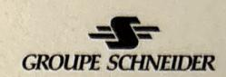

#### Classe de précision:

désignation appliquée à un TC dont les erreurs restent dans des limites spécifiées pour des conditions d'emploi spécifiées.

#### Charge:

Impédance du circuit secondaire exprimée en  $\Omega$  avec indication du facteur de puissance.

#### Charge de précision:

Valeur de la charge sur laquelle sont basées les conditions de précision.

#### Puissance de précision:

Puissance apparente en Volt Ampère VA, que le transformateur peut fournir au circuit secondaire pour lsn et la charge de précision.

#### Fréquence assignée:

'eur de la fréquence sur laquelle sont basées les prescriptions.

## Courant de court-circuit thermique assigné Ith:

Valeur efficace du courant primaire que le transformateur peut supporter pendant une seconde, son secondaire étant mis en court-circuit, sans qu'il subisse de dommage. Sa valeur doit être spécifiée.

#### Courant dynamique assigné ldvn:

Valeur crête du courant primaire que le transformateur peut supporter sans subir de dommages électriques ou mécaniques du fait des efforts électromagnétiques qui en résultent; le secondaire étant mis en court-circuit. La valeur normale de ldyn assigné doit être égale à 2.5\* lth sinon elle doit être indiquée sur la plaque signalétique.

### Courant d'échauffement ou courant thermique continu assigné:

Valeur du courant qui peut passer indéfiniment dans l'enroulement primaire, l'enroulement secondaire débitant sur la charge de précision, sans que l'échauffement dépasse les valeurs spécifiées.

# Définitions relatives à la norme CEI 44-6

#### Courant d'erreur instantanée ia:

Différence entre les valeurs instantanées du courant secondaire is multiplié par le rapport de transformation assigné kn et du courant primaire ip.

Lorsque ce courant comporte deux composantes, l'une alternative (ac) et l'autre apériodique (dc), ces composantes constituantes sont identifiées séparément comme suit:

$$i\epsilon = i\epsilon_{ac} + i\epsilon_{dc} = (kn.is_{ac} - ip_{ac}) + (kn.is_{dc} - ip_{dc})$$

#### Erreur instantanée (totale) de crête (ε):

Courant d'erreur instantanée maximal, pour le cycle de fonctionnement spécifié, exprimé en pourcentage de la valeur instantanée de crête du courant primaire de court-circuit assigné.

$$\hat{\varepsilon} = 100 * \frac{\hat{i}\varepsilon}{\sqrt{2.\text{lpsc}}}$$
 (%)

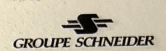

# Erreur instantanée de crête sur la composante alternative du courant(εac):

Erreur instantanée maximale sur la composante alternative du courant exprimé en % de la valeur instantanée de crête du courant primaire de court-circuit assigné.

$$\varepsilon_{ac}^{\wedge} = 100 * \frac{i\varepsilon_{ac}}{\sqrt{2.lpsc}}$$
 (%)

# 1.3. Définitions complémentaires concernant les TC pour mesures

#### Transformateur de courant pour mesures:

destiné à alimenter des appareils de mesure, des compteurs et autres appareils analogues.

# t limite assigné ( pour les appareils de mesure) (ILP):

Valeur au courant primaire minimal pour lequel l'erreur composée du TC pour mesures est égale ou > à 10%, la charge secondaire étant égale à la charge de précision.

ILP=FS\*Isn

Note: Il convient que l'erreur composée soit plus grande que 10% pour protéger les appareils de mesure alimentés par le TC contre les courants de valeurs élevés apparaissant en cas de court-circuit (CC) dans le réseau.

#### Facteur de sécurité (FS):

Rapport entre le courant limite primaire assigné pour l'appareil et le courant primaire assigné. Note: La sécurité des appareils alimentés par le TC est d'autant plus grande, en cas de CC dans le réseau où est intercalé l'enroulement primaire, que le facteur de sécurité FS est plus petit.

#### Force électromotrice limite secondaire:

Produit du facteur de sécurité FS par le courant secondaire assigné et par la somme vectorielle de la charge de précision et de l'impédance de l'enroulement secondaire.

# 1.4. Définitions complémentaires concernant les TC pour protection

## Transformateur de courant pour protection:

TC destiné à alimenter des relais de protection.

## Courant limite de précision assigné:

Valeur la plus élevée du courant primaire pour laquelle le TC doit satisfaire aux prescriptions concernant l'erreur composée.

#### Facteur limite de précision (FLP):

rapport entre le courant limite de précision assigné et le courant primaire assigné.

#### Force électromotrice limite secondaire:

Produit du facteur limite de précision assigné par la somme vectorielle de la charge de précision et de l'impédance de l'enroulement secondaire.

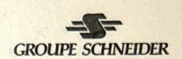

# Chapitre 2: Généralités

# 2. GENERALITES

Ce document, n'a pas pour but d'être un résumé exhaustif des normes relatives aux transformateurs de courant TC ( ou CT's en anglais), mais s'appuie très largement sur celles-ci, pour décrire les points clés qui permettent de mener à bien le dimensionnement des TC, dans ces différentes applications.

- \* Différentes normes applicable aux TC:
  - CEI 44-1/44-6. Norme Internationale.
  - BS 3938, Norme Britannique ( pour les matériels construits jusqu'au 08/98).
  - IEEE/ANSI C57.13, Norme Américaine.

#### 2.1 Rôle des transformateurs de courant:

Le transformateurs de mesure peuvent être considérés à tort, comme un petit maillon, souvent négligé, dans la globalité de la chaîne opérationnelle des réseaux de transport et distribution de l'énergie électrique.

Et pourtant grâce à leurs fonctions de capteur et d'interface entre la Haute et la Basse tension, ils sont essentiels à la sécurité et à l'efficacité de ces réseaux.

Comme tout autre équipement électrique connecté côté H.T., ils ont à supporter toutes les contraintes et les perturbations qui peuvent survenir sur le réseau.

En tant que lien dans la chaîne de mesure et de protection, ils doivent fournir une réponse juste et fidèle, non seulement durant le fonctionnement normal, mais aussi face aux phénomènes transitoires et autres perturbations provoquant de larges variations d'amplitude.

Les transformateurs de courant ont donc trois rôles essentiels:

- délivrer au niveau de leur secondaire, une image de bas niveau, la plus fidèle possible de la grandeur qui circule dans le conducteur H.T.,
  - Protéger les circuits de mesure et/ou de protection de toutes détériorations, en cas de défaut sur le réseau H.T.,
  - assurer l'isolement galvanique entre le primaire et le secondaire pour la protection des personnes.

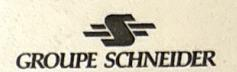

# Chapitre 3: TC selon la norme CEI 44-1

# 2.2 Transformateur de courant suivant la norme CEI 44-1

Cette norme s'applique aux TC en régime permanent, on devra s'y reporter pour tout ce qui est relatif aux conditions:

- d'échauffement,

- de classification d'essais,

- d'isolement interne,

- de marquage de bornes,

- de liane de fuite.

- de température, d'altitude,

- de tenue mécanique,

- d'environnement,

- de tenue à la tension de choc ou à fréquence industrielle.

#### 2.2.1 rs normales

ns un but de standardisation des équipements, la norme définit des valeurs normales pour la plupart des grandeurs utiles au dimensionnement des TC (cf. définition de ces grandeurs dans le glossaire ).

Valeurs normales des courants primaires assignés:

10-12.5-15-20-25-30-40-50-60-75 A

et leurs multiples et sous-multiples décimaux. Les valeurs préférentielles sont soulianées.

Note:Pour un TC à plusieurs rapport de transformation, ces valeurs s'appliquent au plus petit courant primaire.

Valeurs normales des courants secondaires assignés:

1-2-5 A

Valeurs normales des puissances de précision:

Exprimée en Volt ampère (VA), elle indique la puissance que le secondaire peut délivrer en respectant la classe de précision nominale. C'est la consommation totale du circuit secondaire (hors TC, Rct) incluant les fils de liaison, le relais...

2.5-5.0-10-15-30 VA.

Au delà de 30 VA, des valeurs de puissances de précision peuvent être choisies de façon à répondre aux besoins.

# 2.2.2 Transformateur de courant multi-rapport

Il faut distinguer deux types:

- Ceux à changement de prises primaires où la charge de précision est conservé sur toutes les prises.
- Ceux à changement de prises secondaires où la charge de précision varie en fonction de la prise.

La valeur de la puissance de précision est spécifiée Attention !: généralement pour le plus petit rapport de transformation et varie avec le carré du rapport pour un TC mesure, et avec le rapport pour un TC protection.

2000-1000/1 A, 5P20, 10 VA

N.=petit rapport=1000, N.=grand rapport=2000 Mesure: VA,=VA,\*(N,/N,)2

VA+=10\*(2000/1000)2=40 VA

Protection: VA\_=VA\_\*(N\_/N\_) VA,=10\*(2000/1000)=20 VA

# TRANSFORMATEURS DE COURANT STAGE

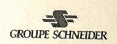

# 2.2.3 Courant de court-circuit thermique assigné ( lth)

Valeur efficace du courant primaire que le transformateur peut supporter pendant 1 seconde, son secondaire étant mis en court-circuit, sans qu'il subisse de dommage. Si le temps d'élimination du défaut par le disjoncteur est égal à t différent de 1s, on peut appliquer la loi de conservation de la chaleur l²t=cste pour 0.5<t<5s.

On a alors: |2t=|th2.1.

l est le courant de court-circuit thermique que le transformateur peut supporter Londant t secondes.

# 2.2.4 Courant dynamique assigné (ldyn)

Valeur crête du courant primaire que le transformateur peut supporter sans subir de dommages électriques ou mécaniques du fait des efforts électromagnétiques qui en résultent, le secondaire étant mis en court-circuit.

Le TC doit tenir électrodynamiquement un courant d'au moins:

### ldyn=2.5\*lth

Toutefois une valeur différente peut être admise sous réserve qu'elle soit indiquée sur

# 2.2.5 Transformateur de courant pour mesures

TC destiné à alimenter des appareils de mesure, des compteurs et autres appareils

# 2.2.5.1 Classe de précision pour les TC mesures

La classe de précision d'un transformateur de courant ( TC ) pour mesures est caractérisée par un nombre ( indice de classe ) égal à la limite supérieure de l'erreur de courant, exprimée en %, pour le courant primaire assigné et la charge de précision. Valeurs normales: 0.1-0.2-0.5-1-3-5

- applications spéciales (comptage spéciale): 0.2S-0.5S

Pour les TC de classes de précision 0,1-0,2-0,5 et 1, l'erreur de courant et de déphasage, à la fréquence assignée, ne doivent pas dépasser les valeurs du tableau1, lorsque la charge secondaire est comprise entre 25% et 100% de la charge

| Classe de précision ±Erreur de courant (rapport) en % pour les valeurs du courant exprimées en % du courant assigné |                                            |                                          |                                             |                                 | Dépha                                  | asage , | ±, pour                     | les vale | eurs du c                           | PAR CONT |                                             | charge es en                          |
|---------------------------------------------------------------------------------------------------------------------|--------------------------------------------|------------------------------------------|---------------------------------------------|---------------------------------|----------------------------------------|---------|-----------------------------|----------|-------------------------------------|----------|---------------------------------------------|------------------------------------------|
| 0.1 0.2 0.5 1 Tableau                                                                                   | 5 0.4 0.75 1.5 3.0 1: Limit | 0.2 0.35 0.75 1.5 tes de l'é | 100 0.1 0.2 0.5 1.0 erreur d | 120 0.1 0.2 0.5 1.0 | 5 15 30 90 180 nt et du | 8       | utes 100 5 10 30 60 age des | 5        | Centira 5 0.45 0.9 2.7 5.4 ur mesur | 20       | 100 0.15 0.3 0.9 1.8 sse 0.1 | 120 0.15 0.3 0.9 1.8 à 1) |

# TRANSFORMATEURS DE COURANT STAGE

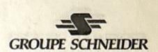

Pour les transformateurs de classes 3 et 5, l'erreur de courant à la fréquence assignée ne doit pas dépasser les valeurs du tableau 2, lorsque la charge secondaire est comprise entre 50% et 100% de la charge de précision.

| sse de précision  | Erreur de courant (rapport) en % pour les valeurs du courant exprimées en % du courant assigné. |                        |  |  |  |
|-------------------|-------------------------------------------------------------------------------------------------|------------------------|--|--|--|
|                   | 50                                                                                              | 120                    |  |  |  |
| 3                 | 3                                                                                               | 3                      |  |  |  |
| 5                 | 5                                                                                               | 5                      |  |  |  |
| ote : Il n'est im | posé aucune limite de déphasage po                                                              | our les classes 3 et 5 |  |  |  |

Tableau 2: Limites de l'erreur de courant des TC pour mesures (classes 3 et 5.)

Pour les TC pour applications particulières spécialement en connexion avec des compteurs d'énergie électrique spéciaux qui mesurent correctement entre 50 mA et 6A,( c'est à dire entre 1% et 120% du courant assigné 5A) des classe de précision 0,2S et 0,5S, l'erreur de courant et de déphasage, à la fréquence assignée, ne doivent pas dépasser les valeurs du tableau 3 lorsque la charge secondaire est comprise entre 25% et 100% de la charge de précision. Ces classes doivent être employées principalement pour les rapports 25/5 50/5 et 100/5 et leurs multiples décimaux et seulement pour le courant secondaire assigné de 5A.

| Classe de précision | en % pour les valeurs du courant exprimées en % du courant assigné                          |      |     |     |     | Déphasage , ±, pour les valeurs du courant exprimées en % du courant assigné |    |          |     |     |       |        |     |     |     |
|---------------------------|---------------------------------------------------------------------------------------------|------|-----|-----|-----|------------------------------------------------------------------------------|----|----------|-----|-----|-------|--------|-----|-----|-----|
|                           | gas courant assigne                                                                         |      |     |     |     |                                                                              | ١  | /linute: | S   |     | Centi | radian | S   |     |     |
|                           | 1                                                                                           | 5%   | 20  | 100 | 120 | 1                                                                            | 5  | 20       | 100 | 120 | 1     | 5      | 20  | 100 | 120 |
| 0.2S                      | 0.75                                                                                        | 0.35 | 0.2 | 0.2 | 0.2 | 30                                                                           | 15 | 10       | 10  | 10  | 0.9   | 0.45   | 0.3 | 0.3 | 0.3 |
| 0.5S                      | 1.5                                                                                         | 0.75 | 0.5 | 0.5 | 0.5 | 90                                                                           | 45 | 30       | 30  | 30  | 2.7   | 1.35   | 0.9 | 0.9 | 0.9 |
| Note : 0                  | Note : Ce tableau est applicable uniquement à des TC dont le courant secondaire assigne =5A |      |     |     |     |                                                                              |    |          |     |     |       |        |     |     |     |

Tableau 3 : Limites de l'erreur de courant et du déphasage des TC pour mesures pour applications particulières

Transformateurs à gamme étendue:

Un TC de classe 0.1 à 1 sera considéré comme possédant une gamme étendue en courant, s'il satisfait aux deux conditions suivantes:

- Son courant d'échauffement est porté à la valeur indiquée comme limite de la gamme des courants. Laquelle est exprimée en % du courant primaire assigné.
- Dans Tableau 1, la valeur supérieure du courant est remplacée par la limite précitée, au cas ou celle-ci diffère des 120% de Ipn. Les valeurs normales des courants d'échauffement Pour les TC à gamme étendue sont 120%, 150% et 200% de Ipn.

Dans tous les cas, la charge employée doit être inductive avec un facteur de puissance de 0.8, sauf si elle absorbe une puissance inférieure à 5 VA, dans ce cas, son facteur de puissance sera l'unité. en aucun cas, la charge ne sera inférieure à 1 VA.

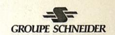

#### 2.2.5.2 Facteur de sécurité (FS)

STAGE

Valeurs normales: 5 et 10

Le courant secondaire sera limité à FS fois le courant nominal en cas de défaut, la sécurité des appareils alimentés par le TC sera donc d'autant plus grande que le FS sera petit.

#### Facteur de sécurité réel (FS')

Le facteur FS est donné pour la charge de précision nominale Pn. Si la charge réelle r est différente on calcul un facteur de sécurité réel FS':

$$FS' = FS * \frac{Pn + Pi}{Pr + Pi}$$

Pn: charge de précision nominal
Pr: charge de précision réelle
Pi: puissance interne du TC
=Rct\*Isn²

Rct: Résistance interne du TC
Isn: Courant secondaire nominal du TC

La charge réelle est la somme de toutes les charges connectées (conducteurs, transformateurs de recalage, appareils de mesure...).

La puissance interne du TC est spécifiée par le fabricant. Elle peut généralement être prise égale à 10% ou 20% de la charge de précision, mais elle peut être largement différente en particulier pour les petits (50/1A) et les grands rapports (2000/1A).

#### Exemple de TC pour mesures : 500/1 A 15VA cl 0.5 FS=5

| Courant primaire assigné   | 500 A. |
|----------------------------|--------|
| Courant secondaire assigné | 1 A.   |
| Classe de précision        | 0.5    |
| Puissance de précision     | 15 VA  |
| Facteur de sécurité        | 5      |

C'est à dire que pour une charge comprise entre 3.75 VA (25% de Pn) et 15 VA sous 1 A au secondaire, l'erreur sur le courant sera ± 0.5% et l'erreur de phase ne dépassera pas 30 minutes.

## 2.2.6 Transformateur de courant pour protection

TC destiné à alimenter des relais de protection.

#### 2.2.6.1 Classe de précision pour les TC protection

La classe de précision d'un TC pour protection est caractérisée par un nombre (indice de classe) et par la lettre « P » (initiale de protection).

Valeurs normales: 5P et 10 P

# TRANSFORMATEURS DE COURANT STAGE

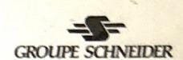

| Classe de | Erreur de courant | Déphasage | Erreur composée en % pour llp * |                              |
|-----------|-------------------|-----------|------------------------------------|------------------------------|
| Précision | en % pour lpn (1) | minutes   | centiradians                       | somme vectorielle (1)+(2) |
| 5P        | ±1                | ±60       | ±1.8                               | 5 A.                         |
| 10P       | ±3                | -         | -                                  | 10                           |

Tableau 4: Limites des erreurs des TC pour protection. \* Ilp: cf. glossaire § 2.2.3.2

Les erreurs sont plus importantes que pour les TC mesures, mais dans un domaine très étendu.

#### 2.2.6.2 Fac limite de protection (FLP)

ridice de classe de précision est suivi de la lettre P à son tour suivie du facteur la cut de précision, ce facteur est le rapport entre la valeur la plus élevée du courant primaire pour laquelle le transformateur doit satisfaire aux prescriptions concernant l'erreur composée et le courant primaire assigné.

Valeurs normales: 5-10-15-20-30

Exemple: 5P20 => erreur composée < à 5% pour toute valeur du courant

comprise entre une fois et 20 fois le courant primaire assigné≡IIp.

#### Facteur limite de précision réel (FLP')

Comme dans le § 2.2.2.2 pour le FS, on définit un FLP' pour la charge de précision réelle.

 $FLP' = FLP * \frac{Pn + Pi}{Pr + Pi}$ 

Exemple de calcul: 400/1 A 15VA

Calcul de la charge réelle:

- conducteur L=50m S=4mm2 RL= $\rho$ L/S\*[1+ $\alpha$ ( $\theta$ -20)] -relais Rr=0.2 $\Omega$ 

pour Cu ρ=0.0179 Ω.mm²/m résistivité du cuivre

 $\alpha$ =4 10-3  $\theta$ =40°C 1+ $\alpha$ ( $\theta$ -20)=1.08

L= longueur du conducteur (aller retour)

S= section du câble

 $RL=0.0179*(2*50/4)*1.08=0.48\Omega$ 

- relais Rr=0.2Ω

 $Pr=(RL+Rr)*Isn^2=(0.48+0.2)*1^2=0.68 \text{ VA}$  Pn=15 VA Pi=3 VA ou Rct=3 $\Omega$ 

 $FLP' = 20* \frac{15+3}{0.68+3} = 98$  Erreur composée < 5% jusqu'à 98\*Isn.

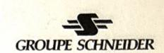

### 2.2.7 Marquage de la plaque signalétique

Tous les TC doivent porter au moins les indications suivantes sur leur plaque signalétique :

- Nom du constructeur ou une indication permettant de l'identifier,
- N° de série ou indication du type, ou de préférence les deux,
- Rapport de transformation assigné sous la forme kn=lpn/lsn A,
- Fréquence assignée,
- Puissance de précision et classe de précision,
- Tension la plus élevée pour le matériel,
- Niveau d'isolement assigné,
- Ith, et Idyn si celui-ci diffère de 2.5\*Ith,
- Classe d'isolation, si elle est différente de A,
- pour les TC à 2 enroulements secondaires, l'utilisation de chacun de ces enroulements et des bornes correspondantes.

#### 2.2.7.1 Plaque signalétique pour un TC mesures

En plus des indications ci-dessus, elle doit indiquer:

- la classe de précision et le facteur de sécurité à la suite de l'indication de puissance de précision, par exemple: 15 VA classe 0.5 FS 10.
- pour les TC à gamme étendue, la limite de la gamme des courants à la suite de la puissance de précision.

#### 2.2.7.2 Plaque signalétique pour un TC protection

En plus des indications du § 2.2.7, elle doit indiquer:

- le facteur limite de précision FLP à la suite de la puissance et de la classe de précision

e courant pour la protection est délini suvant la horsia (A) (S)

par exemple: 30 VA classe 5P10

# TRANSFORMATEURS DE COURANT STAGE

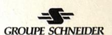

# Chapitre 4: TC selon la norme ANSI/IEEE

# 2.3 TC suivant la norme ANSI / IEEE C57.13-1993

(American National Standards Institute/Institute of Electrical & Electronics Engineers)

### 2.3.1 Caractéristiques

Cette norme est comme son nom l'indique essentiellement destinée aux USA, mais peut être parfois appliquée dans d'autres pays (elle n'est applicable que pour des seaux à 60Hz).

• Typiq par:

ent un transformateur de courant pour la mesure est défini suivant la norme ANSI 600:5A 0.3 B-0.1

respondant à :

- trois classes de précision conformément au tableau 5.

|            | % du courant primaire assigné |          |
|------------|-------------------------------|----------|
|            | 10%                           | 100%     |
| classe 0.3 | +/- 0.6%                      | +/- 0.3% |
| classe 0.6 | +/- 1.2%                      | +/- 0.6% |
| classe 1.2 | +/- 2.4%                      | +/- 1.2% |

Tableau 5 : Limite de l'erreur de courant des transformateurs de courant pour la mesure.

- cing puissances standards conformément au tableau 6.

|       | VA   | R (Ω) | L (mH) | Ζ (Ω)         |
|-------|------|-------|--------|---------------|
| B-0.1 | 2.5  | 0.09  | 0.116  | scondar 0.1 a |
| B-0.2 | 5.0  | 0.18  | 0.232  | 0.2           |
| B-0.5 | 12.5 | 0.45  | 0.580  | 0.5           |
| B-0.9 | 22.5 | 0.81  | 1.040  | 0.9           |
| B-1.8 | 45   | 1.62  | 2.080  | 1.8           |

Tableau 6 : Puissances standards pour un courant secondaire assigné Is=5A et cosφ=0.9

NB : Si Isn≠5A, R,L doivent être multipliées par (5/Isn)2.

Rappel: Z=√(R2+X2) et VA=Z\*Isn2

Remarque : La puissance standard est définie pour le rapport de transformation le plus haut.

Typiquement un transformateur de courant pour la protection est défini suivant la norme ANSI par :

correspondant à :

#### - trois classifications C,K et T:

\* C,K pour lesquels le flux de fuite et négligeable et les performances peuvent être calculées.

Pour les TC de classe K la tension de coude doit être au moins égale à 70% de la tension secondaire terminale (définie plus loin).

\* T pour lesquels le flux de fuite n'est plus négligeable et dont les performances doivent être mesurées par essai.

# TRANSFORMATEURS DE COURANT STAGE

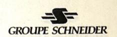

- quatre puissances standards conformément au tableau 8.

|     | VA  | R (Ω) | L (mH)      | Ζ (Ω) |
|-----|-----|-------|-------------|-------|
| B-1 | 25  | 0.5   | 2.3         | 1     |
| B-2 | 50  | 1     | 4.6         | 2     |
| B-4 | 100 | 2     | 9.2 18.4 | 4     |
| B-8 | 200 | 4     | 18.4        | 8     |

Tableau 7: Puissances standards pour Isn=5A et cos φ=0.5

NB : Si Isn≠5A, R,L doivent être multipliées par (5/Isn)².

Rappel:  $Z=\sqrt{(R^2+X^2)}$  et  $VA=Z*Isn^2$ 

est définie pour le rapport de transformation le plus haut.

Par e de pour un transformateur de courant multi-ratio 600:5A , 0.1 , B-0.1 (cf tableau 6)

|    | 50A | 100A  | 150 <b>A</b> | 200 <b>A</b> | 250 <b>A</b> | 300 <b>A</b> | 350 <b>A</b> | 400 <b>A</b> | 500 <b>A</b> | 600A |
|----|-----|-------|--------------|--------------|--------------|--------------|--------------|--------------|--------------|------|
| VA | 0.2 | 0.416 | 0.625        | 0.8          | 1            | 1.25         | 1.66         | 1.87         | 2.08         | 2.5  |

Tableau 8 : Variation de la puissance assignée avec le rapport de transformation.

La puissance assignée décroît de manière linéaire avec la valeur du courant primaire assigné. Il faut avoir à l'esprit quand on utilise les rapports inférieurs que la puissance ne sera pas égale à la puissance assignée, mais inférieure. (parfois très inférieure cf tableau 8, 0.2 VA au lieu de 2.5 VA pour 50:5A)

#### - et une tension secondaire terminale Vst

(chiffre figurant immédiatement après la lettre) qui correspond à 20 fois le courant secondaire assigné \* la charge correspondant à la puissance standard.

exemple: 600:5 A C 400 B-4

Z=4Ω cf. tableau 7 (Z= le chiffre après B-) Vst=20\*lsn\*Z\*(5/lsn)²=20\*5\*4\*(5/5)²= 400V

- On peut trouver un autre paramètre devant la lettre C,K ou T qui indique la limite supérieure de l'erreur quand la tension est égale à Vst et le courant secondaire à 20\*Isn.

Mais il est souvent absent, on prend alors 10 comme valeur par défaut. Cela signifie alors que l'erreur est ≤ 10% pour un courant secondaire de 20\*Isn et une charge secondaire produisant une tension ≤ Vst V.

# 2.3.2 Analogie ANSI / CEI

ANSI: Ipn:Isn A Cα

CEI: Ipn/Isn A, β VA, 5 Pγ

 $\alpha$  =Vst en Volt  $\beta$  = puissance assignée en VA  $\gamma$  = Kflp facteur limite de précision

 $Vst=\alpha=20*lsn*(\beta/lsn^2)*(\gamma/20)$ 

# TRANSFORMATEURS DE COURANT STAGE

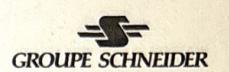

Exemple

600/5 A , 25 VA , 5 P 20 => Vst= 20\*5\*(25/5²)\*(20/20)= 100 V

Vérification C 100 Vst= $20*Isn*Z*(5/Isn^2)$ => Z= 1  $\Omega$  => B-1 cf. Tableau 7 25 VA CQFD

 Chapitre 5: TC selon la norme BS 3938

### 2.4 TC suivant la norme BS 3938 Classe X

Cette norme bien qu'obsolète et remplacée par la BS 7626 (équivalente à la CEI 44-1), s'applique encore à certains produits jusqu'au 1er juin 1998. La plupart des constructeurs de relais de protection, dans leur notice technique, dimensionnent les TC conformément à cette norme.

es TC sont alors définis par:

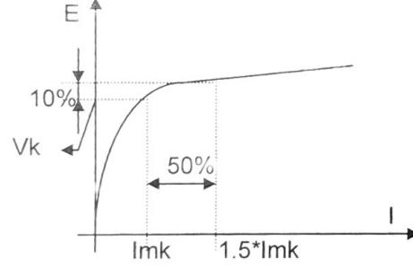

- Vk, la tension de coude, définie sur la courbe d'excitation du TC comme le point qui à une augmentation de 10% de la tension fait correspondre une augmentation de 50% du courant magnétisant Im,
- Imk, le courant corespondant à Vk,
- et Rct la résistance interne du secondaire à 75°C.

L'erreur de rapport ne doit pas excéder ±0.25%.

Comme pour la classe TPS de la norme CEI 44-6 (cf. 2.5.3.1)

La formule générale pour le calcul de la tension de coude est:

$$Vk = Kt * Icc \frac{Isn}{Ipn} (Rct + Rw + Rb)$$

où Rw: résistance de la filerie (wire),

Rb : résistance de la charge (burden), comprenant le relais, les transfos aux. etc... Kt: coefficient de surdimensionnement défini par:

$$Kt = \omega Tp(1-e^{-t/Tp}) + 1$$

où t : temps d'acquisition du relais

et Tp : constante de temps du réseau primaire ωTp=X/R

Souvent t est considéré comme ∞ par rapport à Tp, on a alors:

$$Kt = 1 + \frac{X}{R}$$

## 2.4.1 Analogie CEI / BS

La formule de passage entre la puissance de précision nominale Pn et la tension de coude Vk est la suivante:

$$Pn = \frac{K.Vk.lsn}{FLP} - Rct.lsn^2$$

avec pour les TC fabriqués par NMG K=1.143 pour les classe 5P et K=1.357 pour les classe 10P

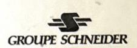

re anteneur au défaut, ce qui

Exemple: Un TC défini en BS classe X par : Vk=220V et Rct=1 $\Omega$  Analogie avec un TC CEI 44-1 5P20

$$Pn = \frac{1.143 * 220 * 1}{20} - 1*1^2 = 11.6 \text{ VA}$$

On obtient alors un TC **15VA 5P20** en prenant la valeur normalisée supérieure la plus proche.

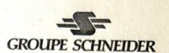

# Chapitre 6: TC selon la norme CEI 44-6

# 2.5 TC suivant la norme CEI 44-6

La norme CEI 44-6 est une partie de la norme 44, elle ne remet donc pas en cause tout ce qui a été vu précédemment, elle la complète, en traitant exclusivement du dimensionnement des TC en régime transitoire.

# 2.5.1 Régil transitoire

appelle régime transitoire d'un TC, le mode de fonctionnement pendant lequel l'a, reil est traversé par un courant de court-circuit généralement asymétrique, dû à l'ap, on d'un défaut. Si l'on néglige le régime permanent antérieur au défaut, ce qui est légre, compte tenu des valeurs élevées des courants de court-circuit considerés, l'équation du courant primaire est de la forme:

$$Ip(t) = Icc.\sqrt{2} \Big[ e^{-t/T1}.cos\theta - cos(\omega t + \theta) \Big]$$

Icc: courant primaire symétrique de court-circuit assigné,

T1: constante de temps du réseau vue par le TC. Elle dépend donc de son emplacement et en particulier de la proximité ou non d'une centrale de production. Pour un réseau HT, T1 varie de 200ms au jeu de barres d'une centrale, à moins de 30ms pour un poste éloigné, 120ms étant une valeur typique; des valeurs plus élevées jusqu'à 500ms peuvent être rencontrées en sortie des alternateurs de grandes puissances.

θ : Paramètre caractéristique de l'asymétrie, celle-ci dépendant de la phase de la tension au point de défaut à l'instant de son apparition.

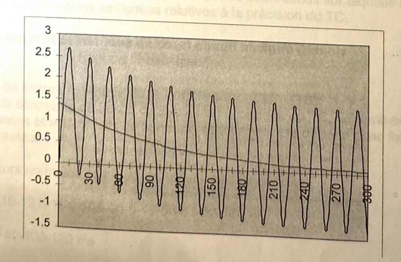

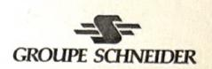

#### 2.5.2 Saturation des Transformateurs de courant

Comme tous les transformateurs classiques, les TC sont constitués d'un circuit magnétique, qui est caractérisé par sa courbe de magnétisation B(H).

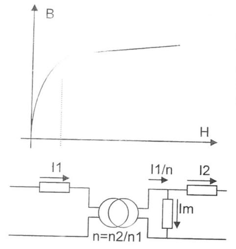

On voit qu'elle est constituée de deux parties bien distinctes, la première où B croit quasiment linèairement en fonction de H, et une autre partie après le coude de la courbe, où le transformateur est saturé. La valeur de l'indution B de ce coude de saturation dépend du matériau du circuit magnétique.

Quand le TC est saturé, le courant magnétisant Im, proportionnel à H, croit très rapidement pour une petite variation de B.

On voit sur le schéma équivalent ci contre, que la croissance rapide de lm, après la saturation, se fait au détriment du courant I2, qui ne reflète donc plus parfaitement l'évolution du courant primaire.

Pour s'affranchir de ce phénomène de saturation, la solution la plus couante est de surdimensionner la section du circuit magnétique, on peut ainsi faire transiter le même flux avec un induction moindre, φ=B\*S, et donc s'éloigner du B correspondant à la saturation.

### 2.5.3 Définitions

En plus des grandeurs déjà évoquées dans la CEI 44-1, la spécificité de cette partie oblige à définir :

d'autres grandeurs nécessaires au dimensionnement des TC,

# Courant primaire de court-circuit assigné ( lpsc):

Valeur efficace du courant primaire symétrique de court-circuit sur laquelle doivent être fondées les conditions assignées relatives à la précision du TC.

# Facteur de courant symétrique de court-circuit assigné (Kssc):

Rapport : Kssc=lpsc/lpn

# Constante de temps assignée de la boucle secondaire (TS):

Valeur de la constante de temps de la boucle secondaire (13): des inductances et résistances de la boucle secondaire, elle dépend donc fortement du transformateur.

des valeurs normales pour des grandeurs déjà rencontrées,

Ith: 6.3-8-10-12.5-16-20-25-31.5-40-50-63-80-100 kA

Tp: 40-60-80-100-120 ms

**Rb** :  $2.5 - \underline{5} - 7.5 - \underline{10} - 15 \Omega$  pour Isn=1 A

Kssc: 3-5-7.5-10-12.5-15-17.5-20-25-30-40-50

# TRANSFORMATEURS DE COURANT STAGE

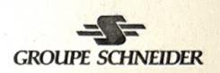

mais aussi des cycles de fonctionnement,

En effet le régime transitoire apparaît à la suite d'un défaut, on peut définir alors deux cycles de fonctionnement F-O et FO-FO:

- le premier (Fermeture-Ouverture) avec un seul passage du courant de défaut pendant t' (F-t'-O), le circuit restant ouvert jusqu'à la vérification de l'état du réseau et à l'élimination du défaut.
- le second (Fermeture-Ouverture avec réenclenchement) avec deux passages du courant de défaut, respectivement pendant t' et t'', si celui-ci n'était pas un défaut fugitif qui aurait pu disparaître pendant le temps de pause tfr entre ses deux applications (F-t'-O-tfr-F-t"-O).

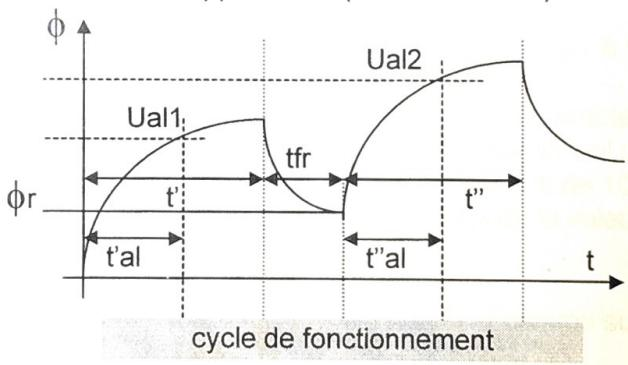

avec les tal, temps admissible jusqu'à la limite de précision, correspondant aux temps pendant lequel la précision spécifiée doit être conservée au cours de toute période spécifiée de passage du courant faisant partie d'un cycle de fonctionnement donné, au moins équivalent au temps d'acquisition de la protection.

# 2.5.2 Transformateur de courant pour mesures

Pour les TC destinés à la mesure, la précision n'étant utile que jusqu'à la valeur nominale du courant primaire, la saturation n'est pas un handicap.

Au contraire elle doit apparaître pour des courants peu élevés 2 à 3 Ipn afin de limiter le courant secondaire et de protéger les appareils de mesure qui ne sont pas dimensionnés pour supporter de forts courants.

Dans ces conditions, la norme CEI 44-6 ne définissant rien de plus, il faut se reporter à la CEI 44-1 pour les TC destinés à la mesure.

# 2.5.3 Transformateur de courant pour protection

Pour les TC destinés à la protection, l'image du courant primaire qu'il délivre doit rester fidèle pendant le régime transitoire, malgré les fortes valeurs des courants de court-circuit imposées au primaire.

On définit pour cela un :

Facteur de dimensionnement pour le régime transitoire assigné (Ktd): Valeur théorique représentative du dimensionnement pour le régime transitoire nécessaire pour satisfaire au cycle de fonctionnement spécifié.

# TRANSFORMATEURS DE COURANT STAGE

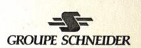

# 2.5.3.1 Classes de transformateurs de courant pour protection

Les TC pour protection sont classés comme suit selon leurs performances fonctionnelles et répondent tous aux mêmes types d'équation:

# $Ual \geq Ktd^*Kssc.(Rct+Rb)Isn$

où l'expression de Ktd dépend de la classe des TC ou du cycle de fonctionnement.

Classe TPS: transformateur de courant à faible flux de fuite dont les performances ont définies par des limites fixées pour les caractéristiques d'excitation par roulement secondaire et pour l'erreur sur le rapport des nombres de spires.

Aucune limite pour le flux rémanent.

Le rapport du nombre de spires d'un TC TPS doit être égal à 1/kn, avec une erreur sur ce rapport ne dépassant pas  $\pm 0.25\%$ .

Les conditions limites de précision sont définies par la caractéristique de magnétisation et la tension secondaire limite d'excitation Ual ne doit pas être < à la valeur spécifiée. Elle doit être telle qu'un accroissement de 10% de sa valeur n'entraîne pas une augmentation de plus de 100% de la valeur instantanée de crête du courant d'excitation correspondant ( cf. Vk ).

La tension secondaire limite d'excitation est définie comme suit:

$$Ual \geq K.Kssc.(Rct + Rb)Isn$$

où K est un paramètre de dimensionnement fixé par l'acheteur.

Remarque: On requiert des TC TPS qu'ils soient à faible flux de fuite, et que le rapport du nombre de spires soit parfaitement déterminé, deux conditions essentielles pour les protections fondées sur le principe de circulation du courant et qui utilisent des relais à haute

• Classe TPX: Limite de précision définie par l'erreur instantanée de crête (ε) au cours du cycle de fonctionnement en régime transitoire spécifié. Aucune limite de flux rémanent spécifié.

Les caractéristiques de base des TPX sont généralement similaires à celles des TPS sauf en ce qui concernent les limites d'erreurs (cf. tableau 10) et le mode de détermination du Ktd.

En effet les TPX n'assurant aucune limite pour le flux rémanent, ils sont généralement réservés à des cycle de fonctionnement sans réenclenchement(leur utilisation pour un cycle FO-FO entrainant un surdimensionnment par rapport à un TPY avec le facteur Ktd2 à cause de leur Ts plus grand.

La norme définit alors dans ce cas le coefficient de dimensionnement en régime transitoire pour un cycle F-O par la formule suivante:

Ktd1 = 1 + 
$$\left[\frac{\omega TpTs\cos\theta}{Tp-Ts}\right]^* \left(e^{-t'al/Tp} - e^{-t'al/Ts}\right)$$

 $\cos \theta$ : coefficient d'asymétrie, non défini dans la norme, on prend alors  $\cos \theta$  =1 ce qui est le plus contraignant, le client peut définir une autre valeur typiquement 0.6 ou 0.9

# TRANSFORMATEURS DE COURANT STAGE

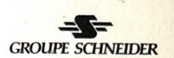

Remarque:

- Les TC de classe TPX sont typiquement utilisés pour des protections de distance avec un simple cycle.

 Classe TPY: Limite de précision définie par l'erreur instantanée de crête au cours du cycle de fonctionnement en régime transitoire spécifié. le flux rémanent ne doit pas excéder 10% du flux de saturation.

En raison de leur limitation de flux rémanent les TC classe TPY sont utilisés pour des rcles avec réenclenchement(ils peuvent être utilisés pour un cycle FO, mais traine pas un gain de dimensionnement suffisant par rapport au TPX).

arme définit alors une autre formule pour le coefficient de dimensionnement du transitoire pour un cycle FO-FO, sous la forme:

$$\star Ktd_2 = \left\{ \left[ \frac{\omega TpTs\cos\theta}{Tp-Ts} \right] (e^{-t'/Tp} - e^{-t'/Ts}) - \sin\omega t' \right\} \star e^{-(tfr+t''al)/Ts}$$

$$+ \left[ \frac{\omega TpTs\cos\theta'}{Tp-Ts} \right] (e^{-t''al/Tp} - e^{-t''al/Ts}) + 1$$

cosθ : coefficient d'asymétrie du premier passage du courant de défaut cosθ': coefficient d'asymétrie du second passage du courant de défaut (cf. Classe TPX)

On prend souvent sin  $\omega t' = -1$ , valeur la plus contraignante.

\*Attention : Il s'est glissé une erreur dans la norme pour la formule de Ktd2, il faut bien lire pour les premiers termes en exponentielles t' et t', au lieu de t' et t'al.

Remarque: Les TC de classe TPY:

- sont donc typiquement utilisés pour des protections de distance avec
- ont un circuit magnétique avec un entrefer.
- Classe TPZ: Limite de précision définie par l'erreur de crête sur la composante

alternative du courant ( $\epsilon_{\rm ac}$ ), au cours d'un seul passage du courant présentant la composante apériodique maximale, la constante de temps de la boucle secondaire ayant la valeur spécifiée. Aucune exigence concernant l'erreur limite sur la composante apériodique du courant. Flux rémanent devant être pratiquement

Pour un TPZ le facteur K correspond au maximum de flux, quelque soit le cycle.

C'est à dire au max. de Ktd1: 
$$Ktd_{max} = \omega Tp * \left(\frac{Tp}{Ts}\right)^{Tp/(Ts-Tp)} + 1$$

La constante de temps secondaire Ts des TPZ, est très inférieure à celle des autres TC, le Ktd calculé, qui en découle, sera donc moins élevé. Pour une même uitilisation le circuit magnétique d'un TPZ sera moins volumineux qu' un TC d'une autre classe

Cependant, ils sont encore très peu utilisés, sauf pour des cycles avec réenclenchement avec de fort niveau de tension.

# TRANSFORMATEURS DE COURANT STAGE

## 2.5.3.2 Comparatif des sections de circuit magnétique

Dans le tableau 9, on calcule les différentes sections de fer nécessaire en fonction de la classe des TC, pour faire face sans saturer aux mêmes conditions d'utilisation.

Les TC ont tous le même rapport de transformation 2000/1 et débitent sur la même parge Rb =5 $\Omega$  à la fréquence nominale de 50 Hz.

sont dimensionnés pour un cycle FO-FO, avec t'=t'al=t "=t "al=0.06s et tfr=0.3s, des coefficients d'asymétrie égales à 1. Avec la formule :

$$Ual \ge Ktd_2.Kssc.(Rct + Rb)Isn$$

La se. on se déduit simplement de la formule de Boucherot:

$$U = \frac{2\pi}{\sqrt{2}}.f.N.Bmax.S$$

Le constructeur donne pour l'induction Bmax=1.6 Tesla. Les autres paramètres de spécification, Ts, Rct dépendent de la nature du TC.

| TDV        | Ts en s  | Ktd2     | Rct en Ω | Ual en V     | S en cm²   |
|------------|----------|----------|----------|--------------|------------|
| TPX TPY | >10 1 | 30 25 | 9 7      | 8400 6000 | 118        |
| TPZ        | 0.06     | 9.5      | 5        | 1900         | 85 26.7 |

Tableau 9: Evolution des sections du circuit magnétiquer.

On remarque que le TC TPX a une section très importante, mais c'est parcequ'il est surdimensionné pour faire face à un réenclenchement, alors que son flux rémanent n'a pas le temps de diminuer avant le second passage du courant.

# 2.5.3.3 Limites des erreurs

# Limites d'erreur pour les TC de classe TPS:

le rapport des nombres de spires primaires et secondaires d'un transformateur de courant de classe TPS doit être numériquement égal à 1/kn. L'erreur sur ce rapport des nombres de spires ne doit pas dépasser  $\pm$  0.25%.

# Limites d'erreur pour les TC des classes TPX, TPY, TPZ:

La résistance de boucle secondaire étant réglée à la valeur Rs=Rct+Rb', les erreurs ne doivent pas dépasser les valeurs indiquées par le tableau 10.

|        | Au courant primaire assigné |              |                | A la condition limite de précision   |
|--------|-----------------------------|--------------|----------------|--------------------------------------|
| Classe | Erreur de rapport en %      |              |                | Erreur instantanée de crête maximale |
| TPX    | ±0.5                        | Minutes      | Centiradians   | %                                    |
| 111    | ±0.5                        | ±30          | ±0.9           | ^ 9                                  |
| TPY    | ±1.0                        | ±60          | ±1.8           | ε=10                                 |
| TPZ    | ±1.0                        | 180±18       | 5.3±0.6        | ε=10                                 |
|        |                             | tableau10: I | imitos d'array | $\varepsilon_{\rm ac}$ =10           |

tableau10: Limites d'erreur.

#### 2.5.3.4 Spécification des TC 44-6

Les paramètres de spécification pour les différentes classes de TC sont détaillés dans le tableau 11 suivant:

|                                               | TPS       | TPX     | TPY | TPZ                                                                                                                                                                                                                                                                                                                                                                                                                                                                                                                                                                                                                                                                                                                                                                                                                                                                                                                                                                                                                                                                                                                                                                                                                                                                                                                                                                                                                                                                                                                                                                                                                                                                                                                                                                                                                                                                                                                                                                                                                                                                                                                            |
|-----------------------------------------------|-----------|---------|-----|--------------------------------------------------------------------------------------------------------------------------------------------------------------------------------------------------------------------------------------------------------------------------------------------------------------------------------------------------------------------------------------------------------------------------------------------------------------------------------------------------------------------------------------------------------------------------------------------------------------------------------------------------------------------------------------------------------------------------------------------------------------------------------------------------------------------------------------------------------------------------------------------------------------------------------------------------------------------------------------------------------------------------------------------------------------------------------------------------------------------------------------------------------------------------------------------------------------------------------------------------------------------------------------------------------------------------------------------------------------------------------------------------------------------------------------------------------------------------------------------------------------------------------------------------------------------------------------------------------------------------------------------------------------------------------------------------------------------------------------------------------------------------------------------------------------------------------------------------------------------------------------------------------------------------------------------------------------------------------------------------------------------------------------------------------------------------------------------------------------------------------|
| Ipn (A)                                       | Х         | х       | х   | Х                                                                                                                                                                                                                                                                                                                                                                                                                                                                                                                                                                                                                                                                                                                                                                                                                                                                                                                                                                                                                                                                                                                                                                                                                                                                                                                                                                                                                                                                                                                                                                                                                                                                                                                                                                                                                                                                                                                                                                                                                                                                                                                              |
| Isn (A)                                       | х         | х       | х   | X                                                                                                                                                                                                                                                                                                                                                                                                                                                                                                                                                                                                                                                                                                                                                                                                                                                                                                                                                                                                                                                                                                                                                                                                                                                                                                                                                                                                                                                                                                                                                                                                                                                                                                                                                                                                                                                                                                                                                                                                                                                                                                                              |
| f (Hz)                                        | X         | х       | х   | X                                                                                                                                                                                                                                                                                                                                                                                                                                                                                                                                                                                                                                                                                                                                                                                                                                                                                                                                                                                                                                                                                                                                                                                                                                                                                                                                                                                                                                                                                                                                                                                                                                                                                                                                                                                                                                                                                                                                                                                                                                                                                                                              |
| Tension + élevée pour le matériel Um (Kv) rms | х         | х       | х   | X                                                                                                                                                                                                                                                                                                                                                                                                                                                                                                                                                                                                                                                                                                                                                                                                                                                                                                                                                                                                                                                                                                                                                                                                                                                                                                                                                                                                                                                                                                                                                                                                                                                                                                                                                                                                                                                                                                                                                                                                                                                                                                                              |
| et niveau d'isole ent assigné (Kv) peak       | x         | x       | x   | X                                                                                                                                                                                                                                                                                                                                                                                                                                                                                                                                                                                                                                                                                                                                                                                                                                                                                                                                                                                                                                                                                                                                                                                                                                                                                                                                                                                                                                                                                                                                                                                                                                                                                                                                                                                                                                                                                                                                                                                                                                                                                                                              |
| (4)                                           | х         | х       | х   | X                                                                                                                                                                                                                                                                                                                                                                                                                                                                                                                                                                                                                                                                                                                                                                                                                                                                                                                                                                                                                                                                                                                                                                                                                                                                                                                                                                                                                                                                                                                                                                                                                                                                                                                                                                                                                                                                                                                                                                                                                                                                                                                              |
| ldy )                                         | Х         | х       | х   | X                                                                                                                                                                                                                                                                                                                                                                                                                                                                                                                                                                                                                                                                                                                                                                                                                                                                                                                                                                                                                                                                                                                                                                                                                                                                                                                                                                                                                                                                                                                                                                                                                                                                                                                                                                                                                                                                                                                                                                                                                                                                                                                              |
| Rapport auque! s'app e la spécification       | х         | х       | х   | X                                                                                                                                                                                                                                                                                                                                                                                                                                                                                                                                                                                                                                                                                                                                                                                                                                                                                                                                                                                                                                                                                                                                                                                                                                                                                                                                                                                                                                                                                                                                                                                                                                                                                                                                                                                                                                                                                                                                                                                                                                                                                                                              |
| Kssc                                          | х         | х       | х   | X                                                                                                                                                                                                                                                                                                                                                                                                                                                                                                                                                                                                                                                                                                                                                                                                                                                                                                                                                                                                                                                                                                                                                                                                                                                                                                                                                                                                                                                                                                                                                                                                                                                                                                                                                                                                                                                                                                                                                                                                                                                                                                                              |
| Tp (ms                                        | 0         | х       | х   | X                                                                                                                                                                                                                                                                                                                                                                                                                                                                                                                                                                                                                                                                                                                                                                                                                                                                                                                                                                                                                                                                                                                                                                                                                                                                                                                                                                                                                                                                                                                                                                                                                                                                                                                                                                                                                                                                                                                                                                                                                                                                                                                              |
| Ts (ms)                                       | 0         | 0       | 0   | 0                                                                                                                                                                                                                                                                                                                                                                                                                                                                                                                                                                                                                                                                                                                                                                                                                                                                                                                                                                                                                                                                                                                                                                                                                                                                                                                                                                                                                                                                                                                                                                                                                                                                                                                                                                                                                                                                                                                                                                                                                                                                                                                              |
| F-O: t', t'al (ms)                            | 0         | х       | х   | 0                                                                                                                                                                                                                                                                                                                                                                                                                                                                                                                                                                                                                                                                                                                                                                                                                                                                                                                                                                                                                                                                                                                                                                                                                                                                                                                                                                                                                                                                                                                                                                                                                                                                                                                                                                                                                                                                                                                                                                                                                                                                                                                              |
| FO-FO: t'-t'al-tfr-t''-t''al (ms)             |           |         |     | and the second second second second second second second second second second second second second second second second second second second second second second second second second second second second second second second second second second second second second second second second second second second second second second second second second second second second second second second second second second second second second second second second second second second second second second second second second second second second second second second second second second second second second second second second second second second second second second second second second second second second second second second second second second second second second second second second second second second second second second second second second second second second second second second second second second second second second second second second second second second second second second second second second second second second second second second second second second second second second second second second second second second second second second second second second second second second second second second second second second second second second second second second second second second second second second second second second second second second second second second second second second second second second second second second second second second second second second second second second second second second second second second second second second second second second second second second second second second second second second second second second second second second second second second second second second second second second second second second second second second second second second second second second second second second second second second second second second second second second second second second second second second second second second second second second second second s |
| Rb (Ω)                                        | х         | х       | х   | X                                                                                                                                                                                                                                                                                                                                                                                                                                                                                                                                                                                                                                                                                                                                                                                                                                                                                                                                                                                                                                                                                                                                                                                                                                                                                                                                                                                                                                                                                                                                                                                                                                                                                                                                                                                                                                                                                                                                                                                                                                                                                                                              |
| K                                             | Х         | 0       | 0   | 0                                                                                                                                                                                                                                                                                                                                                                                                                                                                                                                                                                                                                                                                                                                                                                                                                                                                                                                                                                                                                                                                                                                                                                                                                                                                                                                                                                                                                                                                                                                                                                                                                                                                                                                                                                                                                                                                                                                                                                                                                                                                                                                              |
| lal max à Ual (mA)                            | Х         | 0       | 0   | 0                                                                                                                                                                                                                                                                                                                                                                                                                                                                                                                                                                                                                                                                                                                                                                                                                                                                                                                                                                                                                                                                                                                                                                                                                                                                                                                                                                                                                                                                                                                                                                                                                                                                                                                                                                                                                                                                                                                                                                                                                                                                                                                              |
| Rct (Ω)                                       | х         | 0       | 0   | 0                                                                                                                                                                                                                                                                                                                                                                                                                                                                                                                                                                                                                                                                                                                                                                                                                                                                                                                                                                                                                                                                                                                                                                                                                                                                                                                                                                                                                                                                                                                                                                                                                                                                                                                                                                                                                                                                                                                                                                                                                                                                                                                              |
| x applicable /                                | o non app | licable |     | and the second second second second second second second second second second second second second second second second second second second second second second second second second second second second second second second second second second second second second second second second second second second second second second second second second second second second second second second second second second second second second second second second second second second second second second second second second second second second second second second second second second second second second second second second second second second second second second second second second second second second second second second second second second second second second second second second second second second second second second second second second second second second second second second second second second second second second second second second second second second second second second second second second second second second second second second second second second second second second second second second second second second second second second second second second second second second second second second second second second second second second second second second second second second second second second second second second second second second second second second second second second second second second second second second second second second second second second second second second second second second second second second second second second second second second second second second second second second second second second second second second second second second second second second second second second second second second second second second second second second second second second second second second second second second second second second second second second second second second second second second second second second second second second second second second second second s |

Tableau 11 : Paramètres de spécification.

La méthode de spécification est différente de celle utilisée pour des TC suivant la norme CEI 44-1, on a pas à calculer une tension de coude, ou une puissance de précision, il suffit de préciser les paramétres ci-dessus.

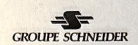

## 2.5.3.5 Marquage de la plaque signalétique

STAGE

Conformément à ces spécifications seront élaborés des TC dont les plaques signalétiques devront comportées les informations suivantes:

| signaletiques devront co |     | TPS | TPX | TPY | TPZ |
|--------------------------|-----|-----|-----|-----|-----|
| Ipn (A)                  | 1   | Х   | х   | X   | X   |
| Isn (A)                  | 1   | Х   | х   | X   | X   |
| Ith(A)                   | 3   | Х   | х   | X   | X   |
| ldyn (A)                 | 3   | Х   | х   | X   | X   |
| Kssc                     |     | Х   | х   | X   | - X |
| Rb (Ω)                   |     | х   | X   | X   | X   |
| Rct (à°C) (Ω)            |     | Х   | X   | X   | X   |
| Ktd                      |     | 0   | х   | X   | X   |
| K                        |     | Х   | 0   | 0   | 0   |
| Ual (V)                  |     | Х   | 0   | 0   | 0 0 |
| Ial (mA)                 |     | х   | 0   | 0   | 0   |
| Fc                       | 2   | 0   | x   | X   | X   |
| Tp (ms)                  | 4   | 0   | х   | х   | X   |
| Ts (ms)                  | 4,5 | 0   | 0   | Х   | 0   |
| F-O: t',t'al (ms)        | 5   | 0   | X   | X   | 0   |
| FO-FO:t",,tfr,t"al (ms)  | 5   |     |     |     |     |

#### x applicable / o non applicable

#### Notes

- 1 Pour les transformateiurs de courant pour protection à plusieurs rapports, Ipn et kn seront habituellement les valeurs les plus élevées relatives à la gamme de rapports.
- 2 Indication à fournir si Fc>1,1.
- 3 Les valeurs de Idyn peuvent dépasser 2.5 Ith en fonction des valeurs de Tp et de Ipsc.
- 4 Lorsque Ts est supérieur à 10s, il sera suffisant d emarquer Ts>10s.
- 5 Compte tenu de la corrélation existant entre Tp, Ts et les cycles de fonctionnement, leur indication sur la plaque signalétique peut être ommise dans le cas de TC à faible flux de fuites.

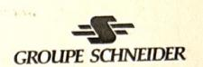

# 3. AUTRES CAPTEURS DE COURANT

Il existe d'autres types de capteurs, qui jouent le même rôle que les transformateurs de courant. Ils peuvent être classés en deux grandes familles:

#### oteurs hybrides 3.1

Ils se caractérisent par une chaîne de transformations de l'information qui peut comporter jusqu'à six éléments, entre le signal primaire à mesurer et son image de has niveau.

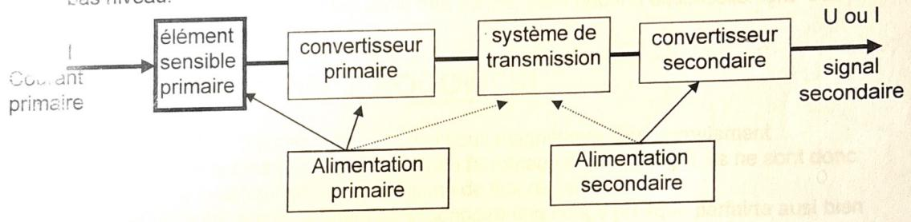

Dont les plus importants sont:

- l'élément sensible primaire, qui utilise un effet physique induit par le champ magnétique créé par I,
- le convertisseur primaire, qui convertit cette effet en un signal adapté au mode de transmission,
- le convertisseur secondaire qui retransforme se signal représentatif du courant primaire, en une grandeur électrique utilisable par les relais.

On différencie trois grands types de capteurs hybrides (CH), en fonction de l'effet physique qu'ils utilisent:

# 3.1.1 Capteurs optiques à effet FARADAY

Ils utilisent l'effet FARADAY, qui engendre la rotation du plan de polarisation d'une onde lumineuse, quand elle traverse un milieu optique baigné par un champ magnétique induit par le courant primaire.

L'information découle de la comparaison entre le signal émis par une diode, et celui reçu par un capteur, aprés que le faisceau lumineux ait traversé ce milieu. Elle est ensuite traitée et amplifiée pour être utilisable par les relais.

Le comportement et la précision de ce type de capteur est sensible essentiellement :

- à la température qui modifie les différentes caractéristiques optiques,
- et à l'influence de l'électronique de conversion.

# 3.1.2 Capteurs à effet Hall

Ils utilisent l'effet Hall qui engendre une différence de potentiel aux bornes d'une plaquette semi-conductrice, traversée par un courant d'excitation i et plongée dans un champ d'induction magnétique B, induit par le courant primaire I.

Pour améliorer la sensibilité du capteur, on augmente B en placant la plaquette dans l'entrefer, d'un circuit magnétique. Mais il est alors soumis aux mêmes phénomènes de saturation qu'un TC CLASSIQUE.

# TRANSFORMATEURS DE COURANT STAGE

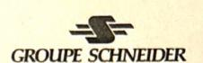

# 3.1.3 Capteurs de courant à flux nul

Ils utilisent l'annulation du flux crée dans un circuit magnétique par le courant primaire, grâce au courant secondaire qui est ajuster électroniquement par un amplificateur piloté par un enroulement de detection (SD) de flux.

Ainsi, le flux étant nul, le courant magnétisant est nul et on a la relation suivante pour les courants:

$$I1 = \frac{N1}{N2}I2$$

La précision d'un tel capteur est donc très bonne, mais dépend essentiellement des performances de l'amplificateurs.

# 3.2 Cap ar de courant à bobine ROGOWSKI

Les capteurs CS ne contiennent pas de circuit magnétique, leur enroulement secondaire est bobiné autour d'un tore non ferromagnétique (cf. fig4), ils ne sont donc pas soumis à la saturation, ni au problème de flux rémanent.

Ils sont donc linéaire et donnent au secondaire une image presque parfairte ausi bien des régimes stationnaires que transitoires.

Comme tous les capteurs le signal secondaire est entachée d'une erreur équivalente à des TC de classe 0.5 pour la mesure et P pour la protection.

Mais le grand avantage des capteurs CS est leur linéarité, qui leur permet une grande plage d'utilisation et donc de réduire et de standardiser la variété des rapports de transformation.

# 3.3 Comparatif des capteurs

|                                                                         | ● mauvais ●● moyen ●●● bon ●●●● très bon |              |                                                                                                                                                                                                                                                                                                                                                                                                                                                                                                                                                                                                                                                                                                                                                                                                                                                                                                                                                                                                                                                                                                                                                                                                                                                                                                                                                                                                                                                                                                                                                                                                                                                                                                                                                                                                                                                                                                                                                                                                                                                                                                                                |  |
|-------------------------------------------------------------------------|------------------------------------------|--------------|--------------------------------------------------------------------------------------------------------------------------------------------------------------------------------------------------------------------------------------------------------------------------------------------------------------------------------------------------------------------------------------------------------------------------------------------------------------------------------------------------------------------------------------------------------------------------------------------------------------------------------------------------------------------------------------------------------------------------------------------------------------------------------------------------------------------------------------------------------------------------------------------------------------------------------------------------------------------------------------------------------------------------------------------------------------------------------------------------------------------------------------------------------------------------------------------------------------------------------------------------------------------------------------------------------------------------------------------------------------------------------------------------------------------------------------------------------------------------------------------------------------------------------------------------------------------------------------------------------------------------------------------------------------------------------------------------------------------------------------------------------------------------------------------------------------------------------------------------------------------------------------------------------------------------------------------------------------------------------------------------------------------------------------------------------------------------------------------------------------------------------|--|
|                                                                         | TC                                       | CS ROGOWSKI  | Capteur Optique FARADAY                                                                                                                                                                                                                                                                                                                                                                                                                                                                                                                                                                                                                                                                                                                                                                                                                                                                                                                                                                                                                                                                                                                                                                                                                                                                                                                                                                                                                                                                                                                                                                                                                                                                                                                                                                                                                                                                                                                                                                                                                                                                                                     |  |
| Performances linéarité fidélité dynamique                               | SD -                                     |              | ••••                                                                                                                                                                                                                                                                                                                                                                                                                                                                                                                                                                                                                                                                                                                                                                                                                                                                                                                                                                                                                                                                                                                                                                                                                                                                                                                                                                                                                                                                                                                                                                                                                                                                                                                                                                                                                                                                                                                                                                                                                                                                                                                           |  |
| précision Aptitudes à fournir le signal                                 |                                          | ••• (a)      |                                                                                                                                                                                                                                                                                                                                                                                                                                                                                                                                                                                                                                                                                                                                                                                                                                                                                                                                                                                                                                                                                                                                                                                                                                                                                                                                                                                                                                                                                                                                                                                                                                                                                                                                                                                                                                                                                                                                                                                                                                                                                                                                |  |
| à: des compteurs d'énergie analogique des compteurs d'énergie numérique | pobline ROGOV                            | SKI - Tore T | on the same of the same of the same of the same of the same of the same of the same of the same of the same of the same of the same of the same of the same of the same of the same of the same of the same of the same of the same of the same of the same of the same of the same of the same of the same of the same of the same of the same of the same of the same of the same of the same of the same of the same of the same of the same of the same of the same of the same of the same of the same of the same of the same of the same of the same of the same of the same of the same of the same of the same of the same of the same of the same of the same of the same of the same of the same of the same of the same of the same of the same of the same of the same of the same of the same of the same of the same of the same of the same of the same of the same of the same of the same of the same of the same of the same of the same of the same of the same of the same of the same of the same of the same of the same of the same of the same of the same of the same of the same of the same of the same of the same of the same of the same of the same of the same of the same of the same of the same of the same of the same of the same of the same of the same of the same of the same of the same of the same of the same of the same of the same of the same of the same of the same of the same of the same of the same of the same of the same of the same of the same of the same of the same of the same of the same of the same of the same of the same of the same of the same of the same of the same of the same of the same of the same of the same of the same of the same of the same of the same of the same of the same of the same of the same of the same of the same of the same of the same of the same of the same of the same of the same of the same of the same of the same of the same of the same of the same of the same of the same of the same of the same of the same of the same of the same of the same of the same of the same of the same of the same of the |  |
| des equipements numériques de protection et Cont Comd                   | ••••                                     | ••••         | ••                                                                                                                                                                                                                                                                                                                                                                                                                                                                                                                                                                                                                                                                                                                                                                                                                                                                                                                                                                                                                                                                                                                                                                                                                                                                                                                                                                                                                                                                                                                                                                                                                                                                                                                                                                                                                                                                                                                                                                                                                                                                                                                             |  |
| Côut relatif / appareillage en HTA en HTB                         | 4000                                     | ••••         | ••                                                                                                                                                                                                                                                                                                                                                                                                                                                                                                                                                                                                                                                                                                                                                                                                                                                                                                                                                                                                                                                                                                                                                                                                                                                                                                                                                                                                                                                                                                                                                                                                                                                                                                                                                                                                                                                                                                                                                                                                                                                                                                                             |  |
| Annuellement installés situation actuelle évolution prévisible          |                                          | •••          | •                                                                                                                                                                                                                                                                                                                                                                                                                                                                                                                                                                                                                                                                                                                                                                                                                                                                                                                                                                                                                                                                                                                                                                                                                                                                                                                                                                                                                                                                                                                                                                                                                                                                                                                                                                                                                                                                                                                                                                                                                                                                                                                              |  |

# TRANSFORMATEURS DE COURANT

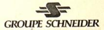

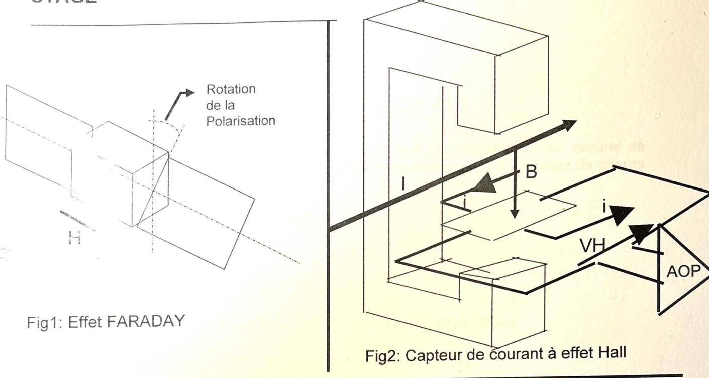

Fig3: Capteur de courant à flux nul

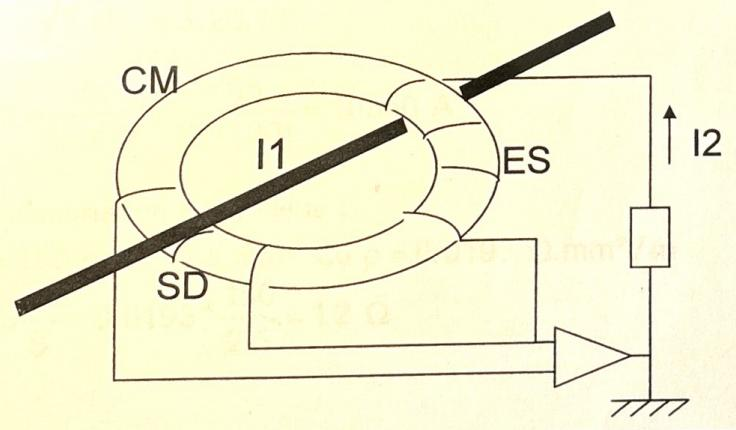

Fig4:Capteur de courant à bobine ROGOWSKI

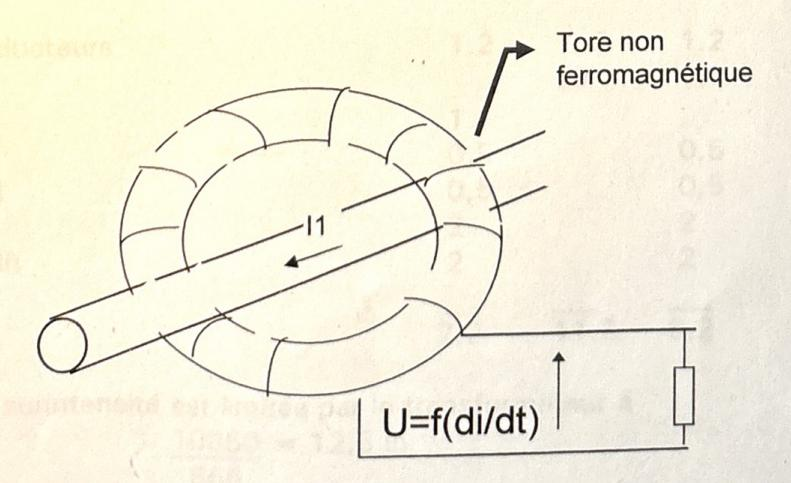

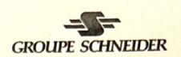

### **ANNEXE I**

# TO POUR LA MESURE suivant la norme CEI 44-1

Pour alimenter les appareils de mesure et de comptage il est naturel de choisir un courant primaire nominal normalisé proche du courant de charge maximal du départ.

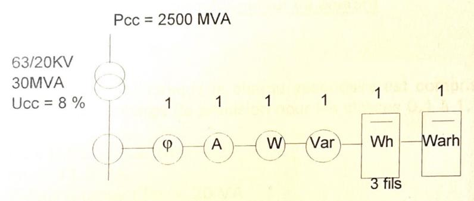

$$\ln = \frac{\text{Pec N}}{\sqrt{3}.\text{U}} = \frac{30.10^6}{\sqrt{3}.20.10^3} = 865 \text{ A}$$

$$Icc = \frac{In}{Ucc\%} = \frac{865}{(8/100)} = 10850 \text{ A}$$

Consommation de la filerie :

L=150 m S=2.5 mm2 Cu ρ=0.0193 Ω.mm2/m 
$$\frac{\rho L}{S}$$
 = 0.0193 \*  $\frac{150}{2.5}$  = 1.2 Ω

#### Consommation (VA)

| Il faul ventior que les appareils o | Ph1      | Ph2       | Ph3 |
|-------------------------------------|----------|-----------|-----|
| Conducteurs φ                       | 1.2      | 1.2 10 | 1.2 |
| AUSEC = 12 in valeur rotanu         | 9 481 ZC |           |     |
| W                                   | 0,5      |           | 0,5 |
| VAR                                 | 0,5      |           | 0,5 |
| Wh                                  | 2        |           | 2   |
| VARh                                | 2        |           | 2   |
| 96)                                 | 7.2      | 11.2      | 6.2 |

- La surintensité est limitée par le transformateur à  $\frac{10850}{865} = 12,5 \text{ In}$ 

# TRANSFORMATEURS DE COURANT STAGE

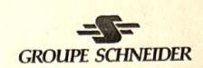

- Pour alimenter des appareils de mesure ou de comptage le réducteur devra se saturer pour des intensités de l'ordre de 5 à 10 In afin d'éviter des surintensités violentes sur les instruments (court-circuit).

On choisira une des classes "Mesures" 0,2 - 0,5 - 1 - 3 en utilisant obligatoirement une des 3 premières classes qui limite les erreurs à la fois sur le rapport et le déphasage, aux mesures faisant intervenir à la fois le courant et la tension (Phasemètre, Wattmètre, compteurs, etc.).

## Caractéristiques du transformateur de courant

### Classe de précision:

Elle est garantie lorsque la charge secondaire est comprise entre 25 % et 100 % de la charge de précision pour les classes 0,1 à 1.

Pn x 0.25 < 6.2 VA

Pn > 11.2 VA

Valeur retenue : Pn = 20 VA

Un TC de Pn = 30 VA ne conviendrait pas car

30 x 0,25 > 6.2 VA 7,5 7 6,2 VA

Facteur de sécurité réelle

$$F'S = FS * \frac{Pn + Pi}{Pr + Pi}$$
 Avec  $FS = 5$  et  $Pi = 5$  équivalent à  $Rct = Pi/Isn^2$ 

|                       | Ph1  | Ph2  | Ph3   |
|-----------------------|------|------|-------|
| Pn (VA)               | 20   | 20   | 20    |
| Pr (VA)               | 7.2  | 11.2 | 6.2   |
| Pi (VA)               | 5    | 5    | 5     |
| F'S 11 1'sn - 0,1 x 1 | 10.2 | 7.7  | 11.16 |

Il faut vérifier que les appareils connectés supportent cette surintensité.

#### Tenue thermique

$$\frac{10850}{900\%} = 12 \text{ In}$$
 valeur retenue 40 20

#### Tenue au court-circuit

$$900 \times 12 \times 2,5 = 27KA \text{ crête}$$

Spécification des transformateurs de courant

## **ANNEXE II**

## PRO CTION AMPEREMETRIQUE

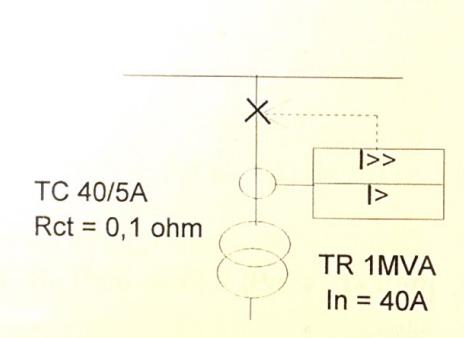

15 KV
Pcc 500MVA
Icc = 20KA
Relais: seuil haut 40 TN
seuil bas 2 TN

Résistance du relais :  $R_R = 30 \text{ m}\Omega$ Résistance de la filerie :  $R_F = 70 \text{m}\Omega$ 

# Calcul selon CEI 44-1

## Charge de précision Pn

Rt = 
$$R_R + R_F = 0.03 + 0.07 = 0.1$$
 ohm  
Pn = Rt  $I^2$ sn = 0.1 x  $5^2 = 2.5$ VA

# Facteur limite de précision

Le TC ne doit pas saturer au seuil maxi d'intensité de réglage du relais.

Comme souvent au moment du calcul des caractéristiques du TC, le seuil de réglage n'est pas connu pour permettre une modification ultérieure utiliser le réglage maximum du seuil haut du relais.

$$FLP = \frac{Ir max}{Ipn} = \frac{1600}{40} = 40$$

# Tenue thermique

Ith = Icc pendant 1S

Tenue mécanique au court circuit

Idyn = 20 000 x 2,5 = 50KA crête

#### Spécification du TC

40/5A 2.5VA 10P40 ; Ith1s 20000 A (Idyn = 50KA crête)

### Décalibrage : solution 1

Utilisation de FLP = 20 au lieu de 40

FLP 
$$(Pn + Pi) = FLP' (Pr + Pi)$$
  
FLP'  $(Pr + R_2 I^2 sn) = FLP (Pn + R_2 I^2 sn)$ 

$$R_2 I^2 sn = 0.1 \times 5^2 = 2.5 VA$$

$$Pn = \frac{200 - 50}{20} = 7,5VA$$

#### Tenue thermique

Utilisation d'un temps d'élimination du défaut de 0.5s (\*) au lieu de 1s pour la tenue thermique.

$$20\ 000^2\ x\ 0.5 = I'th^2\ x\ 1$$

I'th = 
$$\sqrt{20000^2 \times 0.5}$$

$$I'th = 20\ 000\ x\ 0.7 = 14142\ A$$

(\*) la CEI n'admet pas t < 0.5s

# Tenue mécanique au court circuit

$$Idyn = 14 142 \times 2,5 = 35KA crête$$

# Nouvelle spécification du TC

40/5A 10VA 10P20; Ith 0,5s 14142 A (Idyn = 35KA crête)

# **STAGE**

## Décalibrage : solution 2

Utilisation d'un TC 160/5A au lieu de 40/5A

$$FLP = \frac{\text{Im}\,ax}{Ipn} = \frac{1600}{160} = 10$$

### iouvelle spécification du TC

#### 160/5A 2.5VA 10P10 : Ith 20000A/1S

Remarques:

- Réglage du seuil bas du relais : 0.5 au lieu de 2
- Cette solution peut poser un problème de précision si le même ratio est utilisé pour la mesure.

# Transformateur de courant défini suivant la norme BS 3938 classe X

Vk mini > 
$$\frac{\text{Icc.Isn}}{\text{Ipn}}(\text{Rct} + 2\text{Rw} + \text{Rr} + \text{Rx})$$

avec:

 Courant de défaut primaire en A (seuil max) lcc

Isn = Courant nominal du secondaire en A = Courant nominal du primaire en A Ipn

= Résistance interne secondaire du TC en ohm Rct

Rw = Résistance de la filerie en ohm Rr = Résistance du relais en ohm

Résistance d'autres équipements en série avec Rx

le relais

La puissance de précision peut être calculée par une formule de passage entre BS et CEI:

$$S_{(VA)} = \frac{\alpha.Vk.Isn}{FLP} - Rct.Isn^2$$

 $\alpha = 1.143$  pour un TC classe 5P  $\alpha = 1.357$  pour un TC classe 10P

Application numérique

Application numérique  
Vk > 
$$1600.\frac{5}{40}(0.1+0.07+0.03) = 40 \text{ V } \text{Rct} = 0.1\Omega \text{ FLP} = 10 \text{ Isn} = 5\text{A}$$
  
Sva =  $\frac{1.357*40*5}{10} - 0.1*5^2 = 24.6 \text{ VA}$ 

Spécifications du TC

### ANNEXE III

# PROTECTION DE DISTANCE

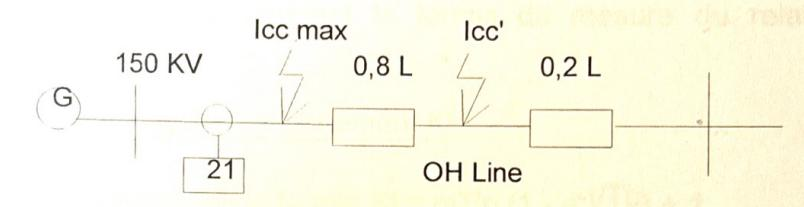

### Caractéristiques de la ligne

$$ZI = (RI + iXI)$$

$$ZI = (0.06 + j0.4) \text{ ohm/km}$$

. Longueur de la ligne = 2.7 Km

. Impédance de la ligne en limite de Zone 1 = 0,8L

$$RI1 = 0.8 \times 0.06 \times 2.7 = 0.13 \text{ ohm}$$

$$XI1 = 0.8 \times 0.4 \times 2.7 = 0.86$$
 ohm

$$ZI1 = 0,13 + j0,86$$
 ohm

### Caractéristiques de la source G

. Puissance du court-circuit : Ss = 9900MVA

. Constante de temps primaire : Tp = 40ms  $\theta$  = 85°

. Impédance Zs = 
$$Un^2/Ss = \frac{(150.10^3)^2}{9900.10^6} = 2.27 \Omega$$

$$Zs = 2.27 85^{\circ} = 0.19 + j 2.26 \text{ ohms}$$

# Courant de court-circuit maximum

$$Icc_{max} = \frac{S_s}{\sqrt{3}.Un} = \frac{9900}{\sqrt{3}.150} = 38.1 \text{ kA}$$

# Courant de court-circuit maximum pour un défaut en limite de zone 1 lcc' (80 % de la longueur de la ligne)

Rt = RI1 + Rs = 0.13 + 0.19 = 0.32  
Xt = XI1 + Xs = 0.86 + 2.26 = 3.12  
Zt = 0.32 + j 3.12 
$$\Omega$$
 Zt =  $\sqrt{0.32^2 + 3.12^2}$  = 3.13  $\Omega$   
Icc'=  $\frac{Un}{\sqrt{3.2t}} = \frac{150}{\sqrt{3*3.13}} = 27.6 \text{ kA}$ 

Constante de temps T'p en limite de zone 1
$$T'p = \frac{L}{R} = \frac{X}{\omega R} = \frac{3.12}{2\pi.50*0.32} = 31 \text{ ms}$$

# TRANSFORMATEURS DE COURANT STAGE

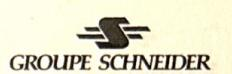

#### Suivant la norme BS3938 classe X

On avait l'habitude de dimensionner le TC associé à une protection de distance conformément à la BS classe X.

Pour un défaut en limite de zone 1 le transformateur de courant ne doit pas saturer pendant le temps de mesure du relais de protection.

#### Calcul du coefficient de surdimensionnement Kt

La formule générale est de la forme:  $Kt = \omega T'p (1 - e^{-t/Tp}) + 1$ 

pour t = 20ms (temps d'acquisition du relais)

Kt= ωT'p (1 - 
$$e^{-t/Tp}$$
) + 1  
= 314 x 31 10-3 (1 -  $e^{-20/31}$ ) +1  
Kt=9.73 (1 - 0,5245) + 1 = 5.65

Mais les constructeurs, comme GEC pour la Micromho, prescrivait la formule pour  $t \to \infty$ 

$$Kt = 1 + \frac{X}{R} = 1 + \frac{3.12}{0.32} = 11$$

#### Calcul de la tension de coude

$$Vk > Kt. \frac{Icc}{n}.10^3 (Rct + R_W + R_B)$$

- Résistance des conducteurs :  $R_W = \rho \cdot \frac{L}{S}$ 

(Aller et retour pour les défauts terre (2Rw) aller seulement pour les défauts phase Rw)

L = 148 m

 $S = 4 \text{ mm}^2 \text{ Cu}$ 

 $p = 0.0193 \text{ ohm } mm^2/m$ 

$$R_W = 0.0193. \frac{148}{4} = 0.714 \Omega$$

- Résistance du relais : RB = 0.34 ohm

- Rapport du TC : 
$$n = \frac{1800}{1} = 1800 \text{ A}$$

- Icc' = 27.6KA

# TRANSFORMATEURS DE COURANT STAGE

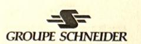

Calcul de Vk pour t = 20ms Kt = 5,65  

$$Vk = 5.65. \frac{27.6}{1800}.10^{3} (Rct + 0.714 + 0.34)$$

Analogie CEI avec Rct = 
$$5\Omega$$
 et FLP = 20  
Vk = 86,6 x 6 =  $524V$ 

$$S_{VA} = \frac{\alpha.V \text{k.lsn}}{\text{FLP}} - \text{Rct.lsn}^2 = \frac{1.143 * 524 * 1}{20} - 5 * 1^2 = 25 \text{ VA}$$

Spécification du TC

1800/1 A, Vk> 86.6 (Rct + 1.05)

Calcul de Vk pour 
$$t \to \infty$$
 Kt = 11

$$Vk = 11.\frac{27.6}{1800}.10^{3}(Rct + 0.716 + 0.34)$$

Analogie CEI avec Rct = 
$$5\Omega$$
 et FLP = 20  
Vk =  $168 \times 6.06 = 1018V$ 

$$S_{VA} = \frac{\alpha.Vk.Isn}{FLP} - Rct.Isn^2 = \frac{1.143*1018*1}{20} - 5*1^2 = 54 \text{ VA}$$

Spécification du TC

1800/1 A, Vk> 168 (Rct + 1.06)

# Suivant la norme CEI 44-6

Pour un cycle de fonctionnement F-O, avec un TC de classe TPX, le facteur de dimensionnement pour le régime transitoire est de la forme:

$$Ktd_1 = 1 + \left[\frac{\omega TpTs\cos\theta}{Tp - Ts}\right] * (e^{-t'al/Tp} - e^{-t'al/Ts})$$

avec :t'al= 20ms, Tp=T'p= 32ms, cosθ=1, t'=60ms durée du passage du courant de défaut et typiquement pour un TPX Ts=10 s.

Remarque: On trouve une valeur très proche de celle calculée par la formule complète de la norme BS. En effet pour Ts >>Tp et t'al, on peut simplifier de Ktd qui devient alors :

Ktd1= 
$$1-\omega Tp (e^{-t'al/Tp_{-1}})$$

# TRANSFORMATEURS DE COURANT STAGE

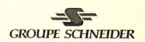

On a alors une tension limite d'excitation secondaire égale à:

Ual = Ktd1\*Kssc\*(Rct+RW+RB)\*Isn  
= Ktd1\*
$$\frac{\text{lcc}'}{n}$$
\*(Rct+RW+RB)  
= 5.67\* $\frac{27.6 \cdot 10^3}{1800}$ \*(5+0.716+0.34)  
Ual = 521 V

#### Spécification du TC

1800/1A, Kssc=15, Tp=32ms, F-O t'=60ms t'al=20ms, Rb=1  $\Omega$ 

Pour un cycle de fonctionnement FO-FO, un TC de classe TPY, le facteur de dimensionnement pour le régime transitoire est de la forme:

$$Ktd_{2} = \left\{ \left[ \frac{\omega T p T s \cos \theta}{T p - T s} \right] \left( e^{-t'/T p} - e^{-t'/T s} \right) - \sin \omega t' \right\} * e^{-(t f r + t'' a l)/T s}$$

$$+ \left[ \frac{\omega T p T s \cos \theta'}{T p - T s} \right] \left( e^{-t'' a l/T p} - e^{-t'' a l/T s} \right) + 1$$

avec t'=60ms, t'al=t''al=20ms, tfr=500ms temps de repos entre deux passage du courant de défaut, Tp=32ms, et typiquement Ts= 0.5s pour un TPY. On considère le cas le plus défavorable ou  $\cos\theta = \cos\theta' = 1$  et  $\sin\omega$  t'=-1.

# Spécification du TC

1800/1A, Kssc=15, Tp=32ms, FO-FO t'=t''=60ms t'al=t''al=20ms, Rb=1 Ω

Remarque: On voit qu'en fonction de la formule que l'on choisit, ou que le cahier des charges impose, on peut trouver des dimensionnement différents. Cela est encore plus vrai si on dimensionne les TC pour un défaut au jeu de barre ce qui est nécessaire en cas d'utilisation d'un localisateur de défaut. Dans ce cas on prendra pour les calculs Iccmax au lieu de Icc' et Tp à la place de T'p. ABB propose alors des coefficients de dimensionnement expérimentaux qui sont moins pénalisant que ceux calculés par la norme.

### **ANNEXE IV**

# Pre action différentielle à haute impédance

(Type MCAG Gec Alsthom)

Ce type de protection est généralement associé à un TC de classe TPS, mais les constructeurs dans leur documentation descriptive se réfèrent encore à la BS classe X. Ces deux standards étant quasiment équivalent, on peut facilement transposer les formules.

Le schéma de principe consiste en un relais connecté à tous les transformateurs de courant en parallèle. Supposons le cas simple d'un jeu de barres à un seul départ et une seule arrivée et représenté par le schéma équivalent ci-dessous.

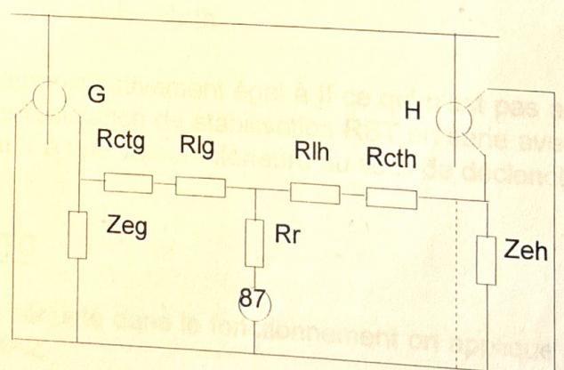

Rr=Résistance du relais de mesure
Rctg=Résistance secondaire du TC G
Rcth=Résistance secondaire du TC H
Rlg=Résistance de la boucle de filerie
reliant le TC G au relais.
Rlh=Résistance de la boucle de filerie
reliant le TC H au relais.
Zeg/Zeh=Transformateur de courant idéal
représenté par ses pertes magnétiques.
Vs=Seuil minimum calculé

If=Courant de court-circuit maximum
sur défaut externe ramené au secondaire.
Vk=Tension de coude sur TC
ie=Courant magnétisant
n=Nombre de capteurs connectés en parallèle
formant la zone à protéger.
Ils doivent avoir des caractéristiques identiques
(Vk, Rct, ie, N, Ipn, Isn).
N=Rapport de transformation du TC = Ipn / Isn
Ipn=Courant nominal primaire du TC
Isn=Courant nominal secondaire du TC

# TRANSFORMATEURS DE COURANT STAGE

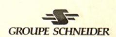

### Stabilité sur défaut externe

Lors d'un défaut extérieur, le courant qui traverse les deux capteurs est identique.

Afin de garantir un maximum de sécurité contre le fonctionnement intempestif de la protection, nous allons nous placer dans le cas le plus défavorable, c'est à dire un des deux capteurs complètement saturé par la composante continue transitoire et l'autre débitant le courant de court-circuit. Le TC saturé est réduit à sa résistance RCT et ne produit aucun courant secondaire Zeh # 0.

La tension développée aux bornes du relais est donnée par :

$$Vs = If(RIh + Rcth)$$

Le courant dans le relais est donné par :

$$Ir = \frac{If(RIh + Rcth)}{Rr + RIh + Rcth}$$

si Rr est petit, Ir sera approximativement égal à If ce qui n'est pas acceptable, il faut donc ajouter une résistance de stabilisation RST en série avec le relais. Ceci limitera le courant Ir à une valeur inférieure au seuil de déclenchement.

# Tension limite d'excitation des TC

Pour garder une sécurité dans le fonctionnement on applique un facteur de dimensionnement K=2.

# Sensibilité sur défaut interne

Nous nous placerons encore dans le cas le plus défavorable, un seul des capteurs est parcouru, au primaire, par le courant de défaut, les autres capteurs ne sont parcourus par aucun courant.

Dans cette hypothèse, le capteur parcouru par le courant de défaut doit pouvoir débiter, au secondaire, le courant de seuil de la protection et les courants magnétisants de tous les capteurs placés en parallèle.

# TRANSFORMATEURS DE COURANT STAGE

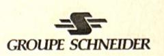

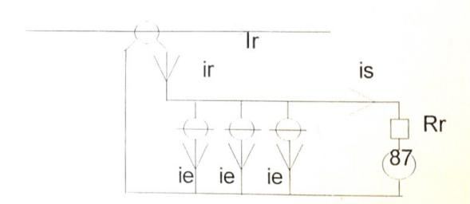

ir = Courant de défaut provoquant le déclenchement is = Courant de seuil affiché sur le relais de protection ie = Courant magnétisant de chaque capteur à Vs n = Nombre de capteurs connectés en parallèle ir = n ie + is

Il est difficile de connaître les composantes des courants magnétisants, donc leur déphasage par rapport à ix.

Aussi pour se placer dans le cas le plus défavorable nous prenons la somme arithmétique des différentes grandeurs.

$$ir = n.ie + is$$

# Tenue aux surintensités et aux surtensions sur défaut interne

En cas de défaut interne, les TC imposent le passage du courant de défaut à travers la branche de mesure (via Rst d'où surtensions).

Surintensité et surtension doivent pouvoir être supportées pendant le temps d'élimination du défaut et ne pas provoquer de claquages.

# Résistance de stabilisation

$$Rst = \frac{Ual - \frac{VA}{ls}}{ls}$$
 avec VA = consommation du relais en VA

# Surtension sur défaut interne

$$Vp = 2 \sqrt{2Ual(VF - Ual)}$$
 (formule approchée)  
 $Vp = Surtension sur défaut interne$ 

Avec: 
$$V_F = \frac{If}{n}(Rct + 2RI + Rst + Rr)$$
;

VF = Tension développée s'il n'y avait pas de saturation

Si Vp>3000 V, il faut une résistance en // avec le relais pour limiter la

# TRANSFORMATEURS DE COURANT STAGE

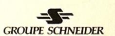

### 1er Exemple : Différentielle de barres

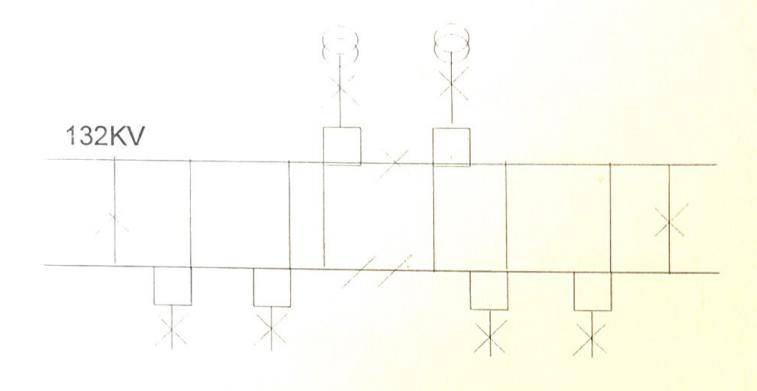

Pcc = 3500 MVA

- Rapport des TC 500/1A

- Résistance de la boucle de filerie : 2RL = 2 ohms

- Résistance secondaire du TC : RCT = 0,7 ohm

Courant de défaut : Icc =  $\frac{3500.10^6}{\sqrt{3.132.10^3}}$  = 15300 A

ramené au secondaire : If =  $\frac{15300}{500}$  = 30.6 A

Condition de stabilité :

Vs > If (RCT +2RL) Vs > 30.6 (0.7 + 2)Vs > 82.6 volts

Tension de limite d'excitation des TC :Ual > 2Vs

Ual > 164.2 volts

Ual retenu: 200 volts

# Spécification du TC

500/1 A, (Rct=0.7 $\Omega$ ), Kscc= 30, K=2, Rb=2 $\Omega$ : Ual > K.Kscc.(Rct+Rb).Isn Ual > 61,2 (2+Rct), le Rct est choisi par le fabriquant du TC.

Sensibilité du relais

ir = n ie + isavec

n = 4 (nombre minimum de TC en parallèle)

ie = 28 mA à Vs = 82.6 volts

is = 80 % x 1A (plage de réglage du relais 20 - 80%) = 0.8A

 $ir = nie + ir = (4 \times 0.028) + 0.8 = 0.912A$ 

ramené au primaire irp = 500/1 x 0,912 = 456A

Ce seuil est convenable, rapporté au courant de court-circuit max de 15300A.

# TRANSFORMATEURS DE COURANT STAGE

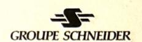

#### Résistance de stabilisation

Rst = 
$$\frac{V_S - \frac{VA}{is}}{is}$$
 avec VA = 1 Rr =  $1\Omega$   
=  $\frac{82.6 - \frac{1}{0.8}}{0.8} \approx 101\Omega$ 

Rst retenue : 220  $\Omega$  (valeur supérieure la plus proche)

#### Surtension sur défaut interne

$$\begin{split} \text{Vp} &= 2\sqrt{2\text{Ual}(\text{VF}-\text{Ual})} \\ \text{V}_{\text{F}} &= \frac{\text{If}}{n}(\text{Rct}+2\text{RI}+\text{Rst}+\text{Rr}) \\ &= \frac{15300}{500}(0.7+2+220+1) = 6845 \text{ V} \\ \text{Vp} &= 2\sqrt{2x200(6845-200)} = 3260 \text{ volts} \\ \text{Vp} &> 3000 \text{ volts} \\ &= \text{>il est nécessaire d'ajouter une résistance non linéaire pour limiter la surtension.} \end{split}$$

#### 2ème Exemple: Protection de terre restreinte

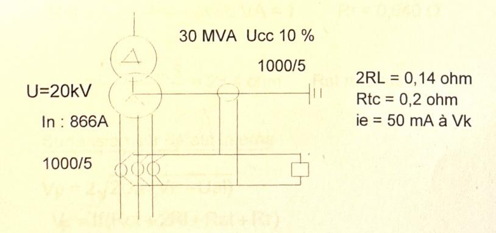

Défaut extérieur max ramené au secondaire

If = Icc. 
$$\frac{Isn}{Ipn}$$
 = Kssc.Isn  
= (In / Ucc%).  $\frac{Isn}{Ipn}$  =  $\frac{MVA}{\sqrt{3}.U}$  / Ucc%.  $\frac{Isn}{Ipn}$   
=  $(\frac{30.10^6}{\sqrt{3}.20.10^3})$  /  $0.1*\frac{5}{1000}$  = 43.3A

# TRANSFORMATEURS DE COURANT STAGE

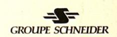

Condition de stabilité :

Vs > If (RCT + 2RL) Vs > 43.3 (0.2 + 0.14)

Vs > 14.7 volts

Tension limite d'excitation des TC

Ual > 2Vs

 $Ual > 2 \times 14.7 = 29 \text{ volts}$ 

Ual retenue: 50 volts

Spécification du TC

1000/5 A, Rct=0.2 $\Omega$ , Kscc= 10, K=2, Rb=0.14 $\Omega$ : Ual > K.Kscc.(Rct+Rb).Isn Ual > 86,6 (0,14+Rct), le Rct est choisi par le fabriquant du TC.

#### Sensibilité du relais

ir = n ie + is

avec n = 4, ie = 50 mA

is = 10 % x 5A (plage réglage du relais 10 % à 40 %)

ir = 
$$\frac{1000}{5}$$
[(4 \* 0.05) + 0.5] = 100A

Ce seuil est convenable rapporté au courant de terre max, pratiquement égal au courant de court-circuit 8660A.

#### Résistance de stabilisation

Rst = 
$$\frac{V_s - \frac{VA}{is}}{is}$$
 avec VA = 1 Rr = 0,040  $\Omega$   
=  $\frac{14,7 - \frac{1}{0,5}}{0,5}$  = 25.4 ohm Rst retenue : 47  $\Omega$ 

#### Surtension sur défaut interne

$$V_p = 2\sqrt{2Ual(VF - Ual)}$$

$$V_F = If(Rct + 2RI + Rst + Rr)$$

$$= 43.3*(0.2 + 0.14 + 47 + 0.04) = 2051 \text{ V}$$

$$V_p = 2\sqrt{2x50(2051 - 50)} = 895 \text{ volts}$$

Vp < 3000 volts => Il n'est pas nécessaire d'ajouter une résistance non linéaire pour limiter la surtension.

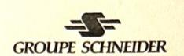

### ANNEXE V

# PROTECTION DIFFERENTIELLE A POURCENTAGE POUR LES JEUX DE BARRES

### Pri pe de fonctionnement de la protection

Une protection différentielle à pourcentage pour les jeux de barres est basée sur la comparaison instantanée pour chaque phase des courants entrant et sortant du jeu de barres. Le déclenchement a lieu lorsque la différence de ces courants est supérieure à un pourcentage du courant traversant et si les éléments de contrôle l'autorisent.

Particulièrement destiné aux jeux de barres à plusieurs sections pour tous les niveaux de tension, elle effectue la commutation des courants au secondaire des transformateurs auxiliaires.

Elle se contente d'une tension de saturation faible, des transformateurs auxiliaires assurent le rattrapage éventuel des rapports des transformateurs de courant principaux qui peuvent donc être de rapports différents.

Le principe est similaire à celui de la protection de barres haute impédance (voir annexe IV)

#### Calcul des transformateurs de courant

La tension de saturation des TC principaux n'intervient pas sur la stabilité en cas de défaut externe, mais doit être suffisante pour assurer le fonctionnement de la protection sur défaut interne. Il suffit pour cela d'une valeur très faible, inférieure à la tension de saturation des TC.

# Exemple d'application

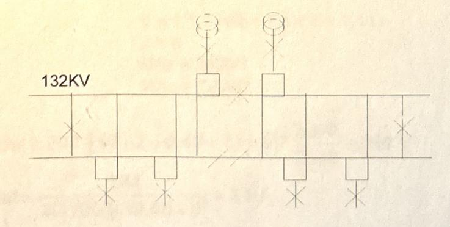

Protection: MBCZ (GEC) TC classe TPS

## TRANSFORMATEURS DE COURANT STAGE

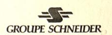

TC des départs lignes :1600/1A

Rtc = 10 ohm RL = 0,48 ohm

TC du couplage :2000/1A

Rtc = 10 ohm RL = 0.48 ohm

TC des arrivées transformateurs :300/1A

Rtc = 3 ohm $R_1 = 0.48 \text{ ohm}$ 

Ual= nsion limite d'excitation

ant nominal secondaire Isn=(

Rct=R stance interne secondaire du TC principal RL=Résistance de la filerie entre le TC principal

et le TC auxiliaire (aller).

B= Résistance interne du relais MBCZ

Z=Résistance d'autres équipements

en série avec le relais

MRr=Rapport de transformation pris comme référence (c'est à dire le plus élevé).

MRc=Rapport de transformation du TC considéré

K=Facteur de performance. Il est recommandé d'utiliser

20 pour les arrivées principales

Is=Courant secondaire du transformateur auxiliaire

MR=Ratio du transformateur auxiliaire

$$MR = \frac{ls}{lsn}$$

B=1,1 MR pour Isn=1A

=0,62 MR pour Isn=2A

=0,28 MR pour Isn=5A

$$|a| = \frac{Ual}{20[Rct + 2RI + Z]}$$

lal: courant magnétisant à Ual.

## Application numérique

TC 2000/1A Rct = 10 
$$\Omega$$
 RL = 0,48  $\Omega$ 

$$K = 20$$
  
Is = 1A

$$MR = \frac{1}{1} = 1$$

$$B = 1.1 \times MR = 1.1 \times 1 = 1.1 \Omega$$

$$Z = 0$$

MRr = 2000/1

MRc = 2000/1

Ual 
$$\ge 20 * 1[10 + 2 + 0.48 + 1.1 + 0] * \frac{2000}{2000} \ge 241 \text{ V}$$

$$Ial = \frac{241}{20[10 + 2 * 0.48 + 0]} = 1.1 \text{ A}$$

$$IaI = \frac{241}{20[10 + 2 \cdot 0.48 + 0]} = 1.1 \text{ A}$$

# TRANSFORMATEURS DE COURANT STAGE

TC 1600/1A Rct = 10 
$$\Omega$$
 RL = 0,48  $\Omega$ 

K = 20  
Is = 1 x 
$$\frac{1600}{2000}$$
 = 0,8A  
MR =  $\frac{0.8}{1}$  = 0.8  
B = 1,1 x MR = 1,1 x 0,8 = 0,88 ohm  
Z = 0  
MRr = 2000 /1  
MRc = 1600 /1

Ual 
$$\ge 20 * 1[10 + 2 + 0.48 + 0.88 + 0] * \frac{2000}{1600} \ge 296 \text{ V}$$

$$|a| = \frac{296}{20[10 + 2 \cdot 0.48 + 0]} = 1.35 \text{ A}$$

TC 300/1A Rct = 3 
$$\Omega$$
 RL = 0,48  $\Omega$ 

K = 15  
Is = 
$$1 \times 300 = 0,15A$$
  
 $2000$   
MR =  $0,15 = 0,15$   
B =  $1,1 \times MR = 1,1 \times 0,15 = 0,165$  ohm  
Z = 0  
MRr =  $2000/1$ 

Ual 
$$\geq 15*1[3+2+0.48+0.165+0]*\frac{2000}{300} \geq 412.5 \text{ V}$$

MRc = 300 / 1

$$|a| = \frac{412.5}{20[3 + 2 \cdot 0.48 + 0]} = 5.2 \text{ A}$$

# TRANSFORMATEURS DE COURANT STAGE

# Protection différentielle à pourcentage pour les transformateurs de puissance

#### Principes de fonctionnement de la protection

Différentielle transformateur

#### principe

La protection du transformateur ne peut pas être réalisée par une différentielle haute impédance compte tenu des courants d'enclenchement et de la rapidité de fonctionnement désirée.

Les particularités de la différentielle transformateur sont liées aux caractéristiques des transformateurs :

- . le rapport de transformation
- . le couplage des enroulements
- le courant d'enclenchement
- . le courant magnétisant permanent

#### rapport de transformation

Les courants primaires et secondaires sont différents en amplitude à cause du rapport de transformation et ils sont différents en phase en fonction du couplage. Il faut donc que les images de ces courants soient mises en forme pour que les signaux qui sont comparés dans la différentielle soient égaux en régime normal. Ceci est réalisé par l'utilisation de transformateurs auxiliaires d'adaptation dont le rôle est d'égaliser les amplitudes et les phases mais aussi d'éliminer ou de compenser les courants homopolaires dans le relais puisque en général les courants homopolaires ne traversent pas les transformateurs de puissance.

Si les rapports des TC correspondent au rapport de transformation du transformateur, on peut se passer du transformateur auxiliaire.

La protection doit rester stable pour tous les défauts extérieurs à la zone surveillée. Ceci est assuré si les transformateurs de courant principaux et auxiliaires ne saturent pas.

# TRANSFORMATEURS DE COURANT STAGE

# $Ual \ge K[Rct + 2RI + Rt + Rx]*Isn$

Avec

Isn = Courant nominal secondaire du TC

Rct = Résistance interne secondaire du TC

RL = Résistance de la filerie en ohm (aller)

Rx = Résistance d'autres équipements en série avec le relais.

K = Facteur de surdimensionnement pour le régime transitoire. Il peut varier en fonction de la valeur de X/R et du courant de défaut. Consulter la notice du constructeur.

Rt = Résistance du transformateur auxiliaire

$$Rt = R + 2RB + R2 * \left(\frac{n1}{n2}\right)^2$$

 $\frac{n1}{n2}$  = rapport du transformateur auxiliaire

R1 = Résistance primaire du TC auxiliaire

R2 = Résistance secondaire du TC auxiliaire

RB = Résistance de la filerie entre le transformateur

auxiliaire et le relais.

Iprim = Courant primaire du transformateur auxiliaire

Isec = Courant secondaire du transformateur

auxiliaire

#### Application numérique

# TRANSFORMATEURS DE COURANT STAGE

#### Côté 110 kV

- Rct = 2 ohms
- Calcul de RL : L = 75m ; 2.5  $mm^2$  Cu

$$RL = 2\rho \frac{L}{S} = 2*0.0193*\frac{75}{2.5} = 1.15\Omega$$

- Calcul de Rt : RB = négligeable

$$R1 = 0,763 \Omega$$

$$R2 = 0.88 \Omega$$

$$Rt = R1 + 2RB + R2 \left(\frac{n_1}{n_2}\right)^2$$

Rt = 0,763 + 
$$\left(\frac{17}{27}\right)^2 \times 0.88$$

$$Rt = 1.11\Omega$$

Calcul de Ual:

 $Ual \ge K In [RCT + 2RL + Rt + Rx]$ 

K = 24 pour X/R = 40 (relais MBCH de Gec Alsthom)

avec If < 15 In

 $Ual \ge 24 \times 1 [2 + 2 \times 1,15 + 1.11 + 0]$ 

Ual ≥ 130 volts

Analogie CEI avec RCT =  $2 \Omega$  et FLP = 20

$$S_{VA} = \frac{1.143 * 130 * 1}{20} - 2 * 1 = 5.4 \text{ VA}$$

Spécification du TC en équivalent 44.1

6VA, 5P20, RCT = 2 ohms, ...

#### Côté 20 kV

$$RcT = 10 \text{ ohm}$$

calcul de RL : 37m ; 2.5 mm2 Cu 
$$RL = 2\rho \frac{L}{S} = 2*0.0193*\frac{37}{2.5} = 0.57\Omega$$

Rx = 0.3 ohm

Rt = 0

 $Ual \ge K In [RCT + 2RL + Rt + Rx] \ge 24 x [1 + 2 x 0,57 + 0,3]$ 

Ual ≥ 60 volts

Analogie CEI avec RCT = 1 ohm et FLP = 20

$$S_{VA} = \frac{1.143*60*1}{20} - 1*1 = 2.5 \text{ VA}$$

Spécification du TC en équivalent 44.1

5VA 5P20 RCT = 1 ohm, ...

### **ANNEXE VI**

# PROTECTION DIFFERENTIELLE LONGITUDINALES DE LIGNES OU DE CABLES

Cette protection compare les courants entrant (i1) et quittant (i2) le troncon protégé.

Lors d'un défaut interne le système de protection déclenche les disjoncteurs des deux extrémités.

La différentielle de ligne à fil pilote doit aussi faire face à une difficulté propre à cette application. La ligne est souvent longue et elle constitue une impédance capacitive.

Le courant capacitif (i'0) de cette ligne est vu comme un courant de défaut. Un dispositif de compensation du courant capacitif permet de ne pas désensibiliser la protection.

#### Absence de défaut

#### Défaut extérieur

#### Défaut intérieur

$$\begin{array}{c|ccccccccccccccccccccccccccccccccccc$$

# TRANSFORMATEURS DE COURANT

STAGE

#### Critère

- Les transformateurs de courant ne doivent pas saturer pour le courant de défaut extérieur maximal.
- Les caractéristiques des transformateurs aux deux extrémités doivent rester dans les limites spécifiées par le constructeur.
- La tension de coude doit être supérieure à la valeur spécifiée par le constructeur.

# Appl. Son numérique (d'après le constructeur suivant BS 3938 équivalence CEI 44-6 classe TPS)

#### Caractéristiques du câble Zc

Zc1 = (0,028 + j 0,202) 
$$\Omega/\text{Km}$$
  
Longueur du câble : 2 Kms Rc1 = 0,056  $\Omega$ , Xc1 = 0,404  $\Omega$   
ZL1 = 0,056 + j 0,404  $\Omega$ 

#### Caractéristiques de la source G

- . Puissance: Ss = 9 900 MVA
- . Constante de temps primaire : Tp = 40 ms  $\theta$  = 85°

$$Zs = \frac{U^2}{Ss} = \frac{(150.10^3)^2}{9900.10^6} = 2.27\Omega$$

$$Zs = 2.27^{85^{\circ}} = 0.19 + j 2.26 \Omega$$

#### Courant de court-circuit maximum

Iccmax = 
$$\frac{\text{Ss}}{\sqrt{3.\text{Un}}} = \frac{9900}{\sqrt{3.150}} = 38.1 \text{ kA}$$

# Courant de court-circuit maximum extérieur à la zone pour assurer la stabilité

Rt = Rc1 + Rs = 0.056 + 0.19 = 0.246
$$\Omega$$
  
Xt = Xc1 + Xs = 0.404 + 2.26 = 2.664 $\Omega$   
Zt = 0.246 + j 2.664,

$$Icc_{emax} = \frac{Un}{\sqrt{3}.Zt} = \frac{150}{\sqrt{3}*2.67} = 32.4 \text{ kA}$$

# TRANSFORMATEURS DE COURANT STAGE

#### Exemple 1: Relais MBCI (GEC Alsthom)

Transformateur de courant : 1000/1A Rct = 3 ohms

Tension limite d'excitation:

Ual≥K.N.Kt.Isn( Rct + X.RL)

RCT = Résistance interne secondaire du TC (ohms)

RL = Résistance de la filerie (aller simple) (ohms)

X = 1 pour liaison 4 fils entre le TC et le relais

2 pour liaison 6 fils entre le TC et le relais

N=3 - utilisation normale

6 - basse sensibilité pour les défauts terre

Kt = Constante dépendante du temps d'opération du relais.

K=. 0,5 cas général U < 220 KV

. 1 pour les applications supérieures ou égales à 220 KV et X/R grand.

#### Calcul numérique

 $RCT = 3 \Omega$   $RL = 0.8 \Omega$ 

X = 1 N = 3

Kt = 40 K = 0.5

 $Ual \ge 0.5 \times 3 \times 40 \times 1 (3 + 0.8)$ 

Ual ≥ 228 volts

#### Courant magnétisant

 $im \le 0.05 lsn \ a 10/lsn \ m = 1A$ 

 $im \le 0.05 à 10 V$ 

#### Résistance de stabilisation

$$Rs = \frac{Vk}{40Isn}$$
 et  $Rs < \frac{12}{Isn^2}$ 

Cette résistance n'est pas utile pour une application avec protection monophasée ou lorsque le relais est connecté sur un transformateur de courant couplé en triangle.

#### Recommandation

Les relais des deux extrémités doivent avoir même N et Kt Il est préférable que les transformateurs de courant aient le même courant nominal secondaire.

# TRANSFORMATEURS DE COURANT STAGE

### Exemple 2: Relais SIEMENS 7SD511

Siemens préconise pour ses protections, une méthode particulière de vérification du dimensionnement du TC pour assurer la stabilité du relais. Elle est basée sur la CEI 44-1, mais intègre un facteur de dimensionnement K, pour tenir compte du régime transitoire.

Les TC doivent répondre aux deux critères suivants:

#### Critère 1:

Les transformateurs de courant ne doivent pas saturer pour un défaut extérieur à la zone surveillée.

$$FLP' \ge K. \frac{Icc_{emax}}{Ipn}$$
  $K = 4$  pour 7SD511

#### Critère 2:

Les caractéristiques de FLP' aux deux extrémités de la ligne doivent rester dans les tolérances admissibles.

$$\frac{1}{4} < \frac{(FLP'*lpn)_{TC1}}{(FLP'*lpn)_{TC2}} < 4$$

#### Calcul numérique:

On a TC1 déjà installé sur site 3000/1 A, 5P20,

Pn=10VA, Rct=3Ω donc Pi=3VA

Consommation du relais Pb=0.1VA

Consommation filerie: L = 112m, S = 2.5mm2, R = 2\*0.019\*112/2.5 = 1.72  $\Omega$ 

$$Pr = 0.1 + 1.72 = 1.82 \text{ V/}$$

$$Pr = 0.1 + 1.72 = 1.82 \text{ VA}$$

$$FLP'1 = FLP1* \frac{Pn + Pi}{Pr + Pi} = 20* \frac{10 + 3}{1.82 + 3} = 54$$

Pour le TC qu'on veut dimensionner TC2 4000/1 A, 10VA

FLP'2 = 
$$4 * \frac{Icc_{emax}}{Ipn} = 4 * \frac{32.4.10^3}{4000} = 34.2$$

on a alors pour le critère 2  $\frac{1}{4} < \frac{54 * 3000}{34.2 * 4000} < 4$  0.25 < 1.25 < 4

et FLP2 = FLP'2\* 
$$\frac{Pr + Pi}{Pn + Pi}$$
 = 34.2\*  $\frac{1.82 + 3}{10 + 3}$  = 12.7 < 15

On peut donc prendre un TC2 4000/1 A, 10VA, 5P15, mais il vaut mieux toujours essayer d'installer un TC identique à celui déjà en place.